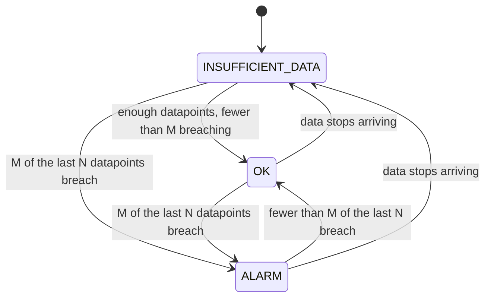
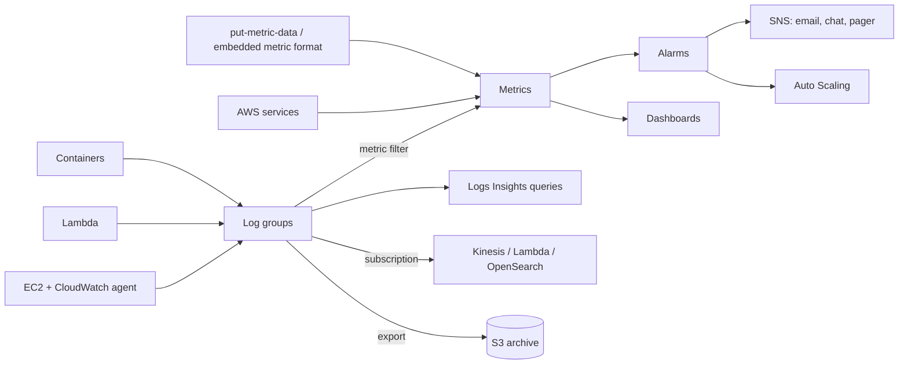

# CloudWatch metrics, logs and alarms

## Before this lesson

You should have launched an instance ([EC2 instances](#/lesson/aws/ec2-instances)) and know what an IAM role is ([IAM identities](#/lesson/aws/iam-identities)). No monitoring background is assumed.

## In plain words

Once a system is running, you need to know whether it is healthy without staring at it. **Amazon CloudWatch** is the AWS service that **collects numbers and text from everything you run, draws them, and tells you when something is wrong**.

A car dashboard is the right picture. The **speedometer and temperature gauge** are *metrics*: numbers measured over and over. The **trip computer's history** is the *log*: a written record of what happened. The **warning light** that comes on when the engine overheats is an *alarm*. A good dashboard lets you drive without opening the bonnet; a good alarm tells you to stop before the engine is ruined.

CloudWatch has three pillars that this lesson covers in turn:

- **Metrics** — numeric measurements over time (CPU at 73 %, 412 requests per minute).
- **Logs** — lines of text emitted by applications and services.
- **Alarms** — rules that watch a metric and act when it crosses a threshold.

Why it matters for a job: "it worked on my machine" ends at production. Whoever operates a service is expected to set up dashboards and alarms, and auto scaling (module 9) is driven entirely by CloudWatch alarms. Interviewers ask, "how would you know this system is unhealthy?"

## Metrics

A **metric** is a time-ordered series of **datapoints**. Each datapoint has a timestamp, a value and a unit. A metric is identified by three things:

- a **namespace** — a container for related metrics, such as `AWS/EC2`, `AWS/RDS`, `AWS/ApplicationELB`, or your own (`Bookshop/Orders`);
- a **metric name** — `CPUUtilization`, `RequestCount`;
- zero or more **dimensions** — name/value pairs that say *which* resource: `InstanceId=i-0abc…`, `LoadBalancer=app/bookshop/…`.

Change any dimension and it is a different metric. `CPUUtilization` for instance A and for instance B are two separate series.

### Period, statistic and resolution

Raw datapoints are aggregated when you read them.

- The **period** is the length of each bucket: 60 seconds, 300 seconds, an hour.
- The **statistic** is how the values in a bucket are combined: `Average`, `Sum`, `Minimum`, `Maximum`, `SampleCount`, or a **percentile** such as `p99`.

A **percentile** deserves a definition: `p99` is the value that 99 % of the measurements fall below. For response times it tells you what the slowest 1 % of users experience. Averages hide trouble: if 95 requests take 100 ms and 5 take 10 seconds, the average is about 600 ms, which describes nobody. **Use percentiles for latency, sums for counts, averages for utilisation.**

- **Resolution**: most AWS services publish datapoints every minute (some every five). *High-resolution* custom metrics can be published down to one-second granularity.
- **Retention**: datapoints are kept for 15 months, but with decreasing detail — one-minute data for 15 days, five-minute data for 63 days, one-hour data for 15 months.

### What you get for free, and what you do not

| Service | Metrics published automatically | Notably missing |
|---|---|---|
| EC2 | CPU utilisation, network in/out, disk operations on instance store, status checks | **Memory and disk-space usage** |
| EBS | Read/write operations and bytes, queue length, burst balance | — |
| RDS | CPU, freeable memory, free storage, connections, IOPS, replica lag | — |
| ALB | Request count, target response time, HTTP 4xx/5xx counts, healthy host count | — |
| Lambda | Invocations, errors, duration, throttles, concurrent executions | — |
| SQS | Messages visible, age of oldest message | — |

The famous gap: **EC2 does not report memory or disk-space usage**, because the hypervisor cannot see inside the operating system. To get them, install the **CloudWatch agent** on the instance. The agent also ships log files.

EC2 **basic monitoring** sends datapoints every five minutes at no charge; **detailed monitoring** sends them every minute for a fee — worth it for instances in an Auto Scaling group that must react quickly.

### Custom metrics

Anything can be a metric: orders placed, items in a cart, queue depth per worker.

```bash
aws cloudwatch put-metric-data --namespace "Bookshop/Orders" \
  --metric-name OrdersPlaced --value 3 --unit Count \
  --dimensions Environment=prod,Channel=web
```

- `--namespace` is yours to choose (anything not starting with `AWS/`).
- `--dimensions` attach context. Be careful: every **unique combination of dimension values is a separate, billed metric**. Putting a user ID or request ID in a dimension creates millions of metrics and a matching bill. That mistake has a name: a **high-cardinality** dimension.

A cheaper and more flexible way to emit custom metrics from applications is the **embedded metric format**: write a specially structured JSON line to the logs and CloudWatch extracts the metrics from it.

### Reading metrics

```bash
aws cloudwatch get-metric-statistics --namespace AWS/EC2 --metric-name CPUUtilization \
  --dimensions Name=InstanceId,Value=i-0a1b2c3d4e5f67890 \
  --start-time 2026-11-21T09:00:00Z --end-time 2026-11-21T09:20:00Z \
  --period 300 --statistics Average Maximum \
  --query "sort_by(Datapoints,&Timestamp)[].[Timestamp,Average,Maximum]" --output table
```

```
+----------------------------+---------+----------+
|  2026-11-21T09:00:00+00:00 |  12.4   |  31.0    |
|  2026-11-21T09:05:00+00:00 |  48.9   |  97.5    |
|  2026-11-21T09:10:00+00:00 |  83.1   |  100.0   |
|  2026-11-21T09:15:00+00:00 |  79.6   |  99.8    |
+----------------------------+---------+----------+
```

Each row is one five-minute bucket. Compare the two columns: at 09:05 the average is under 50 % while the maximum is 97.5 % — the instance was saturated for part of that window, which the average alone would hide.

**Metric math** combines metrics with expressions (error rate = `errors / requests * 100`), and **dashboards** arrange graphs of metrics from any Region and account on one page.

## Alarms

An **alarm** watches one metric (or one metric-math expression) and is always in one of three states:

- **OK** — the condition is not met;
- **ALARM** — the condition is met;
- **INSUFFICIENT_DATA** — not enough datapoints to decide (a new alarm, or the metric stopped arriving).

An alarm is defined by:

- the metric, statistic and **period**;
- a **threshold** and comparison (`>= 80`);
- **evaluation periods** (N): how many recent periods to look at;
- **datapoints to alarm** (M): how many of those N must breach. "3 out of 5" tolerates a single noisy spike and still catches a sustained problem;
- **treatment of missing data**: `missing` (the default: missing points are not counted either way), `notBreaching`, `breaching`, or `ignore` (keep the current state).



### Simulate M out of N

```python-run
def alarm_states(datapoints, threshold, n, m):
    """State after each period for an alarm 'value > threshold, M out of N'."""
    states = []
    for i in range(len(datapoints)):
        if i < n - 1:                                  # window not full yet
            states.append("INSUFFICIENT_DATA")
            continue
        window = datapoints[i - n + 1 : i + 1]         # the last N datapoints
        breaching = sum(1 for v in window if v > threshold)
        states.append("ALARM" if breaching >= m else "OK")
    return states

cpu = [40, 45, 92, 50, 48, 85, 91, 95, 88, 60, 45, 40]
for n, m in ((1, 1), (3, 3), (5, 3)):
    states = alarm_states(cpu, 80, n, m)
    marks = "".join("A" if s == "ALARM" else "." if s == "OK" else "?" for s in states)
    print(f"{m} out of {n}: {marks}")
print("cpu values :", cpu)
```

Reading the code: for each period the function takes the last `n` values, counts how many exceed the threshold, and compares with `m`. The output line shows one character per period (`A` = ALARM, `.` = OK, `?` = insufficient data). With "1 out of 1" the alarm fires on the single spike of 92 and flaps; with "3 out of 3" it waits for three consecutive high readings and clears as soon as one is normal; with "3 out of 5" it ignores the lone spike, fires on the sustained load, and stays in alarm a little longer. Choosing N and M is choosing between **noise** and **delay**. The problem *CloudWatch Alarm State Evaluation* asks you to add the missing-data treatments.

### Alarm actions

When an alarm changes state it can:

- publish to an **SNS topic** — email, SMS, chat tools, paging systems, or a Lambda function;
- trigger an **Auto Scaling** policy (add or remove instances);
- perform an **EC2 action**: stop, terminate, reboot, or **recover** the instance (move it to healthy hardware keeping its ID, IPs and volumes);
- create an incident or operations item in Systems Manager.

A **composite alarm** combines other alarms with AND/OR/NOT, so that you are paged for "high latency AND high error rate", not for each alone. **Anomaly detection** alarms learn a metric's normal daily and weekly pattern and fire when it leaves the expected band — useful when no fixed threshold is right at all hours.

### Worked example: page me when the API is failing

> [!WARNING]
> Standard alarms cost about ten US cents per month each beyond the ten always-free ones; SNS email notifications are free in small volumes. Delete what you create.

```bash
# 1. A topic and an email subscription (confirm the email that arrives).
TOPIC=$(aws sns create-topic --name ops-alerts --query TopicArn --output text)
aws sns subscribe --topic-arn "$TOPIC" --protocol email --notification-endpoint you@example.com

# 2. Alarm when the load balancer returns more than 10 server errors per minute,
#    for 3 of the last 5 minutes. No traffic at all is treated as healthy.
aws cloudwatch put-metric-alarm \
  --alarm-name bookshop-5xx \
  --namespace AWS/ApplicationELB --metric-name HTTPCode_Target_5XX_Count \
  --dimensions Name=LoadBalancer,Value=app/bookshop/50dc6c495c0c9188 \
  --statistic Sum --period 60 \
  --threshold 10 --comparison-operator GreaterThanThreshold \
  --evaluation-periods 5 --datapoints-to-alarm 3 \
  --treat-missing-data notBreaching \
  --alarm-actions "$TOPIC" --ok-actions "$TOPIC"
```

Option by option:

- `--statistic Sum --period 60`: add up the errors in each one-minute bucket.
- `--threshold 10 --comparison-operator GreaterThanThreshold`: a bucket breaches when the sum is above 10.
- `--evaluation-periods 5 --datapoints-to-alarm 3`: "3 out of 5".
- `--treat-missing-data notBreaching`: this metric is only published when errors occur, so *no data means no errors*. With the default setting the alarm would sit in INSUFFICIENT_DATA most of the time.
- `--alarm-actions` and `--ok-actions`: notify on entering ALARM and on recovery.

```bash
# 3. Test the wiring without waiting for a real outage.
aws cloudwatch set-alarm-state --alarm-name bookshop-5xx \
  --state-value ALARM --state-reason "Testing the notification path"
```

An alarm nobody has tested is an assumption.

## Logs

**CloudWatch Logs** stores text output from applications and services.

- A **log event** is one line with a timestamp.
- A **log stream** is the sequence of events from one source (one instance, one container, one Lambda execution environment).
- A **log group** collects streams that share settings: **retention**, encryption and access. Example: `/aws/lambda/checkout`, `/bookshop/api`.

Sources: Lambda (automatic), ECS and EKS containers (via the `awslogs` driver or Fluent Bit), EC2 (via the CloudWatch agent), VPC Flow Logs, Route 53 query logs, API Gateway, CloudTrail, RDS.

> [!WARNING]
> A log group's default retention is **Never expire**. Logs are billed per GB ingested *and* per GB stored each month, so untouched log groups grow the bill for ever. Set a retention period on every group — 30 days is a common default, longer where regulation requires — and export to S3 anything that must be kept cheaply for years.

```bash
aws logs put-retention-policy --log-group-name /bookshop/api --retention-in-days 30

# Follow a log group live, like `tail -f`, filtering for errors.
aws logs tail /bookshop/api --follow --filter-pattern "ERROR" --since 10m
```

```
2026-11-21T10:15:02 i-0a1b2c ERROR payment timeout order=8841 took_ms=30012
2026-11-21T10:15:09 i-0d4e5f ERROR payment timeout order=8843 took_ms=30007
```

### From logs to metrics and insights

- A **metric filter** scans incoming events for a pattern and publishes a metric — count of lines containing `ERROR`, or a number extracted from a field. Alarms can then watch log content.
- **Logs Insights** is a query language for searching and aggregating logs:

```
fields @timestamp, @message
| filter @message like /ERROR/
| parse @message "order=* took_ms=*" as order_id, took_ms
| stats count() as errors, avg(took_ms) as avg_ms by bin(5m)
| sort errors desc
```

Line by line: `fields` chooses columns; `filter` keeps error lines; `parse` pulls two values out of the text; `stats … by bin(5m)` counts errors and averages durations per five-minute bucket; `sort` puts the worst buckets first. You pay per GB of log data scanned, so narrow the time range.

- **Subscription filters** stream matching events in near real time to Lambda, Kinesis or OpenSearch.
- Writing logs as **structured JSON** makes every field directly queryable, with no `parse` needed.



## What to monitor

A widely used starting set for any request-serving system is the four **golden signals**:

| Signal | Question | Example metric |
|---|---|---|
| **Latency** | How long do requests take? | ALB `TargetResponseTime` p95/p99 |
| **Traffic** | How much demand is there? | `RequestCount` |
| **Errors** | How many requests fail? | `HTTPCode_Target_5XX_Count` / requests |
| **Saturation** | How full is the system? | CPU, memory, connections, queue depth |

Alarm on **symptoms users feel** (errors, latency) and page a human for those. Use **causes** (CPU, memory) for dashboards, scaling and diagnosis. An alarm should be **actionable**: if nobody needs to do anything when it fires, it should not wake anyone.

Further CloudWatch features to recognise: **Synthetics** canaries (scripts that test your endpoints on a schedule from outside), **RUM** (real user monitoring in browsers), **Container Insights** and **Lambda Insights**, **Application Signals** (service-level objectives), and **cross-account observability** to view several accounts in one place.

## CloudWatch, CloudTrail and Config

| Service | Records | Question it answers |
|---|---|---|
| CloudWatch | Metrics and logs | Is it healthy and performing? |
| CloudTrail | API calls | Who did what, when? |
| Config | Resource configurations | What did it look like, and is it compliant? |

## Cost notes and free-tier warnings

- **Always free**: basic monitoring metrics from AWS services, 10 custom metrics, 10 alarms, 3 dashboards, 5 GB of log ingestion and storage per month.
- **Custom metrics** are charged per metric per month — each unique dimension combination counts.
- **Detailed monitoring** is charged per instance.
- **Logs**: per GB ingested (the big one), per GB stored, per GB scanned by Insights. Verbose debug logging in production is the commonest cause of a large CloudWatch bill; reduce log level, sample, or use the cheaper *Infrequent Access* log class for logs you rarely query.
- **High-resolution alarms and metrics** cost more than standard ones.

## Pitfalls

- **Expecting memory or disk-space metrics from EC2 without the agent.**
- **Alarming on averages for latency.**
- **"1 out of 1" alarms** that page on every blip — or thresholds so loose that they never fire.
- **Leaving missing-data treatment at the default** for metrics that only exist when something happens.
- **High-cardinality dimensions** in custom metrics.
- **Log groups that never expire.**
- **No alarm on the absence of work**: a queue consumer that died produces no errors at all. Alarm on queue age or on "invocations dropped to zero".
- **Dashboards without alarms**, which only help if someone happens to be looking.

> [!INTERVIEW]
> **"Which EC2 metrics are not available by default, and how do you get them?"** Memory utilisation and disk-space usage, because they are only visible inside the guest operating system. Install the CloudWatch agent, which publishes them as custom metrics and can also ship logs.
>
> **"How would you set up alerting for a web service?"** Alarm on user-facing symptoms — error rate and p99 latency at the load balancer — using M-of-N evaluation to avoid flapping, with missing data treated appropriately, notifying through SNS to an on-call tool; add saturation alarms for scaling and capacity; put logs under retention with metric filters for known error patterns; and test the notification path.

## Cheat sheet

| Item | Remember |
|---|---|
| Metric identity | Namespace + name + dimensions |
| Statistic choice | Percentiles for latency, Sum for counts, Average for utilisation |
| EC2 default interval | 5 min basic, 1 min detailed |
| Not collected by default | Memory, disk space → CloudWatch agent |
| Alarm states | OK, ALARM, INSUFFICIENT_DATA |
| M out of N | Datapoints to alarm out of evaluation periods |
| Missing data | missing, notBreaching, breaching, ignore |
| Alarm actions | SNS, Auto Scaling, EC2 stop/terminate/reboot/recover |
| Log hierarchy | Event → stream → group (retention set on the group) |
| Logs to metrics | Metric filter |
| Search logs | Logs Insights |

## Summary

- CloudWatch collects metrics identified by namespace, name and dimensions, aggregated by period and statistic.
- AWS services publish many metrics automatically; memory and disk space on EC2 need the agent; custom metrics are easy but billed per dimension combination.
- Alarms move between OK, ALARM and INSUFFICIENT_DATA based on M-of-N datapoints and a missing-data rule, and trigger notifications, scaling or instance actions.
- Logs live in log groups with configurable retention, become metrics through filters and are queried with Logs Insights.
- Monitor latency, traffic, errors and saturation; alert on symptoms, and keep alerts actionable.

## Glossary

- **Alarm**: a rule that watches a metric and changes state at a threshold.
- **CloudWatch agent**: software on an instance that publishes OS metrics and logs.
- **Composite alarm**: an alarm computed from other alarms.
- **Datapoint**: one timestamped value of a metric.
- **Dimension**: a name/value pair identifying which resource a metric describes.
- **Embedded metric format**: structured log lines from which metrics are extracted.
- **Golden signals**: latency, traffic, errors, saturation.
- **High cardinality**: having very many distinct values.
- **Log group / stream / event**: collection with shared settings / one source's sequence / one line.
- **Metric filter**: a pattern that turns log events into a metric.
- **Namespace**: a container for metrics.
- **Percentile (p99)**: the value below which 99 % of samples fall.
- **Period**: the aggregation interval of a metric.
- **Statistic**: how datapoints in a period are combined.

```quiz
[
  {"q": "An operations team wants a dashboard of memory utilisation for a fleet of EC2 instances, but the metric is not in the AWS/EC2 namespace. What is required?",
   "options": ["Enable detailed monitoring", "Install and configure the CloudWatch agent on the instances", "Create a metric filter on CloudTrail", "Switch to a larger instance type"],
   "answer": 1,
   "explain": "Memory is only visible inside the operating system. The CloudWatch agent publishes it as a custom metric. Detailed monitoring only changes the interval of the default metrics."},
  {"q": "An alarm on CPU > 80 % with period 60 s and '1 out of 1' datapoints pages the team several times a day for five-second spikes. What is the most appropriate change?",
   "options": ["Delete the alarm", "Use M out of N, for example 3 out of 5 datapoints", "Change the statistic to Minimum and keep 1 out of 1", "Lower the threshold to 50 %"],
   "answer": 1,
   "explain": "Requiring several breaching datapoints within a window filters transient spikes while still catching sustained load."},
  {"q": "A metric is only emitted when errors occur. An alarm on 'Sum > 5' shows INSUFFICIENT_DATA most of the time and never returns to OK. Which setting fixes this?",
   "options": ["Treat missing data as notBreaching", "Treat missing data as breaching", "Increase the threshold", "Use the Average statistic"],
   "answer": 0,
   "explain": "For sparse metrics, no data means no errors. Treating missing datapoints as not breaching lets the alarm rest in OK."},
  {"q": "Why is p99 latency usually a better alarm metric than average latency?",
   "options": ["It is cheaper to compute", "It reveals the slow tail that a small but real share of users experiences, which an average can hide", "It updates more often", "It ignores errors"],
   "answer": 1,
   "explain": "A few very slow requests barely move the average but dominate those users' experience. Percentiles expose the tail."},
  {"q": "A developer adds the customer ID as a dimension on a custom metric published for every request. What is the likely consequence?",
   "options": ["Metrics are rejected", "Each distinct customer ID creates a separate billed metric, causing very high cost", "Dashboards load faster", "The metric becomes high-resolution"],
   "answer": 1,
   "explain": "Every unique dimension combination is its own metric. High-cardinality values such as user or request IDs belong in logs, not dimensions."},
  {"q": "A team's CloudWatch Logs bill grows every month although traffic is flat. What is the most likely cause and fix?",
   "options": ["Alarms are too frequent; delete them", "Log groups have no retention period, so storage accumulates; set retention and archive to S3 if needed", "Metrics are high-resolution; lower them", "Dashboards are shared; unshare them"],
   "answer": 1,
   "explain": "The default retention is never expire. Setting a retention policy caps stored volume; reducing log verbosity cuts ingestion."},
  {"q": "The application writes 'ERROR' lines to a log group. The team wants an alarm when more than 20 such lines appear in five minutes. What do they build?",
   "options": ["A metric filter that counts matching events, then an alarm on that metric", "A Config rule", "A CloudTrail data event", "An SCP"],
   "answer": 0,
   "explain": "Metric filters turn log patterns into CloudWatch metrics, which alarms can then evaluate."},
  {"q": "An EC2 instance fails its system status check because of a hardware problem on the host. Which alarm action restores it with the same instance ID, private IP and EBS volumes?",
   "options": ["Stop", "Terminate", "Recover", "Reboot"],
   "answer": 2,
   "explain": "The recover action migrates the instance to healthy hardware, preserving its identity and attached EBS volumes. A reboot stays on the same host."}
]
```

> **Source:** AWS Certified Solutions Architect Official Study Guide, ch. 5 (Amazon CloudWatch: metrics, alarms, logs). Logs Insights, anomaly detection, composite alarms and the unified agent post-date the book; checked against https://docs.aws.amazon.com/AmazonCloudWatch/latest/monitoring/cloudwatch_concepts.html , https://docs.aws.amazon.com/AmazonCloudWatch/latest/monitoring/AlarmThatSendsEmail.html and https://docs.aws.amazon.com/AmazonCloudWatch/latest/logs/WhatIsCloudWatchLogs.html
