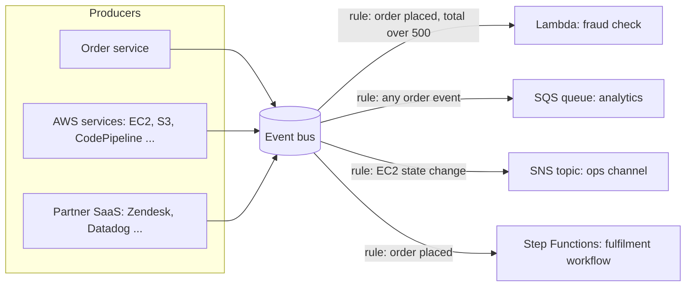
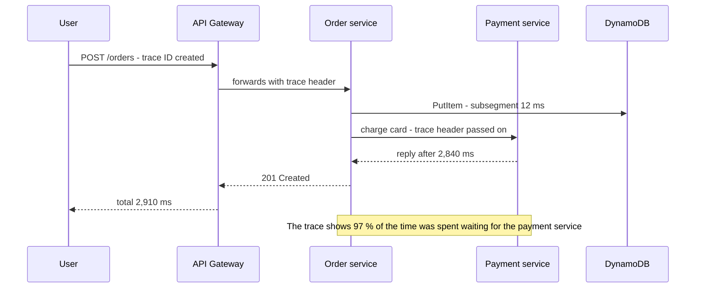

# EventBridge and X-Ray: reacting to events and tracing requests

## Before this lesson

Read [CloudWatch metrics, logs and alarms](#/lesson/aws/cloudwatch) first. You should also know IAM roles and resource-based policies ([IAM identities](#/lesson/aws/iam-identities)). Lambda functions appear as examples; all you need for now is that a Lambda function is a piece of code AWS runs for you when something triggers it ([Lambda](#/lesson/aws/lambda-apigw) covers it fully).

## In plain words

CloudWatch tells you numbers and shows you logs. Two neighbouring services answer different questions.

**Amazon EventBridge** answers: *"when X happens, who should be told, and what should happen next?"* It is a **switchboard for events**. Services announce things that happened — "an instance was terminated", "a file arrived", "an order was placed" — and EventBridge forwards each announcement to whoever asked to hear about that kind of thing. It also works as an alarm clock: "run this every night at 02:00".

Think of an office **noticeboard with a very diligent assistant**. People pin notices on it. They do not know or care who reads them. Colleagues leave standing instructions with the assistant — "tell me about any notice mentioning the printer" — and the assistant delivers copies accordingly.

**AWS X-Ray** answers: *"this request was slow — where did the time go?"* A single click in a modern application may pass through a load balancer, three services, a queue and two databases. X-Ray follows one request through all of them, like the **tracking page for a parcel** that shows every depot it passed and how long it sat in each.

Why it matters for a job: event-driven design is how AWS services are glued together without writing polling loops, and distributed tracing is how you debug anything made of more than one service. Both come up in architecture interviews as "how do these components communicate?" and "how would you find the bottleneck?".

## Events and event-driven architecture

An **event** is a record that something happened: a small JSON document with a source, a type, a time and details. Events are facts about the past; they are not commands.

In a **request-driven** design, service A calls service B and waits. A must know B's address, B must be up, and adding a third interested party means changing A. In an **event-driven** design, A publishes "order placed" and moves on. Any number of consumers react — billing, email, analytics — and A knows none of them. The services are **decoupled**: each can fail, be deployed or be scaled without the others.



## EventBridge building blocks

- An **event bus** receives events. Every account has a **default bus** in each Region, on which AWS services publish their events automatically. You create **custom buses** for your own applications, and **partner buses** receive events from third-party products.
- A **rule** belongs to a bus and has an **event pattern** (which events match) and up to five **targets** (where matching events go).
- A **target** is a destination: Lambda, SQS, SNS, Step Functions, Kinesis, ECS tasks, another event bus (including one in another account or Region), an HTTP endpoint (an *API destination*), and more than twenty other services.

EventBridge was previously called **CloudWatch Events**, and you will still see that name in older material. The default bus and the rule model are the same service under the new name.

### The shape of an event

```json
{
  "version": "0",
  "id": "6a7e8feb-b491-4cf7-a9f1-bf3703467718",
  "detail-type": "EC2 Instance State-change Notification",
  "source": "aws.ec2",
  "account": "111122223333",
  "time": "2026-11-21T10:15:02Z",
  "region": "eu-west-1",
  "resources": ["arn:aws:ec2:eu-west-1:111122223333:instance/i-0a1b2c3d4e5f67890"],
  "detail": {"instance-id": "i-0a1b2c3d4e5f67890", "state": "terminated"}
}
```

The outer fields are the **envelope** and are the same for every event: who published it (`source`), what kind it is (`detail-type`), when and where. The `detail` object is free-form and specific to the event type.

### Event patterns

A pattern is JSON that mirrors the event. A field in the pattern lists the acceptable values; fields not mentioned are not checked.

```json
{
  "source": ["aws.ec2"],
  "detail-type": ["EC2 Instance State-change Notification"],
  "detail": {"state": ["terminated", "stopped"]}
}
```

Reading it: match events whose source is `aws.ec2` **and** whose detail-type is the state-change notification **and** whose `detail.state` is `terminated` **or** `stopped`. The rule is the same as for SNS filter policies, which you will meet in module 9: **different fields are combined with AND; values inside one array with OR**.

Beyond exact values, patterns support operators:

| Operator | Example | Matches |
|---|---|---|
| prefix | `{"prefix": "prod-"}` | strings starting with `prod-` |
| suffix | `{"suffix": ".png"}` | strings ending with `.png` |
| anything-but | `{"anything-but": ["test"]}` | any value except `test` |
| numeric | `{"numeric": [">=", 500]}` | numbers at least 500 |
| exists | `{"exists": false}` | the field is absent |
| wildcard | `{"wildcard": "img/*/thumb.*"}` | glob-style match |

```python-run
def field_matches(allowed, value, present):
    """One pattern field: a list of acceptable values or operator objects (OR between them)."""
    for rule in allowed:
        if isinstance(rule, dict):
            if "exists" in rule and rule["exists"] == present:
                return True
            if present and "prefix" in rule and isinstance(value, str) and value.startswith(rule["prefix"]):
                return True
            if present and "numeric" in rule and isinstance(value, (int, float)):
                op, n = rule["numeric"]
                if {">": value > n, ">=": value >= n, "<": value < n, "<=": value <= n, "=": value == n}[op]:
                    return True
        elif present and rule == value:
            return True
    return False

def matches(pattern, event):
    """Every field in the pattern must match (AND); nested objects are matched recursively."""
    for key, expected in pattern.items():
        if isinstance(expected, dict):
            if not matches(expected, event.get(key, {})):
                return False
        elif not field_matches(expected, event.get(key), key in event):
            return False
    return True

event = {"source": "bookshop.orders", "detail-type": "OrderPlaced",
         "detail": {"total": 640, "country": "FR", "channel": "web"}}

rules = {
    "fraud-check":   {"source": ["bookshop.orders"], "detail": {"total": [{"numeric": [">=", 500]}]}},
    "analytics":     {"source": [{"prefix": "bookshop."}]},
    "us-warehouse":  {"detail-type": ["OrderPlaced"], "detail": {"country": ["US", "CA"]}},
    "no-coupon":     {"detail": {"coupon": [{"exists": False}]}},
}
for name, pattern in rules.items():
    print(f"{name:13s} ->", "MATCH" if matches(pattern, event) else "no match")
```

Line by line: `field_matches` tries each entry of a pattern array and returns as soon as one matches (OR); `matches` requires every pattern key to match, descending into nested objects such as `detail` (AND). The sample order of 640 from France triggers the fraud check, the analytics rule and the no-coupon rule (the `coupon` field is absent), but not the US warehouse rule.

### Schedules

**EventBridge Scheduler** runs targets on a timetable, replacing a server whose only job is `cron`:

- **rate** expressions: `rate(5 minutes)`, `rate(1 day)`;
- **cron** expressions with six fields: `cron(0 2 * * ? *)` means 02:00 every day (minute, hour, day-of-month, month, day-of-week, year), in a time zone you choose;
- **one-time** schedules: `at(2026-12-24T18:00:00)`.

Typical uses: stop development instances every evening, start a nightly batch, send a reminder 24 hours after sign-up.

### Reliability features

- Delivery is **at least once**. A target may occasionally receive the same event twice, so targets should be **idempotent** (handling a duplicate does no harm) — for example by recording the event `id`.
- Failed deliveries are **retried** with backoff for up to 24 hours; after that the event can go to a **dead-letter queue** (an SQS queue that holds events that could not be delivered) so that it is not lost.
- An **archive** stores events on a bus, and **replay** sends archived events through the rules again — to recover from a bug in a consumer or to test a new one with real history.
- **Input transformers** reshape the event before it reaches the target, and the **schema registry** documents event structures and generates code bindings.
- **EventBridge Pipes** connect one source (an SQS queue, a DynamoDB or Kinesis stream) to one target with optional filtering and enrichment, replacing glue code.

### Worked example: tell the team when an instance is terminated

> [!WARNING]
> Custom events and Scheduler invocations are charged per million; events from AWS services on the default bus are free. At learning volumes the cost is zero, but the SNS topic and rule should still be deleted afterwards.

```bash
# 1. The rule with its pattern.
aws events put-rule --name ec2-terminated \
  --event-pattern '{
    "source": ["aws.ec2"],
    "detail-type": ["EC2 Instance State-change Notification"],
    "detail": {"state": ["terminated"]}
  }'

# 2. The target: an existing SNS topic, with a transformer that writes a readable sentence.
aws events put-targets --rule ec2-terminated --targets '[{
  "Id": "notify-ops",
  "Arn": "arn:aws:sns:eu-west-1:111122223333:ops-alerts",
  "InputTransformer": {
    "InputPathsMap": {"id": "$.detail.instance-id", "when": "$.time"},
    "InputTemplate": "\"Instance <id> was terminated at <when>.\""
  }
}]'
```

- `put-rule` creates the rule on the default bus (no `--event-bus-name` given).
- `InputPathsMap` picks values out of the event using JSON paths (`$.detail.instance-id`), and `InputTemplate` places them in a sentence.
- One more piece is needed and often forgotten: the SNS topic's **resource policy** must allow `events.amazonaws.com` to publish to it. EventBridge uses resource-based policies for SNS, SQS and Lambda targets, and an **IAM role** for targets such as Step Functions, Kinesis or ECS.

```bash
# 3. Check a pattern against a sample event before trusting it.
aws events test-event-pattern \
  --event-pattern '{"source":["aws.ec2"],"detail":{"state":["terminated"]}}' \
  --event file://sample-event.json
```

```
{ "Result": true }
```

Publishing your own events uses `put-events`:

```bash
aws events put-events --entries '[{
  "EventBusName": "bookshop",
  "Source": "bookshop.orders",
  "DetailType": "OrderPlaced",
  "Detail": "{\"orderId\": \"8841\", \"total\": 640, \"country\": \"FR\"}"
}]'
```

### EventBridge next to SNS and SQS

| | EventBridge | SNS | SQS |
|---|---|---|---|
| Model | Bus with content-based routing rules | Topic with fan-out to subscribers | Queue polled by consumers |
| Filtering | On any field of the event body | On message attributes or body | None (consumer decides) |
| Sources | AWS services, SaaS partners, your apps | Your apps and some AWS services | Your apps |
| Targets | 20+ AWS services, HTTP endpoints, other buses | Lambda, SQS, HTTP, email, SMS, mobile push | — |
| Throughput and latency | Moderate; about half a second | Very high; low latency | Very high |
| Extras | Scheduling, archive and replay, schema registry | FIFO topics, SMS and email delivery | Buffering, visibility timeout, DLQ |

A common combination: EventBridge routes an event to an **SQS queue**, and a consumer works through the queue at its own pace. Module 9 treats SQS and SNS in depth.

## X-Ray: distributed tracing

### Why logs and metrics are not enough

A metric says "p99 latency rose to 3 seconds". Logs from six services each show a slice of the story. Neither says, for one specific slow request, *which hop took the 3 seconds*. **Distributed tracing** does.

### Concepts

- A **trace** is the complete journey of one request. It has a **trace ID**.
- Each service that handles the request records a **segment**: its name, start and end time, success or error.
- Inside a segment, **subsegments** record individual pieces of work — a call to DynamoDB, an HTTP request to another service, a SQL query.
- The trace ID travels with the request in an HTTP header (`X-Amzn-Trace-Id`, or the W3C standard `traceparent`). Passing it on is called **context propagation**, and it is what lets segments from different services be stitched into one trace.
- **Annotations** are indexed key/value pairs you add (customer tier, order ID) so that traces can be searched; **metadata** is extra, unindexed detail.
- The **service map** (now shown in the CloudWatch console as the *trace map*) is a diagram built from traces: nodes are services, edges are calls, each coloured by error rate and labelled with latency.



### How data gets in

- **Managed services**: switch on *active tracing* for Lambda and API Gateway with one setting; they emit segments themselves.
- **Your code**: an instrumentation library wraps the AWS SDK and HTTP clients and records subsegments automatically. AWS's recommended path is **OpenTelemetry**, an open, vendor-neutral standard, using the *AWS Distro for OpenTelemetry*; the older X-Ray SDKs still work.
- On EC2 and containers, a small process (the X-Ray daemon or the OpenTelemetry collector, both included in the CloudWatch agent) receives segments locally and forwards them in batches. The instance or task role needs permission to write traces.

```python
from aws_xray_sdk.core import xray_recorder, patch_all

patch_all()                                   # 1. auto-instrument boto3, requests, database drivers

@xray_recorder.capture("price_basket")        # 2. record this function as a subsegment
def price_basket(basket):
    xray_recorder.current_subsegment().put_annotation("items", len(basket))   # 3. searchable field
    return sum(item["price"] * item["qty"] for item in basket)
```

1. `patch_all()` wraps supported libraries so that every AWS call and outbound HTTP request becomes a subsegment with no further code.
2. The decorator times `price_basket` and records exceptions.
3. The annotation makes it possible to filter traces by basket size later.

### Sampling

Recording every request would be costly and unnecessary. X-Ray **samples**: by default it records the first request each second and 5 % of the rest. Sampling rules can raise the rate for an important route or for errors and lower it for health checks. The consequence to remember: **a trace may not exist for a given request**; tracing shows patterns and examples, while logs and metrics remain the complete record.

Find what you need with filter expressions, for example:

```
service("order-service") AND responsetime > 2 AND annotation.customer_tier = "gold"
```

### Metrics, logs and traces together

These three are called the **pillars of observability**.

| Pillar | Tells you | AWS tool |
|---|---|---|
| Metrics | *That* something is wrong, and how much | CloudWatch metrics and alarms |
| Traces | *Where* in the chain of services | X-Ray |
| Logs | *Why*, in detail, at that place | CloudWatch Logs |

A typical investigation: an alarm fires on p99 latency → the trace map shows the payment service edge in red → one slow trace shows a 2.8-second call → that service's logs for the trace ID show a retry storm against a card processor. Including the trace ID in every log line is what makes the last jump easy.

## Cost notes and free-tier warnings

- **EventBridge**: events published by AWS services to the default bus are free; custom and partner events, cross-account delivery, archive storage, replay, Pipes and Scheduler invocations are charged per million (Scheduler has a generous monthly free allowance).
- **X-Ray**: charged per million traces recorded and per million retrieved or scanned, with a monthly free allowance (100,000 recorded traces). Sampling is the cost control.
- The real costs are downstream: every matched event invokes a target. A rule with an overly broad pattern, or two rules that trigger each other, can generate millions of Lambda invocations.

## Pitfalls

- **An event loop**: a rule reacts to an S3 or DynamoDB change by making another change that matches the same rule. Guard with a narrower pattern or a marker field.
- **A pattern that is too broad** (`{"source": ["aws.ec2"]}`) or misspelt — a typo in a field name silently matches nothing. Test with `test-event-pattern`.
- **Missing permissions on the target**: the rule matches, nothing arrives. Check the target's resource policy or the rule's role, and the rule's `FailedInvocations` metric.
- **No dead-letter queue**, so undeliverable events vanish after the retry window.
- **Non-idempotent targets** that charge a card twice when an event is delivered twice.
- **Expecting cron in local time** when the schedule was created in UTC.
- **Tracing only one service**: without context propagation in every hop the trace is cut into unrelated pieces.
- **Expecting every request to have a trace** despite sampling.

> [!INTERVIEW]
> **"How would you run a task every night without a server?"** An EventBridge Scheduler schedule with a cron expression targeting a Lambda function, an ECS task or a Step Functions state machine, with a retry policy and a dead-letter queue.
>
> **"Users report intermittent slowness in a microservice application. How do you find the cause?"** Start from latency percentiles per service to confirm and scope it; open the trace map to see which dependency shows high latency or errors; inspect slow traces to find the specific subsegment; then read that component's logs filtered by trace ID. Without tracing in place, add OpenTelemetry instrumentation with context propagation first.

## Cheat sheet

| Need | Use |
|---|---|
| React to an AWS resource change | EventBridge rule on the default bus |
| Route application events by content to many consumers | Custom event bus with rules |
| Run something on a schedule | EventBridge Scheduler (rate, cron, one-time) |
| Re-process past events | Archive and replay |
| Do not lose undeliverable events | Dead-letter queue on the target |
| Connect a stream or queue to a target with filtering | EventBridge Pipes |
| See where a request spent its time | X-Ray trace |
| See how services depend on each other | Trace (service) map |
| Search traces by business field | Annotations |
| Control tracing cost | Sampling rules |

## Summary

- EventBridge is a serverless event bus: producers publish events, rules match them with JSON patterns, and targets receive them; fields are ANDed and values within a field ORed.
- The default bus carries AWS service events; custom and partner buses carry your own and third-party events; Scheduler runs targets on timetables.
- Delivery is at least once with retries, dead-letter queues, archive and replay — so consumers must be idempotent.
- X-Ray traces individual requests across services using a propagated trace ID, producing segments, subsegments and a service map.
- Metrics say that something is wrong, traces say where, logs say why.

## Glossary

- **Annotation**: an indexed key/value pair on a trace, usable in searches.
- **At-least-once delivery**: every event is delivered, possibly more than once.
- **Context propagation**: passing the trace ID along with a request.
- **Dead-letter queue (DLQ)**: a queue that keeps messages or events that could not be processed.
- **Decoupling**: letting components work without direct knowledge of each other.
- **Event**: a record of something that happened.
- **Event bus**: the channel that receives events and applies rules.
- **Event pattern**: the JSON filter of a rule.
- **Idempotent**: safe to perform more than once.
- **OpenTelemetry**: an open standard for traces, metrics and logs.
- **Rule / target**: a pattern or schedule / the destination it sends matches to.
- **Sampling**: recording only a share of requests.
- **Segment / subsegment**: a service's part of a trace / a unit of work inside it.
- **Trace**: the end-to-end record of one request.

```quiz
[
  {"q": "A rule has the pattern {\"source\": [\"aws.s3\"], \"detail\": {\"bucket\": {\"name\": [\"invoices\", \"reports\"]}}}. Which event matches?",
   "options": ["Source aws.s3, bucket name 'invoices'", "Source aws.ec2, bucket name 'invoices'", "Source aws.s3, bucket name 'logs'", "Any event from aws.s3"],
   "answer": 0,
   "explain": "Fields are combined with AND and the values in an array with OR: the source must be aws.s3 and the bucket name must be invoices or reports."},
  {"q": "A team wants development EC2 instances stopped every weekday at 19:00 without running a scheduler server. What should they use?",
   "options": ["A cron job on one of the instances", "EventBridge Scheduler with a cron expression invoking a Lambda function or the EC2 StopInstances API", "A CloudWatch dashboard", "An S3 lifecycle rule"],
   "answer": 1,
   "explain": "EventBridge Scheduler provides serverless cron, rate and one-time schedules with retries, and can call AWS APIs directly."},
  {"q": "A Lambda target occasionally processes the same EventBridge event twice and sends duplicate emails. What is the correct fix?",
   "options": ["Disable retries", "Make the function idempotent, for example by recording processed event IDs", "Switch to a custom bus", "Add a second rule"],
   "answer": 1,
   "explain": "EventBridge guarantees at-least-once delivery, so duplicates are possible by design. Consumers must tolerate them."},
  {"q": "An EventBridge rule matches events (the MatchedEvents metric rises) but the SQS queue target stays empty. What is the most likely cause?",
   "options": ["The pattern is wrong", "The queue's resource policy does not allow events.amazonaws.com to send messages", "SQS cannot be a target", "Events are delayed by 24 hours"],
   "answer": 1,
   "explain": "Matched but undelivered points at target permissions. For SQS, SNS and Lambda targets the target's resource-based policy must allow EventBridge."},
  {"q": "After a bug fix in an order-processing consumer, the team wants to re-run last night's order events through it. Which EventBridge feature supports this?",
   "options": ["Input transformer", "Archive and replay", "Schema registry", "API destinations"],
   "answer": 1,
   "explain": "An archive retains events from a bus and a replay re-sends a time range of them through the rules."},
  {"q": "A request passes through API Gateway, two Lambda functions and DynamoDB and takes four seconds. Which tool shows how long each hop took for that request?",
   "options": ["CloudTrail", "AWS Config", "AWS X-Ray", "Trusted Advisor"],
   "answer": 2,
   "explain": "X-Ray records segments and subsegments for each service handling a request and assembles them into a trace with timings."},
  {"q": "A service is instrumented with X-Ray, but its traces never connect to the upstream service's traces. What is missing?",
   "options": ["A larger sampling rate", "Propagation of the trace header from the upstream call to the downstream service", "A VPC endpoint", "CloudTrail data events"],
   "answer": 1,
   "explain": "Segments are joined by the trace ID carried in the request header. If a hop does not pass it on, the downstream work starts a new, unrelated trace."},
  {"q": "An engineer cannot find a trace for one specific slow request although tracing is enabled. What is the most likely explanation?",
   "options": ["X-Ray keeps traces for only five minutes", "The request was not sampled; X-Ray records a subset of requests by default", "Traces are only stored for errors", "The request used HTTPS"],
   "answer": 1,
   "explain": "By default X-Ray records the first request each second plus a small percentage of the rest. Adjust sampling rules for important routes."}
]
```

> **Source:** AWS Certified Solutions Architect Official Study Guide, ch. 5 (Amazon CloudWatch, including CloudWatch Events) and ch. 14 (loose coupling). EventBridge buses, Scheduler, Pipes and X-Ray post-date the book; checked against https://docs.aws.amazon.com/eventbridge/latest/userguide/eb-what-is.html , https://docs.aws.amazon.com/eventbridge/latest/userguide/eb-event-patterns.html , https://docs.aws.amazon.com/scheduler/latest/UserGuide/what-is-scheduler.html and https://docs.aws.amazon.com/xray/latest/devguide/aws-xray.html
