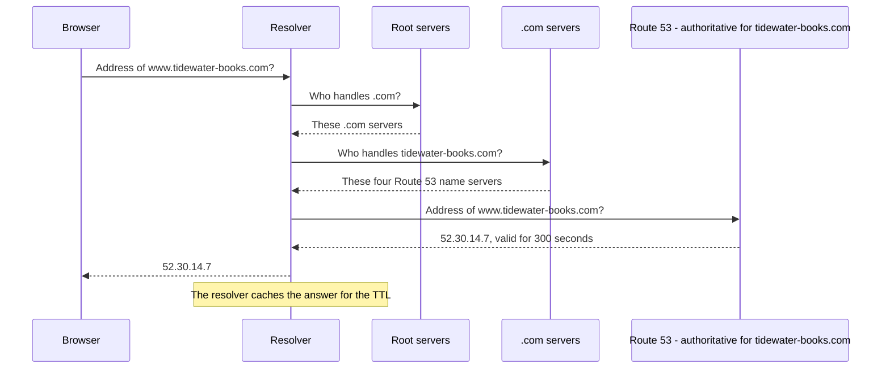
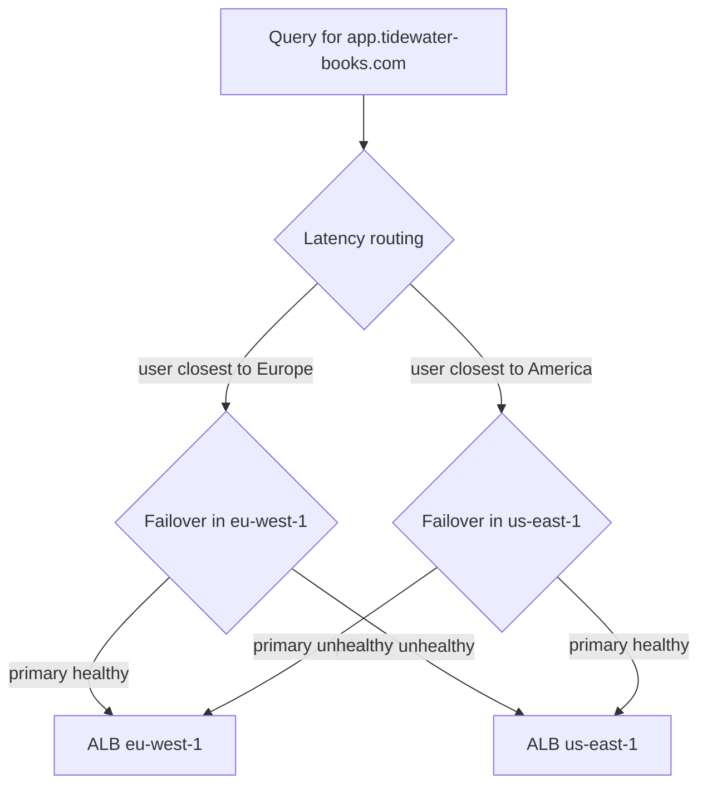

# DNS and Route 53: records and routing policies

## Before this lesson

You should know Regions and edge locations ([the AWS global map](#/lesson/aws/what-is-cloud)) and what a load balancer and a public IP address are in outline ([VPC basics](#/lesson/aws/vpc-basics)). For a deeper treatment of DNS itself, see the networking track's [DNS resolution](#/lesson/networking/dns-resolution) lesson; this one explains what it needs.

## In plain words

Computers find each other by number — an IP address like `52.30.14.7`. People remember names — `tidewater-books.com`. The **Domain Name System (DNS)** is the internet's **phone book**: it turns names into numbers.

**Amazon Route 53** is AWS's DNS service. It does three jobs:

1. **Domain registration** — buying a name such as `tidewater-books.com`.
2. **DNS hosting** — answering the question "what is the address of `www.tidewater-books.com`?" for the whole world.
3. **Health checking and traffic routing** — choosing *which* address to give, depending on who asks and which of your servers are alive.

The third job is what makes Route 53 more than a phone book. Imagine a receptionist for a company with several offices. A caller asks for "sales". The receptionist can always give the head-office number (simple routing), or the number of the office nearest the caller (latency or geolocation routing), or send nine callers in ten to the main office and one in ten to a new one being trialled (weighted routing), or give the backup office's number when the main one does not pick up (failover routing).

The name "53" comes from the network port DNS uses.

Why it matters for a job: every public application has a DNS name, and DNS is the tool for directing users between Regions and for failing over when a site dies. The routing policies are a staple of AWS exams.

## How DNS works

Names are read right to left, each dot separating a level:

```
www . tidewater-books . com .
 |          |            |   |
host   second-level     TLD  root
```

- The **root** is the top of the tree.
- **Top-level domains (TLDs)** are `.com`, `.org`, `.fr`, `.io` and so on.
- A **registrar** sells names under a TLD and records which **name servers** are in charge of each name.
- An **authoritative name server** holds the actual records for a domain and gives the definitive answer.
- A **resolver** (run by your internet provider, your company, or a public service) does the looking-up on behalf of your device and **caches** answers.



### TTL

Every answer carries a **time to live (TTL)**: the number of seconds a resolver may reuse it without asking again.

- A **long TTL** (hours, a day) means fewer queries and faster lookups, but changes spread slowly.
- A **short TTL** (60 seconds) means changes and failovers take effect quickly, at the cost of more queries.

A change you make in Route 53 is live on its own servers within about a minute. The world sees it only as old cached answers expire. Before a planned migration, lower the TTL a day ahead; afterwards, raise it again.

## Hosted zones and records

A **hosted zone** is Route 53's container for the records of one domain.

- A **public hosted zone** answers queries from the internet. When you create one, Route 53 assigns four name servers; the registrar must list them for the domain (automatic if Route 53 is also the registrar).
- A **private hosted zone** answers only inside VPCs you associate with it. It lets internal services use names such as `db.internal.tidewater` that do not exist on the internet. The VPC needs DNS support and DNS hostnames enabled.

A **record** maps a name to a value. The types you must know:

| Type | Maps a name to | Example value |
|---|---|---|
| **A** | An IPv4 address | `52.30.14.7` |
| **AAAA** | An IPv6 address | `2a05:d018:…` |
| **CNAME** | Another name ("canonical name") | `d111abcdef8.cloudfront.net` |
| **MX** | Mail servers, with priorities | `10 mail.example.com` |
| **TXT** | Free text; used to prove domain ownership and for email authentication (SPF, DKIM) | `"v=spf1 include:amazonses.com ~all"` |
| **NS** | The name servers responsible for the zone | `ns-123.awsdns-15.com` |
| **SOA** | "Start of authority": administrative data about the zone | — |
| **SRV** | Host and port of a service | `10 5 5060 sip.example.com` |
| **CAA** | Which certificate authorities may issue certificates for the domain | `0 issue "amazon.com"` |
| **PTR** | Reverse lookup: address to name | — |

### CNAME versus Alias

A **CNAME** says "this name is another name; look that up instead". It has one important restriction from the DNS standard: **a CNAME cannot exist at the top of a zone** (the *zone apex* or *naked domain*, `tidewater-books.com` without `www`), because the apex must also hold NS and SOA records and a CNAME may not share a name with anything else.

That is a real problem, because AWS resources such as load balancers and CloudFront distributions are known by a DNS name, not by a fixed IP address. Route 53 solves it with **Alias records**, a Route 53 extension:

| | CNAME | Alias |
|---|---|---|
| Points to | Any DNS name | Specific AWS resources: ALB/NLB, CloudFront, API Gateway, S3 website endpoints, Global Accelerator, VPC interface endpoints, another record in the same zone |
| Allowed at the zone apex | **No** | **Yes** |
| Query charge | Charged | **Free** for aliases to AWS resources |
| What the client sees | A CNAME, then a second lookup | An A/AAAA answer directly |
| TTL | You set it | Inherited from the target |

The practical rule: **for an AWS resource, use an Alias record** — required at the apex and better everywhere else. An alias cannot point to an EC2 instance's DNS name; for a single instance use an A record with its Elastic IP.

## Health checks

A **health check** tells Route 53 whether an endpoint is working so that routing policies can avoid broken ones. Three kinds:

- **Endpoint checks**: Route 53's checkers in several locations around the world request an IP address or domain name over HTTP, HTTPS or TCP every 30 seconds (or 10 with *fast* checks). The endpoint is healthy when enough checkers get a good response (status 2xx or 3xx, optionally with a required string in the body). After a number of consecutive failures (the *failure threshold*, 3 by default) it is marked unhealthy.
- **Calculated checks**: combine other checks ("healthy if at least 2 of these 3 are").
- **CloudWatch alarm checks**: follow the state of an alarm — the way to check resources in private subnets that the public checkers cannot reach.

Endpoint checks come from the public internet, so the target's security group must admit the Route 53 health-checker address ranges. For **alias records**, set *Evaluate target health* instead: Route 53 then uses the health the load balancer already knows, with no separate check.

## Routing policies

A **routing policy** decides which record Route 53 returns when several exist for the same name and type.

| Policy | How the answer is chosen | Use it for |
|---|---|---|
| **Simple** | The one record (if it holds several values, all are returned in random order) | A single resource |
| **Weighted** | In proportion to weights you assign | Gradual rollouts, A/B tests, blue/green shifts |
| **Latency** | The record whose Region gives the user the lowest network latency | Multi-Region applications, performance |
| **Failover** | The primary while healthy, otherwise the secondary | Active-passive disaster recovery |
| **Geolocation** | By the user's country, continent or US state | Legal restrictions, localisation |
| **Geoproximity** | By geographic distance, shiftable with a *bias* | Moving load gradually between Regions |
| **Multivalue answer** | Up to eight healthy records chosen at random | Basic client-side load spreading with health checks |
| **IP-based** | By the client's IP range (CIDR blocks you list) | Routing by network or ISP |

Details and traps for each:

**Weighted.** A record's share is its weight divided by the sum of weights: weights 90 and 10 give 90 % and 10 %. Weight 0 removes a record from rotation. Unhealthy records are skipped and their share redistributed. Because of caching, the split is statistical, not exact.

**Latency.** Route 53 uses its own measurements of latency between networks and AWS Regions. The lowest-latency Region is not always the geographically nearest.

**Failover.** Exactly one primary and one secondary. The primary needs a health check (or *evaluate target health*). When it fails, answers switch to the secondary; clients move as their cached answers expire — hence short TTLs on failover records.

**Geolocation.** Matches the most specific location first: state, then country, then continent, then a **default** record. Without a default record, users in unlisted locations get no answer at all — a classic mistake. This policy is about *where the user is*, not about speed.

**Latency versus geolocation** is a favourite exam contrast: latency routing optimises performance; geolocation enforces a rule about location (for instance "German users must be served from Frankfurt for legal reasons", or showing a country-specific site).

**Multivalue.** Not a substitute for a load balancer: it returns several addresses and the client picks one, but unlike simple routing it omits unhealthy ones.

Policies can be **nested** using alias records — for example, latency routing between Regions, with a failover pair inside each Region. **Traffic Flow** is a visual editor for building such trees.



### Simulate weighted and failover routing

```python-run
import random
random.seed(42)

def weighted(records):
    """Pick one healthy record in proportion to its weight."""
    live = [r for r in records if r["healthy"] and r["weight"] > 0]
    if not live:                       # everything unhealthy: answer anyway
        live = [r for r in records if r["weight"] > 0]
    roll = random.randrange(sum(r["weight"] for r in live))
    for r in live:
        if roll < r["weight"]:
            return r["value"]
        roll -= r["weight"]

def failover(primary, secondary):
    if primary["healthy"] or not secondary["healthy"]:
        return primary["value"]
    return secondary["value"]

blue  = {"value": "blue-alb",  "weight": 90, "healthy": True}
green = {"value": "green-alb", "weight": 10, "healthy": True}

answers = [weighted([blue, green]) for _ in range(10_000)]
print("canary 90/10      :", {v: answers.count(v) for v in ("blue-alb", "green-alb")})

green["healthy"] = False
answers = [weighted([blue, green]) for _ in range(10_000)]
print("green unhealthy   :", {v: answers.count(v) for v in ("blue-alb", "green-alb")})

primary, standby = {"value": "eu-west-1", "healthy": True}, {"value": "us-east-1", "healthy": True}
print("failover, all well:", failover(primary, standby))
primary["healthy"] = False
print("primary down      :", failover(primary, standby))
standby["healthy"] = False
print("both down         :", failover(primary, standby), "(Route 53 still answers with the primary)")
```

Line by line: `weighted` keeps the healthy records, draws a random number below the total weight and walks the list until the number falls inside a record's slice; with ten thousand draws the split is close to 9,000 / 1,000. Marking green unhealthy sends everything to blue. `failover` returns the primary unless it is unhealthy *and* the secondary is healthy; when both are down Route 53 answers with the primary instead of returning nothing. The problem *Route 53 Routing Policy Resolution* extends this to latency, geolocation and multivalue.

## Worked example: apex alias and a failover pair

> [!WARNING]
> A hosted zone costs about USD 0.50 per month, each health check about USD 0.50–0.75, and registering a domain costs a yearly fee that is **not refundable**. Use a domain you already own or a private hosted zone for practice.

Route 53 changes are sent as a **change batch** — a JSON list of actions.

```json
{
  "Comment": "Apex alias to the load balancer",
  "Changes": [{
    "Action": "UPSERT",
    "ResourceRecordSet": {
      "Name": "tidewater-books.com",
      "Type": "A",
      "AliasTarget": {
        "HostedZoneId": "Z32O12XQLNTSW2",
        "DNSName": "dualstack.bookshop-123456.eu-west-1.elb.amazonaws.com",
        "EvaluateTargetHealth": true
      }
    }
  }]
}
```

- `UPSERT` creates the record or replaces it if it exists (`CREATE` and `DELETE` are the other actions).
- The record is of type `A` at the apex; instead of an IP address it carries an `AliasTarget`.
- `HostedZoneId` here is **the load balancer's** zone ID (a fixed value per Region and load balancer type), not your own zone's.
- `EvaluateTargetHealth: true` makes the alias unhealthy when the load balancer has no healthy targets.

```bash
aws route53 change-resource-record-sets --hosted-zone-id Z0123456789ABCDEFGHIJ \
  --change-batch file://apex-alias.json
```

```
{ "ChangeInfo": { "Id": "/change/C2682N5HXP0BZ4", "Status": "PENDING", ... } }
```

`PENDING` becomes `INSYNC` when all Route 53 servers have the change, usually within a minute.

A failover pair for `api.tidewater-books.com` uses two records with the same name, each with a `SetIdentifier` and a `Failover` role:

```json
{"Name": "api.tidewater-books.com", "Type": "A", "SetIdentifier": "primary-eu",
 "Failover": "PRIMARY", "TTL": 60, "HealthCheckId": "abcd-1234",
 "ResourceRecords": [{"Value": "52.30.14.7"}]}
```

```json
{"Name": "api.tidewater-books.com", "Type": "A", "SetIdentifier": "secondary-us",
 "Failover": "SECONDARY", "TTL": 60,
 "ResourceRecords": [{"Value": "3.220.9.41"}]}
```

`SetIdentifier` distinguishes records that share a name and type; every non-simple policy requires it. The 60-second TTL keeps failover quick.

```bash
# Check what the world sees.
dig +short api.tidewater-books.com
dig +noall +answer tidewater-books.com
```

```
52.30.14.7
tidewater-books.com.   60   IN   A   54.72.11.90
tidewater-books.com.   60   IN   A   52.18.203.4
```

`dig` is the standard DNS lookup tool. The second answer shows the alias resolved to the load balancer's current addresses, with the remaining TTL in the second column.

## Other Route 53 capabilities

- **Route 53 Resolver** is the DNS service inside every VPC (at the VPC base address plus two). **Resolver endpoints** connect it to on-premises DNS: *inbound* endpoints let the office resolve names in your private zones; *outbound* endpoints with forwarding rules let VPC workloads resolve the office's internal names.
- **Resolver DNS Firewall** blocks lookups of known malicious domains from your VPCs.
- **DNSSEC signing** lets resolvers verify that answers were not forged.
- **Application Recovery Controller** adds routing controls and readiness checks for carefully managed multi-Region failover.
- The **availability design goal is 100 %** for the DNS query service: answering queries is a globally distributed data plane, which is why DNS is trusted as the failover mechanism of last resort.

## Cost notes and free-tier warnings

- **Hosted zone**: monthly fee each (the first 25 at the standard rate).
- **Queries**: per million; latency, geo and IP-based queries cost more than standard ones; **alias queries to AWS resources are free**.
- **Health checks**: monthly per check, more for HTTPS, string matching, fast interval, and endpoints outside AWS.
- **Domain registration**: yearly, by TLD.
- **Resolver endpoints**: hourly per network interface plus per million queries — they add up if left running.
- Very short TTLs multiply query counts.

## Pitfalls

- **A CNAME at the zone apex.** Use an Alias.
- **A CNAME to a load balancer where an Alias would be free and faster.**
- **Geolocation without a default record**, leaving unlisted locations with no answer.
- **Confusing latency with geolocation routing.**
- **Failover records with long TTLs**: users keep the dead address for hours.
- **Health checks blocked by the endpoint's security group**, making a healthy site look dead.
- **Treating DNS as a load balancer.** Clients and resolvers cache; distribution is approximate and slow to change. Use it to choose between Regions or stacks, and load balancers within them.
- **Forgetting to update the registrar's name servers** after creating a new hosted zone: the records exist and nobody is asked for them.
- **A private hosted zone that does not resolve**: the VPC is not associated, or DNS hostnames/support are disabled.

> [!INTERVIEW]
> **"What is the difference between a CNAME and an Alias record?"** A CNAME maps a name to another name, cannot be used at the zone apex and is charged per query. An Alias is a Route 53 feature that maps a name — including the apex — directly to an AWS resource such as a load balancer or CloudFront distribution; it returns A/AAAA answers, follows the resource's changing IPs, can evaluate target health, and queries are free.
>
> **"Design DNS for an application running in two Regions."** Latency-based alias records to each Region's load balancer with *evaluate target health* (active-active), or failover records with a health check on the primary (active-passive); short TTLs; health checks that test a meaningful endpoint, not only that the port is open; and a plan for data replication, because DNS moves users, not databases.

## Cheat sheet

| Requirement | Policy / feature |
|---|---|
| One resource | Simple |
| 10 % of users to a new version | Weighted |
| Fastest Region for each user | Latency |
| Standby site when the primary is down | Failover + health check |
| Users in country X must go to site Y | Geolocation (with a default record) |
| Shift load gradually between Regions | Geoproximity with bias |
| Several IPs, skip unhealthy ones | Multivalue answer |
| Naked domain to a load balancer or CloudFront | Alias A/AAAA record |
| Internal names inside VPCs | Private hosted zone |
| Resolve between on-premises and VPC | Resolver inbound and outbound endpoints |
| Faster failover | Lower TTL |

## Summary

- DNS resolves names to addresses through a hierarchy of servers; resolvers cache answers for the TTL, which governs how fast changes spread.
- Route 53 registers domains, hosts public and private zones, and runs health checks.
- Alias records point names — including the zone apex — at AWS resources at no query charge; CNAMEs cannot be used at the apex.
- Routing policies choose among records: simple, weighted, latency, failover, geolocation, geoproximity, multivalue and IP-based, and they can be nested.
- DNS steers users between Regions and stacks; use short TTLs and meaningful health checks for failover.

## Glossary

- **Alias record**: a Route 53 record that points directly to an AWS resource.
- **Authoritative name server**: the server holding a domain's records.
- **CNAME**: a record mapping a name to another name.
- **Failure threshold**: consecutive failed checks before an endpoint is unhealthy.
- **Health check**: a periodic test of an endpoint's availability.
- **Hosted zone**: Route 53's container of records for a domain (public or private).
- **Name server (NS)**: a server that answers DNS queries for a zone.
- **Record**: a mapping from a name to a value of a given type.
- **Registrar**: a company that sells domain names.
- **Resolver**: the DNS client-side server that looks up and caches answers.
- **Routing policy**: the rule for choosing among records with the same name.
- **TLD**: top-level domain, such as `.com`.
- **TTL**: how long an answer may be cached.
- **Zone apex**: the domain name itself, without a subdomain.

```quiz
[
  {"q": "A company wants 'example.com' (no www) to point to an Application Load Balancer. Which record should be created?",
   "options": ["A CNAME at the apex pointing to the ALB's DNS name", "An Alias A record at the apex targeting the ALB", "An MX record", "An A record with the ALB's current IP addresses"],
   "answer": 1,
   "explain": "CNAMEs are not allowed at the zone apex, and a load balancer's IPs change. An Alias record is designed for exactly this."},
  {"q": "A new version of an application is deployed behind a second load balancer. The team wants about 5 % of users to reach it. Which routing policy?",
   "options": ["Failover", "Geolocation", "Weighted with weights 95 and 5", "Simple"],
   "answer": 2,
   "explain": "Weighted routing distributes answers in proportion to the weights, the standard tool for canary and blue/green traffic shifting."},
  {"q": "Regulation requires that users located in Germany are always served by the Frankfurt deployment, regardless of speed. Which policy?",
   "options": ["Latency", "Geolocation", "Weighted", "Multivalue answer"],
   "answer": 1,
   "explain": "Geolocation routes by the user's location. Latency routing optimises response time and could send a German user elsewhere."},
  {"q": "A geolocation configuration has records for Europe and North America only. A user in Japan gets no answer. What is missing?",
   "options": ["A health check", "A default geolocation record", "A lower TTL", "A CNAME"],
   "answer": 1,
   "explain": "Locations that match no record receive no answer unless a default record exists."},
  {"q": "During a failover test the primary is marked unhealthy within a minute, but many users keep reaching the dead primary for over an hour. Why?",
   "options": ["Route 53 takes an hour to propagate changes", "The failover records have a long TTL, so resolvers keep the cached primary address", "Health checks run hourly", "The secondary has weight 0"],
   "answer": 1,
   "explain": "Clients move only when their cached answer expires. Failover records should use short TTLs such as 60 seconds."},
  {"q": "An application runs in eu-west-1 and ap-southeast-1. The goal is the fastest response for each user worldwide, automatically avoiding a Region whose load balancer has no healthy targets. Which setup?",
   "options": ["Simple routing with two IPs", "Latency-based alias records with Evaluate Target Health", "Geolocation by continent without a default", "A single CNAME"],
   "answer": 1,
   "explain": "Latency routing picks the best-performing Region per user, and evaluate target health removes a Region whose load balancer is unhealthy."},
  {"q": "Instances in a VPC must resolve 'db.corp.internal' to a private IP, and the name must not be resolvable from the internet. What should be used?",
   "options": ["A public hosted zone with a TXT record", "A private hosted zone associated with the VPC", "An Elastic IP", "A CloudFront distribution"],
   "answer": 1,
   "explain": "Private hosted zones answer only within associated VPCs (with DNS support and hostnames enabled)."},
  {"q": "A Route 53 HTTP health check reports an EC2 web server as unhealthy, though the site works from a browser. What is a likely cause?",
   "options": ["The instance has too much CPU", "The security group does not allow the Route 53 health checkers' IP ranges", "The TTL is too short", "The record is an Alias"],
   "answer": 1,
   "explain": "Health checks originate from Route 53's public checker addresses. If inbound rules admit only specific IPs, the checks fail."}
]
```

> **Source:** AWS Certified Solutions Architect Official Study Guide, ch. 9 (Domain Name System and Amazon Route 53: record types, hosted zones, routing policies, health checks). Geoproximity, multivalue, IP-based routing and Resolver endpoints post-date the book; checked against https://docs.aws.amazon.com/Route53/latest/DeveloperGuide/routing-policy.html , https://docs.aws.amazon.com/Route53/latest/DeveloperGuide/resource-record-sets-choosing-alias-non-alias.html and https://docs.aws.amazon.com/Route53/latest/DeveloperGuide/dns-failover.html
