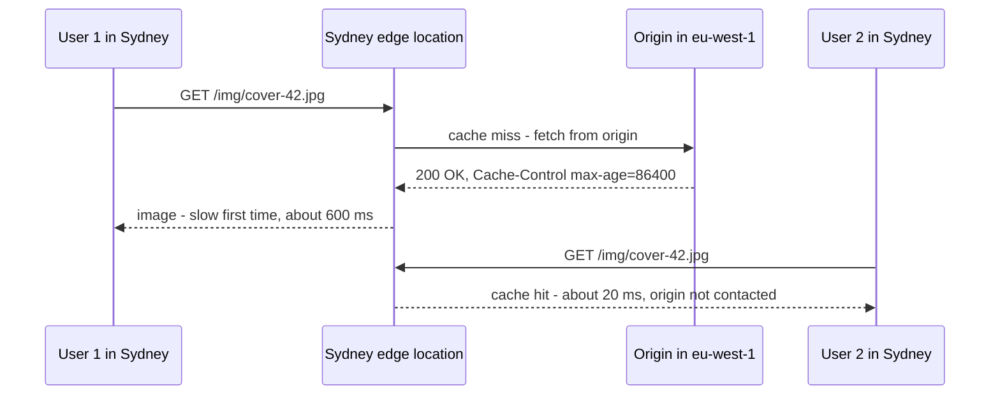

# CloudFront and Global Accelerator

## Before this lesson

You need edge locations ([the AWS global map](#/lesson/aws/what-is-cloud)), S3 buckets and why they should stay private ([S3 protection](#/lesson/aws/s3-protection)), and DNS with Alias records ([Route 53](#/lesson/aws/route53)). The networking track's [HTTP caching](#/lesson/networking/http-caching-cookies) lesson goes deeper into cache headers.

## In plain words

Your servers live in one or two Regions. Your users live everywhere. Every request from Sydney to a server in Ireland travels halfway round the planet and back, and no amount of server tuning removes that distance.

**Amazon CloudFront** is a **content delivery network (CDN)**. It keeps copies of your content in hundreds of **edge locations** around the world. A user in Sydney gets the picture from a machine in Sydney. Only the first request for each file goes all the way to your server.

Think of a **bakery with one central kitchen**. Customers across the country could all drive to the kitchen — or the bakery could stock **local shops** every morning. Most customers are served from the shop round the corner; the kitchen only bakes. If a shop runs out of something, it orders it from the kitchen once and then has it for the next customers.

**AWS Global Accelerator** solves a related problem differently. It does not keep copies of anything. It gives you two fixed IP addresses that are reachable from every edge location, and carries each user's traffic over AWS's private network to the nearest healthy Region — a **private motorway** onto which drivers merge at the nearest junction instead of taking back roads the whole way.

Why it matters for a job: a CDN is the cheapest large performance gain available to a web application, it is also a security layer, and "how would you serve users worldwide?" is asked in every system design interview.

## Vocabulary

- **Origin**: the place the real content lives — an S3 bucket, a load balancer, an API, any web server.
- **Distribution**: a CloudFront configuration. It has a domain name such as `d111abcdef8.cloudfront.net`, to which you attach your own name.
- **Edge location** (point of presence): a site where CloudFront caches content and terminates connections. A second tier of larger **regional edge caches** sits between edge locations and origins.
- **Cache hit / cache miss**: the edge had the object / had to fetch it from the origin.
- **Cache hit ratio**: the share of requests served from cache. Raising it is the main goal of CDN tuning.
- **Static content** is the same for everyone (images, CSS, JavaScript, videos). **Dynamic content** is generated per request (a basket, a search result).



## What CloudFront does for you

1. **Speed for cacheable content**: served from near the user.
2. **Speed for dynamic content too**: the user's TLS connection ends at the nearby edge, and CloudFront reuses warm, persistent connections over the AWS network to the origin. Even uncached API calls usually get faster.
3. **Less load and cost at the origin**: cached requests never reach it.
4. **Security**: free TLS certificates via ACM, **Shield Standard** DDoS protection built in, **AWS WAF** attachable, and the ability to hide the origin entirely.
5. **Resilience**: origin failover, and the option to serve stale content when the origin is down.

## Origins and keeping them private

### S3 origins

The right way to serve a bucket through CloudFront is with **origin access control (OAC)**: the bucket stays private, and its policy allows reads only from your distribution.

```json
{
  "Version": "2012-10-17",
  "Statement": [{
    "Sid": "AllowCloudFrontOnly",
    "Effect": "Allow",
    "Principal": {"Service": "cloudfront.amazonaws.com"},
    "Action": "s3:GetObject",
    "Resource": "arn:aws:s3:::tidewater-site/*",
    "Condition": {"StringEquals": {
      "AWS:SourceArn": "arn:aws:cloudfront::111122223333:distribution/E2EXAMPLE1ABC"}}
  }]
}
```

Reading it: the CloudFront *service* may read objects, but only when acting for the one named distribution. Nobody can fetch from the bucket directly, so WAF rules, signed URLs and geo restrictions cannot be bypassed. (OAC replaces the older *origin access identity*, OAI, which you will still see in older material.)

### Custom origins

Any HTTP server — an Application Load Balancer, an EC2 instance, an API Gateway endpoint, a server outside AWS — is a **custom origin**. To stop people bypassing CloudFront and hitting the load balancer directly:

- allow inbound traffic to the load balancer only from CloudFront's **managed prefix list** in its security group; and
- have CloudFront add a secret custom header that the load balancer or WAF requires; or
- use **VPC origins**, which let CloudFront reach a load balancer in *private* subnets with no public exposure at all.

### Origin groups

An **origin group** pairs a primary and a secondary origin. If the primary returns chosen error codes or times out, CloudFront retries the request against the secondary — for example a replica bucket in another Region.

## Cache behaviours

A distribution has one **default cache behaviour** and optional additional ones, each chosen by a **path pattern**. Each behaviour says which origin to use and how to cache.

| Path pattern | Origin | Caching | Why |
|---|---|---|---|
| `/static/*` | S3 bucket | Long TTL, ignore query strings and cookies | Versioned files that never change |
| `/api/*` | Load balancer | Caching disabled, forward all headers needed | Personalised responses |
| `/media/*` | S3 media bucket | Long TTL, signed URLs required | Paid content |
| `*` (default) | Load balancer | Short TTL | HTML pages |

Other per-behaviour settings: **viewer protocol policy** (redirect HTTP to HTTPS), allowed HTTP methods, automatic **compression** (Gzip and Brotli), and attached functions.

## The cache key and TTL: the heart of the matter

### Cache key

CloudFront stores each response under a **cache key**. Two requests are served the same cached copy only if their keys are identical. By default the key is the distribution's host name plus the URL path. A **cache policy** can add query strings, headers and cookies to it.

Every addition splits the cache:

- Include the query string `?size=200` → one copy per size. Needed if the image really differs.
- Include `?utm_source=newsletter` → one copy per marketing campaign of the *same* file. A wasted miss each time.
- Include the `User-Agent` header → thousands of copies, one per browser version. The hit ratio collapses.
- Include a session cookie → one copy per user: nothing is shared at all.

The rule: **put in the cache key only what actually changes the response.**

A separate **origin request policy** lists values to *forward to the origin without adding them to the key* — for example a header the application logs but that does not affect the answer. Keeping the two concerns apart is what cache policies and origin request policies are for.

### TTL

How long may the edge keep an object before checking with the origin?

- The origin says so with the HTTP response header `Cache-Control: max-age=N` (browsers and CDNs) or `s-maxage=N` (shared caches such as CDNs only; it takes precedence for CloudFront).
- The cache policy sets a **minimum, default and maximum TTL**. The origin's value is clamped between minimum and maximum; when the origin sends no caching header, the default applies. `no-cache`, `no-store` or `private` make CloudFront keep the object for the minimum TTL — zero in the managed caching policies, so effectively not cached.

When a TTL expires CloudFront does not necessarily re-download: it sends a **conditional request** asking "has this changed?" and the origin can answer `304 Not Modified` with no body.

```python-run
def cache_key(path, query, headers, policy):
    """Build the cache key from the parts the policy includes."""
    if policy["query"] == "all":
        names = sorted(query)
    elif policy["query"] == "none":
        names = []
    else:
        names = sorted(n for n in query if n in policy["query"])
    key = path + ("?" + "&".join(f"{n}={query[n]}" for n in names) if names else "")
    lower = {k.lower(): v for k, v in headers.items()}
    for h in sorted(h.lower() for h in policy["headers"]):
        if h in lower:
            key += f"|{h}={lower[h]}"
    return key

requests = [
    ("/img/cover.jpg", {"w": "200", "utm_source": "mail"},  {"User-Agent": "Firefox/131"}),
    ("/img/cover.jpg", {"w": "200", "utm_source": "tweet"}, {"User-Agent": "Chrome/130"}),
    ("/img/cover.jpg", {"w": "200"},                        {"User-Agent": "Safari/18"}),
    ("/img/cover.jpg", {"w": "400"},                        {"User-Agent": "Chrome/130"}),
]
policies = {
    "everything in the key": {"query": "all",   "headers": ["User-Agent"]},
    "only what matters    ": {"query": ["w"],   "headers": []},
}
for name, policy in policies.items():
    keys = [cache_key(p, q, h, policy) for p, q, h in requests]
    print(f"{name}: {len(set(keys))} distinct cache entries for {len(keys)} requests")
    for k in sorted(set(keys)):
        print("     ", k)
```

Line by line: `cache_key` appends the included query parameters in sorted order (so `?a=1&b=2` and `?b=2&a=1` collide, as they should) and then the included headers, lower-cased. The four requests are for two real variants of one image (width 200 and 400). With everything in the key they become four separate cache entries — four origin fetches. With only `w` in the key they become two entries, and the second and third requests are hits. The problem *CloudFront Cache Key and TTL* asks you to implement this together with the TTL rules.

### Changing content: versioning beats invalidation

When a cached file must change before its TTL ends there are two options.

- **Invalidation**: tell CloudFront to drop paths such as `/css/*` from every edge. It takes a minute or so, the first 1,000 paths per month are free and more are charged, and browsers that cached the file are not affected.
- **Versioned file names**: give each build a new name — `app.3f9a2c.js` instead of `app.js` — and reference the new name from the HTML. The new file is fetched immediately everywhere; old and new versions coexist; rollbacks are a matter of pointing back.

Best practice: **long TTLs on versioned assets, short TTLs on the HTML that references them.**

```bash
aws cloudfront create-invalidation --distribution-id E2EXAMPLE1ABC --paths "/index.html" "/css/*"
```

## Restricting who can view content

- **Signed URLs** and **signed cookies** give time-limited access to private content. Your application signs with a private key belonging to a CloudFront *key group*; the edge verifies the signature and expiry. A signed URL covers one file; signed cookies cover many files (a whole video stream or members' area) without changing URLs.
- **Geo restriction** allows or blocks whole countries.
- **AWS WAF** web ACLs filter by IP, rate, country and request content.
- **Field-level encryption** encrypts chosen form fields at the edge so that only one back-end service can read them.

| | CloudFront signed URL | S3 presigned URL |
|---|---|---|
| Signed by | A CloudFront key pair you manage | IAM credentials |
| Served from | Edge caches, your domain | S3 directly |
| Works with | Any origin | S3 only |
| Extra controls | IP range, start time, WAF, geo | Expiry only |
| Use for | Paid or private content at scale | Occasional direct downloads and uploads |

## Code at the edge

Two ways to run your own logic as requests pass through:

| | CloudFront Functions | Lambda@Edge |
|---|---|---|
| Runs | In every edge location | In regional edge caches |
| Language | JavaScript (a restricted runtime) | Node.js or Python |
| Time allowed | Under a millisecond | Up to 5 s (viewer) or 30 s (origin) |
| Network or file access | None | Yes |
| Triggers | Viewer request, viewer response | Viewer and origin request/response |
| Typical use | Header manipulation, URL rewrites and redirects, cache-key normalisation, simple token checks | Calling other services, generating responses, image transformation, complex authentication |
| Cost | Very low | Higher |

Start with CloudFront Functions; move to Lambda@Edge only when the task needs what they lack.

## Worked example: a private bucket served worldwide

> [!WARNING]
> A distribution has no hourly fee; you pay per GB delivered and per request, and a generous always-free allowance covers experiments. Disable and delete test distributions anyway — deletion requires disabling first, which takes several minutes.

Console steps are simplest for a first distribution: *Create distribution* → origin = the bucket → *Origin access control: create new* → *Redirect HTTP to HTTPS* → cache policy `CachingOptimized` → copy the suggested bucket policy onto the bucket. The equivalent as infrastructure as code (CloudFormation), which is how it should exist in a real project:

```yaml
Resources:
  SiteOAC:
    Type: AWS::CloudFront::OriginAccessControl
    Properties:
      OriginAccessControlConfig:
        Name: tidewater-site-oac
        OriginAccessControlOriginType: s3
        SigningBehavior: always          # sign every origin request
        SigningProtocol: sigv4

  SiteDistribution:
    Type: AWS::CloudFront::Distribution
    Properties:
      DistributionConfig:
        Enabled: true
        DefaultRootObject: index.html    # served for requests to "/"
        Aliases: [www.tidewater-books.com]
        ViewerCertificate:
          AcmCertificateArn: !Ref CertificateArn   # must be issued in us-east-1
          SslSupportMethod: sni-only
          MinimumProtocolVersion: TLSv1.2_2021
        Origins:
          - Id: site-bucket
            DomainName: !GetAtt SiteBucket.RegionalDomainName
            OriginAccessControlId: !Ref SiteOAC
            S3OriginConfig: {OriginAccessIdentity: ""}
        DefaultCacheBehavior:
          TargetOriginId: site-bucket
          ViewerProtocolPolicy: redirect-to-https
          Compress: true
          CachePolicyId: 658327ea-f89d-4fab-a63d-7e88639e58f6   # managed policy CachingOptimized
```

Section by section:

- `SiteOAC` creates the origin access control; `always` + `sigv4` means CloudFront signs each request to S3 so that the bucket policy shown earlier can recognise it.
- `Aliases` lists your own domain names; `ViewerCertificate` attaches the ACM certificate. **For CloudFront the certificate must be requested in `us-east-1`**, whatever Region the rest of the stack uses — a detail that catches everyone once.
- `Origins` names the bucket by its *regional* domain name.
- `DefaultCacheBehavior` sends everything to that origin, forces HTTPS, compresses, and uses AWS's managed caching policy (key = path only, long default TTL).

Finish with a Route 53 **Alias** record from `www.tidewater-books.com` to the distribution, then test:

```bash
curl -sI https://www.tidewater-books.com/img/cover-42.jpg | grep -iE "x-cache|age|cache-control"
```

```
cache-control: max-age=86400
x-cache: Miss from cloudfront
```

Run it again:

```
cache-control: max-age=86400
age: 7
x-cache: Hit from cloudfront
```

`x-cache` says whether the edge had the object; `age` is how many seconds it has been cached. These two headers are the first thing to look at when debugging caching.

## Global Accelerator

**Global Accelerator** provides two **static anycast IP addresses**. *Anycast* means the same address is announced from many places at once; the network delivers each user to the nearest one. Traffic enters AWS at the closest edge location and rides the AWS backbone to an **endpoint** — an Application or Network Load Balancer, an EC2 instance or an Elastic IP — in one or more Regions.

- Works at the network layer for **any TCP or UDP** traffic: games, voice, IoT protocols, as well as HTTP.
- **No caching.**
- **Health checks and failover in under a minute**, independent of DNS caching, because the IP addresses clients use never change.
- **Traffic dials** and endpoint weights shift load between Regions.
- The fixed IPs suit customers who must allow-list addresses in firewalls.

| | CloudFront | Global Accelerator |
|---|---|---|
| Layer | HTTP/HTTPS (and WebSocket) | TCP/UDP |
| Caches content | Yes | No |
| Client connects to | A DNS name resolving to edge IPs that change | Two static anycast IPs |
| Best for | Websites, APIs, downloads, video | Non-HTTP protocols, static IP requirements, fast multi-Region failover |
| Runs code / WAF | Functions, Lambda@Edge, WAF | — (WAF on the ALB behind it) |

They can be combined with Route 53: DNS names the accelerator or the distribution with an Alias record.

## Cost notes and free-tier warnings

- **CloudFront** charges per GB transferred to viewers (cheaper than EC2 or S3 data-out in many cases, and tiered by geography), per 10,000 requests, plus invalidations beyond 1,000 paths, Lambda@Edge and Functions invocations, and real-time logs. **Data from AWS origins to CloudFront is free.** The always-free allowance covers 1 TB out and 10 million requests per month; flat-rate plans bundling CloudFront, WAF and DNS also exist.
- **Price classes** restrict a distribution to cheaper groups of edge locations (for example North America and Europe only) at the cost of latency elsewhere.
- **Global Accelerator** charges a fixed hourly fee per accelerator plus a premium per GB — it is never free.
- A higher cache hit ratio lowers both the CloudFront bill and the origin's.

## Pitfalls

- **Requesting the certificate in the wrong Region** (it must be `us-east-1` for CloudFront).
- **Leaving the origin publicly reachable**, so attackers bypass WAF and caching.
- **Forwarding all headers, cookies and query strings "to be safe"**, destroying the hit ratio.
- **Caching personalised responses**: one user's account page served to another. Disable caching for such paths or make sure the cache key includes what distinguishes users.
- **Relying on invalidations for every deployment** instead of versioned file names.
- **No `Cache-Control` headers at the origin**, leaving behaviour to defaults nobody chose.
- **Expecting an invalidation to clear browsers' caches.**
- **Confusing signed URLs with presigned URLs.**
- **Choosing Global Accelerator for a static website** (nothing is cached) or **CloudFront for a UDP game server** (not supported).

> [!INTERVIEW]
> **"How does a CDN improve performance, and what would you cache?"** It serves cacheable responses from edge locations near users and terminates TLS close to them, reusing optimised connections to the origin. Cache static, versioned assets with long TTLs; cache HTML and public API responses briefly; never cache personalised responses unless the cache key separates users. Track the cache hit ratio and keep the cache key minimal.
>
> **"CloudFront or Global Accelerator?"** CloudFront for HTTP content that benefits from caching and edge logic. Global Accelerator when the protocol is not HTTP, when clients need fixed IP addresses, or when failover between Regions must not depend on DNS caches.

## Cheat sheet

| Need | Use |
|---|---|
| Serve a private S3 bucket publicly | CloudFront + origin access control |
| HTTPS on your own domain | ACM certificate in us-east-1 + Alias record |
| Different rules per URL path | Cache behaviours |
| Higher hit ratio | Minimal cache key, long TTLs, versioned names |
| Force-refresh a path | Invalidation |
| Paid or private content | Signed URLs (one file) or signed cookies (many) |
| Block countries | Geo restriction |
| Rewrite URLs or headers at the edge | CloudFront Functions |
| Heavier edge logic | Lambda@Edge |
| Backup origin | Origin group |
| Static IPs, TCP/UDP, fast regional failover | Global Accelerator |

## Summary

- CloudFront caches content at edge locations and accelerates dynamic requests, while shielding and hiding the origin.
- Origins are S3 buckets (kept private with origin access control) or any HTTP server; behaviours map URL paths to origins and caching rules.
- The cache key and TTL determine the hit ratio: include only what changes the response, set caching headers at the origin, and prefer versioned file names over invalidations.
- Signed URLs and cookies, geo restriction and WAF control access; CloudFront Functions and Lambda@Edge run code at the edge.
- Global Accelerator gives static anycast IPs and backbone routing for any TCP/UDP application, without caching.

## Glossary

- **Anycast**: one IP address announced from many locations.
- **Cache behaviour**: per-path settings of a distribution.
- **Cache hit ratio**: the share of requests served from cache.
- **Cache key**: the identifier under which a response is cached.
- **Cache policy / origin request policy**: what forms the key and TTLs / what is forwarded to the origin.
- **CDN**: content delivery network.
- **Conditional request**: asking the origin whether content changed.
- **Distribution**: a CloudFront configuration with its domain name.
- **Invalidation**: removing objects from edge caches before their TTL ends.
- **OAC**: origin access control.
- **Origin**: the source of the content.
- **Origin group**: a primary and secondary origin for failover.
- **Signed URL / signed cookie**: time-limited credentials for private content.
- **Static / dynamic content**: identical for all users / generated per request.

```quiz
[
  {"q": "A static website's files are in an S3 bucket. The security team insists that the bucket must not be publicly accessible, yet the site must be served worldwide over HTTPS. What is the design?",
   "options": ["Enable S3 static website hosting and make the bucket public", "CloudFront with the bucket as origin, origin access control, and a bucket policy allowing only the distribution", "Share presigned URLs for each page", "Put the files on an EC2 instance with an Elastic IP"],
   "answer": 1,
   "explain": "OAC lets only the CloudFront distribution read the private bucket; CloudFront adds HTTPS, caching and a custom domain."},
  {"q": "A cache policy includes all query strings in the cache key. Marketing links add unique tracking parameters to image URLs. What is the effect?",
   "options": ["No effect", "Each unique tracking value creates a separate cache entry, lowering the hit ratio and increasing origin load", "CloudFront strips unknown parameters automatically", "Images are served faster"],
   "answer": 1,
   "explain": "Anything in the cache key splits the cache. Include only parameters that change the response, such as an image width."},
  {"q": "The origin returns 'Cache-Control: max-age=30' and the cache policy has minimum TTL 300, default 86400, maximum 31536000. How long does the edge keep the object?",
   "options": ["30 seconds", "300 seconds", "86400 seconds", "It is not cached"],
   "answer": 1,
   "explain": "The origin's value is clamped between the policy's minimum and maximum TTL, so 30 becomes 300."},
  {"q": "A team deploys new JavaScript several times a day and wants users to get it immediately, with long cache lifetimes. Which practice is best?",
   "options": ["Invalidate /* after each deploy", "Use content-hashed file names for assets with long TTLs and a short TTL on the HTML", "Disable caching", "Lower all TTLs to zero"],
   "answer": 1,
   "explain": "Versioned names make new files new cache entries, so nothing needs purging and old browsers' caches are not a problem."},
  {"q": "A video platform must let paying subscribers stream many segment files for two hours without changing each URL. Which mechanism fits?",
   "options": ["S3 presigned URLs for each segment", "CloudFront signed cookies", "Geo restriction", "A public bucket with an obscure name"],
   "answer": 1,
   "explain": "Signed cookies grant time-limited access to multiple files without modifying URLs. Signed URLs are per file."},
  {"q": "A CloudFormation stack in eu-west-1 fails to attach an ACM certificate created in eu-west-1 to a CloudFront distribution. Why?",
   "options": ["CloudFront does not support HTTPS", "Certificates for CloudFront must be in us-east-1", "The certificate must be self-signed", "ACM certificates work only with load balancers"],
   "answer": 1,
   "explain": "CloudFront is a global service and reads its viewer certificates from ACM in us-east-1."},
  {"q": "A multiplayer game uses UDP and customers' firewalls must allow-list fixed IP addresses. Traffic should reach the nearest healthy Region with fast failover. Which service?",
   "options": ["CloudFront", "Global Accelerator", "Route 53 simple routing", "S3 Transfer Acceleration"],
   "answer": 1,
   "explain": "Global Accelerator provides static anycast IPs for TCP and UDP and routes over the AWS backbone with health-based failover. CloudFront serves HTTP."},
  {"q": "A simple requirement: add a security header to every response and redirect /old/* to /new/*. Which option is the most economical?",
   "options": ["Lambda@Edge on origin response", "A CloudFront Function on viewer request/response", "A fleet of EC2 reverse proxies", "An invalidation"],
   "answer": 1,
   "explain": "Lightweight header changes and redirects are what CloudFront Functions are designed for: sub-millisecond, at every edge, very cheap."}
]
```

> **Source:** AWS Certified Solutions Architect Official Study Guide, ch. 11 (Amazon CloudFront: distributions, origins, cache control, private content). Origin access control, cache policies, CloudFront Functions and Global Accelerator post-date the book; checked against https://docs.aws.amazon.com/AmazonCloudFront/latest/DeveloperGuide/Introduction.html , https://docs.aws.amazon.com/AmazonCloudFront/latest/DeveloperGuide/controlling-the-cache-key.html , https://docs.aws.amazon.com/AmazonCloudFront/latest/DeveloperGuide/private-content-restricting-access-to-s3.html and https://docs.aws.amazon.com/global-accelerator/latest/dg/what-is-global-accelerator.html
