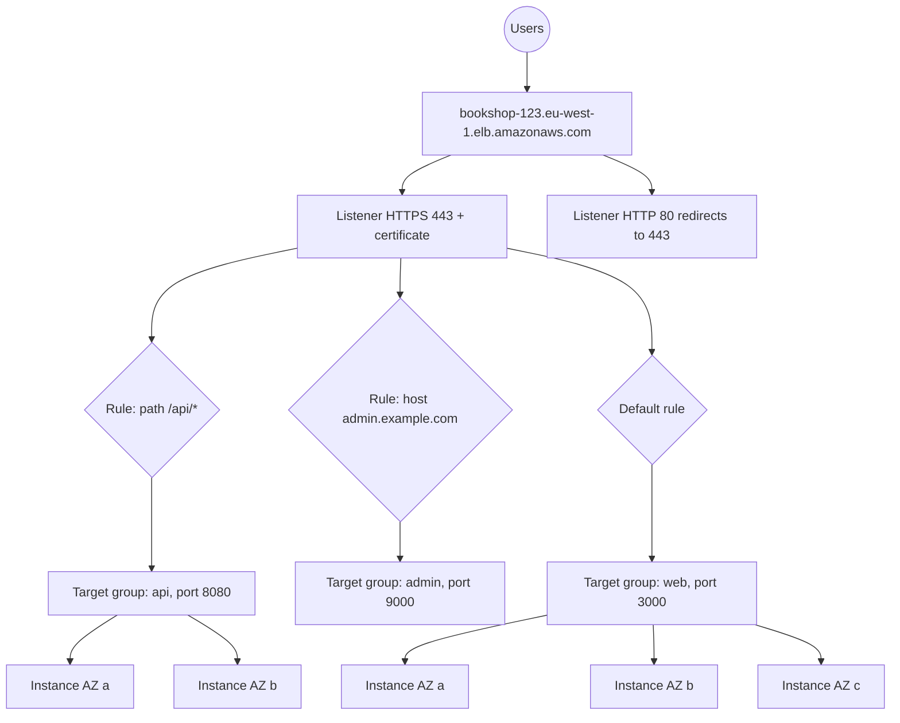

# Elastic Load Balancing: ALB, NLB and health checks

## Before this lesson

You need subnets, public versus private, and security groups ([VPC basics](#/lesson/aws/vpc-basics), [security groups versus network ACLs](#/lesson/aws/vpc-firewalls)), plus EC2 instances ([EC2 instances](#/lesson/aws/ec2-instances)). The networking track's [load balancers and proxies](#/lesson/networking/load-balancers-proxies) lesson covers the general theory.

## In plain words

One server can only do so much, and one server is one failure away from an outage. The answer is several servers. But then: which one should each visitor talk to, and what happens when one of them breaks?

A **load balancer** stands in front of a group of servers and hands out the incoming requests among them. Users talk to the load balancer; the load balancer talks to the servers. It also keeps checking that each server is alive and **stops sending work to any that fail**.

Picture the **host at a restaurant entrance**. Guests do not choose their own waiter. The host knows which waiters are on duty, seats each party with one who is not overloaded, and stops seating anyone in the section of a waiter who has gone home sick.

**Elastic Load Balancing (ELB)** is the AWS service. "Elastic" because the load balancer itself grows and shrinks with traffic and runs across several Availability Zones, so it is not a single point of failure.

Why it matters for a job: a load balancer is in almost every production architecture. It is what makes **high availability**, **horizontal scaling** and **zero-downtime deployments** possible, and "ALB versus NLB" is a standard interview question.

## What a load balancer gives you

1. **Distribution** of requests across healthy targets.
2. **Health checks** and automatic removal of failed targets.
3. **A single stable entry point** (a DNS name) while the servers behind come and go.
4. **High availability across zones.**
5. **TLS termination**: the load balancer holds the certificate and decrypts HTTPS, so servers do not have to.
6. **Security**: servers can sit in private subnets; only the load balancer is exposed.

## The four types

| | **Application LB (ALB)** | **Network LB (NLB)** | **Gateway LB (GWLB)** | Classic LB (CLB) |
|---|---|---|---|---|
| OSI layer | 7 — HTTP, HTTPS, gRPC, WebSocket | 4 — TCP, UDP, TLS | 3 — IP packets | 4 and 7, legacy |
| Routes by | URL path, host name, headers, query string, method | IP protocol and port | — (all traffic to appliances) | — |
| Performance | Very good | Millions of requests per second, very low latency | — | — |
| Static IP | No (DNS name only) | **Yes, one per zone**; Elastic IPs possible | — | No |
| Source IP seen by target | The ALB's (client in `X-Forwarded-For`) | **The client's** (preserved) | Preserved | — |
| Targets | Instances, IPs, Lambda functions | Instances, IPs, an ALB | Virtual appliances | Instances |
| Security group | Yes | Yes (optional) | — | Yes |
| Typical use | Websites, APIs, microservices, containers | Extreme throughput, non-HTTP protocols, fixed IPs, PrivateLink | Third-party firewalls and inspection | Do not use for new work |

The "layers" come from a standard model of networking. **Layer 4** is the transport level: the load balancer sees addresses and ports and forwards connections without understanding their contents. **Layer 7** is the application level: the load balancer reads each HTTP request and can route on what is inside it.

The **Classic Load Balancer** is the original generation and is what the older edition this track follows describes in detail. It remains only for compatibility; use ALB or NLB.

## Anatomy of an Application Load Balancer



- The **load balancer** has nodes in each subnet you select — choose public subnets in **at least two Availability Zones** for an *internet-facing* load balancer. An *internal* load balancer has only private addresses and serves other tiers inside the VPC.
- A **listener** waits for connections on a protocol and port (HTTPS 443) and holds the TLS certificate (free from ACM).
- **Rules** on a listener are evaluated in priority order; the first whose conditions match wins, and there is always a default rule. Conditions: host header, path, HTTP header, method, query string, source IP. Actions: forward to a target group (or to several with weights), redirect, return a fixed response, or authenticate the user first (OIDC or Amazon Cognito).
- A **target group** is a set of targets — EC2 instances, IP addresses (which is how containers and on-premises servers are registered), or a Lambda function — with a protocol, a port and a **health check**.

Routing on host and path lets **one** ALB front many services, which is how microservices and container platforms keep cost down.

## Health checks

The load balancer sends a small request to every target at a regular interval. For an ALB it is an HTTP request to a path you choose.

| Setting | Meaning | Typical |
|---|---|---|
| Path | What to request | `/health` |
| Interval | Seconds between checks | 15–30 |
| Timeout | How long to wait for a reply | 5 |
| Healthy threshold | Consecutive successes to become healthy | 2–5 |
| Unhealthy threshold | Consecutive failures to become unhealthy | 2 |
| Success codes | Which HTTP statuses count | `200` |

The thresholds exist so that a single lost packet does not eject a healthy server, and a single lucky reply does not readmit a broken one. The state only flips after a run of consecutive results.

```python-run
def health_states(results, healthy_threshold, unhealthy_threshold, state="unhealthy"):
    ok = bad = 0
    timeline = []
    for success in results:
        if success:
            ok, bad = ok + 1, 0                      # a success resets the failure streak
            if state == "unhealthy" and ok >= healthy_threshold:
                state = "healthy"
        else:
            bad, ok = bad + 1, 0                     # a failure resets the success streak
            if state == "healthy" and bad >= unhealthy_threshold:
                state = "unhealthy"
        timeline.append(state)
    return timeline

checks = [True, True, True, False, True, True, False, False, True, True, True]
states = health_states(checks, healthy_threshold=3, unhealthy_threshold=2)
for i, (c, s) in enumerate(zip(checks, states)):
    print(f"check {i:2d}: {'pass' if c else 'FAIL'}  ->  {s}")
interval = 30
print("time to detect a dead target:", 2 * interval, "s;  time to trust a new one:", 3 * interval, "s")
```

Line by line: two counters track consecutive passes and failures; each result resets the opposite counter; the state changes only when the relevant streak reaches its threshold. Notice check 3: one failure does not eject the target. Checks 6 and 7 — two failures in a row — do, and three consecutive passes bring it back. The last line shows why these numbers matter operationally: detection time is roughly *threshold × interval*. The problem *Health-Check State Machine* asks for this function.

A good health endpoint answers quickly and tests that *this server* can do its job. Be careful about **deep health checks** that test shared dependencies: if `/health` fails whenever the database is slow, every server fails together, the load balancer has nowhere to send traffic, and a slowdown becomes a total outage.

When a target is deregistered (a deployment, a scale-in) the load balancer stops sending it new requests but lets in-flight ones finish for the **deregistration delay** (300 seconds by default) — this is **connection draining**.

## Routing algorithms

For an ALB target group:

- **Round robin** (default): each target in turn.
- **Least outstanding requests**: the target with the fewest requests in progress. Better when request durations vary a lot.
- **Weighted random** with *anomaly mitigation*: reduces traffic to targets that start returning errors.

**Slow start** gives a newly registered target a gradually increasing share so that it can warm its caches.

**Weighted target groups** let one rule forward to two groups with weights — 90 % to version 1, 10 % to version 2. That is the mechanism behind **blue/green** and **canary** deployments at the load balancer.

An NLB picks a target per connection using a **flow hash** of protocol, source address and port, destination address and port — so one TCP connection always stays with one target.

The problem *Load Balancer Routing Algorithms* has you implement smooth weighted round robin and least outstanding requests.

## Cross-zone load balancing

Each load balancer node lives in one Availability Zone.

- With **cross-zone load balancing on**, every node distributes across *all* targets in all zones. Each target receives an equal share.
- With it **off**, a node only uses targets in its own zone. If zone A has two targets and zone B has eight, DNS sends half the traffic to each zone, so each of A's two targets gets 25 % and each of B's eight gets about 6 %.

It is **always on for ALBs** (free). It is **off by default for NLBs and GWLBs**, where enabling it incurs inter-zone data-transfer charges.

## Sticky sessions

By default each request may go to a different target. If the application keeps user state in the server's memory (a login session, a basket), the user appears logged out on the next request. **Sticky sessions** (session affinity) make the load balancer send a given client to the same target, using a cookie.

Stickiness is a workaround, not a goal. It causes uneven load and loses the session when that target is replaced. The robust design is **stateless servers**: keep session state in ElastiCache or DynamoDB, or in a signed token held by the client, so that any server can serve any request.

## TLS

- **Termination at the load balancer**: clients speak HTTPS to the ALB; the ALB decrypts and forwards. Certificates live in ACM and renew themselves. The ALB can re-encrypt to the targets (HTTPS to the target group) when end-to-end encryption is required.
- **Server Name Indication (SNI)** lets one listener hold many certificates and present the right one for each host name.
- A **security policy** selects the allowed TLS versions and ciphers.
- An NLB can terminate TLS too, or pass encrypted TCP straight through to the targets (*passthrough*) when the servers must hold the keys.
- An ALB adds request headers so that the application knows the original client: `X-Forwarded-For` (client IP), `X-Forwarded-Proto` (http or https), `X-Forwarded-Port`.

## When to choose the Network Load Balancer

- The protocol is not HTTP: databases, MQTT, game servers, DNS, anything over **TCP or UDP**.
- Clients or partners must allow-list **fixed IP addresses**.
- **Millions of connections** or the lowest latency.
- The application needs the **client's source IP** at the network level.
- You are publishing a service through **PrivateLink** (endpoint services require an NLB or GWLB).

A common combination: an NLB (for static IPs) forwarding to an ALB (for HTTP routing).

## Worked example: an ALB in front of two instances

> [!WARNING]
> A load balancer bills per hour from creation (around USD 16–20 per month minimum) plus capacity units, with no always-free allowance for new accounts. Delete it when finished: the target group, listener and load balancer.

```bash
# 1. Target group: HTTP on port 80, health check on /health.
TG=$(aws elbv2 create-target-group --name bookshop-web \
  --protocol HTTP --port 80 --vpc-id vpc-0abc1234 --target-type instance \
  --health-check-path /health --health-check-interval-seconds 15 \
  --healthy-threshold-count 2 --unhealthy-threshold-count 2 \
  --query "TargetGroups[0].TargetGroupArn" --output text)

# 2. Register two instances in different zones.
aws elbv2 register-targets --target-group-arn "$TG" \
  --targets Id=i-0aaa1111 Id=i-0bbb2222

# 3. The load balancer in two public subnets, with its own security group.
ALB=$(aws elbv2 create-load-balancer --name bookshop --type application \
  --scheme internet-facing --subnets subnet-0puba subnet-0pubb \
  --security-groups sg-0alb \
  --query "LoadBalancers[0].LoadBalancerArn" --output text)

# 4. An HTTPS listener forwarding to the target group, and an HTTP listener that redirects.
aws elbv2 create-listener --load-balancer-arn "$ALB" --protocol HTTPS --port 443 \
  --certificates CertificateArn=arn:aws:acm:eu-west-1:111122223333:certificate/abcd-1234 \
  --default-actions Type=forward,TargetGroupArn="$TG"
aws elbv2 create-listener --load-balancer-arn "$ALB" --protocol HTTP --port 80 \
  --default-actions 'Type=redirect,RedirectConfig={Protocol=HTTPS,Port=443,StatusCode=HTTP_301}'
```

- `elbv2` is the CLI namespace for ALB, NLB and GWLB (`elb` is the Classic API).
- `--target-type instance` registers by instance ID; `ip` is used for containers and `lambda` for functions.
- `--scheme internet-facing` gives public addresses; the instances themselves stay in private subnets, with a security group that admits port 80 **only from `sg-0alb`**.
- The second listener answers plain HTTP with a permanent redirect to HTTPS.

```bash
# 5. Are the targets healthy?
aws elbv2 describe-target-health --target-group-arn "$TG" \
  --query "TargetHealthDescriptions[].[Target.Id,TargetHealth.State,TargetHealth.Reason]" --output table
```

```
+--------------+------------+--------------------------+
|  i-0aaa1111  |  healthy   |  None                    |
|  i-0bbb2222  |  unhealthy |  Target.ResponseCodeMismatch |
+--------------+------------+--------------------------+
```

The `Reason` column is the fastest way to debug: `Target.Timeout` usually means a security group blocks the health check; `Target.ResponseCodeMismatch` means the path answered with a status other than the expected one (often a 301 or 404); `Target.FailedHealthChecks` means the connection was refused — nothing is listening on that port.

```bash
# 6. Add a path rule: /api/* goes to a different target group.
aws elbv2 create-rule --listener-arn "$LISTENER" --priority 10 \
  --conditions Field=path-pattern,Values='/api/*' \
  --actions Type=forward,TargetGroupArn="$TG_API"
```

## Reading the error codes

| Code from the load balancer | Meaning | Usual cause |
|---|---|---|
| 502 Bad Gateway | The target sent an invalid response or closed the connection | Application crashed mid-request; keep-alive timeout shorter on the target than on the ALB |
| 503 Service Unavailable | No healthy targets registered | All targets failing health checks; empty target group |
| 504 Gateway Timeout | The target did not answer within the idle timeout (60 s default) | Slow application or database; security group blocking the port |

An ALB publishes these as separate metrics: `HTTPCode_ELB_5XX_Count` (the load balancer's own errors) and `HTTPCode_Target_5XX_Count` (errors returned by your application). Knowing which side produced an error halves the search. **Access logs** (to S3) record every request with timings for each stage.

## Cost notes and free-tier warnings

- **Hourly charge** per load balancer plus **load balancer capacity units (LCUs)**, which measure new connections, active connections, bytes processed and rule evaluations.
- **One ALB with many rules** is far cheaper than one ALB per service.
- **Public IPv4 addresses** on internet-facing load balancers are charged per address per hour, per zone.
- **Cross-zone data transfer** is charged for NLB and GWLB when cross-zone is enabled.
- Idle load balancers left over from experiments are among the most common forgotten costs.

## Pitfalls

- **A single Availability Zone** behind the load balancer — the load balancer is highly available, the application is not.
- **The targets' security group does not admit the load balancer**, so every health check times out.
- **Health check path that redirects or needs authentication** (returns 301/401), marking healthy servers unhealthy.
- **Health checks that depend on shared services**, turning a partial problem into a full outage.
- **Sticky sessions as a substitute for stateless design.**
- **Expecting a fixed IP from an ALB.** Use its DNS name with a Route 53 Alias, or front it with an NLB or Global Accelerator.
- **Application logs showing only the load balancer's IP**: read `X-Forwarded-For`.
- **Idle timeout shorter than a long-running request or WebSocket ping interval**, producing 504s.
- **Building on the Classic Load Balancer** because an old tutorial did.

> [!INTERVIEW]
> **"ALB or NLB?"** ALB for HTTP and HTTPS: it routes on host, path and headers, supports containers and Lambda targets, redirects, authentication and WAF. NLB for TCP/UDP, extreme throughput and low latency, static IP addresses per zone, client IP preservation and PrivateLink services. They can be chained when both static IPs and HTTP routing are needed.
>
> **"How does a load balancer enable zero-downtime deployment?"** New instances are registered and must pass health checks before receiving traffic; old ones are deregistered and drain in-flight requests during the deregistration delay. For blue/green, a second target group receives the new version and listener rule weights shift traffic gradually, with instant rollback by restoring the weights.

## Cheat sheet

| Need | Choose |
|---|---|
| Route by URL path or host name | ALB |
| TCP/UDP, static IP, millions of connections | NLB |
| Insert third-party firewalls | Gateway Load Balancer |
| One entry point for many microservices | ALB listener rules + target groups |
| Canary or blue/green | Weighted target groups |
| Requests of very different duration | Least outstanding requests |
| Finish in-flight requests on removal | Deregistration delay |
| Client IP behind an ALB | `X-Forwarded-For` header |
| 503 from the load balancer | No healthy targets |
| 504 from the load balancer | Target too slow or unreachable |

## Summary

- A load balancer spreads requests across healthy targets in several Availability Zones behind one stable DNS name.
- ALB works at the HTTP level with listeners, rules and target groups; NLB works at the connection level with static IPs and very high performance; GWLB inserts network appliances; CLB is legacy.
- Health checks use consecutive-result thresholds to add and remove targets; draining lets in-flight requests finish.
- Routing algorithms, weighted target groups and cross-zone balancing control how traffic is shared.
- Keep servers stateless and private, terminate TLS at the load balancer, and read the 502/503/504 distinctions when debugging.

## Glossary

- **ALB / NLB / GWLB / CLB**: Application, Network, Gateway and Classic Load Balancers.
- **Blue/green deployment**: running old and new versions side by side and switching traffic.
- **Canary**: sending a small share of traffic to a new version first.
- **Connection draining (deregistration delay)**: letting in-flight requests finish on a target being removed.
- **Cross-zone load balancing**: distributing across targets in all zones from every node.
- **Flow hash**: the NLB's method of pinning a connection to a target.
- **Health check**: a periodic probe of a target.
- **Layer 4 / layer 7**: transport level (TCP/UDP) / application level (HTTP).
- **LCU**: load balancer capacity unit, the usage measure for billing.
- **Listener**: a protocol-and-port entry point with rules.
- **SNI**: Server Name Indication, selecting a certificate by host name.
- **Sticky session**: binding a client to one target.
- **Target group**: a set of targets with a health check.
- **TLS termination**: decrypting HTTPS at the load balancer.

```quiz
[
  {"q": "A company runs three microservices and wants requests for /orders/*, /users/* and /catalog/* to reach different groups of containers through one endpoint. Which load balancer and feature?",
   "options": ["Network Load Balancer with three listeners on different ports", "Application Load Balancer with path-based listener rules and three target groups", "Three Classic Load Balancers", "Gateway Load Balancer"],
   "answer": 1,
   "explain": "Only the ALB inspects HTTP requests and can route by path or host to separate target groups."},
  {"q": "A partner's firewall can only allow-list fixed IP addresses, and the service speaks a custom TCP protocol. Which load balancer?",
   "options": ["Application Load Balancer", "Network Load Balancer with Elastic IPs", "Classic Load Balancer", "CloudFront"],
   "answer": 1,
   "explain": "An NLB provides one static IP per Availability Zone (optionally Elastic IPs) and handles arbitrary TCP. ALB addresses change and it only speaks HTTP."},
  {"q": "All targets of an ALB show 'unhealthy' with reason Target.Timeout, yet the application responds when tested from another instance in the same subnet. What is the most likely cause?",
   "options": ["The certificate has expired", "The targets' security group does not allow traffic from the load balancer's security group on the health-check port", "Cross-zone load balancing is off", "The health check path returns 404"],
   "answer": 1,
   "explain": "A timeout means the probe gets no reply at all, typically a firewall issue. A wrong status code would show ResponseCodeMismatch."},
  {"q": "Health check interval is 30 s, unhealthy threshold 3. Roughly how long after a target dies does the load balancer stop routing to it?",
   "options": ["30 seconds", "About 90 seconds", "5 minutes", "Immediately"],
   "answer": 1,
   "explain": "The target must fail three consecutive checks, 30 seconds apart: about 90 seconds. Shorter intervals and thresholds detect failures faster."},
  {"q": "Users are randomly logged out. The app stores sessions in each server's memory behind an ALB. What is the best long-term fix?",
   "options": ["Enable sticky sessions forever", "Store sessions in a shared store such as ElastiCache or DynamoDB so that servers are stateless", "Use a single large server", "Increase the idle timeout"],
   "answer": 1,
   "explain": "Stateless servers let any target handle any request and survive scaling and replacement. Stickiness only hides the problem and breaks when a target is removed."},
  {"q": "Users receive HTTP 503 from the ALB. What does that indicate?",
   "options": ["The target returned malformed HTTP", "There are no healthy targets in the target group", "The request exceeded the idle timeout", "The client's certificate is invalid"],
   "answer": 1,
   "explain": "503 from the load balancer means it has nowhere to send the request. 502 points at bad responses and 504 at timeouts."},
  {"q": "A team wants to send 10 % of production traffic to a new version and roll back instantly if errors rise. Which ALB capability supports this?",
   "options": ["Sticky sessions", "A forward action with weighted target groups", "Slow start", "Access logs"],
   "answer": 1,
   "explain": "A listener rule can forward to two target groups with weights such as 90 and 10; changing the weights shifts or reverts traffic at once."},
  {"q": "An NLB has two targets in zone A and eight in zone B with cross-zone load balancing disabled. How is traffic shared?",
   "options": ["Each of the ten targets gets 10 %", "Each zone gets half; each target in A gets 25 % and each in B about 6 %", "All traffic goes to zone B", "Zone A gets 20 %"],
   "answer": 1,
   "explain": "Without cross-zone balancing each node only uses targets in its own zone, and DNS splits clients evenly between the zones."}
]
```

> **Source:** AWS Certified Solutions Architect Official Study Guide, ch. 5 (Elastic Load Balancing: listeners, health checks, cross-zone, connection draining, sticky sessions). The book describes the Classic Load Balancer; ALB, NLB and GWLB behaviour checked against https://docs.aws.amazon.com/elasticloadbalancing/latest/application/introduction.html , https://docs.aws.amazon.com/elasticloadbalancing/latest/network/introduction.html and https://docs.aws.amazon.com/elasticloadbalancing/latest/application/target-group-health-checks.html
