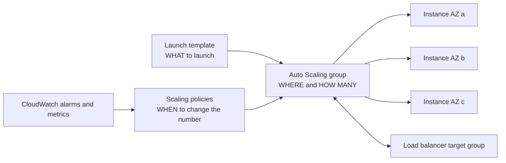
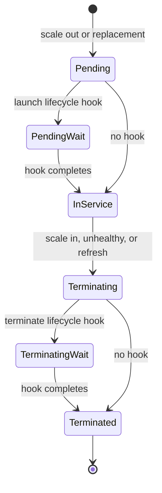

# EC2 Auto Scaling: groups, launch templates and scaling policies

## Before this lesson

You need load balancers and health checks ([Elastic Load Balancing](#/lesson/aws/load-balancing)), CloudWatch alarms ([CloudWatch](#/lesson/aws/cloudwatch)), AMIs and user data ([EC2 instances](#/lesson/aws/ec2-instances)) and purchasing options ([Paying for EC2](#/lesson/aws/ec2-purchasing)).

## In plain words

Traffic is never constant. A shop is quiet at 04:00 and packed at lunchtime; a ticket site is calm for weeks and then swamped for ten minutes. Running enough servers for the busiest moment wastes money the rest of the time. Running too few loses customers at the moment that matters.

**EC2 Auto Scaling** adjusts the number of servers automatically: it **adds instances when demand rises and removes them when it falls**. It also **replaces any instance that breaks**, with no human involved.

Think of a **supermarket's checkout manager**. When queues grow, more tills are opened. When the shop empties, tills close and staff are sent on break. If a cashier faints, a replacement is brought in immediately. The manager works from simple rules: "keep the average queue under four people", "at least two tills always open", "never more than twelve".

Why it matters for a job: elasticity — capacity that follows demand — is the central promise of the cloud, and this is the service that delivers it for EC2. Auto scaling groups also underlie containers on ECS and EKS. Expect questions on scaling policies, cooldowns and how a group heals itself.

## The three parts



### 1. Launch template — what to launch

A **launch template** records everything needed to start one instance: AMI, instance type, key pair, security groups, IAM instance profile, user data, block devices, tags. Templates are **versioned**, so a new AMI is a new version and the previous one remains available for rollback.

The older **launch configuration** did the same job without versions or newer features. AWS no longer allows creating them in new accounts; when a book or tutorial says "launch configuration", read "launch template".

### 2. Auto Scaling group — where and how many

An **Auto Scaling group (ASG)** is the fleet. Its key settings:

- **Subnets** — choose subnets in several Availability Zones. The group spreads instances evenly across them and rebalances when a zone becomes uneven.
- **Minimum, maximum and desired capacity.** *Desired* is the number the group tries to keep running right now. Scaling policies move desired between min and max. Min guarantees a floor for availability; max is a ceiling that protects your budget.
- **Target groups** — new instances are registered with the load balancer automatically and deregistered (with connection draining) before termination.
- **Health check type and grace period.**

### 3. Scaling policies — when to change

Rules that raise or lower the desired capacity. Covered in detail below.

## Self-healing

Even with no scaling policy at all, an ASG keeps the desired number of **healthy** instances.

- **EC2 health checks** (default): an instance is unhealthy if it is not running or fails the EC2 status checks (hardware or network problems on the host).
- **ELB health checks** (enable these when a load balancer is attached): an instance is also unhealthy if the load balancer's health check fails — the process crashed, the application hangs.

An unhealthy instance is **terminated and replaced**. A group with min = max = desired = 1 across two zones is a legitimate pattern: one server, automatically recreated if it or its zone fails.

The **health check grace period** (300 seconds by default) tells the group to ignore health check results for a new instance while it boots and starts the application. Set it longer than your real start-up time, or the group will kill instances before they are ready and loop forever.

This is the "cattle, not pets" idea made concrete: no instance is special, any of them may be replaced at any time, so nothing important may live only on an instance's disk.

## Scaling policies

### Target tracking — the default choice

You pick a metric and a **target value**; Auto Scaling does the rest, like a thermostat. "Keep average CPU at 50 %."

- Built-in metrics: average CPU utilisation, average network in/out, **ALB request count per target**. Custom metrics work too.
- Auto Scaling creates and manages the CloudWatch alarms itself.
- It scales **out quickly** and **in slowly and cautiously**, to protect availability.
- The metric must go *down* when capacity is added (that is how the feedback loop closes). CPU and requests-per-target do; total request count does not.

The idea behind the arithmetic: if four instances are at 80 % and the target is 50 %, the work needs `4 × 80 / 50 = 6.4`, so 7 instances.

### Step scaling

You define CloudWatch alarms and a table of **steps**: how much to add or remove depending on how far the metric is past the threshold.

| Metric (CPU) | Adjustment |
|---|---|
| 60–75 % | add 1 instance |
| 75–90 % | add 2 |
| above 90 % | add 4 |
| below 30 % | remove 1 |

Use it when you want different-sized reactions to different-sized breaches. Adjustments can be a count (`ChangeInCapacity`), a percentage (`PercentChangeInCapacity`) or an absolute value (`ExactCapacity`).

### Simple scaling

One alarm, one fixed adjustment, then a **cooldown** during which nothing else happens. It is the oldest type and is superseded by the two above; you need to recognise it.

### Scheduled scaling

Change min, max or desired at set times: "weekdays at 08:00 set minimum to 10; at 20:00 set it to 2". For load that follows the clock.

### Predictive scaling

Machine learning studies up to two weeks of history, forecasts the next two days and **launches capacity ahead of** the predicted load. It suits regular daily or weekly cycles and applications that take minutes to start. Combine it with target tracking, which handles whatever the forecast missed.

| Policy | Reacts to | Best for |
|---|---|---|
| Target tracking | A metric drifting from its target | Almost everything; start here |
| Step | Alarm breaches of different sizes | Fine control of the response |
| Simple | One alarm | Legacy |
| Scheduled | The clock | Known events and working hours |
| Predictive | A forecast | Recurring patterns, slow-starting apps |

### Cooldowns and warm-up

After adding instances, the metric does not improve instantly — the new instances are still booting. Without a pause, the group would keep adding more for the same spike.

- The **cooldown** (default 300 seconds) applies to simple scaling: after an activity, wait before starting another.
- **Instance warm-up** applies to target tracking and step scaling: a new instance's metrics are not counted until it has warmed up, and its capacity is already taken into account when deciding whether more is needed.

Too short and the group **flaps** (adds and removes repeatedly); too long and it reacts sluggishly.

### Simulate target tracking

```python-run
import math

def simulate(load_per_min, target, min_size, max_size, start, scale_in_wait):
    """load is in 'percent-instances': 250 means two and a half fully busy instances."""
    capacity, last_change = start, None
    print(f"{'min':>3} {'load':>5} {'cap':>4} {'cpu %':>6}  action")
    for t, load in enumerate(load_per_min):
        cpu = load / capacity
        desired = max(min_size, min(max_size, math.ceil(load / target)))
        action = ""
        if desired > capacity:                                   # scale out at once
            action, capacity_next, last_change = f"scale out to {desired}", desired, t
        elif desired < capacity and (last_change is None or t - last_change >= scale_in_wait):
            action, capacity_next, last_change = f"scale in to {desired}", desired, t
        else:
            capacity_next = capacity
            if desired < capacity:
                action = "wait (scale-in cooldown)"
        print(f"{t:>3} {load:>5} {capacity:>4} {cpu:>6.0f}  {action}")
        capacity = capacity_next

load = [100, 110, 320, 480, 500, 470, 300, 150, 100, 100, 100, 100]
simulate(load, target=50, min_size=2, max_size=8, start=2, scale_in_wait=3)
```

Line by line: each minute the average CPU is the total load divided by the instance count; the wanted capacity is the load divided by the target, rounded up and clamped between minimum and maximum; growing happens immediately, shrinking only when three minutes have passed since the last change. Watch minute 3: the load would need ten instances, but the maximum is 8, so CPU stays above target — **the maximum is a hard ceiling**, and whether to raise it is a business decision about cost versus user experience. Watch the end: capacity comes down in cautious steps. The problems *Target-Tracking Scaling Simulation* and *Step Scaling with Cooldown* ask you to implement both policy types precisely.

## What metric should drive scaling?

Scale on the thing that actually limits your application.

| Workload | Good scaling metric |
|---|---|
| CPU-bound web or API servers | Average CPU utilisation |
| Request-bound servers behind an ALB | `ALBRequestCountPerTarget` |
| Queue workers | **Backlog per instance**: messages visible in the queue ÷ running instances |
| Memory-bound services | Memory utilisation from the CloudWatch agent |

For queue workers, the raw queue length is a poor target (it does not fall proportionally as you add workers until the backlog clears). Backlog per instance, compared with "how many messages one instance can handle within the acceptable delay", is the standard recipe.

## Mixed instances and Spot

An ASG can launch several instance types and both purchase options through a **mixed instances policy**:

- an **On-Demand base** (say, 2 instances) for a guaranteed floor;
- a percentage split above the base (say, 30 % On-Demand, 70 % Spot);
- a list of acceptable instance types, or attribute-based selection ("any type with 2–4 vCPUs and at least 8 GiB");
- the **price-capacity-optimised** allocation strategy, which draws Spot from the pools least likely to be interrupted.

With **capacity rebalancing** enabled, the group launches a replacement as soon as AWS signals that a Spot instance is at elevated risk, before the two-minute notice.

## Deploying new versions

How do you roll out a new AMI to a running group?

- **Instance refresh**: a rolling replacement. You set a *minimum healthy percentage* (for example 90 %); the group replaces instances in batches, waiting for each batch to become healthy, with optional checkpoints and automatic rollback.
- **Blue/green**: create a second ASG with the new template behind a second target group, shift traffic at the load balancer, delete the old group.
- **Maximum instance lifetime** forces every instance to be replaced after a set age — a simple way to guarantee regular patching.

## Finer controls

- **Lifecycle hooks** pause an instance in `Pending:Wait` (before it enters service) or `Terminating:Wait` (before it is terminated) so that a script can run: install software, register with a cluster, or upload logs and drain work before shutdown.
- **Warm pools** keep pre-initialised instances stopped (you pay only for their storage) so that scale-out takes seconds instead of minutes.
- **Termination policy** decides which instance goes during scale-in. The default keeps zones balanced, then prefers instances using the oldest launch template or configuration, then those closest to the next billing hour.
- **Scale-in protection** shields specific instances, for example a worker in the middle of a long job.
- **Suspend processes** temporarily stops chosen activities (launch, terminate, health check replacement) while you investigate.



## Worked example

> [!WARNING]
> An Auto Scaling group launches real, billable instances and **relaunches them if you terminate them by hand**. To stop the charges, delete the group (or set min, max and desired to 0) — not the individual instances.

```bash
# 1. Launch template.
aws ec2 create-launch-template --launch-template-name bookshop-web \
  --launch-template-data '{
    "ImageId": "ami-0c1e3f5a7b9d2e4f6",
    "InstanceType": "t3.small",
    "IamInstanceProfile": {"Name": "bookshop-app"},
    "SecurityGroupIds": ["sg-0app"],
    "MetadataOptions": {"HttpTokens": "required"},
    "UserData": "IyEvYmluL2Jhc2gKZG5mIGluc3RhbGwgLXkgbmdpbngKc3lzdGVtY3RsIGVuYWJsZSAtLW5vdyBuZ2lueAo=",
    "TagSpecifications": [{"ResourceType": "instance",
                           "Tags": [{"Key": "Name", "Value": "bookshop-web"}]}]
  }'
```

- The JSON holds the same choices as a manual launch. `UserData` must be **Base64-encoded** in a launch template (the string above decodes to a three-line script that installs and starts nginx).
- `HttpTokens: required` enforces IMDSv2 on every instance the group creates.

```bash
# 2. The group: 2 to 8 instances across three private subnets, attached to the ALB target group.
aws autoscaling create-auto-scaling-group \
  --auto-scaling-group-name bookshop-web \
  --launch-template "LaunchTemplateName=bookshop-web,Version=\$Latest" \
  --min-size 2 --max-size 8 --desired-capacity 2 \
  --vpc-zone-identifier "subnet-0priva,subnet-0privb,subnet-0privc" \
  --target-group-arns "$TG" \
  --health-check-type ELB --health-check-grace-period 120
```

- `--vpc-zone-identifier` lists the subnets, one per zone.
- `--health-check-type ELB` makes the group replace instances that fail the load balancer's check, not only those with failed hardware.
- `--health-check-grace-period 120` gives a new instance two minutes before health is judged.

```bash
# 3. Target tracking: keep average CPU at 50 %.
aws autoscaling put-scaling-policy --auto-scaling-group-name bookshop-web \
  --policy-name cpu50 --policy-type TargetTrackingScaling \
  --target-tracking-configuration '{
    "PredefinedMetricSpecification": {"PredefinedMetricType": "ASGAverageCPUUtilization"},
    "TargetValue": 50.0
  }'

# 4. A scheduled action: a larger floor during working hours (times in UTC).
aws autoscaling put-scheduled-update-group-action --auto-scaling-group-name bookshop-web \
  --scheduled-action-name workday-start --recurrence "0 7 * * 1-5" --min-size 4
```

`--recurrence` is a five-field cron expression: minute 0, hour 7, any day of month, any month, Monday to Friday.

```bash
# 5. Watch what the group does.
aws autoscaling describe-scaling-activities --auto-scaling-group-name bookshop-web \
  --max-items 3 --query "Activities[].[StartTime,StatusCode,Cause]" --output text
```

```
2026-11-21T10:22:14Z  Successful  At 2026-11-21T10:22:02Z a monitor alarm TargetTracking-bookshop-web-AlarmHigh-... in state ALARM triggered policy cpu50 changing the desired capacity from 2 to 4.
2026-11-21T10:01:40Z  Successful  At 2026-11-21T10:01:38Z an instance was launched in response to an unhealthy instance needing to be replaced.
```

The `Cause` text explains every action in plain language — the first place to look when a group behaves unexpectedly.

```bash
# 6. Roll out a new AMI (after creating a new template version), then clean up.
aws autoscaling start-instance-refresh --auto-scaling-group-name bookshop-web \
  --preferences '{"MinHealthyPercentage": 90, "InstanceWarmup": 120}'
aws autoscaling delete-auto-scaling-group --auto-scaling-group-name bookshop-web --force-delete
```

## Beyond EC2

**Application Auto Scaling** applies the same policy types to other resources: ECS service task counts, DynamoDB provisioned capacity, Aurora replica counts, Lambda provisioned concurrency, and more. The concepts in this lesson transfer directly.

## Vertical versus horizontal scaling

| | Vertical (scale up) | Horizontal (scale out) |
|---|---|---|
| How | A bigger instance | More instances |
| Limit | The largest instance type | Practically none |
| Downtime | Usually a restart | None |
| Failure tolerance | Still one machine | Survives losing instances |
| Requires | Nothing special | Stateless design and a load balancer |

Auto Scaling is horizontal. Its precondition is **statelessness**: sessions in a shared store, uploads in S3, nothing unique on local disk.

## Cost notes and free-tier warnings

- Auto Scaling itself is **free**; you pay for the instances, EBS volumes and CloudWatch alarms it creates.
- Scaling in is where the money is saved. A group that scales out eagerly and never comes back down costs more than a fixed fleet.
- **Detailed (1-minute) monitoring** makes scaling react faster and costs a little per instance.
- Use Spot through a mixed instances policy for stateless tiers; cover the minimum with a Savings Plan.
- Warm pools charge for the stopped instances' EBS volumes and any Elastic IPs.

## Pitfalls

- **Terminating instances by hand to save money** and watching them come back.
- **A grace period shorter than start-up time**: endless launch-and-kill loops.
- **EC2 health checks only**, so that an instance with a crashed application stays in service.
- **A single subnet or zone.**
- **Stateful instances**: user uploads or sessions on local disk vanish at scale-in.
- **A maximum set too low** (the site melts) **or absent in practice** (a runaway bug scales to a ruinous bill).
- **Scaling on a metric that does not respond to capacity.**
- **Slow boot**: installing everything in user data means scale-out takes ten minutes. Bake an AMI, use warm pools, or add predictive scaling.
- **Thresholds too close together** in step policies, causing flapping.

> [!INTERVIEW]
> **"How would you make a web tier both highly available and elastic?"** Stateless instances from a launch template in an Auto Scaling group spanning at least two Availability Zones, registered with an ALB target group, using ELB health checks with a suitable grace period; target tracking on CPU or requests per target; minimum of two for availability and a maximum as a cost guard; sessions and files externalised; Spot mixed in above an On-Demand base.
>
> **"The group keeps launching and terminating instances. Why?"** Most often new instances are judged unhealthy before they finish starting — the grace period is too short or the health check path fails — or scale-out and scale-in thresholds overlap so the group oscillates. Read the scaling activity causes and the target health reasons.

## Cheat sheet

| Concept | Remember |
|---|---|
| Launch template | What to launch; versioned; replaces launch configurations |
| ASG | Subnets in several AZs + min / max / desired |
| Self-healing | Unhealthy instances are terminated and replaced |
| Health check type | EC2 (default) or ELB (use with a load balancer) |
| Grace period | Time before health counts for a new instance |
| Target tracking | "Keep metric at X"; the default choice |
| Step scaling | Bigger breach, bigger adjustment |
| Scheduled / predictive | By clock / by forecast |
| Cooldown / warm-up | Pause after scaling / ignore metrics of booting instances |
| Lifecycle hook | Run something before InService or before termination |
| Instance refresh | Rolling replacement to a new template version |
| Mixed instances | On-Demand base + Spot across many types |

## Summary

- An Auto Scaling group keeps a desired number of healthy instances, launched from a versioned template across several Availability Zones, between a minimum and a maximum.
- It replaces unhealthy instances automatically; with a load balancer, use ELB health checks and an adequate grace period.
- Target tracking holds a metric at a target and is the default; step, scheduled and predictive policies cover graded, time-based and forecast-based needs.
- Cooldowns and warm-up prevent over-reaction; lifecycle hooks, warm pools and instance refresh handle start-up, speed and deployments.
- Horizontal scaling requires stateless instances; the maximum is both a capacity limit and a budget guard.

## Glossary

- **Auto Scaling group (ASG)**: a managed fleet of instances kept at a desired size.
- **Cooldown**: a pause after a scaling activity before the next.
- **Desired capacity**: the number of instances the group currently aims for.
- **Flapping**: repeated scale-out and scale-in in quick succession.
- **Grace period**: time after launch during which health checks are ignored.
- **Horizontal / vertical scaling**: more instances / a bigger instance.
- **Instance refresh**: rolling replacement of a group's instances.
- **Launch template**: a versioned description of how to launch an instance.
- **Lifecycle hook**: a pause point for custom actions during launch or termination.
- **Mixed instances policy**: several instance types and purchase options in one group.
- **Predictive scaling**: scaling ahead of forecast load.
- **Step scaling**: adjustments sized by how far a metric breaches.
- **Target tracking**: holding a metric at a target value.
- **Warm pool**: pre-initialised stopped instances ready to enter service.
- **Warm-up**: the period before a new instance's metrics count.

```quiz
[
  {"q": "An engineer terminates two idle instances of an Auto Scaling group from the EC2 console to save money. A few minutes later two new instances are running. Why?",
   "options": ["Termination protection restarted them", "The group maintains its desired capacity and replaced the missing instances", "The load balancer launched them", "Spot interruptions were reversed"],
   "answer": 1,
   "explain": "An ASG always works towards its desired capacity. To reduce the fleet, lower the desired or minimum capacity or delete the group."},
  {"q": "A web application's process crashes on one instance, but the instance itself keeps running and stays in the group, returning errors. Which setting fixes this?",
   "options": ["A longer cooldown", "Health check type ELB on the Auto Scaling group", "Scale-in protection", "A larger maximum"],
   "answer": 1,
   "explain": "With EC2 health checks only, a running instance counts as healthy. ELB health checks let the group replace instances whose application fails the load balancer's check."},
  {"q": "New instances need about four minutes to install software and start. The group's health check grace period is 60 seconds. What is the likely symptom?",
   "options": ["Instances are terminated as unhealthy before they finish starting, in a loop", "Scale-in never happens", "The load balancer returns 301", "Nothing; the grace period is unrelated"],
   "answer": 0,
   "explain": "Health is judged after the grace period. If the application is not yet up, the instance is replaced, and the same happens to its replacement."},
  {"q": "An e-commerce site has steady CPU-bound traffic that varies unpredictably during the day. Which scaling policy is the recommended starting point?",
   "options": ["Simple scaling with a 10-minute cooldown", "Target tracking on average CPU utilisation", "A scheduled action only", "Manual scaling"],
   "answer": 1,
   "explain": "Target tracking keeps a metric near a target with the least configuration and manages its own alarms."},
  {"q": "Every weekday at 09:00 traffic triples within two minutes, and instances take five minutes to become ready. Target tracking reacts too late. What should be added?",
   "options": ["A lower maximum", "Scheduled or predictive scaling to add capacity before 09:00, optionally with a warm pool", "A longer cooldown", "Sticky sessions"],
   "answer": 1,
   "explain": "Reactive policies cannot beat a boot time longer than the ramp. Scaling ahead of a known pattern solves it."},
  {"q": "Four instances run at 90 % average CPU. The target-tracking target is 60 %. Approximately how many instances are needed?",
   "options": ["4", "5", "6", "9"],
   "answer": 2,
   "explain": "Required capacity is current capacity times current value over target: 4 x 90 / 60 = 6."},
  {"q": "Before an instance is terminated during scale-in, its logs must be uploaded to S3 and in-flight jobs finished. Which feature provides the time to do this?",
   "options": ["A termination lifecycle hook", "Predictive scaling", "A launch template version", "Cross-zone load balancing"],
   "answer": 0,
   "explain": "A lifecycle hook holds the instance in Terminating:Wait until your script signals completion or a timeout expires."},
  {"q": "A fleet of workers pulls jobs from an SQS queue. Which metric is the best basis for scaling the workers?",
   "options": ["Average CPU of the workers", "Number of messages visible divided by the number of running instances (backlog per instance)", "Network in on the load balancer", "Total messages ever sent"],
   "answer": 1,
   "explain": "Backlog per instance reflects how long messages will wait and falls as workers are added, which makes it suitable for target tracking."}
]
```

> **Source:** AWS Certified Solutions Architect Official Study Guide, ch. 5 (Auto Scaling: launch configurations, groups, scaling plans and policies). Launch templates, target tracking, predictive scaling, mixed instances and instance refresh post-date the book; checked against https://docs.aws.amazon.com/autoscaling/ec2/userguide/what-is-amazon-ec2-auto-scaling.html , https://docs.aws.amazon.com/autoscaling/ec2/userguide/as-scaling-target-tracking.html and https://docs.aws.amazon.com/autoscaling/ec2/userguide/ec2-auto-scaling-health-checks.html
