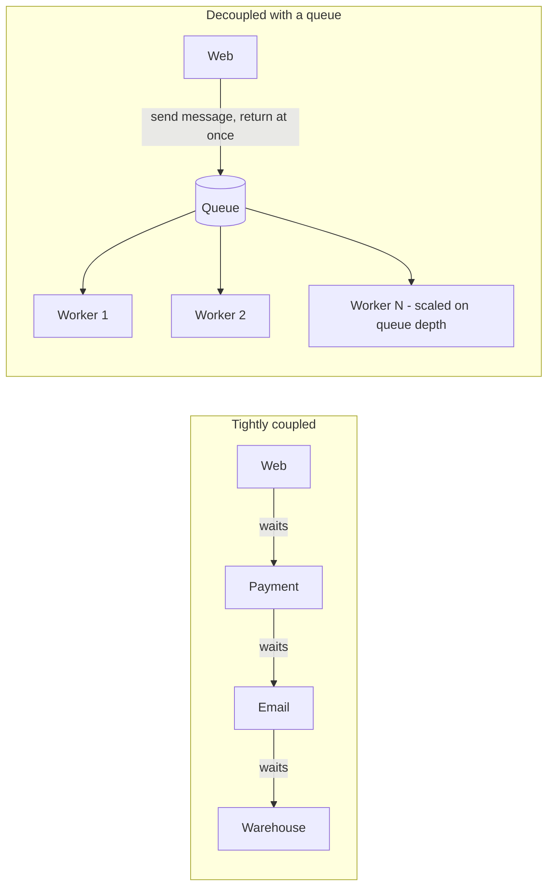
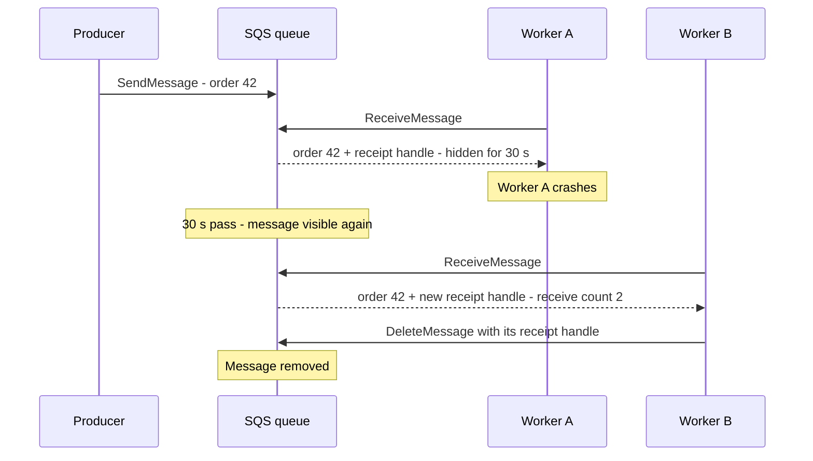
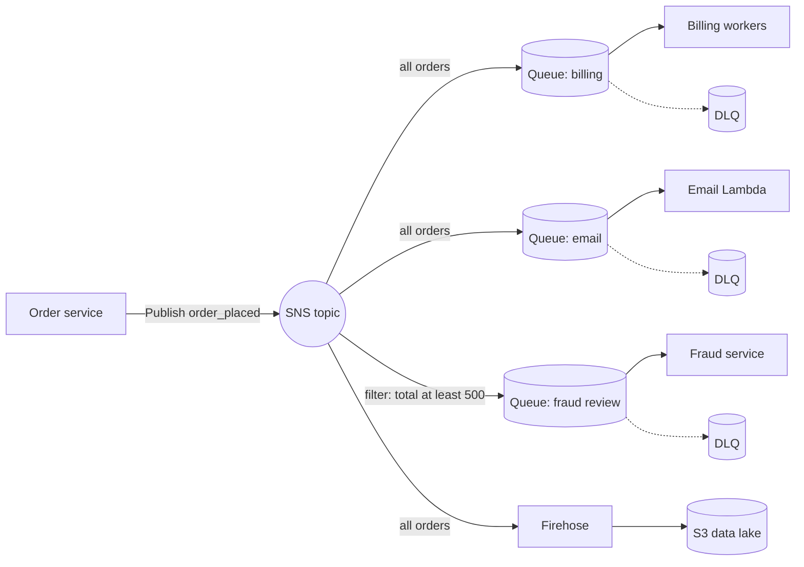

# SQS and SNS: queues, topics and fan-out

## Before this lesson

You should know what an event and decoupling are ([EventBridge and X-Ray](#/lesson/aws/eventbridge-xray)), how Auto Scaling groups work ([EC2 Auto Scaling](#/lesson/aws/auto-scaling)) and the basics of IAM resource policies ([IAM identities](#/lesson/aws/iam-identities)).

## In plain words

When one part of a system calls another directly and waits for the answer, the two are chained together: if the second is slow, the first is slow; if the second is down, the first fails. **Messaging services** break that chain by putting something in the middle.

- **Amazon SQS** (Simple Queue Service) is a **queue**: a waiting line for messages. One program drops a message in and gets on with its day. Another program takes messages out when it is ready. Each message is handled by **one** worker.
- **Amazon SNS** (Simple Notification Service) is a **topic**: a loudspeaker. One program announces a message and **every subscriber** gets its own copy at once.

Two everyday pictures. A queue is the **in-tray on a desk**: colleagues leave documents in it at any time, and you work through them at your own pace; if you are out for an hour, nothing is lost — the pile is taller when you return. A topic is a **newsletter**: the editor writes once and everyone on the mailing list receives it.

Put together they form the most common integration pattern on AWS, called **fan-out**: publish once to a topic, and let several queues each receive a copy for a different job.

Why it matters for a job: "decouple the components with a queue" is one of the most frequent correct answers in AWS architecture questions. Understanding visibility timeouts, dead-letter queues and standard-versus-FIFO is what distinguishes someone who has used queues from someone who has heard of them.

## Why queues make systems better

Consider a bookshop site where placing an order triggers payment, a confirmation email, a warehouse instruction and a loyalty-points update. Done synchronously in one web request, the customer waits for all four and the order fails if any one of them is down.

With a queue in between:

1. **Resilience**: the web tier accepts the order and enqueues work. If the email service is down for ten minutes, messages wait and are processed when it returns.
2. **Load levelling**: a burst of 10,000 orders becomes a tall queue, not a crashed warehouse service. Workers drain it at a steady rate.
3. **Independent scaling**: add workers when the queue is long, remove them when it is empty.
4. **Simpler producers**: the sender needs to know only the queue, not who consumes it.



The trade-off: the work becomes **asynchronous**. The customer is told "order received", not "order fully processed", and the system must cope with messages that arrive late, twice, or out of order.

## SQS basics

A **producer** calls `SendMessage`. A **consumer** calls `ReceiveMessage`, does the work, then calls `DeleteMessage`. SQS is **pull-based**: nothing is pushed to consumers; they ask.

Facts:

- A message is up to **1 MiB** of text (raised from the 256 KB that older material quotes; for larger payloads, store the body in S3 and send a pointer — the *claim-check* pattern).
- **Retention**: messages wait up to 4 days by default, configurable from 1 minute to **14 days**. Unprocessed messages older than that are discarded.
- A standard queue has effectively **unlimited throughput** and needs no capacity planning.
- Messages are stored redundantly across several Availability Zones.

### The visibility timeout

This is the mechanism to understand above all others.

When a consumer receives a message, SQS does **not** delete it. It **hides** it from other consumers for the **visibility timeout** (30 seconds by default, up to 12 hours).

- If the consumer finishes and calls `DeleteMessage` in time, the message is gone.
- If the consumer crashes, or takes too long, the timeout expires, the message **becomes visible again**, and another consumer receives it.



No message is lost when a worker dies; the price is that a message may be delivered **more than once**. This guarantee is called **at-least-once delivery**, and it has a consequence you must design for: consumers have to be **idempotent**, meaning that processing the same message twice does no harm. Typical techniques: record processed message IDs, or make the operation naturally repeatable ("set status to SHIPPED" is safe twice; "add 10 points" is not).

Setting the timeout:

- **Too short** → messages reappear while still being worked on, causing duplicates.
- **Too long** → after a crash, the message waits needlessly before being retried.
- Rule of thumb: several times the normal processing time. A consumer that needs longer for one message can extend it with `ChangeMessageVisibility` (a *heartbeat*).

Each successful receive returns a **receipt handle**, a token valid for that delivery only. Deleting requires the handle from the latest receive.

### Dead-letter queues

Some messages can never be processed — malformed data, a bug triggered by one particular input. Such a **poison message** would be received, fail, reappear and fail again for ever, wasting workers.

A **dead-letter queue (DLQ)** is an ordinary queue designated to collect these. A **redrive policy** on the source queue sets `maxReceiveCount`: after that many receives without deletion, SQS moves the message to the DLQ.

- Alarm on the DLQ's `ApproximateNumberOfMessagesVisible` being above zero: something needs a human.
- After fixing the bug, **redrive** moves messages from the DLQ back to the source queue.
- Give the DLQ a longer retention than the source queue.

### Simulate the visibility timeout and a DLQ

```python-run
class Queue:
    def __init__(self, visibility_timeout, max_receive):
        self.vt, self.max_receive = visibility_timeout, max_receive
        self.messages, self.dlq = [], []          # each message: dict with body, visible_at, count

    def send(self, t, body):
        self.messages.append({"body": body, "visible_at": t, "count": 0})

    def receive(self, t):
        for m in list(self.messages):
            if m["visible_at"] > t:               # hidden: someone is working on it
                continue
            if m["count"] >= self.max_receive:    # received too often: dead-letter it
                self.messages.remove(m)
                self.dlq.append(m["body"])
                continue
            m["count"] += 1
            m["visible_at"] = t + self.vt         # hide it for the visibility timeout
            return m
        return None

    def delete(self, m):
        self.messages.remove(m)

q = Queue(visibility_timeout=30, max_receive=3)
q.send(0, "order 41")
q.send(0, "order 42 (malformed)")

def worker(body):                                 # pretend processing: fails on the bad message
    return "malformed" not in body

for t in range(0, 151, 10):                       # one worker polls every 10 seconds
    m = q.receive(t)
    if m is None:
        print(f"t={t:3d}  nothing visible")
    elif worker(m["body"]):
        q.delete(m)
        print(f"t={t:3d}  processed and deleted: {m['body']}")
    else:
        print(f"t={t:3d}  FAILED (attempt {m['count']}): {m['body']} - hidden until t={m['visible_at']}")
print("dead-letter queue:", q.dlq)
```

Line by line: `receive` skips hidden messages, moves a message to the DLQ once it has already been received `max_receive` times, and otherwise bumps the count and hides the message; `delete` removes it for good. In the run, order 41 is processed at once. The malformed order fails at t=10, is invisible until t=40, fails again, and after its third failure is moved to the dead-letter queue on the next poll — the worker is then free and the bad message is preserved for inspection. The problem *SQS Queue Simulator* asks you to build this with receipt handles and FIFO groups.

### Long polling

By default `ReceiveMessage` returns immediately, often empty (**short polling**). A consumer looping on that makes huge numbers of pointless, billed requests. **Long polling** — `WaitTimeSeconds` up to 20 — makes the call wait until a message arrives or the time runs out. It cuts cost and reduces delay. Always enable it.

Other controls: **delay queues** postpone delivery of new messages (up to 15 minutes); **batching** sends, receives or deletes up to 10 messages per request, cutting cost tenfold.

## Standard versus FIFO queues

| | Standard | FIFO |
|---|---|---|
| Ordering | Best effort — may arrive out of order | Strict, per **message group** |
| Delivery | At least once (occasional duplicates) | Exactly-once *processing*, with deduplication |
| Throughput | Practically unlimited | 300 messages/s (3,000 with batching); more in high-throughput mode |
| Name | Any | Must end in `.fifo` |
| Use for | Most workloads | When order or duplicates would break correctness: financial operations, state machines per entity |

FIFO stands for "first in, first out". Two concepts make FIFO queues work:

- **Message group ID**: order is guaranteed *within* a group, and groups are processed in parallel. Use the entity whose events must stay ordered — the order ID, the account ID. While one message of a group is in flight, later messages of that group wait. A single group ID for everything means a single-file queue with no parallelism.
- **Deduplication**: a message sent again with the same *deduplication ID* (or, with content-based deduplication, the same body) within five minutes is accepted but not delivered a second time. This protects against producers that retry.

Choose standard unless you can name the harm that reordering or duplication would cause. Even with FIFO, consumers should remain idempotent, because a consumer can still crash after doing the work and before deleting the message.

## SNS basics

A **publisher** sends a message to a **topic**. SNS **pushes** a copy to every **subscription**. Subscriber types:

- **SQS queues**, **Lambda functions**, **HTTP/HTTPS endpoints**, **Amazon Data Firehose** (application-to-application);
- **email**, **SMS**, **mobile push notifications** (application-to-person).

Facts:

- Up to 256 KB per message; no storage — if a subscriber is unreachable, SNS retries according to a delivery policy and can send failures to a per-subscription **dead-letter queue**.
- **Standard topics**: at-least-once, best-effort order, very high throughput. **FIFO topics**: strict order and deduplication, delivering to FIFO queues.
- A topic's **access policy** (a resource policy) controls who may publish and subscribe — this is how S3 or EventBridge are allowed to publish.

### Message filtering

By default every subscriber receives everything. A **filter policy** on a subscription selects only the messages it wants, by matching **message attributes** (or the message body).

```json
{
  "event_type": ["order_placed"],
  "country": ["FR", "DE"],
  "total": [{"numeric": [">=", 500]}]
}
```

Reading it: deliver only messages whose `event_type` is `order_placed` **and** whose `country` is `FR` **or** `DE` **and** whose `total` is at least 500. Different attribute names are combined with AND; values within one array with OR — the same logic as EventBridge patterns. Filtering in SNS means subscribers never receive (or pay to process) irrelevant messages. The problem *SNS Fan-Out with Filter Policies* has you implement the matching.

## The fan-out pattern

Publishing straight to several Lambda functions or HTTP endpoints works, but each subscriber must be available at that instant. Putting an **SQS queue between the topic and each consumer** gives every consumer its own durable buffer, its own retry behaviour and its own pace.



Benefits: the order service publishes once and knows nothing about consumers; adding a fifth consumer is a new subscription with no change to existing code; a failure in fraud review does not delay billing; each queue has its own DLQ.

## Worked example: fan-out with a filter and a DLQ

> [!WARNING]
> SQS and SNS each include one million free requests per month permanently, so this exercise costs nothing — unless a consumer polls in a tight loop without long polling. Delete the queues and topic afterwards.

```bash
# 1. A dead-letter queue and a main queue that uses it.
DLQ_URL=$(aws sqs create-queue --queue-name fraud-dlq \
  --attributes MessageRetentionPeriod=1209600 --query QueueUrl --output text)
DLQ_ARN=$(aws sqs get-queue-attributes --queue-url "$DLQ_URL" \
  --attribute-names QueueArn --query Attributes.QueueArn --output text)

Q_URL=$(aws sqs create-queue --queue-name fraud-review --attributes "{
  \"VisibilityTimeout\": \"120\",
  \"ReceiveMessageWaitTimeSeconds\": \"20\",
  \"RedrivePolicy\": \"{\\\"deadLetterTargetArn\\\":\\\"$DLQ_ARN\\\",\\\"maxReceiveCount\\\":\\\"5\\\"}\"
}" --query QueueUrl --output text)
```

- `MessageRetentionPeriod=1209600` is 14 days in seconds, the maximum, for the DLQ.
- `VisibilityTimeout 120`: a worker has two minutes per message.
- `ReceiveMessageWaitTimeSeconds 20`: long polling by default for every consumer.
- `RedrivePolicy` is itself a JSON string inside JSON (hence the heavy escaping): after 5 failed receives, move to the DLQ.

```bash
# 2. A topic, and a subscription for the queue with a filter policy.
TOPIC=$(aws sns create-topic --name orders --query TopicArn --output text)
Q_ARN=$(aws sqs get-queue-attributes --queue-url "$Q_URL" \
  --attribute-names QueueArn --query Attributes.QueueArn --output text)

aws sns subscribe --topic-arn "$TOPIC" --protocol sqs --notification-endpoint "$Q_ARN" \
  --attributes '{"FilterPolicy": "{\"total\": [{\"numeric\": [\">=\", 500]}]}",
                 "RawMessageDelivery": "true"}'
```

`RawMessageDelivery` delivers the message body as published instead of wrapping it in an SNS envelope. One step is still missing and is the usual reason "nothing arrives": the **queue's access policy** must allow the topic to send to it:

```json
{
  "Version": "2012-10-17",
  "Statement": [{
    "Effect": "Allow",
    "Principal": {"Service": "sns.amazonaws.com"},
    "Action": "sqs:SendMessage",
    "Resource": "arn:aws:sqs:eu-west-1:111122223333:fraud-review",
    "Condition": {"ArnEquals": {"aws:SourceArn": "arn:aws:sns:eu-west-1:111122223333:orders"}}
  }]
}
```

The condition restricts the permission to messages coming from this one topic.

```bash
# 3. Publish two orders; only the large one should reach the fraud queue.
aws sns publish --topic-arn "$TOPIC" --message '{"orderId": "8841", "total": 640}' \
  --message-attributes '{"total": {"DataType": "Number", "StringValue": "640"}}'
aws sns publish --topic-arn "$TOPIC" --message '{"orderId": "8842", "total": 35}' \
  --message-attributes '{"total": {"DataType": "Number", "StringValue": "35"}}'

# 4. Receive (long poll), process, delete.
aws sqs receive-message --queue-url "$Q_URL" --wait-time-seconds 20 --max-number-of-messages 10 \
  --query "Messages[].[Body,ReceiptHandle]" --output text
```

```
{"orderId": "8841", "total": 640}    AQEBwJnKyrHigUMZj6rYigCgxlaS3SLy0a...
```

```bash
aws sqs delete-message --queue-url "$Q_URL" --receipt-handle "AQEBwJnKyrHigUMZj6rYigCgxlaS3SLy0a..."
```

Only order 8841 arrived. Forgetting the final `delete-message` is the classic beginner bug: the message reappears after the visibility timeout and is processed again and again until it lands in the DLQ.

## Consuming with Lambda

A Lambda function can be attached to a queue with an **event source mapping**: Lambda polls for you, invokes the function with a batch of messages, and deletes them when the function succeeds. If the function fails, the batch becomes visible again — unless the function reports **partial batch failures**, in which case only the failed messages return. Set the queue's visibility timeout to at least six times the function timeout.

## Choosing between the messaging services

| Question | SQS | SNS | EventBridge | Kinesis Data Streams |
|---|---|---|---|---|
| Model | Queue (pull) | Topic (push, fan-out) | Event bus with rules | Ordered, replayable stream |
| Who gets a message | One consumer | Every subscriber | Every matching target | Every consumer application |
| Stored? | Up to 14 days, until deleted | No | No (optional archive) | 1 to 365 days, replayable |
| Ordering | FIFO queues only | FIFO topics only | No | Per shard |
| Best for | Buffering work, decoupling tiers | Broadcasting, notifications | Routing events by content, SaaS and AWS events, schedules | High-volume real-time data, analytics |

Kinesis is the subject of the next lesson. **Amazon MQ** (managed ActiveMQ and RabbitMQ) exists for migrating applications that depend on standard messaging protocols such as JMS or AMQP; for new cloud-native designs prefer SQS and SNS.

## Cost notes and free-tier warnings

- **SQS** charges per request (send, receive, delete — each up to 64 KB chunk; a batch of 10 counts as one request per chunk). FIFO costs more per request than standard. Empty receives are requests too: use long polling.
- **SNS** charges per publish and per delivery, with prices varying a great deal by protocol: deliveries to SQS and Lambda are free or nearly so; **SMS is expensive** and priced per message per country.
- Data transfer within a Region between these services is free.
- A poison message without a DLQ is a slow cost leak: it is received (and billed, and processed) for up to 14 days.

## Pitfalls

- **Not deleting messages after processing.**
- **Visibility timeout shorter than processing time**, producing duplicate work.
- **Non-idempotent consumers** on an at-least-once queue.
- **No dead-letter queue**, or a DLQ nobody monitors.
- **Short polling in a tight loop.**
- **Using FIFO with one message group for everything**, then wondering why throughput is poor.
- **Expecting SNS to keep messages for subscribers that are offline.** Put a queue behind each subscription.
- **Forgetting the queue's access policy** when subscribing it to a topic.
- **Putting large payloads in messages** instead of an S3 pointer.
- **Treating a queue as a database**: messages expire, and you cannot query a queue.

> [!INTERVIEW]
> **"What is the visibility timeout?"** After a consumer receives a message, SQS hides it from other consumers for that period. If the consumer deletes it in time, it is gone; otherwise it becomes visible again and is redelivered. That gives at-least-once delivery without losing messages when a consumer fails, and it is why consumers must be idempotent and the timeout must exceed processing time.
>
> **"SQS or SNS?"** SQS when one consumer (or a pool of identical workers) should process each message, at its own pace, with buffering. SNS when one message must reach several different consumers. Combine them — SNS fan-out to SQS queues — to get broadcast and durable per-consumer buffering together.

## Cheat sheet

| Need | Answer |
|---|---|
| Decouple and buffer work | SQS standard queue |
| Strict order, no duplicates | SQS FIFO with message group IDs |
| One message to many consumers | SNS topic |
| Broadcast with durable buffers | SNS → several SQS queues (fan-out) |
| Subscribers want a subset | SNS filter policy |
| Handle poison messages | DLQ with `maxReceiveCount` |
| Fewer empty receives | Long polling (`WaitTimeSeconds` up to 20) |
| Messages larger than the 1 MiB limit | Body in S3, pointer in the message |
| Processing takes longer than expected | Extend with `ChangeMessageVisibility` |
| Max retention | 14 days |

## Summary

- Queues and topics decouple producers from consumers, absorbing bursts and failures.
- SQS is pull-based: receive hides a message for the visibility timeout and the consumer must delete it; otherwise it is redelivered, giving at-least-once delivery that demands idempotent consumers.
- Dead-letter queues capture messages that repeatedly fail; long polling and batching cut cost.
- Standard queues maximise throughput; FIFO queues add ordering per message group and deduplication.
- SNS pushes each message to all subscribers, optionally filtered; SNS in front of SQS queues is the fan-out pattern.

## Glossary

- **Asynchronous**: not waiting for the result before continuing.
- **At-least-once delivery**: every message is delivered, sometimes more than once.
- **Claim check**: storing a large payload elsewhere and sending a reference.
- **Consumer / producer**: the receiver / sender of messages.
- **Dead-letter queue (DLQ)**: where repeatedly failing messages are moved.
- **Deduplication ID**: a FIFO token that suppresses repeated sends for five minutes.
- **Fan-out**: delivering one message to many consumers.
- **FIFO**: first in, first out.
- **Filter policy**: a subscription rule selecting which messages are delivered.
- **Idempotent**: safe to perform more than once.
- **Long polling**: a receive call that waits for messages.
- **Message group ID**: the FIFO key within which order is preserved.
- **Poison message**: a message that can never be processed successfully.
- **Receipt handle**: the token identifying one delivery of a message.
- **Redrive**: moving messages to a DLQ, or back from it.
- **Topic**: an SNS channel that pushes messages to subscribers.
- **Visibility timeout**: how long a received message stays hidden.

```quiz
[
  {"q": "A worker receives a message, processes it for 90 seconds, and deletes it. The queue's visibility timeout is 30 seconds. What happens?",
   "options": ["Nothing unusual", "The message becomes visible again after 30 s and other workers process it too, causing duplicates", "The message is moved to the DLQ after 30 s", "The delete call is rejected and the message is lost"],
   "answer": 1,
   "explain": "When the timeout expires before deletion, SQS makes the message available again. Set the timeout above the processing time or extend it during processing."},
  {"q": "One malformed message keeps failing and being retried, slowing down the queue. Which feature isolates it for later analysis?",
   "options": ["Long polling", "A dead-letter queue with a redrive policy (maxReceiveCount)", "A delay queue", "A FIFO queue"],
   "answer": 1,
   "explain": "After the configured number of receives without deletion, SQS moves the message to the DLQ, freeing consumers and preserving the message."},
  {"q": "A bank must apply debits and credits for each account in the exact order they were issued, without duplicates, while different accounts are processed in parallel. Which configuration?",
   "options": ["Standard queue", "FIFO queue with the account ID as message group ID", "FIFO queue with one group ID for all messages", "SNS standard topic"],
   "answer": 1,
   "explain": "FIFO queues guarantee order within a message group and deduplicate; using the account ID as the group allows parallelism across accounts."},
  {"q": "When an order is placed, the billing, shipping and analytics systems must each process it independently, and a failure in one must not affect the others. Which design?",
   "options": ["One SQS queue polled by all three systems", "An SNS topic with three SQS queues subscribed, one per system", "Three direct HTTP calls from the order service", "A single FIFO queue"],
   "answer": 1,
   "explain": "With one shared queue each message goes to only one consumer. Fan-out through SNS to a queue per system gives every system its own durable copy."},
  {"q": "A consumer polls an almost empty queue in a loop and the SQS request count is very high. What reduces cost and latency?",
   "options": ["Decrease the visibility timeout", "Enable long polling with a wait time up to 20 seconds", "Switch to FIFO", "Increase message retention"],
   "answer": 1,
   "explain": "Long polling holds the request open until a message arrives or the wait time ends, eliminating most empty responses."},
  {"q": "An SQS queue is subscribed to an SNS topic, but published messages never appear in the queue. The subscription is confirmed and has no filter. What is the likely cause?",
   "options": ["SNS cannot deliver to SQS", "The queue's access policy does not allow the topic to send messages", "The visibility timeout is too long", "The queue is standard"],
   "answer": 1,
   "explain": "SQS needs a resource policy allowing sqs:SendMessage from the SNS service for that topic's ARN."},
  {"q": "Why must consumers of a standard SQS queue be idempotent?",
   "options": ["Because messages are encrypted", "Because delivery is at-least-once, so the same message can be delivered more than once", "Because queues are regional", "Because messages are limited to 1 MiB"],
   "answer": 1,
   "explain": "Duplicates can arise from redelivery after a timeout or from the distributed nature of standard queues; processing must tolerate repeats."},
  {"q": "A subscriber should receive only messages where the attribute 'severity' is 'critical'. Where is this configured?",
   "options": ["In the publisher's code", "In a filter policy on that subscription", "In the queue's redrive policy", "In the topic name"],
   "answer": 1,
   "explain": "Subscription filter policies let SNS deliver only matching messages, without publishers knowing about subscribers' interests."}
]
```

> **Source:** AWS Certified Solutions Architect Official Study Guide, ch. 8 (Amazon SQS: message lifecycle, visibility timeout, delay queues, long polling, dead-letter queues; Amazon SNS: topics, subscriptions, fan-out). FIFO queues and topics and subscription filter policies post-date the book; checked against https://docs.aws.amazon.com/AWSSimpleQueueService/latest/SQSDeveloperGuide/welcome.html , https://docs.aws.amazon.com/AWSSimpleQueueService/latest/SQSDeveloperGuide/sqs-visibility-timeout.html , https://docs.aws.amazon.com/AWSSimpleQueueService/latest/SQSDeveloperGuide/sqs-fifo-queues.html and https://docs.aws.amazon.com/sns/latest/dg/sns-message-filtering.html
