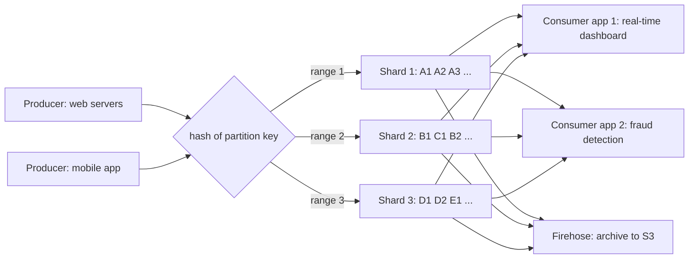
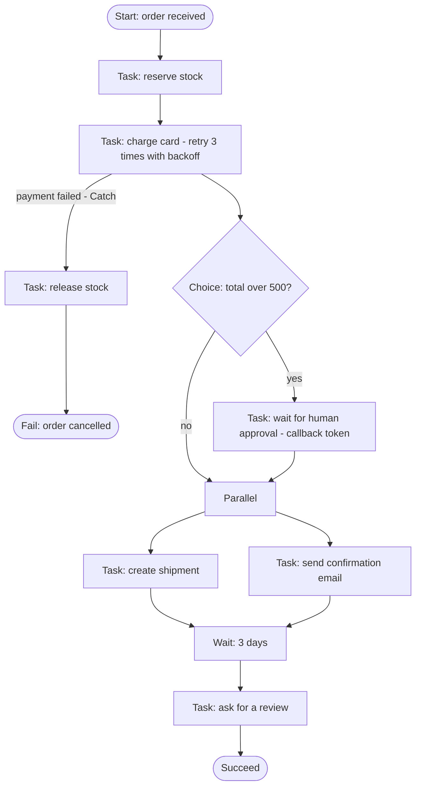

# Kinesis, Step Functions and SWF

## Before this lesson

Read [SQS and SNS](#/lesson/aws/messaging) first: queues, at-least-once delivery and idempotency are assumed. You should also know what a Lambda function is in outline (code AWS runs on demand; [Lambda and API Gateway](#/lesson/aws/lambda-apigw) has the detail) and what a partition key does in DynamoDB ([DynamoDB](#/lesson/aws/dynamodb)) — Kinesis uses the same idea.

## In plain words

The last lesson covered messages that are *work to be done once*. This lesson covers two other shapes of asynchronous processing.

**Streams — Amazon Kinesis.** Some data never stops arriving: clicks on a website, temperature readings from ten thousand sensors, log lines, card transactions. You do not want to "process each one once and throw it away"; you want a **continuous, ordered record** that several different programs can read, each at its own speed, and that can be **re-read from the beginning** if needed. A queue is an in-tray: once a letter is dealt with, it is gone. A stream is a **conveyor belt with a video recording**: everyone watches the same items go past, and anyone can rewind the tape.

**Workflows — AWS Step Functions.** Many business processes are a sequence of steps with decisions, retries and waits: *reserve stock → charge the card → if that fails, release the stock → otherwise create the shipment → wait for the courier → send the email*. You could hide that logic inside one big program, or scatter it across services that call each other. Step Functions lets you draw it as a **flowchart that AWS executes**, remembering where each order is in the chart, retrying failed steps, and showing you exactly where anything got stuck.

Why it matters for a job: "real-time analytics", "clickstream" and "IoT ingestion" in a question point at Kinesis; "orchestrate", "long-running", "human approval" and "saga" point at Step Functions. Knowing when a stream beats a queue is a classic interview comparison.

## Streams versus queues

| | SQS queue | Kinesis data stream |
|---|---|---|
| After a consumer processes a record | Deleted | **Stays** until the retention period ends |
| Consumers | Compete: each message goes to one | **Independent**: every application reads everything |
| Replay | No | **Yes**, from any point in the retention window |
| Order | FIFO queues only | **Per partition key** (per shard) |
| Scaling unit | None to manage | Shards (or on-demand mode) |
| Typical use | Jobs, commands, decoupling | Events, telemetry, logs, analytics, change data capture |

Rule of thumb: if each item is a **task** that one worker should perform, use a queue. If each item is a **fact** that several systems want to observe, in order, possibly more than once, use a stream.

## Kinesis Data Streams

### Records, shards and partition keys

- A **record** is one item of data: up to 1 MB, plus a **partition key** you choose and a **sequence number** assigned by Kinesis.
- A stream is made of **shards**. A shard is an ordered sequence of records and the unit of capacity:
  - **writes**: up to **1 MB per second or 1,000 records per second** per shard;
  - **reads**: up to **2 MB per second** per shard, shared by all consumers using the standard mode.
- The **partition key** decides the shard. Kinesis takes the MD5 hash of the key — a 128-bit number — and each shard owns a contiguous range of that number space.

Consequences:

1. **All records with the same partition key go to the same shard, in order.** Use the entity whose events must stay ordered: device ID, user ID, order ID.
2. **A skewed key creates a hot shard.** If one customer produces half the traffic and the key is the customer ID, that one shard is overloaded however many shards exist. Writes beyond a shard's limit fail with `ProvisionedThroughputExceededException`. This is the same hot-partition problem as in DynamoDB, with the same remedies: a higher-cardinality key or a random suffix when strict order per entity is not required.



### Capacity modes

- **Provisioned**: you choose the number of shards and pay per shard-hour. Change it by **splitting** a shard in two or **merging** two neighbours (*resharding*).
- **On-demand**: Kinesis manages shards automatically and you pay per GB written and read. It accommodates up to double the previous peak; the right choice for new or unpredictable workloads.

Sizing a provisioned stream is arithmetic that exams like:

```python-run
import math, hashlib

def shards_needed(write_kb_per_s, records_per_s, read_kb_per_s):
    return max(1,
               math.ceil(write_kb_per_s / 1024),     # 1 MB/s write per shard
               math.ceil(records_per_s / 1000),      # 1,000 records/s per shard
               math.ceil(read_kb_per_s / 2048))      # 2 MB/s read per shard

# 4,000 sensors, each sending one 2 KB reading per second; two consumer apps read everything.
writes_kb = 4000 * 2
n = shards_needed(writes_kb, 4000, 2 * writes_kb)
print("shards needed:", n, "(write volume, record count and shared read throughput all considered)")

def shard_for(key, shard_count):
    h = int(hashlib.md5(key.encode()).hexdigest(), 16)       # 128-bit hash of the key
    return h * shard_count // 2**128                         # which equal slice it falls in

good = [f"sensor-{i:04d}" for i in range(4000)]              # one key per sensor
bad = ["plant-A"] * 3000 + ["plant-B"] * 1000                # two keys for everything
for name, keys in (("key = sensor id", good), ("key = plant name", bad)):
    counts = [0] * n
    for k in keys:
        counts[shard_for(k, n)] += 1
    print(f"{name:17s} records per shard: {counts}")
```

Line by line: `shards_needed` takes the largest of the three per-shard limits. For 8 MB/s of writes, 4,000 records/s and 16 MB/s of total reads the stream needs 8 shards. `shard_for` reproduces the routing: hash the key, scale the 128-bit result to a shard index. With one key per sensor the 4,000 records spread almost evenly; with two plant names everything lands on at most two shards, each far beyond its 1,000 records-per-second limit, while the other shards sit empty. The problem *Kinesis Shard Count and Partition Keys* asks you to code this.

### Retention and replay

Records are kept for **24 hours by default**, extendable to **365 days**. A consumer chooses where to start: the oldest record (`TRIM_HORIZON`), only new records (`LATEST`), a timestamp, or a sequence number. Deploy a fixed version of a consumer and re-read yesterday's data — something a queue cannot offer.

### Producers and consumers

**Writing**: the `PutRecord` / `PutRecords` API through an SDK, the Kinesis Producer Library (batching and retries for high volume), or the Kinesis Agent for log files. Many AWS services can write to a stream directly (CloudWatch Logs subscriptions, DynamoDB change streams, IoT Core, EventBridge).

**Reading**:

- **Lambda** with an event source mapping: Lambda polls each shard and invokes your function with a batch, in order per shard. A failing batch is retried and **blocks that shard** until it succeeds, expires or is sent to an on-failure destination; configure *bisect on error* and a maximum retry count so that one bad record cannot stall the stream for a day.
- The **Kinesis Client Library (KCL)** on EC2 or containers: it coordinates several workers, assigns shards to them, and stores each shard's **checkpoint** — the position processed so far — in a DynamoDB table.
- **Standard consumers** share the 2 MB/s per shard between them. **Enhanced fan-out** gives *each* registered consumer its own 2 MB/s per shard, pushed over HTTP/2 with about 70 ms latency, for an extra charge. Use it when several applications read the same busy stream.

Delivery is **at least once**: after a crash a consumer resumes from its last checkpoint and may reprocess a few records, so consumers must be idempotent.

```bash
# Create an on-demand stream, write one record, read it back.
aws kinesis create-stream --stream-name clicks \
  --stream-mode-details StreamMode=ON_DEMAND

aws kinesis put-record --stream-name clicks --partition-key user-1042 \
  --data "$(echo -n '{"page":"/books/42","ts":"2026-11-21T10:15:02Z"}' | base64)"
```

```
{
    "ShardId": "shardId-000000000002",
    "SequenceNumber": "49650127346721823479016782378123782"
}
```

- `--partition-key` chooses the shard; every click of user 1042 will land on shard 2, in order.
- `--data` must be Base64-encoded on the command line; SDKs do that for you.
- The response gives the shard and the record's sequence number.

```bash
ITER=$(aws kinesis get-shard-iterator --stream-name clicks \
  --shard-id shardId-000000000002 --shard-iterator-type TRIM_HORIZON \
  --query ShardIterator --output text)
aws kinesis get-records --shard-iterator "$ITER" --query "Records[].Data" --output text | base64 -d
```

```
{"page":"/books/42","ts":"2026-11-21T10:15:02Z"}
```

A **shard iterator** is a cursor into one shard; `TRIM_HORIZON` starts at the oldest retained record. Real consumers use Lambda or the KCL instead of these low-level calls.

> [!WARNING]
> A provisioned stream bills for every shard-hour whether or not data flows, and Kinesis has no always-free allowance. Delete test streams: `aws kinesis delete-stream --stream-name clicks`.

## Amazon Data Firehose

**Amazon Data Firehose** (formerly Kinesis Data Firehose) is the easy path when the goal is "get this streaming data *into a store*". It is a fully managed **delivery stream**: no shards, no consumers to write.

- **Sources**: direct `PutRecord` calls, a Kinesis data stream, an MSK topic, CloudWatch Logs, EventBridge, IoT.
- **Destinations**: **S3**, **Redshift**, **OpenSearch**, Apache Iceberg tables, Splunk, generic HTTP endpoints and several monitoring vendors.
- It **buffers** records and delivers a batch when a size (for example 5 MB) or a time (for example 60 seconds) threshold is reached — so it is **near real time**, not real time.
- On the way it can **transform** records with a Lambda function, **convert** JSON to columnar Parquet or ORC, **compress**, and partition the output by date or by a field.
- There is **no replay** and no multiple-consumer model: it delivers and forgets.

| | Kinesis Data Streams | Amazon Data Firehose |
|---|---|---|
| Purpose | Real-time stream for custom consumers | Load streaming data into storage and analytics |
| Latency | Sub-second (about 200 ms; 70 ms with enhanced fan-out) | Seconds to minutes (buffered) |
| Capacity | Shards or on-demand | Fully automatic |
| Retention and replay | 1–365 days, replayable | None |
| You write | Producers and consumers | Nothing (optional transform function) |

They are often chained: producers → Data Streams → (real-time consumers) **and** → Firehose → S3 data lake.

The rest of the family, briefly: **Amazon Managed Service for Apache Flink** runs stream-processing programs (windowed aggregations, joins between streams) on Kinesis or Kafka data; **Amazon MSK** is managed Apache Kafka, the choice when you need Kafka's API and ecosystem; **Kinesis Video Streams** ingests video from cameras.

## Step Functions

### Orchestration and choreography

There are two ways for services to cooperate on a multi-step process.

- **Choreography**: each service reacts to events and emits new ones (EventBridge, SNS). Nobody is in charge. Flexible and loosely coupled, but the overall flow exists only in people's heads, and "where is order 8841 stuck?" is hard to answer.
- **Orchestration**: one coordinator calls each step in turn and tracks progress. The flow is explicit and observable. **Step Functions** is the AWS orchestrator.

Use choreography between independent domains and orchestration inside a business process that has a clear owner.

### State machines

A workflow is a **state machine**, written in JSON in the **Amazon States Language**. Each run of it is an **execution**. The states:

| State | Does |
|---|---|
| **Task** | One unit of work: invoke a Lambda function, run an ECS task, call almost any AWS API directly, or wait for an external worker |
| **Choice** | Branch on the data |
| **Parallel** | Run several branches at the same time and wait for all |
| **Map** | Run the same steps for each item of a list (the *distributed* mode handles millions of items from S3) |
| **Wait** | Pause for a duration or until a timestamp — up to a year, at no compute cost |
| **Pass** | Reshape data without doing work |
| **Succeed / Fail** | End the execution |



A fragment of the definition for the payment step:

```json
{
  "ChargeCard": {
    "Type": "Task",
    "Resource": "arn:aws:states:::lambda:invoke",
    "Arguments": {
      "FunctionName": "arn:aws:lambda:eu-west-1:111122223333:function:charge-card",
      "Payload": ""
    },
    "Retry": [{
      "ErrorEquals": ["Lambda.TooManyRequestsException", "PaymentGatewayTimeout"],
      "IntervalSeconds": 2,
      "BackoffRate": 2.0,
      "MaxAttempts": 3,
      "JitterStrategy": "FULL"
    }],
    "Catch": [{
      "ErrorEquals": ["States.ALL"],
      "Next": "ReleaseStock"
    }],
    "Next": "IsLargeOrder"
  }
}
```

Field by field:

- `Type: Task` with the `lambda:invoke` resource calls a Lambda function, passing the state's input as the payload.
- `Retry` lists error names and a policy: wait 2 seconds, then 4, then 8 (`BackoffRate` doubles the interval — **exponential backoff**), at most three attempts, with random **jitter** so that many executions do not retry in step.
- `Catch` says where to go if the error is not retried or retries are exhausted. `States.ALL` matches any error. Here the flow moves to `ReleaseStock` — a **compensating action** that undoes an earlier step.
- `Next` names the following state on success.

Undoing completed steps when a later one fails, instead of holding one database transaction across services, is the **saga pattern**, and it is the textbook Step Functions use case.

Retries, error handling, parallelism, timeouts and waits are declared in the workflow instead of being written, tested and debugged in application code. The console draws each execution on the flowchart with every state's input, output and timing — an operational superpower.

### Integration patterns

- **Request/response**: call a service and continue as soon as it accepts the request.
- **Run a job (`.sync`)**: start a job (a Batch job, an ECS task, a Glue job, another state machine) and wait until it finishes.
- **Wait for callback (`.waitForTaskToken`)**: hand a **task token** to an external system or a human and pause — for minutes or months — until someone calls back with that token. This is how approvals work.

### Standard and Express workflows

| | Standard | Express |
|---|---|---|
| Maximum duration | **1 year** | **5 minutes** |
| Execution guarantee | Exactly once per state | At least once (asynchronous) or at most once (synchronous) |
| Pricing | Per **state transition** | Per execution, duration and memory |
| History | Kept and browsable for 90 days | Sent to CloudWatch Logs |
| Use for | Long-running, auditable business processes, approvals | High-volume, short event processing; request-time orchestration behind an API |

```bash
# Start an execution of a Standard workflow and see what it did.
EXEC=$(aws stepfunctions start-execution \
  --state-machine-arn arn:aws:states:eu-west-1:111122223333:stateMachine:order-fulfilment \
  --name order-8841 --input '{"orderId": "8841", "total": 640}' \
  --query executionArn --output text)

aws stepfunctions describe-execution --execution-arn "$EXEC" --query "[status,startDate,stopDate]"
aws stepfunctions get-execution-history --execution-arn "$EXEC" \
  --query "events[?type=='TaskFailed' || type=='ExecutionSucceeded'].[timestamp,type]" --output table
```

`--name` must be unique per state machine for 90 days in Standard workflows, which makes starting the same order twice a harmless error — built-in idempotency. The history lists every state entered, each retry and each failure.

### When Step Functions, when something else

| Situation | Use |
|---|---|
| Multi-step process with branches, retries, waits, compensation | Step Functions |
| One function calls two others in a row | Plain code in one Lambda may do |
| A function sleeps or polls while waiting for a job | Step Functions (`.sync` or a Wait state) — never pay a function to sleep |
| Human approval lasting days | Step Functions with a task token |
| Independent services reacting to facts | EventBridge / SNS (choreography) |
| Simple buffered work | SQS |
| Scheduled data pipelines with a rich Python ecosystem | Managed Workflows for Apache Airflow (MWAA) |

## Amazon SWF

**Amazon Simple Workflow Service (SWF)** is the older workflow service, and the one the edition of the book behind this track describes. Its vocabulary:

- a **workflow execution** coordinated inside a **domain**;
- **decider** programs that you write, which poll for *decision tasks* and say what happens next;
- **activity workers** that you write and run anywhere (including on premises or as manual steps), which poll for *activity tasks* and do the work;
- **task lists** that route tasks to workers; executions can last up to a year.

SWF still runs, but you host and code both deciders and workers yourself. **AWS recommends Step Functions for new applications.** For exams: an answer mentioning deciders and activity workers means SWF; a new design that needs orchestration, visual workflows or serverless integration means Step Functions. SWF remains a fit only for unusual cases such as needing external signals to intervene in a running process in ways Step Functions does not offer, or launching child processes that return results to a parent in specific legacy designs.

## Cost notes and free-tier warnings

- **Kinesis Data Streams (provisioned)**: per shard-hour plus per million PUT payload units; extended retention and enhanced fan-out are extra. **On-demand**: per GB ingested and retrieved, with a per-stream hourly charge. Neither is free.
- **Firehose**: per GB ingested, plus format conversion and dynamic partitioning if used; no idle charge.
- **Step Functions Standard**: per state transition (the first 4,000 per month are always free). A loop that polls every second for an hour is 3,600+ transitions — use `.sync` integrations or longer waits. **Express**: per request and GB-second, far cheaper at high volume.
- Whatever the workflow calls (Lambda, ECS, Batch) is billed separately.

## Pitfalls

- **Using a queue where consumers need replay or several independent readers** — or a stream where each item should be handled once by one worker.
- **A low-cardinality partition key**, producing hot shards and throttling.
- **Too few shards for the read side**: several standard consumers share 2 MB/s per shard.
- **One failing record blocking a shard** for Lambda consumers without bisecting, retry limits and a failure destination.
- **Expecting Firehose to be real time** or to support replay.
- **Non-idempotent stream consumers.**
- **Standard workflows for millions of tiny executions** (expensive), or **Express for a process that waits days** (five-minute limit).
- **Passing large data between states**: the payload limit is 256 KB; store data in S3 and pass references.
- **No timeouts on Task states**: a stuck integration leaves an execution waiting until its one-year limit.
- **Designing new systems on SWF.**

> [!INTERVIEW]
> **"SQS, SNS or Kinesis?"** SQS is a queue: each message is consumed by one worker and deleted — buffering and decoupling work. SNS is publish/subscribe: each message is pushed to all subscribers — fan-out and notifications. Kinesis Data Streams is an ordered, durable log: many consumer applications read independently and can replay, with ordering per partition key — real-time analytics, telemetry and event sourcing at high volume.
>
> **"How would you implement a multi-step order process with rollback?"** A Step Functions Standard workflow implementing a saga: each Task has retries with exponential backoff and jitter for transient errors and a Catch that routes to compensating tasks (release stock, refund payment); idempotent task implementations keyed by order ID; a callback token for manual approval; timeouts on every task; execution names derived from the order ID to prevent duplicates.

## Cheat sheet

| Clue | Service |
|---|---|
| Real-time, ordered, replayable, many consumers | Kinesis Data Streams |
| Load streaming data into S3, Redshift or OpenSearch with no code | Amazon Data Firehose |
| SQL or windowed analytics on streams | Managed Service for Apache Flink |
| Needs the Kafka API | Amazon MSK |
| Shard limits | 1 MB/s or 1,000 records/s in; 2 MB/s out |
| Same key | Same shard, ordered |
| Dedicated read throughput per consumer | Enhanced fan-out |
| Orchestrate steps with retries, branches, waits | Step Functions |
| Up to a year, audited, exactly-once | Standard workflow |
| Under five minutes, very high volume | Express workflow |
| Human approval | Task token callback |
| Deciders and activity workers | SWF (legacy) |

## Summary

- A stream is a durable, ordered, replayable log read by many independent consumers; a queue hands each message to one consumer and deletes it.
- Kinesis Data Streams scales by shards (or on-demand); the partition key fixes the shard and the ordering scope, and skewed keys cause hot shards.
- Firehose buffers and delivers streaming data to stores with optional transformation, in near real time and without replay.
- Step Functions executes state machines with declarative retries, error handling, parallelism, waits and callbacks; Standard workflows suit long-running auditable processes and Express workflows suit short high-volume ones.
- SWF is the earlier workflow service, retained for existing systems.

## Glossary

- **Checkpoint**: a consumer's saved position in a shard.
- **Choreography / orchestration**: coordination by events with no central controller / by a central coordinator.
- **Compensating action**: a step that undoes an earlier completed step.
- **Delivery stream**: a Firehose pipeline to a destination.
- **Enhanced fan-out**: dedicated per-consumer read throughput.
- **Execution**: one run of a state machine.
- **Exponential backoff**: retrying with waits that grow by a factor.
- **Partition key**: the value that determines a record's shard.
- **Resharding**: splitting or merging shards.
- **Saga**: a sequence of local transactions with compensations on failure.
- **Sequence number**: a record's position identifier within a shard.
- **Shard**: an ordered, capacity-limited sequence of records.
- **State machine**: a workflow definition of states and transitions.
- **Task token**: a token an external party returns to resume a paused workflow.

```quiz
[
  {"q": "A ride-sharing app must process location updates from each vehicle in order, feed both a live map and a fraud detector, and be able to reprocess the last 24 hours after a bug fix. Which service fits?",
   "options": ["SQS standard queue", "SNS topic", "Kinesis Data Streams with the vehicle ID as partition key", "Step Functions Express"],
   "answer": 2,
   "explain": "Ordering per key, several independent consumers and replay within retention are the defining features of a stream."},
  {"q": "A provisioned stream has 10 shards. One large customer generates 60 % of all records and the partition key is the customer ID. Producers see throughput-exceeded errors while most shards are idle. Why?",
   "options": ["The retention period is too short", "All of that customer's records hash to the same shard, creating a hot shard", "Consumers are too slow", "Enhanced fan-out is disabled"],
   "answer": 1,
   "explain": "Each partition key maps to one shard. A dominant key overloads that shard regardless of the total number of shards."},
  {"q": "An application writes 3,500 records per second of 1.5 KB each. Ignoring reads, how many shards does a provisioned stream need?",
   "options": ["4", "5", "6", "8"],
   "answer": 2,
   "explain": "Volume: 5,250 KB/s needs ceil(5250/1024) = 6 shards. Count: ceil(3500/1000) = 4. The larger requirement, 6, applies."},
  {"q": "The requirement is to capture clickstream events and store them in S3 as compressed Parquet files, with a delay of a minute or two acceptable and no custom consumer code. Which service?",
   "options": ["Kinesis Data Streams with the KCL", "Amazon Data Firehose", "SQS FIFO", "Step Functions"],
   "answer": 1,
   "explain": "Firehose is a managed delivery stream that buffers, converts formats, compresses and writes to S3 without servers or consumer code."},
  {"q": "A loan application involves automatic checks, then approval by a manager that may take several days, then account creation. Which is the most suitable orchestrator?",
   "options": ["Step Functions Express workflow", "Step Functions Standard workflow with a task-token callback", "A Lambda function that sleeps", "SQS delay queue"],
   "answer": 1,
   "explain": "Standard workflows run up to a year and can pause at a task until an external system returns the task token, at no compute cost while waiting."},
  {"q": "In a Step Functions task, what do Retry and Catch do?",
   "options": ["Retry re-runs the whole execution; Catch deletes it", "Retry re-attempts the state for listed errors with backoff; Catch routes to another state when errors are not retried or retries are exhausted", "Both send emails", "They configure IAM"],
   "answer": 1,
   "explain": "Error handling is declarative per state: Retry for transient failures and Catch for fallback or compensation paths."},
  {"q": "A workflow charges a card, then fails while creating the shipment. The business rule is to refund the card. What pattern does a Catch that routes to a 'refund' task implement?",
   "options": ["Fan-out", "Saga with compensating actions", "Blue/green", "Long polling"],
   "answer": 1,
   "explain": "A saga replaces a distributed transaction with a series of steps, each having a compensating step that undoes it if a later step fails."},
  {"q": "A design document for a new system mentions 'deciders' and 'activity workers' polling task lists. Which service is being described, and what is AWS's current guidance?",
   "options": ["Step Functions; it is deprecated", "Amazon SWF; AWS recommends Step Functions for new applications", "Kinesis; use Firehose instead", "SNS; use EventBridge instead"],
   "answer": 1,
   "explain": "Deciders and activity workers are SWF concepts. SWF still works, but Step Functions is the recommended orchestrator for new designs."}
]
```

> **Source:** AWS Certified Solutions Architect Official Study Guide, ch. 8 (Amazon SWF: workflows, domains, deciders, activity workers) and ch. 11 (Amazon Kinesis: Streams, Firehose, Analytics). Step Functions, on-demand streams and enhanced fan-out post-date the book; checked against https://docs.aws.amazon.com/streams/latest/dev/key-concepts.html , https://docs.aws.amazon.com/firehose/latest/dev/what-is-this-service.html , https://docs.aws.amazon.com/step-functions/latest/dg/welcome.html and https://docs.aws.amazon.com/amazonswf/latest/developerguide/swf-welcome.html
