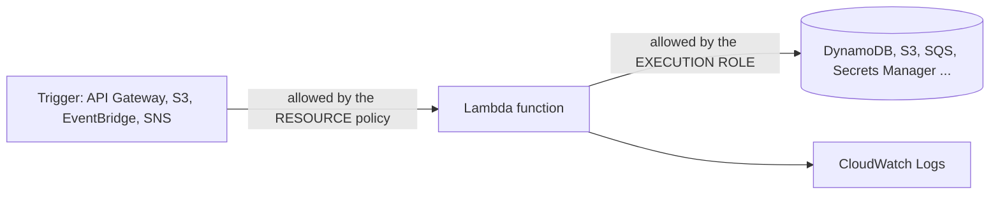
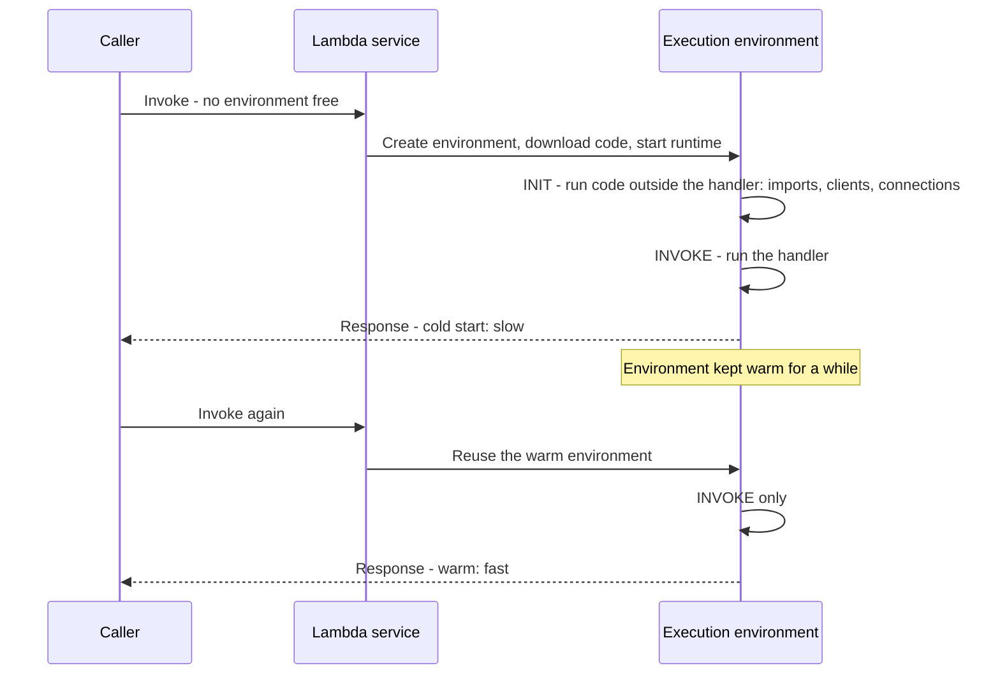
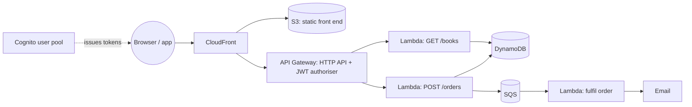

# Lambda and API Gateway: serverless compute

## Before this lesson

You need IAM roles ([IAM identities](#/lesson/aws/iam-identities)), events and queues ([EventBridge](#/lesson/aws/eventbridge-xray), [SQS and SNS](#/lesson/aws/messaging)) and the EC2 model you are about to contrast with ([EC2 instances](#/lesson/aws/ec2-instances), [Auto Scaling](#/lesson/aws/auto-scaling)). A little HTTP vocabulary helps (method, path, status code).

## In plain words

With EC2 you rent a computer and keep it running, busy or idle. **AWS Lambda** turns that around: **you hand AWS a function — a small piece of code — and AWS runs it whenever something happens, for exactly as long as it takes, then stops charging.** There is no server for you to start, patch, scale or shut down. This style is called **serverless**: servers exist, but they are entirely AWS's concern.

Compare owning a car with taking a taxi. A car costs money sitting on the drive. A taxi costs nothing until you need a ride, costs by the trip, and if a hundred of your friends need a ride at the same moment, a hundred taxis come. The taxi is not ideal for everything — a twelve-hour road trip is cheaper in your own car — but for many short, irregular journeys it wins.

**Amazon API Gateway** is the front door that turns a function into a web API: it receives HTTP requests from the internet, checks who is calling, limits how fast they may call, and passes each request to your function.

Why it matters for a job: Lambda is the glue of AWS — reacting to uploads, queue messages, schedules and database changes — and "API Gateway + Lambda + DynamoDB" is the standard serverless web backend. Interviewers ask about cold starts, concurrency limits and when *not* to use Lambda.

## The Lambda model

A **function** consists of:

- your **code** — a zip archive (up to 250 MB unzipped) or a **container image** (up to 10 GB);
- a **runtime** — Python, Node.js, Java, .NET, Ruby, or a custom runtime for Go, Rust and others;
- a **handler** — the function in your code that Lambda calls;
- **configuration** — memory, timeout, environment variables, an **execution role**.

```python
import json

def handler(event, context):
    """Called once per invocation."""
    name = event.get("name", "world")                 # 1. read input from the event
    print(f"greeting {name}")                         # 2. anything printed goes to CloudWatch Logs
    return {"statusCode": 200,                        # 3. the return value is the result
            "body": json.dumps({"message": f"Hello, {name}!"})}
```

- `event` is the input: a dictionary whose shape depends on who invoked the function (an HTTP request, an S3 notification, a batch of queue messages).
- `context` carries metadata such as the request ID and the remaining time.
- Standard output is captured in a CloudWatch log group named `/aws/lambda/<function-name>`.

### Limits that shape designs

| Setting | Value |
|---|---|
| Memory | 128 MB to 10,240 MB; **CPU is allocated in proportion to memory** |
| Timeout | up to **30 minutes** per invocation (it was 15 minutes for many years, and most older material and exam questions still say 15) |
| Temporary disk (`/tmp`) | 512 MB to 10,240 MB |
| Payload | 6 MB for synchronous request and response; 1 MB for asynchronous events |
| Environment variables | 4 KB in total |
| Default concurrency | 1,000 concurrent executions per Region per account (raisable) |

The memory setting is the only performance dial: doubling memory doubles the CPU share, so a CPU-bound function often finishes in half the time for the same cost.

### Two kinds of permission

Mixing these up is the most common Lambda confusion.

1. The **execution role** is an IAM role the function *assumes while running*. Its policies say what the function may do — write logs, read a table, put an object.
2. The function's **resource-based policy** says *who may invoke the function* — API Gateway, S3, EventBridge, another account.



## How a function is invoked

| Model | Who uses it | Behaviour on error |
|---|---|---|
| **Synchronous** | API Gateway, ALB, function URLs, direct SDK calls | The caller waits and receives the error; the caller decides whether to retry |
| **Asynchronous** | S3, SNS, EventBridge | Lambda queues the event, returns at once, **retries twice**, then sends the event to a **dead-letter queue or on-failure destination** if configured |
| **Poll-based (event source mapping)** | SQS, Kinesis, DynamoDB Streams, Kafka | Lambda polls the source, invokes with **batches**; failures are retried according to the source (visibility timeout for SQS; until success or expiry for streams) |

Because asynchronous and poll-based invocations retry, **functions must be idempotent** — the same lesson as for queues.

## Execution environments and cold starts

Lambda runs your code inside an isolated **execution environment** (a tiny virtual machine).



- A **cold start** happens when no idle environment exists: Lambda creates one, loads the code, starts the runtime and runs your initialisation code. It adds from tens of milliseconds (small Python or Node.js functions) to several seconds (large Java or .NET applications, heavy dependencies).
- A **warm** invocation reuses an environment and runs only the handler.
- One environment handles **one request at a time**. Ten simultaneous requests need ten environments.
- Environments are frozen between invocations and discarded after a period of inactivity, or whenever Lambda chooses.

Practical consequences:

1. **Initialise outside the handler.** Create SDK clients, load configuration and open database connections at module level so that warm invocations reuse them.
2. **Never rely on state inside the environment.** Variables and `/tmp` may survive to the next invocation, or may not, and other concurrent requests run in other environments. Keep state in DynamoDB, S3 or ElastiCache.
3. **Reduce cold starts** when latency matters: smaller packages, fewer imports, more memory, the arm64 architecture, **SnapStart** (Lambda snapshots an initialised environment and resumes from it — for Java, Python and .NET), or **provisioned concurrency**.

```python
import os, boto3

table = boto3.resource("dynamodb").Table(os.environ["TABLE_NAME"])   # INIT: runs once per environment

def handler(event, context):
    item = table.get_item(Key={"id": event["id"]}).get("Item")       # INVOKE: runs every time
    return item or {"error": "not found"}
```

## Concurrency

**Concurrency** is the number of invocations running at the same instant. A useful estimate: `concurrency ≈ requests per second × average duration in seconds`. A function called 200 times per second that takes 0.5 s needs about 100 concurrent environments.

- The **account limit** (1,000 by default) is shared by all functions in a Region. Beyond it, invocations are **throttled**: synchronous callers receive HTTP 429; asynchronous events are retried for up to six hours.
- **Reserved concurrency** sets aside part of the account limit for one function. It guarantees that function its share and — just as important — is a **maximum**: use it to stop a function from overwhelming a database or consuming the whole account limit. Setting it to 0 switches a function off.
- **Provisioned concurrency** keeps a chosen number of environments initialised and ready, removing cold starts for that many simultaneous requests. It is billed for as long as it is configured.
- Lambda also limits how fast a function can scale: each function can add 1,000 environments every 10 seconds.

```python-run
def lambda_stats(invocations, idle_timeout_ms, limit):
    """invocations: (start_ms, duration_ms) sorted by start. Returns cold starts, peak, throttled."""
    envs = []                                     # the time each live environment becomes free
    cold = peak = throttled = 0
    for start, duration in invocations:
        envs = [f for f in envs if f > start or start - f <= idle_timeout_ms]   # drop expired ones
        warm = [f for f in envs if f <= start]                                   # idle and still alive
        busy = len(envs) - len(warm)
        if warm:
            envs.remove(max(warm))                # reuse the most recently used environment
        elif busy < limit:
            cold += 1                             # nothing warm: create a new environment
        else:
            throttled += 1                        # at the concurrency limit: reject
            continue
        envs.append(start + duration)
        peak = max(peak, sum(1 for f in envs if f > start))
    return cold, peak, throttled

steady = [(i * 100, 80) for i in range(50)]                  # one request every 100 ms, 80 ms each
burst = [(0, 400)] * 30                                      # 30 requests at the same instant
sparse = [(i * 20 * 60 * 1000, 80) for i in range(6)]        # one request every 20 minutes
for name, load in (("steady", steady), ("burst", burst), ("sparse", sparse)):
    c, p, t = lambda_stats(load, idle_timeout_ms=10 * 60 * 1000, limit=20)
    print(f"{name:7s} invocations={len(load):3d} cold starts={c:2d} peak concurrency={p:2d} throttled={t}")
```

Line by line: each environment is represented by the time it becomes free; an invocation reuses a warm one if any exists, creates one (a cold start) if the limit allows, and is throttled otherwise. Three patterns, three outcomes: *steady* traffic needs one environment and suffers one cold start; a *burst* of 30 simultaneous requests with a limit of 20 gives 20 cold starts and 10 throttled requests; *sparse* traffic (one call every 20 minutes, with environments assumed to expire after 10) is cold **every time**. Cold starts hurt most at the two extremes — sudden bursts and rarely used functions. The problem *Lambda Concurrency and Cold Starts* asks you to write this accounting.

## Pricing

Two meters:

- **Requests**: a small fee per million invocations.
- **Duration**: **GB-seconds** — configured memory (in GB) × execution time (billed per millisecond). Initialisation time is billed too.

An always-free allowance of 1 million requests and 400,000 GB-seconds per month applies to every account.

```python-run
def lambda_cost(invocations, avg_ms, memory_mb,
                per_million=0.20, per_gb_s=0.0000166667, free_req=1_000_000, free_gb_s=400_000):
    gb_seconds = invocations * (avg_ms / 1000) * (memory_mb / 1024)
    requests = max(0, invocations - free_req) / 1e6 * per_million
    compute = max(0, gb_seconds - free_gb_s) * per_gb_s
    return gb_seconds, requests + compute

for label, n, ms, mem in [("small API", 3_000_000, 120, 256),
                          ("busy API", 100_000_000, 120, 512),
                          ("same, slower code", 100_000_000, 600, 512),
                          ("constant heavy load", 2_600_000_000, 100, 1024)]:
    gbs, usd = lambda_cost(n, ms, mem)
    print(f"{label:20s} {gbs:>14,.0f} GB-s  ->  {usd:>10,.2f} USD/month")
```

Reading it: GB-seconds are invocations × seconds × gigabytes; the free allowances are subtracted from each meter separately. The small API costs cents. The busy API costs about USD 110 a month — and five times as much if the code takes five times longer, which shows that **in Lambda, slow code is expensive code**. The last row is a function busy about 100 times in parallel around the clock: thousands of dollars a month, more than a few EC2 instances or containers doing the same work. Lambda is cheapest for **spiky or low-to-moderate** load and loses to always-on compute for **steady high** load. The problem *Lambda Monthly Cost* formalises the calculation.

## Other features to recognise

- **Versions and aliases**: publishing creates an immutable numbered version; an alias (`prod`) points to a version and can **split traffic** between two (95 % to v7, 5 % to v8) for canary releases.
- **Layers**: shared libraries packaged once and attached to many functions.
- **Environment variables**: configuration, encrypted at rest; put secrets in Secrets Manager or Parameter Store and fetch (and cache) them.
- **Function URLs**: a built-in HTTPS endpoint for a single function, without API Gateway.
- **VPC access**: by default a function runs outside your VPC and can reach the internet and AWS APIs. Attach it to **private subnets** to reach RDS or ElastiCache; it then needs a NAT gateway or VPC endpoints to reach anything outside the VPC.
- **Destinations and dead-letter queues**: where asynchronous results and failures go.
- **Lambda@Edge**: functions running at CloudFront (see [CloudFront](#/lesson/aws/cloudfront)).
- **Observability**: metrics (`Invocations`, `Errors`, `Duration`, `Throttles`, `ConcurrentExecutions`), logs and X-Ray tracing with one switch.

## API Gateway

A browser or mobile app cannot conveniently call Lambda's API directly. **API Gateway** provides a managed HTTPS endpoint and maps each **route** (a method and a path such as `GET /books/{id}`) to an **integration** — a Lambda function, another HTTP service, or an AWS service API.

What it takes off your hands:

| Feature | What it does |
|---|---|
| **Throttling** | Limits requests per second (a steady rate and a burst), per API, per stage, per route or per client |
| **Authorisation** | IAM signatures, **Cognito** or any OIDC/JWT provider, or a **Lambda authoriser** running your own logic |
| **Usage plans and API keys** | Quotas and rate limits per customer |
| **Request validation and transformation** | Reject malformed requests before your code runs; reshape payloads |
| **Stages** | Separate deployments (`dev`, `prod`) with their own settings; canary releases |
| **Caching** | Cache responses for a TTL |
| **CORS, custom domains, TLS certificates** | Browser access and friendly URLs |
| **Logging, metrics, tracing, WAF** | Operations and protection |

Three API types:

| | HTTP API | REST API | WebSocket API |
|---|---|---|---|
| Use for | Most new APIs | When you need the extra features | Two-way real-time communication (chat, live updates) |
| Cost | Lowest | Higher | Per message and connection-minute |
| Extras | JWT authorisers, simple and fast | API keys and usage plans, caching, request validation, private APIs, WAF | Persistent connections |

Limits worth knowing: an integration must answer within **29 seconds** by default (so a slow job should be accepted, queued and processed asynchronously), and payloads are capped at 10 MB.

Endpoint types: **regional** (the default), **edge-optimised** (fronted by CloudFront, REST only) and **private** (reachable only through a VPC endpoint).

### The classic serverless backend



Every component scales by itself, is highly available across zones without configuration, and costs nothing when idle.

## Worked example: a function behind an HTTP API

> [!WARNING]
> Everything here fits inside the always-free allowances at test volumes. A public URL can be called by anyone, though: keep throttling on and delete the API when finished.

```bash
# 1. Package the handler shown earlier (saved as app.py) and create the function.
zip function.zip app.py
aws lambda create-function --function-name hello \
  --runtime python3.13 --handler app.handler \
  --zip-file fileb://function.zip \
  --role arn:aws:iam::111122223333:role/hello-exec \
  --memory-size 256 --timeout 10 --architectures arm64
```

- `--handler app.handler` means "file `app.py`, function `handler`".
- `--role` is the execution role; it needs a trust policy for `lambda.amazonaws.com` and at least the managed policy `AWSLambdaBasicExecutionRole` (permission to write logs).
- `--timeout 10`: fail after ten seconds instead of the default three. Always set a deliberate timeout.
- `arm64` (Graviton) is cheaper per GB-second than x86.

```bash
# 2. Invoke it directly and read the response.
aws lambda invoke --function-name hello \
  --cli-binary-format raw-in-base64-out --payload '{"name": "Ana"}' out.json
cat out.json
```

```
{ "StatusCode": 200, "ExecutedVersion": "$LATEST" }
{"statusCode": 200, "body": "{\"message\": \"Hello, Ana!\"}"}
```

```bash
# 3. Put an HTTP API in front. The "quick create" form makes the API, a default route,
#    the Lambda integration and an auto-deployed stage in one call.
API=$(aws apigatewayv2 create-api --name hello-api --protocol-type HTTP \
  --target arn:aws:lambda:eu-west-1:111122223333:function:hello \
  --query ApiId --output text)

# 4. Allow API Gateway to invoke the function (the resource-based policy).
aws lambda add-permission --function-name hello --statement-id apigw \
  --action lambda:InvokeFunction --principal apigateway.amazonaws.com \
  --source-arn "arn:aws:execute-api:eu-west-1:111122223333:$API/*"

curl "https://$API.execute-api.eu-west-1.amazonaws.com/"
```

```
{"message": "Hello, world!"}
```

Step 4 is the one people forget; without it API Gateway returns `500 Internal Server Error` because it is not permitted to call the function.

```bash
# 5. Protect yourself: limit the function to 5 concurrent executions, then clean up.
aws lambda put-function-concurrency --function-name hello --reserved-concurrent-executions 5
aws apigatewayv2 delete-api --api-id "$API"
aws lambda delete-function --function-name hello
```

In real projects the function, role, API and permissions are declared together in a template — **AWS SAM** or the **CDK** exist for exactly this.

## When not to use Lambda

| Situation | Better choice |
|---|---|
| Jobs longer than the timeout, or needing GPUs | ECS/Fargate, Batch, EC2 |
| Steady, high, predictable throughput | Containers or EC2 (cheaper per unit of work) |
| Very low and consistent latency with large runtimes | Containers, or Lambda with provisioned concurrency |
| Long-lived connections or in-memory state | Containers |
| Thousands of functions opening database connections | RDS Proxy in front of the database, or DynamoDB |
| Waiting on something for minutes | Step Functions |

## Cost notes and free-tier warnings

- Lambda: requests plus GB-seconds; **provisioned concurrency** is charged for every second it is configured; extra `/tmp` storage and data transfer are extra.
- API Gateway: per million requests (HTTP APIs are much cheaper than REST APIs), plus caching (hourly) and data transfer.
- **Recursive loops** are the notorious Lambda bill: a function triggered by uploads to a bucket that writes its output to the *same* bucket triggers itself for ever. Use separate buckets or prefixes; Lambda detects and stops some loops, but do not rely on it.
- A NAT gateway added only so that a VPC-attached function can reach the internet often costs more than the function.
- Set **log retention** on each function's log group.

## Pitfalls

- **Creating SDK clients or database connections inside the handler**, paying their set-up cost on every call.
- **Storing state in globals or `/tmp`** and assuming it persists.
- **Leaving the default 3-second timeout**, or setting the maximum everywhere and letting stuck calls burn money.
- **No reserved concurrency in front of a relational database**: a traffic spike opens a thousand connections.
- **Non-idempotent handlers** on retried event sources.
- **Confusing the execution role with the resource policy.**
- **Putting a function in a VPC unnecessarily**, then losing internet access.
- **SQS visibility timeout shorter than the function timeout**, causing duplicate processing.
- **Synchronous chains of functions calling functions**: you pay for all of them while they wait, and failures compound. Use queues, events or Step Functions.

> [!INTERVIEW]
> **"What is a cold start and how do you mitigate it?"** When no warm execution environment is available Lambda must create one, load the code and run initialisation before the handler, adding latency. Mitigate with small deployment packages and lazy imports, more memory, initialising clients outside the handler, SnapStart where supported, and provisioned concurrency for latency-critical paths.
>
> **"Lambda or containers?"** Lambda for event-driven, short, bursty or infrequent workloads where scaling to zero and no operations matter. Containers on Fargate or ECS for long-running processes, steady high throughput, custom system dependencies, or control over the runtime. Many systems mix both.

## Cheat sheet

| Item | Remember |
|---|---|
| Billing | Requests + GB-seconds (memory × time), per ms |
| Memory | 128 MB–10 GB; CPU scales with it |
| Timeout | Up to 30 minutes (15 in older material) |
| One environment | One request at a time |
| Cold start | New environment: INIT + INVOKE |
| Reserved concurrency | Guarantee and cap for one function |
| Provisioned concurrency | Pre-warmed environments, billed while configured |
| Execution role vs resource policy | What the function may do vs who may invoke it |
| Async invoke | Two retries, then DLQ or destination |
| API Gateway | HTTP API (cheap, simple), REST API (full features), WebSocket |
| API Gateway timeout | 29 seconds by default |

## Summary

- Lambda runs functions on demand in isolated execution environments, scaling from zero to thousands of parallel copies, billed per request and per GB-second.
- Cold starts occur when a new environment is needed; initialise outside the handler, keep functions stateless, and use SnapStart or provisioned concurrency where latency matters.
- Concurrency is requests per second times duration; reserved concurrency guarantees and caps it, and the account limit throttles beyond it.
- The execution role governs what a function can access; a resource-based policy governs who can invoke it; retried invocation models require idempotent code.
- API Gateway exposes functions as throttled, authorised HTTP APIs; together with DynamoDB and S3 it forms the standard serverless backend.
- Lambda is not the cheapest or best option for long-running or steady high-volume work.

## Glossary

- **Alias / version**: a named pointer to / an immutable snapshot of a function.
- **Authoriser**: the API Gateway component that validates callers.
- **Cold start**: the delay of creating and initialising a new execution environment.
- **Concurrency**: invocations running at the same instant.
- **Event source mapping**: Lambda's poller for queues and streams.
- **Execution environment**: the isolated runtime holding one copy of a function.
- **Execution role**: the IAM role a function assumes while running.
- **GB-second**: one gigabyte of memory used for one second.
- **Handler**: the entry-point function Lambda calls.
- **Integration**: the backend an API route forwards to.
- **Layer**: a shared package of code or libraries.
- **Provisioned concurrency**: environments kept initialised in advance.
- **Reserved concurrency**: a per-function concurrency guarantee and ceiling.
- **Serverless**: running code without managing servers, paying per use.
- **SnapStart**: resuming functions from a snapshot of an initialised environment.
- **Stage**: a named deployment of an API.
- **Throttling**: rejecting invocations above a limit.

```quiz
[
  {"q": "A function creates a new database connection and loads a 50 MB model inside the handler on every invocation. What is the simplest improvement?",
   "options": ["Increase the timeout", "Move the connection and model loading outside the handler so warm invocations reuse them", "Reduce the memory setting", "Use a larger /tmp"],
   "answer": 1,
   "explain": "Code at module level runs once per execution environment during INIT. Warm invocations then skip that work entirely."},
  {"q": "An API receives 400 requests per second and each invocation takes 250 ms. Roughly how much concurrency does the function need?",
   "options": ["25", "100", "400", "1,600"],
   "answer": 1,
   "explain": "Concurrency is about requests per second times duration in seconds: 400 x 0.25 = 100."},
  {"q": "A burst of traffic makes a Lambda function open more connections than the PostgreSQL database can accept. Which setting directly prevents the function from scaling past a safe number?",
   "options": ["Provisioned concurrency", "Reserved concurrency", "A longer timeout", "More memory"],
   "answer": 1,
   "explain": "Reserved concurrency is both a guarantee and a hard cap for a function. RDS Proxy is the complementary fix on the database side."},
  {"q": "A function is triggered by S3 uploads and writes a resized image back to the same bucket and prefix. What is the danger?",
   "options": ["The image will be too large", "A recursive loop: each output triggers the function again, running up cost", "S3 will reject the write", "The function will time out after 3 seconds"],
   "answer": 1,
   "explain": "Writing to the trigger's own source re-triggers the function indefinitely. Use a different bucket or a prefix filter."},
  {"q": "API Gateway returns 500 when calling a new Lambda integration, although invoking the function directly with the CLI works. What is the most likely cause?",
   "options": ["The execution role lacks DynamoDB access", "The function's resource-based policy does not allow apigateway.amazonaws.com to invoke it", "The function has too much memory", "The stage name is wrong"],
   "answer": 1,
   "explain": "The resource-based policy controls who may invoke the function. Without permission for API Gateway the integration fails before your code runs."},
  {"q": "A function processing S3 events asynchronously fails because of a bug. What does Lambda do?",
   "options": ["Nothing; the event is lost immediately", "Retries twice, then sends the event to a configured dead-letter queue or on-failure destination", "Retries for ever", "Returns the error to S3, which re-uploads the object"],
   "answer": 1,
   "explain": "Asynchronous invocations are retried automatically twice; a DLQ or failure destination preserves events that still fail."},
  {"q": "A workload runs around the clock at a steady 200 concurrent executions. The team wants the lowest cost. What should they consider?",
   "options": ["Lambda is always cheapest", "Containers or instances, because per-unit cost of always-on compute is lower than Lambda at steady high load", "Increase the Lambda timeout", "Use a WebSocket API"],
   "answer": 1,
   "explain": "Lambda's pay-per-use pricing wins for spiky and low volume. For constant heavy utilisation, provisioned compute (with Savings Plans) is usually cheaper."},
  {"q": "A user-facing Java function must respond quickly even on the first request after idle periods. Which options address cold starts?",
   "options": ["SnapStart or provisioned concurrency", "A larger payload limit", "Putting the function in a VPC", "Asynchronous invocation"],
   "answer": 0,
   "explain": "SnapStart restores from a snapshot of an initialised environment, and provisioned concurrency keeps environments ready; both cut start-up latency."}
]
```

> **Source:** AWS Certified Solutions Architect Official Study Guide, ch. 3 and ch. 11 (compute services overview; AWS Lambda is mentioned only briefly in the edition used) and ch. 14 (loose coupling, elasticity). Current limits, including the 30-minute timeout, checked against https://docs.aws.amazon.com/lambda/latest/dg/gettingstarted-limits.html , https://docs.aws.amazon.com/lambda/latest/dg/lambda-concurrency.html , https://docs.aws.amazon.com/lambda/latest/dg/lambda-runtime-environment.html and https://docs.aws.amazon.com/apigateway/latest/developerguide/welcome.html
