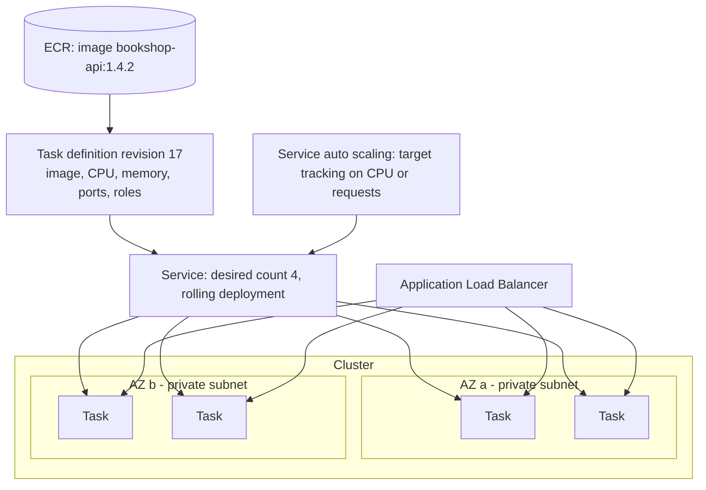
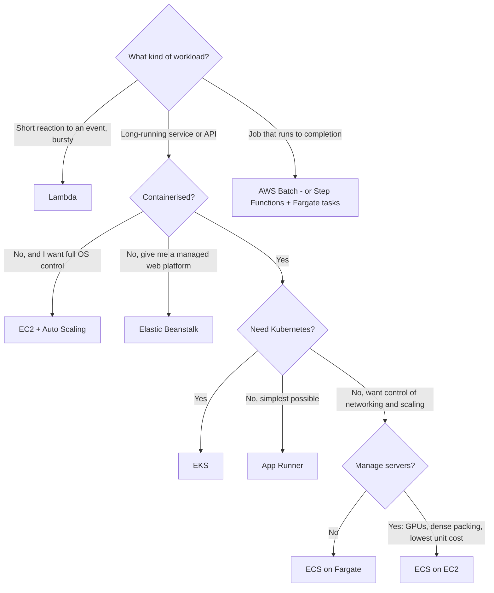

# Containers and platforms: ECS, EKS, Fargate, Elastic Beanstalk and Batch

## Before this lesson

You should know EC2 and Auto Scaling ([EC2 instances](#/lesson/aws/ec2-instances), [EC2 Auto Scaling](#/lesson/aws/auto-scaling)), load balancers ([Elastic Load Balancing](#/lesson/aws/load-balancing)), IAM roles ([IAM identities](#/lesson/aws/iam-identities)) and Lambda for contrast ([Lambda and API Gateway](#/lesson/aws/lambda-apigw)). If containers are new to you, the Docker track's [What is a container](#/lesson/docker/what-is-a-container) lesson is the place to start; the essentials are repeated here.

## In plain words

Between "rent a whole virtual machine and manage everything" (EC2) and "hand over a single function" (Lambda) lies a wide middle ground. Most real applications live there.

A **container** is a sealed box holding an application **together with everything it needs to run** — the right language version, libraries and settings. The same box runs identically on a laptop, a test server and production. The usual analogy is the **shipping container**: because every box has the same shape, ports, cranes and lorries can handle any cargo without caring what is inside.

Boxes alone are not enough. Somebody has to decide which ship each box goes on, replace boxes that fall overboard, and add more when demand rises. That job is **container orchestration**, and AWS offers it in several forms:

- **Amazon ECS** — AWS's own orchestrator: simpler, deeply integrated with AWS.
- **Amazon EKS** — managed **Kubernetes**, the open-source industry standard: more powerful, more complex, portable.
- **AWS Fargate** — a way of running containers for ECS or EKS **without any servers for you to manage**.
- **AWS Elastic Beanstalk** and **AWS App Runner** — "give us your code or image and we will build the whole environment".
- **AWS Batch** — for jobs that run to completion, such as overnight calculations.

Why it matters for a job: containers are how most companies ship software, and "ECS or EKS? EC2 or Fargate?" is a decision every platform team makes and every interviewer asks about.

## Containers in two minutes

- An **image** is a read-only package: your application plus its dependencies, built from a recipe called a `Dockerfile`.
- A **container** is a running instance of an image, isolated from other containers but sharing the host's operating-system kernel — which is why it starts in seconds and weighs megabytes, where a virtual machine boots a whole operating system.
- A **registry** stores images. **Amazon ECR** (Elastic Container Registry) is AWS's: private repositories with IAM access control, encryption, vulnerability scanning on push, and lifecycle rules that delete old images.

| | Virtual machine | Container | Lambda function |
|---|---|---|---|
| Packages | A whole OS | App + dependencies | Code (zip or image) |
| Starts in | Minutes | Seconds | Milliseconds to seconds |
| You manage | OS, runtime, scaling | Image, task definition | Code only |
| Runs | Indefinitely | Indefinitely | Up to the function timeout |
| Scales to zero | No | With effort | Yes |

## Amazon ECS

### Vocabulary

- A **task definition** is the blueprint: which image(s), how much CPU and memory, which ports, environment variables, secrets, log configuration and IAM roles. It is versioned in **revisions**.
- A **task** is one running copy of a task definition — one or several containers that live together.
- A **service** keeps a chosen number of tasks running, replaces failed ones, registers them with a load balancer, and performs rolling deployments. It is to tasks what an Auto Scaling group is to instances.
- A **cluster** is the logical group in which tasks and services run.
- A **capacity provider** says where the compute comes from: Fargate, Fargate Spot, or an Auto Scaling group of EC2 instances.



### Launch types: EC2 or Fargate

This is the first decision and the most asked.

| | EC2 launch type | Fargate |
|---|---|---|
| Who runs the servers | You: an Auto Scaling group of instances with the ECS agent | AWS; no instances visible |
| You pay for | The instances, full or empty | vCPU and memory **requested by each task**, per second |
| Patching and AMIs | Yours | AWS's |
| Scaling | Two levels: tasks **and** instances | One level: tasks |
| GPUs, special hardware, privileged mode | Yes | Limited |
| Cost at steady high utilisation | Lower (especially with Savings Plans and Spot) | Higher per unit |
| Operational effort | Higher | Lowest |

**Fargate** is "serverless containers": you declare the CPU and memory a task needs and AWS finds somewhere to run it, in its own isolated micro-VM. Start with Fargate. Move to EC2 capacity when the fleet is large and steadily busy enough for dense packing to pay off, or when you need GPUs or host-level access. **Fargate Spot** offers large discounts for interruptible tasks.

### Networking

With the `awsvpc` network mode (mandatory on Fargate), **each task receives its own elastic network interface, private IP address and security group**, like a small instance. Tasks belong in private subnets; an ALB with an **IP-type target group** routes to them. Remember that every task consumes an IP address from the subnet — size subnets accordingly.

For service-to-service calls, **ECS Service Connect** (or Cloud Map service discovery) gives services stable names such as `http://orders:8080`.

### Two roles — again

A task definition names two IAM roles, mirroring Lambda's split:

| Role | Used by | For |
|---|---|---|
| **Task execution role** | The ECS agent / Fargate | Pulling the image from ECR, writing logs to CloudWatch, fetching secrets to inject |
| **Task role** | **Your application code** | Calling AWS services: S3, DynamoDB, SQS… |

If the container cannot start because the image cannot be pulled, look at the execution role. If your code gets *AccessDenied* calling S3, look at the task role.

### A task definition, annotated

```json
{
  "family": "bookshop-api",
  "requiresCompatibilities": ["FARGATE"],
  "networkMode": "awsvpc",
  "cpu": "512",
  "memory": "1024",
  "runtimePlatform": {"cpuArchitecture": "ARM64", "operatingSystemFamily": "LINUX"},
  "executionRoleArn": "arn:aws:iam::111122223333:role/ecsTaskExecutionRole",
  "taskRoleArn": "arn:aws:iam::111122223333:role/bookshop-api-task",
  "containerDefinitions": [{
    "name": "api",
    "image": "111122223333.dkr.ecr.eu-west-1.amazonaws.com/bookshop-api:1.4.2",
    "portMappings": [{"containerPort": 8080}],
    "environment": [{"name": "STAGE", "value": "prod"}],
    "secrets": [{"name": "DB_PASSWORD",
                 "valueFrom": "arn:aws:secretsmanager:eu-west-1:111122223333:secret:bookshop/db"}],
    "healthCheck": {"command": ["CMD-SHELL", "curl -f http://localhost:8080/health || exit 1"],
                    "interval": 15, "retries": 3},
    "logConfiguration": {"logDriver": "awslogs",
      "options": {"awslogs-group": "/ecs/bookshop-api", "awslogs-region": "eu-west-1",
                  "awslogs-stream-prefix": "api"}}
  }]
}
```

- `family` is the name; each registration creates a new revision.
- `cpu: 512` means half a vCPU (1024 units = one vCPU); `memory` is in MiB. On Fargate these come in fixed combinations and are what you are billed for.
- `ARM64` selects Graviton, which is cheaper.
- The two role ARNs are the pair described above.
- `image` pins an exact tag. Avoid `latest`: you could not tell which code is running or roll back reliably.
- `secrets` injects a Secrets Manager value as an environment variable at start — the secret never appears in the task definition.
- `healthCheck` lets ECS replace a container whose process is alive but not answering.
- `logConfiguration` sends standard output to CloudWatch Logs.

### Worked example: build, push, run

> [!WARNING]
> Fargate tasks bill per second for the vCPU and memory requested, and the load balancer in front bills hourly. Two small tasks cost roughly USD 1 per day. Set the service's desired count to 0 or delete it when you finish.

```bash
# 1. A repository, a login, a build and a push.
aws ecr create-repository --repository-name bookshop-api --image-scanning-configuration scanOnPush=true
aws ecr get-login-password | docker login --username AWS --password-stdin \
  111122223333.dkr.ecr.eu-west-1.amazonaws.com
docker build --platform linux/arm64 -t bookshop-api:1.4.2 .
docker tag bookshop-api:1.4.2 111122223333.dkr.ecr.eu-west-1.amazonaws.com/bookshop-api:1.4.2
docker push 111122223333.dkr.ecr.eu-west-1.amazonaws.com/bookshop-api:1.4.2
```

- `get-login-password` prints a temporary token (valid 12 hours) that is piped into `docker login`; no long-lived registry password exists.
- `--platform linux/arm64` builds for Graviton, matching the task definition.
- `tag` gives the local image its full registry name; `push` uploads it.

```bash
# 2. Register the task definition and create a cluster and a service.
aws ecs register-task-definition --cli-input-json file://taskdef.json
aws ecs create-cluster --cluster-name bookshop

aws ecs create-service --cluster bookshop --service-name api \
  --task-definition bookshop-api --desired-count 2 --launch-type FARGATE \
  --network-configuration "awsvpcConfiguration={subnets=[subnet-0priva,subnet-0privb],securityGroups=[sg-0app],assignPublicIp=DISABLED}" \
  --load-balancers "targetGroupArn=$TG,containerName=api,containerPort=8080" \
  --deployment-configuration "deploymentCircuitBreaker={enable=true,rollback=true},minimumHealthyPercent=100,maximumPercent=200"
```

- `--desired-count 2` across two private subnets gives one task per zone.
- `assignPublicIp=DISABLED`: tasks are private. They therefore need a NAT gateway **or VPC endpoints for ECR, S3 and CloudWatch Logs** to pull the image and ship logs — the commonest reason a new Fargate task sits in `PENDING` and then stops with a pull error.
- `--load-balancers` registers each task's IP and port in the ALB target group.
- `minimumHealthyPercent=100,maximumPercent=200`: during a deployment, start new tasks before stopping old ones.
- The **deployment circuit breaker** stops a rollout whose new tasks keep failing and rolls back to the last working revision automatically.

```bash
# 3. Deploy version 1.4.3: register a new revision, then point the service at it.
aws ecs update-service --cluster bookshop --service api --task-definition bookshop-api:18
aws ecs wait services-stable --cluster bookshop --services api

# 4. Scale the service on CPU, exactly as with an Auto Scaling group.
aws application-autoscaling register-scalable-target --service-namespace ecs \
  --resource-id service/bookshop/api --scalable-dimension ecs:service:DesiredCount \
  --min-capacity 2 --max-capacity 10
aws application-autoscaling put-scaling-policy --service-namespace ecs \
  --resource-id service/bookshop/api --scalable-dimension ecs:service:DesiredCount \
  --policy-name cpu60 --policy-type TargetTrackingScaling \
  --target-tracking-scaling-policy-configuration \
  '{"TargetValue": 60, "PredefinedMetricSpecification": {"PredefinedMetricType": "ECSServiceAverageCPUUtilization"}}'
```

Everything learned about target tracking in [EC2 Auto Scaling](#/lesson/aws/auto-scaling) applies unchanged; only the thing being counted is tasks instead of instances.

## Amazon EKS

**Kubernetes** (often written K8s) is the open-source orchestrator that most of the industry has standardised on. **Amazon EKS** runs it for you.

- AWS operates the **control plane** — the Kubernetes API server and its database — across three Availability Zones, patches it and keeps it available. You pay a flat hourly fee per cluster.
- You provide the **data plane**, where your **pods** (Kubernetes' unit: one or more containers, comparable to an ECS task) run:
  - **managed node groups** — EC2 instances that AWS provisions and upgrades for you;
  - **Fargate profiles** — pods on serverless capacity;
  - **EKS Auto Mode** — AWS manages nodes, scaling, networking and storage add-ons automatically;
  - **Karpenter** — an open-source node autoscaler that launches right-sized instances in seconds.
- AWS integrations arrive as add-ons: the VPC CNI plugin (pods get VPC IP addresses), the Load Balancer Controller (Kubernetes objects create ALBs and NLBs), storage drivers for EBS and EFS, and **EKS Pod Identity** or *IAM Roles for Service Accounts* to give each pod its own IAM role.

### ECS or EKS?

| | ECS | EKS |
|---|---|---|
| API | AWS-specific, small | Kubernetes, large and extensible |
| Learning curve | Gentle | Steep |
| Control-plane cost | None | Hourly fee per cluster |
| Portability | AWS only (plus ECS Anywhere) | Any cloud or data centre running Kubernetes |
| Ecosystem | AWS services | Vast open-source tooling: Helm, operators, service meshes, GitOps |
| Choose when | You want the simplest path on AWS and have no Kubernetes investment | You already use Kubernetes, need its ecosystem, or want multi-cloud consistency |

Neither is "better". A small team shipping a few services on AWS is usually happier on ECS with Fargate. An organisation with Kubernetes skills, tooling and workloads elsewhere picks EKS. The site's [Kubernetes lessons in the MLOps track](#/lesson/mlops/k8s-core) cover Kubernetes itself.

## Platform services: least effort

### Elastic Beanstalk

**Elastic Beanstalk** is a platform-as-a-service layer over the building blocks you already know. You upload code (a zip of a Python, Node.js, Java, .NET, PHP, Ruby or Go application, or a Docker configuration) and it creates an **environment**: EC2 instances in an Auto Scaling group, a load balancer, security groups, CloudWatch alarms, and optionally an RDS database.

- **You keep full access** to the underlying resources — they are ordinary EC2 instances in your account.
- Beanstalk itself is **free**; you pay for the resources.
- **Web server** environments serve HTTP; **worker** environments pull jobs from an SQS queue.
- **Deployment policies** — an exam favourite:

| Policy | How it works | Downtime | Capacity during deploy | Rollback |
|---|---|---|---|---|
| All at once | Replace everything together | **Yes** | Zero briefly | Redeploy |
| Rolling | Batches, one after another | No | Reduced | Redeploy |
| Rolling with additional batch | Add a batch first, then roll | No | Full | Redeploy |
| Immutable | New instances in a new temporary group, then swap | No | Full | Terminate the new ones |
| Traffic splitting | Canary a percentage on new instances | No | Full | Shift traffic back |
| Blue/green | A separate environment, then **swap URLs** | No | Double | Swap back |

Customisation lives in `.ebextensions` configuration files inside your bundle. One classic trap: a database created *inside* a Beanstalk environment is deleted with it — create production databases separately.

Beanstalk suits teams that want a conventional web application running with the least thought. Its model predates containers; many teams now reach for App Runner or ECS instead.

### App Runner and Lightsail

- **AWS App Runner** takes a container image or a source repository and returns an HTTPS URL, with builds, load balancing, auto scaling and certificates handled. It is the shortest path from a web service to production when you need no control over the network.
- **Amazon Lightsail** offers simple virtual servers, containers and databases at a fixed monthly price with a simplified console — aimed at small sites and at learning. The worked project in module 14 starts there.

## AWS Batch

Some work is not a service that answers requests but a **job** that starts, computes and ends: rendering a film, pricing a portfolio overnight, re-encoding a video library, training a model, analysing genomes.

**AWS Batch** runs such jobs in containers.

- A **job definition** names the image, command, vCPUs, memory (and GPUs), retry strategy and timeout.
- You **submit jobs** to a **job queue** with a priority.
- A **compute environment** — Fargate, EC2 or EKS, On-Demand or **Spot** — is scaled up by Batch when jobs wait and back to **zero** when the queue is empty.
- **Array jobs** fan one submission out into thousands of parallel children; **dependencies** order jobs; **multi-node parallel jobs** span instances for tightly coupled computation.

Batch itself is free; you pay for the compute. Because batch work usually tolerates interruption and retries, **Spot Instances** are its natural partner and can cut the cost by more than half.

```bash
aws batch submit-job --job-name reprice-2026-11-21 \
  --job-queue nightly --job-definition reprice:4 \
  --array-properties size=500 \
  --container-overrides 'environment=[{name=RUN_DATE,value=2026-11-21}]'
```

`--array-properties size=500` creates 500 child jobs, each receiving its index in the environment variable `AWS_BATCH_JOB_ARRAY_INDEX` so that it knows which slice of the work is its own.

| | Lambda | Batch | ECS service |
|---|---|---|---|
| Work shape | Short, event-driven | Long-running jobs that finish | Long-running services |
| Max duration | The function timeout | Unlimited | Unlimited |
| GPUs | No | Yes | Yes (EC2) |
| Scales to zero | Yes | Yes | With effort |

## Choosing a compute service



## Cost notes and free-tier warnings

- **ECS**: no charge for the orchestrator. **Fargate**: per vCPU-second and GB-second requested — an over-sized task definition is paid for in full even when idle. **EC2 launch type**: the instances.
- **EKS**: an hourly fee per cluster (roughly USD 73 a month) before any nodes, and a higher fee for clusters left on an out-of-support Kubernetes version. Share clusters between teams instead of creating one per application.
- **ECR**: per GB-month stored and data transfer; add lifecycle policies to expire old images.
- **Savings Plans** (Compute) cover Fargate and EC2 nodes alike; **Fargate Spot and EC2 Spot** suit interruptible tasks and batch.
- **Beanstalk and Batch** are free wrappers; their resources are not.
- Hidden costs: the load balancer, NAT gateway traffic for image pulls (use VPC endpoints), CloudWatch log ingestion from chatty containers.

## Pitfalls

- **Confusing the task execution role with the task role.**
- **Tasks in private subnets with no route to ECR**, stuck in `PENDING`.
- **Using the `latest` tag**, making rollbacks and audits impossible.
- **No container health check or load balancer health check**, so that a hung process keeps receiving traffic.
- **Subnets too small** for one IP address per task or pod.
- **Storing data inside the container.** Container file systems are ephemeral; use S3, EFS, a database.
- **Choosing EKS without a reason**, then spending months on cluster operations.
- **One EKS cluster per microservice.**
- **A production database created inside an Elastic Beanstalk environment.**
- **Running On-Demand compute for interruptible batch work.**
- **Memory limits set too low**: the container is killed with an out-of-memory error and restarts in a loop.

> [!INTERVIEW]
> **"ECS or EKS, and EC2 or Fargate?"** ECS is simpler and AWS-native with no control-plane fee; EKS is managed Kubernetes for teams that need its API, ecosystem or portability. Fargate removes server management and bills per task, ideal for small to medium or variable workloads; EC2 capacity gives GPUs, host access and lower unit cost at sustained scale, at the price of managing instances.
>
> **"How do containers get AWS permissions?"** Through a task role (ECS) or a pod-level IAM role (EKS Pod Identity or IRSA) that the application's SDK assumes automatically; the separate execution role is used by the platform to pull images, write logs and inject secrets. No access keys are baked into images.

## Cheat sheet

| Need | Service |
|---|---|
| Store container images | ECR |
| Run containers the simplest AWS-native way | ECS |
| Run containers with Kubernetes | EKS |
| No servers to manage for containers | Fargate |
| Image or repo to URL with minimal setup | App Runner |
| Classic web app with managed EC2, ASG, ALB | Elastic Beanstalk |
| Jobs that run to completion, scale to zero, Spot | AWS Batch |
| Fixed-price simple servers | Lightsail |
| Pull images, write logs | Task execution role |
| App calls AWS | Task role |
| Safe deployments | Rolling with circuit breaker; blue/green |

## Summary

- Containers package an application with its dependencies; ECR stores images; orchestrators keep the right number running and replace failures.
- ECS is AWS's simpler orchestrator built from task definitions, tasks, services and clusters; EKS is managed Kubernetes with a larger ecosystem and more operational weight.
- Fargate runs tasks and pods without servers, billed per requested vCPU and memory; EC2 capacity trades effort for control and unit cost.
- Tasks get their own network interface and two IAM roles — execution role for the platform, task role for the application.
- Elastic Beanstalk and App Runner provide whole platforms from code or an image; Batch queues and runs finite jobs, ideally on Spot.

## Glossary

- **App Runner**: a fully managed service that runs a web container from an image or repository.
- **Capacity provider**: the source of compute for an ECS cluster.
- **Cluster**: the logical grouping in which tasks or pods run.
- **Container / image**: a running isolated process set / the read-only package it starts from.
- **Control plane / data plane**: the orchestrator's brain / the machines running workloads.
- **Deployment circuit breaker**: automatic stop and rollback of a failing ECS deployment.
- **ECR**: Elastic Container Registry.
- **Fargate**: serverless compute for containers.
- **Job queue / compute environment**: Batch's waiting line / the capacity that runs jobs.
- **Kubernetes**: the open-source container orchestrator.
- **Orchestration**: scheduling, scaling and healing containers.
- **Pod**: Kubernetes' smallest deployable unit.
- **Service (ECS)**: keeps a desired number of tasks running behind a load balancer.
- **Task / task definition**: a running copy / the blueprint.
- **Task role / task execution role**: permissions for the application / for the platform.

```quiz
[
  {"q": "A team of three wants to run four containerised web services on AWS with the least operational work. They have no Kubernetes experience. Which combination fits?",
   "options": ["EKS with self-managed nodes", "ECS with Fargate", "EC2 instances with Docker installed by hand", "AWS Batch"],
   "answer": 1,
   "explain": "ECS is the simpler orchestrator and Fargate removes server management entirely. EKS adds complexity that needs a reason."},
  {"q": "A Fargate task fails to start with 'CannotPullContainerError'. The image exists in ECR and the tasks run in private subnets. Which two things should be checked?",
   "options": ["The task role and the ALB listener", "The task execution role's ECR permissions and network access to ECR (NAT gateway or VPC endpoints)", "The CPU architecture and the log group name", "The Route 53 record and the certificate"],
   "answer": 1,
   "explain": "Pulling the image is done by the platform using the execution role, over the network path available to the task."},
  {"q": "Application code in an ECS task gets AccessDenied when writing to DynamoDB. Which role needs the permission?",
   "options": ["The task execution role", "The task role", "The instance profile of the developer's laptop", "The ECS service-linked role"],
   "answer": 1,
   "explain": "The task role is assumed by the application inside the container. The execution role is only for pulling images, logging and injecting secrets."},
  {"q": "A company already runs Kubernetes on premises and in another cloud, with Helm charts and operators it wants to reuse. Which AWS service?",
   "options": ["ECS", "EKS", "Elastic Beanstalk", "Lambda"],
   "answer": 1,
   "explain": "EKS provides a conformant Kubernetes API, so existing manifests, charts and tooling carry over."},
  {"q": "A nightly risk calculation consists of 2,000 independent jobs of 20 minutes each, tolerates retries, and nothing runs during the day. What minimises cost?",
   "options": ["An always-on ECS service", "AWS Batch with an array job on a Spot compute environment that scales to zero", "A fleet of Reserved Instances", "One large EC2 instance running jobs in sequence"],
   "answer": 1,
   "explain": "Batch queues the jobs, scales compute up for the run and back to zero afterwards, and Spot suits interruptible, retryable work."},
  {"q": "Which Elastic Beanstalk deployment policy causes downtime?",
   "options": ["Rolling with additional batch", "Immutable", "All at once", "Blue/green"],
   "answer": 2,
   "explain": "All at once replaces every instance simultaneously, so the application is briefly unavailable. The others keep capacity in service."},
  {"q": "An ECS service runs steadily at high utilisation on hundreds of tasks and needs GPUs for some of them. Which capacity choice is most appropriate?",
   "options": ["Fargate only", "EC2 capacity providers, with Savings Plans and Spot where suitable", "Lambda", "App Runner"],
   "answer": 1,
   "explain": "EC2 capacity supports GPUs and dense packing, and its unit cost at sustained scale is lower than Fargate's."},
  {"q": "Why is tagging images 'latest' in production task definitions discouraged?",
   "options": ["ECR does not allow the tag", "It is impossible to know exactly which build is running or to roll back to a known version", "It makes containers slower", "It disables health checks"],
   "answer": 1,
   "explain": "A mutable tag can point at different images over time. Immutable, versioned tags or digests make deployments traceable and reversible."}
]
```

> **Source:** AWS Certified Solutions Architect Official Study Guide, ch. 3 (Amazon EC2 Container Service overview) and ch. 11 (DevOps: AWS Elastic Beanstalk). Fargate, EKS, App Runner and AWS Batch post-date the book; checked against https://docs.aws.amazon.com/AmazonECS/latest/developerguide/Welcome.html , https://docs.aws.amazon.com/AmazonECS/latest/developerguide/task-iam-roles.html , https://docs.aws.amazon.com/eks/latest/userguide/what-is-eks.html , https://docs.aws.amazon.com/elasticbeanstalk/latest/dg/using-features.rolling-version-deploy.html and https://docs.aws.amazon.com/batch/latest/userguide/what-is-batch.html
