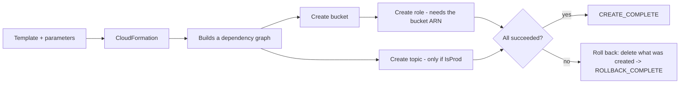
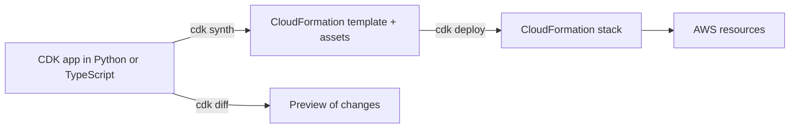

# Infrastructure as code with CloudFormation and the CDK

## Before this lesson

You should have met the idea of infrastructure as code in [Shared responsibility and four ways to drive AWS](#/lesson/aws/responsibility-and-tools), and you should recognise the resources used as examples: VPCs and subnets ([VPC basics](#/lesson/aws/vpc-basics)), security groups ([security groups versus network ACLs](#/lesson/aws/vpc-firewalls)), S3 buckets ([S3 basics](#/lesson/aws/s3-basics)) and IAM roles ([IAM identities](#/lesson/aws/iam-identities)).

## In plain words

So far you have created resources by typing commands one at a time. That is fine once. It is a poor way to build something you must rebuild for a second environment, review before it changes, or put back exactly as it was after a mistake.

**Infrastructure as code (IaC)** means describing your infrastructure in a text file and letting a tool make reality match the file. **AWS CloudFormation** is AWS's tool for that: you write a **template** saying *what* should exist, and CloudFormation works out the order, creates everything, and — if one step fails — undoes what it had done.

Think of the difference between **telling a builder what to do step by step** ("lay ten bricks here, now mix cement…") and **handing over an architect's drawing**. With the drawing, the builder works out the steps; a second identical house needs only the same drawing; and a change is made by editing the drawing and letting the builder find what differs.

The **AWS Cloud Development Kit (CDK)** goes one step further: you write the drawing as a short program in Python or TypeScript, and the CDK expands it into a full CloudFormation template.

Why it matters for a job: no serious team builds production by hand. IaC gives repeatability, peer review, history and fast recovery. Reading a CloudFormation or Terraform template is an expected skill for backend, DevOps and data engineers alike.

## What IaC buys you

| Without IaC | With IaC |
|---|---|
| "Who opened that port, and why?" | Every change is a reviewed commit with an author and a message |
| Staging differs subtly from production | Both are created from the same template with different parameters |
| Rebuilding after a disaster takes days of archaeology | Deploy the template in another Region |
| Clean-up misses things | Delete the stack; everything it created goes |
| Knowledge lives in one person's head | The template is the documentation |

Two words from the first module matter here. A template is **declarative**: it states the desired end state, not the steps. And applying it is **idempotent**: deploying the same template twice changes nothing the second time.

## Templates and stacks

- A **template** is a YAML or JSON file.
- A **stack** is one deployed instance of a template: a set of real resources managed as a unit. You create, update and delete the stack, never the individual resources.

### Anatomy of a template

```yaml
AWSTemplateFormatVersion: "2010-09-09"
Description: A private, versioned bucket and a role that can read it

Parameters:                         # values supplied at deploy time
  Environment:
    Type: String
    AllowedValues: [dev, staging, prod]
    Default: dev

Mappings:                           # fixed lookup tables
  RetentionDays:
    dev:     {Noncurrent: 7}
    staging: {Noncurrent: 30}
    prod:    {Noncurrent: 365}

Conditions:                         # booleans computed from parameters
  IsProd: !Equals [!Ref Environment, prod]

Resources:                          # the only mandatory section
  ReportsBucket:
    Type: AWS::S3::Bucket
    DeletionPolicy: Retain          # keep the bucket even if the stack is deleted
    UpdateReplacePolicy: Retain
    Properties:
      BucketName: !Sub "tidewater-reports-${Environment}-${AWS::AccountId}"
      VersioningConfiguration: {Status: Enabled}
      PublicAccessBlockConfiguration:
        BlockPublicAcls: true
        BlockPublicPolicy: true
        IgnorePublicAcls: true
        RestrictPublicBuckets: true
      LifecycleConfiguration:
        Rules:
          - Id: expire-old-versions
            Status: Enabled
            NoncurrentVersionExpiration:
              NoncurrentDays: !FindInMap [RetentionDays, !Ref Environment, Noncurrent]

  ReaderRole:
    Type: AWS::IAM::Role
    Properties:
      AssumeRolePolicyDocument:
        Version: "2012-10-17"
        Statement:
          - Effect: Allow
            Principal: {Service: ec2.amazonaws.com}
            Action: sts:AssumeRole
      Policies:
        - PolicyName: read-reports
          PolicyDocument:
            Version: "2012-10-17"
            Statement:
              - Effect: Allow
                Action: s3:GetObject
                Resource: !Sub "${ReportsBucket.Arn}/*"

  ProdAlarmTopic:
    Type: AWS::SNS::Topic
    Condition: IsProd               # created only in production

Outputs:                            # values to show or share with other stacks
  BucketName:
    Value: !Ref ReportsBucket
    Export:
      Name: !Sub "${AWS::StackName}-BucketName"
```

Section by section:

- **Parameters** make one template serve several environments. Types include `String`, `Number`, lists, AWS-specific types such as `AWS::EC2::VPC::Id` (validated against your account) and SSM parameter types (fetch a value from Parameter Store at deploy time).
- **Mappings** are lookup tables keyed by something known at deploy time (environment, Region).
- **Conditions** switch resources or properties on and off.
- **Resources** declare each resource with a **logical ID** (`ReportsBucket`, a name inside the template), a **type** (`AWS::Service::Thing`) and **properties**. CloudFormation gives the real resource a **physical ID**.
- **Outputs** publish values; an **export** makes one available to other stacks.

### Intrinsic functions

The `!Something` tags are functions CloudFormation evaluates:

| Function | Does | Example |
|---|---|---|
| `!Ref` | A parameter's value, or a resource's main identifier | `!Ref Environment`, `!Ref ReportsBucket` |
| `!GetAtt` | Another attribute of a resource | `!GetAtt ReportsBucket.Arn` |
| `!Sub` | Substitutes `${…}` inside a string | `!Sub "arn:aws:s3:::${ReportsBucket}/*"` |
| `!Join` | Joins a list with a separator | `!Join ["-", [a, b]]` |
| `!FindInMap` | Looks up a mapping | as above |
| `!If`, `!Equals`, `!Not`, `!And`, `!Or` | Conditional logic | `!If [IsProd, 3, 1]` |
| `!ImportValue` | Reads another stack's export | `!ImportValue network-VpcId` |
| `!GetAZs`, `!Select`, `!Split` | Lists | `!Select [0, !GetAZs ""]` |

**Pseudo parameters** are predefined: `AWS::Region`, `AWS::AccountId`, `AWS::StackName`, `AWS::Partition`.

### Dependencies and order

You never write "create the bucket first". When `ReaderRole` refers to `ReportsBucket.Arn`, CloudFormation infers that the bucket must exist first and builds a dependency graph, creating independent resources in parallel. The rare dependency that is not visible through a reference is declared with `DependsOn`.



## The stack lifecycle

### Create

```bash
aws cloudformation deploy \
  --template-file reports.yaml \
  --stack-name reports-dev \
  --parameter-overrides Environment=dev \
  --capabilities CAPABILITY_NAMED_IAM
```

```
Waiting for changeset to be created..
Waiting for stack create/update to complete
Successfully created/updated stack - reports-dev
```

- `deploy` creates the stack if it does not exist and updates it if it does.
- `--parameter-overrides` supplies parameter values.
- `--capabilities CAPABILITY_NAMED_IAM` is a deliberate acknowledgement that the template creates IAM resources; without it CloudFormation refuses, so that nobody grants permissions by accident.

If any resource fails, CloudFormation **rolls back**: it deletes everything it created and the stack ends in `ROLLBACK_COMPLETE`. A stack is all or nothing.

### Update with a change set

Editing a template and redeploying makes CloudFormation compute the difference. What happens to each changed resource depends on the property:

| Update behaviour | Meaning | Example |
|---|---|---|
| **No interruption** | Changed in place, keeps running | An instance's tags; a bucket's lifecycle rule |
| **Some interruption** | Changed in place with a brief outage | Changing an EC2 instance type (stop/start) |
| **Replacement** | A **new** resource is created and the old one **deleted** | Renaming an S3 bucket or DynamoDB table; changing an RDS engine |

Replacement of a database means the data is gone unless you protected it. A **change set** is a preview of exactly these effects before anything happens.

```bash
aws cloudformation create-change-set --stack-name reports-dev --change-set-name rename \
  --template-body file://reports.yaml --parameters ParameterKey=Environment,ParameterValue=dev \
  --capabilities CAPABILITY_NAMED_IAM
aws cloudformation describe-change-set --stack-name reports-dev --change-set-name rename \
  --query "Changes[].ResourceChange.[Action,LogicalResourceId,ResourceType,Replacement]" --output table
```

```
+---------+----------------+-------------------+-------+
|  Modify |  ReportsBucket |  AWS::S3::Bucket  |  True |
|  Modify |  ReaderRole    |  AWS::IAM::Role   |  False|
+---------+----------------+-------------------+-------+
```

`Replacement: True` on the bucket is the warning to stop and think. If the preview is acceptable, `execute-change-set` applies it.

> [!WARNING]
> Always read the change set before updating a stack that contains data. **A property change that requires replacement deletes the old resource.** Protect stateful resources with `DeletionPolicy: Retain` or `Snapshot`, with `UpdateReplacePolicy`, with **termination protection** on the stack, and with a **stack policy** that denies updates to named resources.

### Protecting resources

- `DeletionPolicy`: `Delete` (the default for most types), `Retain` (leave the resource when the stack is deleted), or `Snapshot` (for RDS, EBS, ElastiCache, Redshift: take a final snapshot first).
- `UpdateReplacePolicy`: the same choices, applied to the old resource when an update replaces it.
- **Stack termination protection**: the stack cannot be deleted until the flag is removed.
- **Stack policy**: a JSON document saying which resources updates may touch.

### Drift

If someone changes a resource by hand in the console, the template and reality disagree. This is **drift**. **Drift detection** compares the two and lists the differences. CloudFormation does not correct drift automatically, and a later update may fail or silently overwrite the manual change. The discipline is to change stack-managed resources only through the stack. Existing hand-made resources can be brought under management with **resource import** or the **IaC generator**, which scans an account and writes a template.

### Delete

```bash
aws cloudformation delete-stack --stack-name reports-dev
```

Everything in the stack is deleted, except resources with `Retain`. Deletion fails on things that refuse to go — most commonly a **non-empty S3 bucket** or a security group still in use elsewhere.

## Organising many stacks

One template for a whole company would be unmanageable (and there are limits — 500 resources per stack). Common structure: stacks split by **lifecycle and ownership** — network, data stores, application — because they change at different rates and are owned by different people.

Ways for stacks to cooperate:

- **Cross-stack references**: stack A *exports* an output; stack B uses `!ImportValue`. An exported value cannot be changed or removed while another stack imports it — a strong, sometimes inconvenient, coupling.
- **SSM parameters**: stack A writes a value to Parameter Store; stack B reads it through a parameter type. Looser coupling.
- **Nested stacks**: a parent stack includes child templates as `AWS::CloudFormation::Stack` resources, for reusable components deployed together.
- **StackSets**: deploy one template to **many accounts and Regions** from a single place — the mechanism for organisation-wide baselines such as logging roles and Config rules.

Other features to recognise:

- **Helper scripts** (`cfn-init`, `cfn-signal`) and **creation policies** configure EC2 instances and make the stack wait until an instance signals that its software is ready.
- **Custom resources** run a Lambda function during stack operations to do anything CloudFormation does not support natively.
- **Dynamic references** pull secrets at deploy time: `{{resolve:secretsmanager:bookshop/db:SecretString:password}}`. Never put a password in a parameter default or in the template.
- **Hooks and Guard** check resources against rules before they are created (for example "every bucket must block public access").
- The **CloudFormation registry** adds third-party and private resource types and reusable **modules**.
- The **service role**: by default CloudFormation acts with the permissions of whoever deploys. A dedicated role lets a pipeline deploy infrastructure without holding those permissions itself.

## The CDK

Large YAML templates become repetitive: a production VPC is several hundred lines of subnets, route tables, routes and associations. The **AWS CDK** lets you describe infrastructure in a general-purpose language — TypeScript, Python, Java, C#, Go — with loops, functions, types and editor auto-completion.

The CDK does not replace CloudFormation. It **synthesises** your program into a CloudFormation template and deploys that, so everything above (stacks, change sets, rollback, drift) still applies.



### Constructs

The building block is a **construct**, in three levels:

- **L1** — a one-to-one wrapper of a CloudFormation resource (`CfnBucket`). Every property spelled out.
- **L2** — a resource with sensible defaults and helper methods (`s3.Bucket`). `bucket.grant_read(role)` writes the correct least-privilege policy for you.
- **L3 (patterns)** — whole architectures in one object (`ApplicationLoadBalancedFargateService` creates a cluster, service, task definition, load balancer, security groups and roles).

```python
from aws_cdk import App, Stack, Duration, RemovalPolicy, aws_s3 as s3, aws_iam as iam, aws_ec2 as ec2
from constructs import Construct

class ReportsStack(Stack):
    def __init__(self, scope: Construct, id: str, *, env_name: str, **kwargs):
        super().__init__(scope, id, **kwargs)

        vpc = ec2.Vpc(self, "Vpc", max_azs=2, nat_gateways=1)        # 1

        bucket = s3.Bucket(self, "Reports",                          # 2
            versioned=True,
            block_public_access=s3.BlockPublicAccess.BLOCK_ALL,
            encryption=s3.BucketEncryption.S3_MANAGED,
            removal_policy=RemovalPolicy.RETAIN,
            lifecycle_rules=[s3.LifecycleRule(
                noncurrent_version_expiration=Duration.days(365 if env_name == "prod" else 7))])

        role = iam.Role(self, "Reader",                              # 3
            assumed_by=iam.ServicePrincipal("ec2.amazonaws.com"))
        bucket.grant_read(role)                                      # 4

app = App()
for name in ("dev", "prod"):                                         # 5
    ReportsStack(app, f"reports-{name}", env_name=name)
app.synth()
```

1. One line creates a VPC across two Availability Zones with public and private subnets, route tables, an internet gateway and one NAT gateway — about forty CloudFormation resources.
2. An L2 bucket with safe settings; the lifecycle rule uses an ordinary Python expression instead of a mapping.
3. A role that EC2 may assume.
4. `grant_read` generates the IAM policy with exactly the needed actions on exactly this bucket.
5. A plain loop creates two stacks from one class.

```bash
cdk bootstrap          # once per account and Region: creates the bucket and roles CDK deploys with
cdk synth              # print the generated CloudFormation template
cdk diff               # what would change, including IAM and security-group changes
cdk deploy reports-dev # create or update the stack
cdk destroy reports-dev
```

`cdk diff` highlights permission and network-exposure changes and asks for confirmation — the CDK's equivalent of reading a change set.

### Choosing a tool

| | CloudFormation | CDK | Terraform / OpenTofu | AWS SAM |
|---|---|---|---|---|
| You write | YAML / JSON | TypeScript, Python, Java, Go, C# | HCL | YAML shorthand |
| Engine | CloudFormation | CloudFormation | Its own, with a **state file** you store and lock | CloudFormation |
| Scope | AWS | AWS | Many clouds and SaaS providers | Serverless on AWS |
| Strength | No tooling needed, managed state and rollback | Abstraction, reuse, testing | Multi-provider, large ecosystem | Concise serverless apps, local testing |
| Watch out for | Verbosity | An extra layer to understand | State management, drift between state and reality | Narrow focus |

The equivalent of the bucket in Terraform's language, for recognition:

```hcl
resource "aws_s3_bucket" "reports" {
  bucket = "tidewater-reports-${var.environment}"
}

resource "aws_s3_bucket_versioning" "reports" {
  bucket = aws_s3_bucket.reports.id
  versioning_configuration { status = "Enabled" }
}
```

Each `resource` block has a type and a local name; `aws_s3_bucket.reports.id` is a reference from which Terraform infers ordering, exactly as `!Ref` does. `terraform plan` plays the role of a change set and `terraform apply` executes it.

Which tool a team uses matters less than using one consistently. All share the same principles: declare, review, apply, never edit by hand.

## Good practice

- Keep templates in Git; deploy through a pipeline, not from laptops.
- Review the change set or diff before every production deployment.
- Split stacks by lifecycle; protect stateful resources.
- Parameterise what differs between environments; do not copy and edit templates.
- No secrets in templates — use dynamic references or Secrets Manager-generated passwords.
- Lint and test: `cfn-lint`, CloudFormation Guard or `cdk-nag` for policy checks, unit tests for CDK code.
- Tag everything from the stack (stack-level tags propagate to resources).
- Let names be generated where possible: hard-coded physical names prevent replacements and second copies of a stack.

## Cost notes and free-tier warnings

- CloudFormation and the CDK are **free** for AWS resource types; you pay for what the stacks create. Third-party registry extensions and Hooks have small per-operation charges.
- A template makes it easy to create expensive things in one command. Read what a sample template contains — a NAT gateway, a Multi-AZ database, an EKS cluster — before deploying it.
- `delete-stack` is the cleanest way to end an experiment, **except** for resources marked `Retain`, buckets that are not empty, and snapshots taken on deletion — these remain and are billed.
- The CDK bootstrap stack holds a small S3 bucket and ECR repository of deployment assets that grow over time; clean them occasionally.

## Pitfalls

- **Updating without reading the change set**, and replacing a database.
- **Manual edits to stack-managed resources**, creating drift.
- **A failed first creation** leaves the stack in `ROLLBACK_COMPLETE`; it can only be deleted and recreated.
- **`UPDATE_ROLLBACK_FAILED`**: the rollback itself got stuck (often because of drift). Use *continue update rollback*, skipping the resources that block it.
- **Hard-coded names, AMI IDs, account numbers and Regions.** Use generated names, SSM public parameters and pseudo parameters.
- **Tightly coupled exports** that prevent changing the producing stack.
- **Forgetting `--capabilities`** for IAM resources.
- **Circular dependencies**, typically two security groups referencing each other inline; break the cycle with separate ingress-rule resources.
- **Secrets in parameters without `NoEcho`**, or in the template itself.
- **One enormous stack** where a small change risks everything.

> [!INTERVIEW]
> **"What happens if a CloudFormation stack update fails halfway?"** CloudFormation rolls the stack back to its previous working state: resources created by the update are deleted and modified ones are restored, leaving the stack in `UPDATE_ROLLBACK_COMPLETE`. Stacks are transactional. Change sets let you preview the update beforehand, including which resources would be replaced.
>
> **"CloudFormation or Terraform?"** Both are declarative and plan-then-apply. CloudFormation (and the CDK on top of it) is AWS-native, with state and rollback managed by the service and same-day support for most AWS features. Terraform works across many providers with a large module ecosystem, but you manage its state file and locking. Choose by the team's skills and whether infrastructure spans providers; never mix both on the same resources.

## Cheat sheet

| Concept | Remember |
|---|---|
| Template / stack | The description / its deployed instance |
| Sections | Parameters, Mappings, Conditions, **Resources** (mandatory), Outputs |
| `!Ref` / `!GetAtt` / `!Sub` | Identifier / attribute / string substitution |
| Change set | Preview an update; look for Replacement |
| Failure | Automatic rollback |
| `DeletionPolicy` | Delete, Retain, Snapshot |
| Drift | Manual change outside the stack; detect, do not ignore |
| Share values | Exports + `!ImportValue`, or SSM parameters |
| Many accounts and Regions | StackSets |
| Reusable components | Nested stacks, modules, CDK constructs |
| CDK | Program → `cdk synth` → CloudFormation template |
| IAM in a template | Needs `--capabilities` |

## Summary

- Infrastructure as code makes environments repeatable, reviewable and recoverable; templates are declarative and deployments idempotent.
- A CloudFormation template declares resources (plus parameters, mappings, conditions and outputs); a stack is its deployed instance, created, updated and deleted as a unit with automatic rollback.
- Change sets preview updates, including replacements that would destroy data; deletion policies, termination protection and stack policies protect stateful resources.
- Stacks are split by lifecycle and linked by exports or parameters; StackSets deploy across accounts and Regions.
- The CDK expresses infrastructure as code in general-purpose languages and synthesises CloudFormation; Terraform is the multi-provider alternative with self-managed state.

## Glossary

- **Change set**: a preview of the changes an update would make.
- **Construct**: a CDK building block representing one or more resources.
- **Custom resource**: a stack resource implemented by your own Lambda function.
- **DeletionPolicy**: what happens to a resource when its stack is deleted.
- **Drift**: divergence between a stack's template and the real resources.
- **Dynamic reference**: a template placeholder resolved from Secrets Manager or Parameter Store at deploy time.
- **Export / import**: publishing a stack output / reading it from another stack.
- **Intrinsic function**: a built-in template function such as `!Ref` or `!Sub`.
- **Logical ID / physical ID**: a resource's name in the template / its real identifier.
- **Nested stack**: a stack created as a resource of another stack.
- **Pseudo parameter**: a predefined value such as `AWS::Region`.
- **Replacement**: an update that creates a new resource and deletes the old one.
- **Rollback**: undoing a failed stack operation.
- **StackSet**: one template deployed to many accounts and Regions.
- **Synthesise**: the CDK step that generates a CloudFormation template.

```quiz
[
  {"q": "A stack creation fails on the fifth of eight resources. What state is the account left in by default?",
   "options": ["Four resources remain and must be deleted by hand", "CloudFormation rolls back, deleting the resources it created; the stack shows ROLLBACK_COMPLETE", "The stack retries for ever", "The fifth resource is skipped and the rest are created"],
   "answer": 1,
   "explain": "Stack operations are all-or-nothing. On failure CloudFormation removes what it created so that no half-built environment remains."},
  {"q": "Before updating a production stack, an engineer wants to know whether the RDS instance will be modified in place or replaced. What should they do?",
   "options": ["Deploy and watch", "Create a change set and inspect the Replacement field", "Run drift detection", "Delete and recreate the stack"],
   "answer": 1,
   "explain": "A change set lists each affected resource and whether the change requires replacement, before anything is executed."},
  {"q": "Which template setting ensures an RDS database is backed up when the stack is deleted?",
   "options": ["DependsOn: Snapshot", "DeletionPolicy: Snapshot", "Condition: IsProd", "Outputs: Backup"],
   "answer": 1,
   "explain": "DeletionPolicy: Snapshot takes a final snapshot of supported resources (RDS, EBS, ElastiCache, Redshift) before deletion. Retain would keep the database itself."},
  {"q": "An administrator changes a security group rule in the console for a resource managed by a stack. What is this called and how is it found?",
   "options": ["Rollback; found in CloudTrail only", "Drift; found with CloudFormation drift detection", "Replacement; found in the change set", "Nesting; found in Outputs"],
   "answer": 1,
   "explain": "Drift is a difference between the template and actual configuration. Drift detection reports which properties differ."},
  {"q": "A network stack creates a VPC. Several application stacks need its ID. Which mechanism lets them obtain it without hard-coding?",
   "options": ["Mappings in each application template", "An exported output in the network stack and !ImportValue in the others (or an SSM parameter)", "A Condition", "User data"],
   "answer": 1,
   "explain": "Cross-stack references share values between independently managed stacks; SSM parameters are a more loosely coupled alternative."},
  {"q": "A security team must deploy the same logging role to 80 accounts in four Regions and keep it updated. Which feature?",
   "options": ["Nested stacks", "CloudFormation StackSets", "A change set", "Drift detection"],
   "answer": 1,
   "explain": "StackSets deploy and update one template across many accounts and Regions from a central administrator account."},
  {"q": "What does 'cdk synth' produce?",
   "options": ["Running AWS resources", "A CloudFormation template generated from the CDK application", "A Terraform state file", "A Docker image"],
   "answer": 1,
   "explain": "The CDK synthesises a program into CloudFormation templates, which CloudFormation then deploys."},
  {"q": "A template renames an existing S3 bucket by changing its BucketName property. What will the update do?",
   "options": ["Rename the bucket in place", "Create a new bucket and delete the old one, which fails if the old bucket is not empty", "Nothing; names are ignored", "Copy all objects to the new name automatically"],
   "answer": 1,
   "explain": "BucketName requires replacement. CloudFormation creates a new bucket and then tries to delete the old one; objects are not migrated."}
]
```

> **Source:** AWS Certified Solutions Architect Official Study Guide, ch. 11 (DevOps: AWS CloudFormation — templates, stacks, parameters) and ch. 14 (automation as an architectural practice). Change sets, StackSets, drift detection and the CDK post-date the book; checked against https://docs.aws.amazon.com/AWSCloudFormation/latest/UserGuide/Welcome.html , https://docs.aws.amazon.com/AWSCloudFormation/latest/UserGuide/using-cfn-updating-stacks-changesets.html , https://docs.aws.amazon.com/AWSCloudFormation/latest/UserGuide/aws-attribute-deletionpolicy.html and https://docs.aws.amazon.com/cdk/v2/guide/home.html
