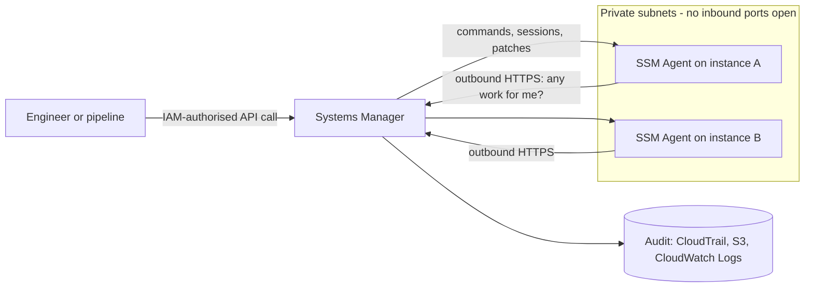
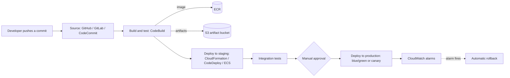
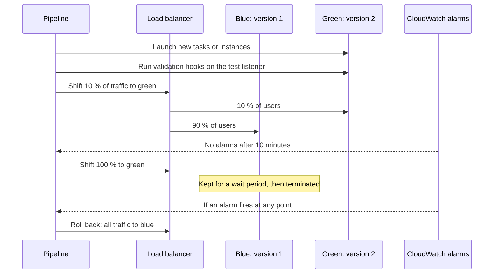

# Systems Manager and the CodePipeline family

## Before this lesson

You should know CloudFormation ([Infrastructure as code](#/lesson/aws/cloudformation-cdk)), IAM roles and least privilege ([IAM identities](#/lesson/aws/iam-identities)), EC2 access options ([EC2 instances](#/lesson/aws/ec2-instances)) and how load balancers and ECS deploy new versions ([Elastic Load Balancing](#/lesson/aws/load-balancing), [Containers](#/lesson/aws/containers)). The site's CI/CD track covers pipelines in general; this lesson is about the AWS tools.

## In plain words

Building infrastructure is one half of running software. The other half is the daily routine: logging in to machines, applying security patches, keeping configuration values somewhere sensible, and getting each new version of the code from a developer's laptop to production safely.

Two families of AWS services cover that routine.

**AWS Systems Manager** (often shortened to **SSM**) is the **caretaker's toolkit** for your servers: a master key that opens any machine without leaving doors unlocked, a schedule for maintenance, a register of what is installed where, and a cabinet for settings and secrets.

The **Code family** — **CodeBuild**, **CodeDeploy** and **CodePipeline**, with **CodeArtifact** beside them — is the **factory conveyor belt** for software. A developer pushes a change; the belt carries it through building, testing and deployment stations, stopping the line if any station finds a fault. This practice is called **CI/CD**: continuous integration and continuous delivery.

Why it matters for a job: "how do you deploy without downtime?", "how do you patch four hundred servers?" and "where do you keep configuration?" are everyday operations questions, and the vocabulary of rolling, blue/green and canary deployments is asked in nearly every DevOps and backend interview.

## Systems Manager

### What makes a machine "managed"

Systems Manager controls machines through the **SSM Agent**, a small program preinstalled on Amazon Linux, Ubuntu and Windows AMIs. A machine becomes a **managed node** when three things are true:

1. the agent is running;
2. the instance has an IAM role with the managed policy `AmazonSSMManagedInstanceCore` (or *Default Host Management Configuration* is enabled for the account);
3. the agent can reach the Systems Manager endpoints — through a NAT gateway or through **VPC interface endpoints** for `ssm`, `ssmmessages` and `ec2messages`.

The agent makes **outbound** HTTPS connections and asks for work. Nothing connects *in* to the instance. On-premises servers and other clouds' machines can be registered too (*hybrid activations*).



### Session Manager

**Session Manager** gives you a shell on an instance with **no SSH port open, no bastion host, no key pairs and no public IP address**. Access is decided by IAM, every session start is recorded in CloudTrail, and the full keystroke log can be sent to S3 or CloudWatch Logs.

```bash
aws ssm start-session --target i-0a1b2c3d4e5f67890
```

```
Starting session with SessionId: ana-0f3a9c1d2e4b5a678
sh-5.2$ whoami
ssm-user
```

It also forwards ports — the standard way to reach a private database from a laptop:

```bash
aws ssm start-session --target i-0a1b2c3d4e5f67890 \
  --document-name AWS-StartPortForwardingSessionToRemoteHost \
  --parameters '{"host":["bookshop.c9akciq32.eu-west-1.rds.amazonaws.com"],"portNumber":["5432"],"localPortNumber":["5432"]}'
```

- `--target` is any managed instance that can reach the database.
- The **document** named here is a predefined procedure for forwarding a local port through the instance to a remote host.
- Afterwards `psql -h localhost` on the laptop talks to the private database, with no inbound rule added anywhere.

A **bastion host** is the older design: a small instance in a public subnet that administrators SSH into first. It works, but it is an exposed server to patch and a pile of keys to manage. Session Manager replaces it.

### Run Command and documents

**Run Command** executes a command or script on many instances at once, selected by ID, by **tag** or by resource group.

```bash
CMD=$(aws ssm send-command \
  --document-name AWS-RunShellScript \
  --targets "Key=tag:Role,Values=web" \
  --parameters 'commands=["systemctl is-active nginx","df -h / | tail -1"]' \
  --max-concurrency "25%" --max-errors "2" \
  --query Command.CommandId --output text)

aws ssm list-command-invocations --command-id "$CMD" --details \
  --query "CommandInvocations[].[InstanceId,Status,CommandPlugins[0].Output]" --output text
```

```
i-0aaa1111   Success   active
                       /dev/nvme0n1p1   30G  8.1G   22G  27% /
i-0bbb2222   Success   active
                       /dev/nvme0n1p1   30G   27G  3.0G  91% /
```

- `--targets "Key=tag:Role,Values=web"` selects every managed instance tagged `Role=web` — no list of host names to maintain.
- `--max-concurrency "25%"` runs on a quarter of the fleet at a time; `--max-errors "2"` stops the rollout after two failures. These two **rate controls** are what make fleet-wide commands safe.
- The second command collects each instance's output. Here it has found a server at 91 % disk usage.

An **SSM document** defines what to do. *Command documents* (such as `AWS-RunShellScript`) are used by Run Command and State Manager; *Automation runbooks* define multi-step procedures that call AWS APIs — for example "stop instance → snapshot volume → start instance → wait until healthy". Hundreds are provided, and you can write your own.

### Patch Manager and State Manager

**Patch Manager** automates operating-system patching:

- a **patch baseline** says which patches are approved (for example, security patches seven days after release);
- **patch groups** (a tag) map instances to a baseline;
- a **maintenance window** schedules when patching runs, with rate controls and an option to reboot;
- a **compliance report** shows which instances are missing which patches.

**State Manager** keeps instances in a declared state by re-applying an **association** on a schedule: "the CloudWatch agent is installed and running with this configuration", "the antivirus definitions are current".

For fleets that are replaced instead of repaired — Auto Scaling groups and containers — the equivalent is to **build a new patched image and roll it out** (EC2 Image Builder plus an instance refresh). Both approaches coexist in most companies.

### Parameter Store

**Parameter Store** holds configuration values and secrets in a hierarchy:

```
/bookshop/prod/db/host        String        bookshop.c9akciq32.eu-west-1.rds.amazonaws.com
/bookshop/prod/db/password    SecureString  (encrypted with KMS)
/bookshop/prod/feature/new-checkout   String   true
```

```bash
aws ssm put-parameter --name /bookshop/prod/feature/new-checkout --type String --value true
aws ssm put-parameter --name /bookshop/prod/db/password --type SecureString --value 'N0t-a-real-one'

# Fetch a whole subtree, decrypting secrets.
aws ssm get-parameters-by-path --path /bookshop/prod --recursive --with-decryption \
  --query "Parameters[].[Name,Type]" --output table
```

- Three types: `String`, `StringList`, and `SecureString` (encrypted with a KMS key).
- The **path hierarchy** lets an IAM policy grant an application access to `/bookshop/prod/*` and nothing else.
- Parameters are **versioned**, and changes are recorded in CloudTrail.
- CloudFormation, ECS task definitions, Lambda and CodeBuild can all reference parameters directly, so values are injected at deploy or start time instead of being baked in.
- AWS publishes **public parameters**, such as the latest Amazon Linux AMI ID for each Region.

The comparison with **Secrets Manager** from [the security services lesson](#/lesson/aws/security-services) applies: Parameter Store for configuration and simple secrets (standard parameters are free); Secrets Manager when you need automatic rotation, cross-Region replication or generated passwords. **AWS AppConfig** adds validation and gradual rollout for feature flags and dynamic configuration.

### The rest of the toolkit

| Capability | What it does |
|---|---|
| **Inventory** | Collects installed software, network settings and services from each node |
| **Fleet Manager** | A console to browse nodes, files, processes and logs |
| **Automation** | Runs runbooks, including with approval steps |
| **Maintenance Windows** | Schedules disruptive tasks |
| **Compliance** | Patch and association compliance in one view |
| **OpsCenter / Incident Manager** | Operational issues and incident response plans |
| **Distributor** | Packages and installs agents and software |

Systems Manager's core features are free; you pay for advanced parameters, on-premises node tiers and a few specialised features.

> [!NOTE]
> The edition of the book this track follows describes **AWS OpsWorks** (managed Chef and Puppet) for configuration management. OpsWorks reached end of life in 2024. Its jobs are now done by Systems Manager, by infrastructure as code, and by containers. If an old exam question mentions "Chef recipes" or "stacks and layers", OpsWorks was the intended answer.

## CI/CD on AWS

### The ideas

- **Continuous integration (CI)**: every change pushed to the shared repository is automatically built and tested, so that problems surface within minutes.
- **Continuous delivery**: every change that passes is automatically prepared for release, with a human approving the final step to production.
- **Continuous deployment**: the same, with no human step.

A **pipeline** automates the path. An **artifact** is what one stage hands to the next: a zip of compiled code, a container image, a CloudFormation template.



### The services

| Service | Role | Notes |
|---|---|---|
| **CodePipeline** | Orchestrates the stages | Sources from GitHub, GitLab, Bitbucket (through a *connection*), CodeCommit, S3, ECR |
| **CodeBuild** | Builds and tests | Runs your commands in a fresh container; pay per build minute; no build servers to keep |
| **CodeDeploy** | Deploys to EC2, on-premises servers, Lambda and ECS | Rolling, blue/green, canary and linear strategies with automatic rollback |
| **CodeArtifact** | Private package repository | npm, PyPI, Maven, NuGet and others, with upstream proxies |
| **CodeCommit** | Managed Git repositories | Fewer features than GitHub or GitLab; AWS's stance on it has changed more than once in recent years, so check its current status before choosing it for a new project |
| **ECR** | Container image registry | Covered in [Containers](#/lesson/aws/containers) |

Many teams use GitHub Actions or GitLab CI for the pipeline and only AWS for the deployment targets, authenticating with OIDC federation (see [Policy evaluation and STS](#/lesson/aws/iam-evaluation)). The concepts transfer either way.

### CodeBuild and the buildspec

CodeBuild reads its instructions from a file called `buildspec.yml` at the root of the repository.

```yaml
version: 0.2

env:
  variables:
    IMAGE_REPO: 111122223333.dkr.ecr.eu-west-1.amazonaws.com/bookshop-api
  parameter-store:
    SONAR_TOKEN: /bookshop/ci/sonar-token        # injected from Parameter Store, never in Git

phases:
  install:
    runtime-versions:
      python: 3.13
  pre_build:
    commands:
      - pip install -r requirements-dev.txt
      - pytest -q                                 # a failing test stops the pipeline here
      - aws ecr get-login-password | docker login --username AWS --password-stdin ${IMAGE_REPO%/*}
      - TAG=${CODEBUILD_RESOLVED_SOURCE_VERSION:0:8}   # first 8 characters of the commit ID
  build:
    commands:
      - docker build -t $IMAGE_REPO:$TAG .
  post_build:
    commands:
      - docker push $IMAGE_REPO:$TAG
      - printf '[{"name":"api","imageUri":"%s"}]' $IMAGE_REPO:$TAG > imagedefinitions.json

artifacts:
  files:
    - imagedefinitions.json

cache:
  paths:
    - /root/.cache/pip/**/*
```

Section by section:

- `env` defines plain variables and values fetched from Parameter Store (or Secrets Manager) at build time.
- `phases` run in order — `install`, `pre_build`, `build`, `post_build`. Any command that exits with an error fails the build.
- The image is tagged with the **commit ID**, so every running container can be traced to the exact source.
- `imagedefinitions.json` tells the ECS deploy action which image each container should use.
- `artifacts` lists files handed to the next stage; `cache` speeds up later builds.
- The build runs with a **service role**; it needs permission only to push to that one repository, read those parameters and write logs.

### CodeDeploy and deployment strategies

How the new version replaces the old one decides how risky a release is.

| Strategy | How it works | Risk and rollback |
|---|---|---|
| **All at once / in place** | Stop the old version and start the new on every server together | Downtime; rollback means redeploying |
| **Rolling** | Replace a few servers at a time behind the load balancer | No downtime; reduced capacity during the roll; old and new versions serve together |
| **Blue/green** | Stand up a complete second environment (green) with the new version, test it, **switch traffic**, keep the old one (blue) for a while | Near-instant rollback by switching back; costs double capacity briefly |
| **Canary** | Send a small share (say 10 %) of traffic to the new version, watch metrics, then shift the rest | A problem affects few users; needs good monitoring |
| **Linear** | Shift traffic in equal steps (10 % every 10 minutes) | Gradual; slower |



CodeDeploy supports these across three compute platforms:

- **EC2 and on-premises**: an agent on each machine follows `appspec.yml`, which maps files to destinations and names **lifecycle hook** scripts (`BeforeInstall`, `AfterInstall`, `ApplicationStart`, `ValidateService`). In-place or blue/green with a new Auto Scaling group.
- **Lambda**: shifts an **alias** from the old version to the new, canary or linear, with pre- and post-traffic hook functions.
- **ECS**: blue/green between two target groups, with a test listener for validation.

**Automatic rollback** can be triggered by a failed deployment or by a **CloudWatch alarm** — error rate, latency — firing during the shift. That last link is what makes fast releases safe: the pipeline watches the same signals an on-call engineer would.

Two requirements make these strategies work, and both are application design issues, not tooling issues:

- **Backward-compatible changes**: during a rolling or canary release, old and new code run at once against the same database. Schema changes must be made in steps that both versions tolerate (add a column first, use it later, remove the old one last).
- **Health checks that mean something**: the deployment proceeds on the strength of them.

### A pipeline as code

Pipelines are infrastructure and belong in templates. A CloudFormation outline of a three-stage pipeline:

```yaml
Pipeline:
  Type: AWS::CodePipeline::Pipeline
  Properties:
    PipelineType: V2
    RoleArn: !GetAtt PipelineRole.Arn
    ArtifactStore: {Type: S3, Location: !Ref ArtifactBucket}
    Stages:
      - Name: Source
        Actions:
          - Name: GitHub
            ActionTypeId: {Category: Source, Owner: AWS, Provider: CodeStarSourceConnection, Version: "1"}
            Configuration:
              ConnectionArn: !Ref GitHubConnectionArn
              FullRepositoryId: tidewater/bookshop-api
              BranchName: main
            OutputArtifacts: [{Name: Source}]
      - Name: Build
        Actions:
          - Name: TestAndBuild
            ActionTypeId: {Category: Build, Owner: AWS, Provider: CodeBuild, Version: "1"}
            Configuration: {ProjectName: !Ref BuildProject}
            InputArtifacts: [{Name: Source}]
            OutputArtifacts: [{Name: Built}]
      - Name: Production
        Actions:
          - Name: Approve
            ActionTypeId: {Category: Approval, Owner: AWS, Provider: Manual, Version: "1"}
            RunOrder: 1
          - Name: DeployToEcs
            ActionTypeId: {Category: Deploy, Owner: AWS, Provider: ECS, Version: "1"}
            Configuration: {ClusterName: bookshop, ServiceName: api, FileName: imagedefinitions.json}
            InputArtifacts: [{Name: Built}]
            RunOrder: 2
```

- Each **stage** contains **actions**; an action has a category (Source, Build, Test, Deploy, Approval, Invoke) and a provider.
- Artifacts flow by name: the Source action outputs `Source`, the Build action consumes it and outputs `Built`.
- `RunOrder` sequences actions inside a stage: approval first, deployment second.
- The pipeline and each action use **IAM roles**; least privilege here matters a great deal, because a pipeline can change production.

```bash
aws codepipeline start-pipeline-execution --name bookshop-api
aws codepipeline get-pipeline-state --name bookshop-api \
  --query "stageStates[].[stageName,latestExecution.status]" --output table
```

```
+-------------+-------------+
|  Source     |  Succeeded  |
|  Build      |  Succeeded  |
|  Production |  InProgress |
+-------------+-------------+
```

`InProgress` on the last stage here means the pipeline is waiting for the manual approval.

## Putting it together

A change's journey in a well-run AWS shop:

1. A pull request is reviewed and merged.
2. The pipeline builds once, runs unit tests and security scans, and produces **one immutable artifact** tagged with the commit ID.
3. That same artifact is deployed to staging by updating a CloudFormation stack or ECS service; integration tests run.
4. After approval (or automatically), the artifact is deployed to production with a canary or blue/green shift guarded by alarms.
5. Configuration comes from Parameter Store or Secrets Manager per environment — the artifact itself is identical everywhere.
6. Nobody logs in to servers for a release; when someone must investigate, Session Manager records it.

## Cost notes and free-tier warnings

- **Systems Manager**: Session Manager, Run Command, Patch Manager, State Manager, Inventory and standard parameters are free for EC2. Interface VPC endpoints for SSM in private subnets are billed hourly.
- **CodeBuild**: per build minute by compute size, with a monthly free allowance of small-instance minutes. Long or oversized builds are the cost driver; use caching.
- **CodePipeline**: V2 pipelines bill per action-execution minute; V1 per active pipeline per month.
- **CodeDeploy**: free for EC2, Lambda and ECS; a small fee per on-premises update.
- **Blue/green** doubles capacity during the switch-over; keep the wait period sensible.
- Artifact buckets and ECR repositories grow for ever unless lifecycle rules expire old builds.

## Pitfalls

- **An instance that never appears as a managed node**: missing instance role, no network path to the SSM endpoints, or the agent not running.
- **Keeping port 22 open "for emergencies"** when Session Manager is available.
- **Run Command across the whole fleet at once** with no concurrency or error limits.
- **Patching in place without a maintenance window or a reboot plan.**
- **Secrets in buildspec files, pipeline variables or build logs.**
- **Rebuilding the artifact for each environment**, so that what was tested is not what is deployed.
- **A pipeline role with administrator access.**
- **Deploying incompatible database changes with a rolling strategy.**
- **Canary releases without alarms**: a gradual rollout nobody is watching is only a slow rollout.
- **No tested rollback.**
- **Relying on a tool from an old tutorial** (OpsWorks, launch configurations) that is no longer available.

> [!INTERVIEW]
> **"How do you give engineers shell access to instances in private subnets?"** Systems Manager Session Manager: the SSM Agent and an instance role with `AmazonSSMManagedInstanceCore`, plus NAT or VPC endpoints for connectivity. No inbound ports, bastions or SSH keys; access is granted with IAM, logged in CloudTrail, and session content can be recorded to S3 or CloudWatch Logs.
>
> **"Explain blue/green versus canary deployment."** Blue/green runs the new version in a complete parallel environment and switches traffic over at once, keeping the old environment for instant rollback. Canary sends a small percentage of real traffic to the new version first and proceeds only if metrics stay healthy. Both avoid downtime; canary limits the blast radius of a bad release, blue/green makes the switch and the rollback simplest. Both depend on meaningful health checks, alarms and backward-compatible changes.

## Cheat sheet

| Need | Tool |
|---|---|
| Shell without SSH, keys or bastion | Session Manager |
| Run a command on many instances | Run Command (with concurrency and error limits) |
| Scheduled OS patching and compliance | Patch Manager + maintenance windows |
| Keep configuration applied | State Manager |
| Configuration values and simple secrets | Parameter Store |
| Rotating secrets | Secrets Manager |
| Multi-step operational procedures | Automation runbooks |
| Orchestrate build, test, deploy | CodePipeline |
| Build and test without build servers | CodeBuild (`buildspec.yml`) |
| Deploy to EC2, Lambda, ECS with traffic shifting | CodeDeploy (`appspec.yml`) |
| Private package repository | CodeArtifact |
| Zero-downtime release with instant rollback | Blue/green |
| Expose few users to a new version first | Canary |

## Summary

- Systems Manager manages nodes through an outbound-connecting agent: Session Manager for audited shell access without open ports, Run Command for fleet-wide commands, Patch Manager and State Manager for patching and desired state, Parameter Store for configuration.
- CI/CD automates the path from commit to production; CodePipeline orchestrates stages, CodeBuild builds and tests from a buildspec, CodeDeploy shifts traffic to new versions.
- Deployment strategies trade speed, cost and risk: in place, rolling, blue/green, canary and linear, with alarm-driven automatic rollback.
- Build one immutable artifact, promote it through environments, inject configuration at deploy time, and give pipelines only the permissions they need.

## Glossary

- **Appspec / buildspec**: the instruction files for CodeDeploy / CodeBuild.
- **Artifact**: the output of a pipeline stage passed to the next.
- **Association**: a State Manager binding of a document to targets on a schedule.
- **Bastion host**: a public server used as a stepping stone for SSH.
- **Blue/green**: releasing by switching traffic between two complete environments.
- **Canary**: releasing to a small share of traffic first.
- **CI/CD**: continuous integration and continuous delivery or deployment.
- **Document / runbook**: a Systems Manager definition of commands / of a multi-step automation.
- **Lifecycle hook**: a script run at a defined point of a deployment.
- **Maintenance window**: a scheduled period for disruptive operations.
- **Managed node**: a machine registered with Systems Manager.
- **Patch baseline**: the rules approving patches for installation.
- **Pipeline**: an automated sequence of stages from source to deployment.
- **Rolling deployment**: replacing instances in batches.
- **SSM Agent**: the software that connects a machine to Systems Manager.

```quiz
[
  {"q": "A security audit forbids inbound SSH and bastion hosts, but engineers must still open shells on private EC2 instances, with every session logged. What satisfies this?",
   "options": ["EC2 key pairs rotated weekly", "Systems Manager Session Manager with session logging to S3 or CloudWatch Logs", "A VPN to each instance", "Opening port 22 only at night"],
   "answer": 1,
   "explain": "Session Manager needs no inbound ports or keys; access is controlled by IAM and sessions are auditable."},
  {"q": "A new instance in a private subnet with no NAT gateway does not appear in Systems Manager, although it has the correct instance role. What is missing?",
   "options": ["A public IP on the load balancer", "VPC interface endpoints for the Systems Manager services (ssm, ssmmessages, ec2messages)", "An SSH key pair", "A larger instance type"],
   "answer": 1,
   "explain": "The agent must reach the Systems Manager endpoints over HTTPS. Without NAT, interface endpoints provide that path."},
  {"q": "An operator needs to restart a service on 300 web servers tagged Role=web, a few at a time, stopping if several fail. Which approach?",
   "options": ["SSH to each server in a loop", "Run Command targeting the tag with max-concurrency and max-errors", "Terminate all instances", "A CloudFormation change set"],
   "answer": 1,
   "explain": "Run Command targets nodes by tag and its rate controls limit the blast radius of a bad command."},
  {"q": "Where should a build fetch a third-party API token so that it never appears in the repository?",
   "options": ["A plaintext variable in buildspec.yml", "Parameter Store SecureString or Secrets Manager, referenced from the buildspec env section", "A comment in the README", "The artifact bucket"],
   "answer": 1,
   "explain": "CodeBuild can inject values from Parameter Store or Secrets Manager at build time using its service role."},
  {"q": "A team wants to release a new Lambda version to 10 % of invocations for ten minutes and roll back automatically if the error alarm fires. Which service and strategy?",
   "options": ["CodeDeploy with a canary configuration on a Lambda alias", "CodeBuild with a cache", "Patch Manager with a baseline", "CloudFormation drift detection"],
   "answer": 0,
   "explain": "CodeDeploy shifts alias traffic between Lambda versions canary-style and can roll back on CloudWatch alarms."},
  {"q": "Which deployment strategy provides the fastest rollback at the cost of temporarily doubling capacity?",
   "options": ["In place", "Rolling", "Blue/green", "All at once"],
   "answer": 2,
   "explain": "The previous environment stays intact, so rolling back is a traffic switch. Both environments run at once during the transition."},
  {"q": "A pipeline rebuilds the container image separately for staging and production from the same commit. Why is this discouraged?",
   "options": ["It uses too little compute", "The production image is not byte-for-byte the one that was tested; dependencies may differ between builds", "ECR rejects duplicate tags", "CodePipeline cannot run two builds"],
   "answer": 1,
   "explain": "Build once and promote the same immutable artifact so that what passed testing is exactly what is released; inject environment differences as configuration."},
  {"q": "During a rolling deployment, version 2 of an application drops a database column that version 1 still reads. What happens?",
   "options": ["Nothing; the load balancer hides it", "Requests served by remaining version 1 instances fail, because old and new versions run concurrently against the same schema", "The database rolls back automatically", "CodeDeploy rewrites the queries"],
   "answer": 1,
   "explain": "Rolling and canary releases require backward-compatible changes. Schema changes must be staged so that both versions work at each step."}
]
```

> **Source:** AWS Certified Solutions Architect Official Study Guide, ch. 11 (DevOps: AWS OpsWorks, AWS CloudFormation, AWS Elastic Beanstalk) and ch. 14 (automation). Systems Manager and the Code services post-date the book and OpsWorks has been retired; checked against https://docs.aws.amazon.com/systems-manager/latest/userguide/what-is-systems-manager.html , https://docs.aws.amazon.com/systems-manager/latest/userguide/session-manager.html , https://docs.aws.amazon.com/codebuild/latest/userguide/build-spec-ref.html , https://docs.aws.amazon.com/codedeploy/latest/userguide/deployment-configurations.html and https://docs.aws.amazon.com/codepipeline/latest/userguide/welcome.html
