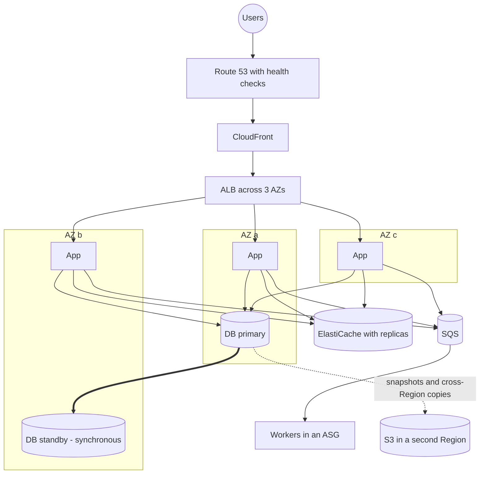
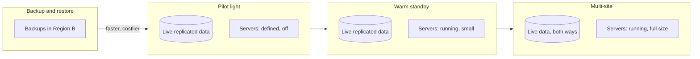

# Reliability: resilient architectures, RTO, RPO and disaster recovery

## Before this lesson

This lesson pulls together services from the whole track: Availability Zones and Regions ([the AWS global map](#/lesson/aws/what-is-cloud)), load balancing and Auto Scaling ([Elastic Load Balancing](#/lesson/aws/load-balancing), [EC2 Auto Scaling](#/lesson/aws/auto-scaling)), Multi-AZ databases and read replicas ([RDS and Aurora](#/lesson/aws/rds-aurora)), S3 replication ([S3 protection](#/lesson/aws/s3-protection)), queues ([SQS and SNS](#/lesson/aws/messaging)), Route 53 failover ([Route 53](#/lesson/aws/route53)) and infrastructure as code ([CloudFormation](#/lesson/aws/cloudformation-cdk)).

## In plain words

Everything fails eventually. Disks wear out, a software release has a bug, a power cut takes out a data centre, somebody deletes the wrong table. **Reliability** is the ability of a system to keep doing its job despite such events, and to recover quickly when it cannot.

The **AWS Well-Architected Framework** is AWS's collection of design advice, organised into six **pillars**: operational excellence, security, reliability, performance efficiency, cost optimisation and sustainability. This module covers the five that the certification concentrates on, starting with reliability.

A hospital is a good mental model. It does not hope the electricity never fails; it has a generator, tests it every month, and has decided in advance which wards get power first. It keeps copies of patient records off site. It rehearses evacuations. None of that is pessimism — it is what makes the hospital dependable.

Two questions run through the whole lesson, and a business must answer them before an engineer can design anything:

- **How long can we be down?** (the recovery time objective, **RTO**)
- **How much recent data can we afford to lose?** (the recovery point objective, **RPO**)

Why it matters for a job: "design for failure" is the oldest AWS architecture principle, disaster-recovery strategy questions appear in every Solutions Architect exam, and outages are what on-call engineers are measured by.

## Design for failure

The first principle from the architecture best practices that this track's source book lists is to assume that any component can fail and design so that nothing important depends on one of anything.

A **single point of failure (SPOF)** is a component whose failure stops the whole system. Hunting them is the core exercise:

| Single point of failure | Resilient replacement |
|---|---|
| One EC2 instance | Auto Scaling group across ≥ 2 Availability Zones behind a load balancer |
| One database instance | RDS Multi-AZ or Aurora with replicas in other zones |
| One NAT gateway | One per Availability Zone |
| An Elastic IP on one server | A load balancer or Route 53 record in front of several |
| Files on an instance's disk | S3 or EFS |
| Sessions in server memory | ElastiCache or DynamoDB |
| One Region (for the most critical systems) | A second Region with replicated data |
| One person who knows how to deploy | Automation and runbooks |

**Redundancy** — more than one of everything — is the general cure. It only helps when failures are **independent**: two servers in the same rack share the rack's fate, which is why AWS gives you Availability Zones with separate power and networking.

### Availability in numbers

**Availability** is the fraction of time a system works. It is usually written in "nines".

| Availability | Downtime per year | Downtime per month |
|---|---|---|
| 99 % | 3.65 days | 7.3 hours |
| 99.9 % ("three nines") | 8.8 hours | 44 minutes |
| 99.95 % | 4.4 hours | 22 minutes |
| 99.99 % ("four nines") | 53 minutes | 4.4 minutes |
| 99.999 % ("five nines") | 5.3 minutes | 26 seconds |

Two rules of arithmetic govern how components combine:

- **In series** (the request needs A *and* B *and* C): multiply the availabilities. Every extra dependency lowers the total.
- **In parallel** (any one of several redundant copies suffices): multiply the *un*availabilities. Redundancy raises the total sharply.

```python-run
def series(*parts):                 # all must work
    total = 1.0
    for a in parts:
        total *= a
    return total

def parallel(a, copies):            # at least one of `copies` independent copies must work
    return 1 - (1 - a) ** copies

def downtime_minutes_per_month(a):
    return (1 - a) * 30 * 24 * 60

single = series(0.995, 0.995, 0.995)                     # one web server, one app server, one database
print(f"three single components in series : {single:.4%}  -> {downtime_minutes_per_month(single):6.0f} min/month")

redundant = series(parallel(0.995, 2), parallel(0.995, 2), parallel(0.995, 2))
print(f"each tier doubled across two zones : {redundant:.4%}  -> {downtime_minutes_per_month(redundant):6.1f} min/month")

with_dependency = series(redundant, 0.999)               # plus one external payment API at 99.9 %
print(f"...plus a hard dependency at 99.9% : {with_dependency:.4%}  -> {downtime_minutes_per_month(with_dependency):6.1f} min/month")
```

Line by line: `series` multiplies availabilities; `parallel` computes one minus the chance that every copy is down at once. Three tiers of single 99.5 % components give about 98.5 % — eleven hours of downtime a month. Doubling each tier gives 99.99 %. Adding one unavoidable call to a 99.9 % external service drags the whole thing back to about 99.9 %: **a system is never more available than its hard dependencies**, which is the argument for making dependencies *soft* with queues, caches, timeouts and fallbacks.

### Patterns that make systems resilient

- **Multi-AZ everything.** The baseline for production.
- **Loose coupling.** A queue or event bus between components means one can fail without stopping the other.
- **Statelessness.** Any instance can be replaced because nothing unique lives on it.
- **Health checks and automatic replacement.** Auto Scaling groups, ECS services and load balancers do this without a human.
- **Timeouts and retries with exponential backoff and jitter.** A call without a timeout can hang for ever; retries without backoff turn a slow dependency into a dead one. Wait a little, then twice as long, then four times, with a random offset so that clients do not retry in step. AWS SDKs do this by default.
- **Idempotency**, so that a retry is harmless.
- **Throttling and load shedding.** Reject the excess quickly instead of collapsing for everyone.
- **Graceful degradation.** If recommendations are down, show the page without recommendations.
- **Circuit breakers.** After repeated failures, stop calling a broken dependency for a while and fail fast.
- **Static stability.** Keep working with what you have when a control system is impaired — for example, run enough capacity in two zones to carry the load if the third is lost, instead of counting on launching instances during the incident.
- **Bulkheads / cell-based design.** Divide the system into isolated portions so that a failure affects one portion only.



## High availability is not disaster recovery

These two are often confused.

- **High availability (HA)** keeps the system running through *expected, small-scale* failures — an instance, a disk, an Availability Zone — automatically, usually within one Region.
- **Disaster recovery (DR)** restores the system after a *large-scale* event that HA cannot absorb: a whole Region unavailable, data corrupted or deleted, ransomware, an account compromise.
- **Backup** protects against data loss or corruption, including the kind you cause yourself.

Multi-AZ does not protect you from a bad deployment that deletes rows: the deletion is faithfully replicated to the standby within milliseconds. Replication is not backup.

## RTO and RPO


- **Recovery point objective (RPO)**: the maximum acceptable amount of data loss, measured in time. An RPO of one hour means that after recovery, at most the last hour's changes are gone. It is determined by **how often data is copied** — backup frequency or replication lag.
- **Recovery time objective (RTO)**: the maximum acceptable time between the disaster and the service being available again. It is determined by **how much is already running and how automated the recovery is**.

Both are **business decisions** expressed in money: what does an hour of downtime cost, and what does an hour of lost orders cost? Tighter objectives cost more, steeply. A payroll system used once a month and a payment API do not deserve the same answer, and a company should classify its systems into tiers.

## The four disaster-recovery strategies

From cheapest and slowest to dearest and fastest. The secondary site is usually a second Region.

| | **Backup and restore** | **Pilot light** | **Warm standby** | **Multi-site active/active** |
|---|---|---|---|---|
| In the recovery Region before a disaster | Backups only | Data replicated live; core infrastructure defined but **switched off** | A **scaled-down but running** copy of everything | A **full-size** copy serving live traffic |
| On disaster | Build infrastructure from code, restore data | Start and scale the servers, switch traffic | Scale up, switch traffic | Remove the failed Region from routing |
| Typical RTO | Hours to a day | Tens of minutes to hours | Minutes | Near zero |
| Typical RPO | Hours (time since last backup) | Seconds to minutes (replication lag) | Seconds | Near zero |
| Relative cost | Lowest | Low | Medium | Highest |

The names are worth a moment:

- **Pilot light** comes from gas boilers: a tiny flame is always burning so that the main burner can be lit instantly. The flame here is the **data** — a replicated database, replicated buckets — plus ready-made images and templates. No application servers run.
- **Warm standby** is a complete system already running at small scale. It can take a little traffic immediately and is scaled up during failover. The difference from pilot light in one sentence: *a warm standby can serve requests right now; a pilot light cannot until servers are started*.
- **Multi-site active/active** runs at full scale in two or more Regions at once. Failover is a routing change. The hard part is data: writes in two places need a database designed for it (DynamoDB global tables, Aurora Global Database with a single write Region and fast promotion) and an application that tolerates replication delay.



### Building blocks for each strategy

| Need | Services |
|---|---|
| Scheduled, policy-driven backups across services, with cross-Region and cross-account copies | **AWS Backup** (backup plans, vaults, **Vault Lock** for immutability) |
| Database copies in another Region | RDS cross-Region read replicas and snapshot copies; **Aurora Global Database**; **DynamoDB global tables** |
| Object replication | S3 Cross-Region Replication (with versioning) |
| Rebuild infrastructure identically | CloudFormation / CDK / Terraform; AMIs copied to the recovery Region |
| Replicate whole servers continuously | **AWS Elastic Disaster Recovery** (block-level replication, launch in minutes) |
| Redirect users | Route 53 failover or latency records with health checks; Global Accelerator |
| Controlled, rehearsed regional failover | Application Recovery Controller |
| Guarantee capacity in the recovery Region | On-Demand Capacity Reservations |

### Choosing: a worked scenario

Tidewater Books classifies three systems.

| System | Cost of downtime | RTO | RPO | Strategy | Why |
|---|---|---|---|---|---|
| Internal reporting | Low | 24 h | 24 h | Backup and restore | Nightly backups copied to a second Region; infrastructure from templates when needed |
| Online shop | High | 30 min | 5 min | Warm standby | A small copy running in the second Region with an Aurora Global Database secondary; scale up and switch DNS |
| Payment API | Very high | ~1 min | ~0 | Multi-site active/active | Both Regions serve traffic; DynamoDB global tables; Route 53 latency routing with health checks |

The decision procedure is always the same: filter the strategies that meet both objectives, then take the cheapest. The problem *Disaster-Recovery Strategy Selector* turns that into code, and *Multi-AZ Failover vs Read-Replica Promotion* computes the downtime and data loss of different database protections.

## Backups that work

- **Automate** them; a backup that depends on someone remembering does not exist.
- **Copy** them to another Region, and ideally another account, so that a compromised account cannot delete them. Make them **immutable** (AWS Backup Vault Lock, S3 Object Lock) against ransomware.
- **Encrypt** them, and make sure the key is available where you will restore.
- **Test restores regularly.** An untested backup is a hope. AWS Backup can run scheduled restore tests.
- Use **point-in-time recovery** (RDS, DynamoDB, S3 versioning) for the common case of "undo the last hour".
- Know your real **RPO** from the backup schedule and your real **RTO** from a timed restore drill.

```bash
# A backup plan: daily at 02:00 UTC, keep 35 days, copy each recovery point to another Region.
aws backup create-backup-plan --backup-plan '{
  "BackupPlanName": "daily-35d-with-dr-copy",
  "Rules": [{
    "RuleName": "daily",
    "TargetBackupVaultName": "primary-vault",
    "ScheduleExpression": "cron(0 2 * * ? *)",
    "Lifecycle": {"DeleteAfterDays": 35},
    "CopyActions": [{
      "DestinationBackupVaultArn": "arn:aws:backup:eu-central-1:111122223333:backup-vault:dr-vault",
      "Lifecycle": {"DeleteAfterDays": 35}
    }]
  }]
}'

# Assign resources by tag: everything tagged Backup=daily.
aws backup create-backup-selection --backup-plan-id "$PLAN_ID" --backup-selection '{
  "SelectionName": "tagged-daily",
  "IamRoleArn": "arn:aws:iam::111122223333:role/service-role/AWSBackupDefaultServiceRole",
  "ListOfTags": [{"ConditionType": "STRINGEQUALS", "ConditionKey": "Backup", "ConditionValue": "daily"}]
}'
```

- The **plan** holds rules: a schedule (cron), a target **vault** (an encrypted container for recovery points), a retention lifecycle and copy actions.
- The **selection** assigns resources by tag, so that any new database or volume tagged `Backup=daily` is protected without editing the plan. With a daily schedule the RPO is up to 24 hours.

## Testing resilience

A recovery plan that has never been exercised will fail when needed.

- **Game days**: scheduled rehearsals in which a team simulates a failure and follows the runbook.
- **Chaos engineering**: deliberately injecting faults to verify that the system copes. **AWS Fault Injection Service** can stop instances, throttle APIs, add network latency or cut off an Availability Zone, with automatic stop conditions tied to alarms.
- **Failover drills**: `reboot --force-failover` on a database, removing a zone's instances, switching Route 53 to the recovery Region.
- **Restore drills**: timed, from real backups, into an isolated environment.
- **Resilience Hub** assesses an application's architecture against stated RTO and RPO targets and points out gaps.

## Other reliability practices

- **Manage service quotas.** Every account has limits (instances per Region, Lambda concurrency, addresses). A failover that needs 200 instances in a Region where your quota is 50 will not succeed. Raise quotas in the recovery Region in advance.
- **Scale horizontally** and **stop guessing capacity**: auto scaling removes a whole class of overload outages.
- **Manage change through automation.** Most outages are caused by changes. Infrastructure as code, pipelines, small releases, canaries and automatic rollback are reliability tools.
- **Monitor everything that matters** and alarm on symptoms, so that recovery starts before customers call.

## Cost notes and free-tier warnings

- **Multi-AZ** roughly doubles database cost and adds inter-zone data transfer. It is the price of availability for production and usually unnecessary for development.
- **Backup and restore** costs only storage (cheap) and transfer. **Pilot light** adds replicated databases. **Warm standby** adds a small running fleet and load balancers in a second Region. **Active/active** doubles nearly everything and adds cross-Region replication traffic.
- **Cross-Region data transfer** is charged per GB and is easy to underestimate for chatty replication.
- Old **snapshots and recovery points** accumulate; set lifecycles.
- Over-engineering is a real failure mode: five-nines infrastructure for an internal tool is money that buys nothing. Match the spend to the RTO and RPO the business actually set.

## Pitfalls

- **Calling Multi-AZ "disaster recovery"**, or replication "backup".
- **RTO and RPO chosen by engineers alone**, without the business pricing downtime and data loss.
- **A DR plan that has never been tested** — or backups never restored.
- **Backups in the same account and Region as the data**, deletable by the same compromised credentials.
- **Forgetting dependencies**: the application fails over but its DNS, certificates, secrets, container images or third-party allow-lists do not exist in the recovery Region.
- **Insufficient quotas or capacity** in the recovery Region.
- **Retries without backoff, jitter or limits**, amplifying an incident.
- **Health checks that are too shallow** (port open) or too deep (fail when any dependency is slow).
- **Manual, undocumented failover steps** that only one person knows.
- **Data replicated one way with no plan to fail back.**

> [!INTERVIEW]
> **"Explain RTO and RPO and how they drive a DR design."** RPO is the maximum tolerable data loss measured in time and is set by backup or replication frequency; RTO is the maximum tolerable time to restore service and is set by how much infrastructure is pre-provisioned and automated. Given both, choose the cheapest of backup and restore, pilot light, warm standby or multi-site active/active that meets them, then test it.
>
> **"Your application runs in one Region across three Availability Zones. Is that enough?"** It handles instance and zone failures — high availability. It does not handle a regional event, data corruption or accidental deletion. Whether more is needed depends on the business's RTO and RPO: at minimum, automated immutable backups copied to another Region and account, and infrastructure as code so that the system can be rebuilt; tighter objectives justify pilot light, warm standby or active/active.

## Cheat sheet

| Term | Meaning |
|---|---|
| SPOF | A component whose failure stops everything |
| HA | Survive small failures automatically, usually within a Region |
| DR | Recover from large-scale events |
| RPO | Tolerable data loss, in time |
| RTO | Tolerable downtime |
| Backup and restore | Cheapest; RTO and RPO in hours |
| Pilot light | Data live, servers off; RTO tens of minutes |
| Warm standby | Small running copy; RTO minutes |
| Multi-site active/active | Full copy serving traffic; RTO near zero |
| Series availability | Multiply availabilities |
| Parallel availability | 1 − (unavailability ^ copies) |
| Replication | Not a backup |
| Untested recovery | Not a recovery plan |

## Summary

- Reliability starts from the assumption that every component fails; remove single points of failure with redundancy across independent Availability Zones, loose coupling and stateless design.
- Availabilities multiply in series and improve dramatically in parallel; hard dependencies cap what you can achieve.
- High availability handles small failures automatically; disaster recovery handles large ones; backups handle data loss and corruption — each needs its own answer.
- RPO and RTO are business targets that select among backup and restore, pilot light, warm standby and multi-site active/active.
- Automate backups, copy them out of the account and Region, make them immutable, and test restores and failovers regularly.

## Glossary

- **Availability**: the fraction of time a system is working.
- **AWS Backup**: the central service for scheduled, policy-based backups.
- **Chaos engineering**: injecting faults deliberately to verify resilience.
- **Circuit breaker**: stopping calls to a failing dependency for a period.
- **Disaster recovery (DR)**: restoring service after a large-scale failure.
- **Exponential backoff / jitter**: retry waits that grow by a factor / with a random offset.
- **Game day**: a rehearsal of failure and recovery.
- **Graceful degradation**: continuing with reduced functionality.
- **High availability (HA)**: staying up through component failures.
- **Pilot light**: DR with live data and dormant compute.
- **Redundancy**: having more than one of a component.
- **RPO / RTO**: recovery point objective / recovery time objective.
- **Single point of failure (SPOF)**: a component with no backup.
- **Static stability**: continuing to operate without needing changes during a failure.
- **Warm standby**: DR with a scaled-down running copy.
- **Well-Architected Framework**: AWS's design guidance organised into pillars.

```quiz
[
  {"q": "A company's order database must lose at most 5 minutes of data and be back within 1 hour after a regional disaster. Which statement is correct?",
   "options": ["RTO is 5 minutes and RPO is 1 hour", "RPO is 5 minutes and RTO is 1 hour", "Both are 1 hour", "Neither applies to databases"],
   "answer": 1,
   "explain": "RPO is the tolerable data loss (5 minutes); RTO is the tolerable time to recover (1 hour)."},
  {"q": "In the recovery Region, a replica database is kept up to date and AMIs and templates are ready, but no application servers run until a disaster is declared. Which strategy is this?",
   "options": ["Backup and restore", "Pilot light", "Warm standby", "Multi-site active/active"],
   "answer": 1,
   "explain": "Pilot light keeps the data live and the rest switched off. A warm standby would already be running a scaled-down application."},
  {"q": "An internal analytics tool can be offline for a day and may lose a day of data. Budget is minimal. Which DR strategy fits?",
   "options": ["Multi-site active/active", "Warm standby", "Backup and restore with cross-Region backup copies", "Pilot light with Aurora Global Database"],
   "answer": 2,
   "explain": "With RTO and RPO of about 24 hours, the cheapest strategy meets the objectives; anything more is overspending."},
  {"q": "A web tier is 99.9 % available and it depends synchronously on a database that is 99.9 % available. What is the approximate availability of the combination?",
   "options": ["99.99 %", "99.9 %", "99.8 %", "99.0 %"],
   "answer": 2,
   "explain": "Components in series multiply: 0.999 x 0.999 is about 0.998."},
  {"q": "A developer runs a faulty migration that deletes customer rows in an RDS Multi-AZ database. Can the standby be used to recover the data?",
   "options": ["Yes, promote the standby", "No, the standby is a synchronous copy and received the deletion; use point-in-time recovery or a backup", "Yes, the standby lags by an hour", "No, RDS has no way to recover"],
   "answer": 1,
   "explain": "Replication copies mistakes instantly. Protection against data corruption or deletion comes from backups and point-in-time recovery."},
  {"q": "Which measure best protects backups against an attacker who has gained administrator access to the production account?",
   "options": ["Storing snapshots in the same account with a tag", "Copying backups to a separate account and using an immutable vault lock", "Taking backups more often", "Using a larger instance for the database"],
   "answer": 1,
   "explain": "Cross-account copies with immutability (AWS Backup Vault Lock or S3 Object Lock) cannot be deleted with credentials from the compromised account."},
  {"q": "During an outage of a downstream service, thousands of clients retry immediately and continuously, preventing it from recovering. Which practice addresses this?",
   "options": ["Longer TTLs", "Exponential backoff with jitter and a retry limit, plus circuit breaking", "More read replicas", "Sticky sessions"],
   "answer": 1,
   "explain": "Spacing retries out with growing, randomised delays and stopping after a limit prevents a retry storm from sustaining the outage."},
  {"q": "A team has a documented multi-Region failover plan that has never been executed. What is the most valuable next step?",
   "options": ["Add a third Region", "Run a game day: perform the failover and a timed restore, then fix what breaks", "Buy Reserved Instances in the recovery Region", "Increase the backup retention period"],
   "answer": 1,
   "explain": "Untested plans fail on missing quotas, permissions, DNS, secrets or steps nobody remembered. Rehearsal reveals the real RTO and the gaps."}
]
```

> **Source:** AWS Certified Solutions Architect Official Study Guide, ch. 14 (Architecture Best Practices: design for failure and nothing fails; loose coupling). The pillar structure and DR strategy names follow the AWS Well-Architected Framework; checked against https://docs.aws.amazon.com/wellarchitected/latest/reliability-pillar/welcome.html , https://docs.aws.amazon.com/whitepapers/latest/disaster-recovery-workloads-on-aws/disaster-recovery-options-in-the-cloud.html and https://docs.aws.amazon.com/aws-backup/latest/devguide/whatisbackup.html
