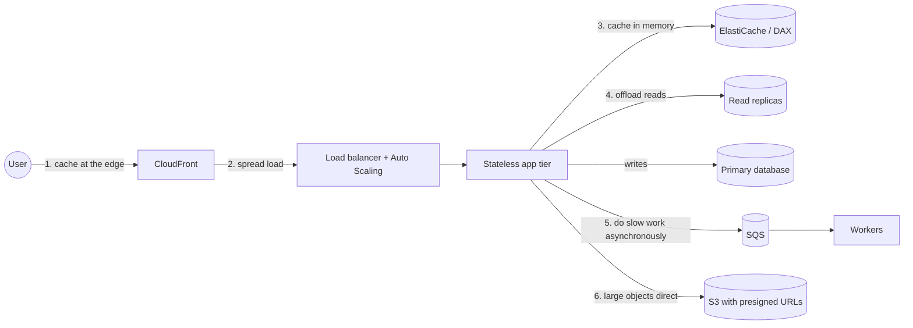
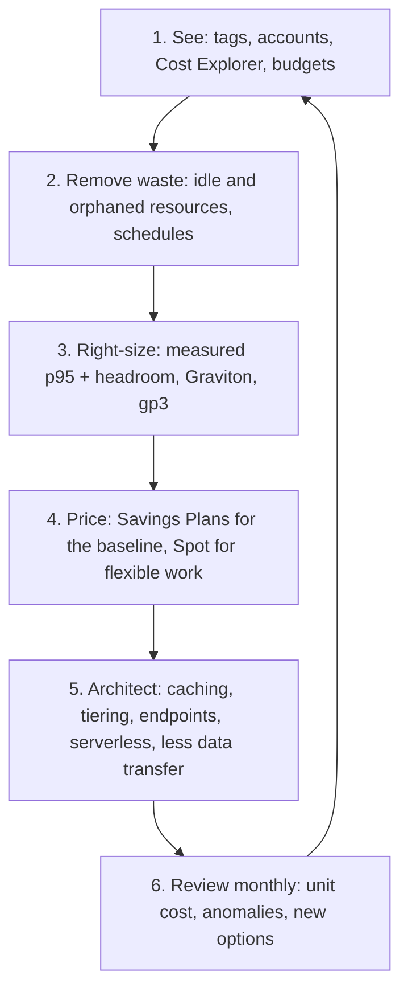

# Performance efficiency and cost optimisation

## Before this lesson

This lesson draws on most of the track: instance families and purchasing options ([EC2 instances](#/lesson/aws/ec2-instances), [Paying for EC2](#/lesson/aws/ec2-purchasing)), storage choices ([EBS](#/lesson/aws/ebs-storage), [S3 basics](#/lesson/aws/s3-basics), [File storage](#/lesson/aws/file-storage)), databases and caches ([RDS and Aurora](#/lesson/aws/rds-aurora), [DynamoDB](#/lesson/aws/dynamodb), [ElastiCache and Redshift](#/lesson/aws/cache-warehouse)), content delivery ([CloudFront](#/lesson/aws/cloudfront)), scaling ([Auto Scaling](#/lesson/aws/auto-scaling)), billing tools ([A safe first account](#/lesson/aws/account-and-billing)) and [Reliability](#/lesson/aws/reliability-dr), the first pillar lesson.

## In plain words

Two of the Well-Architected pillars are two sides of one question: **are we using the right resources, and the right amount of them?**

- **Performance efficiency** asks whether the system is fast enough and stays fast as demand changes — by *choosing the right kind* of resource for each job.
- **Cost optimisation** asks whether we are paying for anything we do not need — by *not buying more than the job requires* and *paying the lowest price for what we do use*.

Think of running a delivery company. Performance is choosing a motorbike for letters and a lorry for furniture, and planning routes so that drivers do not cross the city twice. Cost is not leaving engines idling overnight, not sending a lorry to carry one envelope, and signing a lease instead of hiring by the day for the vans you know you will use all year. Done well, the two reinforce each other: the right-sized, right-shaped vehicle is both quicker and cheaper.

Why it matters for a job: in most companies the cloud bill is one of the largest engineering costs, and "how would you make this faster?" and "how would you cut this bill by a third?" are standard interview scenarios. The engineers who answer both with numbers are the ones who get to design systems.

## Performance efficiency

### The principles

The pillar's design principles, restated plainly:

1. **Use managed services for advanced technology.** Let AWS run the database cluster, the search engine, the machine-learning platform; your team's time goes to your product.
2. **Go global in minutes.** Put content and compute near users with CloudFront, edge functions and multiple Regions.
3. **Use serverless** where it fits, removing servers as a thing to size at all.
4. **Experiment more often.** Trying a different instance family or database is a configuration change, not a purchase order.
5. **Know the mechanics.** Choose the technology whose behaviour matches how the data is actually used.

### Selection: the right tool for each layer

Performance work on AWS is largely *selection*. This table doubles as a summary of the track.

| Layer | Question | Options |
|---|---|---|
| **Compute** | Steady service, burst of events, or batch? CPU-, memory- or GPU-bound? | EC2 family by bottleneck (`c`, `r`, `m`, `g`/`p`); Graviton; containers; Lambda; Batch |
| **Storage** | Block, file or object? Random or sequential? How hot? | gp3 / io2 / st1; EFS / FSx; S3 classes; instance store for scratch |
| **Database** | Relational with joins, key-value at scale, analytics, cache, search, graph, time series? | Aurora/RDS, DynamoDB, Redshift/Athena, ElastiCache, OpenSearch, Neptune, Timestream |
| **Network** | Where are the users? How chatty are the components? | CloudFront, Global Accelerator, Route 53 latency routing, placement groups, VPC endpoints, Direct Connect |

The source book's best practices put this as **"leverage different storage options"**: there is no one store for everything. A single application sensibly keeps sessions in ElastiCache, orders in Aurora, the product catalogue in DynamoDB, images in S3 behind CloudFront, search in OpenSearch and history in a data lake. Using one database for all of it is the commonest cause of both slow systems and big bills.

### The standard performance moves



1. **Cache at the edge.** Static assets and cacheable API responses served from CloudFront never reach your servers.
2. **Scale horizontally.** More small instances behind a load balancer, adjusted automatically.
3. **Cache in memory.** Repeated database reads answered from ElastiCache or DAX in microseconds.
4. **Offload reads** to replicas; keep the primary for writes.
5. **Make slow work asynchronous.** Accept the request, enqueue the job, respond immediately.
6. **Keep large payloads out of the application path** with presigned URLs and multipart uploads.

Two more from the book's list of principles:

- **Think parallel.** The cloud makes a hundred machines for one hour cost the same as one machine for a hundred hours. Split work so that it can run side by side: multipart S3 transfers, array jobs in Batch, Map states in Step Functions, many shards, many consumers, Redshift's parallel `COPY`. A job that takes ten hours on one server can finish in six minutes on a hundred — for the same price.
- **Do not fear constraints.** If one instance cannot hold the data in memory, distribute it across several, add a cache, or shard. If a volume's IOPS limit is too low, stripe volumes or choose a different store. A limit is a prompt to redesign, not a wall.

### Measure, do not guess

- Define targets users care about — for example, "p99 page load under 800 ms".
- **Load-test** before launch and before events. Because infrastructure is elastic, you can create a production-sized test environment for an afternoon.
- Monitor continuously (CloudWatch, X-Ray) and find the *actual* bottleneck before changing anything. Doubling the web tier does nothing if the database is saturated.
- Review regularly: AWS releases new instance generations and features all the time, and a newer generation is typically both faster and cheaper. **Compute Optimizer** flags candidates.

### Trade-offs

Performance is bought with something else. Name the trade explicitly.

| To gain | You give up | Example |
|---|---|---|
| Speed | Freshness | Caching: faster, possibly stale |
| Speed | Consistency | Eventually consistent reads, read replicas |
| Speed | Money | Larger instances, provisioned IOPS, provisioned concurrency |
| Speed | Durability | Instance store, single-zone storage classes |
| Throughput | Latency per item | Batching |
| Space | CPU | Compression |

## Cost optimisation

### The principles

1. **Practise cloud financial management.** Somebody owns the bill; teams see their own spending; cost is discussed like any other engineering metric. This discipline is often called **FinOps**.
2. **Adopt a consumption model.** Pay for what you use; switch off what you do not.
3. **Measure overall efficiency** — cost per order, per active user, per gigabyte processed — not only the total.
4. **Stop spending on undifferentiated heavy lifting.** Managed services cost more per hour than raw instances but less than the engineers needed to run the equivalent.
5. **Analyse and attribute expenditure** with tags and accounts, so that every euro has an owner.

### Step 1: see

You cannot reduce what you cannot see.

- **Tags** and **cost allocation tags**; a separate **account** per workload or environment.
- **Cost Explorer** to break spending down by service, account, tag, Region, usage type — and to find the largest lines.
- **Budgets** and **Cost Anomaly Detection** to be told when something changes.
- **Cost and Usage Report** in S3, queried with Athena, for line-level analysis.
- **Trusted Advisor**, **Compute Optimizer** and **Cost Optimization Hub** for ready-made recommendations.

A reliable rule: a handful of line items make up most of any bill. Find the top five and work on those.

### Step 2: stop waste

Waste is spending that buys nothing. It is the safest thing to cut.

| Waste | How to find it | Fix |
|---|---|---|
| Idle instances and databases | CloudWatch CPU and connections near zero for weeks | Terminate, or stop with a schedule |
| Non-production running nights and weekends | Usage pattern | Scheduler: on 50 of 168 hours saves about 70 % |
| Unattached EBS volumes, old snapshots, unused AMIs | `describe-volumes` with status `available`; snapshot age | Delete; lifecycle policies |
| Idle load balancers, unused Elastic IPs, forgotten NAT gateways | Zero request count; unassociated addresses | Delete |
| S3 data in the wrong class; incomplete multipart uploads; unbounded versions | Storage Lens, Storage Class Analysis | Lifecycle rules, Intelligent-Tiering |
| Logs kept for ever | Log group retention "never expire" | Set retention; archive to S3 |
| Over-provisioned DynamoDB or Aurora capacity | Consumed versus provisioned | Auto scaling, on-demand, Serverless v2 |

### Step 3: right-size

Match capacity to measured demand — the procedure from [Paying for EC2](#/lesson/aws/ec2-purchasing): two weeks of p95 CPU *and memory*, add headroom, pick the cheapest type that fits, consider Graviton and newer generations. The same applies to RDS instance classes, Lambda memory settings (the *Power Tuning* approach: test several sizes and choose the cheapest that meets the latency target), Fargate task sizes and EBS volumes (move gp2 to gp3; reduce over-provisioned IOPS).

### Step 4: use the right pricing model

| Usage pattern | Model |
|---|---|
| Steady baseline, 1–3 years | Savings Plans (Compute for flexibility); reserved capacity for RDS, ElastiCache, Redshift, OpenSearch, DynamoDB |
| Interruptible, flexible | Spot (up to ~90 % off) |
| Unpredictable, short-lived | On-Demand |
| Idle most of the time | Serverless: Lambda, Fargate, Aurora Serverless v2, DynamoDB on-demand |

The order matters: **eliminate waste → right-size → then commit**. Buying a three-year commitment for an over-sized fleet locks the waste in.

### Step 5: design for cost

Architecture choices fix most of the bill long before anyone opens Cost Explorer.

- **Data transfer** is the most overlooked cost. Inbound is free; outbound to the internet is charged; **traffic between Availability Zones and between Regions is charged in both directions**; traffic through a **NAT gateway** pays a per-GB processing fee on top.
  - Serve the internet through **CloudFront** (cheaper egress, and origin-to-CloudFront transfer is free).
  - Use **VPC gateway endpoints** for S3 and DynamoDB so that this traffic bypasses the NAT gateway.
  - Keep chatty components in the same zone where resilience allows, and avoid needless cross-Region calls.
- **Storage tiering**: lifecycle rules and Intelligent-Tiering; compress and use columnar formats for analytics.
- **Caching** reduces database size and request counts.
- **Managed and serverless services** convert fixed cost into per-use cost for spiky workloads.
- **Elasticity**: scale in as eagerly as you scale out.



### Worked example: a bill cut in half

A monthly bill for a small production system, with illustrative prices. Run it, then change the assumptions.

```python-run
HOURS = 730

before = {
    "6 x m5.2xlarge app servers, On-Demand, p95 CPU 18 %":   6 * 0.384 * HOURS,
    "4 x m5.xlarge dev/test servers running 24/7":           4 * 0.192 * HOURS,
    "db.r5.2xlarge Multi-AZ database":                       2 * 1.00 * HOURS,
    "2 TB gp2 volumes + 6 TB forgotten snapshots":           2000 * 0.10 + 6000 * 0.05,
    "3 NAT gateways + 9 TB processed (mostly S3 traffic)":   3 * 0.045 * HOURS + 9000 * 0.045,
    "20 TB S3 Standard, 80 % untouched for a year":          20000 * 0.023,
    "8 TB data transfer out from the load balancer":         8000 * 0.09,
}

after = {
    "6 x m7g.large (right-sized, Graviton), Savings Plan":   6 * 0.0816 * 0.70 * HOURS,
    "4 x dev/test servers, right-sized, 50 h/week schedule": 4 * 0.0816 * (50 / 168) * HOURS,
    "db.r7g.xlarge Multi-AZ, reserved":                      2 * 0.48 * 0.65 * HOURS,
    "2 TB gp3 + 1 TB snapshots under lifecycle":             2000 * 0.08 + 1000 * 0.05,
    "3 NAT gateways + 1 TB (S3 via gateway endpoint)":       3 * 0.045 * HOURS + 1000 * 0.045,
    "4 TB Standard + 16 TB in colder tiers":                 4000 * 0.023 + 16000 * 0.004,
    "8 TB out through CloudFront, 70 % cached at the edge":  8000 * 0.085,
}

def show(title, bill):
    total = sum(bill.values())
    print(title)
    for name, cost in sorted(bill.items(), key=lambda kv: -kv[1]):
        print(f"  {cost:8.0f}  {name}")
    print(f"  {total:8.0f}  TOTAL\n")
    return total

b, a = show("BEFORE (USD per month)", before), show("AFTER (USD per month)", after)
print(f"saving: {b - a:.0f} USD per month ({(b - a) / b:.0%})")
```

Reading the output: lines are sorted by size, which is how to read any bill. The biggest single improvements are right-sizing the over-provisioned application and database tiers (measured CPU was 18 %), scheduling non-production, and removing forgotten snapshots — none of which required a redesign. Only after that do commitments, the gateway endpoint and storage tiering add their share. The total falls by well over half, and the system is no slower: the Graviton instances at 60 % utilisation serve the same traffic. The problem *Monthly Bill Estimator* in the first module, and *On-Demand vs Reserved vs Spot* and *Right-Size an Instance* in the EC2 module, exercise these calculations.

### Useful commands for a clean-up

```bash
# Unattached volumes.
aws ec2 describe-volumes --filters Name=status,Values=available \
  --query "Volumes[].[VolumeId,Size,VolumeType,CreateTime]" --output table

# Elastic IPs that are not associated with anything.
aws ec2 describe-addresses --query "Addresses[?AssociationId==null].[PublicIp,AllocationId]" --output table

# Last month's cost by service, largest first.
aws ce get-cost-and-usage --time-period Start=2026-10-01,End=2026-11-01 \
  --granularity MONTHLY --metrics UnblendedCost \
  --group-by Type=DIMENSION,Key=SERVICE \
  --query "sort_by(ResultsByTime[0].Groups,&to_number(Metrics.UnblendedCost.Amount))[-5:].[Keys[0],Metrics.UnblendedCost.Amount]" \
  --output table
```

```
+----------------------------------------+----------+
|  Amazon Simple Storage Service         |  412.07  |
|  Amazon Virtual Private Cloud          |  503.55  |
|  AWS Data Transfer                     |  720.00  |
|  Amazon Relational Database Service    |  1460.00 |
|  Amazon Elastic Compute Cloud - Compute|  2242.56 |
+----------------------------------------+----------+
```

- The first two commands list classic orphans. `AssociationId==null` is a JMESPath filter for addresses attached to nothing.
- `aws ce` is the Cost Explorer API. The query sorts services by cost and keeps the top five. (Each Cost Explorer API call costs one US cent, so do not put it in a tight loop.)

## Where the two pillars meet

| Action | Performance | Cost |
|---|---|---|
| Newer instance generation / Graviton | Faster | Cheaper |
| Right-sizing | Neutral if measured properly | Cheaper |
| Caching (CloudFront, ElastiCache) | Much faster | Usually cheaper (smaller origin) |
| Auto scaling | Capacity when needed | No idle capacity |
| gp2 → gp3 | More consistent | Cheaper |
| Asynchronous processing | Faster responses | Workers can use Spot |
| Purpose-built database | Faster for its pattern | Often cheaper than forcing one database to do everything |
| Provisioned IOPS, provisioned concurrency, bigger instances | Faster | **More expensive** — justify with a measured need |
| Multi-Region active/active | Lower latency globally | **Much more expensive** |

Most improvements help both; the last two rows are genuine trade-offs to decide with the business.

A sixth pillar, **sustainability**, sits naturally beside these two: using fewer resources for the same work — higher utilisation, efficient instance types such as Graviton, less stored and transferred data — reduces energy use as well as cost.

## Cost notes and free-tier warnings

- Cost Explorer's console, Budgets alerts, Compute Optimizer and Trusted Advisor's core checks are free; the Cost Explorer API, hourly granularity and some advanced recommendations are charged.
- Savings Plans and reservations are commitments with no undo; start with partial coverage of the proven baseline.
- Spot savings disappear if interruptions cause lost work; design for checkpointing first.
- A cheaper storage class with retrieval fees can cost more than Standard if the data is read often.

## Pitfalls

- **Optimising without measuring**: scaling the tier that was not the bottleneck; committing before right-sizing.
- **Averages**: right-sizing on average CPU and ignoring p95, memory and burst patterns.
- **Ignoring data transfer and NAT processing** when estimating an architecture.
- **Untagged resources**, so that nobody can say what a third of the bill is for.
- **One database for every access pattern.**
- **Treating cost as a one-off project** instead of a monthly habit.
- **Cutting redundancy to save money** on a system whose downtime costs more than the saving.
- **Caching without thinking about staleness or invalidation.**
- **Premature optimisation**: provisioned IOPS, the largest instances and multi-Region before any evidence they are needed.
- **Believing serverless is always cheapest**: at steady high volume it is not.

> [!INTERVIEW]
> **"How would you reduce an AWS bill by 30 % without hurting the service?"** Get visibility with tags and Cost Explorer and rank the top line items. Remove waste first: idle and orphaned resources, non-production schedules, log and snapshot retention. Right-size compute and databases from p95 metrics and move to current generations and Graviton, gp2 to gp3. Fix architectural leaks: S3 gateway endpoint, CloudFront for egress, storage lifecycle. Then cover the remaining steady baseline with Savings Plans and reserved capacity, and move interruptible work to Spot. Track unit cost afterwards.
>
> **"The site is slow at peak. Where do you start?"** With measurements: which percentile, which endpoint, and which tier is saturated according to metrics and traces. Typical fixes in order of leverage: cache static and cacheable responses at the edge; cache hot reads in memory; scale the stateless tier horizontally; move reads to replicas and slow work to queues; only then scale the database up. Each choice comes with a trade-off to state — usually freshness or cost.

## Cheat sheet

| Goal | First moves |
|---|---|
| Faster for global users | CloudFront, latency routing, Global Accelerator |
| Faster reads | ElastiCache / DAX, read replicas |
| Faster responses | Asynchronous queues for slow work |
| Faster batch | Parallelise: more workers, shards, array jobs |
| Know where money goes | Tags, accounts, Cost Explorer |
| Be warned | Budgets, Cost Anomaly Detection |
| Cut waste | Delete idle and orphaned resources, schedule non-prod |
| Smaller instances | Right-size from p95 + headroom |
| Lower unit price | Savings Plans, reserved capacity, Spot |
| Lower transfer cost | CloudFront, gateway endpoints, fewer cross-AZ and cross-Region flows |
| Lower storage cost | Lifecycle, Intelligent-Tiering, gp3, compression |
| Order of work | Waste → right-size → commit → re-architect → review |

## Summary

- Performance efficiency is mostly selection: the right compute, storage, database and network option for each access pattern, verified by measurement and revisited as AWS evolves.
- The standard performance moves are edge caching, horizontal scaling, in-memory caching, read offloading, asynchronous processing and parallelism — each with an explicit trade-off.
- Cost optimisation starts with visibility, then removes waste, right-sizes, applies the right pricing model, and finally designs data transfer, storage tiering and elasticity for economy.
- Do those steps in order and repeat them monthly; track cost per unit of business value.
- Most improvements serve both pillars; where they conflict, decide with numbers.

## Glossary

- **Bottleneck**: the component that limits a system's throughput.
- **Consumption model**: paying only for resources actually used.
- **Cost allocation tag**: a tag activated for grouping the bill.
- **Cost and Usage Report**: the detailed line-item billing export.
- **Egress**: data leaving AWS or a Region or zone.
- **FinOps**: the practice of managing cloud spending collaboratively.
- **Horizontal scaling**: adding more instances.
- **Load test**: generating realistic traffic to measure behaviour.
- **Purpose-built database**: a store designed for one access pattern.
- **Right-sizing**: matching resource size to measured need.
- **Trade-off**: gaining one property by giving up another.
- **Unit cost**: cost per order, user or other business measure.
- **Waste**: spending that produces no value.

```quiz
[
  {"q": "A report shows a fleet's average CPU at 12 % and p95 at 20 % over a month. The team plans to buy a three-year Savings Plan for the current fleet. What should they do first?",
   "options": ["Buy the plan immediately to maximise savings", "Right-size the fleet, then size the commitment to the reduced baseline", "Convert to Dedicated Hosts", "Add more instances for headroom"],
   "answer": 1,
   "explain": "Committing before right-sizing locks in waste. Remove waste and right-size first, then commit to what remains."},
  {"q": "Private instances download 12 TB a month from S3 through a NAT gateway. Which change cuts cost with no performance penalty?",
   "options": ["A larger NAT gateway", "An S3 gateway VPC endpoint", "Moving the bucket to another Region", "Enabling S3 Transfer Acceleration"],
   "answer": 1,
   "explain": "Gateway endpoints are free and route S3 traffic privately, avoiding the NAT gateway's per-GB processing charge."},
  {"q": "Development and test servers are used on weekdays from 08:00 to 18:00 only. Roughly what share of their compute cost does stopping them outside those hours save?",
   "options": ["About 10 %", "About 30 %", "About 70 %", "None, stopped instances are billed"],
   "answer": 2,
   "explain": "50 of 168 hours a week is about 30 % of the time, so about 70 % of instance-hours are avoided. Storage is still billed."},
  {"q": "A product page is slow because the same expensive database query runs for every visitor. Which change gives the largest improvement at the lowest cost?",
   "options": ["Move the database to io2 with maximum IOPS", "Cache the query result in ElastiCache with a TTL and invalidate on change", "Add a second Region", "Double the web servers"],
   "answer": 1,
   "explain": "Repeated identical reads are ideal for caching. The trade-off to manage is staleness."},
  {"q": "A genomics job takes 50 hours on one large instance. The work divides into independent chunks. Which principle applies, and what does it cost?",
   "options": ["Vertical scaling: use a bigger instance at higher cost", "Think parallel: 50 instances for about an hour cost roughly the same as one for 50 hours and finish far sooner", "Caching: store the result for next time", "Reserved capacity: commit for three years"],
   "answer": 1,
   "explain": "Pay-per-use pricing makes parallelism nearly free in cost terms: instance-hours are the same, elapsed time is much shorter."},
  {"q": "Which data flow is free of data-transfer charges?",
   "options": ["From an EC2 instance to the internet", "Between EC2 instances in different Availability Zones", "From the internet into S3", "Between two Regions"],
   "answer": 2,
   "explain": "Inbound transfer from the internet is free. Outbound, cross-zone and cross-Region transfer are charged."},
  {"q": "A team finds 6 TB of EBS snapshots from servers deleted two years ago and 40 unattached volumes. Which category of optimisation is this?",
   "options": ["Right-sizing", "Eliminating waste", "Commitment discounts", "Re-architecture"],
   "answer": 1,
   "explain": "Orphaned resources deliver no value. Removing them is the safest, first step of cost optimisation."},
  {"q": "An API's latency problem is traced to a saturated database, but the team responds by doubling the number of application servers. What is the likely result?",
   "options": ["Latency halves", "Little improvement, possibly worse, because the bottleneck was not addressed and more app servers open more connections", "The database scales automatically", "Costs fall"],
   "answer": 1,
   "explain": "Optimisation must target the measured bottleneck. Adding capacity elsewhere wastes money and can increase pressure on the constrained tier."}
]
```

> **Source:** AWS Certified Solutions Architect Official Study Guide, ch. 14 (Architecture Best Practices: implement elasticity; leverage different storage options; think parallel; don't fear constraints) and ch. 1 (cost advantages). Pillar structure from the AWS Well-Architected Framework; checked against https://docs.aws.amazon.com/wellarchitected/latest/performance-efficiency-pillar/welcome.html , https://docs.aws.amazon.com/wellarchitected/latest/cost-optimization-pillar/welcome.html and https://docs.aws.amazon.com/cost-management/latest/userguide/what-is-costmanagement.html
