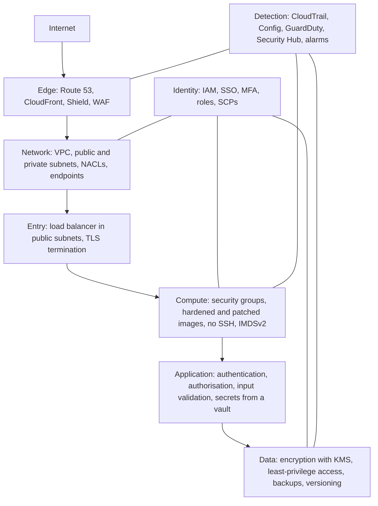
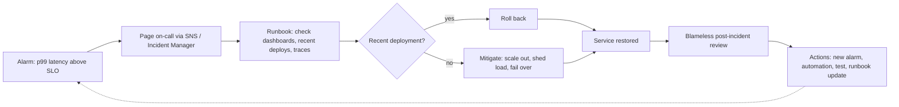

# The security pillar, compliance and operational excellence

## Before this lesson

This lesson assembles pieces taught earlier: shared responsibility ([Shared responsibility](#/lesson/aws/responsibility-and-tools)), IAM and policy evaluation ([IAM identities](#/lesson/aws/iam-identities), [Policy evaluation, STS, Organizations and SCPs](#/lesson/aws/iam-evaluation)), encryption, logging and threat detection ([KMS, Secrets Manager and the detective and protective services](#/lesson/aws/security-services)), network controls ([Security groups versus network ACLs](#/lesson/aws/vpc-firewalls)), monitoring ([CloudWatch](#/lesson/aws/cloudwatch)) and automation ([CloudFormation](#/lesson/aws/cloudformation-cdk), [Systems Manager and CodePipeline](#/lesson/aws/ssm-codepipeline)). It follows [Reliability](#/lesson/aws/reliability-dr) and [Performance and cost](#/lesson/aws/performance-cost).

## In plain words

The two remaining pillars are about people and habits as much as technology.

**Security** is protecting information and systems: only the right people get in, anything they do is recorded, data is unreadable if stolen, and when something does go wrong you notice quickly and know what to do. The guiding idea is **defence in depth** — many independent layers, so that one mistake is not a disaster. A medieval castle had a moat, an outer wall, an inner wall, a keep and guards; an attacker who crossed the moat still had four problems.

**Operational excellence** is running the system well day after day: releasing changes safely, knowing how it is behaving, responding to problems, and getting a little better after each one. A good **airline** is the model: checklists for routine tasks, rehearsed procedures for emergencies, instruments that show what the aircraft is doing, and an investigation after every incident whose purpose is to fix the system, not to blame the pilot.

Why it matters for a job: these are the pillars that separate a demo from a production system. Interviewers at every level ask "how would you secure this?" and "how do you know it is healthy, and what happens when it is not?". The Solutions Architect exam gives security the largest share of its questions.

## The security pillar

### Seven design principles

1. **Implement a strong identity foundation.** Least privilege, separation of duties, central identity, no long-lived credentials.
2. **Maintain traceability.** Log and monitor every action and change, in real time.
3. **Apply security at all layers.** Edge, VPC, subnet, load balancer, instance, operating system, application, data.
4. **Automate security best practices.** Controls defined as code and enforced by machines.
5. **Protect data in transit and at rest.** Classify it; encrypt it; control access to it.
6. **Keep people away from data.** Remove the need for direct human access to production data and systems.
7. **Prepare for security events.** Have a plan, tools and practice.

The source book's version is the principle **"build security in every layer"**, on top of the shared responsibility model: AWS secures the cloud itself, and you secure what you build in it.

### Defence in depth, layer by layer



| Area | Question to ask | Controls taught in this track |
|---|---|---|
| **Identity and access** | Who can do what, and can they do too much? | IAM Identity Center with MFA; roles everywhere; least-privilege policies; permissions boundaries; SCPs; Access Analyzer; no root use; no long-lived keys |
| **Detection** | Would we know, and how fast? | Organisation-wide CloudTrail to a locked archive; Config rules; GuardDuty; Security Hub; VPC Flow Logs; alarms on root sign-in and policy changes |
| **Infrastructure protection** | How could traffic or code reach this resource? | Private subnets; security groups referencing groups; NACLs; WAF and Shield at the edge; Session Manager instead of SSH; patched AMIs; Inspector |
| **Data protection** | What if the data were copied? | Classification; encryption at rest with KMS and in transit with TLS; S3 Block Public Access; bucket and key policies; Secrets Manager; Macie; backups and Object Lock |
| **Incident response** | What do we do in the first hour? | Runbooks; isolated forensic account; pre-provisioned access; automated containment; practice |
| **Application security** | Is our own code the weak point? | Code review, dependency and image scanning in the pipeline, secrets never in code |

### A layered example

Securing a typical three-tier application — each line is one independent layer:

1. DNS in Route 53; all traffic enters through **CloudFront** with **Shield Standard** and an **AWS WAF** web ACL (managed rules, a rate limit).
2. The **ALB** accepts connections only from CloudFront's managed prefix list; TLS with an ACM certificate.
3. Application instances or tasks run in **private subnets**; their security group admits only the ALB's security group.
4. No SSH. Access through **Session Manager**, logged. **IMDSv2** required. Images rebuilt and patched regularly.
5. The application's **role** may read one bucket prefix, one secret and one queue.
6. The database is in **isolated subnets**; its security group admits only the application's group; **encrypted** with a customer managed KMS key; credentials in **Secrets Manager** with rotation.
7. S3 buckets: **Block Public Access**, versioning, TLS-only bucket policy, access through a **VPC gateway endpoint**.
8. **CloudTrail**, **Config** and **GuardDuty** on in every Region, findings in **Security Hub**, logs in a separate account.
9. **SCPs** prevent anyone in the account from disabling item 8 or leaving the approved Regions.
10. **Backups** copied to another account with an immutable vault.

An attacker who finds an application bug still faces a role that can do very little, a database they cannot reach from the internet, encrypted data, and logs they cannot erase.

### Automating guardrails

Security that depends on people remembering fails eventually. Three kinds of automated control:

- **Preventive** — stop the bad thing from happening: SCPs, IAM policies, Block Public Access, security groups, CloudFormation Hooks and policy checks in the pipeline.
- **Detective** — notice it: Config rules, GuardDuty, Security Hub standards, CloudTrail alarms.
- **Responsive** — fix it automatically: an EventBridge rule that reacts to a finding.

```json
{
  "source": ["aws.guardduty"],
  "detail-type": ["GuardDuty Finding"],
  "detail": {
    "severity": [{"numeric": [">=", 7]}],
    "resource": {"resourceType": ["Instance"]}
  }
}
```

This EventBridge pattern matches high-severity GuardDuty findings about EC2 instances. Its target can be a Lambda function or an Automation runbook that **contains** the instance: replace its security groups with one that allows nothing, snapshot its volumes for analysis, tag it, and page the on-call engineer. Containment happens in seconds, at any hour.

```bash
# A Config managed rule: flag any security group that allows SSH from anywhere.
aws configservice put-config-rule --config-rule '{
  "ConfigRuleName": "restricted-ssh",
  "Source": {"Owner": "AWS", "SourceIdentifier": "INCOMING_SSH_DISABLED"},
  "Scope": {"ComplianceResourceTypes": ["AWS::EC2::SecurityGroup"]}
}'
aws configservice describe-compliance-by-config-rule --config-rule-names restricted-ssh \
  --query "ComplianceByConfigRules[].[ConfigRuleName,Compliance.ComplianceType]" --output text
```

```
restricted-ssh   NON_COMPLIANT
```

- `Owner: AWS` selects a ready-made managed rule by its identifier.
- `Scope` limits evaluation to security groups.
- The second command reports the verdict; the console lists the offending groups, and a remediation action can remove the rule automatically.

### Incident response

When, not if. The standard phases:

1. **Prepare** — runbooks, contact lists, logging already on, a separate forensics account, roles for responders, practice.
2. **Detect and analyse** — a finding or alarm; establish scope from CloudTrail, Config, Flow Logs.
3. **Contain** — isolate resources, revoke sessions, disable keys. Preserve evidence (snapshots, memory) before deleting anything.
4. **Eradicate and recover** — remove the cause, rebuild from known-good images and code, rotate every credential that could have been exposed, restore data.
5. **Learn** — a blameless review; turn each lesson into an automated control.

The commonest real incident is a **leaked access key**. The response in order: deactivate the key (do not only delete it — you need to see failed uses); attach a deny-all policy or revoke sessions for the affected identity; search CloudTrail for everything the key did; look in *every Region* for resources the attacker created; rotate related secrets; find how it leaked; replace long-lived keys with roles so that it cannot recur.

## Compliance

**Compliance** means demonstrating that your systems meet external rules: laws such as the GDPR (EU personal data) or HIPAA (US health data), and standards such as PCI DSS (payment cards), ISO 27001 and SOC 2.

Three ideas organise it on AWS:

1. **Shared responsibility applies to compliance too.** AWS is audited for the infrastructure; you inherit those controls and remain responsible for everything you configure. A service being "in scope" for a programme means it *can* be used compliantly, not that your workload *is* compliant.
2. **Evidence from AWS comes through AWS Artifact** — SOC reports, ISO certificates, PCI attestations and agreements you can accept online (for example a Business Associate Addendum for HIPAA). You cannot tour a data centre; the auditors' reports stand in for that.
3. **Evidence from you is best produced continuously and automatically**: Config conformance packs, Security Hub standards (CIS benchmarks, AWS Foundational Security Best Practices, PCI DSS), **AWS Audit Manager** to collect and organise evidence, CloudTrail as the record of who did what.

Governance at scale uses the multi-account tools from [the Organizations lesson](#/lesson/aws/iam-evaluation): accounts per workload and environment, organisational units, SCPs, and **Control Tower** to set up and enforce a landing zone. **Data residency** — keeping data in particular countries — is met by choosing Regions and denying the rest with an SCP.

The book's chapter on risk and compliance makes one further point worth keeping: a customer's own risk management does not go away in the cloud. You still identify what you are protecting, assess the threats, choose controls and verify them; the cloud changes *which* controls you operate yourself and gives you far better tools for verifying them.

## The operational excellence pillar

### Design principles

1. **Organise teams around business outcomes**, with clear ownership of each workload.
2. **Implement observability for actionable insights.** Understand the system from its outputs.
3. **Safely automate where possible.** Operations as code.
4. **Make frequent, small, reversible changes.**
5. **Refine operations procedures frequently.**
6. **Anticipate failure.** Run pre-mortems and game days.
7. **Learn from all operational events and metrics.**
8. **Use managed services** to reduce operational burden.

### Operations as code

Everything that defines the system and how it is operated is text in version control:

| What | Tool |
|---|---|
| Infrastructure | CloudFormation, CDK, Terraform |
| Server and container configuration | AMIs from Image Builder, Dockerfiles, State Manager |
| Deployments | CodePipeline or another CI/CD system |
| Alarms and dashboards | Defined in the same templates as the resources they watch |
| Operational procedures | Systems Manager Automation runbooks |
| Guardrails | SCPs, Config rules, policy-as-code checks |

The benefits are the IaC benefits again: repeatable, reviewable, auditable, and fast to restore.

### Small, reversible changes

Most outages follow a change. The response is not fewer changes but **smaller** ones:

- a small change is easier to review, test and understand;
- when it fails, the cause is obvious and the rollback is quick;
- canary and blue/green deployments with alarm-triggered rollback limit the blast radius;
- **feature flags** separate *deploying* code from *releasing* a feature.

Teams measure this with four widely used indicators: deployment frequency, lead time for changes, change failure rate, and time to restore service.

### Observability and alerting

Recall the three pillars from [EventBridge and X-Ray](#/lesson/aws/eventbridge-xray): metrics say that something is wrong, traces where, logs why. Operational excellence adds discipline on top:

- Define **service level objectives** (SLOs): for example "99.9 % of requests succeed within 500 ms over 30 days". An SLO turns "is it healthy?" into a number, and the allowed shortfall — the **error budget** — into a basis for deciding whether to ship features or fix reliability.
- **Alert on symptoms** that users feel; page a human only for those.
- Every alert links to a **runbook**: what it means, what to check, how to fix it.
- Dashboards for each workload; business metrics (orders per minute) beside technical ones.

A good test of an alert: *if it fires at 03:00, is there something a person must do right now?* If not, it should be a ticket or a dashboard, not a page.

### Runbooks, playbooks and incident response

- A **runbook** is a documented procedure for a known task — routine ("rotate the certificate") or reactive ("the queue is backing up").
- A **playbook** is a guide for investigating an unknown problem.
- Automate runbooks step by step: first written, then scripted, then triggered by an alarm.



During an incident, **mitigate first, diagnose later**: rolling back or failing over restores service; understanding the root cause can wait an hour.

### Learning: the blameless review

After every significant incident, write down:

- a timeline of what happened and when it was detected;
- the impact on users;
- contributing causes — technical and organisational;
- what went well and what did not;
- a short list of actions, each with an owner and a date.

"Blameless" is a practical rule, not a kindness: people who fear blame hide information, and the organisation then cannot learn. The useful question is never "who made the mistake?" but "why did the system make that mistake easy, and why was it not caught?". AWS calls its own version *correction of error*.

### Operational readiness

Before a workload goes live, review a checklist. A compact version:

| Area | Ready when |
|---|---|
| Ownership | A named team is on call, with an escalation path |
| Deployment | Automated pipeline; rollback tested |
| Observability | Dashboards, SLOs, alarms with runbooks |
| Resilience | Multi-AZ; failure and restore tested; backups verified |
| Security | Least privilege; secrets managed; logging on; threat model reviewed |
| Capacity and cost | Load tested; quotas checked; budget and tags in place |
| Documentation | Architecture diagram; runbooks current |

The **AWS Well-Architected Tool** in the console walks a workload through questions for all six pillars and produces a list of high- and medium-risk issues with improvement plans. It is free, and running a review every six months or before a major launch is a common practice. **Trusted Advisor** gives a continuous, automated subset of the same checks.

## The pillars together

| Pillar | Central question |
|---|---|
| Operational excellence | Can we run and change it safely, and do we learn? |
| Security | Is it protected, and would we know if it were not? |
| Reliability | Does it keep working, and can it recover? |
| Performance efficiency | Is it using the right resources as needs change? |
| Cost optimisation | Are we paying only for what delivers value? |
| Sustainability | Are we minimising resources and energy? |

They pull against each other at times — encryption and redundancy cost money, tight security adds friction — and the framework's purpose is to make those trade-offs deliberate. A useful habit in design interviews is to name the pillar you are optimising and what it costs in another.

## Cost notes and free-tier warnings

- The Well-Architected Tool, IAM, Organizations, SCPs, Block Public Access, Session Manager and CloudTrail's first management-event trail are **free** — the most important controls cost nothing.
- **Config**, **GuardDuty**, **Security Hub**, **Inspector** and **Macie** are billed by volume and add up across many accounts and Regions; use their free trials to see steady-state cost, and tune what is recorded.
- **Log retention** is a cost decision with a compliance side: keep what regulation demands, in cheap storage classes, and expire the rest.
- A security incident is the most expensive line there is: fraudulent usage, recovery effort, fines and lost trust dwarf the cost of the controls.

## Pitfalls

- **Perimeter-only security**: a strong outer wall and nothing inside it.
- **Controls that exist only as documents**, not as enforced automation.
- **Logs in the same account they describe**, deletable by an attacker.
- **Alert fatigue**: so many noisy alarms that the real one is ignored.
- **Treating compliance as security.** Passing an audit shows that controls existed on the day; attackers do not read audit reports.
- **Assuming an "eligible" service makes the workload compliant.**
- **Heroics instead of process**: one person who fixes everything at 03:00 from memory.
- **Blame after incidents**, which guarantees the next one is reported late.
- **Large, infrequent releases.**
- **Runbooks nobody has run.**
- **Human access to production data as the normal way of working.**

> [!INTERVIEW]
> **"How do you secure a new workload on AWS?"** In layers. Identity: federated access with MFA, roles with least privilege, guardrail SCPs. Network: private subnets, security groups chained by reference, WAF and Shield at the edge, no inbound administration ports. Data: encryption with KMS at rest and TLS in transit, managed secrets, private buckets, immutable cross-account backups. Detection: CloudTrail, Config and GuardDuty across all Regions, centralised. Response: automated containment and rehearsed runbooks. All of it defined as code and checked in the pipeline.
>
> **"Tell me about how you would handle a production incident."** Acknowledge and assess impact; mitigate first — roll back the last change, fail over or scale — before deep diagnosis; communicate status; once stable, find contributing causes from metrics, traces and logs; hold a blameless review and convert the findings into automated checks, alarms and runbook updates with owners and dates.

## Cheat sheet

| Topic | Key points |
|---|---|
| Defence in depth | Independent controls at edge, network, compute, application, data, identity |
| Control types | Preventive, detective, responsive |
| Identity foundation | SSO + MFA, roles, least privilege, SCPs |
| Traceability | Org-wide CloudTrail, Config, central log archive |
| Data protection | Classify, encrypt (KMS, TLS), restrict, back up immutably |
| Incident response | Prepare, detect, contain, eradicate and recover, learn |
| Compliance evidence | AWS's from Artifact; yours from Config, Security Hub, Audit Manager |
| Operations as code | Infrastructure, deployments, alarms and runbooks in version control |
| Safe change | Small, frequent, reversible; canary; automatic rollback; feature flags |
| Alerting | On symptoms; actionable; linked to runbooks |
| After incidents | Blameless review with owned actions |
| Review tool | AWS Well-Architected Tool |

## Summary

- Security is layered: identity, detection, infrastructure protection, data protection and incident response, with controls automated as preventive, detective and responsive guardrails.
- Compliance is shared: AWS supplies audited infrastructure and reports through Artifact; you supply correctly configured workloads and continuous evidence.
- Operational excellence treats operations as code, favours small reversible changes, builds observability around service level objectives, and prepares with runbooks and rehearsals.
- Incidents are mitigated first and analysed afterwards in blameless reviews whose actions are automated.
- The Well-Architected pillars are a checklist of questions and a vocabulary for stating trade-offs.

## Glossary

- **Blameless review**: an incident analysis focused on systemic causes.
- **Blast radius**: the extent of damage a failure or compromise can cause.
- **Compliance**: demonstrable adherence to laws, regulations and standards.
- **Containment**: limiting the spread of a security incident.
- **Control Tower**: the service that sets up and governs a multi-account landing zone.
- **Defence in depth**: several independent layers of protection.
- **Error budget**: the amount of failure an SLO permits.
- **Feature flag**: a switch that turns functionality on without a deployment.
- **Guardrail**: an automated rule that prevents or detects undesired configurations.
- **Incident response**: the organised handling of a security or operational event.
- **Operations as code**: defining and running operations through versioned code.
- **Playbook / runbook**: an investigation guide / a documented procedure.
- **Preventive / detective / responsive control**: stops / notices / automatically remediates a problem.
- **SLO**: service level objective, a measurable reliability target.
- **Well-Architected Tool**: the console service for reviewing workloads against the pillars.

```quiz
[
  {"q": "A web application is protected by a strict WAF, but all instances behind it share one IAM role with administrator access and the database accepts connections from the whole VPC. Which principle is being ignored?",
   "options": ["Elasticity", "Defence in depth with least privilege at every layer", "Think parallel", "Cost optimisation"],
   "answer": 1,
   "explain": "A single strong perimeter is not enough. If the application is breached, over-broad roles and open internal access leave nothing to stop the attacker."},
  {"q": "A service control policy denies cloudtrail:StopLogging in all member accounts. What kind of control is this?",
   "options": ["Detective", "Preventive", "Responsive", "Corrective by a human"],
   "answer": 1,
   "explain": "It stops the action from happening at all. A Config rule noticing that logging was stopped would be detective; an automation re-enabling it would be responsive."},
  {"q": "An access key for an IAM user is found in a public repository. What is the best first action?",
   "options": ["Delete the repository and take no further action", "Deactivate the key and revoke the identity's sessions, then investigate its use in CloudTrail across all Regions", "Wait to see if it is used", "Rotate the root password only"],
   "answer": 1,
   "explain": "Contain first by disabling the credential, then determine what it did and what was created, and finally remove the cause by replacing long-lived keys with roles."},
  {"q": "An auditor asks for proof that AWS's data centres meet ISO 27001 and SOC 2 requirements. Where does the customer obtain it?",
   "options": ["By requesting a site visit", "AWS Artifact", "AWS Config", "Trusted Advisor"],
   "answer": 1,
   "explain": "Artifact provides AWS's audit reports and certifications on demand. Config and Security Hub provide evidence about the customer's own configuration."},
  {"q": "A company stores health data on a 'HIPAA eligible' AWS service. Does that make the workload compliant?",
   "options": ["Yes, automatically", "No; eligibility means the service can be used in a compliant design, but the customer must configure and operate it compliantly and sign the required agreement", "Only in us-east-1", "Only if Multi-AZ is enabled"],
   "answer": 1,
   "explain": "Under the shared responsibility model the customer remains responsible for encryption, access control, logging and procedures for its own workload."},
  {"q": "A team releases once a quarter in a large batch; each release causes an outage that takes hours to diagnose. Which operational excellence principle addresses this most directly?",
   "options": ["Use larger instances", "Make frequent, small, reversible changes with automated deployment and rollback", "Add more manual approval steps", "Stop releasing"],
   "answer": 1,
   "explain": "Small changes are easier to test and to roll back, and when one fails the cause is evident."},
  {"q": "The on-call engineer receives 200 alerts a night, most needing no action, and misses a real outage. What should change?",
   "options": ["Add more alerts", "Alert on user-facing symptoms tied to SLOs, make every page actionable with a runbook, and move the rest to dashboards or tickets", "Disable all alarms", "Hire a second on-call engineer to read them"],
   "answer": 1,
   "explain": "Alert fatigue hides real problems. Pages should be few, meaningful and actionable."},
  {"q": "After an outage caused by a manual configuration error, which outcome of the review is most valuable?",
   "options": ["Naming the engineer responsible", "An action to automate the change through reviewed code with validation, so the error cannot recur", "A reminder email to be more careful", "No written record"],
   "answer": 1,
   "explain": "Blameless reviews look for why the system allowed the mistake and convert the lesson into automated prevention."}
]
```

> **Source:** AWS Certified Solutions Architect Official Study Guide, ch. 12 (Security on AWS), ch. 13 (AWS Risk and Compliance: shared responsibility for compliance, reports, certifications and attestations) and ch. 14 (Architecture Best Practices: build security in every layer). Pillar structure from the AWS Well-Architected Framework; checked against https://docs.aws.amazon.com/wellarchitected/latest/security-pillar/welcome.html , https://docs.aws.amazon.com/wellarchitected/latest/operational-excellence-pillar/welcome.html and https://docs.aws.amazon.com/artifact/latest/ug/what-is-aws-artifact.html
