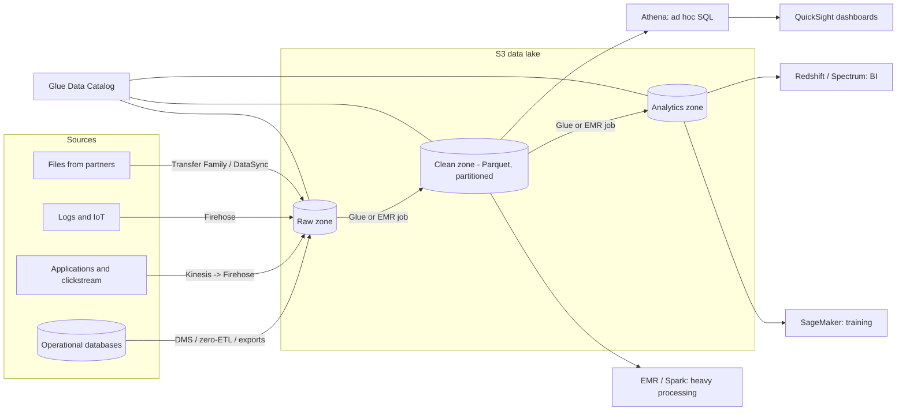

# Data lakes on S3: Glue, Athena, EMR and Firehose

## Before this lesson

You need S3 buckets, prefixes, storage classes and lifecycle rules ([S3 basics](#/lesson/aws/s3-basics)), the difference between transactional and analytical workloads and what Redshift is ([RDS and Aurora](#/lesson/aws/rds-aurora), [ElastiCache, DAX and Redshift](#/lesson/aws/cache-warehouse)), streams and Firehose ([Kinesis and Step Functions](#/lesson/aws/streams-workflows)) and IAM roles ([IAM identities](#/lesson/aws/iam-identities)). Basic SQL helps. The MLOps track's [data pipelines](#/lesson/mlops/data-pipelines) lesson covers pipeline design in general.

## In plain words

Every organisation produces data in many shapes: orders in a database, clicks from a website, logs from servers, spreadsheets from finance, images, sensor readings. Analysts and machine-learning models want to use all of it together.

A **data lake** is a single place where all that data is kept **in its original form, cheaply, for as long as you like**, and where many different tools can read it. On AWS the lake is **Amazon S3**. Files go in as they are; structure is applied later, when someone asks a question.

Compare a **warehouse** with a **lake**. A warehouse (Redshift, from the databases module) is like a supermarket: everything is cleaned, labelled and put on the right shelf before customers arrive — quick to shop in, but only what was shelved is available. A lake is like a big storeroom behind the shop where every delivery is kept in its crate. It costs little, nothing is thrown away, and with a good **inventory list** you can find and unpack whatever you need.

That inventory list is the key idea of this lesson. Files in S3 are bytes. A **catalogue** records "the files under this prefix form a table called `orders` with these columns". With a catalogue in place, you can run SQL directly on the files.

The cast:

- **AWS Glue** — the catalogue, plus a service for transforming data.
- **Amazon Athena** — SQL on files in S3, with nothing to run.
- **Amazon EMR** — managed clusters for big-data engines such as Spark.
- **Amazon Data Firehose** — delivers streaming data into the lake.
- **AWS Lake Formation** — permissions for the lake.

Why it matters for a job: data engineering and ML roles are built on this stack. "Where does the training data live and how do you query it?" is a routine interview question, and the answer is almost always "Parquet in S3, catalogued in Glue, queried with Athena or Spark".

## Why S3 is the lake

- **Cheap and unlimited**: around USD 23 per terabyte-month in Standard, far less in colder classes, no capacity to plan.
- **Durable**: eleven nines.
- **Decoupled from compute**: storage is paid for by the gigabyte; engines are started only when a query runs. A warehouse cluster, by contrast, traditionally bundled the two.
- **Open**: every analytics and ML tool — Athena, Spark, Redshift, SageMaker, pandas — reads S3.
- **Governed**: IAM, bucket policies, encryption, versioning, lifecycle rules.

### Zones

A lake is organised into **zones** (also called layers), usually as separate buckets or top-level prefixes:

| Zone | Contents | Format | Who reads it |
|---|---|---|---|
| **Raw** (landing, bronze) | Data exactly as received, never modified | JSON, CSV, logs, database exports | Pipelines only |
| **Clean** (curated, silver) | Validated, deduplicated, typed, partitioned | Parquet | Analysts, data scientists |
| **Analytics** (aggregated, gold) | Business-level tables and features | Parquet / table formats | Dashboards, ML training, reports |

Keeping the raw zone immutable means any mistake in a transformation can be fixed by re-running it from the originals.



## File formats and partitioning

Two choices decide whether queries on a lake are fast and cheap or slow and expensive.

### Columnar formats

**CSV** and **JSON** are **row-oriented** text: to read one column you must read every byte of every row. **Apache Parquet** (and the similar ORC) is **columnar** and binary:

- values of one column are stored together, so a query reads **only the columns it names**;
- similar values compress well — files are typically 3 to 10 times smaller;
- each file carries **statistics** (minimum and maximum per column per block), so an engine can **skip** blocks that cannot match a filter (*predicate pushdown*);
- the **schema** — column names and types — is stored in the file.

Rule: land data in whatever format it arrives; **convert to Parquet for anything that will be queried**.

### Partitioning

**Partitioning** arranges files under prefixes that encode a column's value, in the `key=value` style:

```
s3://tidewater-lake/clean/orders/year=2026/month=11/day=20/part-0001.parquet
s3://tidewater-lake/clean/orders/year=2026/month=11/day=21/part-0001.parquet
```

A query with `WHERE year = 2026 AND month = 11 AND day = 21` then reads only the files under that one prefix. This is **partition pruning**, and since Athena charges by bytes scanned, it cuts cost in direct proportion.

Guidelines:

- Partition by columns that queries **filter on** — almost always a date, sometimes Region or tenant.
- **Do not over-partition.** A partition per user or per minute produces millions of tiny files, and listing them costs more time than reading the data. Aim for files of roughly 128 MB to 1 GB.
- **Compact small files** periodically. Streaming ingestion naturally produces many small files.

### Table formats

A plain "folder of Parquet files" has weaknesses: no atomic updates, awkward deletes, slow listings, no history. **Open table formats** — **Apache Iceberg** (the one AWS services have converged on), Delta Lake, Hudi — add a metadata layer giving ACID transactions, row-level updates and deletes, schema evolution, and **time travel** (query the table as it was yesterday). **Amazon S3 Tables** is a bucket type that stores Iceberg tables and maintains them (compaction, snapshot clean-up) for you. A lake with these warehouse-like features is often called a **lakehouse**.

### What it saves

Athena's price is per terabyte scanned. The simulation shows how the two choices multiply.

```python-run
PRICE_PER_TB = 5.00                      # USD per terabyte scanned (illustrative)

days = 365
rows_per_day = 20_000_000
columns = 40
bytes_per_value_csv = 12                 # average text width including the separator
parquet_compression = 5                  # columnar + compression: about 5x smaller

total_csv_tb = days * rows_per_day * columns * bytes_per_value_csv / 1024**4

def scanned_tb(fmt, partitioned, days_queried, columns_queried):
    share_of_days = days_queried / days if partitioned else 1.0      # partition pruning
    if fmt == "csv":
        return total_csv_tb * share_of_days                          # must read every column
    share_of_columns = columns_queried / columns                     # column pruning
    return total_csv_tb / parquet_compression * share_of_days * share_of_columns

print(f"one year of data as CSV: {total_csv_tb:.2f} TB")
print("query: total revenue per country for the last 7 days (3 columns)\n")
for fmt, part in (("csv", False), ("csv", True), ("parquet", False), ("parquet", True)):
    tb = scanned_tb(fmt, part, days_queried=7, columns_queried=3)
    label = f"{fmt:7s} {'partitioned by day' if part else 'unpartitioned':18s}"
    print(f"{label} scans {tb * 1024:10.2f} GB  ->  {tb * PRICE_PER_TB:8.4f} USD per query")
```

Line by line: the data set is about 3.2 TB as CSV. `scanned_tb` applies partition pruning (only 7 of 365 days) and, for Parquet, compression and column pruning (3 of 40 columns). The same question costs about USD 16 on unpartitioned CSV and a fraction of a cent on partitioned Parquet — a difference of several thousand times, and the speed-up is of the same order. No cluster was resized; only the layout of the files changed.

## The Glue Data Catalog

The **AWS Glue Data Catalog** is a central **metastore**: a registry of **databases** (namespaces) and **tables**. A table entry records the S3 location, the file format, the columns and types, and the partitions. It holds *metadata only* — the data stays in S3.

One catalogue per account per Region is shared by Athena, Redshift Spectrum, EMR, Glue jobs, SageMaker and Lake Formation, so a table defined once is visible everywhere.

Ways to populate it:

- A **crawler** scans an S3 prefix (or a database), infers the schema and partitions, and creates or updates tables. Convenient for discovery; it can guess types wrongly and costs a little per run.
- **DDL** in Athena: `CREATE EXTERNAL TABLE …`, explicit and repeatable.
- **Infrastructure as code** or the Glue API.
- **Partition projection** lets Athena *compute* partition locations from a pattern (for example dates) instead of storing every partition in the catalogue — the low-maintenance choice for time-partitioned data.

## Glue ETL

**ETL** means extract, transform, load: read data from a source, reshape it, write it to a destination. (**ELT** loads first and transforms inside the destination with SQL.)

**AWS Glue** runs ETL jobs **serverlessly**, mostly on **Apache Spark**:

- You write PySpark or Scala (or build visually in Glue Studio); Glue provisions workers, runs the job and releases them.
- Billing is per **DPU-hour** (a data processing unit is a bundle of CPU and memory), per second, with no idle cost.
- **Job bookmarks** remember what has already been processed so that a rerun handles only new files.
- **Triggers and workflows** schedule and chain crawlers and jobs; for complex pipelines use Step Functions or Managed Workflows for Apache Airflow.
- **Glue Data Quality** checks rules ("`order_id` is unique", "`amount` is not null") and **Glue DataBrew** offers no-code cleaning.

A minimal job converting raw JSON to partitioned Parquet:

```python
from pyspark.sql import SparkSession
from pyspark.sql.functions import col, to_date, year, month, dayofmonth

spark = SparkSession.builder.getOrCreate()

raw = spark.read.json("s3://tidewater-lake/raw/orders/")                     # 1
clean = (raw
    .dropDuplicates(["order_id"])                                            # 2
    .filter(col("total") >= 0)                                               # 3
    .withColumn("order_date", to_date(col("created_at")))                    # 4
    .withColumn("year", year("order_date"))
    .withColumn("month", month("order_date"))
    .withColumn("day", dayofmonth("order_date")))

(clean.write.mode("append")                                                  # 5
    .partitionBy("year", "month", "day")
    .parquet("s3://tidewater-lake/clean/orders/"))
```

1. Read every JSON file under the raw prefix into a distributed table (a *DataFrame*); Spark infers the schema.
2. Remove repeated orders — streaming sources deliver at least once.
3. Drop rows that fail a basic validity rule.
4. Derive a proper date and the three partition columns from the timestamp string.
5. Write Parquet under `year=/month=/day=` prefixes, adding to what is there.

The job's **IAM role** needs read access to the raw prefix, write access to the clean prefix, and Glue catalogue permissions — nothing else.

## Athena

**Amazon Athena** runs standard SQL on data in S3. It is **serverless**: there is nothing to start; you pay **per terabyte of data scanned** (cancelled queries pay for what they scanned; failed queries and DDL are free).

```sql
CREATE EXTERNAL TABLE lake.orders (
  order_id     string,
  customer_id  string,
  country      string,
  total        decimal(10,2),
  created_at   timestamp
)
PARTITIONED BY (year int, month int, day int)
STORED AS PARQUET
LOCATION 's3://tidewater-lake/clean/orders/';

MSCK REPAIR TABLE lake.orders;
```

- `EXTERNAL` means Athena does not own the data: dropping the table removes only the catalogue entry.
- `PARTITIONED BY` declares the columns encoded in the path; they are not inside the files.
- `LOCATION` is the S3 prefix.
- `MSCK REPAIR TABLE` scans the prefix and registers the `key=value` partitions it finds (not needed with partition projection).

```sql
SELECT country, count(*) AS orders, sum(total) AS revenue
FROM lake.orders
WHERE year = 2026 AND month = 11 AND day BETWEEN 15 AND 21
GROUP BY country
ORDER BY revenue DESC
LIMIT 5;
```

```
country | orders | revenue
--------+--------+-----------
FR      | 184220 | 9840112.40
DE      | 150871 | 8102337.15
...
(Run time: 1.9 seconds, Data scanned: 212.4 MB)
```

The filter on the partition columns prunes to seven days, and only three columns are read. "Data scanned" is printed with every result — watch it.

Running it from the command line:

```bash
QID=$(aws athena start-query-execution \
  --query-string "SELECT count(*) FROM lake.orders WHERE year=2026 AND month=11 AND day=21" \
  --work-group analysts \
  --query QueryExecutionId --output text)
aws athena get-query-execution --query-execution-id "$QID" \
  --query "QueryExecution.[Status.State,Statistics.DataScannedInBytes]" --output text
aws athena get-query-results --query-execution-id "$QID" --query "ResultSet.Rows[1].Data[0].VarCharValue"
```

```
SUCCEEDED   8514233
"20114507"
```

Queries are asynchronous: start, poll for the state, fetch the results (which are also written as a file to an S3 results location).

Things to know:

- **Workgroups** separate teams, enforce a results location and encryption, and set a **per-query data-scan limit** — the guard against an accidental full-lake scan.
- **CTAS** (`CREATE TABLE AS SELECT`) writes a query's result as a new Parquet table: an easy way to convert formats or build aggregates.
- **Federated queries** reach other stores (RDS, DynamoDB, on-premises) through connectors; **Athena for Spark** runs notebooks.
- Athena suits **ad hoc and intermittent** analysis. For dashboards hit by hundreds of users all day, or complex joins over very large tables, a warehouse such as Redshift gives steadier performance.

| | Athena | Redshift | EMR |
|---|---|---|---|
| Model | Serverless SQL on S3 | Data warehouse (provisioned or serverless) | Managed clusters for Spark, Hive, Trino, Flink, HBase |
| Pay for | Data scanned | Capacity (or RPU-seconds) | Instance-hours (or serverless usage) |
| Best for | Ad hoc exploration, infrequent queries, log analysis | Repeated BI workloads, complex joins, consistent latency | Large custom processing, ML pipelines, full framework control |
| Operate | Nothing | Little | Most |

## Amazon EMR

**EMR** runs open-source big-data frameworks — **Apache Spark** above all, also Hive, Trino/Presto, Flink, HBase — on managed clusters.

A classic cluster has three kinds of node:

- the **primary** node coordinates;
- **core** nodes run tasks **and hold data** in the cluster's own file system (HDFS);
- **task** nodes only compute and hold no data — which makes them ideal for **Spot Instances**: losing one costs some rework and nothing else.

Good practice:

- Keep data in **S3** (through the EMR file system, EMRFS), not in HDFS, so that the cluster is disposable.
- Prefer **transient clusters**: start, run the job, terminate. A long-running cluster idling overnight is the classic EMR waste.
- Use **managed scaling**, and **Spot** for task nodes with On-Demand for primary and core.
- Deployment choices: **EMR on EC2** (most control), **EMR on EKS** (share a Kubernetes cluster), and **EMR Serverless** (submit a job, no cluster to size).

Choose EMR over Glue when you need specific framework versions or tuning, non-Spark engines, very large or long jobs where cluster pricing wins, or existing Hadoop workloads to migrate. Choose Glue for typical ETL with the least operation.

## Getting data into the lake

| Source | Service |
|---|---|
| Streams of events, logs, clicks | **Amazon Data Firehose** → S3, with conversion to Parquet and time-based prefixes |
| Relational databases, including ongoing changes | **AWS Database Migration Service (DMS)** with change data capture; zero-ETL integrations; snapshot exports to S3 |
| Files on premises | **DataSync**, Transfer Family, Storage Gateway |
| SaaS applications (Salesforce, Slack…) | **Amazon AppFlow** |
| Other AWS services' logs | Native delivery to S3 (CloudTrail, ALB, VPC Flow Logs, CloudFront) |
| Very large one-off transfers | Snowball Edge |

Firehose's buffering produces one file per interval per stream; set the buffer large enough (for example 128 MB or 5 minutes) to avoid a swarm of tiny files, and let it write Parquet using the Glue table's schema.

## Governing the lake

A lake without governance becomes a **data swamp**: nobody knows what is there, whether it is correct, or who may see it.

- **AWS Lake Formation** adds database-style permissions on top of the catalogue: grant a role `SELECT` on a table, on **specific columns**, or on **rows** matching a filter, instead of writing S3 policies by prefix. **LF-tags** apply the same rule to many tables ("anything tagged `sensitivity=pii` is visible only to the privacy team").
- **Encryption** with KMS everywhere; **Macie** to discover personal data; **CloudTrail data events** for an audit trail of object access.
- **Data quality checks** in pipelines, and a catalogue with owners and descriptions (Amazon DataZone / SageMaker Catalog).
- **Lifecycle rules** on the raw zone, and **Intelligent-Tiering** for data whose access pattern is unknown.
- **Data residency and retention** rules — including the right to deletion under privacy law, which is far easier with table formats that support row-level deletes.

## A complete small pipeline

Clickstream to dashboard, for Tidewater Books:

1. The website sends click events to a **Kinesis data stream** (so that a real-time consumer can also read them).
2. **Firehose** reads the stream and writes compressed JSON to `raw/clicks/dt=2026-11-21/` every five minutes.
3. A nightly **Glue job** (triggered by EventBridge Scheduler, orchestrated by Step Functions) deduplicates, validates and writes Parquet to `clean/clicks/`, partitioned by date; Glue Data Quality fails the run if more than 1 % of rows are rejected.
4. The **Glue Data Catalog** table uses partition projection, so new days are queryable at once.
5. Analysts query with **Athena** in a workgroup limited to 50 GB per query; a **QuickSight** dashboard reads a small aggregated table built by a CTAS query.
6. Data scientists read the same clean table from **SageMaker** to train a recommendation model (next lesson).
7. **Lake Formation** hides the `email` column from everyone except the support team.
8. Lifecycle rules move raw files to Glacier Instant Retrieval after 90 days and delete them after three years.

## Also worth knowing: the book's remaining application and end-user services

The source book's chapter on application services lists a handful of products beyond queues, topics and workflows. Several have since been retired, renamed or closed to new customers, and cloud services change names often, so this table gives the job each one did and what to use now. Dates and statuses were checked against AWS documentation and announcements in late 2026; confirm in the current console before building on any row.

| Service | What it does, in plain words | Status and what to use |
|---|---|---|
| **Amazon SES** (Simple Email Service) | Sends (and can receive) email at scale: receipts, password resets, newsletters. It handles the technical reputation work that gets mail into inboxes. | **Current.** You verify a domain or address, then send through an API or SMTP. New accounts start in a **sandbox** (limited volume, verified recipients only) until you request production access. SES can publish delivery, bounce and complaint events to **SNS**. It is also the recommended email service now that Pinpoint has ended. |
| **Amazon Elastic Transcoder** | Converted video and audio files from one format to others (for example one master video into versions for phones, tablets and televisions). | **Discontinued on 13 November 2025.** Replaced by **AWS Elemental MediaConvert**, a file-based video transcoding service that charges for the minutes of video processed. Recreate presets and jobs there. |
| **Amazon WorkSpaces** | A **virtual desktop**: a Windows or Linux desktop running in AWS that an employee reaches from any device. Think of it as renting a laptop that lives in a data centre. | **Current.** It signs users in through a directory ([Directory Service](#/lesson/aws/iam-identities), above), runs in your VPC, and bills monthly or hourly. |
| **Amazon AppStream 2.0** | Streams a single application (for example one expensive design tool) to a browser, with nothing installed on the user's computer. | **Renamed** Amazon WorkSpaces Applications; the same idea of streaming an application rather than a whole desktop. Older documents still say AppStream. |
| **Amazon CloudSearch** | A managed search engine for a website's own content (search box, filters, suggestions). | **Closed to new customers since 25 July 2024**; existing customers keep using it. For new work use **Amazon OpenSearch Service** (or OpenSearch Serverless), which also appears in the log-analysis material of [CloudWatch](#/lesson/aws/cloudwatch) and [Streams and workflows](#/lesson/aws/streams-workflows). |
| **Amazon WorkDocs** | A shared document store and review tool, comparable to a company file-sharing site. | **Support ended 25 April 2025.** Use S3 with a sharing tool, or a third-party suite. |
| **Amazon WorkMail** | A managed business email and calendar service. | **Winding down:** closed to new customers on 30 April 2026, with support ending on 31 March 2027. Plan a migration to another provider. |
| **Amazon Mobile Analytics / Amazon Pinpoint** | Tracked how people use mobile apps and sent campaign messages. | Mobile Analytics was retired years ago. **Pinpoint's support ended on 30 October 2026**; its SMS, voice and push channels continue as **AWS End User Messaging**, and email moves to **SES**. |
| **AWS Device Farm** | Runs your mobile or web app's tests on real phones and browsers in the cloud, so you do not own a drawer of handsets. | **Current.** |
| **Amazon SWF** | Coordinates multi-step background jobs with durable state. | **Still available, but Step Functions is the choice for new work** ([Streams and workflows](#/lesson/aws/streams-workflows)). |

How to use the table in an exam or interview. Old study material names these products as if all were current, and a question that still does so is asking the *concept*: "send transactional email" means SES, "convert a video to many formats" means a transcoding service (today MediaConvert), "virtual desktops for staff" means WorkSpaces, "search engine for my site" means OpenSearch Service. Give the current answer and mention the old name; that shows you know both the vocabulary and the present state of the platform.

> [!TIP]
> A quick way to catch a retirement: AWS announces end-of-support dates on each service's own documentation page, usually under a heading such as "end of support" or "availability change". Look there before building on any service you have not used in the last year.

### SES in one worked example

When Tidewater Books completes an order, a Lambda function sends the confirmation email. The caller needs an IAM role with permission to send, and the sending identity must be verified.

```bash
aws sesv2 create-email-identity --email-identity example.com
aws sesv2 send-email \
  --from-email-address orders@example.com \
  --destination ToAddresses=customer@example.org \
  --content 'Simple={Subject={Data=Your order},Body={Text={Data=Thank you for your order.}}}'
```

- `create-email-identity` registers the domain; SES then returns DNS records to publish (**DKIM**, a digital signature on each message, plus optional SPF and DMARC records) that prove you own it and help receivers trust your mail.
- `send-email` sends one message. In the sandbox the recipient must also be a verified identity, which is why a first test succeeds only with your own addresses.
- Bounces (the address does not exist) and complaints (a recipient marked it as spam) must be watched. Too many harms your sending reputation, and SES can suspend an account. Route these events to SNS or a queue and stop sending to those addresses.

## Cost notes and free-tier warnings

- **S3** storage and requests: the lake's base cost. Small files inflate request charges.
- **Athena**: per TB scanned. Partition, use Parquet, select only needed columns, and set workgroup limits. A `SELECT *` over an unpartitioned CSV table is the classic expensive mistake.
- **Glue**: per DPU-hour for jobs and crawlers, billed per second with a one-minute minimum; the catalogue is free up to a million objects. Interactive sessions and development endpoints bill while open — close them.
- **EMR**: the EC2 instances plus an EMR surcharge. Terminate clusters; use Spot for task nodes.
- **Firehose**: per GB ingested, plus format conversion.
- **Data transfer**: keep engines in the same Region as the bucket.

## Pitfalls

- **Querying raw CSV or JSON** instead of converting to Parquet.
- **No partitioning**, or partition columns never used in `WHERE` clauses.
- **Over-partitioning and millions of tiny files.**
- **Trusting crawler-inferred schemas** for production tables.
- **Mutating the raw zone**, losing the ability to reprocess.
- **A lake with no catalogue, owners or quality checks** — a swamp.
- **Managing access purely by bucket prefix** when column- or row-level control is required.
- **Leaving EMR clusters or Glue interactive sessions running.**
- **Athena results buckets that grow for ever**; add a lifecycle rule.
- **Using Athena for a high-concurrency dashboard**, or a warehouse for occasional ad hoc questions.

> [!INTERVIEW]
> **"How would you make Athena queries faster and cheaper?"** Store data in a columnar, compressed format such as Parquet; partition on the columns used in filters and keep file sizes in the hundreds of megabytes; select only needed columns; use partition projection or a table format like Iceberg for large tables; pre-aggregate with CTAS for dashboards; and enforce scan limits per workgroup.
>
> **"Data lake or data warehouse?"** A lake stores any data cheaply in open formats on S3 with compute decoupled, suiting exploration, ML and varied tools. A warehouse stores curated, structured data for fast, consistent SQL at high concurrency. Most architectures use both — the lake as the system of record, the warehouse for serving BI — increasingly blurred by lakehouse table formats and by Redshift querying S3 directly.

## Cheat sheet

| Need | Service |
|---|---|
| Store everything cheaply, durably | S3 (raw, clean, analytics zones) |
| Know what tables exist | Glue Data Catalog |
| Discover schemas automatically | Glue crawler |
| Serverless Spark ETL | Glue jobs |
| SQL on S3 with no infrastructure | Athena |
| Full control of Spark, Hive, Trino, Flink | EMR (transient clusters, Spot task nodes) |
| Streaming ingestion to S3 | Amazon Data Firehose |
| Replicate databases into the lake | DMS / zero-ETL |
| Column- and row-level permissions | Lake Formation |
| Updates, deletes, time travel on the lake | Iceberg tables / S3 Tables |
| Cheaper, faster queries | Parquet + partitioning + column selection |
| BI dashboards | QuickSight (on Athena or Redshift) |

## Summary

- A data lake keeps all data in S3 in open formats, organised into raw, clean and analytics zones, with storage decoupled from compute.
- Columnar formats and partitioning determine query cost and speed; table formats such as Iceberg add transactions and row-level changes.
- The Glue Data Catalog is the shared metastore; Glue jobs transform data serverlessly on Spark.
- Athena runs SQL on S3 and bills by data scanned; EMR provides managed clusters for heavy or specialised processing; Redshift serves high-concurrency analytics.
- Firehose, DMS, DataSync and AppFlow bring data in; Lake Formation, encryption, quality checks and lifecycle rules keep the lake governed.

## Glossary

- **Athena**: serverless SQL query service for data in S3.
- **Catalogue (metastore)**: a registry of tables, schemas and locations.
- **Columnar format**: a file layout storing each column's values together.
- **Crawler**: a Glue component that infers schemas and partitions.
- **CTAS**: create table as select.
- **Data lake**: a central store of raw and processed data in open formats.
- **DPU**: data processing unit, Glue's unit of capacity.
- **ELT / ETL**: load then transform / extract, transform, load.
- **EMR**: managed clusters for big-data frameworks.
- **Iceberg**: an open table format with transactions and time travel.
- **Lakehouse**: a lake with warehouse features.
- **Lake Formation**: fine-grained access control for the lake.
- **Parquet**: a widely used open columnar file format.
- **Partition pruning**: skipping data whose partition values cannot match a filter.
- **Predicate pushdown**: skipping file blocks using stored statistics.
- **Transient cluster**: a cluster created for one job and then terminated.
- **Zone**: a stage of refinement in the lake (raw, clean, analytics).
- **AWS Elemental MediaConvert**: the file-based video transcoding service that replaced Elastic Transcoder.
- **DKIM**: a digital signature added to email so that receivers can verify the sender's domain.
- **SES sandbox**: the limited starting mode of an SES account (restricted volume and recipients).
- **Transcoding**: converting audio or video files from one format to others.
- **WorkSpaces**: managed virtual desktops in AWS.

```quiz
[
  {"q": "An Athena table over 2 TB of CSV logs is queried daily for 'errors in the last 24 hours' and each query scans the full 2 TB. Which change reduces cost the most?",
   "options": ["Run the query at night", "Convert the data to Parquet partitioned by date and filter on the partition column", "Add more Athena capacity", "Move the bucket to Glacier Deep Archive"],
   "answer": 1,
   "explain": "Partition pruning limits the scan to one day and Parquet reads only the needed columns in compressed form, cutting bytes scanned by orders of magnitude."},
  {"q": "What does the Glue Data Catalog store?",
   "options": ["A copy of the data in a faster format", "Metadata: table definitions, schemas, partitions and S3 locations", "Query results", "IAM policies"],
   "answer": 1,
   "explain": "The catalogue is a metastore shared by Athena, EMR, Redshift Spectrum and Glue. The data itself stays in S3."},
  {"q": "A team must run occasional exploratory SQL on files in S3, with no infrastructure to manage and payment only when queries run. Which service?",
   "options": ["A provisioned Redshift cluster", "Amazon Athena", "A long-running EMR cluster", "RDS for PostgreSQL"],
   "answer": 1,
   "explain": "Athena is serverless and billed per data scanned, which suits intermittent ad hoc analysis."},
  {"q": "A pipeline partitions clickstream data by user_id, creating 30 million prefixes with a few kilobytes each. Queries are slow. Why?",
   "options": ["S3 cannot hold that many objects", "Over-partitioning produces huge numbers of tiny files, so listing and opening files dominates query time", "Parquet does not support partitions", "Athena limits tables to 1,000 partitions"],
   "answer": 1,
   "explain": "Partition on low-cardinality filter columns such as date and keep files in the 128 MB to 1 GB range; compact small files."},
  {"q": "An EMR cluster processes nightly jobs. Which configuration lowers cost without risking the cluster's data?",
   "options": ["Spot Instances for primary and core nodes", "Spot Instances for task nodes, On-Demand for primary and core, data in S3, cluster terminated after the job", "One very large On-Demand node kept running", "HDFS as the only storage"],
   "answer": 1,
   "explain": "Task nodes hold no data, so interruptions only cost rework. Keeping data in S3 makes the cluster disposable."},
  {"q": "Analysts may query the customers table but must not see the 'email' column, while the support team may. Which service provides this most directly?",
   "options": ["S3 bucket policies by prefix", "AWS Lake Formation column-level permissions", "A second copy of the table without the column", "Security groups"],
   "answer": 1,
   "explain": "Lake Formation grants access to tables, columns and filtered rows through the catalogue, enforced by Athena, Redshift Spectrum and other integrated engines."},
  {"q": "Why keep the raw zone of a data lake immutable?",
   "options": ["Because S3 objects cannot be overwritten", "So that any transformation can be corrected and re-run from the original data", "To reduce storage cost", "Because Athena requires it"],
   "answer": 1,
   "explain": "Raw data is the source of truth. If a cleaning job has a bug, it can be fixed and replayed only if the originals were preserved."},
  {"q": "Website click events must land in S3 as Parquet within a few minutes, with no servers or consumer code. Which service?",
   "options": ["AWS DataSync", "Amazon Data Firehose with format conversion", "AWS Snowball", "Amazon EMR"],
   "answer": 1,
   "explain": "Firehose buffers streaming records and delivers them to S3, converting JSON to Parquet using a Glue table schema."},
  {"q": "A reader finds an old study guide that says to use Amazon Elastic Transcoder to convert uploaded videos. What is the current answer?", "options": ["Elastic Transcoder is still the recommended service", "AWS Elemental MediaConvert, because Elastic Transcoder was discontinued", "Amazon SES", "Amazon CloudSearch"], "answer": 1, "explain": "Elastic Transcoder reached end of support on 13 November 2025; MediaConvert is its replacement."},
  {"q": "A new project needs a search box over its own product catalogue. Which service should be chosen, and why not Amazon CloudSearch?", "options": ["CloudSearch, it is the managed search service", "OpenSearch Service, because CloudSearch is closed to new customers", "WorkDocs", "Elastic Transcoder"], "answer": 1, "explain": "CloudSearch has been closed to new customers since July 2024; OpenSearch Service is the recommended search engine."},
  {"q": "A new SES account can send only to a few verified addresses at low volume. What is the cause and the fix?", "options": ["The account is in the SES sandbox; request production access", "SES does not support external recipients", "A security group blocks port 25", "The account needs Shield Advanced"], "answer": 0, "explain": "SES accounts begin in a sandbox that limits volume and recipients. You request production access, and then manage bounces and complaints to protect your sending reputation."}
]
```

> **Source:** AWS Certified Solutions Architect Official Study Guide, ch. 11 (Analytics: Amazon EMR, AWS Data Pipeline, Amazon Kinesis) and ch. 7 (Amazon Redshift). Glue, Athena, Lake Formation and Iceberg-based table services post-date the book, and AWS Data Pipeline is now in maintenance; checked against https://docs.aws.amazon.com/glue/latest/dg/what-is-glue.html , https://docs.aws.amazon.com/athena/latest/ug/what-is.html , https://docs.aws.amazon.com/athena/latest/ug/performance-tuning.html , https://docs.aws.amazon.com/emr/latest/ManagementGuide/emr-what-is-emr.html and https://docs.aws.amazon.com/lake-formation/latest/dg/what-is-lake-formation.html
