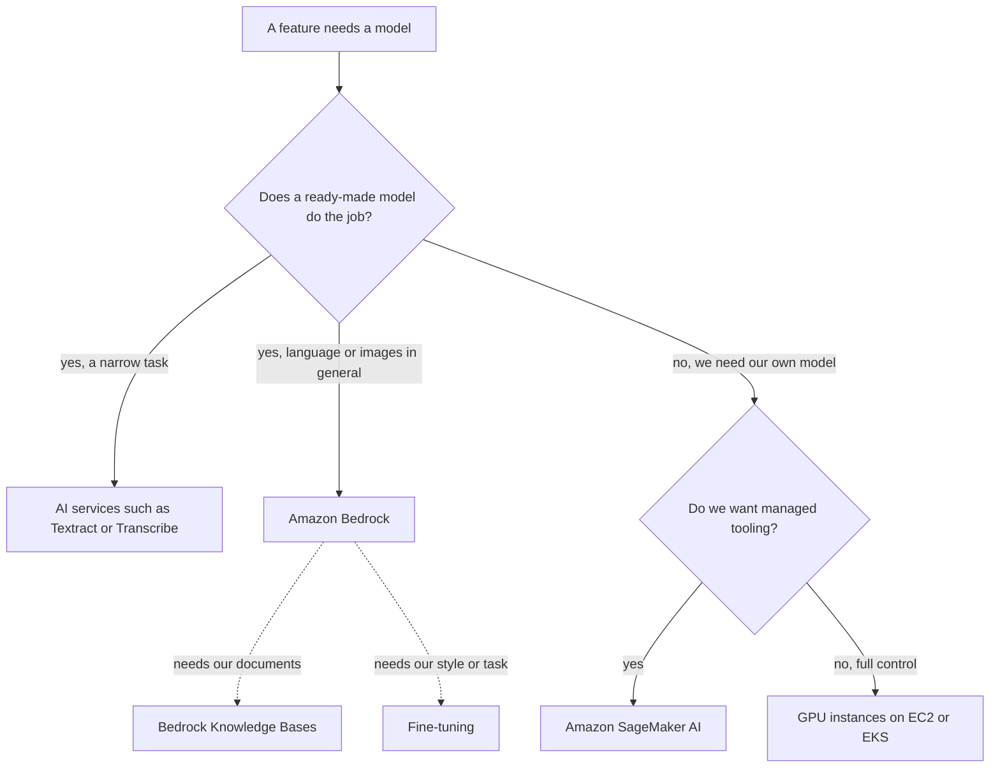
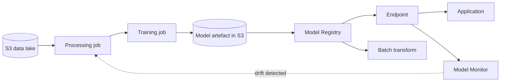

# SageMaker, Bedrock and GPU instances

## Before this lesson

You need virtual servers and instance types ([EC2 instances](#/lesson/aws/ec2-instances)), On-Demand, Spot and Savings Plans ([paying for EC2](#/lesson/aws/ec2-purchasing)), buckets ([S3 basics](#/lesson/aws/s3-basics)), roles ([IAM identities](#/lesson/aws/iam-identities)) and the data lake from the previous lesson ([data lakes on S3](#/lesson/aws/data-lakes)), because training data comes from there. No machine-learning background is assumed: the handful of ideas needed are explained below. Serverless functions ([Lambda and API Gateway](#/lesson/aws/lambda-apigw)) appear in one design.

## In plain words

Suppose you want a cake for a party. You have three options. You can **buy a finished cake** from a bakery: quick, good, and you do not need to know how to bake. You can **rent a professional kitchen** with ovens, mixers and staff who clean up, and bake your own recipe there. Or you can **lease a bare oven**, bring every tool yourself and control every detail.

Machine learning on AWS offers the same three levels:

- **Buy the finished thing.** Call a ready-made model through an API. For general-purpose language and image models this is **Amazon Bedrock**; for narrow tasks such as reading text from scanned documents there are single-purpose AI services.
- **Rent the kitchen.** **Amazon SageMaker AI** provides managed tools for building, training and serving *your own* models: you bring data and code, it supplies and cleans up the machines.
- **Lease the oven.** Rent **GPU instances** on EC2 and run whatever software you like.

A few words first. A **model** is a program whose behaviour was learned from examples instead of being written by hand. **Training** is the learning step: showing the model many examples and adjusting its internal numbers (its *parameters*) until its answers are good. **Inference** is using the trained model to answer a new question. Training is occasional and heavy; inference is constant and must be fast. A **GPU** (graphics processing unit) is a processor that performs thousands of simple calculations at the same time, which is exactly what both steps need.

Why it matters for a job: almost every engineering team is now asked to add a model to a product, and the first design question is always which of the three levels to use. Choosing the bakery when it is good enough saves months; choosing the bare oven by reflex is the most expensive mistake in this lesson. Machine-learning engineer, data and backend interviews all probe this choice, and the Solutions Architect exam expects you to recognise what each service is for.

## The three levels



| Level | You bring | AWS runs | Pay for | Typical use |
|---|---|---|---|---|
| **AI services** | Input data | The model and everything under it | Per document, image, minute or character | Text from scans (Textract), speech to text (Transcribe), text to speech (Polly), translation (Translate), image labels (Rekognition), sentiment and entities (Comprehend) |
| **Amazon Bedrock** | A prompt, optionally your documents | Foundation models and the servers they run on | Per token, or reserved capacity | Chat assistants, summarising, drafting, extraction, search over company documents |
| **Amazon SageMaker AI** | Data, training code or a chosen algorithm | Notebooks, training clusters, endpoints, pipelines | Instance time per second | Fraud scoring, recommendations, forecasting, custom vision models |
| **GPU instances** | Everything | The hardware | Instance time | Research, unusual frameworks, very large training runs, maximum cost control |

A note on names. In December 2024 the service long known as Amazon SageMaker was renamed **Amazon SageMaker AI**. The name **Amazon SageMaker** now refers to a wider platform that also brings together analytics tools, a lakehouse and a shared workspace called Unified Studio. The command-line and API namespace is still `sagemaker`, and older articles use the old name for what this lesson calls SageMaker AI.

## Amazon Bedrock

A **foundation model** is a very large model trained once, at great cost, on a broad range of text or images, and then reused for many tasks. Bedrock gives access to foundation models from several companies (Amazon's own and others such as Anthropic, Meta and Mistral) through one API. There is nothing to launch: you send a request and receive an answer.

Models read and write **tokens**, pieces of text roughly three quarters of an English word long. A **prompt** is the text you send. Prices are quoted per thousand or per million tokens, separately for input and output, and output is the dearer of the two.

A call with the AWS SDK for Python looks like this:

```python
import boto3

bedrock = boto3.client("bedrock-runtime", region_name="ap-southeast-1")

response = bedrock.converse(
    modelId=MODEL_ID,                                              # 1
    system=[{"text": "You write one-sentence summaries of book reviews."}],
    messages=[{"role": "user", "content": [{"text": review_text}]}],   # 2
    inferenceConfig={"maxTokens": 100, "temperature": 0.2},        # 3
)
print(response["output"]["message"]["content"][0]["text"])        # 4
print(response["usage"])
```

```
A warm, slow-burning family saga that rewards patient readers.
{'inputTokens': 412, 'outputTokens': 14, 'totalTokens': 426}
```

1. `modelId` names the model, or an *inference profile* that lets Bedrock route the request across Regions for capacity.
2. The conversation is a list of messages, each with a role. `converse` uses the same shape for every model, so switching model is a one-line change.
3. `maxTokens` caps the length, and therefore the cost, of the answer. `temperature` controls randomness: low values give steadier output.
4. The answer text, followed by the token counts you will be billed for.

The caller's IAM role needs `bedrock:InvokeModel` on that model. There are no API keys to store on a server.

### Making a foundation model know your business

A foundation model knows nothing about Tidewater Books' returns policy. There are three ways to supply what it lacks, in increasing order of effort:

1. **Put it in the prompt.** For a page or two of facts, paste them into the request.
2. **Retrieval-augmented generation (RAG).** Store your documents in a searchable form; for each question, fetch the few most relevant passages and add them to the prompt. The model answers from those passages. **Bedrock Knowledge Bases** manages the whole flow: it reads documents from S3, splits them into chunks, converts each chunk to an **embedding** (a list of numbers that places text with similar meaning close together), stores the embeddings in a vector store, and retrieves the nearest chunks at question time.
3. **Fine-tuning.** Continue training the model on your own examples so that it adopts a style or learns a specialised task. It costs more, takes longer and must be repeated when the base model changes; reach for it when prompts and retrieval have been tried and are not enough.

The retrieval step is simpler than it sounds. This demo uses word counts as a crude embedding so that it runs without any model; real embeddings capture meaning, not only shared words, but the mechanics are identical.

```python-run
import math, re
from collections import Counter

documents = {
    "returns":   "Books can be returned within 30 days of delivery if they are unread and undamaged.",
    "shipping":  "Orders within Singapore are delivered in two working days. Overseas delivery takes ten days.",
    "gift":      "Gift cards never expire and can be used for books and stationery but not for delivery fees.",
    "preorder":  "Preordered books are charged when they ship, not when the order is placed.",
}

def embed(text):
    return Counter(re.findall(r"[a-z]+", text.lower()))        # word -> count: a toy embedding

def cosine(a, b):
    dot = sum(a[w] * b[w] for w in a)
    norm = math.sqrt(sum(v * v for v in a.values())) * math.sqrt(sum(v * v for v in b.values()))
    return dot / norm if norm else 0.0

index = {name: embed(text) for name, text in documents.items()}

def retrieve(question, k=1):
    q = embed(question)
    ranked = sorted(index, key=lambda name: cosine(q, index[name]), reverse=True)
    return [(name, round(cosine(q, index[name]), 2)) for name in ranked[:k]]

for question in ("How many days do I have to return unread books?",
                 "When are preordered books charged?",
                 "How long does delivery take overseas?"):
    (name, score), = retrieve(question)
    print(f"Q: {question}\n   best passage: {name} (similarity {score})\n   prompt gets: {documents[name]}\n")
```

`embed` turns text into a bag of word counts. `cosine` measures how closely two such bags point in the same direction, from 0 (nothing in common) to 1 (identical). `retrieve` scores every document against the question and returns the best. Each question pulls out the right passage, and that passage is what would be placed in the prompt ahead of the question. A knowledge base does the same with millions of chunks and far better embeddings.

### Other Bedrock features to recognise

- **Guardrails** apply content filters, blocked topics and masking of personal data to requests and responses, independently of the model.
- **Agents** let a model plan several steps and call your APIs (often Lambda functions) to complete a task.
- **Batch inference** processes a large file of prompts asynchronously at a lower price, for work that is not interactive.
- **Provisioned Throughput** reserves model capacity for an hourly fee, for steady high volume or for serving a customised model.
- **Prompt caching** discounts a long prefix, such as fixed instructions, that is repeated on every call.
- **Privacy**: prompts and outputs are not used to train the underlying models and are not shared with the model providers. Traffic can stay private through a VPC endpoint, and data is encrypted with KMS.

## Amazon SageMaker AI

Use SageMaker AI when the model must be **yours**: trained on your own data to predict something specific, such as which customers will stop buying or whether a payment is fraudulent. It covers each stage of the work.



| Stage | Component | What it does |
|---|---|---|
| Explore | **Studio** | A browser workspace with notebooks and a code editor on managed instances |
| Prepare | **Processing jobs**, Data Wrangler, **Feature Store** | Run cleaning code on temporary machines; store reusable model inputs (*features*) |
| Label | **Ground Truth** | Manage people and tools that label examples |
| Start quickly | **JumpStart** | A catalogue of pretrained models and example solutions |
| Train | **Training jobs**, automatic model tuning | Run training code on a temporary cluster; search for the best settings |
| Track | Managed MLflow, **Model Registry** | Record experiments; version and approve models |
| Serve | **Endpoints**, batch transform | Answer requests live, or score a whole data set offline |
| Watch | **Model Monitor**, Clarify | Detect changes in data or accuracy; report bias and explain predictions |
| Automate | **Pipelines** | Chain the stages into a repeatable workflow |

### A training job

A **training job** is the central idea, and it follows a pattern you already know from this track: temporary compute, durable storage. SageMaker starts the instances you ask for, pulls a container image with your training code, copies the data from S3, runs the code, saves the resulting **model artefact** (a file holding the learned parameters) to S3, and terminates the instances. You pay per second for the time they existed.

```python
from sagemaker.estimator import Estimator

estimator = Estimator(
    image_uri=training_image,                               # 1
    role=execution_role_arn,                                # 2
    instance_count=1,
    instance_type="ml.g5.xlarge",                           # 3
    use_spot_instances=True,                                # 4
    max_run=3600,
    max_wait=7200,
    checkpoint_s3_uri="s3://tidewater-ml/checkpoints/recs/",
    output_path="s3://tidewater-ml/models/",                # 5
    hyperparameters={"epochs": 10, "learning_rate": 0.001}, # 6
)
estimator.fit({"train": "s3://tidewater-lake/analytics/recs/train/"})
```

1. The container image holding the framework and your training script.
2. An **execution role**: the IAM role the job assumes, limited to reading the training data and writing the outputs.
3. One instance with a single GPU. SageMaker instance types carry an `ml.` prefix.
4. Use Spot capacity, which is much cheaper and can be taken back at short notice. `max_run` limits training time and `max_wait` limits training plus waiting for capacity. The job saves **checkpoints** (its progress so far) to S3 so that it can resume after an interruption.
5. Where the model artefact is written.
6. **Hyperparameters** are settings chosen before training, such as how many passes to make over the data (*epochs*).

This is the long-established style of the SageMaker Python SDK; the newest major version expresses the same job through a `ModelTrainer` class. The ideas, and the bill, are the same.

Why checkpoints matter so much on Spot capacity:

```python-run
import random

def train(hours_needed, interruption_chance_per_hour, checkpoint_every, seed):
    random.seed(seed)
    done, since_checkpoint, billed = 0.0, 0.0, 0.0
    interruptions = 0
    step = 0.25                                           # simulate in quarter-hour steps
    while done < hours_needed:
        billed += step
        done += step
        since_checkpoint += step
        if checkpoint_every and since_checkpoint >= checkpoint_every:
            since_checkpoint = 0.0                        # progress is now safe in S3
        if random.random() < interruption_chance_per_hour * step:
            interruptions += 1
            lost = since_checkpoint if checkpoint_every else done
            done -= lost                                  # work since the last checkpoint is gone
            since_checkpoint = 0.0
        if billed > 500:
            break
    return billed, interruptions

ON_DEMAND, SPOT = 1.00, 0.35                              # illustrative USD per hour
need = 20
print(f"job needs {need} hours of training; on demand that costs {need * ON_DEMAND:.2f} USD\n")
for label, every in (("Spot, no checkpoints", 0), ("Spot, checkpoint hourly", 1.0), ("Spot, checkpoint every 15 min", 0.25)):
    runs = [train(need, 0.08, every, seed) for seed in range(200)]
    hours = sum(r[0] for r in runs) / len(runs)
    cuts = sum(r[1] for r in runs) / len(runs)
    print(f"{label:30s} average {hours:6.1f} billed hours, {cuts:3.1f} interruptions, cost {hours * SPOT:6.2f} USD")
```

The function advances a job in quarter-hour steps. Each step may be interrupted; when that happens, the work since the last checkpoint is lost, or all of it if there are no checkpoints. Averaged over 200 runs, a 20-hour job without checkpoints is billed for about two and a half times as long as planned because it keeps restarting from zero. That erases most of the saving, and an unlucky run costs more than On-Demand. With checkpoints the same job finishes in about 21 hours at roughly a third of the On-Demand price. Spot training without checkpoints is a false economy.

### Serving a model

Deploying a model means giving applications a way to call it. SageMaker AI offers four ways, and choosing among them is a favourite interview question.

| Option | How it behaves | Choose it when |
|---|---|---|
| **Real-time endpoint** | Instances run continuously behind an HTTPS address and answer in milliseconds; auto scaling adds and removes instances | Interactive features with steady traffic |
| **Serverless inference** | Capacity appears on request and disappears when idle; first request after a pause is slow (a *cold start*); CPU only | Spiky or low traffic that tolerates occasional delay |
| **Asynchronous inference** | Requests are queued; results are written to S3; can scale to zero when the queue is empty | Large inputs or predictions that take minutes |
| **Batch transform** | A temporary job scores a whole data set from S3 and stops | Nightly or weekly scoring with no live caller |

A real-time endpoint **bills for every second it exists**, whether or not anyone calls it. The demo compares the options for different traffic patterns, with illustrative prices.

```python-run
HOURS = 730                                    # hours in a month

def realtime(instances, price_per_hour):
    return instances * price_per_hour * HOURS

def serverless(requests, seconds_each, memory_gb, price_per_gb_second=0.00002):
    return requests * seconds_each * memory_gb * price_per_gb_second

def batch(runs_per_month, hours_per_run, price_per_hour):
    return runs_per_month * hours_per_run * price_per_hour

cases = {
    "internal tool, 2,000 predictions a day": 2_000 * 30,
    "product page, 200,000 predictions a day": 200_000 * 30,
    "busy API, 5 million predictions a day": 5_000_000 * 30,
}
for name, monthly_requests in cases.items():
    rt = realtime(instances=2, price_per_hour=0.12)                 # two small CPU instances for availability
    sl = serverless(monthly_requests, seconds_each=0.2, memory_gb=2)
    print(f"{name}\n   real-time endpoint {rt:8.2f} USD   serverless {sl:8.2f} USD   -> "
          f"{'serverless' if sl < rt else 'real-time'}")
print(f"\nnightly scoring of all customers as a batch job: {batch(30, 0.5, 0.12):.2f} USD a month")
```

`realtime` multiplies instances by an hourly price by the hours in a month: the same figure whatever the traffic. `serverless` charges only for the seconds spent computing. At two thousand predictions a day the serverless option costs cents while the always-on pair costs about USD 175. At five million a day the order reverses. And if nobody needs an instant answer, a half-hour batch job each night costs less than two dollars. The pattern is the same one you saw with Lambda against EC2: pay per use while volume is low or uneven, pay for capacity when it is high and steady.

## GPU instances

When you rent the hardware directly, you choose an **accelerated computing** instance family. The letters are worth recognising:

| Family | Hardware | Typical use |
|---|---|---|
| **G** (for example G5, G6) | One to eight mid-range NVIDIA GPUs | Inference, graphics, fine-tuning smaller models |
| **P** (for example P4, P5, P6) | Up to eight top-range NVIDIA GPUs with very fast networking | Training large models |
| **Inf** | AWS Inferentia chips | Lower-cost inference at volume |
| **Trn** | AWS Trainium chips | Lower-cost training for supported frameworks |

Prices span two orders of magnitude: a single-GPU G-family instance is around a dollar an hour On-Demand, and the largest P-family instances cost tens of dollars an hour. Three practical facts follow.

- **Quotas start low.** A new account's limit for GPU families is often zero. Request an increase through Service Quotas days before you need it.
- **Capacity is scarce.** Having quota does not guarantee that an instance is available. **Capacity Blocks for ML** reserve GPU instances for a future date and duration at a known price, and **On-Demand Capacity Reservations** hold capacity for as long as you keep paying for them.
- **Idle GPUs are the costliest waste in the cloud.** An eight-GPU instance left running over a weekend costs thousands of dollars.

A GPU instance needs matching drivers and libraries. The AWS **Deep Learning AMIs** and Deep Learning Containers come with them installed and tested, which saves a day of set-up. At larger scale teams run GPU nodes in EKS or use **SageMaker HyperPod**, which keeps a resilient cluster available for long training runs.

## A worked design

Tidewater Books wants two features: "customers who bought this also bought" on product pages, and a help assistant that answers questions about orders and policies.

- **Recommendations** depend on the shop's own sales data, so this is a model of its own. A weekly **SageMaker Pipeline** reads the clean sales table from the data lake, runs a processing job to build training data, trains on one Spot GPU instance with checkpoints, and registers the model. Because recommendations for each book change only weekly, a **batch transform** job computes them for the whole catalogue and writes them to DynamoDB. The product page reads DynamoDB in a few milliseconds. No endpoint runs at all.
- **The help assistant** needs general language ability plus the shop's policies, so it uses **Bedrock** with a **knowledge base** built from the policy documents in S3, a **guardrail** that masks card numbers and declines unrelated topics, and a Lambda function behind API Gateway that calls Bedrock and looks up order status. Cost scales with questions asked.

Neither feature required a GPU instance to be managed by hand, and the design says why: one model is ours but not needed live, the other is live but not ours.

## Securing it

- **Roles, not keys.** Training jobs, endpoints and Lambda functions each assume a role scoped to the buckets and models they use.
- **Private networking.** Run training jobs and endpoints in your VPC subnets, reach S3 and Bedrock through VPC endpoints, and enable network isolation for training containers that should have no outbound access.
- **Encryption.** KMS keys for S3 data, training volumes and model artefacts.
- **Data care.** Training data often contains personal information. Apply the lake's column-level permissions, remove fields the model does not need, and record which data trained which model version.
- **Guardrails and logging.** Filter inputs and outputs of language models, and log model invocations (to CloudWatch Logs or S3) with the same care as any log that may hold customer text.

## Cost notes and free-tier warnings

- **Endpoints bill until deleted.** Stopping a notebook does not stop an endpoint. List endpoints, Studio applications and training jobs at the end of every session.
- **Studio and notebook instances bill while running**, including when idle overnight. Set idle shutdown.
- **GPU instances** are excluded from most free allowances, and new accounts on the credit-based free plan may find them unavailable or their quota at zero.
- **Bedrock on-demand** has no idle cost but no natural ceiling either: cap `maxTokens`, cache repeated prompt prefixes, use batch inference for offline work, start with the smallest model that passes your tests, and put a budget alarm on the service.
- **Provisioned Throughput** and Capacity Blocks are commitments billed whether used or not.
- **Knowledge bases** need a vector store, and some vector stores have a minimum monthly charge even when empty.
- **Savings**: managed Spot training with checkpoints, Machine Learning Savings Plans for steady SageMaker AI usage, serverless or asynchronous endpoints that scale to zero, and batch transform in place of an idle real-time endpoint.

## Pitfalls

- **Training a custom model when an API call would do.**
- **Renting GPU instances by hand** when a managed training job would start, finish and stop by itself.
- **A real-time endpoint for a nightly need.**
- **Spot training without checkpoints.**
- **Fine-tuning first** instead of trying a better prompt and retrieval.
- **Sending whole documents in every prompt** when retrieval could send three paragraphs.
- **No evaluation set.** Without a fixed set of test questions and expected answers, you cannot tell whether a change of prompt or model helped.
- **Forgetting quotas** until the day of the deadline.
- **Leaving notebooks and endpoints running.**
- **Putting personal data into prompts and logs** without masking or a retention rule.
- **Assuming a model stays accurate.** Data changes; monitor predictions and retrain.

> [!INTERVIEW]
> **"When would you use Bedrock, SageMaker or plain EC2 for a machine-learning feature?"** Bedrock when a foundation model, possibly grounded in our documents through retrieval, meets the need: no infrastructure and pay per token. SageMaker AI when we must train or host our own model and want managed training jobs, endpoints, registry and pipelines. EC2 or EKS with GPUs when we need full control of the stack or the economics of very large, steady workloads justify operating it ourselves. I start at the highest level that works and move down only for a stated reason.
>
> **"How would you serve a model that is called a few hundred times a day?"** Not with an always-on real-time endpoint, which bills around the clock. If responses can take a moment, a serverless endpoint that scales to zero; if inputs are large or slow, asynchronous inference; and if predictions can be computed ahead of time, a batch job that writes results to a database the application reads.
>
> **"How do you cut training cost?"** Right-size the instance by measuring GPU utilisation, use managed Spot training with frequent checkpoints, stop early when the validation score stops improving, cache prepared data, and commit to a Savings Plan only for the steady baseline.

## Cheat sheet

| Need | Choice |
|---|---|
| Text from scans, speech, translation, image labels | The matching AI service |
| Language or image generation through an API | Bedrock |
| Answers grounded in company documents | Bedrock Knowledge Bases (RAG) |
| Content filters and masking | Bedrock Guardrails |
| A model trained on our own data | SageMaker AI training job |
| Cheaper training | Managed Spot with checkpoints |
| Live predictions, steady traffic | Real-time endpoint with auto scaling |
| Live predictions, spiky or rare traffic | Serverless inference |
| Large or slow predictions | Asynchronous inference |
| Scoring a whole data set | Batch transform |
| Version and approve models | Model Registry |
| Repeatable train-and-deploy workflow | SageMaker Pipelines |
| Detect drift | Model Monitor |
| Inference GPUs | G family |
| Large-scale training GPUs | P family, Capacity Blocks |
| Preinstalled drivers and frameworks | Deep Learning AMIs and Containers |

## Summary

- There are three levels: call a ready-made model (AI services, Bedrock), train and serve your own with managed tools (SageMaker AI), or rent GPU hardware (EC2). Start at the highest level that meets the need.
- Bedrock gives API access to foundation models billed per token; knowledge bases, guardrails and fine-tuning adapt them to a business.
- SageMaker AI's training jobs use temporary compute with data and artefacts in S3; its four inference options trade latency against idle cost.
- GPU instances are powerful, scarce and expensive: plan quotas and capacity, and never leave them idle.
- Security follows the rest of the track: roles, private networking, encryption, careful handling of personal data.
- The largest savings come from not running things: batch over live, serverless over always-on, Spot with checkpoints over On-Demand.

## Glossary

- **Batch transform**: a temporary job that runs a model over a whole data set.
- **Checkpoint**: saved training progress from which a job can resume.
- **Cold start**: the delay when capacity must be prepared before the first request.
- **Embedding**: a list of numbers representing the meaning of a piece of text.
- **Endpoint**: an HTTPS address that serves predictions from a deployed model.
- **Execution role**: the IAM role a SageMaker job or endpoint assumes.
- **Fine-tuning**: further training of an existing model on your own examples.
- **Foundation model**: a large general-purpose model reused for many tasks.
- **GPU**: a processor built for massively parallel arithmetic.
- **Guardrail**: a configurable filter on a model's inputs and outputs.
- **Hyperparameter**: a training setting chosen before training starts.
- **Inference**: using a trained model to produce an answer.
- **Model artefact**: the file of learned parameters produced by training.
- **Prompt**: the text sent to a language model.
- **RAG**: retrieval-augmented generation; fetching relevant passages and adding them to the prompt.
- **Token**: the unit of text that language models read, write and are billed by.
- **Training**: adjusting a model's parameters from examples.

```quiz
[
  {"q": "A team wants to extract the text and tables from scanned invoices. Which approach needs the least effort?",
   "options": ["Train a custom vision model on SageMaker AI", "Call Amazon Textract", "Rent a P-family GPU instance and install an open-source model", "Fine-tune a foundation model"],
   "answer": 1,
   "explain": "Extracting text from documents is a narrow task with a ready-made AI service. Building or hosting a model would add cost and work for no benefit."},
  {"q": "A support assistant built on Bedrock must answer from the company's 5,000 policy documents, which change weekly. Which technique fits best?",
   "options": ["Retrieval-augmented generation with a knowledge base over the documents in S3", "Paste all documents into every prompt", "Fine-tune the model every week", "Train a new foundation model"],
   "answer": 0,
   "explain": "A knowledge base retrieves only the relevant passages for each question and is refreshed by re-indexing the documents. Fine-tuning weekly is slow and costly, and the documents are too large for one prompt."},
  {"q": "A model is used to score every customer once each night. No application calls it during the day. Which deployment is the most cost-effective?",
   "options": ["A real-time endpoint with two instances", "A provisioned GPU instance running continuously", "Provisioned Throughput", "A batch transform job each night"],
   "answer": 3,
   "explain": "Batch transform starts instances, scores the data set from S3, writes results and stops. A real-time endpoint would bill for 24 hours to do half an hour of work."},
  {"q": "Why should a training job that uses Spot capacity write checkpoints to S3?",
   "options": ["Checkpoints make the GPU faster", "S3 requires them", "Spot capacity can be reclaimed, and without checkpoints an interrupted job restarts from the beginning", "They reduce the size of the model"],
   "answer": 2,
   "explain": "An interruption discards work since the last checkpoint. With frequent checkpoints the loss is minutes; without them it is everything."},
  {"q": "A new account tries to launch a GPU instance and receives an error saying the vCPU limit for that instance family is zero. What is the fix?",
   "options": ["Choose a different AMI", "Attach an internet gateway", "Request a quota increase for that family through Service Quotas", "Enable detailed monitoring"],
   "answer": 2,
   "explain": "Accelerated instance families often start with a quota of zero. Increases are requested per family and can take days, so plan ahead."},
  {"q": "An interactive feature receives a few hundred prediction requests a day in unpredictable bursts and can tolerate an occasional slow first response. Which inference option fits?",
   "options": ["Serverless inference", "Real-time endpoint on GPU instances", "Batch transform", "A Capacity Block"],
   "answer": 0,
   "explain": "Serverless inference scales to zero between bursts and bills only for compute used, at the price of cold starts."},
  {"q": "Which statement about Bedrock on-demand pricing is correct?",
   "options": ["It is billed per hour whether or not requests are sent", "It is free below one million requests", "It requires reserving GPU instances", "It is billed per input and output token, so limiting response length and prompt size controls cost"],
   "answer": 3,
   "explain": "On-demand use is metered in tokens, with output tokens priced higher than input. Hourly billing applies to Provisioned Throughput, which is a separate option."},
  {"q": "What does a SageMaker AI execution role do?",
   "options": ["It is the password for Studio", "It is the IAM role a job or endpoint assumes to read data and write outputs, and it should be limited to those resources", "It grants every user administrator access", "It encrypts the model"],
   "answer": 1,
   "explain": "Jobs and endpoints act through a role, like any other workload on AWS. Least privilege limits what a faulty or compromised job can reach."}
]
```

> **Source:** AWS Certified Solutions Architect Official Study Guide, ch. 3 (Amazon EC2 instance families and purchasing options) and ch. 14 (architecture best practices) for the underlying compute and cost ideas; SageMaker AI, Bedrock and current accelerated instance families post-date the book. Checked against https://docs.aws.amazon.com/sagemaker/latest/dg/whatis.html , https://docs.aws.amazon.com/sagemaker/latest/dg/deploy-model.html , https://docs.aws.amazon.com/sagemaker/latest/dg/model-managed-spot-training.html , https://docs.aws.amazon.com/bedrock/latest/userguide/what-is-bedrock.html , https://docs.aws.amazon.com/bedrock/latest/userguide/knowledge-base.html , https://docs.aws.amazon.com/bedrock/latest/userguide/conversation-inference.html , https://docs.aws.amazon.com/AWSEC2/latest/UserGuide/accelerated-computing-instances.html and https://docs.aws.amazon.com/AWSEC2/latest/UserGuide/ec2-capacity-blocks.html
