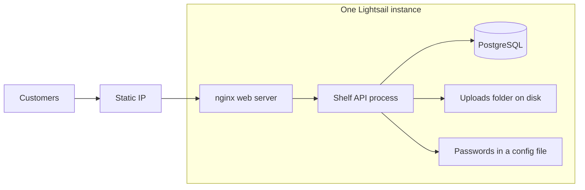
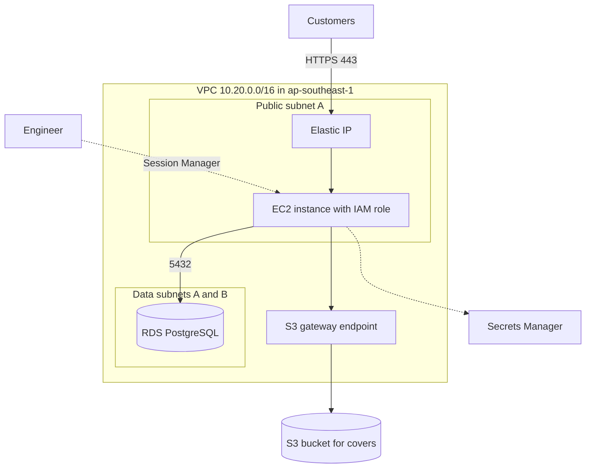

# Project part 1: from one Lightsail server to a VPC with RDS and S3

## Before this lesson

This is the first half of a worked project that reuses most of the track. You should have met virtual servers and user data ([EC2 instances](#/lesson/aws/ec2-instances)), buckets and presigned URLs ([S3 basics](#/lesson/aws/s3-basics), [S3 protection](#/lesson/aws/s3-protection)), subnets, route tables and gateways ([VPC basics](#/lesson/aws/vpc-basics)), security groups ([Security groups versus network ACLs](#/lesson/aws/vpc-firewalls)), managed databases ([RDS and Aurora](#/lesson/aws/rds-aurora)), roles and policies ([IAM identities](#/lesson/aws/iam-identities)) and DNS records ([Route 53](#/lesson/aws/route53)). Each idea is restated in one sentence where it is used, so you can follow along even if one of those lessons is hazy.

## In plain words

Picture a food stall run by one person. That person takes the orders, cooks, handles the money and keeps the ingredients in a box under the counter. It is cheap, it is quick to set up, and for twenty customers a day it is the right design. Its weakness is that everything depends on one person and one cart: if the owner is ill, the stall is closed; if the cart is stolen, the recipes and the takings go with it.

A small web application on a single server is that stall. One machine runs the web server, the application code, the database and the folder of uploaded files. This lesson and the next one turn the stall into a restaurant: the same menu, but with the storeroom, the till and the kitchen separated so that any one of them can be replaced without closing the doors.

We do it in stages, and each stage fixes one named weakness. In this lesson the application leaves its single **Amazon Lightsail** server and lands in a network of its own, with the database in **Amazon RDS**, the files in **Amazon S3** and its permissions supplied by an **IAM role**. In part 2 it gains a load balancer, automatic scaling, a content delivery network, a deployment pipeline and monitoring.

Why this matters for a job: real engineering work is rarely a blank page. It is far more often "this thing works on one box and the business now depends on it; make it safe to depend on". Interviewers ask the same thing in the form "how would you take this to production?" and they are listening for the order of your steps and the reason for each one.

## The application and the plan

The running example is **Shelf**, the stock and ordering service of the fictional bookshop Tidewater Books, based in Singapore. Shelf has three parts:

- an **API**: a program written in Python that answers web requests such as "list the books in this category" or "place this order". (API stands for application programming interface: a set of web addresses that other programs call.)
- a **PostgreSQL database** holding books, customers and orders. PostgreSQL is a widely used open-source relational database, the kind that stores rows in tables and is queried with SQL.
- a folder of **cover images** that staff upload, a few hundred kilobytes each.

All AWS resources go in the Singapore Region, whose code is `ap-southeast-1`. A **Region** is a geographic area holding several **Availability Zones (AZs)**, and an AZ is one or more data centres with independent power and networking.

Here is the whole journey. Stages 0 to 4 are this lesson; the rest are part 2.

| Stage | Change | Weakness it removes |
|---|---|---|
| 0 | One Lightsail instance running everything | (starting point) |
| 1 | Move configuration and state out of the server's own disk and memory | The server cannot be replaced or duplicated |
| 2 | Build a VPC with public, application and data subnets in two AZs | No network boundaries; nowhere safe to put a database |
| 3 | Move the database to RDS | Data lives on the same disk as the code; backups are manual |
| 4 | Move uploads to S3; give the server an IAM role; cut over | Files are tied to one disk; passwords and keys sit in files |
| 5 | Load balancer and Auto Scaling group across two AZs | One server, one AZ |
| 6 | Multi-AZ database, CloudFront, HTTPS managed by AWS | Database is a single point of failure; slow for distant users |
| 7 | Deployment pipeline, alarms, dashboards, cost controls | Releases by hand; nobody knows when it breaks |

## Stage 0: one Lightsail instance

**Amazon Lightsail** is a simplified corner of AWS for small workloads. You pick a **bundle**: a fixed monthly price that includes a virtual server (Lightsail calls it an **instance**), solid-state disk space and a generous data-transfer allowance. At the time of writing a Linux bundle with 2 GB of memory, 60 GB of disk and 3 TB of monthly transfer is USD 12 a month, and the smallest bundle is USD 5. There is one bill line and no surprises, which is why Lightsail suits a first deployment.

Creating the server from the command line looks like this. The AWS Command Line Interface (CLI) is the `aws` program that sends requests to AWS from a terminal.

```bash
aws lightsail get-bundles --query "bundles[?isActive].[bundleId,price,ramSizeInGb]" --output table   # 1
aws lightsail create-instances \
  --instance-names shelf-1 \
  --availability-zone ap-southeast-1a \
  --blueprint-id ubuntu_24_04 \
  --bundle-id small_3_0 \
  --user-data file://bootstrap.sh                                                                   # 2
aws lightsail allocate-static-ip --static-ip-name shelf-ip                                          # 3
aws lightsail attach-static-ip --static-ip-name shelf-ip --instance-name shelf-1
aws lightsail open-instance-public-ports --instance-name shelf-1 \
  --port-info fromPort=443,toPort=443,protocol=TCP                                                  # 4
```

1. Bundle and blueprint identifiers change as AWS revises its price list, so list the current ones first instead of trusting an identifier copied from a tutorial.
2. `create-instances` starts the server. A **blueprint** is the operating-system image; `user-data` is a script that runs once at first boot and here installs the web server, the API and PostgreSQL.
3. A **static IP** is a fixed public address. Without it, the address changes whenever the instance is stopped and started.
4. The Lightsail **firewall** decides which ports accept traffic from the internet. Port 443 is HTTPS, the encrypted form of web traffic.

Inside the box, four things run side by side:



Lightsail also offers managed databases, a load balancer, object storage and a content delivery network of its own, all at flat prices. Staying inside Lightsail and adding those is a legitimate path for a small site. We leave for three reasons that apply to Shelf: the team wants automatic scaling on demand, fine-grained network control, and the full set of AWS services described in the rest of this track. Lightsail can connect to the rest of AWS only through a peering link with the account's *default* VPC, which is too coarse for the layout we are about to build.

### What is wrong with one box

Write the weaknesses down before fixing anything. Each one becomes a stage.

- **A single point of failure.** If the instance, its disk or its AZ fails, the site is down, and a disk failure can take the database with it.
- **State is trapped on the server.** *State* is any data that must survive from one request to the next: database rows, uploaded files, the record of who is logged in. Because it all lives on this machine, you cannot add a second machine or throw this one away.
- **Growth is vertical only.** The only way to handle more traffic is a bigger bundle, which needs a restart and has a ceiling.
- **Backups depend on memory.** Someone has to remember to take a snapshot (a point-in-time copy of the disk).
- **Secrets live in a file.** The database password sits in a configuration file on disk; anyone who can read the file can read the database.
- **Every change is live surgery.** A release means logging in and restarting things by hand while customers are using them.

## Stage 1: make the server stateless

A server is **stateless** when it keeps nothing that matters on its own disk or in its own memory between requests. Any stateless server can answer any request, so servers become interchangeable: add one, remove one, replace one, and no customer notices. Everything in part 2 depends on this property, which is why it comes first, before any AWS resource is created.

Shelf holds three kinds of state. Each gets a new home.

| State | Where it lives now | Where it will live | Why |
|---|---|---|---|
| Books, customers, orders | PostgreSQL on the instance | RDS PostgreSQL | Managed backups, failover, independent sizing |
| Cover images | `/var/www/shelf/uploads` | An S3 bucket | Unlimited, durable, readable from any server |
| Login sessions | A dictionary in the API's memory | A signed cookie now, a shared cache later | Any server must recognise any logged-in user |
| Configuration and passwords | A file baked into the server | Environment variables filled from Secrets Manager | Same code runs anywhere; secrets are not in files |

A **session** is the server's memory that a particular browser has logged in. The demo below shows what goes wrong when sessions are kept in each server's own memory and a second server is added. A list of servers is visited in turn (*round robin*), which is how a load balancer behaves by default.

```python-run
import itertools

class Server:
    def __init__(self, name, shared=None):
        self.name = name
        # where this server keeps logins: its own memory, or one store shared by all servers
        self.sessions = shared if shared is not None else {}

    def login(self, user):
        token = f"token-{user}"
        self.sessions[token] = user
        return token

    def whoami(self, token):
        return self.sessions.get(token, "NOT LOGGED IN")

def run(servers, title):
    print(title)
    turn = itertools.cycle(servers)            # round robin: each request goes to the next server
    first = next(turn)
    token = first.login("mei")
    print(f"  login handled by {first.name}")
    for i in range(4):
        s = next(turn)
        print(f"  request {i + 1} handled by {s.name}: {s.whoami(token)}")

run([Server("server-a"), Server("server-b")], "Sessions kept in each server's memory")
shared = {}
run([Server("server-a", shared), Server("server-b", shared)], "\nSessions kept in a shared store")
```

Line by line: each `Server` owns a `sessions` dictionary unless it is handed a shared one. `login` records the user under a token and returns the token, as a real site would in a cookie. `run` logs in on the first server and then sends four requests that alternate between the two. In the first run every request that reaches `server-b` prints `NOT LOGGED IN`, because the login was recorded only in `server-a`. In the second run both servers consult the same dictionary and all four requests succeed. Replace the dictionary with a cache service or a database table and you have the production fix.

The code changes for stage 1 are small and are made while the application still runs on Lightsail:

1. Read the database address, bucket name and secrets from **environment variables** (named values handed to a program when it starts) instead of a file in the code.
2. Put file reads and writes behind two functions, `save_cover` and `cover_url`, so that the storage behind them can change in one place.
3. Replace in-memory sessions with a signed cookie or a `sessions` table.
4. Add a `/healthz` address that returns "ok" when the API process is up and able to serve. Part 2's load balancer will call it every few seconds.

## Stage 2: a network of our own

A **Virtual Private Cloud (VPC)** is a private network inside AWS that you define: its address range, its subdivisions and its doors to the outside. A **subnet** is a slice of the VPC's address range that lives in exactly one AZ. A subnet is **public** when its route table sends internet-bound traffic to an **internet gateway** (the VPC's door to the internet) and **private** when it does not.

Shelf's network has three tiers, each present in two AZs:

- **public subnets** for things that must be reachable from the internet (in part 2, the load balancer);
- **application subnets** for the API servers;
- **data subnets** for the database, with no route to the internet at all.

Two AZs are needed even while there is one server: RDS insists that a database's *subnet group* spans at least two AZs, and part 2 will fill the second zone.

Address ranges are written in **CIDR notation**: `10.20.0.0/16` means "the addresses whose first 16 bits match `10.20`", about 65,000 of them. A larger number after the slash means a smaller block. The demo checks a subnet plan the way you should before creating anything: every subnet inside the VPC, none overlapping, and a count of usable addresses. AWS keeps five addresses in every subnet for its own use.

```python-run
import ipaddress

vpc = ipaddress.ip_network("10.20.0.0/16")
plan = [
    ("public-a", "10.20.0.0/24",  "ap-southeast-1a"),
    ("public-b", "10.20.1.0/24",  "ap-southeast-1b"),
    ("app-a",    "10.20.16.0/20", "ap-southeast-1a"),
    ("app-b",    "10.20.32.0/20", "ap-southeast-1b"),
    ("data-a",   "10.20.64.0/24", "ap-southeast-1a"),
    ("data-b",   "10.20.65.0/24", "ap-southeast-1b"),
]

nets = []
for name, cidr, az in plan:
    net = ipaddress.ip_network(cidr)
    assert net.subnet_of(vpc), f"{name} is outside the VPC"
    for other_name, other in nets:
        assert not net.overlaps(other), f"{name} overlaps {other_name}"
    nets.append((name, net))
    usable = net.num_addresses - 5              # AWS reserves 5 addresses per subnet
    print(f"{name:9s} {cidr:15s} {az}  usable addresses: {usable}")

used = sum(n.num_addresses for _, n in nets)
print(f"\nplan uses {used} of {vpc.num_addresses} addresses ({100 * used / vpc.num_addresses:.1f}%), the rest is room to grow")
```

`ip_network` parses a CIDR block; `subnet_of` and `overlaps` are the two checks that catch most planning mistakes. The application subnets are deliberately large (4,091 usable addresses each) because servers, containers and functions all take addresses from them, while the public and data subnets hold a handful of things. Only about 14 % of the VPC is allocated, which leaves space for a third AZ or new tiers. Change `app-b` to `10.20.24.0/20` and run it again to see the overlap check fail.

### Routes and firewalls

- The **public** route table has one extra line: `0.0.0.0/0` (every address not matched by something more specific) goes to the internet gateway.
- The **application** route table sends `0.0.0.0/0` to a **NAT gateway**, a managed device in a public subnet that lets private servers start connections to the internet (to download packages, for example) while nothing outside can start a connection to them. That gateway arrives with part 2; this lesson's single server sits in a public subnet and does not need it.
- The **data** route table has only the local route. A database has no business talking to the internet.
- An **S3 gateway endpoint** adds a route so that traffic to S3 stays on the AWS network. It is free, and it later spares the NAT gateway from carrying every image.

A **security group** is a firewall attached to a resource. Its rules can name *another security group* as the allowed source, which reads as "anything wearing that badge may come in". Shelf uses a chain:

| Security group | Allows inbound | From |
|---|---|---|
| `shelf-app-sg` | TCP 443 | The internet (this lesson); the load balancer's group (part 2) |
| `shelf-db-sg` | TCP 5432, the PostgreSQL port | `shelf-app-sg` only |

No rule opens port 22, the remote-login port (SSH). Engineers will reach the server through **Session Manager**, a feature of AWS Systems Manager that opens a shell through the AWS API, checks IAM permissions and records the session, with no inbound port at all.

## Stage 3: the database moves to RDS

**Amazon Relational Database Service (RDS)** runs the database engine for you: it installs and patches PostgreSQL, takes daily backups, keeps the transaction log so that you can restore to any second within the retention period, and can maintain a standby copy in another AZ. You still own the schema, the queries and the choice of size.

```bash
aws rds create-db-subnet-group \
  --db-subnet-group-name shelf-data \
  --db-subnet-group-description "Data subnets for Shelf" \
  --subnet-ids subnet-0aaa1111bbbb2222c subnet-0ddd3333eeee4444f          # 1

aws rds create-db-instance \
  --db-instance-identifier shelf-db \
  --engine postgres \
  --db-instance-class db.t4g.micro \
  --allocated-storage 20 --storage-type gp3 \
  --db-name shelf \
  --master-username shelf_admin \
  --manage-master-user-password \
  --db-subnet-group-name shelf-data \
  --vpc-security-group-ids sg-0db5555666677778 \
  --no-publicly-accessible \
  --storage-encrypted \
  --backup-retention-period 7 \
  --deletion-protection                                                   # 2
```

1. A **DB subnet group** lists the subnets RDS may use: the two data subnets.
2. Reading the options in order: the engine is PostgreSQL; `db.t4g.micro` is a small burstable instance class; storage is 20 GB of general-purpose SSD; `--manage-master-user-password` tells RDS to generate the administrator password, store it in **AWS Secrets Manager** and rotate it, so that no human ever types or sees it; the instance gets no public address; storage is encrypted; automated backups are kept for seven days; and deletion protection stops an accidental `delete-db-instance`.

The instance is single-AZ for now. Part 2 switches on Multi-AZ, which roughly doubles the database's price and is the right moment to discuss what it buys.

### Moving the data

The simplest migration is **dump and restore**: export the old database to a file, import the file into the new one. It needs a short window during which nobody writes to the old database.

```bash
# on the Lightsail instance
pg_dump --format=custom --no-owner --dbname=shelf --file=shelf.dump
aws s3 cp shelf.dump s3://tidewater-shelf-migration-111122223333/shelf.dump

# on the new EC2 instance inside the VPC
aws s3 cp s3://tidewater-shelf-migration-111122223333/shelf.dump .
pg_restore --no-owner --host=shelf-db.c9akciq32.ap-southeast-1.rds.amazonaws.com \
  --username=shelf_admin --dbname=shelf shelf.dump
psql --host=shelf-db.c9akciq32.ap-southeast-1.rds.amazonaws.com --username=shelf_admin --dbname=shelf \
  --command="SELECT count(*) FROM orders;"
```

```
 count
-------
 48213
(1 row)
```

`pg_dump` writes a consistent copy of the database in PostgreSQL's compact archive format. The file travels through a private S3 bucket, so the new database never needs a public address. `pg_restore` replays it into RDS, and the final query is the first of several checks: compare row counts for every table with the source before believing the copy.

For a database too large or too busy for a write freeze, **AWS Database Migration Service (DMS)** copies the existing rows and then keeps applying new changes until you switch over. Shelf's database is a few gigabytes, so the dump takes about a minute and the simpler tool wins.

Create a separate database user for the application with rights on its own tables only. The administrator account that RDS manages is for migrations and emergencies.

## Stage 4: files to S3, permissions from a role, and the cutover

### The bucket

**Amazon S3** stores **objects** (a file plus its metadata) in **buckets**. It is not a disk attached to a server: programs reach it over HTTPS, which is exactly why any number of servers can share it.

```bash
aws s3api create-bucket --bucket tidewater-shelf-uploads-111122223333 \
  --region ap-southeast-1 --create-bucket-configuration LocationConstraint=ap-southeast-1
aws s3api put-bucket-versioning --bucket tidewater-shelf-uploads-111122223333 \
  --versioning-configuration Status=Enabled
aws s3 sync /var/www/shelf/uploads s3://tidewater-shelf-uploads-111122223333/covers/
```

```
upload: uploads/9780141439518.jpg to s3://tidewater-shelf-uploads-111122223333/covers/9780141439518.jpg
upload: uploads/9780062316097.jpg to s3://tidewater-shelf-uploads-111122223333/covers/9780062316097.jpg
...
```

New buckets block all public access and encrypt every object by default, and we leave both settings alone. **Versioning** keeps earlier copies of an object when it is overwritten or deleted, which turns "someone deleted the covers" from a disaster into a restore. `sync` copies only files that are missing or changed, so it can be run once early and again at cutover to pick up the last few uploads.

The bucket is private, so how does a browser show a cover? For now the API hands out **presigned URLs**: web addresses that carry a signature and an expiry time, each granting access to one object for a few minutes. Inside `cover_url` the application asks the AWS SDK for Python to produce one:

```python
import boto3

s3 = boto3.client("s3")

def cover_url(isbn):
    return s3.generate_presigned_url(
        "get_object",
        Params={"Bucket": BUCKET, "Key": f"covers/{isbn}.jpg"},
        ExpiresIn=300,          # seconds
    )
```

`generate_presigned_url` does not contact S3. It signs the request locally with the server's credentials, and S3 verifies the signature when the browser uses the link. Part 2 replaces this with CloudFront, which serves the same private bucket through a cache.

### The role

Where do "the server's credentials" come from? Not from an access key pasted into a file. An **IAM role** is an identity with permissions and no password; a server that has been given a role receives short-lived credentials automatically and the SDK picks them up. The wrapper that attaches a role to an EC2 instance is called an **instance profile**.

The role's policy lists exactly what Shelf needs:

```json
{
  "Version": "2012-10-17",
  "Statement": [
    {
      "Sid": "ReadWriteCovers",
      "Effect": "Allow",
      "Action": ["s3:GetObject", "s3:PutObject", "s3:DeleteObject"],
      "Resource": "arn:aws:s3:::tidewater-shelf-uploads-111122223333/covers/*"
    },
    {
      "Sid": "ReadDatabaseSecret",
      "Effect": "Allow",
      "Action": "secretsmanager:GetSecretValue",
      "Resource": "arn:aws:secretsmanager:ap-southeast-1:111122223333:secret:shelf/app-db-user-AbCdEf"
    }
  ]
}
```

The first statement allows reading, writing and deleting objects under the `covers/` prefix of one bucket, and nothing in any other bucket. The second allows reading one secret. The role also carries the AWS managed policy `AmazonSSMManagedInstanceCore`, which is what lets Session Manager work. If the server were compromised, the attacker could damage cover images and read one database password; they could not create servers, read other buckets or touch IAM.

### The new server

The application now starts on an EC2 instance built from a script, not copied from the old machine. Lightsail can export a snapshot to EC2 as a machine image, and that is a fair shortcut for a quick lift. Rebuilding from a script is better here because part 2 needs to launch identical servers automatically, and a server that can only be produced by copying an old one is not reproducible.

```bash
aws ec2 run-instances \
  --image-id resolve:ssm:/aws/service/ami-amazon-linux-latest/al2023-ami-kernel-default-arm64 \
  --instance-type t4g.small \
  --subnet-id subnet-0a1b2c3d4e5f60718 \
  --security-group-ids sg-0aa1111222233334 \
  --iam-instance-profile Name=shelf-app \
  --metadata-options HttpTokens=required \
  --user-data file://bootstrap.sh \
  --tag-specifications 'ResourceType=instance,Tags=[{Key=Name,Value=shelf-app-1},{Key=project,Value=shelf}]'
```

The image identifier asks AWS for the current Amazon Linux 2023 image for Arm processors, so the command does not go stale. `HttpTokens=required` enforces the safer version of the instance metadata service. `bootstrap.sh` installs the API, reads its settings from Secrets Manager and starts it. An **Elastic IP** (a fixed public address) is attached afterwards; it is temporary, because in part 2 the servers move to private subnets behind a load balancer.

### Cutting over without drama

The **Domain Name System (DNS)** turns `shelf.tidewaterbooks.example` into an address. Every DNS answer carries a **time to live (TTL)**: how many seconds a resolver may reuse the answer before asking again. When you change the record, resolvers that cached the old answer keep sending customers to the old server until their copy expires. The demo measures how long that tail lasts.

```python-run
import random
random.seed(7)

def still_on_old_server(ttl_seconds, minutes_after_switch, resolvers=10_000):
    # each resolver cached the old answer at a random moment during the TTL before the switch
    stale = 0
    for _ in range(resolvers):
        age_at_switch = random.uniform(0, ttl_seconds)
        expires_in = ttl_seconds - age_at_switch
        if expires_in > minutes_after_switch * 60:
            stale += 1
    return 100 * stale / resolvers

for ttl in (86_400, 3_600, 60):
    row = "  ".join(f"{m:>3d} min: {still_on_old_server(ttl, m):5.1f}%" for m in (1, 10, 60, 360))
    print(f"TTL {ttl:>6d} s ->  {row}")
```

With a one-day TTL, three quarters of resolvers are still pointing at the old server six hours after the change. With a 60-second TTL, everyone has moved within a minute. The lesson: **lower the TTL a day or two before the move**, so that the long-lived copies have already expired when you switch.

The runbook, in order:

1. Two days before: lower the record's TTL to 60 seconds. Take a Lightsail snapshot.
2. Run `aws s3 sync` and a trial dump and restore. Time them. Test the new server through its own address.
3. At a quiet hour: put the old site into read-only mode, so that no order is written to a database you are about to leave.
4. Final `pg_dump`, copy, `pg_restore`; final `aws s3 sync`. Compare row counts.
5. Point the DNS record at the new server's Elastic IP. Watch the new server's logs for traffic and errors.
6. Leave the Lightsail instance stopped but intact for a week as the way back.
7. After a week: delete the Lightsail instance, release its static IP, delete the migration bucket, and raise the TTL again.

The read-only window is the downtime customers experience, and for Shelf it is about ten minutes. Rehearsing step 2 is what makes that number predictable.

## Where we are



Fixed: the data and the files no longer live on the server; backups are automatic; no password or access key is stored in a file; the network has tiers; the server can be rebuilt from a script in minutes.

Still wrong, and the subject of part 2: there is one server in one AZ; the database has no standby; HTTPS certificates are still managed by hand on the server; releases are manual; and nothing raises an alarm when the site fails.

## Cost notes and free-tier warnings

Prices below are rounded on-demand figures to show proportions. Check the AWS Pricing Calculator for `ap-southeast-1` before committing to anything.

| Item | Lightsail start | After this lesson |
|---|---|---|
| Server | USD 12 bundle (2 GB memory, 60 GB disk, 3 TB transfer) | `t4g.small` about USD 15, plus 20 GB disk about USD 2 |
| Public IPv4 address | Included while attached | About USD 3.65 (every public IPv4 address is billed by the hour) |
| Database | On the same server | `db.t4g.micro` single-AZ about USD 16, plus 20 GB storage about USD 3 |
| Files | On the same disk | S3: cents for a few gigabytes |
| Secret | A file | Secrets Manager: USD 0.40 per secret |
| **Rough total** | **USD 12** | **USD 40** |

- The production-style layout costs about three times as much before any redundancy is added. You are paying for managed backups, isolation and the ability to grow. For a hobby site, Lightsail remains the sensible choice; say so in an interview.
- **Lightsail charges continue until resources are deleted.** A stopped instance still bills for its bundle, snapshots bill per gigabyte, and a static IP that is not attached to an instance bills by the hour.
- **Delete the migration dump** and its bucket; it is a complete copy of customer data.
- An **Elastic IP that is not attached** to a running instance is billed, as is the attached one.
- RDS storage and backups beyond the size of the database are charged per gigabyte; manual snapshots are kept, and billed, until you delete them.
- New accounts on the credit-based free plan can run this stage inside their credits, but a NAT gateway or a forgotten database will drain them quickly. Set the budget alarm from [the account lesson](#/lesson/aws/account-and-billing) first.

## Pitfalls

- **Lifting the server before removing its state.** Copying the machine image into EC2 moves the problem to a more expensive address.
- **Making the database public "for the migration".** Move the dump through S3 or run the restore from inside the VPC.
- **Forgetting the TTL.** Changing DNS with a one-day TTL leaves customers split between old and new servers for a day, with orders landing in both databases.
- **No write freeze.** Orders placed on the old server after the final dump are silently lost.
- **Using the administrator account in the application.** A bug or an injection attack then has full control of the database.
- **Access keys in the bootstrap script.** A role makes them unnecessary.
- **One enormous `/16` subnet**, or subnets too small to grow. Plan tiers and leave gaps.
- **Opening port 22 to the world.** Use Session Manager.
- **Not testing the restore.** A backup that has never been restored is a hope, not a backup.
- **Leaving the old Lightsail resources running** for months after the move.

> [!INTERVIEW]
> **"You inherit a web application running on a single server with its database on the same machine. What do you do first?"** Before adding anything, make the server replaceable: move configuration to the environment, the database to a managed service with automated backups, uploaded files to object storage and sessions to a shared store or signed cookies. Then give the server its permissions through a role, put it in a network with separate tiers, and script its build. Only a stateless, reproducible server can be put behind a load balancer and scaled, so those steps come before redundancy.
>
> **"How do you migrate the database with minimal downtime?"** For a small database, a rehearsed dump and restore inside a short read-only window, with DNS TTL lowered in advance and row counts verified. For a large or busy one, DMS or native replication to keep the target in sync and a switchover measured in seconds. In both cases keep the old system intact as a rollback until the new one has proved itself.

## Cheat sheet

| Need | Choice in this project |
|---|---|
| Cheapest way to start | One Lightsail bundle |
| Replaceable servers | No local state; build from a script |
| Private network with tiers | VPC, six subnets across two AZs |
| Database without administration | RDS PostgreSQL, encrypted, 7-day backups, deletion protection |
| No human-held database password | `--manage-master-user-password` and Secrets Manager |
| Shared, durable file storage | Private S3 bucket with versioning |
| Browser access to private files | Presigned URLs (CloudFront in part 2) |
| Permissions for code on a server | IAM role through an instance profile |
| Shell access without SSH | Session Manager |
| Small database migration | `pg_dump`, copy through S3, `pg_restore`, verify counts |
| Fast DNS cutover | Lower TTL to 60 s days before |
| Way back | Keep the old instance and a snapshot for a week |

## Summary

- A single server is a fine starting point; its limits are a single point of failure, trapped state, manual backups and secrets on disk.
- Statelessness comes first: database to RDS, files to S3, sessions to a shared place, configuration to the environment.
- The VPC separates public, application and data tiers across two AZs, with security groups that reference each other.
- RDS supplies backups, encryption and managed credentials; S3 supplies durable shared storage; an IAM role supplies permissions without stored keys.
- A cutover is a rehearsed runbook: low TTL, write freeze, final copy, verify, switch, and a kept rollback.

## Glossary

- **Blueprint**: Lightsail's name for an operating-system or application image.
- **Bundle**: a Lightsail plan with a fixed monthly price for server, disk and transfer.
- **Cutover**: the moment traffic is switched from the old system to the new one.
- **DB subnet group**: the list of subnets, in at least two AZs, that an RDS database may use.
- **Dump and restore**: migrating a database by exporting it to a file and importing that file elsewhere.
- **Elastic IP**: a fixed public IPv4 address that you can attach to a resource.
- **Environment variable**: a named value passed to a program when it starts.
- **Instance profile**: the container that attaches an IAM role to an EC2 instance.
- **Presigned URL**: a time-limited, signed link to one private S3 object.
- **Runbook**: a written, ordered list of steps for an operational task.
- **Session**: the server-side record that a browser has logged in.
- **Session Manager**: shell access to a server through the AWS API, with no inbound port.
- **State**: data that must survive between requests.
- **Stateless server**: a server that keeps no such data locally, so any copy can answer any request.
- **TTL**: time to live; how long a DNS answer may be cached.

```quiz
[
  {"q": "Why must the application be made stateless before it is put behind a load balancer?",
   "options": ["Load balancers refuse connections to servers with disks", "Requests will reach different servers, so anything kept on one server's disk or in its memory is missing on the others", "Stateless servers are cheaper per hour", "RDS requires it"],
   "answer": 1,
   "explain": "With more than one server, a login or an uploaded file stored locally exists on only one of them. Moving state to shared services makes every server interchangeable."},
  {"q": "The team wants no person to know the database administrator password. Which option achieves this when creating the RDS instance?",
   "options": ["--manage-master-user-password, so RDS generates the password and keeps it in Secrets Manager", "Passing the password in user data", "Storing the password in an S3 object", "Using the default password"],
   "answer": 0,
   "explain": "RDS creates and rotates the secret in Secrets Manager. Applications read it through an IAM role with secretsmanager:GetSecretValue on that secret."},
  {"q": "A DNS record has a TTL of 86,400 seconds. You change it to point at a new server. What should you expect?",
   "options": ["All users move within one minute", "Nothing changes until the registrar approves it", "Users move gradually over up to a day, as cached answers expire", "Users move only after they restart their browsers"],
   "answer": 2,
   "explain": "Resolvers reuse an answer until its TTL expires. Lowering the TTL to about 60 seconds a day or two before the change makes the switch quick."},
  {"q": "How does the API on the EC2 instance obtain permission to write to the S3 bucket?",
   "options": ["An access key saved in the configuration file", "The bucket is made public", "The root user's password", "An IAM role attached through an instance profile, which supplies temporary credentials automatically"],
   "answer": 3,
   "explain": "A role gives the instance short-lived credentials that the SDK finds automatically. Nothing long-lived is stored on disk."},
  {"q": "The RDS database is created in the data subnets with no public address. How is the dump file from the old Lightsail server loaded into it?",
   "options": ["Temporarily make the database publicly accessible", "Email the file to AWS Support", "It cannot be done", "Copy the dump to a private S3 bucket and run pg_restore from a server inside the VPC"],
   "answer": 3,
   "explain": "The restore runs from inside the VPC, where the security group allows the application servers to reach port 5432. The database never needs internet exposure."},
  {"q": "Why does the subnet plan include data subnets in two Availability Zones while there is only one database instance?",
   "options": ["Each subnet can hold only one database", "An RDS DB subnet group must cover at least two AZs, and the second zone is needed later for a standby", "Subnets are free only in pairs", "PostgreSQL requires two networks"],
   "answer": 1,
   "explain": "RDS requires the subnet group to span at least two AZs, and enabling Multi-AZ later places the standby in the other zone."},
  {"q": "Which statement about the cost of this stage is accurate?",
   "options": ["Moving from Lightsail to EC2 and RDS always lowers the bill", "S3 storage for a few gigabytes is the largest item", "The separated layout costs more than one Lightsail bundle; the extra buys managed backups, isolation and room to scale", "Stopped Lightsail instances are free"],
   "answer": 2,
   "explain": "A single bundle is the cheapest option. The new layout roughly triples the bill before redundancy is added, and forgotten Lightsail resources keep billing until deleted."}
]
```

> **Source:** AWS Certified Solutions Architect Official Study Guide, ch. 2 (Amazon S3), ch. 3 (Amazon EC2 and EBS), ch. 4 (Amazon VPC), ch. 6 (IAM roles), ch. 7 (Amazon RDS) and ch. 14 (architecture best practices: design for failure, loose coupling). Lightsail, Secrets Manager, Session Manager and RDS-managed master passwords post-date the book; checked against https://docs.aws.amazon.com/lightsail/latest/userguide/what-is-amazon-lightsail.html , https://docs.aws.amazon.com/lightsail/latest/userguide/amazon-lightsail-exporting-snapshots-to-amazon-ec2.html , https://aws.amazon.com/lightsail/pricing/ , https://docs.aws.amazon.com/AmazonRDS/latest/UserGuide/rds-secrets-manager.html , https://docs.aws.amazon.com/AmazonRDS/latest/UserGuide/USER_VPC.WorkingWithRDSInstanceinaVPC.html , https://docs.aws.amazon.com/AmazonS3/latest/userguide/using-presigned-url.html and https://docs.aws.amazon.com/systems-manager/latest/userguide/session-manager.html
