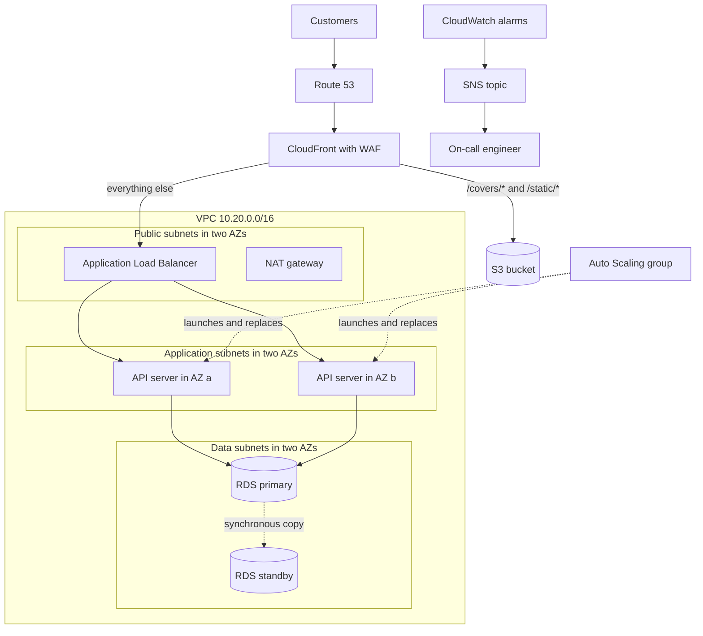
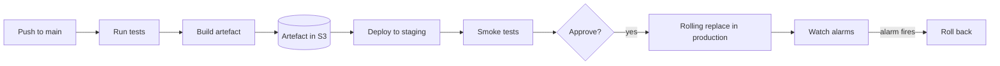

# Project part 2: load balancing, auto scaling, CloudFront, CI/CD and monitoring

## Before this lesson

Read [project part 1](#/lesson/aws/project-foundations) first: this lesson continues from its final diagram. It also leans on [Elastic Load Balancing](#/lesson/aws/load-balancing), [EC2 Auto Scaling](#/lesson/aws/auto-scaling), Multi-AZ databases ([RDS and Aurora](#/lesson/aws/rds-aurora)), [CloudFront](#/lesson/aws/cloudfront), alarms ([CloudWatch](#/lesson/aws/cloudwatch)), pipelines ([Systems Manager and the CodePipeline family](#/lesson/aws/ssm-codepipeline)) and templates ([CloudFormation and the CDK](#/lesson/aws/cloudformation-cdk)). Every term is defined again in a sentence where it first appears.

## In plain words

At the end of part 1 the food stall had become a small restaurant with a proper storeroom (S3), a safe for the takings (RDS) and a written recipe for setting up the kitchen (the bootstrap script). It still had one cook. If the cook is ill, the restaurant is closed; if a coach party arrives, the queue goes out of the door.

A restaurant that people rely on adds five things, and each has a direct AWS counterpart:

- a **host at the door** who sends each party to a cook who is free, and stops sending people to a cook who has collapsed: the **load balancer**;
- a **manager who phones extra cooks** when the room fills and sends them home when it empties: **Auto Scaling**;
- a **takeaway counter in every neighbourhood** holding the popular dishes ready, so most customers never come to the main kitchen: the **content delivery network**, CloudFront;
- a **routine for changing the menu** without closing: the **deployment pipeline**;
- **smoke alarms and a till report**: **monitoring** and **cost controls**.

Why this matters for a job: this layout (DNS, CDN, load balancer, stateless servers in several zones, a managed database with a standby, object storage) is the standard answer for a web application on AWS. You will build it, inherit it or be asked to draw it. Knowing why each box is there, what fails without it and what it costs is what separates an engineer from someone reciting a diagram.

## The target



Read it from the top, the way a request travels. **Route 53**, the DNS service, answers the name with CloudFront's address. **CloudFront** serves images and other static files from S3 through its cache, and forwards everything else to the load balancer. The **Application Load Balancer (ALB)** spreads requests over API servers in two Availability Zones (AZs). The servers read and write the **RDS** primary database, which keeps a standby in the other AZ. Around the edge, an **Auto Scaling group** keeps the right number of servers alive and **CloudWatch** watches everything.

## Step 1: one recipe for every server

Auto Scaling launches servers with nobody present, so the complete recipe for a server must be written down. That recipe is a **launch template**: the machine image, instance type, security group, IAM role and user-data script, stored as a versioned object.

There are two ways to get the application onto a new server:

| Approach | How | Boot to ready | Trade-off |
|---|---|---|---|
| **Bootstrap at launch** | A plain image; user data installs packages and downloads the release | Minutes | Simple, but slow to scale and dependent on package mirrors being reachable |
| **Baked image** | A pipeline builds an AMI (Amazon Machine Image) with everything installed; user data only fetches settings | Well under a minute | Faster and more predictable; needs an image-building step |

Shelf bakes the runtime and its libraries into an image with EC2 Image Builder, and lets user data fetch the current release and settings. Whichever you choose, the test is the same: **terminate a server on purpose and watch a correct one replace it** with no human action.

## Step 2: the load balancer

A **load balancer** is a managed front door that receives requests and passes each one to a healthy server. The ALB works at the level of HTTP, so it can read paths and headers, and it lives in the two public subnets so that it survives the loss of one zone.

The pieces:

- A **target group** is the list of servers that should receive traffic, plus the **health check** that decides which of them are fit: a small request the ALB sends to every server every few seconds.
- A **listener** is a port the ALB accepts connections on, with rules. Port 443 forwards to the target group; port 80 answers with a redirect to HTTPS.
- A **certificate** from **AWS Certificate Manager (ACM)** proves the site's identity for HTTPS. ACM certificates are free with AWS load balancers and CloudFront, and they renew themselves. The hand-managed certificate on the server from part 1 is retired.

```bash
aws elbv2 create-target-group --name shelf-api --protocol HTTP --port 8000 \
  --vpc-id vpc-0123456789abcdef0 --target-type instance \
  --health-check-path /healthz --health-check-interval-seconds 15 \
  --healthy-threshold-count 2 --unhealthy-threshold-count 3
aws elbv2 modify-target-group-attributes --target-group-arn "$TG" \
  --attributes Key=deregistration_delay.timeout_seconds,Value=30
```

The health check calls `/healthz` every 15 seconds; a server joins after two good answers and is removed after three bad ones, so a dead server stops receiving traffic within about 45 seconds. The **deregistration delay** is how long the ALB lets requests already in progress finish on a server that is being removed. The default is 300 seconds; Shelf's requests take milliseconds, so 30 seconds is plenty and makes deployments quicker.

Two design points that are easy to get wrong:

- **Keep the load balancer's health check shallow.** `/healthz` should answer "this process is up and able to serve". If it also queries the database, a ten-second database hiccup marks *every* server unhealthy at once, and the Auto Scaling group may start replacing a perfectly good fleet. Put the deeper check ("can I reach the database?") on a separate address used by alarms and dashboards.
- **Tighten the security groups.** The servers' group now accepts port 8000 only from the ALB's group, and the servers move to the private application subnets with no public addresses. The Elastic IP from part 1 is released.

The private servers still need to start outbound connections (to download releases and reach AWS APIs), so a **NAT gateway** goes into a public subnet and the application route tables send `0.0.0.0/0` to it. One NAT gateway is a single point of failure for outbound traffic if its zone fails; one per zone removes that risk and doubles the fee. Shelf starts with one, adds **VPC endpoints** (private doors to S3, Secrets Manager and Systems Manager) so that most traffic bypasses the NAT gateway anyway, and writes the trade-off down.

## Step 3: the Auto Scaling group

An **Auto Scaling group (ASG)** owns a set of identical servers. You give it a launch template, the subnets to use, and three numbers: **minimum**, **maximum** and **desired** capacity. It launches servers to reach the desired number, spreads them over the zones, registers them with the target group, and replaces any that fail.

```yaml
AppGroup:
  Type: AWS::AutoScaling::AutoScalingGroup
  Properties:
    VPCZoneIdentifier: [!Ref AppSubnetA, !Ref AppSubnetB]
    MinSize: "2"
    MaxSize: "6"
    HealthCheckType: ELB
    HealthCheckGracePeriod: 120
    TargetGroupARNs: [!Ref AppTargets]
    LaunchTemplate:
      LaunchTemplateId: !Ref AppTemplate
      Version: !GetAtt AppTemplate.LatestVersionNumber

CpuPolicy:
  Type: AWS::AutoScaling::ScalingPolicy
  Properties:
    AutoScalingGroupName: !Ref AppGroup
    PolicyType: TargetTrackingScaling
    TargetTrackingConfiguration:
      PredefinedMetricSpecification:
        PredefinedMetricType: ASGAverageCPUUtilization
      TargetValue: 50
```

This is a fragment of a CloudFormation template, the text file from which the whole environment is created. Reading it:

- `VPCZoneIdentifier` lists the two application subnets, one per zone.
- `MinSize: 2` is the availability floor: never fewer than one server per zone. `MaxSize: 6` is the cost ceiling.
- `HealthCheckType: ELB` makes the group trust the load balancer's verdict. Without it the group checks only that the virtual machine is running, and a server whose application has crashed stays in service for ever.
- `HealthCheckGracePeriod: 120` gives a new server two minutes to boot before failed checks count against it.
- The **target tracking** policy says "keep average CPU near 50 %". The group adds servers when the average is above the target and removes them, cautiously, when it is well below. It works like a thermostat: you state the temperature, not when to switch the heater.

### How many servers is "enough"?

The minimum is a reliability decision. If one zone disappears, the surviving servers must carry the full load immediately; new servers take minutes to arrive, and during a real zone failure everyone else is requesting capacity at the same moment. Sizing so that the survivors are already sufficient is called **static stability**.

```python-run
import math

def plan(peak_rps, rps_per_server, zones, survive_zone_loss):
    needed = math.ceil(peak_rps / rps_per_server)            # servers needed at peak
    if survive_zone_loss:
        per_zone = math.ceil(needed / (zones - 1))            # the remaining zones must carry the peak
    else:
        per_zone = math.ceil(needed / zones)
    total = per_zone * zones
    after_loss = per_zone * (zones - 1)
    return needed, per_zone, total, after_loss

peak, each = 900, 150
print(f"peak {peak} requests/s; one server handles {each} requests/s\n")
for zones in (2, 3):
    for survive in (False, True):
        needed, per_zone, total, after = plan(peak, each, zones, survive)
        ok = "yes" if after * each >= peak else "NO"
        spare = 100 * (total - needed) / needed
        print(f"{zones} AZs, sized for a zone loss: {str(survive):5s} -> {per_zone} per AZ, {total} total "
              f"({spare:3.0f}% spare)  peak served after losing an AZ: {ok}")
```

`plan` first works out how many servers the peak needs (six here). Without the zone-loss rule it divides them evenly, and losing a zone leaves too few. With the rule, the servers in the *remaining* zones must number six on their own. In two zones that means twelve servers, 100 % spare. In three zones it means nine, 50 % spare. That arithmetic is the practical argument for three zones once a fleet grows: the same protection for half the idle capacity. Shelf's peak fits on one server, so a minimum of two (one per zone) already satisfies the rule.

## Step 4: a database that survives a zone

```bash
aws rds modify-db-instance --db-instance-identifier shelf-db --multi-az --apply-immediately
```

**Multi-AZ** tells RDS to keep a **standby** copy of the database in the other zone and to copy every write to it before confirming the write (*synchronous replication*). If the primary or its zone fails, RDS promotes the standby and repoints the database's DNS name, typically within one to two minutes. The application reconnects to the same name. No data is lost, because every confirmed write was already on the standby.

Three details complete the picture:

- **The standby is for availability, not for speed.** In the classic two-instance arrangement it accepts no queries. To spread read traffic you add a **read replica**, a separate copy that lags slightly behind.
- **Multi-AZ does not protect against mistakes.** A mistaken `DELETE` is copied to the standby immediately. Protection against mistakes comes from automated backups and point-in-time restore, which were switched on in part 1.
- **Count the connections.** Each API server holds a pool of open database connections, say ten. Six servers hold sixty, and a small PostgreSQL instance accepts only around a hundred. When the fleet or the pool grows, put **RDS Proxy** in front: it shares a small set of database connections among many clients and also shortens the interruption during a failover.

## Step 5: CloudFront in front

**Amazon CloudFront** is a **content delivery network (CDN)**: hundreds of **edge locations** around the world that keep copies of your content close to users. A request goes to the nearest edge; if the edge holds a fresh copy (a *cache hit*), it answers at once without contacting your servers.

Shelf's distribution has two **origins** (the places CloudFront fetches from) and routes by path:

| Path pattern | Origin | Caching |
|---|---|---|
| `/covers/*`, `/static/*` | The S3 bucket, kept private with **origin access control** so that only this distribution can read it | Long: a year, with file names that change when content changes |
| `/api/catalogue/*` | The ALB | Short: 60 seconds; the same for every visitor |
| Everything else (`/api/orders`, logins) | The ALB | None; cookies and headers are forwarded |

The presigned URLs from part 1 are no longer needed for covers: browsers load `https://shelf.tidewaterbooks.example/covers/9780141439518.jpg` and CloudFront fetches from the private bucket on their behalf.

Three settings finish the job. The certificate for a CloudFront distribution must be requested from ACM in the `us-east-1` Region, whatever Region the rest of the system uses. The ALB's security group accepts traffic only from CloudFront's **managed prefix list** (an AWS-maintained list of CloudFront's addresses), so nobody can go around the CDN. And **AWS WAF**, a web application firewall, is attached to the distribution with AWS's managed rule groups and a rate limit per client address.

The effect on the servers is large:

```python-run
requests_per_day = 2_000_000
share_static = 0.80                    # covers, style sheets, scripts
static_kb, api_kb = 180, 4             # average response sizes

def origin_load(hit_static, hit_api):
    static = requests_per_day * share_static
    api = requests_per_day * (1 - share_static)
    to_origin = static * (1 - hit_static) + api * (1 - hit_api)
    gb = (static * (1 - hit_static) * static_kb + api * (1 - hit_api) * api_kb) / 1024**2
    return to_origin, gb

cases = (("no CDN", 0.0, 0.0),
         ("static files cached, 95% hits", 0.95, 0.0),
         ("plus catalogue API cached, 60% hits", 0.95, 0.60))
for label, hs, ha in cases:
    n, gb = origin_load(hs, ha)
    print(f"{label:38s} requests reaching AWS origins: {n:>9,.0f}/day   data from origins: {gb:6.1f} GB/day")
```

`origin_load` splits the day's requests into static and API, removes the share answered from the cache, and adds up what is left. With no CDN the origins see two million requests and about 276 GB a day. Caching static files alone removes roughly three quarters of the requests and 95 % of the bytes. The servers and the database now do only the work that needs them, which is why a CDN is usually the cheapest performance improvement available.

## Step 6: shipping changes safely

**Continuous integration and continuous delivery (CI/CD)** means that every change to the code is tested automatically and, if it passes, delivered to production by a repeatable, scripted process instead of by a person typing commands on a server.



An **artefact** is the packaged release: one file, built once, named after the commit that produced it, and never modified. The same artefact goes to a **staging** environment (a small copy of production) and then to production, so what was tested is exactly what ships.

The pipeline can be built with AWS's own tools (CodePipeline to orchestrate, CodeBuild to test and package, CodeDeploy to roll out) or with an external system. Shelf's code lives on GitHub, so it uses GitHub Actions:

```yaml
permissions:
  id-token: write        # let the job request a signed identity token
  contents: read
jobs:
  deploy:
    runs-on: ubuntu-latest
    steps:
      - uses: actions/checkout@v4
      - run: make test
      - uses: aws-actions/configure-aws-credentials@v4
        with:
          role-to-assume: arn:aws:iam::111122223333:role/shelf-deploy
          aws-region: ap-southeast-1
      - run: |
          tar czf "shelf-$GITHUB_SHA.tar.gz" app/
          aws s3 cp "shelf-$GITHUB_SHA.tar.gz" s3://tidewater-shelf-artifacts-111122223333/
          aws ssm put-parameter --name /shelf/release --value "$GITHUB_SHA" --type String --overwrite
          aws autoscaling start-instance-refresh --auto-scaling-group-name shelf-app \
            --preferences '{"MinHealthyPercentage": 100, "MaxHealthyPercentage": 150, "InstanceWarmup": 120}'
```

The important line is `role-to-assume`. No AWS access key is stored in GitHub. The job presents a short-lived token signed by GitHub (**OpenID Connect**, OIDC), and the role's trust policy accepts tokens only from this repository's `main` branch. The role may write to the artefact bucket, set one parameter and start a refresh of one Auto Scaling group; nothing else.

The last command starts an **instance refresh**: the ASG replaces its servers in batches with new ones, which read the `/shelf/release` parameter at boot and download that artefact. `MinHealthyPercentage: 100` with `MaxHealthyPercentage: 150` means "launch new servers first, up to half as many again, and remove old ones only when the new ones pass their health checks", so capacity never dips.

The demo shows what the simpler setting, a minimum healthy percentage on its own, does to capacity while servers are being replaced.

```python-run
import math

def rolling(fleet, min_healthy_pct, minutes_per_batch=4):
    must_stay = math.ceil(fleet * min_healthy_pct / 100)
    batch = max(1, fleet - must_stay)
    old, new, t = fleet, 0, 0
    print(f"fleet of {fleet}, minimum healthy {min_healthy_pct}% -> replace {batch} at a time")
    while old > 0:
        step = min(batch, old)
        old -= step
        print(f"  t={t:3d} min  serving: {old} old + {new} new = {old + new}  (replacing {step})")
        t += minutes_per_batch
        new += step
    print(f"  t={t:3d} min  serving: {new} new, finished\n")

rolling(4, 50)
rolling(4, 75)
rolling(10, 90)
```

`must_stay` is the number of servers that have to keep serving; the rest can be taken out at once. A fleet of four at 50 % is replaced in two batches of two and finishes in 8 minutes, but runs at half capacity throughout. At 75 % it takes four batches and 16 minutes with three quarters of capacity. Deployment speed and capacity during deployment pull against each other, and launching replacements *before* removing old servers is how you get both.

Two more rules make releases reversible:

- **Old and new code run side by side during every rollout**, so each release must work with the previous database schema. Change the schema in an *expand* step (add the new column, keep the old), ship the code, and remove the old column in a later *contract* step.
- **Roll back by redeploying the previous artefact**, not by repairing servers by hand. Instance refresh and CodeDeploy can both stop and reverse automatically when a CloudWatch alarm fires during the rollout.

Other rollout styles exist: **blue/green** builds a complete second fleet and switches traffic to it in one move, and **canary** sends a small share of traffic to the new version first. Both cost more for a short time and limit the damage a bad release can do.

## Step 7: knowing when it breaks

Monitoring answers three questions: is it working, how will I know when it stops, and what do I look at to find out why? Four measurements describe any request-serving system, often called the **golden signals**: **latency** (how long requests take), **traffic** (how many there are), **errors** (how many fail) and **saturation** (how full the resources are).

A **CloudWatch alarm** watches one metric and changes state when the metric crosses a threshold for a set number of periods. Shelf's starting set:

| Signal | Metric | Alarm when | Likely meaning |
|---|---|---|---|
| Errors | ALB `HTTPCode_Target_5XX_Count` as a share of `RequestCount` | Above 1 % for 5 minutes | Application bug or a failing dependency |
| Latency | ALB `TargetResponseTime`, 99th percentile | Above 1 second for 10 minutes | Slow queries, overloaded servers |
| Availability | ALB `UnHealthyHostCount` | Above 0 for 5 minutes | Servers failing health checks |
| Capacity | ASG in-service instances equal to the maximum | For 15 minutes | The ceiling is too low or something is looping |
| Database | RDS `CPUUtilization` | Above 80 % for 15 minutes | Missing index, undersized instance |
| Database | RDS `FreeStorageSpace` | Below 20 % | Disk filling; the database stops when it reaches zero |
| Database | RDS `DatabaseConnections` | Above 80 % of the limit | Pool too large or connection leak |
| Outside view | CloudWatch Synthetics canary on the home page and one API call | Two consecutive failures | The site is down from a customer's point of view |
| Money | AWS Budgets forecast | Above the monthly budget | Something is running that should not be |

Each alarm publishes to an **SNS topic**, a named channel that fans the message out to email, chat and the on-call phone. Alarm on what customers feel (errors, latency, the outside view) and page a person for those. Keep causes (CPU, memory) as lower-urgency warnings and as graphs on a **dashboard**, where they help diagnosis.

Logs complete the set. The servers write one line of **structured** text per request (a JSON object with the path, status, duration and a request identifier) and the CloudWatch agent ships it to a **log group** with a 30-day retention period. The ALB and CloudFront write access logs to S3. With a request identifier passed from CloudFront through the ALB to the application, one customer complaint can be traced through every layer.

## Step 8: what happens when things fail

A design is only as good as its answers to "what if". Walk the diagram and break each box:

| Failure | What happens automatically | Customer impact |
|---|---|---|
| One API server crashes | Health check fails; ALB stops routing to it within 45 seconds; ASG replaces it | A few failed requests, then none |
| A whole AZ fails | ALB uses the other zone; ASG launches replacements there; RDS promotes the standby if the primary was in the lost zone | Up to two minutes of database errors at worst |
| The database primary fails | Standby promoted, DNS name repointed | One to two minutes of errors on writes and uncached reads |
| A bad release | Alarms fire during the rollout; the refresh stops and reverses | A share of requests fail for a few minutes |
| Traffic rises fivefold | CloudFront absorbs static load; target tracking adds servers up to the maximum | Slower responses for a few minutes |
| Someone deletes cover images | S3 versioning keeps the previous versions | None after a restore |
| Someone drops a table | Point-in-time restore to the minute before | Data since the restore point must be reconciled |
| The entire Region fails | Nothing automatic in this design | Outage until the Region returns |

The last row is a deliberate decision, not an oversight. Surviving a Region failure needs a second Region with replicated data, and the [reliability lesson](#/lesson/aws/reliability-dr) explains the options and their price. For a bookshop, backups copied to a second Region and a tested rebuild from the CloudFormation template are a sensible stopping point.

## Cost notes and free-tier warnings

Rounded monthly on-demand figures for the finished design, to show proportions:

| Item | Rough monthly cost (USD) |
|---|---|
| Two `t4g.small` API servers with disks | 34 |
| Application Load Balancer, low traffic | 20 |
| One NAT gateway, before data charges | 43 |
| RDS `db.t4g.micro` Multi-AZ with storage | 38 |
| CloudFront, S3, Route 53 zone, certificates | Under 5 at this size |
| WAF web ACL with a few rules | 8 |
| Secrets, alarms, logs, canary | 10 |
| **Total** | **about 155** |

- This is about thirteen times the Lightsail bundle from stage 0, and most of it is redundancy and fixed fees, not compute. That is the honest price of "survives a zone failure and deploys without downtime".
- **The NAT gateway is the surprise**: an hourly fee plus a charge for every gigabyte through it. Gateway endpoints for S3 are free; interface endpoints have an hourly fee each, so add them where they replace enough NAT traffic.
- **Load balancers, NAT gateways and Multi-AZ databases bill while idle.** A forgotten staging copy of this environment costs almost as much as production. Give staging a schedule that scales it to zero outside working hours, and delete experiments with the template that created them.
- Levers once the system is steady: a **Compute Savings Plan** for the two always-on servers, **Graviton** (Arm) instance types as used here, a scheduled lower minimum at night if the traffic allows, short log retention, and long cache lifetimes.
- CloudFront has an always-free monthly allowance of requests and data transfer that covers a site of this size.
- Credits on a new account's free plan will not last long with a NAT gateway, a load balancer and a Multi-AZ database running. Build it, study it, and tear it down the same day.

## Pitfalls

- **A deep health check on the load balancer**, so that one database blip removes every server.
- **`HealthCheckType` left at the default**, so crashed applications stay in service.
- **Minimum capacity of one.** The site then has a single server whenever traffic is low.
- **Servers that take ten minutes to become ready**, which makes scaling and deployments useless in a hurry.
- **State left on the servers**: local sessions, files in `/tmp` that another request expects, a scheduled job that runs on every server.
- **The ALB reachable directly from the internet**, bypassing CloudFront and WAF.
- **Requesting the CloudFront certificate in the wrong Region.**
- **Long-lived access keys in the CI system** instead of an OIDC role.
- **Schema changes that break the previous release**, which makes rollback impossible.
- **Alarms on everything**, so that the team learns to ignore them, or alarms that notify nobody.
- **Treating Multi-AZ as a backup.**
- **Building it all by hand in the console**, so that nobody can rebuild it or create a matching staging environment.

> [!INTERVIEW]
> **"Draw a highly available web application on AWS and explain each component."** Route 53 resolves the name to CloudFront, which caches static content from a private S3 bucket and forwards dynamic requests to an Application Load Balancer in public subnets across at least two AZs. The ALB health-checks stateless application servers in private subnets, managed by an Auto Scaling group with a minimum that survives a zone loss and a target-tracking policy. The database is RDS Multi-AZ in isolated subnets, with automated backups; sessions and files live in shared services. Security groups chain from load balancer to application to database, servers use IAM roles, and CloudWatch alarms on errors, latency and unhealthy hosts notify the on-call engineer. Then state what it does not cover: a Region failure.
>
> **"How do you deploy without downtime?"** Build one immutable artefact, test it in staging, then replace servers gradually behind the load balancer, launching new ones before removing old ones, with connection draining and health checks gating each batch. Keep schema changes backward compatible so that two versions can run together, watch error and latency alarms during the rollout, and roll back automatically by redeploying the previous artefact.

## Cheat sheet

| Need | Choice in this project |
|---|---|
| One address, many servers, failed ones skipped | Application Load Balancer with a shallow health check |
| HTTPS certificates without renewal chores | ACM (in `us-east-1` for CloudFront) |
| Self-healing fleet across zones | Auto Scaling group, minimum 2, `HealthCheckType: ELB` |
| Follow demand | Target tracking on CPU or requests per target |
| Survive a zone loss without waiting | Size the minimum for static stability |
| Database failover | RDS Multi-AZ |
| Many clients, few database connections | RDS Proxy |
| Fast static content, less origin load | CloudFront with a private S3 origin |
| Block common web attacks and floods | AWS WAF on the distribution |
| Outbound access for private servers | NAT gateway, reduced by VPC endpoints |
| Deploy from CI without stored keys | OIDC role |
| Replace servers gradually | Instance refresh, or CodeDeploy rolling or blue/green |
| Know it is down before customers say so | Alarms on errors, latency, unhealthy hosts; a synthetic canary |
| Rebuild or copy the environment | CloudFormation or CDK |

## Summary

- A launch template is the recipe; an Auto Scaling group keeps the right number of servers cooked from it, across zones, and replaces failures.
- The load balancer gives one stable entry point, health-checks servers and terminates HTTPS with a managed certificate.
- Multi-AZ gives the database a synchronous standby and automatic failover; backups still guard against mistakes.
- CloudFront moves static content to the edge, shields the origin and is the natural place for WAF.
- A pipeline builds one artefact, deploys it by replacing servers gradually, and rolls back on alarms.
- Monitoring starts from what customers feel: errors, latency and reachability, with a person notified.
- The finished design costs an order of magnitude more than one small server; each added component should be justified by a failure it removes.

## Glossary

- **Artefact**: the packaged, immutable output of a build.
- **Blue/green deployment**: releasing by building a second fleet and switching traffic to it.
- **Canary (deployment)**: sending a small share of traffic to a new version first.
- **Canary (synthetic)**: a scheduled script that calls the site from outside and reports failures.
- **Deregistration delay**: time allowed for in-flight requests to finish on a server being removed.
- **Expand and contract**: changing a database schema in backward-compatible steps.
- **Golden signals**: latency, traffic, errors and saturation.
- **Health check**: a periodic request used to decide whether a server should receive traffic.
- **Instance refresh**: an Auto Scaling feature that replaces servers in batches.
- **Launch template**: the stored recipe for launching a server.
- **Managed prefix list**: an AWS-maintained list of address ranges usable in security group rules.
- **OIDC role**: an IAM role assumed with a short-lived token from an external identity provider.
- **Origin**: the source from which a CDN fetches content.
- **Staging**: a production-like environment for final testing.
- **Static stability**: having enough capacity already running to absorb a failure without scaling.
- **Target group**: the set of servers behind a load balancer listener, with their health check.
- **Target tracking**: a scaling policy that holds a metric near a chosen value.

```quiz
[
  {"q": "An Auto Scaling group uses the default EC2 health check. The application process on one server crashes while the virtual machine keeps running. What happens?",
   "options": ["The group replaces the server at once", "Traffic is still sent to it for ever", "The load balancer stops sending it traffic, but the group keeps the broken server because the machine itself looks healthy", "The whole group restarts"],
   "answer": 2,
   "explain": "The ALB's health check removes it from rotation, but only HealthCheckType: ELB makes the group act on that verdict and launch a replacement."},
  {"q": "Peak load needs six servers and the fleet spans three AZs. How many servers give static stability against the loss of one AZ?",
   "options": ["9", "6", "8", "12"],
   "answer": 0,
   "explain": "The two surviving zones must hold six servers between them, so three per zone and nine in total. With two zones the answer would be twelve."},
  {"q": "Why should the load balancer's health check not query the database?",
   "options": ["Health checks cannot use TCP", "It makes the check too fast", "The database charges per health check", "A brief database problem would mark every server unhealthy at once and could trigger replacement of the whole fleet"],
   "answer": 3,
   "explain": "A shared dependency failing makes all targets fail together. Keep the routing check shallow and monitor the dependency separately."},
  {"q": "A developer runs a DELETE without a WHERE clause on a Multi-AZ RDS database. Which feature recovers the data?",
   "options": ["The Multi-AZ standby", "Point-in-time restore from automated backups", "The read replica", "The load balancer"],
   "answer": 1,
   "explain": "The standby and replicas receive the deletion too. Automated backups with transaction logs allow a restore to the moment before the mistake."},
  {"q": "Where must the ACM certificate for a CloudFront distribution be requested?",
   "options": ["In us-east-1", "In the Region of the origin", "In any Region", "In the Region nearest to most users"],
   "answer": 0,
   "explain": "CloudFront is a global service that reads certificates from us-east-1. A certificate for the ALB is requested in the ALB's own Region."},
  {"q": "A GitHub Actions workflow deploys to AWS. Which approach avoids storing long-lived AWS credentials in GitHub?",
   "options": ["An IAM user's access key in repository secrets", "The root user's key", "An IAM role assumed through OpenID Connect, trusted only for that repository and branch", "Emailing the artefact to an administrator"],
   "answer": 2,
   "explain": "With OIDC the job exchanges a short-lived signed token for temporary role credentials. Nothing permanent exists to leak."},
  {"q": "During a rolling deployment, old and new versions serve traffic at the same time. What does this require of database changes?",
   "options": ["None; the database is unaffected", "The database must be stopped during deployment", "Every table must be duplicated", "Each release must work with the previous schema, so changes are made in backward-compatible expand and contract steps"],
   "answer": 3,
   "explain": "If a release needs a schema the old code cannot use, the old servers fail mid-rollout and rollback becomes impossible."},
  {"q": "Which item in the finished design often surprises teams on the bill?",
   "options": ["The Route 53 hosted zone", "The NAT gateway's hourly fee and per-gigabyte processing charge", "ACM certificates", "The security groups"],
   "answer": 1,
   "explain": "A NAT gateway bills for every hour and every gigabyte. Gateway endpoints for S3 and fewer downloads at boot reduce it; certificates and security groups are free."}
]
```

> **Source:** AWS Certified Solutions Architect Official Study Guide, ch. 5 (Elastic Load Balancing, Amazon CloudWatch, Auto Scaling), ch. 7 (Amazon RDS Multi-AZ), ch. 11 (Amazon CloudFront, AWS CloudFormation) and ch. 14 (architecture best practices: design for failure, implement elasticity). Application Load Balancers, target tracking, instance refresh, ACM, WAF managed rules, origin access control and OIDC federation for CI post-date the book; checked against https://docs.aws.amazon.com/elasticloadbalancing/latest/application/target-group-health-checks.html , https://docs.aws.amazon.com/autoscaling/ec2/userguide/asg-instance-refresh.html , https://docs.aws.amazon.com/autoscaling/ec2/userguide/as-scaling-target-tracking.html , https://docs.aws.amazon.com/AmazonRDS/latest/UserGuide/Concepts.MultiAZ.html , https://docs.aws.amazon.com/AmazonCloudFront/latest/DeveloperGuide/private-content-restricting-access-to-s3.html , https://docs.aws.amazon.com/acm/latest/userguide/acm-regions.html and https://docs.aws.amazon.com/IAM/latest/UserGuide/id_roles_providers_create_oidc.html
