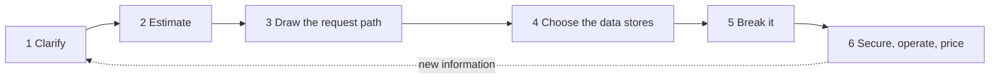
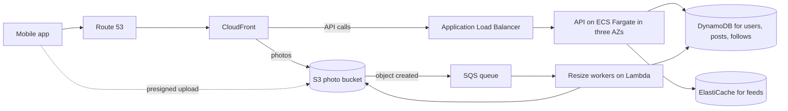
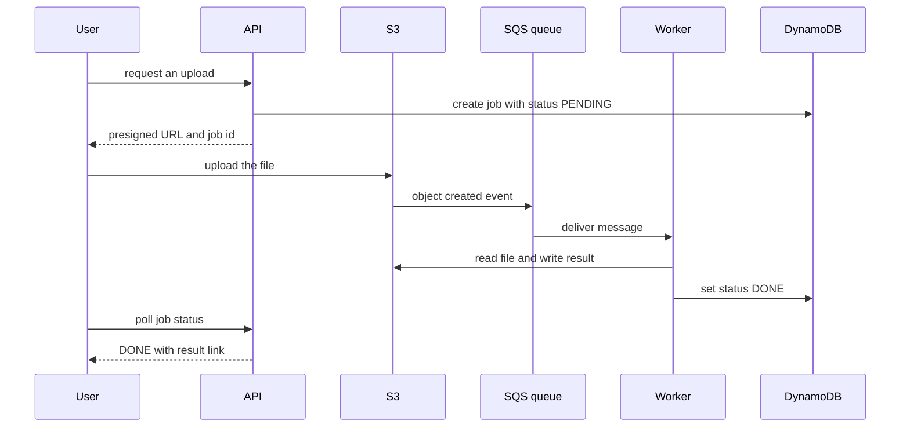

# Answering "design X on AWS" and the classic comparisons

## Before this lesson

This lesson is a review that turns the track into spoken answers, so it assumes you have worked through the service modules, and above all the worked project ([part 1](#/lesson/aws/project-foundations), [part 2](#/lesson/aws/project-scale)) and the Well-Architected lessons ([reliability](#/lesson/aws/reliability-dr), [performance and cost](#/lesson/aws/performance-cost)). Each comparison links back to the lesson that teaches it in full. If a service name here is unfamiliar, follow the link before memorising the one-line answer.

## In plain words

An architect meeting a new client does not start by drawing a house. The first half hour is questions: how many people will live here, what is the budget, is the land flat, does anyone work from home? Only then does a sketch appear, and the architect explains it room by room, including what was left out to stay within budget.

A cloud design interview is that meeting. The interviewer says "design a photo-sharing service on AWS" and then watches *how you get to* a diagram. Jumping straight to a list of services is the most common way to fail, because it shows you matching keywords instead of solving a problem. The second kind of question, "what is the difference between X and Y?", tests whether you know when each service is the right tool.

This lesson gives you a repeatable method for the first kind, two fully worked answers, a table of model answers for the second kind, and the troubleshooting questions that backend and cloud interviewers like to ask.

Why it matters for a job: Singapore's banks, marketplaces, logistics firms and technology companies run heavily on AWS, and cloud, backend, data and site-reliability interviews all include some form of these questions. The same method is what you will use at work when someone asks for a design document.

## A six-step method



**1. Clarify (two or three minutes).** Ask what the system must do (*functional requirements*) and how well (*non-functional requirements*: scale, speed, availability, data sensitivity, budget). Good questions: Who are the users and where are they? How many per day? Read-heavy or write-heavy? How large is each item? How fresh must data be? What happens to the business if it is down for an hour? Is there a compliance rule about where data lives? Say your assumptions aloud when the interviewer leaves a gap.

**2. Estimate.** Turn the answers into three or four round numbers: requests per second at peak, storage per year, data sent to users per month. The numbers decide the design. Fifty requests a second and fifty thousand are different architectures.

**3. Draw the request path.** Follow one request from the user's device to the data and back, left to right: DNS, edge, load balancer or API front door, compute, data. Name a concrete AWS service for each box and say in one clause why that one.

**4. Choose the data stores.** State what data exists, how it is read and written, and which store fits each kind. Most designs need more than one: a database for records, object storage for files, a cache for hot reads, a queue between fast and slow parts.

**5. Break it.** Go box by box and ask "what happens when this fails?" and "what happens at ten times the load?". Add redundancy or a buffer where the answer is "the system stops".

**6. Secure, operate, price.** Who may call what (IAM roles, security groups, encryption)? How will you know it is unhealthy (metrics, alarms, logs)? How is it deployed? What are the two or three largest items on the bill, and what would you change if the budget halved?

Then close with **trade-offs**: what you chose not to build and when you would revisit it. Interviewers score this highly, because every real design is a set of compromises.

### Step 2 in practice

A day has 86,400 seconds; round it to 100,000 for mental arithmetic. One million requests a day is therefore about 10 a second on average. Peaks are usually two to five times the average.

```python-run
def estimate(daily_users, requests_per_user, peak_factor, write_share, response_kb, stored_kb_per_write):
    per_day = daily_users * requests_per_user
    avg_rps = per_day / 86_400
    peak_rps = avg_rps * peak_factor
    writes_per_day = per_day * write_share
    storage_tb_year = writes_per_day * stored_kb_per_write * 365 / 1024**3
    egress_tb_month = per_day * response_kb * 30 / 1024**3
    print(f"  requests per day        {per_day:>14,.0f}")
    print(f"  average / peak per sec  {avg_rps:>8,.0f} / {peak_rps:,.0f}")
    print(f"  writes per day          {writes_per_day:>14,.0f}")
    print(f"  new storage per year    {storage_tb_year:>12,.1f} TB")
    print(f"  data sent to users      {egress_tb_month:>12,.1f} TB per month")

print("Photo sharing: 1 million daily users, 40 requests each, 5% are uploads of 2 MB photos")
estimate(1_000_000, 40, peak_factor=4, write_share=0.05, response_kb=300, stored_kb_per_write=2_048)
print("\nInternal reporting tool: 2,000 daily users, 50 requests each, 10% writes of 2 KB rows")
estimate(2_000, 50, peak_factor=3, write_share=0.10, response_kb=20, stored_kb_per_write=2)
```

The function multiplies users by requests to get the daily total, divides by the seconds in a day for the average rate, and applies a peak factor. Storage is writes per day times the size of each stored item times 365; data sent is requests times response size times 30. The photo service comes out at roughly 460 requests a second on average, 1,900 at peak, about 1.4 petabytes of new photos a year and hundreds of terabytes a month sent to users. Those last two numbers tell you the design is dominated by **object storage and a CDN**, not by servers. The reporting tool peaks at about three requests a second and stores a few gigabytes a year (the table rounds that to 0.0 TB): one small managed database and a pair of small servers are enough, and anything more is over-engineering. Saying that aloud is a strong answer.

## Worked answer 1: a photo-sharing service

**Clarify.** One million daily users, mostly in South-East Asia. Users upload photos, follow others and scroll a feed. Reads far outnumber writes. A feed may be a few seconds stale. Photos must never be lost. Target availability 99.9 %.

**Estimate.** From the demo: about 2,000 requests a second at peak, 4 TB of new photos a day.

**Request path and data stores.**



Say it as a story:

- "Photos are large and never change, so they live in **S3** and are served through **CloudFront**. The app uploads straight to S3 with a **presigned URL**, so photo bytes never pass through my servers."
- "The API is stateless and runs on **Fargate** behind an **ALB** across three zones, scaling on request count. I chose containers over Lambda because traffic is steady and high; I would choose Lambda for a spiky, low-volume API."
- "Posts, follows and user profiles are read by key at high volume with a simple access pattern, so **DynamoDB** with on-demand capacity fits. If the product needed complex joins and reporting I would use Aurora instead and say why."
- "Feeds are read constantly and are expensive to compute, so each user's feed is cached in **ElastiCache** and refreshed when someone they follow posts."
- "Creating thumbnails is slow and can be retried, so an **S3 event** puts a message on an **SQS** queue and **Lambda** workers resize in the background. A dead-letter queue catches images that repeatedly fail."

**Break it.** A zone fails: the ALB and Fargate tasks continue in the other two; DynamoDB and S3 are regional services that already span zones. The cache node fails: the API falls back to computing the feed, more slowly, so I run a replica. Upload spike: the queue absorbs it and workers scale with queue depth. Region failure: S3 Cross-Region Replication and DynamoDB global tables are the next step if the business needs it.

**Secure, operate, price.** Buckets private behind origin access control; task roles with least privilege; encryption at rest by default and TLS in transit; WAF on CloudFront. Alarms on error rate, latency, queue age and throttled DynamoDB requests. Largest costs: S3 storage and data transfer out, so lifecycle rules move old originals to a colder class and CloudFront caches aggressively.

**Trade-offs.** "I accepted eventual consistency in feeds for speed. I did not build multi-Region. I would revisit the feed design if a single account gained millions of followers."

## Worked answer 2: process uploaded files in the background

The question arrives in many costumes: "users upload videos to be transcoded", "customers upload spreadsheets to import", "generate a monthly report on request". The shape is always the same: **accept quickly, work slowly, report back**.



The points to make:

- The API answers in milliseconds with a job identifier. It never holds a connection open while work happens, so API Gateway's or the load balancer's time limits do not matter.
- The **queue decouples** the upload rate from the processing rate. If a thousand files arrive at once, nothing is rejected; they wait.
- Workers are **Lambda** if a job fits within 15 minutes and its memory limit, **Fargate** or **AWS Batch** if not. They scale on the number of waiting messages.
- SQS delivers **at least once**, so a job may run twice. Workers must be **idempotent**: running the same job again gives the same result. Recording the job state in DynamoDB with a conditional write is the usual guard.
- The queue's **visibility timeout** (how long a message is hidden while one worker handles it) must exceed the processing time, or a second worker will pick up the same message mid-job.
- After a set number of failed attempts the message moves to a **dead-letter queue** with an alarm on it, so one poisonous file does not block the rest.
- For multi-step work (validate, transcode, notify), **Step Functions** orchestrates the steps with retries and a visible history.

Why a queue smooths a spike:

```python-run
def simulate(arrivals_per_sec, workers, jobs_per_worker_per_sec, seconds):
    backlog, peak_backlog, peak_at = 0, 0, 0
    drained_at = None
    capacity = workers * jobs_per_worker_per_sec
    for t in range(seconds):
        backlog += arrivals_per_sec(t)
        backlog -= min(backlog, capacity)
        if backlog > peak_backlog:
            peak_backlog, peak_at = backlog, t
        if backlog == 0 and peak_backlog and drained_at is None:
            drained_at = t
    return capacity, peak_backlog, peak_at, drained_at

spike = lambda t: 500 if 60 <= t < 120 else 40        # one minute at 500 jobs/s, otherwise 40 jobs/s

for workers in (5, 10, 50):
    cap, peak, at, drained = simulate(spike, workers, jobs_per_worker_per_sec=10, seconds=3600)
    if peak == 0:
        print(f"{workers:3d} workers ({cap:3d} jobs/s): no backlog at any time")
        continue
    wait = peak / cap                                    # time for the last job in the spike to reach a worker
    print(f"{workers:3d} workers ({cap:3d} jobs/s): largest backlog {peak:6,d} at t={at}s, "
          f"longest wait about {wait:4.0f}s, queue empty again at t={drained}s")
```

Each second, new jobs join the backlog and the workers remove up to their combined capacity. With 5 workers (50 jobs a second) the one-minute spike builds a backlog of 27,000 jobs that takes about three quarters of an hour to clear, yet no job is lost and nothing returned an error. With 10 workers the backlog is gone in under seven minutes. With 50 workers there is no backlog at all, at ten times the cost of the first option. The queue lets you choose a point between those two, and auto scaling on queue depth moves along that line by itself.

## The classic comparisons

For each pair, the interviewer wants one sentence on the difference and one on when to choose which. The table gives a model answer; the linked lesson has the detail.

### Networking

| Question | Model answer |
|---|---|
| **Security group or network ACL?** ([lesson](#/lesson/aws/vpc-firewalls)) | A security group is a stateful firewall on a resource's network interface with allow rules only; replies are permitted automatically. A network ACL is a stateless filter on a subnet with numbered allow and deny rules, so return traffic needs its own rule. Use security groups for nearly everything and ACLs for a coarse subnet-wide block, such as denying one address range. |
| **Internet gateway, NAT gateway or VPC endpoint?** ([lesson](#/lesson/aws/vpc-basics)) | An internet gateway gives resources with public addresses two-way internet access. A NAT gateway lets private resources start outbound connections only. A VPC endpoint reaches an AWS service privately without either: gateway endpoints (S3, DynamoDB) are free route-table entries; interface endpoints are private network interfaces billed by the hour. |
| **ALB or NLB?** ([lesson](#/lesson/aws/load-balancing)) | An Application Load Balancer understands HTTP: it routes by path, host or header and suits web applications and APIs. A Network Load Balancer forwards TCP and UDP connections at very high volume with a fixed address per zone and suits non-HTTP protocols, extreme throughput or clients that need a fixed address to allow-list. |
| **Peering or Transit Gateway?** ([lesson](#/lesson/aws/vpc-connectivity)) | Peering links two VPCs directly and does not pass traffic onward, fine for a handful. A Transit Gateway is a hub that many VPCs and on-premises links attach to, with central routing. |
| **VPN or Direct Connect?** | A Site-to-Site VPN is an encrypted tunnel over the internet, ready in minutes with variable latency. Direct Connect is a dedicated private circuit with consistent performance that takes weeks to install and is not encrypted unless you add a VPN or MACsec on top. Many firms use Direct Connect with a VPN as backup. |
| **CloudFront or Global Accelerator?** ([lesson](#/lesson/aws/cloudfront)) | CloudFront caches HTTP content at edge locations. Global Accelerator gives two fixed anycast addresses and carries TCP or UDP traffic over the AWS network to the nearest healthy Region, with no caching. Choose it for non-HTTP protocols, fixed addresses or fast regional failover. |

### Compute and storage

| Question | Model answer |
|---|---|
| **EC2, containers or Lambda?** ([lesson](#/lesson/aws/lambda-apigw)) | Lambda runs short functions on events with nothing to manage and no charge when idle, limited to 15 minutes per run. Fargate runs containers without servers, for long-running or steady services. EC2 gives full control of the machine for special hardware, licences or the lowest unit cost at steady high load. |
| **ECS or EKS?** ([lesson](#/lesson/aws/containers)) | ECS is AWS's own container orchestrator: simpler and closely integrated. EKS is managed Kubernetes: choose it for portability or an existing Kubernetes skill set and tooling. |
| **EBS, EFS, S3 or instance store?** ([lesson](#/lesson/aws/file-storage)) | EBS is a network disk for one instance in one zone: boot volumes and databases. EFS is a shared file system that many instances across zones mount at once. S3 is object storage reached over HTTPS, effectively unlimited and the cheapest per gigabyte. Instance store is fast local disk that is lost when the instance stops: scratch space and caches only. |
| **Scale up or scale out?** | Scaling up means a larger machine: easy, with a ceiling and a restart. Scaling out means more machines behind a load balancer: needs stateless design, has no practical ceiling and adds fault tolerance. |
| **On-Demand, Savings Plans or Spot?** ([lesson](#/lesson/aws/ec2-purchasing)) | On-Demand for unpredictable or short-lived use. Savings Plans or Reserved Instances for the steady baseline, in return for a one- or three-year commitment. Spot for interruptible work such as batch jobs, at a deep discount with a two-minute warning before reclaim. |

### Data

| Question | Model answer |
|---|---|
| **RDS, Aurora or DynamoDB?** ([lessons](#/lesson/aws/rds-aurora)) | RDS runs standard relational engines for workloads that need SQL, joins and transactions. Aurora is AWS's MySQL- and PostgreSQL-compatible engine with storage replicated across three zones, faster failover and up to 15 replicas. DynamoDB is a key-value store with single-digit-millisecond access at any scale, when access patterns are known and simple. |
| **Multi-AZ or read replica?** | Multi-AZ keeps a synchronous standby for automatic failover: it is for availability. A read replica is an asynchronous copy that serves queries: it is for read scaling and can be promoted by hand. They solve different problems and are often used together. |
| **ElastiCache or DAX?** ([lesson](#/lesson/aws/cache-warehouse)) | ElastiCache is a general in-memory cache or data store that the application calls explicitly. DAX is a cache built specifically for DynamoDB that needs almost no code change. |
| **Redshift or Athena?** ([lesson](#/lesson/aws/data-lakes)) | Redshift is a data warehouse for frequent, complex analytics with consistent speed. Athena runs SQL directly on files in S3 and charges per query: best for occasional questions. |
| **S3 storage classes?** ([lesson](#/lesson/aws/s3-basics)) | Standard for active data; Standard-IA or One Zone-IA for data read rarely but needed at once; Intelligent-Tiering when the pattern is unknown; the Glacier classes for archives, from millisecond retrieval down to hours at the lowest price. |

### Integration

| Question | Model answer |
|---|---|
| **SQS, SNS, EventBridge or Kinesis?** ([lessons](#/lesson/aws/messaging)) | SQS is a queue: each message is handled by one worker and then deleted; use it to buffer work. SNS is publish and subscribe: each message is pushed to every subscriber; use it to fan out. EventBridge is an event bus that routes events to targets by rules on their content, including events from AWS services and schedules. Kinesis Data Streams keeps an ordered, replayable record that several consumers read independently; use it for high-volume streams and analytics. |
| **Standard or FIFO queue?** | Standard queues have nearly unlimited throughput, deliver at least once and may reorder. FIFO queues keep order within a message group and remove duplicates within a five-minute window, at lower throughput. |
| **Step Functions or a queue?** ([lesson](#/lesson/aws/streams-workflows)) | A queue hands one task to one worker. Step Functions coordinates many steps with branching, retries, waits and a visible execution history. |

### Security and operations

| Question | Model answer |
|---|---|
| **IAM user or role?** ([lesson](#/lesson/aws/iam-identities)) | A user is a long-lived identity with a password or access keys. A role has no credentials of its own and is assumed for a limited time. People sign in through IAM Identity Center and assume roles; workloads always use roles. |
| **Identity policy, resource policy, SCP?** ([lesson](#/lesson/aws/iam-evaluation)) | An identity policy says what a principal may do. A resource policy says who may use a resource and can grant access across accounts. A service control policy sets the outer limit for whole accounts in an organisation and grants nothing by itself. An explicit deny anywhere wins. |
| **KMS, Secrets Manager or Parameter Store?** ([lesson](#/lesson/aws/security-services)) | KMS manages encryption keys and performs cryptographic operations. Secrets Manager stores secrets such as database passwords and rotates them. Parameter Store holds configuration values and simple secrets at little or no cost, without built-in rotation. |
| **CloudWatch, CloudTrail or Config?** ([lesson](#/lesson/aws/cloudwatch)) | CloudWatch answers "how is it performing?" with metrics, logs and alarms. CloudTrail answers "who did what, and when?" by recording API calls. Config answers "what does my configuration look like, how has it changed, and does it comply with my rules?". |
| **Shield, WAF or GuardDuty?** | Shield absorbs denial-of-service floods at the network and transport layers. WAF filters HTTP requests by rules, such as injection patterns and rate limits. GuardDuty analyses logs to detect suspicious behaviour inside the account. |
| **High availability, fault tolerance or disaster recovery?** ([lesson](#/lesson/aws/reliability-dr)) | High availability keeps downtime short through redundancy and quick failover. Fault tolerance means no visible interruption at all, at higher cost. Disaster recovery is the plan and the copies for restoring service after a large-scale failure, measured by RTO (how long until service returns) and RPO (how much recent data may be lost). |

### The rules as code

Writing a decision down as code forces it to be precise. Edit the requirements and rerun.

```python-run
def pick_data_store(n):
    if n.get("files"):
        return "S3", "objects reached over HTTPS; add CloudFront if users download them"
    if n.get("analytics"):
        if n.get("queries_per_day", 0) > 1000:
            return "Redshift", "frequent complex analytics need a warehouse"
        return "Athena on S3", "occasional queries: pay per query, nothing to run"
    if n.get("sub_ms_reads"):
        return "ElastiCache in front of the database", "microsecond reads come from memory"
    if n.get("joins") or n.get("transactions_across_tables"):
        if n.get("high_availability"):
            return "Aurora, or RDS Multi-AZ", "relational with automatic failover"
        return "RDS", "relational engine, managed backups"
    if n.get("key_lookups") and n.get("scale") == "very high":
        return "DynamoDB", "known key-based access at any scale"
    return "RDS", "default to relational until access patterns are known"

cases = {
    "order system with joins, must survive an AZ failure": dict(joins=True, high_availability=True),
    "user profile pictures": dict(files=True),
    "shopping cart, millions of users, lookup by cart id": dict(key_lookups=True, scale="very high"),
    "finance team's monthly question over old logs": dict(analytics=True, queries_per_day=3),
    "leaderboard read 50,000 times a second": dict(sub_ms_reads=True),
    "new product, requirements unclear": dict(),
}
for name, needs in cases.items():
    choice, why = pick_data_store(needs)
    print(f"{name}\n   -> {choice}: {why}")
```

The function checks the most distinctive requirement first (files, then analytics, then extreme read speed) and falls through to a relational database when nothing special is known. That final default is itself an interview answer: when requirements are vague, a relational database is the choice that keeps the most options open.

## Troubleshooting questions

These test whether you have operated anything. Answer with an ordered checklist, from the most likely cause to the least.

**"An instance in a private subnet cannot reach the internet."**
1. Does the subnet's route table send `0.0.0.0/0` to a NAT gateway?
2. Is the NAT gateway in a *public* subnet (one whose route table points at the internet gateway), and is it in the available state with an Elastic IP?
3. Does the instance's security group allow the outbound traffic?
4. Do the network ACLs on both subnets allow the traffic out and the replies back on the high-numbered ephemeral ports?
5. Is DNS resolution enabled for the VPC?

**"The load balancer returns 502, 503 or 504."** A 503 means there is no healthy target: check target health, the health-check path and whether the targets' security group admits the load balancer. A 504 means a target did not answer in time: look for slow queries or an exhausted connection pool. A 502 means the target sent something invalid or closed the connection: check that the application's keep-alive timeout is longer than the load balancer's idle timeout, and read the application logs.

**"A user gets Access Denied on an S3 object."** Work outward through every layer that can say no: the identity policy, the bucket policy, Block Public Access settings, the KMS key policy if the object is encrypted with a customer key, a VPC endpoint policy, and a service control policy on the account. An explicit deny in any of them wins.

**"An API has become slow."** Start with what changed (a deployment, a traffic rise). Compare the load balancer's response time with the application's own timings to locate the delay, follow a trace in X-Ray to the slow hop, and check the database's CPU, connections and slowest queries. Then fix the cause: an index, a cache, a larger pool, more capacity.

**"The monthly bill doubled."** Open Cost Explorer, group by service and then by usage type, and compare with last month. The usual suspects are data transfer, NAT gateway processing, a forgotten environment, unattached volumes and old snapshots, verbose logs, and a scaling policy pinned at its maximum. Then add a budget alert and cost-allocation tags so that the next surprise arrives in a day, not a month.

**"Tell me about an outage you handled."** Use a simple structure: the situation, your task, the actions you took, the result, and what you changed afterwards so that it could not recur. If your experience is from projects, describe a failure you caused on purpose in the worked project and what you observed.

## Pitfalls

- **Naming services before asking questions.**
- **No numbers.** Without an estimate you cannot justify any choice.
- **One database for everything**, or five data stores where one would do.
- **Forgetting state**: sessions, uploads and scheduled jobs on the servers.
- **Never mentioning failure, security or cost** until asked.
- **Over-engineering**: multi-Region and Kubernetes for two thousand users. Match the design to the estimate.
- **Reciting features without a decision.** "It depends" must be followed by "on these two things, and here I would choose…".
- **Outdated answers**: launch configurations, classic load balancers, access keys on servers, bastion hosts by default.
- **Arguing with a hint.** When the interviewer pushes on a part of your design, they are offering marks; explore it.

> [!INTERVIEW]
> **"Design a URL shortener on AWS."** Clarify: reads vastly outnumber writes, redirects must be fast and highly available, links rarely change. Estimate: say 100 million redirects a day, about 1,200 a second on average. Path: Route 53 to CloudFront, which caches redirects for popular links; uncached requests go to API Gateway and Lambda (or an ALB and Fargate at steady high volume), which look up the short code in DynamoDB by key. Writes generate a unique code and use a conditional put to avoid collisions. Break it: every component is multi-AZ by design; add global tables for multi-Region. Operate: alarms on error rate and latency, WAF rate limits against abuse. Cost: dominated by requests, so caching at the edge is the main lever. Trade-off: cached redirects make link deletion take effect only after the cache lifetime.
>
> **"What would you change if traffic grew a hundredfold?"** Name the first bottleneck from your estimate instead of listing everything: usually the database write path or a hot key. Then give the specific remedy: partition the data, add a cache, move slow work to a queue, and only then add Regions.

## Cheat sheet

| Step | What to say |
|---|---|
| Clarify | Users, scale, read or write heavy, item size, freshness, availability target, constraints |
| Estimate | Requests per second at peak, storage per year, data out per month |
| Path | DNS, edge, front door, compute, data |
| Data | One store per access pattern: relational, key-value, object, cache, queue |
| Break | Each box failing; ten times the load |
| Secure | Roles, network tiers, encryption, WAF |
| Operate | Alarms on errors and latency, logs, pipeline |
| Price | The two biggest bill items and their levers |
| Close | Trade-offs and what you would revisit |

## Summary

- A design answer is a conversation in six steps: clarify, estimate, draw the path, choose data stores, break it, then secure, operate and price it.
- Round numbers drive the design; say them aloud.
- Most background-processing questions reduce to "accept quickly, queue, work, report", with idempotent workers and a dead-letter queue.
- Comparison questions want the difference in one sentence and the deciding condition in another.
- Troubleshooting answers are ordered checklists from most to least likely.
- Always finish with trade-offs.

## Glossary

- **Access pattern**: the way data is read and written, such as "fetch an order by its identifier".
- **Anycast address**: one IP address announced from many locations, so that traffic enters the nearest one.
- **Back-of-envelope estimate**: a quick calculation with round numbers.
- **Dead-letter queue**: a queue that receives messages which repeatedly failed processing.
- **Decoupling**: placing a buffer between components so that each can fail or scale independently.
- **Ephemeral port**: a temporary high-numbered port a client uses for the reply to a connection.
- **Eventual consistency**: copies of data agree after a short delay, not instantly.
- **Fan-out**: delivering one message to many receivers.
- **Functional requirement**: something the system must do.
- **Idempotent**: safe to repeat; a second run gives the same result as the first.
- **Non-functional requirement**: how well the system must do it: speed, scale, availability, security, cost.
- **Peak factor**: the ratio of the busiest period's load to the average.
- **Trade-off**: a benefit accepted together with its cost.
- **Visibility timeout**: how long a queue hides a message while one worker processes it.

```quiz
[
  {"q": "An interviewer says: \"Design a ticket-booking system on AWS.\" What should you do first?",
   "options": ["Draw a multi-Region diagram", "List every AWS database service", "Ask clarifying questions about users, scale, consistency needs and constraints", "Start writing CloudFormation"],
   "answer": 2,
   "explain": "Requirements and rough numbers decide the design. Starting with services shows keyword matching, not problem solving."},
  {"q": "A service receives 8.6 million requests a day with a peak factor of 5. Roughly what peak rate should the design handle?",
   "options": ["About 100 requests per second", "About 5,000 requests per second", "About 86,000 requests per second", "About 500 requests per second"],
   "answer": 3,
   "explain": "8.6 million divided by 86,400 seconds is about 100 per second on average; five times that is about 500."},
  {"q": "Users upload spreadsheets that take up to ten minutes each to import. Which design is the most robust?",
   "options": ["The API stores the file in S3, places a message on an SQS queue and returns a job id; workers process and record the status", "The API processes the file before responding", "The browser retries until the import finishes", "A larger EC2 instance"],
   "answer": 0,
   "explain": "Accept quickly, queue, work, report. The queue buffers spikes and survives worker failures, and no request waits on a long task."},
  {"q": "Why must workers that read from a standard SQS queue be idempotent?",
   "options": ["Messages are encrypted", "Delivery is at least once, so the same message can arrive twice", "Queues lose messages after one hour", "SQS delivers in strict order"],
   "answer": 1,
   "explain": "A duplicate delivery or a retry after a timeout runs the job again. Idempotent processing makes the repeat harmless."},
  {"q": "Which is the best one-line distinction between Multi-AZ and a read replica?",
   "options": ["Multi-AZ is a synchronous standby for automatic failover; a read replica is an asynchronous copy for scaling reads", "Multi-AZ is cheaper", "They are two names for the same feature", "Read replicas fail over automatically; Multi-AZ does not"],
   "answer": 0,
   "explain": "One is for availability, the other for read capacity. They are frequently combined."},
  {"q": "A client must allow-list fixed IP addresses for a TCP service that is not HTTP. Which entry point fits?",
   "options": ["Application Load Balancer", "Network Load Balancer", "CloudFront", "API Gateway"],
   "answer": 1,
   "explain": "An NLB forwards TCP and provides a fixed address per zone. An ALB handles HTTP and its addresses change."},
  {"q": "A load balancer returns 503 errors. What is the first thing to check?",
   "options": ["The DNS TTL", "The S3 bucket policy", "Whether any registered target is healthy", "The size of the database"],
   "answer": 2,
   "explain": "A 503 from a load balancer means it has no healthy target to send to: look at target health, the health-check path and the security group."},
  {"q": "Requirements for a new product are vague. Which data store is the most defensible default?",
   "options": ["DynamoDB, because it scales", "Redshift", "Instance store volumes", "A relational database on RDS, because it supports flexible queries while access patterns are still unknown"],
   "answer": 3,
   "explain": "Key-value stores reward known access patterns. A relational database keeps options open and can be complemented later."}
]
```

> **Source:** AWS Certified Solutions Architect Official Study Guide, ch. 14 (architecture best practices: design for failure, implement elasticity, loose coupling, storage options, security in every layer) and the exam essentials of ch. 4-9. The design method and model answers are this guide's own; service facts were checked against https://docs.aws.amazon.com/wellarchitected/latest/framework/welcome.html , https://docs.aws.amazon.com/AWSSimpleQueueService/latest/SQSDeveloperGuide/sqs-visibility-timeout.html , https://docs.aws.amazon.com/elasticloadbalancing/latest/application/load-balancer-troubleshooting.html , https://docs.aws.amazon.com/vpc/latest/userguide/vpc-nat-gateway.html and https://docs.aws.amazon.com/global-accelerator/latest/dg/what-is-global-accelerator.html
