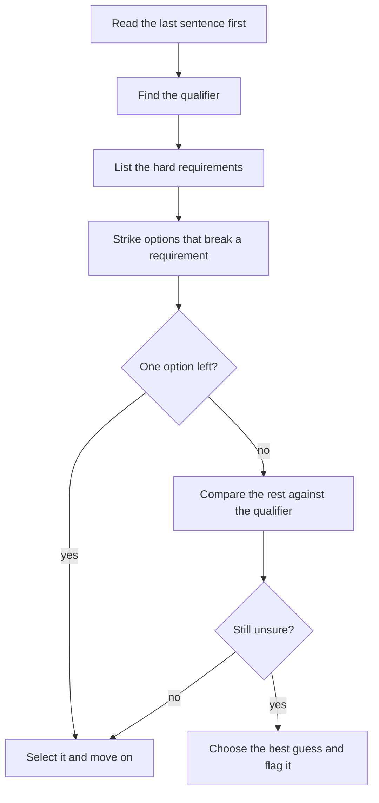

# Exam strategy and practice scenarios 1-30

## Before this lesson

This lesson and the next are practice for the **AWS Certified Solutions Architect - Associate** exam, and for the scenario questions that interviewers borrow from it. They assume you have finished the service modules of this track. Each practice scenario names the idea it tests in its explanation, so a wrong answer tells you which lesson to reread; the links you will need most are [IAM identities](#/lesson/aws/iam-identities), [policy evaluation](#/lesson/aws/iam-evaluation), [security services](#/lesson/aws/security-services), [VPC firewalls](#/lesson/aws/vpc-firewalls), [RDS and Aurora](#/lesson/aws/rds-aurora), [SQS and SNS](#/lesson/aws/messaging) and [reliability](#/lesson/aws/reliability-dr). Read [the design-answers lesson](#/lesson/aws/design-answers) first for the comparison tables.

## In plain words

A driving theory test does not ask you to recite the highway code. It shows a picture of a junction and asks what you would do. People who know every rule still fail if they have never practised reading the pictures.

The Solutions Architect exam works the same way. Almost every question is a short story: a company has this system, this problem and this constraint; which of four designs is best? Often two or three of the options would *work*. Only one fits the constraint in the story: the cheapest, the one with least operational effort, the one that needs no code change. The skill being tested is reading requirements carefully and matching them to the right service, which is exactly what a solutions architect does all day.

This lesson covers how the exam is built, a method for reading scenario questions, a table of trigger phrases, a few topics from the study guide that this track has only touched, and then thirty practice scenarios on the two heaviest domains: security and resilience.

Why it matters for a job: the certificate is a common filter in job advertisements for cloud roles in Singapore and elsewhere, and it gets a CV past the first screen. More usefully, studying for it forces you to cover every major service once, so that at work you at least know what exists. It does not prove you can build things; the worked project is your evidence for that.

## What the exam is

The facts below describe exam version **SAA-C03**, current at the time of writing. AWS revises exams every few years, so read the official exam guide before you book.

| Item | Value |
|---|---|
| Questions | 65 in total: 50 scored and 15 unscored trial questions that are not marked as such |
| Time | 130 minutes |
| Question types | Multiple choice (one correct answer out of four) and multiple response (two or more correct out of five or more) |
| Scoring | A scaled score from 100 to 1,000; 720 passes |
| Guessing | Unanswered questions count as wrong and there is no penalty for a wrong answer, so answer everything |
| Scoring model | Compensatory: you need the overall mark, not a pass in each section |
| Delivery | A test centre or an online proctored session |
| Validity | Three years |

A **scaled score** is the raw mark converted to a common scale so that slightly harder and slightly easier versions of the exam are comparable. It is not a percentage: 720 does not mean 72 % of questions. As a working target, aim to get clearly more than three quarters of practice questions right before you book.

### The four domains

A **domain** is a subject area with a fixed share of the scored questions.

| Domain | Share | What it asks you to do | Where this track covers it |
|---|---|---|---|
| 1. Design secure architectures | 30 % | Control access to resources (IAM, roles, federation, multi-account), secure workloads (network tiers, firewalls, WAF), protect data (encryption, key management, backups, retention) | Modules 4, 6 and 12 |
| 2. Design resilient architectures | 26 % | Build loosely coupled, scalable systems (queues, topics, serverless, containers) and highly available or fault-tolerant ones (Multi-AZ, failover, disaster recovery) | Modules 5, 8, 9 and 12 |
| 3. Design high-performing architectures | 24 % | Choose storage, compute, database, network and data-ingestion services that meet a performance need | Modules 2, 3, 5, 8, 10 and 13 |
| 4. Design cost-optimised architectures | 20 % | Choose the cheapest storage class, purchasing option, database configuration and network path that still meets the requirement | Modules 2, 3 and 12 |

Two observations. Security is the largest domain, and security ideas (roles instead of keys, least privilege, encryption) also appear inside questions from the other three. And nothing in the list is about memorising console screens or command syntax: the exam is about *choosing*.

## Reading a scenario question



1. **Read the last sentence first.** It holds the actual question, and it tells you what to look for in the story above it.
2. **Find the qualifier.** This is the phrase that decides between options that all work: *most cost-effective*, *least operational overhead*, *highest availability*, *minimal changes to the application*, *most secure*. Underline it mentally.
3. **List the hard requirements**: must survive an AZ failure, must be encrypted with a customer-controlled key, must keep order, must respond in milliseconds.
4. **Strike options that break a requirement.** Usually two fall at once: one uses a service that cannot do the job, one ignores a stated constraint.
5. **Compare what is left against the qualifier.** Between a managed service and something you build yourself on EC2, "least operational overhead" picks the managed one. Between two that both work, "most cost-effective" picks the cheaper.

Common traps:

- **The do-it-yourself option.** "Launch an EC2 instance and write a script that…" is rarely right when a managed feature exists.
- **The real service that does a different job.** CloudTrail offered where CloudWatch is needed; a read replica offered where Multi-AZ is needed.
- **The over-engineered option.** A multi-Region active-active design when the story asked only for AZ-level availability.
- **The option that changes the application** when the story says the code cannot change.
- **Absolute words** such as "all" or "never" in an option deserve suspicion.

### What the qualifier is telling you

| Phrase in the question | What it points towards |
|---|---|
| Least operational overhead; fully managed | Serverless and managed services: Lambda, Fargate, DynamoDB, Aurora Serverless, S3, managed rules |
| Most cost-effective | Right storage class, Spot or Savings Plans, serverless for spiky load, gateway endpoints, lifecycle rules |
| Highly available | At least two AZs: Multi-AZ, Auto Scaling group across zones, load balancer |
| Fault tolerant; no downtime | Redundancy with no interruption at all: active-active, more capacity than the minimum |
| Disaster recovery; Region failure | Cross-Region replication, backups in another Region, Route 53 failover, global tables, Aurora Global Database |
| Decouple; buffer; no lost requests | SQS between components |
| Fan out; notify several systems | SNS topic, often with SQS queues subscribed |
| In order; exactly once | SQS FIFO queue |
| Real-time stream; several consumers; replay | Kinesis Data Streams |
| Minimal code changes; lift and shift | Same engine on RDS or EC2; features that sit in front, such as RDS Proxy, DAX, ElastiCache or CloudFront |
| Without traversing the internet; private | VPC endpoints, PrivateLink, Direct Connect |
| Temporary credentials; no long-lived keys | IAM roles and STS |
| Audit who did what | CloudTrail |
| Check configuration against rules | AWS Config |
| Detect threats | GuardDuty |
| Find personal data in S3 | Macie |
| Rotate database passwords | Secrets Manager |
| Keys the customer controls and audits | KMS customer managed key; CloudHSM if a dedicated device is required |
| Cannot be deleted for N years | S3 Object Lock in compliance mode |
| Shared file system, Linux | EFS |
| Shared file system, Windows or SMB | FSx for Windows File Server |
| Sub-millisecond reads; cache | ElastiCache, or DAX for DynamoDB |
| Global users, static content | CloudFront |
| Global users, TCP or UDP, fixed addresses | Global Accelerator |
| Unknown or changing access pattern in S3 | S3 Intelligent-Tiering |
| Interruptible; fault-tolerant batch | Spot Instances |

The table is a set of first guesses, not rules. The demo applies it mechanically to a question so that you can see both its use and its limits.

```python-run
SIGNALS = {
    "least operational overhead": "prefer managed or serverless services over anything built on EC2",
    "most cost-effective": "among options that work, choose the cheapest; check storage class and purchase option",
    "highly available": "needs at least two Availability Zones",
    "minimal changes": "keep the same engine and code; add a feature in front or underneath",
    "in order": "SQS FIFO or a stream, not a standard queue",
    "decouple": "put SQS between the components",
    "without traversing the internet": "VPC endpoint or PrivateLink",
    "rotate": "Secrets Manager",
    "audit": "CloudTrail for API calls; Config for configuration history",
    "cannot be deleted": "S3 Object Lock",
}

def analyse(question):
    q = question.lower()
    found = [(phrase, hint) for phrase, hint in SIGNALS.items() if phrase in q]
    print(question)
    for phrase, hint in found:
        print(f"   [{phrase}] -> {hint}")
    if not found:
        print("   no trigger phrase: list the hard requirements yourself")
    print()

analyse("A company must decouple its order service from a billing service that is sometimes offline. "
        "Which solution meets this requirement with the LEAST operational overhead?")
analyse("Database credentials must rotate every 30 days with minimal changes to the application.")
analyse("Which design provides the lowest latency for users in Europe?")
```

`analyse` lower-cases the question and reports every phrase from the table it contains. The first question triggers two hints that together point at a managed queue. The third triggers nothing, which is the honest limit of keyword matching: you still have to read the story and reason about it. Add phrases of your own as you meet them in practice questions.

## Time and guessing

You have 130 minutes for 65 questions: two minutes each. Most people finish with time to spare if they keep moving and lose time if they wrestle with one question.

```python-run
total_minutes, questions = 130, 65

def plan(first_pass_seconds, flagged, minutes_per_flagged):
    first_pass = questions * first_pass_seconds / 60
    review = flagged * minutes_per_flagged
    left = total_minutes - first_pass - review
    print(f"first pass at {first_pass_seconds}s each: {first_pass:5.1f} min | "
          f"{flagged} flagged at {minutes_per_flagged} min: {review:4.1f} min | spare: {left:5.1f} min")

plan(90, 15, 2)
plan(120, 15, 2)
plan(75, 20, 2)

def expected_correct(sure, down_to_two, blind, scored=50):
    points = sure + down_to_two / 2 + blind / 4
    return points, 100 * points / scored

print()
for sure, two, blind in ((30, 0, 20), (30, 15, 5), (35, 12, 3)):
    points, pct = expected_correct(sure, two, blind)
    print(f"sure of {sure}, narrowed {two} to two options, blind guess on {blind}: "
          f"expect {points:.1f} of 50 right ({pct:.0f}%)")
```

The first function shows that a 90-second first pass leaves half an hour to revisit fifteen flagged questions, while a strict two minutes each leaves nothing. The second shows why elimination is worth practising: with thirty certain answers, guessing blindly on the other twenty gives an expected 35 right, but striking two wrong options on fifteen of them raises that to nearly 39 without learning a single new fact. Never leave a question blank.

Practical habits:

- Answer every question on the first pass, **flag** the doubtful ones and return at the end.
- For multiple-response questions, the number of answers to choose is stated. Treat each option as true or false against the story.
- Do not change an answer on review unless you can say what you misread.
- If your first language is not English, AWS lets you request extra time before you book; check the certification site for the current arrangement.

## Loose ends from the study guide

The study guide this track follows was written for an earlier version of the exam. Most of its content is still tested. A few topics have been renamed, retired or touched only briefly in earlier lessons, so here they are in one place.

**DHCP option sets.** When an instance starts it asks the network for its settings using the Dynamic Host Configuration Protocol (DHCP). A **DHCP option set** is the VPC-level list of those settings: the domain name, the DNS servers to use (by default the Amazon-provided resolver), and optionally time servers. Each VPC has exactly one option set. You cannot edit one; you create a new set and associate it with the VPC. The usual reason to do so is to point instances at your own DNS servers, for example those of a corporate directory.

**AWS Directory Service.** Many companies keep users and computers in Microsoft Active Directory. Directory Service offers three choices:

| Option | What it is | Choose it when |
|---|---|---|
| **AWS Managed Microsoft AD** | A real Active Directory run by AWS across two AZs | You need full Active Directory features in the cloud, or a trust relationship with an on-premises directory |
| **AD Connector** | A proxy that forwards sign-in requests to your existing on-premises directory; nothing is stored in AWS | Users stay in the on-premises directory and you only need AWS services to authenticate against it |
| **Simple AD** | A small, low-cost, compatible directory | A small standalone setup that needs only basic features |

Workloads that depend on it include Windows file shares on FSx, Windows instances joined to a domain, and single sign-on through IAM Identity Center.

**AWS CloudHSM.** A hardware security module (HSM) is a tamper-resistant device that stores encryption keys and performs cryptographic operations inside itself. KMS, which you met in the security module, is a shared managed service. **CloudHSM** gives you dedicated, single-tenant HSMs inside your VPC where only you control the keys. Choose it when a regulation or contract demands a dedicated device under your sole control; otherwise KMS is simpler and cheaper.

**Older names for current ideas.**

| The guide says | Today |
|---|---|
| Amazon Glacier vaults and archives | The S3 Glacier storage classes (Instant Retrieval, Flexible Retrieval, Deep Archive), reached through lifecycle rules |
| AWS Import/Export | The Snow Family of physical transfer devices, whose range has narrowed in recent years; DataSync and Direct Connect for online transfer |
| AWS Data Pipeline | A legacy service; use Glue, Step Functions or Managed Workflows for Apache Airflow |
| AWS OpsWorks | Retired; use Systems Manager and infrastructure as code |
| Amazon SWF | Still available; Step Functions is the choice for new workflows |
| Classic Load Balancer | Application and Network Load Balancers |
| Launch configurations | Launch templates |
| Bastion hosts for administration | Systems Manager Session Manager |
| NAT instances | NAT gateways |

When a practice question from an old source gives an answer in the left column, translate it to the right column and check that you know why the newer service replaced it.

## How to use the practice scenarios

1. Cover the options and say what *you* would design. Then look for it among the options.
2. Choose, then read the explanation even when you were right. Being right for the wrong reason fails the next variant.
3. For every miss, write one line: the requirement you overlooked and the service that satisfies it.
4. Return to the misses after two days.

Scenarios 1 to 18 are from domain 1 (secure architectures) and 19 to 30 from domain 2 (resilient architectures).

### Scenarios 1-6: access to resources

```quiz
[
  {"q": "Scenario 1. An application on EC2 instances must read objects from one S3 bucket. The security team forbids long-lived credentials on servers. What should the architect do?",
   "options": ["Attach an IAM role with a policy allowing s3:GetObject on that bucket to the instances through an instance profile", "Create an IAM user and store its access key in the application's configuration file", "Make the bucket public and restrict it by the instances' IP addresses", "Store the root user's access key in Secrets Manager"],
   "answer": 0,
   "explain": "A role delivers short-lived credentials to the instance automatically, and the policy limits them to one bucket. Access keys in files are long-lived; public buckets and root keys are never the answer."},
  {"q": "Scenario 2. A monitoring vendor that runs in its own AWS account needs read-only access to resources in a customer's account. Which approach is the most secure?",
   "options": ["Create an IAM user for the vendor and email the access keys", "Share the customer's administrator password", "Enable public access on the resources", "Create a cross-account IAM role with a read-only policy that trusts the vendor's account and requires an external ID"],
   "answer": 3,
   "explain": "The vendor assumes a role and receives temporary credentials. The external ID in the trust policy stops the vendor's other customers from tricking it into using this role, the confused-deputy problem."},
  {"q": "Scenario 3. A company with forty AWS accounts wants to make sure that no account, including its administrators, can disable CloudTrail or use Regions other than Singapore. What should it use?",
   "options": ["An IAM policy attached to every user in every account", "Service control policies applied through AWS Organizations", "A security group rule", "An S3 bucket policy"],
   "answer": 1,
   "explain": "A service control policy sets the maximum permissions for whole accounts, administrators included, and is managed centrally. Per-user policies can be removed by the account's own administrators."},
  {"q": "Scenario 4. Employees already sign in with corporate Active Directory credentials. The company wants them to reach several AWS accounts with single sign-on and no separate IAM users. Which solution fits?",
   "options": ["Create an IAM user for each employee in each account", "Share one IAM user per department", "IAM Identity Center connected to the corporate directory, with permission sets assigned per account", "Amazon Cognito identity pools for the console"],
   "answer": 2,
   "explain": "IAM Identity Center federates the existing directory and grants roles in each account through permission sets. Cognito is for the users of your own applications, not for workforce access to AWS."},
  {"q": "Scenario 5. A mobile app lets customers sign in with a social account or an email address and then upload photos directly to S3. Which service handles sign-up, sign-in and temporary AWS credentials for those users?",
   "options": ["Amazon Cognito", "IAM users created by the app", "AWS Directory Service Simple AD", "AWS Key Management Service"],
   "answer": 0,
   "explain": "Cognito user pools manage sign-up and sign-in, including social providers, and identity pools exchange the resulting tokens for temporary credentials scoped by an IAM role."},
  {"q": "Scenario 6. Administrators need shell access to EC2 instances in private subnets. No inbound ports may be opened and every session must be logged. What is the best solution?",
   "options": ["A bastion host in a public subnet with port 22 open to the office", "Attach public IP addresses to the instances", "A site-to-site VPN for each administrator", "Systems Manager Session Manager with IAM permissions and session logging to CloudWatch Logs or S3"],
   "answer": 3,
   "explain": "Session Manager opens a shell through the Systems Manager agent's outbound connection, authorises with IAM and can record sessions. A bastion still needs an open port and key management."}
]
```

### Scenarios 7-12: securing workloads and networks

```quiz
[
  {"q": "Scenario 7. A three-tier application runs in a VPC. The database must accept connections only from the application servers, whose number changes with Auto Scaling. How should the database's security group be written?",
   "options": ["Allow the database port from 0.0.0.0/0", "Allow the database port from the application tier's security group", "Allow the database port from each application server's current IP address", "Use a network ACL to allow the whole VPC"],
   "answer": 1,
   "explain": "Referencing the application tier's security group as the source admits whichever instances currently belong to it, with no rule changes as the fleet scales."},
  {"q": "Scenario 8. A public web application behind an Application Load Balancer is being probed with SQL injection and cross-site scripting attempts. Which service blocks these requests?",
   "options": ["AWS Shield Standard", "Network ACLs", "AWS WAF with managed rule groups on the load balancer", "Amazon GuardDuty"],
   "answer": 2,
   "explain": "WAF inspects HTTP requests and blocks patterns such as injection. Shield handles volumetric floods, network ACLs see only addresses and ports, and GuardDuty detects but does not block."},
  {"q": "Scenario 9. Traffic from one known malicious IP range must be blocked from every instance in a subnet. Which control can do this?",
   "options": ["A deny rule in a security group", "An IAM policy", "A route to a NAT gateway", "A deny rule in the subnet's network ACL"],
   "answer": 3,
   "explain": "Network ACLs support explicit deny rules at the subnet boundary. Security groups have allow rules only, so they cannot single out a range to block."},
  {"q": "Scenario 10. Instances in private subnets download large files from S3 through a NAT gateway. Security wants the traffic to stay on the AWS network, and finance wants the NAT charges reduced. What should be added?",
   "options": ["An internet gateway on the private subnets", "A second NAT gateway", "A gateway VPC endpoint for S3 with a route in the private route tables", "S3 Transfer Acceleration"],
   "answer": 2,
   "explain": "A gateway endpoint routes S3 traffic privately at no charge, so it no longer passes through the NAT gateway. A bucket policy can additionally require requests to arrive through that endpoint."},
  {"q": "Scenario 11. A security team wants continuous detection of threats such as instances contacting known malicious hosts or unusual API activity, with the least set-up effort. Which service?",
   "options": ["Amazon GuardDuty", "Amazon Inspector", "AWS Config", "Amazon Macie"],
   "answer": 0,
   "explain": "GuardDuty analyses CloudTrail events, VPC flow logs and DNS logs for suspicious behaviour once it is switched on. Inspector scans for software vulnerabilities, Config tracks configuration, Macie finds sensitive data in S3."},
  {"q": "Scenario 12. An auditor asks for proof that no security group ever allows SSH from 0.0.0.0/0, with a record of any violation and automatic correction. Which service provides this?",
   "options": ["AWS CloudTrail alone", "AWS Config with a managed rule and automatic remediation", "Amazon CloudWatch metrics", "AWS Trusted Advisor only"],
   "answer": 1,
   "explain": "Config records resource configurations over time, evaluates them against rules such as restricted SSH, and can trigger a remediation action. CloudTrail shows who made a change but does not evaluate compliance."}
]
```

### Scenarios 13-18: protecting data

```quiz
[
  {"q": "Scenario 13. Objects in S3 must be encrypted with a key that the company controls, with every use of the key recorded for audit. Which option meets this with the least effort?",
   "options": ["Server-side encryption with S3 managed keys", "Server-side encryption with a customer managed KMS key", "Client-side encryption with a key kept in the application code", "No encryption and a strict bucket policy"],
   "answer": 1,
   "explain": "With a customer managed KMS key the company sets the key policy and rotation, and each use is logged in CloudTrail. S3 managed keys give no control or per-use audit."},
  {"q": "Scenario 14. A production RDS database was created without encryption. It must now be encrypted at rest. What is the correct procedure?",
   "options": ["Tick the encryption box on the running instance", "Enable Multi-AZ", "Take a snapshot, copy the snapshot with encryption enabled, restore a new instance from the encrypted copy and switch the application to it", "Encrypt the security group"],
   "answer": 2,
   "explain": "Encryption cannot be switched on for an existing RDS instance. The supported path is an encrypted copy of a snapshot, restored as a new instance."},
  {"q": "Scenario 15. An application's database password must be rotated automatically every 30 days without redeploying the application. Which service is designed for this?",
   "options": ["AWS Secrets Manager with rotation enabled", "Systems Manager Parameter Store standard parameters", "An encrypted file in S3", "AWS Certificate Manager"],
   "answer": 0,
   "explain": "Secrets Manager stores the secret, rotates it on a schedule with built-in support for RDS, and the application fetches the current value at run time."},
  {"q": "Scenario 16. Financial records in S3 must not be deleted or overwritten by anyone, including administrators, for seven years. What should be configured?",
   "options": ["Versioning only", "A lifecycle rule that moves objects to Glacier", "MFA on the root user", "S3 Object Lock in compliance mode with a seven-year retention period"],
   "answer": 3,
   "explain": "Object Lock in compliance mode makes object versions immutable until the retention date, and no user can shorten it. Versioning alone still lets a permitted user delete versions."},
  {"q": "Scenario 17. A company must share a private report in S3 with an external partner for 24 hours, without creating an AWS identity for the partner. What should it use?",
   "options": ["Make the object public for a day", "A presigned URL with a 24-hour expiry", "A new IAM user for the partner", "Cross-Region Replication"],
   "answer": 1,
   "explain": "A presigned URL grants time-limited access to one object using the signer's permissions. Nothing is made public and no identity is created."},
  {"q": "Scenario 18. A regulator requires that encryption keys be held in a dedicated, single-tenant hardware device controlled only by the company. Which service satisfies this?",
   "options": ["AWS KMS with an AWS managed key", "AWS Secrets Manager", "AWS CloudHSM", "S3 managed encryption keys"],
   "answer": 2,
   "explain": "CloudHSM provides dedicated hardware security modules in the customer's VPC with keys under the customer's sole control. KMS is a shared managed service."}
]
```

### Scenarios 19-24: high availability

```quiz
[
  {"q": "Scenario 19. A MySQL database on RDS must stay available if an Availability Zone fails, with automatic failover and no change to the application. Which feature?",
   "options": ["Multi-AZ deployment", "A read replica in the same AZ", "A larger instance class", "Daily manual snapshots"],
   "answer": 0,
   "explain": "Multi-AZ keeps a synchronous standby in another zone and repoints the same endpoint on failover. Replicas are asynchronous and are for read scaling; snapshots restore slowly."},
  {"q": "Scenario 20. Heavy reporting queries on an RDS PostgreSQL database slow down the transactions of the main application. What is the simplest fix?",
   "options": ["Enable Multi-AZ and send reports to the standby", "Move the database to instance store", "Increase the backup retention period", "Create a read replica and point the reporting tool at it"],
   "answer": 3,
   "explain": "A read replica serves read-only queries and takes the reporting load off the primary. A classic Multi-AZ standby does not accept queries."},
  {"q": "Scenario 21. Web servers run on EC2 in one Availability Zone. The company wants the application to survive the failure of an instance or of a zone automatically. What should the architect design?",
   "options": ["An Auto Scaling group spanning at least two AZs behind an Application Load Balancer with health checks", "One larger instance", "An Elastic IP that an engineer moves by hand", "A daily AMI backup"],
   "answer": 0,
   "explain": "The load balancer stops sending traffic to failed instances and the group replaces them, across zones. Anything manual or single-instance leaves a single point of failure."},
  {"q": "Scenario 22. Linux web servers in several AZs must all read and write the same directory of user-uploaded files. Which storage service fits?",
   "options": ["An EBS volume attached to each server", "Instance store", "Amazon EFS mounted on every server", "S3 Glacier"],
   "answer": 2,
   "explain": "EFS is a shared network file system that many instances across zones can mount at once. An EBS volume belongs to one zone and normally to one instance."},
  {"q": "Scenario 23. Users lose their shopping carts whenever Auto Scaling removes a web server. Which change fixes this most robustly?",
   "options": ["Disable scale-in", "Store session data in ElastiCache or DynamoDB instead of on the web servers", "Use larger instances", "Increase the health check interval"],
   "answer": 1,
   "explain": "Moving session state to a shared store makes the servers stateless, so any server can serve any user and removing one loses nothing. Sticky sessions would only postpone the loss."},
  {"q": "Scenario 24. A website's primary stack runs in one Region. If it fails its health check, visitors should be sent to a static maintenance page hosted in S3. Which Route 53 routing policy does this?",
   "options": ["Weighted routing", "Latency-based routing", "Geolocation routing", "Failover routing with a health check on the primary"],
   "answer": 3,
   "explain": "Failover routing returns the primary record while its health check passes and the secondary when it fails."}
]
```

### Scenarios 25-30: decoupling and disaster recovery

```quiz
[
  {"q": "Scenario 25. A web tier sends orders directly to a processing tier. When the processing tier is slow or down, orders are lost. Which change prevents the loss?",
   "options": ["A bigger processing instance", "A second load balancer", "CloudFront in front of the web tier", "An SQS queue between the tiers, with the processors polling it"],
   "answer": 3,
   "explain": "A queue stores each order durably until a processor handles it and deletes it, so slow or failed processors delay work without losing it."},
  {"q": "Scenario 26. When an order is placed, the inventory, email and analytics systems must each receive the event independently, and one being slow must not affect the others. Which design?",
   "options": ["The order service calls each system in turn", "One SQS queue polled by all three systems", "Publish to an SNS topic with a separate SQS queue subscribed for each system", "Write the order to a file on EFS"],
   "answer": 2,
   "explain": "SNS delivers a copy to every subscription, and a queue per consumer buffers each one separately. With a single shared queue each message would be taken by only one of the three."},
  {"q": "Scenario 27. Payment instructions for the same account must be processed strictly in the order sent, and never twice. Which service configuration?",
   "options": ["An SQS standard queue", "An SQS FIFO queue using the account ID as the message group ID", "An SNS standard topic", "Messages written to S3"],
   "answer": 1,
   "explain": "FIFO queues preserve order within a message group and remove duplicates. Standard queues deliver at least once and may reorder."},
  {"q": "Scenario 28. A company needs a disaster recovery plan for a Region failure with a recovery time of about one hour and a recovery point of 15 minutes, at the lowest cost that meets those targets. Which strategy?",
   "options": ["Pilot light", "Backup and restore", "Multi-site active-active", "No plan; rely on Multi-AZ"],
   "answer": 0,
   "explain": "Pilot light keeps data replicating continuously and only the core components running in the second Region, giving recovery in tens of minutes. Backup and restore usually takes hours; active-active exceeds the need and the budget; Multi-AZ does not cover a Region."},
  {"q": "Scenario 29. An application in two Regions needs a key-value database that accepts writes in both Regions and replicates them automatically. Which service?",
   "options": ["RDS with a cross-Region read replica", "ElastiCache in one Region", "DynamoDB global tables", "S3 with versioning"],
   "answer": 2,
   "explain": "Global tables are multi-Region and multi-active: every replica accepts writes. A cross-Region read replica is read-only until promoted."},
  {"q": "Scenario 30. A static website is served from S3 through CloudFront. It must stay available if the bucket's Region has an outage. Which design achieves this?",
   "options": ["Replicate the bucket to a second Region and configure a CloudFront origin group that fails over to the replica", "Turn on versioning", "Use S3 One Zone-IA", "Raise the cache lifetime to one year"],
   "answer": 0,
   "explain": "Cross-Region Replication keeps a copy elsewhere, and an origin group makes CloudFront retry the secondary origin when the primary returns errors."}
]
```

## Cost notes and free-tier warnings

- The exam fee is about USD 150 at the time of writing. Passing any AWS exam has usually come with a discount voucher for the next one.
- AWS publishes a free set of official practice questions and the exam guide. Use those before paying for third-party question banks, and avoid sites offering "real exam questions": they breach the candidate agreement and their answers are often wrong.
- Hands-on practice costs money only if you forget to clean up. Build, observe, delete, and keep the budget alarm from [the account lesson](#/lesson/aws/account-and-billing) switched on.
- Much of what the exam asks about (IAM, VPC subnets and route tables, security groups, S3 buckets with small objects) costs nothing or cents to practise. NAT gateways, load balancers, Multi-AZ databases and directories bill by the hour from the moment they exist.

## Pitfalls

- **Answering from the first familiar service name** without reading the qualifier.
- **Choosing what you would do at work** when the story's constraint points elsewhere.
- **Studying only by memorising question banks.** Variants defeat memorised answers; understanding the reason does not.
- **Skipping the security domain** because it feels dry. It is the largest.
- **Using outdated material** that recommends bastion hosts, NAT instances, Classic Load Balancers or retired services.
- **Leaving questions unanswered.**
- **Booking before scoring consistently well** on timed practice sets.

> [!INTERVIEW]
> **"I see you hold the Solutions Architect certificate. What did you find hardest, and what have you built?"** Interviewers ask this to separate memorisation from experience. Name a real topic (for example, how policy evaluation combines identity policies, resource policies and service control policies), explain it in two sentences, and then describe something you built: the stages of the worked project, a failure you injected and what happened, and what it cost. The certificate opens the conversation; the project carries it.
>
> **"A question gives two designs that both work. How do you choose?"** State the deciding criterion out loud: the availability target, the operational effort the team can afford, the cost at the expected scale, and how reversible the choice is. Then pick one and say what would make you change your mind.

## Cheat sheet

| Topic | Remember |
|---|---|
| Format | 65 questions, 130 minutes, 720 of 1,000 to pass, no penalty for guessing |
| Weights | Secure 30 %, resilient 26 %, high-performing 24 %, cost-optimised 20 % |
| Method | Last sentence, qualifier, hard requirements, strike, compare |
| Pace | About 90 seconds per question on the first pass; flag and return |
| Default instincts | Roles over keys; managed over self-built; multi-AZ for availability; queue to decouple |
| Directory choices | Managed Microsoft AD (full), AD Connector (proxy), Simple AD (small) |
| Dedicated key hardware | CloudHSM |
| VPC-wide DNS settings | DHCP option set |

## Summary

- The exam is scenario-based: read the requirement and the qualifier, strike what breaks a requirement, and choose what best fits the qualifier.
- Four domains are weighted 30, 26, 24 and 20 %; security is the largest and appears everywhere.
- Trigger phrases suggest a first guess; reasoning about the story confirms it.
- Keep moving, answer everything, flag doubts and return.
- Older study material uses retired names; translate them to current services.
- Review every explanation, including for questions you answered correctly.

## Glossary

- **AD Connector**: a proxy that lets AWS services authenticate against an on-premises Active Directory.
- **Compensatory scoring**: a scheme in which strong sections can make up for weak ones.
- **Confused deputy**: a trusted service tricked into acting for the wrong party; prevented by an external ID.
- **DHCP option set**: the VPC-level network settings handed to instances at start-up.
- **Distractor**: a wrong answer written to look plausible.
- **Domain**: a subject area of the exam with a fixed weight.
- **External ID**: a shared value a third party must present when assuming a cross-account role.
- **Hardware security module (HSM)**: a tamper-resistant device that holds keys and performs cryptography.
- **Multiple response**: a question with two or more correct answers to select.
- **Permission set**: in IAM Identity Center, a template of permissions granted in an account.
- **Qualifier**: the phrase in a question that decides between workable options.
- **Scaled score**: a mark converted to a common scale across exam versions.
- **Unscored question**: a trial question that does not count towards the result.

> **Source:** AWS Certified Solutions Architect Official Study Guide, introduction and exam essentials of ch. 1-14; ch. 4 (DHCP option sets), ch. 6 (IAM), ch. 11 (AWS Directory Service, AWS CloudHSM, AWS Data Pipeline, AWS Import/Export, AWS OpsWorks) and ch. 12 (security). The practice scenarios are original to this guide. Exam format and domain weights checked against the SAA-C03 exam guide at https://docs.aws.amazon.com/aws-certification/latest/solutions-architect-associate-03/solutions-architect-associate-03.html ; service facts checked against https://docs.aws.amazon.com/vpc/latest/userguide/VPC_DHCP_Options.html , https://docs.aws.amazon.com/directoryservice/latest/admin-guide/what_is.html , https://docs.aws.amazon.com/cloudhsm/latest/userguide/introduction.html , https://docs.aws.amazon.com/AmazonS3/latest/userguide/object-lock.html and https://docs.aws.amazon.com/AmazonRDS/latest/UserGuide/Overview.Encryption.html
