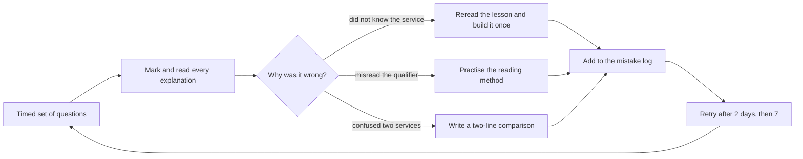

# Practice scenarios 31-60

## Before this lesson

This lesson continues directly from [exam strategy and practice scenarios 1-30](#/lesson/aws/exam-practice-1): use the same method (last sentence, qualifier, hard requirements, strike, compare). The scenarios here cover the rest of the resilience domain and all of the performance and cost domains, so the lessons to have fresh are [EBS volumes](#/lesson/aws/ebs-storage), [S3 basics](#/lesson/aws/s3-basics), [EC2 purchasing](#/lesson/aws/ec2-purchasing), [ElastiCache, DAX and Redshift](#/lesson/aws/cache-warehouse), [CloudFront and Global Accelerator](#/lesson/aws/cloudfront), [Lambda and API Gateway](#/lesson/aws/lambda-apigw) and [performance and cost](#/lesson/aws/performance-cost).

## In plain words

A football team does not get better by playing matches alone. After each match the coach replays the recording, stops at every goal conceded and asks: what did we fail to see, and what do we do next time? The match is the test; the replay is where the learning happens.

Practice questions are matches. Most people who fail the exam did plenty of questions and very little replay: they checked the score, felt good or bad, and moved on. This lesson gives you thirty more scenarios and, more importantly, a routine for the replay: how to sort your mistakes, how to schedule their return, which numbers are worth committing to memory, and a four-week plan that ends with you ready to book.

Why it matters for a job: the habit you build here (a short written note on every mistake and a scheduled second look) is the same habit behind good incident reviews and good code review. Interviewers who ask "tell me about something you got wrong" are checking for it.

## The review loop



Every wrong answer falls into one of three groups, and each has a different cure:

| Kind of mistake | Example | Cure |
|---|---|---|
| **Knowledge gap**: you did not know what the service does | Never heard of S3 Object Lock | Reread the lesson section; create the thing once in a sandbox account if it is cheap |
| **Reading error**: you knew the services but missed the constraint | Chose the fastest design when the question asked for the cheapest | Slow down on the last sentence; underline the qualifier |
| **Confusion**: you mixed up two similar services | Read replica chosen for failover | Write the difference in two lines of your own and add it to your comparison sheet |

Keep a **mistake log**: one line per miss with the date, the kind of mistake, and the corrected rule in your own words. Rewriting the rule yourself is what makes it stick; copying the explanation does not.

### Scheduling the second look

Seeing a missed question again the next minute proves nothing. Seeing it again after a gap, and getting it right, shows the idea has moved into long-term memory. A simple scheme known as the **Leitner system** uses boxes: a card you answer correctly moves to a box that is reviewed less often, and a card you miss goes back to the first box.

```python-run
import random
random.seed(3)

INTERVAL = {1: 1, 2: 3, 3: 7}                 # box -> days until the next review

def simulate(cards, days, p_first_try=0.5, gain=0.2):
    box = {c: 1 for c in range(cards)}
    due = {c: 0 for c in range(cards)}
    skill = {c: p_first_try for c in range(cards)}
    reviews_per_day = []
    for day in range(days):
        todays = [c for c in box if due[c] <= day]
        for c in todays:
            correct = random.random() < skill[c]
            skill[c] = min(0.97, skill[c] + gain)             # every review teaches a little
            box[c] = min(3, box[c] + 1) if correct else 1
            due[c] = day + INTERVAL[box[c]]
        reviews_per_day.append(len(todays))
    return box, skill, reviews_per_day

box, skill, reviews = simulate(cards=40, days=21)
for week in range(3):
    print(f"week {week + 1}: reviews per day {reviews[week * 7:(week + 1) * 7]}")
counts = {b: sum(1 for v in box.values() if v == b) for b in (1, 2, 3)}
print(f"\nafter 21 days: box 1 (daily) {counts[1]}, box 2 (every 3 days) {counts[2]}, box 3 (weekly) {counts[3]}")
print(f"average chance of answering correctly: {100 * sum(skill.values()) / len(skill):.0f}%")
```

Each card starts in box 1 with an even chance of being answered correctly. Every day the cards that are due are reviewed: a correct answer promotes the card and lengthens its interval, a miss sends it back to daily review, and each review raises the chance of success a little. The output shows forty reviews on the first day falling to between one and about a dozen a day by the third week, with nearly every card in the weekly box. The workload shrinks by itself as you learn, which is what makes the routine sustainable alongside a job. Change `cards` to the size of your own mistake log to see what it would cost you per day.

### Are you ready?

The four domains have different weights, so a plain average of practice scores misleads. Weight them.

```python-run
WEIGHTS = {"secure": 0.30, "resilient": 0.26, "high-performing": 0.24, "cost-optimised": 0.20}

def readiness(results):
    # results: domain -> (correct, attempted)
    weighted = 0.0
    for domain, weight in WEIGHTS.items():
        right, total = results[domain]
        pct = 100 * right / total
        weighted += weight * pct
        flag = "  <- study this first" if pct < 70 else ""
        print(f"  {domain:16s} {right:3d}/{total:<3d} = {pct:5.1f}%  (weight {weight:.0%}){flag}")
    print(f"  weighted score: {weighted:.1f}%  ->  {'book the exam' if weighted >= 80 else 'keep practising'}\n")

print("Candidate A")
readiness({"secure": (14, 18), "resilient": (13, 16), "high-performing": (12, 14), "cost-optimised": (10, 12)})
print("Candidate B: strong on performance, weak on security")
readiness({"secure": (10, 18), "resilient": (12, 16), "high-performing": (14, 14), "cost-optimised": (11, 12)})
```

`readiness` converts each domain's result to a percentage, multiplies by the domain's weight and adds them up. Candidate B scored a perfect fourteen on performance yet has a lower weighted score than candidate A, because the weak domain is the heaviest one. The 80 % threshold is a deliberately cautious personal target, not an official pass mark: practice questions are usually a little kinder than the real ones, and a margin protects you from an unlucky set. Enter your own results from the sixty scenarios in these two lessons.

## Numbers worth knowing

The exam rarely asks for a number outright, but numbers decide between options ("the job runs for 40 minutes", "messages must be kept for 10 days"). AWS raises limits regularly, so treat these as correct at the time of writing and verify anything you quote in a design.

### Storage

| Fact | Value |
|---|---|
| S3 durability | 99.999999999 % (eleven nines), by storing data across at least three AZs, except the One Zone classes |
| S3 object size | Up to 50 TB with multipart upload (older material says 5 TB); a single PUT carries up to 5 GB |
| Minimum storage duration | Standard-IA and One Zone-IA 30 days; Glacier Instant Retrieval and Flexible Retrieval 90 days; Glacier Deep Archive 180 days |
| Glacier Flexible Retrieval times | Expedited 1-5 minutes; standard 3-5 hours; bulk 5-12 hours |
| Glacier Deep Archive times | Standard within 12 hours; bulk within 48 hours |
| EBS scope | A volume lives in one AZ; snapshots are incremental and regional |
| gp3 baseline | 3,000 IOPS and 125 MiB/s at any size, with more purchasable separately |
| Highest EBS performance | io2 Block Express: up to 256,000 IOPS and 99.999 % durability |
| EFS | A regional, shared file system for Linux over NFS |

### Compute and networking

| Fact | Value |
|---|---|
| Lambda maximum run time | 15 minutes |
| Lambda memory | Up to 10,240 MB; CPU scales with memory |
| Lambda default concurrency | 1,000 concurrent executions per Region per account (can be raised) |
| API Gateway integration timeout | 29 seconds by default |
| Spot interruption notice | Two minutes |
| Auto Scaling default cooldown | 300 seconds for simple scaling |
| CloudWatch EC2 metrics | Every 5 minutes (basic) or every minute (detailed); memory and disk use need the CloudWatch agent |
| VPC size | /16 (65,536 addresses) down to /28 (16); five addresses reserved per subnet |
| Security group default | No inbound allowed, all outbound allowed; stateful |
| Custom network ACL default | Denies everything until rules are added; stateless |
| CloudFront certificate | Must be in `us-east-1` |

### Databases and messaging

| Fact | Value |
|---|---|
| RDS automated backups | Retention 0 to 35 days, with point-in-time restore |
| RDS Multi-AZ failover | Typically 60-120 seconds, same endpoint |
| Aurora storage | Six copies across three AZs; up to 15 replicas |
| DynamoDB item size | Up to 400 KB |
| DynamoDB capacity units | 1 RCU = one strongly consistent read per second of up to 4 KB (or two eventually consistent); 1 WCU = one write per second of up to 1 KB |
| DynamoDB point-in-time recovery | Up to 35 days |
| SQS retention | 4 days by default; 1 minute to 14 days |
| SQS visibility timeout | 30 seconds by default; up to 12 hours |
| SQS message size | Up to 1 MiB (older material says 256 KB) |
| SQS long polling | Up to 20 seconds |
| SQS FIFO throughput | 300 API calls per second per action without batching, 3,000 messages with batching, more in high-throughput mode |
| Kinesis shard | 1 MB or 1,000 records per second in; 2 MB per second out; retention 24 hours by default, up to 365 days |
| KMS direct encryption | Up to 4 KB; larger data uses envelope encryption with data keys |

### A cost reflex

Cost questions often reduce to a break-even. Infrequent-access storage is cheaper to keep and dearer to read, so it pays off only when little of the data is read each month. The prices are illustrative.

```python-run
STANDARD = 0.023            # USD per GB-month
IA_STORE = 0.0125           # USD per GB-month, Standard-IA
IA_RETRIEVE = 0.01          # USD per GB retrieved

def monthly(gb, share_read):
    standard = gb * STANDARD
    ia = gb * IA_STORE + gb * share_read * IA_RETRIEVE
    return standard, ia

gb = 10_000
print(f"{gb:,} GB stored; share of the data read each month varies\n")
for share in (0.0, 0.25, 0.5, 1.0, 1.5, 2.0):
    std, ia = monthly(gb, share)
    better = "Standard-IA" if ia < std else "Standard"
    print(f"read {share:4.0%} per month: Standard {std:7.2f} USD, Standard-IA {ia:7.2f} USD -> {better}")

break_even = (STANDARD - IA_STORE) / IA_RETRIEVE
print(f"\nbreak-even: reading about {break_even:.0%} of the data per month")
```

`monthly` adds storage and retrieval for each class. Standard-IA wins while less than about the whole data set is read once a month and loses beyond that. Two more conditions sit outside this arithmetic and appear in exam options: objects in the infrequent-access classes are billed for at least 30 days and as if they were at least 128 KB, so tiny or short-lived objects belong in Standard. When the access pattern is unknown, Intelligent-Tiering makes the decision for you for a small monitoring fee.

## Practice scenarios

Scenarios 31 to 34 finish domain 2 (resilient architectures), 35 to 48 cover domain 3 (high-performing architectures) and 49 to 60 cover domain 4 (cost-optimised architectures).

### Scenarios 31-34: resilience, continued

```quiz
[
  {"q": "Scenario 31. A relational application on Aurora needs a disaster recovery copy in another Region with a recovery point of about one second and the ability to promote that Region quickly. Which feature?",
   "options": ["Daily snapshots copied to the second Region", "A Multi-AZ deployment", "An S3 export of the tables", "Aurora Global Database"],
   "answer": 3,
   "explain": "Aurora Global Database replicates storage to secondary Regions with typical lag under a second and lets a secondary be promoted. Snapshots give a recovery point of hours; Multi-AZ covers zones, not Regions."},
  {"q": "Scenario 32. An order workflow has five steps, including a manual approval that can take days. Failed steps must be retried, and operators want to see where each order is. Which service coordinates this with the least custom code?",
   "options": ["AWS Step Functions", "One long-running Lambda function", "A cron job on EC2", "An SQS queue alone"],
   "answer": 0,
   "explain": "Step Functions models the steps as a state machine with built-in retries, waits for external approval and a visual execution history. A Lambda function is limited to 15 minutes."},
  {"q": "Scenario 33. A Lambda function consumes an SQS queue. A few malformed messages fail every time, are retried endlessly and delay the others. What should be configured?",
   "options": ["A longer message retention period", "More memory for the function", "A dead-letter queue with a maximum receive count on the source queue", "A FIFO queue"],
   "answer": 2,
   "explain": "After the set number of failed receives, SQS moves the message to the dead-letter queue, where it can be inspected while the rest of the queue flows."},
  {"q": "Scenario 34. A company wants one place to define backup schedules and retention for RDS, EBS, EFS and DynamoDB across its accounts, with copies sent to a second Region. Which service?",
   "options": ["Custom scripts on a scheduled EC2 instance", "AWS Backup", "S3 lifecycle rules", "AWS DataSync"],
   "answer": 1,
   "explain": "AWS Backup centralises backup plans across many services and accounts and supports cross-Region and cross-account copies."}
]
```

### Scenarios 35-41: performance

```quiz
[
  {"q": "Scenario 35. Users on several continents download product images and videos from an S3 bucket in Singapore and complain of slow loading. What improves this most directly?",
   "options": ["A larger EC2 instance", "S3 versioning", "A CloudFront distribution in front of the bucket", "A NAT gateway"],
   "answer": 2,
   "explain": "CloudFront caches the files at edge locations near users, so most requests never travel to Singapore."},
  {"q": "Scenario 36. The same product details are read from an RDS database thousands of times a second, and the database is the bottleneck. Which addition reduces load and latency the most?",
   "options": ["Amazon ElastiCache holding the frequently read results", "A bigger EBS volume", "Amazon Kinesis", "AWS Config"],
   "answer": 0,
   "explain": "An in-memory cache answers repeated reads in well under a millisecond and removes them from the database."},
  {"q": "Scenario 37. A tightly coupled high-performance computing job needs the lowest possible network latency between its EC2 instances. Which placement strategy?",
   "options": ["Spread placement group", "Cluster placement group", "Partition placement group", "Instances in three Regions"],
   "answer": 1,
   "explain": "A cluster placement group packs instances close together in one AZ for low latency and high throughput. Spread and partition groups trade that for failure isolation."},
  {"q": "Scenario 38. A mission-critical database on EC2 needs 200,000 IOPS with sub-millisecond latency and the highest volume durability. Which EBS volume type?",
   "options": ["Throughput Optimized HDD (st1)", "General Purpose SSD (gp3)", "Cold HDD (sc1)", "Provisioned IOPS SSD (io2 Block Express)"],
   "answer": 3,
   "explain": "io2 Block Express provides the highest IOPS and 99.999 % durability. HDD types suit sequential throughput, and gp3 is the general default below this performance level."},
  {"q": "Scenario 39. Clickstream events from millions of devices must be ingested in real time, read independently by three applications and be replayable for 24 hours. Which service?",
   "options": ["An SQS standard queue", "Amazon Kinesis Data Streams", "An SNS topic", "AWS Batch"],
   "answer": 1,
   "explain": "A stream keeps an ordered, retained record that several consumers read at their own pace and can replay. Queue messages are deleted once consumed, and SNS keeps nothing."},
  {"q": "Scenario 40. A read-heavy application on DynamoDB needs response times in microseconds with minimal changes to its code. What should be added?",
   "options": ["More read capacity units", "A global secondary index", "ElastiCache with a rewritten data-access layer", "DynamoDB Accelerator (DAX)"],
   "answer": 3,
   "explain": "DAX is an in-memory cache that speaks the DynamoDB API, so the application changes its client and little else. ElastiCache would work but needs caching logic written."},
  {"q": "Scenario 41. A new API has unpredictable traffic with long idle periods and sudden bursts. The team wants no servers to manage and no cost while idle. Which architecture?",
   "options": ["API Gateway with Lambda functions and a DynamoDB on-demand table", "EC2 instances in an Auto Scaling group with a minimum of two", "One large Reserved Instance", "A Kubernetes cluster on EC2"],
   "answer": 0,
   "explain": "All three services scale with requests and bill per use, so idle periods cost almost nothing and bursts are absorbed without capacity planning."}
]
```

### Scenarios 42-48: performance, continued

```quiz
[
  {"q": "Scenario 42. Customers around the world upload multi-gigabyte files to one S3 bucket in Singapore, and uploads from distant countries are slow. Which feature helps?",
   "options": ["S3 Object Lock", "Requester Pays", "S3 Transfer Acceleration, with multipart upload", "A gateway VPC endpoint"],
   "answer": 2,
   "explain": "Transfer Acceleration takes uploads in at the nearest edge location and carries them over the AWS network to the bucket; multipart upload sends parts in parallel."},
  {"q": "Scenario 43. Analysts run complex queries joining billions of rows, and these slow down the transactional RDS database. Where should the analytical workload go?",
   "options": ["The same database with more indexes", "DynamoDB", "ElastiCache", "Amazon Redshift"],
   "answer": 3,
   "explain": "Redshift is a columnar data warehouse built for large analytical queries, keeping them away from the transactional system."},
  {"q": "Scenario 44. Windows applications need a shared file system over the SMB protocol, integrated with Active Directory. Which service?",
   "options": ["Amazon EFS", "S3 with a bucket policy", "Amazon FSx for Windows File Server", "Instance store"],
   "answer": 2,
   "explain": "FSx for Windows File Server provides managed SMB shares with Active Directory integration. EFS uses NFS and is for Linux."},
  {"q": "Scenario 45. A multiplayer game uses UDP and has players worldwide. It needs fixed entry IP addresses, the lowest latency to the nearest healthy Region and quick failover. Which service?",
   "options": ["CloudFront", "AWS Global Accelerator", "Route 53 simple routing", "An Application Load Balancer"],
   "answer": 1,
   "explain": "Global Accelerator provides static anycast addresses and routes TCP and UDP over the AWS network to the closest healthy endpoint. CloudFront and ALBs serve HTTP."},
  {"q": "Scenario 46. A team wants to run occasional SQL queries over log files already stored in S3, without loading them anywhere or running servers. Which service?",
   "options": ["Amazon Athena", "Amazon RDS", "Amazon EMR with a permanent cluster", "Amazon Redshift provisioned cluster"],
   "answer": 0,
   "explain": "Athena queries data in place in S3 and charges per query, which suits occasional analysis."},
  {"q": "Scenario 47. An Aurora database handles a growing number of read queries that vary through the day. Which design scales reads with the least effort?",
   "options": ["Aurora Replicas behind the reader endpoint, with Aurora Auto Scaling adjusting their number", "A larger writer instance only", "Manual snapshots restored at peak times", "A second, separate database kept in sync by the application"],
   "answer": 0,
   "explain": "The reader endpoint spreads connections over replicas, and Aurora Auto Scaling adds or removes replicas as load changes."},
  {"q": "Scenario 48. A latency-sensitive API on Lambda shows slow first responses after quiet periods. Which setting addresses this?",
   "options": ["A longer timeout", "A dead-letter queue", "Provisioned concurrency", "Reserved concurrency of zero"],
   "answer": 2,
   "explain": "Provisioned concurrency keeps a number of execution environments initialised so that requests avoid cold starts. Reserved concurrency of zero would stop the function altogether."}
]
```

### Scenarios 49-54: cost

```quiz
[
  {"q": "Scenario 49. A company runs a steady baseline of EC2 instances around the clock and expects to change instance families, and to move part of the workload to Fargate, over the next three years. Which option gives the largest saving while keeping that flexibility?",
   "options": ["On-Demand Instances", "A Compute Savings Plan", "Standard Reserved Instances for the current instance type", "Spot Instances for everything"],
   "answer": 1,
   "explain": "A Compute Savings Plan discounts a committed hourly spend across instance families, Regions, Fargate and Lambda. Standard Reserved Instances are tied to a family; Spot can be interrupted."},
  {"q": "Scenario 50. Nightly image-rendering jobs can be restarted from a checkpoint if interrupted. Which purchasing option minimises cost?",
   "options": ["On-Demand Instances", "Dedicated Hosts", "Reserved Instances paid all upfront", "Spot Instances"],
   "answer": 3,
   "explain": "Interruptible, fault-tolerant batch work is the ideal case for Spot, which offers the deepest discounts in exchange for possible reclaim with two minutes' notice."},
  {"q": "Scenario 51. A bucket holds data whose access pattern is unknown and changes over time. The company wants the lowest storage cost without analysing usage or risking retrieval delays. Which storage class?",
   "options": ["S3 Standard", "S3 Glacier Deep Archive", "S3 One Zone-IA", "S3 Intelligent-Tiering"],
   "answer": 3,
   "explain": "Intelligent-Tiering moves each object between access tiers automatically according to its use, with no retrieval charges for the automatic tiers."},
  {"q": "Scenario 52. Compliance logs must be kept for seven years. They are almost never read, and a retrieval within 12 hours is acceptable. Which is the most cost-effective approach?",
   "options": ["A lifecycle rule that transitions them to S3 Glacier Deep Archive", "Keep them in S3 Standard", "Store them on EBS volumes", "Keep them in S3 Standard-IA"],
   "answer": 0,
   "explain": "Deep Archive is the cheapest class and its standard retrieval completes within 12 hours. A lifecycle rule makes the transition automatic."},
  {"q": "Scenario 53. Development and test instances run all day and night but are used only during office hours on weekdays. What reduces their cost with the least risk?",
   "options": ["Buy three-year Reserved Instances for them", "Stop them outside office hours on a schedule and start them in the morning", "Move them to Dedicated Hosts", "Enable detailed monitoring"],
   "answer": 1,
   "explain": "Stopped instances do not incur compute charges, and office hours are roughly a quarter of the week. A scheduler or scheduled scaling action automates it."},
  {"q": "Scenario 54. An application serves 50 TB of downloads a month directly from EC2 instances to the internet, and data transfer dominates the bill. Which change lowers it?",
   "options": ["Larger instances", "Move the instances to private subnets behind a NAT gateway", "Serve the downloads through CloudFront", "Enable EBS encryption"],
   "answer": 2,
   "explain": "Transfer from AWS origins to CloudFront is free, CloudFront's delivery rates fall with volume, and cached responses do not touch the instances at all."}
]
```

### Scenarios 55-60: cost, continued

```quiz
[
  {"q": "Scenario 55. A finance team wants recommendations for EC2 instances and EBS volumes that are over-provisioned, based on their measured utilisation. Which service produces these?",
   "options": ["AWS Compute Optimizer", "AWS CloudTrail", "Amazon Inspector", "AWS Shield"],
   "answer": 0,
   "explain": "Compute Optimizer analyses utilisation metrics and recommends better-fitting instance types and volume settings."},
  {"q": "Scenario 56. A team wants an email when the month's forecast spend is expected to exceed USD 500. What should they set up?",
   "options": ["A CloudTrail trail", "An AWS Budgets budget with a forecast alert", "A service control policy", "A CloudFormation stack policy"],
   "answer": 1,
   "explain": "AWS Budgets tracks actual and forecast cost against a threshold and notifies by email or SNS."},
  {"q": "Scenario 57. Thumbnails can be regenerated from original images at any time and are read rarely, but must load instantly when requested. Which is the cheapest suitable storage class?",
   "options": ["S3 Standard", "S3 Glacier Flexible Retrieval", "S3 Glacier Deep Archive", "S3 One Zone-IA"],
   "answer": 3,
   "explain": "One Zone-IA costs less than Standard-IA because it stores data in a single AZ, acceptable for data that can be recreated, and it still returns objects in milliseconds. The archive classes take minutes to hours."},
  {"q": "Scenario 58. Many gp2 volumes were made larger than needed solely to obtain more IOPS. How can cost be reduced without losing performance?",
   "options": ["Convert them to sc1", "Move the data to instance store", "Convert them to gp3 and provision the required IOPS independently of size", "Take more snapshots"],
   "answer": 2,
   "explain": "gp3 costs less per gigabyte and separates IOPS and throughput from volume size, so capacity no longer has to be bought for performance."},
  {"q": "Scenario 59. A DynamoDB table in on-demand mode now has steady, predictable traffic all day. Which change is likely to reduce its cost?",
   "options": ["Add a global secondary index", "Switch to provisioned capacity with auto scaling", "Enable DynamoDB Streams", "Move the table to another Region"],
   "answer": 1,
   "explain": "On-demand suits unpredictable load; for steady load, provisioned capacity sized close to actual use is cheaper per request, and auto scaling tracks slow changes."},
  {"q": "Scenario 60. A MySQL-compatible development database is used for a few hours a week at unpredictable times. Which option minimises cost while keeping it available on demand?",
   "options": ["A large provisioned instance running all the time", "A Multi-AZ deployment with two read replicas", "Aurora Serverless v2 configured to scale down to zero capacity when idle", "A self-managed database on a Dedicated Host"],
   "answer": 2,
   "explain": "Aurora Serverless v2 adjusts capacity to load and can pause when there are no connections, so compute is billed only while the database is in use."}
]
```

## A four-week plan

The plan assumes about an hour a day and that you have already worked through the service modules once.

| Week | Focus | Work |
|---|---|---|
| 1 | Security (30 %) | Reread modules 4 and 6. Redo scenarios 1-18 timed. Build: a role assumed by an instance, a bucket policy, a VPC with public and private subnets. Start the mistake log. |
| 2 | Resilience (26 %) | Reread modules 5, 9 and the reliability lesson. Redo scenarios 19-34. Build: an Auto Scaling group behind a load balancer; terminate an instance and watch. Delete everything afterwards. |
| 3 | Performance and cost (44 %) | Reread modules 2, 3, 8, 10 and the performance and cost lesson. Redo scenarios 35-60. Rewrite the comparison tables from the design-answers lesson from memory. |
| 4 | Mixed, timed | AWS's official practice question set and at least two full 65-question timed sets. Review every explanation. Work the mistake log daily. Book when the weighted score is steadily above your target. |

In the last two days, stop learning new services. Reread your mistake log and your comparison sheet, sleep, and on the day read every last sentence first.

## Cost notes and free-tier warnings

- The hands-on tasks in the plan are cheap if each is deleted the same day, and expensive if a load balancer, NAT gateway or database is left running for the month. End every session by checking the Billing console's list of services with charges.
- Full-length third-party practice exams usually cost a few dollars each. Two or three good ones are enough; quality of review matters more than quantity of questions.
- A retake means paying the fee again, and AWS imposes a waiting period after a failed attempt. One more week of review is cheaper.

## Pitfalls

- **Counting questions done instead of mistakes understood.**
- **Redoing the same set immediately** and mistaking recognition for knowledge.
- **Memorising limits without their meaning.** "15 minutes" matters only because it rules Lambda out for a 40-minute job.
- **Ignoring the cost domain** as common sense. It has its own vocabulary: storage classes, purchasing options, endpoints, data transfer.
- **Trusting old numbers.** Limits such as object size, message size and volume performance have risen; a source that disagrees with the documentation is out of date.
- **Cramming new services in the final days** instead of consolidating.
- **No hands-on work at all.** A service you have created once is far easier to reason about.

> [!INTERVIEW]
> **"Which AWS limits do you keep in your head, and why?"** Give a few that change designs, each with its consequence: Lambda's 15-minute limit pushes long jobs to Fargate, Batch or Step Functions; API Gateway's default 29-second timeout forces slow work to be asynchronous; SQS's visibility timeout must exceed processing time or work is duplicated; an EBS volume lives in one AZ, so shared or multi-AZ storage means EFS or S3; DynamoDB's 400 KB item limit sends large payloads to S3 with a pointer. Then add that limits change and you check the documentation before committing a design to one.
>
> **"How would you reduce an AWS bill by a third without hurting reliability?"** Measure first with Cost Explorer grouped by service and usage type. Then, in order of effort: delete what is unused (idle load balancers, unattached volumes, old snapshots, forgotten environments); schedule non-production to stop out of hours; right-size using Compute Optimizer; move storage to the right class with lifecycle rules; replace NAT traffic with endpoints and serve downloads through CloudFront; and finally commit to Savings Plans for the remaining steady baseline. Set budgets and tags so that the saving persists.

## Cheat sheet

| Requirement in the question | Usual answer |
|---|---|
| Cross-Region relational DR, seconds of data loss | Aurora Global Database |
| Multi-step workflow with waits and retries | Step Functions |
| Messages that always fail | Dead-letter queue |
| Central backup policy | AWS Backup |
| Lowest latency between instances | Cluster placement group |
| Highest disk performance | io2 Block Express |
| Microsecond DynamoDB reads | DAX |
| Slow global uploads to S3 | Transfer Acceleration |
| SMB shares with Active Directory | FSx for Windows File Server |
| SQL over files in S3 | Athena |
| Lambda cold starts | Provisioned concurrency |
| Flexible commitment discount | Compute Savings Plan |
| Interruptible batch | Spot |
| Unknown S3 access pattern | Intelligent-Tiering |
| Seven-year archive | Lifecycle to Glacier Deep Archive |
| Re-creatable, rarely read, instant | One Zone-IA |
| Over-provisioned resources | Compute Optimizer |
| Spend alert | AWS Budgets |

## Summary

- Practice sets are only as useful as the review that follows them: classify each mistake as a knowledge gap, a reading error or a confusion, and treat each differently.
- A mistake log reviewed at widening intervals keeps the daily workload small and the knowledge durable.
- Weight practice results by domain; a weak security score costs more than a weak cost score.
- A short list of limits decides many questions; know what each one rules out.
- Cost questions are comparisons: the cheapest option that still meets every stated requirement.
- Four focused weeks with hands-on work and timed sets is a realistic plan after completing this track.

## Glossary

- **Break-even**: the point at which two options cost the same.
- **Cold start**: the delay while a new Lambda execution environment is prepared.
- **Envelope encryption**: encrypting data with a data key and that key with a KMS key.
- **Knowledge gap**: a mistake caused by not knowing a service or feature.
- **Leitner system**: a review scheme in which correctly answered cards are seen less often.
- **Mistake log**: a running list of missed questions with the corrected rule in your own words.
- **Minimum storage duration**: the shortest period an object is billed for in a storage class.
- **Provisioned concurrency**: Lambda environments kept initialised to avoid cold starts.
- **Reading error**: a mistake caused by missing a requirement or qualifier in the question.
- **Spaced repetition**: reviewing material at increasing intervals.
- **Weighted score**: a practice result adjusted by each domain's share of the exam.

> **Source:** AWS Certified Solutions Architect Official Study Guide, review questions and exam essentials of ch. 2, 3, 5, 7, 8, 10, 11 and 14 (topics only; all scenarios are original to this guide). Limits and features checked against https://docs.aws.amazon.com/AmazonS3/latest/userguide/upload-objects.html , https://docs.aws.amazon.com/AmazonS3/latest/userguide/storage-class-intro.html , https://docs.aws.amazon.com/AWSSimpleQueueService/latest/SQSDeveloperGuide/quotas-messages.html , https://docs.aws.amazon.com/lambda/latest/dg/gettingstarted-limits.html , https://docs.aws.amazon.com/ebs/latest/userguide/ebs-volume-types.html , https://docs.aws.amazon.com/AmazonRDS/latest/AuroraUserGuide/aurora-global-database.html , https://docs.aws.amazon.com/AmazonRDS/latest/AuroraUserGuide/aurora-serverless-v2.html and https://docs.aws.amazon.com/savingsplans/latest/userguide/what-is-savings-plans.html
