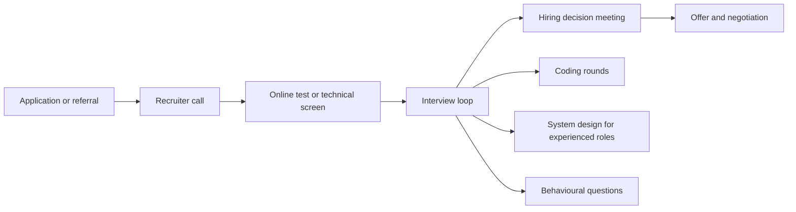

# What a behavioural interview is

## Before this lesson

Nothing. This is the first lesson of the track and assumes no work experience and no interview experience. If you want a picture of the whole hiring process first (application, phone screen, on-site day, offer), the lesson [How hiring works, end to end](#/lesson/interview-prep/hiring-pipeline) in the Cracking the Coding Interview track gives it; this track then goes much deeper on one part of that process, the questions about you.

## In plain words

Imagine you need a plumber for a leaking pipe. You could ask two kinds of question. One kind: "What would you do if the pipe burst at midnight?" Anyone can give a good answer to that, including someone who has never held a wrench. The other kind: "Tell me about the last time a pipe burst on a job. What did you actually do?" Now the answer has to come from memory, it has details you can check, and it tells you how this person really behaves under pressure.

A **behavioural interview** is the second kind of conversation, used for hiring. The interviewer asks you to describe specific things you have done in the past: a disagreement you handled, a deadline you missed, a time you helped a struggling teammate. The idea underneath it is simple and old: **the way you acted in the past is the best available hint about the way you will act in the future.**

Why it matters for a job in software: at large technology companies, every candidate meets at least one interviewer whose main job is to collect this kind of evidence, and at some companies (Amazon is the best-known example) every interviewer asks these questions alongside the technical ones. A candidate who writes excellent code but cannot give a single clear example of working with other people often does not get the offer. The good news is that this is the most trainable part of the whole process. Your past does not change between now and the interview, but the way you remember, organise and tell it can change a lot in a few weeks.

## The vocabulary you need

A few words will appear in every lesson of this track. Each is defined here once in plain language.

- **Interviewer**: the person asking the questions. Usually an engineer or manager at the company, sometimes a recruiter.
- **Candidate**: you, the person being interviewed.
- **Recruiter**: a company employee who manages your application, schedules interviews and later talks to you about the offer. Recruiters are not usually the people who judge your answers in depth.
- **Interview loop**: the set of interviews you go through for one job, often several in a row on the same day or spread over a week. The name comes from the idea of going "around" a group of interviewers.
- **Competency**: a skill or habit the company wants to see, described in a way that can be observed. "Handles disagreement respectfully" is a competency; "is nice" is not, because you cannot observe it reliably.
- **Evidence**: the specific things you say that show (or fail to show) a competency. "I booked a call with the other team, showed them the error logs and we agreed on a fix by Friday" is evidence. "I am a great communicator" is a claim, not evidence.
- **Behavioural question**: a question about a real past event, usually starting with "Tell me about a time..." or "Describe a situation where...".
- **Hypothetical question**: a question about an imagined future situation, usually starting with "What would you do if...".

## Why the past is used to predict the future

Hiring is a prediction. The company is trying to guess, from a few hours of conversation, how you will behave over the next several years. Every interview method is a way of collecting clues for that guess, and some kinds of clue are more reliable than others.

The United States Office of Personnel Management (OPM), the agency that writes hiring guidance for the US federal government, summarises research on interviews and notes that questions about past behaviour show higher **validity** for complex professional work. Validity, in hiring research, means how well a method's scores line up with how people actually perform on the job later. A method with high validity separates future strong performers from future weak ones; a method with low validity is close to guessing.

Why would past behaviour be a good clue? Three plain reasons:

1. **Habits repeat.** People who check their work carefully tend to keep doing so. People who avoid hard conversations tend to keep avoiding them.
2. **Real events are hard to invent on the spot.** A true story has names, numbers, a messy middle and a specific ending. A made-up one tends to be smooth and vague, and it falls apart when the interviewer asks a second or third question.
3. **The candidate cannot easily guess the "right" answer.** Ask anyone "Would you help a struggling teammate?" and they will say yes. Ask "Tell me about the last time a teammate was struggling" and the answer reveals what they really did.

> [!NOTE]
> "Best available hint" is not the same as "perfect predictor". People grow, and a story from three years ago may show someone you no longer are. That is exactly why good answers often end with what you learned and what you do differently now. Later lessons show how.

## Two kinds of question: behavioural and hypothetical

Google's re:Work site, where Google publishes guidance on its people practices, describes two main types of structured interview question:

- **Behavioural questions** ask about past experience ("Tell me about a time..."). They show patterns in how a person has acted.
- **Hypothetical questions** describe a realistic job situation and ask how you would handle it ("What would you do if..."). They show how a person reasons about something new.

Both are used in real loops. Lesson 17 of this track, [Hypothetical and scenario questions](#/lesson/behavioural/hypothetical-questions), covers the second kind in depth. For now, learn to recognise them quickly, because the right kind of answer differs.

| You hear | Type | What a good answer contains |
|---|---|---|
| "Tell me about a time you disagreed with a teammate." | Behavioural | One specific real event, what you did, what happened |
| "Describe a situation where you missed a deadline." | Behavioural | One real event, told honestly, with what you changed afterwards |
| "Give me an example of when you took the lead without being asked." | Behavioural | One real event where you acted on your own initiative |
| "What would you do if your manager asked you to ship code you thought was unsafe?" | Hypothetical | Your reasoning, the options, the trade-offs, and ideally a real example of similar judgement |
| "Imagine a customer reports data loss on a Friday evening. Walk me through your next hour." | Hypothetical (scenario) | A clear sequence of steps and the reasons behind them |
| "How do you usually handle feedback?" | Disguised behavioural | A general habit, then quickly a specific example that proves it |

The last row matters. Many questions sound general ("How do you usually...?", "What is your approach to...?") but the interviewer still wants evidence. A strong candidate answers the general part in one sentence and then says "for example, last semester..." and tells a real story. Meta's interview preparation blog makes the same point for its behavioural round: if you drift into theory, expect the interviewer to ask for a real example.

### Signal words

You can usually tell the type from a few words:

- **Behavioural**: "tell me about a time", "describe a situation", "give me an example", "walk me through a project where", "what is the most ... you have ever ...".
- **Hypothetical**: "what would you do", "imagine", "suppose", "how would you handle", "if you were".

## What a behavioural interview is not

Newcomers often arrive with wrong expectations, so it helps to clear a few away.

**It is not a puzzle round.** Years ago, some technology companies were famous for brainteasers such as estimating how many golf balls fit in an aeroplane. Google's own "How we hire" page states that it does not use brainteasers, because they did not predict how people performed in the job. A behavioural interview is the opposite of a trick: it asks about things you already know, your own life.

**It is not a personality test.** You are not being sorted into "introvert" or "extrovert". Quiet people do well in these interviews all the time. What matters is whether you can give clear examples of useful behaviour.

**It is not small talk.** The friendly tone can mislead you. The interviewer is usually writing notes the whole time and will later rate what you said against a written standard. Lessons 2 and 3 explain how that rating works.

**It is not a test with one right answer.** Two candidates can tell completely different stories about conflict and both score highly, because what is being judged is the behaviour shown in the story, not which story it is.

**It is not only for experienced people.** Graduate and intern interviews include behavioural questions too. Interviewers expect stories from school projects, part-time jobs, clubs and volunteering when you have little work history. Lesson 7, [Mining your experience](#/lesson/behavioural/mining-experience), shows how to find them.

## Where these questions appear in a hiring process

The exact steps differ by company, role, level and year, so treat the flow below as a typical shape rather than a rule.



Behavioural questions can turn up at almost every arrow. The recruiter call often includes "Tell me about yourself" and "Why are you interested in us?". In the loop, companies organise them differently:

- **Amazon** builds its interviews around its Leadership Principles. Its preparation page for the Software Development Engineer II role describes four interviews of 55 minutes each, and says to expect two to three behavioural questions in each of them, alongside technical questions. Lesson 20 covers this.
- **Meta**, in its 2022 software engineering preparation post, describes a separate 45-minute behavioural interview alongside the coding and design rounds. Lesson 21 covers this.
- **Google** rates candidates on a small set of attributes; one of them is leadership, which for individual engineers means taking initiative and working well across teams. Behavioural questions are how that attribute is gathered.
- **Singapore employers** such as GovTech, Grab and DBS describe interviews that check both skills and fit with stated company values. Lesson 23 covers them.

## What the interviewer is trying to collect

Every behavioural question is a door into one or more competencies. Here is a starter list of the competencies that appear most often in software engineering loops. Each later lesson in the "question families" modules takes one of these and goes deep.

| Competency | Plain meaning | Typical question |
|---|---|---|
| Collaboration | You work well with others and make the team better | "Tell me about a successful team project." |
| Handling conflict | You disagree respectfully and still deliver | "Describe a disagreement with a colleague." |
| Learning from failure | You own mistakes and change because of them | "Tell me about a time you failed." |
| Ownership | You take responsibility beyond the minimum | "Tell me about something you did that was not your job." |
| Dealing with ambiguity | You make progress when things are unclear | "Describe a project where the requirements kept changing." |
| Influence | You persuade people who do not report to you | "Tell me about convincing others to adopt your idea." |
| Customer focus | You care about the people who use what you build | "Tell me about a time you went out of your way for a user." |

Notice what is not on the list: intelligence, charm, confidence, perfect English. Those may affect impressions, and later lessons show how good structure reduces the influence of impressions, but the target is evidence of behaviour.

## A first look at a real exchange

Here is a short, fictional exchange to make this concrete. It is an **example**, invented for teaching.

> **Example (fictional).**
> **Interviewer:** Tell me about a time you had to work with someone who was difficult to work with.
> **Candidate:** Oh, I get along with everyone. I think communication is really important, so I always try to be open and listen.
> **Interviewer:** Could you give me a specific example, from a project or a job?
> **Candidate:** Hmm. Well, in my final-year project, one teammate kept missing our meetings...

The first answer contains no evidence at all. It is a claim about yourself plus an opinion. The interviewer has to spend a follow-up question to get anything usable, and some interviewers will not ask; they will write "no example given" and move on. The second attempt, the one that starts "in my final-year project", is where the real answer begins.

The rest of this track teaches you to start at that second answer, every time, and to tell it in a way that is easy to follow and easy to score.

## Myths that hold beginners back

**"I have no experience, so I have nothing to say."** You have more than you think. A group assignment where one member stopped replying is a conflict and collaboration story. A part-time café job where an order went wrong is a customer story. Interviewers adjust their expectations to your level; they want to see the behaviour, not the size of the stage.

**"My stories need to be impressive."** A small story told clearly beats a grand story told vaguely. "I noticed our club's sign-up form lost entries and fixed it in a weekend" can score better than "I was part of a team that built a platform for millions of users", because the first shows what you did.

**"I should only tell success stories."** Failure questions are standard, and Amazon's Bar Raisers (specially trained interviewers, explained in lesson 20) say openly that being self-critical about mistakes and showing what you learned can impress them. A candidate who has never failed sounds like a candidate who has never tried anything hard.

**"I can improvise. It is only talking."** Improvised answers are usually long, start in the wrong place and forget the result. Preparation is what makes an answer sound natural, the same way a musician who has practised sounds relaxed on stage.

**"I should memorise perfect scripts."** Also a trap. Memorised scripts sound flat and break at the first unexpected follow-up question. The middle path, preparing stories as notes and practising them aloud, is what lesson 8 teaches.

## How this track is organised

The track has seven modules, and each builds on the previous ones.

1. **Foundations** (lessons 1 to 3): what this interview is, why companies use structured interviews, and how your answers are scored.
2. **Telling a story** (lessons 4 to 6): the STAR structure in depth, its variants, and the habits that make answers score well.
3. **Preparing your material** (lessons 7 to 9): finding stories in your life, organising them into a story bank, and the opening questions.
4. **Question families, part 1** (lessons 10 to 14): teamwork, conflict, failure, ownership, ambiguity.
5. **Question families, part 2** (lessons 15 to 19): influence, customers and standards, hypothetical questions, follow-up probes, red flags.
6. **Company playbooks** (lessons 20 to 23): Amazon, Google and Meta, Microsoft and Apple, Singapore companies.
7. **Level, format and the offer** (lessons 24 to 26): senior-level signals, remote interviews and questions to ask, offers and Singapore employment basics.

If you have an interview next week, read lessons 4, 6, 8 and 18 first, then the company lesson for your target.

## Summary

- A behavioural interview asks about specific things you did in the past, because past behaviour is the best available clue to future behaviour.
- OPM notes that questions about past behaviour show higher validity (better prediction of job performance) for complex professional work.
- Behavioural questions ask "tell me about a time"; hypothetical questions ask "what would you do if". Both are used, and general-sounding questions usually still want a real example.
- It is not a puzzle, a personality test or small talk. Google says it does not use brainteasers because they did not predict performance.
- Companies place these questions differently: spread across every Amazon interview, a dedicated 45-minute round at Meta, a leadership attribute at Google. Details vary by role, level and year.
- Students and career switchers are expected to draw on school, part-time work and volunteering.
- Preparation beats both improvising and memorising scripts.

## Glossary

- **Behavioural interview**: an interview, or part of one, that asks for real examples from your past.
- **Behavioural question**: a "tell me about a time" question about a real past event.
- **Hypothetical question**: a "what would you do if" question about an imagined situation.
- **Competency**: an observable skill or habit the employer wants, such as handling conflict.
- **Evidence**: specific statements about what you did, as opposed to claims about what you are like.
- **Interview loop**: the full set of interviews for one job.
- **Recruiter**: the company employee who manages your application and schedule.
- **Validity**: how well an assessment's scores predict later job performance.
- **Brainteaser**: a trick or puzzle question unrelated to the job, no longer used at Google by its own account.

```quiz
[
  {"q": "An interviewer asks: 'What would you do if a teammate stopped replying to messages a week before a deadline?' What type of question is this?",
   "options": ["Behavioural", "Hypothetical", "A brainteaser", "A personality test"],
   "answer": 1,
   "explain": "It asks about an imagined situation ('what would you do if'), so it is hypothetical. A strong answer still often attaches a real example of similar judgement."},
  {"q": "Which statement is evidence rather than a claim?",
   "options": ["I am a natural leader.", "I always communicate clearly.", "I set up a shared task board, assigned owners for each of the six features and we demoed on time.", "People tell me I am easy to work with."],
   "answer": 2,
   "explain": "Only the third describes specific actions and a result that an interviewer can write down and probe."},
  {"q": "Why do structured hiring processes favour questions about past behaviour?",
   "options": ["They are shorter to ask", "Past behaviour is the best available hint about future behaviour, and research summarised by OPM shows higher validity for complex professional work", "They are required by law everywhere", "They let interviewers avoid taking notes"],
   "answer": 1,
   "explain": "Validity means how well the method predicts later performance; real past events are harder to fake than intentions."},
  {"q": "A candidate is asked 'How do you usually handle feedback?' Which answer is strongest?",
   "options": ["I welcome all feedback.", "Feedback is very important in software teams.", "I ask for specifics and act on them. For example, in my internship a reviewer said my pull requests were too large, so I split the next feature into four small ones and review time dropped from days to hours.", "It depends on the feedback."],
   "answer": 2,
   "explain": "General-sounding questions still want evidence. The strong answer gives the habit in one sentence and then proves it with a real example."},
  {"q": "A final-year student says: 'I have no work experience, so I cannot answer behavioural questions.' What is the best advice?",
   "options": ["Invent a work story", "Skip behavioural rounds", "Use school projects, part-time jobs, clubs and volunteering, because interviewers want the behaviour, not the size of the stage", "Answer every question hypothetically"],
   "answer": 2,
   "explain": "Interviewers adjust expectations to the candidate's level. Real student experiences show the same competencies."},
  {"q": "Why does Google say it stopped using brainteasers?",
   "options": ["They were too hard", "They did not predict job performance", "Candidates complained about time", "They were replaced by personality tests"],
   "answer": 1,
   "explain": "Google's How we hire page says brainteasers did not predict how people performed, so they are not used."}
]
```

> **Source:** US OPM, Structured Interviews (https://www.opm.gov/policy-data-oversight/assessment-and-selection/other-assessment-methods/structured-interviews/); Google re:Work, A guide to structured interviewing (https://rework.withgoogle.com/intl/en/guides/a-guide-to-structured-interviewing-for-better-hiring-practices); Google, How we hire (https://www.google.com/about/careers/applications/how-we-hire/); Amazon, SDE II interview prep (https://atoz.amazon/en-us/jobs/hiring-process/interview-prep/software-development-engineer-ii); Meta, Preparing for your software engineering interview, 2022 (https://www.metacareers.com/blog/preparing-for-your-software-engineering-interview-at-meta/); Amazon, Bar Raiser tips (https://www.aboutamazon.com/news/workplace/amazon-job-interview-questions-tips-bar-raisers). All examples are original and fictional.
