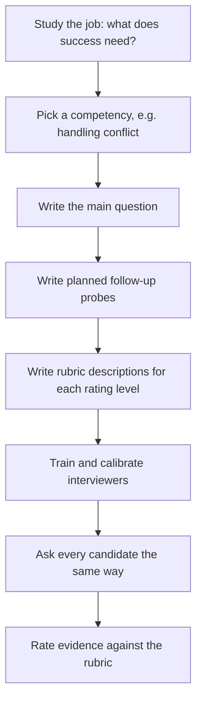

# Why companies use structured interviews

## Before this lesson

Read [What a behavioural interview is](#/lesson/behavioural/what-is-behavioural). You should know the difference between a behavioural question ("tell me about a time...") and a hypothetical one ("what would you do if..."), and what a competency is (an observable skill or habit the employer wants to see).

## In plain words

Picture a cooking competition with three judges. In the first version, each judge walks around, tastes whatever dish they like, chats with whichever cook seems friendly, and at the end says who "felt" best. In the second version, every cook makes the same dish, every judge tastes every plate, and each judge fills in the same scorecard: taste out of four, presentation out of four, with a written description of what a four looks like. The second competition is less fun to watch but much fairer, and its results are far more likely to pick the best cook.

A **structured interview** is the second competition applied to hiring. Every candidate for a role is asked questions chosen in advance for that role, and every answer is scored against the same written standard. An **unstructured interview** is the first competition: each interviewer asks whatever comes to mind and forms an overall impression.

Why should you, the candidate, care how the company designs its interviews? Because once you understand the design, you know what kind of answer it rewards. A structured interview rewards specific, relevant evidence about the exact competency the question targets. It punishes rambling, vague claims and answers to a different question than the one asked. Knowing this changes how you prepare.

## Unstructured and structured, side by side

| | Unstructured interview | Structured interview |
|---|---|---|
| Questions | Chosen by each interviewer on the day | Chosen in advance for the role, the same for every candidate |
| Follow-up questions | Whatever the interviewer is curious about | Planned probes for each question, plus natural follow-ups |
| Scoring | An overall impression, often "would I like to work with this person?" | Each answer rated on a scale with written descriptions of each level |
| Notes | Optional, often sparse | Detailed notes expected, so others can review the evidence |
| Interviewer preparation | Little | Training, plus **calibration**: interviewers compare ratings so they score the same answer the same way |
| Main risk | Personal bias, inconsistency, chatting instead of assessing | Can feel stiff; depends on good questions and trained interviewers |

Two terms in the table deserve a plain definition:

- A **rubric** is the written scoring guide: for one question or competency, it describes what a poor, middling and excellent answer looks like. Lesson 3 is about rubrics.
- **Calibration** is the practice of interviewers checking that they apply the rubric the same way, for example by rating the same recorded or written answer separately and then discussing any differences.

## Google's description of a structured interview

Google's re:Work guide defines structured interviewing as asking every candidate for a role the same questions and assessing the answers with the same scoring standards and the same predetermined qualifications. It lists four ingredients:

1. **Vetted, relevant questions.** Questions are written and checked in advance so that each one targets something the job needs.
2. **Guidance on what good answers contain.** Interviewers get notes on what to listen for, so the bar is not invented on the day.
3. **Standardised rubrics.** Every answer is rated on the same scale with the same descriptions.
4. **Interviewer training and calibration.** People are taught to use the method and checked for consistency.

The guide also explains that each question comes with an initial prompt and a set of **predetermined follow-up questions**: probes that dig into the parts of the story the first answer usually leaves out, such as what your goal was, how others reacted, and what you did next. This is useful to know, because it means the follow-ups you hear are often not a sign that you answered badly. They are part of the plan. Lesson 18, [Handling follow-up probes](#/lesson/behavioural/follow-up-probes), shows how to handle them.

Google's public "How we hire" page adds that it uses the same rubrics for every candidate and describes its process as taking roughly six to eight weeks once interviews for a role begin (not counted from the application), while noting that timing varies.

## Why companies bother

Structure costs effort. Someone has to write the questions, design the rubrics and train hundreds of interviewers. Companies do it for four main reasons.

### Reason 1: better prediction

The whole point of an interview is to predict job performance. OPM's guidance on structured interviews reports that structured interviews predict performance better than unstructured ones, and that questions about past behaviour show higher validity for complex professional work. Google's re:Work guide reports the same conclusion from Google's own research: structured interviews were better predictors of performance.

The reason is not mysterious. When everyone answers the same questions against the same standard, differences in scores are more likely to reflect differences in the candidates rather than differences in which interviewer they happened to meet, or how the conversation happened to drift.

### Reason 2: fairness and less bias

**Bias**, in hiring, means a systematic tilt in judgement that has nothing to do with ability to do the job: favouring people who went to your university, who share your hobbies, who speak with your accent, or who resemble the people already on the team. Unstructured interviews give bias a lot of room, because "overall impression" is exactly where these tilts live.

Structure narrows the room. When an interviewer must write down specific evidence and match it to a written description of each rating level, "I liked them" is no longer enough to justify a high score, and "they did not seem like a fit" is no longer enough to justify a low one. Lesson 3 names the most common rater errors.

Fair-hiring guidance in Singapore points the same way. The Tripartite Alliance for Fair and Progressive Employment Practices (TAFEP), which publishes Singapore's fair-employment guidelines, advises interviewers to keep questions job-related and to avoid questions about personal characteristics such as age, race, religion, marital status, plans for children and disability. Lesson 26 covers your rights in more detail.

### Reason 3: efficiency

It sounds backwards, but preparation saves time. Google's re:Work guide reports that having prepared questions, guides and rubrics saved interviewers about 40 minutes per interview on average, because they no longer had to invent questions or reconstruct their impressions afterwards.

### Reason 4: a better experience for candidates

Google also reports that candidates who were rejected after a structured interview were 35% happier with their experience than those rejected after an unstructured one. A plausible reading is that a focused, clearly job-related conversation feels fairer, even when the result is a no.

## How one structured question is built

It helps to see a question from the company's side. Here is the life cycle of a single behavioural question, simplified.



A fictional example of what an interviewer's sheet might hold for one question (this is an **example** made for teaching, not any company's real material):

> **Competency:** Handling disagreement.
> **Main question:** Tell me about a time you disagreed with a teammate about how to do a piece of work.
> **Planned probes:** What exactly was the disagreement? What did you do first? How did the other person see it? How was it resolved? What would you do differently?
> **Strong answers usually show:** the candidate sought the other view before arguing; used facts or a small test rather than authority; stayed respectful; the work moved forward; the candidate can say what they learned.
> **Weak answers usually show:** no specific event; the candidate "won" by escalating or ignoring the other person; blame; no outcome.

Look at that sheet as a candidate and you can see the answer it rewards. That is the core idea of this whole track: **prepare for the sheet, not for the conversation.**

## What structure means for you, the candidate

### Answer the question that was asked

Each question maps to a competency, and the rubric for that competency is what you are scored against. If you are asked about a disagreement and you tell a story about a tight deadline, your excellent deadline story may earn nothing on the disagreement rubric. Before you start, take two seconds to name the competency to yourself: "This is a conflict question."

### Expect the interviewer to read from a sheet

Some interviewers will look down at their notes, read the question word for word and type while you talk. That is not rudeness or boredom; it is the method. Do not let it unsettle you, and do not fill silences with extra rambling while they finish typing. Pausing briefly so they can catch up is fine.

### Different interviewers cover different competencies

In a loop with several interviewers, the company usually divides the competencies among them so the same ground is not covered twice. This has a practical consequence: **do not tell the same story to every interviewer.** If one interviewer heard your best project story, the next interviewer may be assigned a different competency and needs fresh evidence. A varied set of stories, which lesson 8 helps you build, solves this. Amazon's own list of interview mistakes includes repeating the same example for every question.

### One answer is one data point

Because ratings are per question and per competency, one weak answer does not end the interview. Candidates who stumble on the first question and then give three strong answers often do well overall. Reset after a weak answer instead of carrying it into the next one.

### Follow-ups are normal

Planned probes are built in. "What did you do next?" or "How did the other person react?" are not traps. They are the interviewer collecting the evidence the rubric asks for. The best response is a direct, specific answer.

## A fictional exchange in a structured interview

> **Example (fictional).** A graduate candidate, Wei Ling, in a structured interview.
> **Interviewer** (reading): Tell me about a time you disagreed with a teammate about how to do a piece of work.
> **Wei Ling:** In my second-year software engineering module, our team of four built a library booking app. I disagreed with a teammate, Arjun, about whether to use a relational database or store everything in JSON files.
> **Interviewer:** What did you do first?
> **Wei Ling:** I asked him why he preferred files. His reason was that none of us had used a database and he was worried about the two-week deadline. That was fair, so I suggested we each spend one evening on a small prototype: he would try the file approach with two users booking the same room at once, and I would try SQLite, a small database that runs as a single file.
> **Interviewer** (typing): How was it resolved?
> **Wei Ling:** His prototype double-booked the room in about one test in five. Mine did not, because the database could enforce that a room has only one booking per time slot. We showed both to the team on Friday and chose SQLite. I also wrote a one-page setup guide so the two members who had never used SQL could start the next day.
> **Interviewer:** What would you do differently?
> **Wei Ling:** I would suggest the prototype idea earlier. We argued for two days before trying anything.

Every probe gets a direct, concrete answer. Wei Ling respects her teammate's concern, uses a small test rather than authority, gets the work moving and reflects honestly. Each sentence gives the interviewer something to write in the "strong answers usually show" column.

## The limits of structure

Structure is a spectrum, not a switch. Many real interviews are **semi-structured**: the main questions are planned, but the interviewer has freedom in follow-ups and conversation. Some smaller companies interview with almost no structure. Some interviewers at structured companies drift from the method. You cannot control any of this, which is why the preparation in this track is designed to work for both kinds: an answer that scores well against a rubric also impresses an unstructured interviewer, because it is clear, specific and relevant.

Also remember that each company's process changes over time and differs by role and level. Treat every specific number in this track (number of interviews, minutes, weeks) as "what the company said at the time of writing", and check the company's own careers pages before your interview.

## Your turn

Take a real job posting you are interested in. Read the responsibilities and requirements and write down the five competencies you think a structured interview for it would target. For each, write one question the interviewer might ask. Keep the list; lesson 7 uses it to choose your stories.

## Summary

- A structured interview asks every candidate for a role the same prepared questions and scores answers against the same written rubric. An unstructured interview relies on each interviewer's questions and overall impression.
- Google's re:Work lists four ingredients: vetted questions, guidance on good answers, standardised rubrics, and interviewer training and calibration. Questions come with planned follow-up probes.
- Companies use structure because it predicts performance better (OPM, Google), reduces bias, saves time (Google reports about 40 minutes per interview) and gives rejected candidates a better experience (35% happier, per Google).
- As a candidate: answer the exact question, expect note-taking and sheets, vary your stories across interviewers, treat each answer as one data point, and welcome probes.
- Real interviews range from fully structured to loose; good structured answers work everywhere.

## Glossary

- **Structured interview**: an interview where questions and scoring standards are set in advance and are the same for every candidate for a role.
- **Unstructured interview**: an interview where each interviewer chooses questions freely and judges by overall impression.
- **Semi-structured interview**: planned main questions with freedom in follow-ups.
- **Rubric**: a written scoring guide describing what each rating level looks like.
- **Calibration**: checking and aligning how different interviewers apply the same rubric.
- **Probe**: a follow-up question that asks for missing detail.
- **Bias**: a systematic tilt in judgement unrelated to ability to do the job.
- **TAFEP**: the Tripartite Alliance for Fair and Progressive Employment Practices, which publishes Singapore's fair-employment guidance.

```quiz
[
  {"q": "Which feature most clearly makes an interview 'structured'?",
   "options": ["It takes place in an office", "Every candidate for the role gets the same prepared questions, scored against the same rubric", "The interviewer is a senior manager", "It lasts exactly one hour"],
   "answer": 1,
   "explain": "Structure means fixed questions and fixed scoring standards across candidates, not location, seniority or length."},
  {"q": "An interviewer reads your question from a sheet and types while you speak. What does this most likely mean?",
   "options": ["They are bored", "They are following a structured method and recording evidence for later review", "You have already failed", "They want you to talk faster"],
   "answer": 1,
   "explain": "Detailed notes are part of structured interviewing so the hiring team can review evidence later."},
  {"q": "You gave your best project story to the first interviewer. The second interviewer asks about influencing others. What should you do?",
   "options": ["Retell the same story because it is your best", "Use a different story that shows influence, since interviewers usually cover different competencies", "Refuse the question", "Summarise your resume instead"],
   "answer": 1,
   "explain": "Interviewers often split competencies; repeating one example across questions is a listed Amazon interview mistake."},
  {"q": "According to Google's re:Work guide, what did structured interviewing save interviewers on average?",
   "options": ["About 5 minutes per interview", "About 40 minutes per interview", "A full day per hire", "Nothing measurable"],
   "answer": 1,
   "explain": "Google reports about 40 minutes saved per interview from prepared questions, guides and rubrics."},
  {"q": "The interviewer asks, 'And how did the other person react?' What is the best interpretation?",
   "options": ["A trap to catch you lying", "A planned probe collecting evidence the rubric asks for", "A sign your answer was wrong", "Small talk"],
   "answer": 1,
   "explain": "Structured questions come with predetermined follow-ups. Answer directly and specifically."},
  {"q": "You are asked about a disagreement, but your strongest story is about meeting a tight deadline. What is the risk of telling the deadline story?",
   "options": ["No risk; a strong story always scores", "It may earn little, because the answer is scored against the disagreement rubric", "It will take too little time", "The interviewer will not be able to take notes"],
   "answer": 1,
   "explain": "Each question maps to a competency; a great story about a different competency gives little evidence for the one being rated."},
  {"q": "Which reason for structured interviews concerns bias?",
   "options": ["It saves interviewer time", "It forces ratings to rest on written evidence matched to descriptions, leaving less room for 'I liked them'", "It shortens the hiring process to one week", "It removes the need for technical rounds"],
   "answer": 1,
   "explain": "Requiring evidence tied to rubric levels narrows the space where personal tilts operate."}
]
```

> **Source:** Google re:Work, A guide to structured interviewing (https://rework.withgoogle.com/intl/en/guides/a-guide-to-structured-interviewing-for-better-hiring-practices); US OPM, Structured Interviews (https://www.opm.gov/policy-data-oversight/assessment-and-selection/other-assessment-methods/structured-interviews/); Google, How we hire (https://www.google.com/about/careers/applications/how-we-hire/); TAFEP, Conducting job interviews (https://www.tal.sg/tafep/employment-practices/recruitment/conducting-job-interviews); Amazon, Interview mistakes (https://www.aboutamazon.com/news/workplace/amazon-jobs-interview-mistakes). The interviewer sheet and dialogue are original and fictional.
