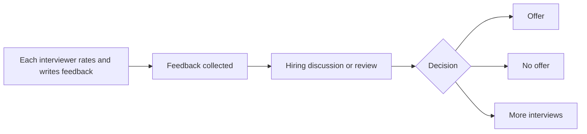

# How you are scored

## Before this lesson

Read [Why companies use structured interviews](#/lesson/behavioural/structured-interviews). You should know what a rubric is (a written scoring guide that describes each rating level), what a probe is (a follow-up question asking for missing detail) and what calibration means (interviewers aligning how they apply the same rubric). If you have read [What interviewers evaluate and how rubrics work](#/lesson/interview-prep/what-interviewers-score) in the Cracking the Coding Interview track, this lesson goes further on the behavioural side: rating scales, the notes behind them, and the mistakes raters make.

## In plain words

Think of a diving competition. The judges do not give a score for "how much I enjoyed the dive". Each judge has a scale, knows what a 3 and an 8 look like, watches specific things (take-off, rotation, entry into the water) and writes down a number. Then the numbers are combined. A diver who understands the scoring trains differently: a clean entry is worth working on even if the crowd barely notices it.

In a behavioural interview, you are the diver. The interviewer listens for specific things, writes notes, and turns those notes into a rating on a scale. Later, a group of people who never met you may read those notes and decide. This lesson shows you each step, so you can make your answers easy to score well.

The single most useful idea here: **you are not scored on what you meant, only on what the interviewer could write down.** If an action happened but you did not say it clearly, it does not exist in the notes.

## Step 1: the interviewer listens for evidence

During your answer, the interviewer is mentally sorting your sentences into three bins:

1. **Evidence for the competency**: specific actions you took that show the skill the question targets. "I asked the on-call engineer for the error logs, found that the timeouts only happened for one region, and moved our retry setting from three to one for that region."
2. **Context**: facts that help them understand, but are not themselves evidence. "We were a team of five building a payments service."
3. **Noise**: things that use time but help neither. Long background, opinions, side stories, technical detail that does not change the story.

A strong answer is mostly bin 1, with a little bin 2 and almost no bin 3. Lesson 4 turns this into the STAR structure.

## Step 2: notes

Google's re:Work guide tells interviewers to take detailed notes on each answer so that others in the hiring process can review them later. In practice, a note is a compressed version of your evidence. Here is what an interviewer's notes might look like for two candidates answering the same ownership question. Both are **fictional examples**.

> **Candidate A (notes):**
> Q: time you took ownership beyond your role.
> - "worked on a project to improve the app", team effort
> - "we fixed lots of bugs", "we improved performance"
> - asked for own role: "I helped with the backend"
> - result: "it went well, the users liked it"
> - no numbers. Unclear what candidate personally did.

> **Candidate B (notes):**
> Q: time you took ownership beyond your role.
> - internship, team of 6, mobile banking app; C on frontend
> - noticed crash reports for one Android version ignored for 3 weeks, no owner
> - C reproduced on emulator, found null date field, fixed, added test
> - C wrote a short guide so crash triage rotates weekly; manager adopted it
> - crash rate on that version from about 2% of sessions to under 0.1% in 2 weeks
> - reflection: should have flagged earlier instead of waiting a week

Candidate B's note almost writes the rating for the interviewer. Candidate A's note forces them to guess, and in a structured process, guessing is not allowed, so the rating falls.

> [!TIP]
> Speak in a way that is easy to write down. Short sentences, one action per sentence, names of things ("the crash dashboard", "the onboarding guide"), and numbers. Pause half a second after an important number so it lands.

## Step 3: the rating scale

Once your answer is complete, the interviewer converts the notes into a rating on a fixed scale.

### How many levels?

There is no universal scale. OPM's guide to structured interviews describes rating scales with between three and seven levels, and recommends that at least three of the levels be described in words, so raters know what each one looks like. Google's re:Work guide gives an example scale with four levels: **poor, borderline, solid, outstanding**.

A scale where levels are described with examples of behaviour is often called an **anchored** scale: each level is "anchored" to a description, so two raters reading the same notes are more likely to land on the same score.

### A fictional anchored rubric

Below is an **example** rubric for one competency, written for this lesson in the style these sources describe. It is not any company's real rubric.

| Level | Description for "Ownership" |
|---|---|
| Outstanding | Saw a problem nobody owned, acted without being asked, fixed the root cause, made sure it stayed fixed (process, documentation or tooling), and can show a measurable effect. Honest about trade-offs. |
| Solid | Took clear responsibility for their own work and some adjacent work, followed through to a result, explains their own actions specifically. |
| Borderline | Did their assigned work well, but the example shows little beyond the assignment; or own role is hard to separate from the team's. |
| Poor | No specific example; blames others for gaps; or the story shows avoiding responsibility. |

Compare the two sets of notes above with this rubric. Candidate B is at least solid, probably outstanding (noticed an unowned problem, fixed the root cause, made a process so it stayed fixed, measured result, honest reflection). Candidate A is borderline at best, and possibly poor, because the evidence is missing, not because the candidate did nothing.

### Why "borderline" exists

Many scales include a middle level that says "not enough evidence either way". It is a warning sign for candidates: it is often the rating given to people who probably did good work but did not show it. Most of the techniques in this track (STAR, saying "I", numbers, answering the actual question) exist to move you from borderline to solid.

## Step 4: probes fill the gaps

If your first answer leaves a gap, a trained interviewer probes. OPM's guide specifically advises interviewers to probe when a candidate says "we", to find out what the candidate personally did. Google's guide describes planned follow-ups for each question.

This is good news: a probe is a second chance to supply missing evidence. But it is better not to need it, because interview time is limited. If an interviewer spends five minutes extracting your role from one story, that is one fewer question where you could have shown a different competency.

## Step 5: the decision

What happens after your last interview depends on the company. A common shape is:



Two details from Amazon's published material show how seriously some companies treat this step:

- Amazon has specially trained interviewers called **Bar Raisers**. Amazon says there are more than 3,600 of them, that they come from outside the hiring team, and that they are trained over a period of three to twelve months.
- Amazon describes the hiring decision as one the Bar Raiser and the hiring manager make together. (Lesson 20 explains the Bar Raiser fully; note that Amazon's own description is a joint decision, so be careful with claims you may read elsewhere about a "veto".)

The practical lesson: **your notes travel without you.** People who never met you may judge you from the written record. A vague answer cannot be rescued by a warm handshake.

## Rater errors: how scoring goes wrong

Interviewers are human. OPM's guide lists several common rating errors that interviewer training tries to prevent. Knowing them helps you understand what structure protects you from, and where a little care on your side helps.

### Similar-to-me error

Rating someone higher because they resemble the rater: same university, same hobby, same home town, same way of talking. It is a form of bias. Structured rubrics fight it by requiring evidence. Your part: do not rely on rapport; make sure the evidence is in the answer.

### Halo error

Letting one strong impression colour everything else. A candidate with a famous company on their CV, or a brilliant first answer, may be rated higher on unrelated competencies. The reverse also happens in practice: one poor answer drags down the rest. Your part: treat every question as a fresh start, and recover quickly from a weak answer.

### Leniency and strictness errors

Some raters are generous with everyone; others are harsh with everyone. Calibration exists to correct this. You cannot control who you get, which is one reason companies use several interviewers.

### Central tendency error

Putting almost everyone in the middle of the scale to avoid committing. If an interviewer's evidence is thin, the middle feels safe. Your part: give enough specific evidence that a high rating is easy to justify.

| Error | What happens | What protects you |
|---|---|---|
| Similar-to-me | Rater favours people like themselves | Rubrics that require evidence; your clear evidence |
| Halo | One impression colours all ratings | Separate ratings per question; your fast recovery |
| Leniency or strictness | Rater too soft or too hard on everyone | Calibration; multiple interviewers |
| Central tendency | Rater avoids high and low scores | Strong, specific evidence that makes a high score defensible |

## What the scoring process means for your preparation

Put the five steps together and a short list of habits falls out. Each is taught in detail later.

1. **Lead with a one-sentence headline** so the interviewer knows which bin to file your story in (lesson 4).
2. **Give context briefly** and spend most of your time on your own actions (lesson 4).
3. **Say "I" for your actions**, and name others' contributions fairly (lesson 6).
4. **Include numbers** or, when numbers do not exist, concrete observable outcomes (lesson 6).
5. **End with a result and a reflection**, so the final note has something to anchor a high rating (lessons 4 and 5).
6. **Answer the competency the question targets**, not a nearby one (lesson 2).
7. **Have varied stories**, so each interviewer gets fresh evidence (lesson 8).

## Practise scoring yourself

Scoring someone else's answer is one of the fastest ways to improve your own. Read this fictional answer to "Tell me about a time you had to learn something quickly" and rate it against the four levels poor, borderline, solid, outstanding, before reading the commentary.

> **Example (fictional answer).** "In my polytechnic final-year project, our client, a small logistics firm, changed their request three weeks before the deadline: they wanted the delivery tracker to work offline on drivers' phones. None of the four of us had built offline features. I volunteered to learn it. I spent two evenings on the official documentation for the browser's storage features and built a tiny test page that saved a delivery while the phone was in aeroplane mode and sent it when the connection came back. I showed the team the test on Monday, and we split the remaining work: I built the sync logic and wrote a half-page guide for the others. We delivered on time; in the client's trial, two drivers used it in a basement car park with no signal for a week and no deliveries were lost. I learned that a tiny throwaway prototype is the fastest way for me to learn something new."

**Commentary.** This is at least solid and arguably outstanding for a student. The challenge is clear and specific. The candidate's own actions are distinct (volunteered, studied, built a prototype, showed it, built the sync logic, wrote a guide). There is a concrete result (no deliveries lost in a real trial) and an honest, specific reflection. What could lift it further: a number on the learning speed ("two evenings") is there; a number on the result could be stronger ("about 300 deliveries recorded offline"), if true.

## Summary

- You are scored on what the interviewer could write down, not on what you meant.
- Interviewers sort what you say into evidence, context and noise, and take detailed notes (Google re:Work).
- Notes become ratings on a fixed scale. OPM describes scales of three to seven levels with at least three described in words; Google's example uses poor, borderline, solid, outstanding.
- "Borderline" is often the rating for good work that was not shown clearly.
- Probes fill gaps; OPM advises probing when candidates say "we".
- Decisions are often made by people reading the notes. At Amazon, the Bar Raiser and hiring manager decide together; Amazon reports more than 3,600 Bar Raisers, trained over three to twelve months, from outside the hiring team.
- Rater errors (similar-to-me, halo, leniency or strictness, central tendency) are what structure tries to prevent; clear evidence is your protection.

## Glossary

- **Rating scale**: the fixed set of levels an answer can receive.
- **Anchored scale**: a rating scale whose levels are described with examples of behaviour.
- **Notes**: the interviewer's written record of your answer, used later by others.
- **Debrief or hiring discussion**: a meeting or review where interviewers' feedback is combined into a decision.
- **Bar Raiser**: at Amazon, a specially trained interviewer from outside the hiring team who decides on the hire jointly with the hiring manager.
- **Similar-to-me error**: rating people higher because they resemble the rater.
- **Halo error**: letting one strong impression lift ratings on unrelated points.
- **Leniency or strictness error**: a rater being consistently too generous or too harsh.
- **Central tendency error**: rating almost everyone in the middle of the scale.

```quiz
[
  {"q": "A candidate fixed a serious bug during an internship but describes it as 'we sorted out some issues'. What is the most likely scoring outcome?",
   "options": ["Outstanding, because the work was real", "Borderline or lower, because the notes cannot show what the candidate personally did", "No effect; interviewers infer the details", "Automatic rejection"],
   "answer": 1,
   "explain": "Ratings rest on what can be written down. Vague team language leaves the interviewer without evidence of the candidate's own actions."},
  {"q": "According to OPM's guide, how many levels do structured interview rating scales typically have?",
   "options": ["Always exactly 2", "Between 3 and 7, with at least 3 described in words", "Always 10", "Between 10 and 20"],
   "answer": 1,
   "explain": "OPM describes scales of three to seven levels and recommends describing at least three of them."},
  {"q": "An interviewer went to the same university as the candidate and rates them highly on every competency despite thin evidence. Which rater error is this most like?",
   "options": ["Central tendency", "Similar-to-me", "Strictness", "Calibration"],
   "answer": 1,
   "explain": "Favouring a candidate because they resemble the rater is the similar-to-me error."},
  {"q": "Which sentence would most help an interviewer write a high rating for ownership?",
   "options": ["I am very proactive.", "We improved things a lot.", "Crash reports for one Android version had no owner for three weeks, so I reproduced the crash, fixed a null date field and added a test.", "The team was great to work with."],
   "answer": 2,
   "explain": "It names the unowned problem and the candidate's own specific actions, which map directly to an ownership rubric."},
  {"q": "What does Amazon say about how its hiring decision is made?",
   "options": ["The recruiter decides alone", "The Bar Raiser and the hiring manager decide together", "The candidate's future teammates vote", "The Bar Raiser decides alone with an absolute veto, per Amazon's own page"],
   "answer": 1,
   "explain": "Amazon describes a joint decision between the Bar Raiser and the hiring manager. Do not claim a veto on the basis of Amazon's own description."},
  {"q": "Your first answer went badly. Which rater error makes it important to deliver a strong second answer quickly?",
   "options": ["Halo, because one impression can colour other ratings", "Leniency", "Central tendency", "None; first answers are discarded"],
   "answer": 0,
   "explain": "One impression can spread to other ratings. A clearly strong next answer gives separate evidence and limits that effect."},
  {"q": "Why might an interviewer probe after you say 'we'?",
   "options": ["To test your grammar", "Because OPM-style guidance advises finding out what the candidate personally did", "To shorten the interview", "Because 'we' is forbidden"],
   "answer": 1,
   "explain": "Saying 'we' hides individual contribution; probing for it is standard structured-interview practice."}
]
```

> **Source:** Google re:Work, A guide to structured interviewing (https://rework.withgoogle.com/intl/en/guides/a-guide-to-structured-interviewing-for-better-hiring-practices); US OPM, Structured Interviews: A Practical Guide, 2011 (https://www.opm.gov/policy-data-oversight/assessment-and-selection/structured-interviews/structured-interviews.pdf); Amazon, The Bar Raiser (https://www.aboutamazon.com/news/workplace/amazon-bar-raiser). The rubric, notes and example answer are original and fictional.
