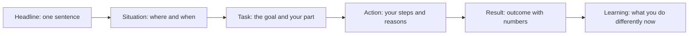

# STAR in depth

## Before this lesson

Read [How you are scored](#/lesson/behavioural/how-you-are-scored): you should know that interviewers sort what you say into evidence, context and noise, and that ratings rest on the notes they can write. The lesson [The story grid and the STAR structure](#/lesson/interview-prep/story-grid-star) in the Cracking the Coding Interview track introduces STAR in one page with a single worked example; this lesson takes each part apart, compares the time splits that universities recommend, rebuilds messy stories step by step, and gives you an interactive builder to check your own drafts.

## In plain words

When a friend tells you a good story at dinner, it usually has a shape: where they were, what went wrong, what they did about it, and how it ended. When a friend tells a bad story, they start in the middle, go back to explain, forget the ending and spend five minutes on the weather. The facts may be equally interesting; the shape is what differs.

**STAR** is a fixed shape for answering behavioural questions. The letters stand for:

- **S**ituation: the setting, in a sentence or two.
- **T**ask: the goal or problem, and what your responsibility was.
- **A**ction: what you did, step by step. This is the main part.
- **R**esult: what happened in the end, ideally measured, and what you learned.

Career centres at universities such as MIT and Northwestern teach STAR because it matches what interviewers need to write down. It is not a magic formula; it is a way of putting the evidence in the order a listener can follow. For a job, it means your real experience gets the credit it deserves.



The diagram adds two small pieces around the four letters: a one-sentence **headline** at the start (a summary that tells the listener where the story is going) and a **learning** sentence at the end. Both are common advice, and lesson 5 shows that some variants of STAR make the learning a formal fifth part.

## How long should each part be?

Different universities suggest different proportions. Both are rules of thumb, not standards.

| Part | MIT CAPD suggestion | Northwestern suggestion |
|---|---|---|
| Situation | about 20% | about 15% |
| Task | about 10% | about 10% |
| Action | about 60% | about 50% |
| Result | about 10% | about 25% |

MIT's Career Advising and Professional Development office (CAPD) describes its split as a rough guide to pacing. Northwestern's career advancement office puts more weight on the result. The two agree on what matters most: **Action is the largest part, by a wide margin**, and Situation plus Task together stay around a quarter or less.

Why the difference on Result? A reasonable reading: a story with a strong measurable outcome and a meaningful lesson deserves more time at the end; a story where the outcome is simple ("the feature shipped on time") needs only a sentence. Use the Action share as your fixed point and let the Result breathe when it has something to say.

> [!NOTE]
> In time, if your whole answer is about two minutes, 60% Action is a little over a minute of describing what you did. That is a lot. Most beginners spend most of their time on the Situation instead, which is the most common STAR mistake of all.

## Situation: the shortest useful setting

The Situation answers "where are we, and why should I care?". It should let a stranger follow the rest of the story, and nothing more.

**Include:**
- The setting: company type, school module, club, job. ("A four-person team in my second-year software engineering module.")
- Scale, if it matters to the story. ("A payments service handling about 2,000 transactions a day.")
- The trigger: the thing that made this story start. ("Two weeks before the demo, our client changed the requirements.")

**Leave out:**
- History that does not change the outcome ("the company was founded in 2011 by...").
- Technical detail that the Action does not depend on.
- Names of people who do not appear again.

A useful test: if you deleted the sentence, would anything in the Action stop making sense? If not, delete it.

**Weak Situation:** "So I was working at this company, it was my second job, I had joined about a year before after my previous role, where I did mostly frontend, and the team I was on was about eight people, though it changed during the year, and we were using a mix of Java and some Python, and our manager was quite new..."

**Strong Situation:** "I was a backend developer on an eight-person team that ran the order service for an online grocery company. One Monday, about one in fifty orders started failing at checkout."

## Task: the goal and your part

The Task is where beginners get confused, because it seems to overlap with the Situation. Here is the difference:

- **Situation** = the world before you act. What is going on.
- **Task** = the job to be done and whose job it was. What success would look like and why you were the one doing it.

The Task is also where you separate your responsibility from the team's, which matters for scoring. "The team's goal was to launch the booking app by the end of term; my part was the payment flow and the automated tests" tells the interviewer exactly what to credit you for.

**Examples of Tasks:**
- "I was on call that week, so finding the cause was my responsibility."
- "Nobody owned the flaky test suite. I decided to take it on, because it was slowing every release."
- "As the club treasurer, I had to get the event budget approved before the venue deposit was due on Friday."

Notice the second example: the Task can be something you chose, not something you were assigned. That choice is itself evidence of ownership (lesson 13).

### Situation or Task? A quick check

| Sentence | Situation or Task? |
|---|---|
| "Our app's sign-up rate dropped by a third after a redesign." | Situation (what happened) |
| "My manager asked me to find out why within a week." | Task (the job and who held it) |
| "I worked part-time at a bubble tea shop on weekends." | Situation |
| "I wanted to cut the queue time during the Saturday rush." | Task |

If you are unsure, do not worry about perfect labels. The interviewer cares that the setting is brief and the goal is clear, not that you announce "and now the Task".

## Action: where the evidence lives

The Action is what you are really being scored on. Several habits make it strong.

### 1. Use steps, in order

Describe three to five distinct actions, in the order you did them. Order shows your thinking: what you checked first tells the interviewer how you approach problems.

### 2. Say why, not only what

"I looked at the logs" is an action. "I looked at the logs first, because the failures started on Monday and we had deployed on Friday, so I wanted to see whether the errors began with the release" is an action with **reasoning**. Reasoning is what separates a competent answer from an outstanding one, because it shows judgement.

### 3. Include the obstacle

Real stories have a moment where something did not work: the first fix failed, a teammate disagreed, the data was missing. Including it makes the story believable and shows persistence. Leaving it out makes the story sound too smooth to be true.

### 4. Show the people, not only the technology

Even technical stories involve people: who you asked, who you informed, whose agreement you needed. Many competencies (collaboration, influence, communication) are only visible through those moments.

### 5. Use "I" for your actions

"I wrote", "I proposed", "I asked". Lesson 6 covers this in depth; for now, notice that every action in the strong examples below starts with "I".

**Weak Action:** "We looked into it and eventually found the problem, so we fixed it and things got better."

**Strong Action:** "I started with the error dashboard and saw that every failing order used the same new payment option, which had launched on Friday. I pulled twenty failing requests from the logs and found that the payment provider was rejecting a field our code now sent as empty. I could have patched it alone in an hour, but the payments team owned that integration, so I messaged their on-call engineer with the twenty examples and a suggested fix. While they reviewed it, I turned off the new payment option with a feature switch, a setting that lets us hide a feature without deploying code, so customers could pay with the other methods. They shipped the fix that afternoon, and I turned the option back on after watching the error rate for an hour."

Count the distinct actions: checked the dashboard, pulled examples, chose to involve the owning team (with a reason), mitigated with a feature switch, verified after the fix. Each is a separate line in the interviewer's notes.

## Result: outcome, numbers, learning

The Result closes the story. It answers "so what?" and gives the interviewer an anchor for the rating.

**Include:**
- **The outcome of your actions**, measured if possible: time saved, errors reduced, users reached, money, grades, people affected.
- **Effects on people**, if relevant: the client signed off, the teammate later asked you to review their work, the process was adopted.
- **The learning**: one sentence on what you do differently since. Keep it specific to the story.

**Weak Result:** "So yeah, it all worked out in the end."

**Strong Result:** "Checkout failures went from about 2% of orders back to the normal level of under 0.1% within six hours, and the payments team added a check for empty fields to their tests. Since then, whenever I see an error spike after a release, I look for the newest change touching that path first, which has made my on-call shifts a lot calmer."

### What if the result was bad?

Not every story ends well, and failure questions require stories that do not. Michigan Tech's career services page makes the point that poor results and mistakes are often where the most useful lessons come from; what matters is that you explain what you learned and how you apply it. A bad result told honestly with a real lesson scores better than a good result with no learning. Lesson 12 is about this.

## Rebuilding a messy story: a worked example for a junior

Here is how a student might first tell a story, followed by the rebuild. Both are **fictional examples**.

**First attempt (as spoken):** "So for our hackathon we wanted to do something with food waste and there were five of us but one guy left on the first night, and we used React, well I had not used React before but I learned it, and the judges liked the demo, we came second, and also the API was down for a bit, which was stressful, but anyway it worked out and I learned a lot about teamwork."

It has good material buried in it: a teammate leaving, a new technology, an outage under pressure, a result. Now the rebuild, for the question "Tell me about a time you worked under pressure":

- **Headline:** "At a 36-hour hackathon, the external data service our app depended on went down six hours before judging, and I rebuilt the demo around it."
- **Situation:** "Our team of four was building an app that suggests recipes from food close to its expiry date. It pulled product data from a free public food database."
- **Task:** "I was responsible for the frontend and the demo. Six hours before judging, the database started returning errors for every request."
- **Action:** "First I checked the service's status page, which said it was down with no time for recovery, so I assumed it would not come back in time. I proposed to the team that we stop waiting and cache the data we needed: we had about forty products in our demo script. I wrote a small script that saved those forty items from our earlier successful requests into a local file, and changed the app to read from the file when the service failed. I told the team clearly that the demo would only work for those forty items, so the presenter would not wander off-script. Then I rehearsed the demo twice with our presenter."
- **Result:** "The demo ran without a single error, and we placed second of 22 teams. The judges asked how we handled the outage and liked the fallback. What I took from it is to build a fallback for any external service before a demo, not after it fails; I now do that by default on every project."

Notice what was cut: the teammate leaving (a different story, perhaps a teamwork one), "I learned React" (a learning-fast story) and "it was stressful" (a feeling, not an action). One messy memory often holds several clean STAR stories.

## Rebuilding a story for an experienced engineer

Experienced engineers have the opposite problem: too much material, and a habit of drowning the Action in technical detail. The rebuild is mostly about choosing.

**First attempt (summary):** a ten-minute account of migrating a service from one database to another, covering the schema, the replication tool, three vendor calls, two reorganisations and a holiday freeze.

**Rebuild for "Tell me about your most complex project":**
- **Headline:** one sentence naming the migration, its size and the outcome.
- **Situation and Task (30 seconds):** why the migration mattered and your role ("I led the technical plan and coordinated three teams").
- **Action (about 90 seconds):** the three decisions that shaped the project, each with a reason and a rejected alternative: migrating in phases rather than all at once; running both databases in parallel and comparing results; choosing which team moved first and why.
- **Result (30 seconds):** the outcome with numbers (downtime, cost, latency), plus what you would change.

Everything else (the vendor calls, the holiday freeze) waits for follow-up questions. Interviewers who want depth will ask, and you will look more senior for having chosen well. Lesson 24 develops senior-level signals further.

## Interactive: a STAR answer builder

Type or paste your four parts below and press Run. The page counts words per part, shows the proportions as a bar, compares them with the MIT or Northwestern split, estimates speaking time and counts how often you say "I" and "we". Speaking time uses 140 words per minute, an approximate average for calm speech; your own pace may differ, so time yourself aloud too (lesson 6 has a timer). Nothing is sent anywhere; it all runs in this page.

```html-run
<!doctype html>
<html lang="en">
<head>
<meta charset="utf-8">
<title>STAR builder</title>
<style>
  body { font-family: system-ui, sans-serif; margin: 12px; color: #1f2937; background: #fff; }
  label { font-weight: 600; display: block; margin-top: 10px; }
  textarea { width: 100%; box-sizing: border-box; min-height: 60px; font: inherit; padding: 6px; }
  .count { font-size: 12px; color: #6b7280; }
  .bar { display: flex; height: 26px; margin: 12px 0 4px; border-radius: 6px; overflow: hidden; border: 1px solid #d1d5db; }
  .bar div { color: #fff; font-size: 12px; display: flex; align-items: center; justify-content: center; white-space: nowrap; overflow: hidden; }
  .s { background: #2563eb; } .t { background: #7c3aed; } .a { background: #059669; } .r { background: #d97706; }
  .target .s, .target .t, .target .a, .target .r { opacity: 0.55; }
  #advice li { margin: 4px 0; }
  select { font: inherit; }
</style>
</head>
<body>
<label>Situation <span class="count" id="cs"></span></label>
<textarea id="S">I was a backend developer on an eight-person team running the order service for an online grocery company. One Monday, about one in fifty orders started failing at checkout.</textarea>
<label>Task <span class="count" id="ct"></span></label>
<textarea id="T">I was on call that week, so finding and stopping the failures was my job.</textarea>
<label>Action <span class="count" id="ca"></span></label>
<textarea id="A">I started with the error dashboard and saw that every failing order used the new payment option launched on Friday. I pulled twenty failing requests and found the provider rejected a field our code now sent empty. The payments team owned that integration, so I sent their on-call engineer the examples and a suggested fix. While they reviewed it, I hid the new option with a feature switch so customers could pay another way. After their fix shipped I turned it back on and watched the error rate for an hour.</textarea>
<label>Result <span class="count" id="cr"></span></label>
<textarea id="R">Failures dropped from about 2% of orders to under 0.1% within six hours, and the payments team added a test for empty fields. Since then I check the newest change on the failing path first.</textarea>
<p>Compare with: <select id="model"><option value="mit">MIT 20 / 10 / 60 / 10</option><option value="nu">Northwestern 15 / 10 / 50 / 25</option></select></p>
<div><b>Your answer</b></div>
<div class="bar" id="mine"></div>
<div><b>Suggested split</b></div>
<div class="bar target" id="target"></div>
<p id="summary"></p>
<ul id="advice"></ul>
<script>
var parts = ["S", "T", "A", "R"];
var names = { S: "Situation", T: "Task", A: "Action", R: "Result" };
var cls = { S: "s", T: "t", A: "a", R: "r" };
var models = { mit: { S: 20, T: 10, A: 60, R: 10 }, nu: { S: 15, T: 10, A: 50, R: 25 } };
function words(t) { var m = t.trim().match(/\S+/g); return m ? m.length : 0; }
function countWord(t, w) { var re = new RegExp("\\b" + w + "\\b", "gi"); var m = t.match(re); return m ? m.length : 0; }
function drawBar(el, shares) {
  el.innerHTML = "";
  parts.forEach(function (p) {
    var d = document.createElement("div");
    d.className = cls[p];
    d.style.width = shares[p] + "%";
    d.textContent = shares[p] > 7 ? p + " " + Math.round(shares[p]) + "%" : "";
    el.appendChild(d);
  });
}
function update() {
  var w = {}, total = 0, all = "";
  parts.forEach(function (p) {
    var text = document.getElementById(p).value;
    w[p] = words(text); total += w[p]; all += " " + text;
  });
  var shares = {};
  parts.forEach(function (p) {
    shares[p] = total ? (100 * w[p] / total) : 25;
    document.getElementById("c" + p.toLowerCase()).textContent = w[p] + " words";
  });
  drawBar(document.getElementById("mine"), shares);
  var model = models[document.getElementById("model").value];
  drawBar(document.getElementById("target"), model);
  var secs = Math.round(total / 140 * 60);
  var iCount = countWord(all, "I") + countWord(all, "my");
  var weCount = countWord(all, "we") + countWord(all, "our");
  document.getElementById("summary").textContent = total + " words, about " + secs +
    " seconds aloud. 'I' or 'my': " + iCount + ", 'we' or 'our': " + weCount + ".";
  var tips = [];
  if (shares.A < model.A - 15) tips.push("Action is only " + Math.round(shares.A) + "%. Move detail from the setting into what you did.");
  if (shares.S + shares.T > 40) tips.push("Situation and Task take " + Math.round(shares.S + shares.T) + "% of the answer. Cut background that the Action does not need.");
  if (!/\d/.test(document.getElementById("R").value)) tips.push("The Result has no number. Can you measure the outcome, or name a concrete effect?");
  if (weCount > iCount) tips.push("You say 'we' more than 'I'. The interviewer may not see your part.");
  if (secs < 60) tips.push("Under a minute: probably missing steps or reasons in the Action.");
  if (secs > 240) tips.push("Over four minutes: trim and leave detail for follow-up questions.");
  if (!tips.length) tips.push("Proportions look healthy. Now say it aloud and time it.");
  var ul = document.getElementById("advice"); ul.innerHTML = "";
  tips.forEach(function (t) { var li = document.createElement("li"); li.textContent = t; ul.appendChild(li); });
}
parts.forEach(function (p) { document.getElementById(p).addEventListener("input", update); });
document.getElementById("model").addEventListener("change", update);
update();
</script>
</body>
</html>
```

How the page works, briefly: `words` counts runs of non-space characters in each box; the shares are each part's words divided by the total; `drawBar` draws one coloured segment per part with a width equal to its share; the advice list prints a tip only when a rule is broken. The sample text in the boxes is a shortened version of the checkout story from this lesson: about 170 words, roughly 54% Action and 21% Result, which sits close to the Northwestern split and takes a little over a minute to say. Switch the comparison to MIT and the page will not complain, because the Action is within 15 points of 60%. Replace it with your own story and watch the bar change as you type.

## Common STAR mistakes, collected

1. **The long runway**: a minute of Situation before anything happens. Fix: two sentences, then the trigger.
2. **The missing Task**: the listener never learns what success looked like or what your part was. Fix: one sentence beginning "My part was..." or "I was responsible for...".
3. **The team blur**: an Action full of "we". Fix: "I" for your own steps (lesson 6).
4. **The technical deep dive**: the Action becomes a lecture on a technology. Fix: one sentence of technical detail per decision, then the reason.
5. **The vanishing Result**: the story stops at the fix. Fix: always say what changed, with a number if one exists.
6. **The generic lesson**: "I learned that communication is important". Fix: a lesson specific to the story, ideally with a habit you now follow.
7. **The robot announcer**: "Situation: ... Task: ... Action: ...". Fix: use STAR as an invisible skeleton, not as spoken labels.

## Summary

- STAR stands for Situation, Task, Action, Result. Add a one-sentence headline before it and a learning sentence at the end.
- Time splits differ by source: MIT suggests about 20/10/60/10, Northwestern about 15/10/50/25. Both make Action the largest part.
- Situation: the shortest setting that makes the Action understandable, ending with the trigger.
- Task: the goal and your specific responsibility, which may be something you chose to take on.
- Action: three to five steps in order, with reasons, obstacles, people, and "I".
- Result: measured outcome, effects on people, and a specific lesson. Bad results are allowed if the learning is real.
- Messy memories usually contain several STAR stories; experienced engineers must choose, not include everything.

## Glossary

- **STAR**: Situation, Task, Action, Result, a structure for answering behavioural questions.
- **Headline**: a one-sentence summary said before the story.
- **Situation**: the brief setting of the story, ending with the event that started it.
- **Task**: the goal to be achieved and your part in it.
- **Action**: the steps you took, with your reasons.
- **Result**: the outcome, ideally measured, plus what you learned.
- **Trigger**: the event that starts the story's problem.
- **Feature switch**: a setting that turns a product feature on or off without deploying new code.
- **CAPD**: MIT's Career Advising and Professional Development office.

```quiz
[
  {"q": "Which sentence belongs in the Task part of a STAR answer?",
   "options": ["Our company sells groceries online.", "I was on call that week, so finding the cause was my responsibility.", "I pulled twenty failing requests from the logs.", "Failures dropped to under 0.1%."],
   "answer": 1,
   "explain": "The Task states the goal and whose job it was. The others are Situation, Action and Result."},
  {"q": "MIT and Northwestern suggest different STAR time splits. On what do they agree?",
   "options": ["Situation should be the longest part", "Action should be the largest part by a wide margin", "Result should always be exactly 10%", "Task should be skipped"],
   "answer": 1,
   "explain": "MIT suggests about 60% Action and Northwestern about 50%; both keep Situation and Task short."},
  {"q": "Two candidates describe the same bug fix. Which Action would score higher, and why? A: 'We looked into it and fixed it.' B: 'I checked the dashboard first because the errors began after Friday's release, then pulled twenty failing requests and found an empty field.'",
   "options": ["A, because it is shorter", "B, because it shows the candidate's own ordered steps and the reasoning behind them", "Neither; actions are not scored", "A, because it credits the team"],
   "answer": 1,
   "explain": "B gives distinct personal actions in order with reasons, which is evidence of judgement that maps to a rubric."},
  {"q": "A student's hackathon story mentions a teammate leaving, learning React and an outage before judging. Asked about working under pressure, what should they do?",
   "options": ["Tell all three events in one answer", "Tell the outage story and save the others for different questions", "Talk only about React", "Say hackathons do not count"],
   "answer": 1,
   "explain": "One messy memory often holds several STAR stories. Choose the one that matches the competency and keep the others for other questions."},
  {"q": "Which is the strongest Result?",
   "options": ["It all worked out in the end.", "The team was really happy.", "Checkout failures fell from about 2% to under 0.1% within six hours, and since then I check the newest change on the failing path first.", "I learned that communication is important."],
   "answer": 2,
   "explain": "It gives a measured outcome and a specific habit learned from the story."},
  {"q": "Your story ended badly: the feature was cancelled. Can it still be a good STAR answer?",
   "options": ["No, results must be positive", "Yes, if you tell it honestly and explain a specific lesson and how you apply it", "Only if you blame the cancellation on management", "Only for senior roles"],
   "answer": 1,
   "explain": "Career services such as Michigan Tech's note that poor results can carry the best lessons; the learning is what gets scored."},
  {"q": "In the STAR builder page, what does the advice 'Situation and Task take 45% of the answer' tell you to do?",
   "options": ["Add more background", "Cut background the Action does not need and move detail into what you did", "Remove the Result", "Speak faster"],
   "answer": 1,
   "explain": "Setting and goal should stay around a quarter or less; the evidence is in the Action."}
]
```

> **Source:** MIT CAPD, The STAR method for behavioral interviews (https://capd.mit.edu/resources/the-star-method-for-behavioral-interviews/); Northwestern Career Advancement, The STAR approach (https://www.northwestern.edu/careers/jobs-internships/interviewing/the-star-approach.html); Michigan Tech Career Services, Behavioral interviews (https://www.mtu.edu/career/students/networking/interviews/behavioral/); US OPM, Structured Interviews: A Practical Guide, 2011 (https://www.opm.gov/policy-data-oversight/assessment-and-selection/structured-interviews/structured-interviews.pdf). Stories and the builder page are original.
