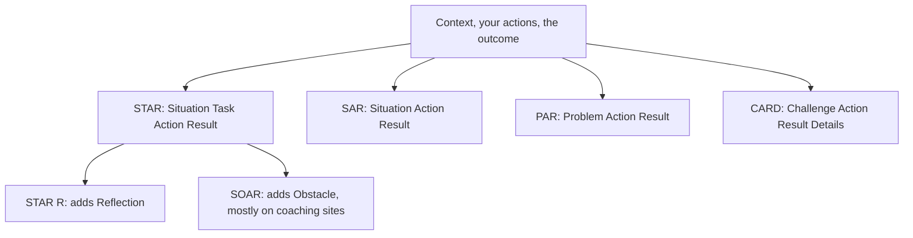

# STAR variants: CARD, SAR, PAR and STAR(R)

## Before this lesson

Read [STAR in depth](#/lesson/behavioural/star-in-depth). You should be comfortable with the four parts (Situation, Task, Action, Result), the idea that Action is the largest part, and the one-sentence headline at the start.

## In plain words

Recipes for the same dish differ from cookbook to cookbook. One calls the first step "prepare the vegetables", another "mise en place", a third combines it with the next step. The dish is the same; the instructions are organised a little differently, and some cookbooks add a final step such as "taste and adjust".

Answer structures for behavioural questions are like that. STAR is the most widely taught, but you will meet others: **CARD**, **SAR**, **PAR**, and Microsoft's **STAR(R)**, which adds a fifth step called Reflection. They all describe the same underlying shape: what the problem was, what you did, and what came of it. This lesson shows how they map onto each other, what each one emphasises, and how to use the extra ideas (especially Details and Reflection) to make your answers stronger.

Why it matters: a company's careers page may recommend one particular format, and when it does, it is telling you what its interviewers like to hear. Microsoft's interview tips recommend STAR(R) by name. If you prepare with that in mind, you give them exactly what they asked for.

## The family tree



Every member has the same core: some **context**, your **actions**, and the **outcome**. They differ in two ways: how they split the context (one part or two) and what extra emphasis they add at the end (details, reflection, obstacles).

## SAR and PAR: STAR with the Task folded in

Michigan Tech's career services page describes STAR and notes that the same technique is often called SAR or PAR. In common usage:

- **SAR** stands for Situation, Action, Result.
- **PAR** stands for Problem, Action, Result.

Both merge the Situation and the Task into one opening. Nothing is lost if the opening still answers both questions: "where are we?" and "what needed to happen, and what was my part?".

**When SAR or PAR is useful:**
- **Short answers.** A recruiter phone screen may only leave you 60 to 90 seconds per question. Three parts are easier to keep tight than four.
- **Stories where the task is obvious.** If the Situation is "the production database went down while I was on call", the task (restore it) needs no separate sentence.
- **Problem-first thinkers.** PAR's word "Problem" pushes you to open with the tension immediately, which makes stories more gripping.

**The risk:** with only one opening part, beginners sometimes drop the "my part" sentence, and the interviewer cannot tell what the candidate was responsible for. Keep that sentence even when you use SAR or PAR.

## CARD: Challenge, Action, Result, Details

Strayer University's career centre teaches **CARD**:

- **Challenge**: the problem, goal or requirement in the example.
- **Action**: the specific actions you took to meet it.
- **Result**: the benefit or outcome, in specific and measurable terms.
- **Details**: clarifying facts that make the story concrete, such as how many, how much, how long or how often.

The interesting part is **Details**. It is not a separate section you say at the end. It is a reminder to sprinkle concrete quantities through the whole answer. Strayer's own examples mark the details inside the other parts, not after them.

Compare these two versions of the same sentence:

- Without details: "I helped a frustrated user fix her computer problem."
- With details: "I went to her desk within five minutes of getting back, apologised for the two-hour wait, and had the problem fixed in about ten minutes."

The second version is more believable, easier to picture and easier to write in notes. Details answer the interviewer's silent question "how big was this, really?".

### A details checklist

When you review a story, look for places where one of these four questions has an answer you left out:

| Question | Example detail |
|---|---|
| How many? | "a team of four", "22 teams entered", "about 300 users a week" |
| How much? | "cut the cloud bill by about a fifth", "a budget of SGD 2,000" |
| How long? | "in two evenings", "for three weeks nobody owned it", "within six hours" |
| How often? | "failed about twice a month", "every Saturday rush", "one test in five" |

Strayer also advises keeping answers to one to two minutes, preparing stories that demonstrate the qualifications in the job posting, and noticing that one story can show several skills at once. Lessons 7 and 8 build on those points.

## STAR(R): adding Reflection

Microsoft's interview tips page recommends answering with **STAR(R)**: Situation, Task, Action, Result, and **Reflection**. The page lists Reflection as the final step and does not spell out exactly what it should contain, so what follows is a practical interpretation consistent with the rest of Microsoft's tips, which ask candidates to be ready to describe how they applied feedback, worked with others and adapted their approach.

A **reflection** is your look back at the story with the benefit of hindsight. It answers questions like:

- What did I learn about the problem, the people or myself?
- What would I do differently with what I know now?
- How have I applied that lesson since?

### Weak and strong reflections

| Weak reflection | Why weak | Strong reflection | Why strong |
|---|---|---|---|
| "I learned that communication is key." | Generic; could follow any story | "I learned to send a written summary after every decision meeting. I now do it within an hour, and in the next project nobody disputed a decision later." | Specific habit, evidence it changed behaviour |
| "I would not change anything." | Sounds closed to learning | "I would bring the client in a week earlier; we lost four days building something they did not need." | Honest, specific, cost stated |
| "I realised I am a perfectionist." | A disguised strength | "I spent two days polishing a screen nobody had validated. Now I demo rough versions after one day." | Real cost and a changed habit |

A strong reflection has three ingredients: **a specific lesson**, **a changed behaviour**, and ideally **evidence** that the change happened (a later project where you applied it).

### Why reflection impresses interviewers

Reflection is evidence of a competency in its own right: the ability to learn from experience. Companies that value growth (Microsoft builds it into its recommended answer format; Meta's preparation blog says interviewers look for self-awareness and growth; Amazon's Bar Raisers say being self-critical about mistakes can impress them) all reward it. A candidate who does the same work as another but reflects well on it often looks more senior, because reflection is what turns experience into judgement.

## SOAR, briefly

You may meet **SOAR**: Situation, Obstacle, Action, Result. It appears mainly on coaching and blog sites rather than in official company or university guidance. Its useful idea is the **Obstacle**: naming what made the situation hard. You already saw in lesson 4 that a good Action includes the obstacle; SOAR makes it a named part. Use the idea if it helps you remember to include tension, but there is no need to learn it as a separate system.

## One story, three ways

Here is a single **fictional** story told in three formats, to show that the formats differ mostly in emphasis. The candidate, Farah, worked part-time on a university IT helpdesk. The question is "Tell me about a time you improved a process."

### As SAR (about 45 seconds)

> **Situation.** I worked eight hours a week at my university's IT helpdesk. Students who forgot their password had to queue at the counter, and in the first week of term the queue reached about forty minutes, mostly for password resets. My part was the counter, and I wanted the queue shorter.
> **Action.** I counted request types for two shifts and found that roughly two thirds were resets. I wrote a one-page guide with screenshots for the self-service reset page, which most students did not know existed, and asked my supervisor if we could put a QR code to it on the queue sign. She agreed, and I printed the signs.
> **Result.** In the next busy week the longest queue I recorded was about fifteen minutes, and resets at the counter fell by about half.

### As CARD (about 70 seconds)

The same story with **Details** woven in: "eight hours a week", "two shifts, 130 requests", "about two thirds", "a one-page guide with six screenshots", "the longest queue went from about forty minutes to about fifteen", "counter resets fell from about 85 to about 40 a week". The structure is the same; the numbers make it vivid.

### As STAR(R) (about 90 seconds)

Everything in the SAR version, plus a **Reflection**:

> **Reflection.** What I took from it is that counting before changing anything was the most valuable step. I had assumed the queue was about slow staff; the count showed it was about a missing piece of information. I have used the same habit since: in my final-year project I logged where users got stuck for a week before redesigning anything, and it pointed us to a single confusing button rather than the whole screen we had planned to rebuild.

Notice that the reflection includes evidence of reuse (the final-year project). That single sentence turns a nice helpdesk story into a story about how Farah learns.

## Choosing a format

| Situation | Format to reach for |
|---|---|
| Recruiter phone screen, very short answers | SAR or PAR |
| Company recommends a format (for example Microsoft's STAR(R)) | That format |
| Failure, mistake or feedback questions | STAR(R): the reflection is the point |
| Story with strong measurable outcomes | STAR or CARD with rich details |
| Senior roles, where judgement is being assessed | STAR(R), with the reflection on trade-offs |
| You are not sure | STAR, with a one-sentence learning at the end |

The honest truth is that a well-told STAR answer with a specific learning sentence at the end already covers almost everything the variants add. The variants are most useful as **checklists**: CARD reminds you to add numbers; STAR(R) reminds you to reflect; SOAR reminds you to name the obstacle; SAR and PAR remind you that the opening can be short.

## Practice: convert a story

Take this bare SAR story and turn it into a STAR(R) answer, adding details and a reflection. Write it down, then compare with the suggestions below.

> **Bare story (fictional).** "In my internship I noticed the test suite took a long time. I made it faster by running tests in parallel. The team was happy."

<details>
<summary>Suggestions for the conversion</summary>

- **Situation**: how long did it take, and why did it matter? ("The test suite for our web app took about 25 minutes, so the six developers on the team ran it only once or twice a day.")
- **Task**: whose problem was it, and why did you take it on? ("Nobody owned the test setup. My mentor agreed I could spend two days of my internship on it.")
- **Action**: what did you check, choose and do, with reasons? ("I timed each test file and found that three files that started a real database took 60% of the time. I first split the suite to run in four parallel groups, which brought it to about 9 minutes. Then I replaced the database in those three files with a lighter in-memory one where the tests did not need the real thing, and kept the real database for two integration tests.")
- **Result**: with numbers. ("The suite went from about 25 minutes to about 6. Developers started running it before every commit, and the number of broken builds on the main branch fell from several a week to about one.")
- **Reflection**: specific lesson plus reuse. ("I learned to measure before optimising: my first guess was that the tests were slow because there were too many of them, but three files caused most of the time. I now time things before changing them, which I also did on my final-year project's slow page.")

</details>

## Summary

- STAR, SAR, PAR, CARD, STAR(R) and SOAR share one core: context, your actions, the outcome.
- SAR (Situation, Action, Result) and PAR (Problem, Action, Result) fold the Task into the opening; keep the "my part" sentence.
- CARD (Challenge, Action, Result, Details), taught by Strayer University, reminds you to weave in how many, how much, how long and how often. Strayer suggests answers of one to two minutes.
- STAR(R), recommended by Microsoft, adds Reflection: a specific lesson, a changed behaviour and evidence of the change.
- SOAR adds an Obstacle and comes mainly from coaching sites; use the idea, not the system.
- Use the variants as checklists. Match a company's recommended format when it names one.

## Glossary

- **SAR**: Situation, Action, Result.
- **PAR**: Problem, Action, Result.
- **CARD**: Challenge, Action, Result, Details, as taught by Strayer University's career centre.
- **Details**: concrete quantities (how many, how much, how long, how often) woven through an answer.
- **STAR(R)**: Situation, Task, Action, Result, Reflection, the format Microsoft recommends.
- **Reflection**: a look back at the story: what you learned, what you would change and how you have applied it.
- **SOAR**: Situation, Obstacle, Action, Result, a variant found mainly on coaching sites.
- **Obstacle**: the thing that made the situation hard.

```quiz
[
  {"q": "What does the D in Strayer University's CARD format stand for?",
   "options": ["Decision", "Details: clarifying facts such as how many, how much, how long or how often", "Delivery", "Disagreement"],
   "answer": 1,
   "explain": "Strayer's CARD is Challenge, Action, Result, Details, where Details are concrete quantities woven through the story."},
  {"q": "Which company recommends STAR(R), and what does the extra R stand for?",
   "options": ["Amazon, Results", "Microsoft, Reflection", "Google, Rubric", "Meta, Respect"],
   "answer": 1,
   "explain": "Microsoft's interview tips recommend the STAR(R) model: Situation, Task, Action, Result, Reflection."},
  {"q": "Which reflection would score highest?",
   "options": ["I learned that teamwork matters.", "I would not change anything.", "I learned to send a written summary after decision meetings; I now do it within an hour, and in the next project no decision was disputed later.", "I realised I care too much."],
   "answer": 2,
   "explain": "It names a specific lesson, a changed behaviour and evidence that the change happened."},
  {"q": "You are on a 20-minute recruiter call with several questions. Which format is most practical?",
   "options": ["SAR or PAR, because three parts keep short answers tight", "SOAR with a long obstacle section", "No structure at all", "Read your CV aloud"],
   "answer": 0,
   "explain": "Short screens leave about a minute per answer; SAR or PAR keeps it tight while still giving context, actions and outcome."},
  {"q": "What is the main risk of SAR or PAR compared with STAR?",
   "options": ["They are not allowed at large companies", "With the Task folded into the opening, candidates may forget to say what their own part was", "They take longer", "They have no Result"],
   "answer": 1,
   "explain": "Without a separate Task, the 'my part' sentence is easy to drop, leaving the interviewer unsure what to credit you for."},
  {"q": "Where should CARD's Details appear in your answer?",
   "options": ["As a separate list at the very end", "Woven into the challenge, actions and result as concrete quantities", "Only if the interviewer asks", "In a follow-up email"],
   "answer": 1,
   "explain": "Strayer's examples mark the details inside the other parts. They make the whole story concrete and believable."},
  {"q": "Where does SOAR mostly come from, according to this lesson's research?",
   "options": ["Microsoft's official tips", "Coaching and blog sites rather than official company or university guidance", "OPM regulations", "Amazon's Leadership Principles"],
   "answer": 1,
   "explain": "SOAR appears mainly on coaching sites. Its useful idea, naming the obstacle, is already part of a good STAR Action."}
]
```

> **Source:** Strayer University Career Center, Behavioral interview questions (CARD), PDF (https://assets.strayer.edu/career-center/Behavioral-Interview-Questions.pdf); Michigan Tech Career Services, Behavioral interviews (https://www.mtu.edu/career/students/networking/interviews/behavioral/); Microsoft Careers, Interview tips (https://careers.microsoft.com/v2/global/en/hiring-tips/interview-tips); Meta, Preparing for your software engineering interview, 2022 (https://www.metacareers.com/blog/preparing-for-your-software-engineering-interview-at-meta/); Amazon, Bar Raiser tips (https://www.aboutamazon.com/news/workplace/amazon-job-interview-questions-tips-bar-raisers). Stories are original and fictional.
