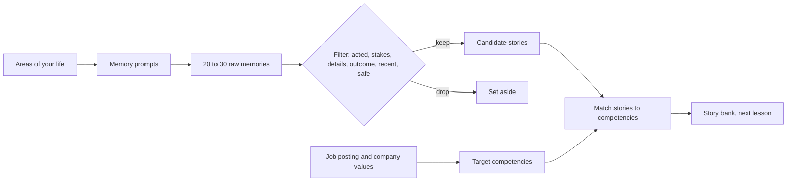

# Mining your experience for stories

## Before this lesson

Read [STAR in depth](#/lesson/behavioural/star-in-depth) and [Saying "I", using data, and getting the length right](#/lesson/behavioural/i-data-length). You should know what a STAR story needs (setting, goal, your actions, a measured result) and why one memory can hold several stories. Keep the list of competencies you wrote in the "Your turn" exercise of [Why companies use structured interviews](#/lesson/behavioural/structured-interviews), if you did it.

## In plain words

Gold miners do not find nuggets lying on the ground. They dig a lot of ordinary rock, wash it, and keep the small part that shines. Finding interview stories works the same way. Most people sit down, try to think of "a great example of leadership", find nothing, and conclude they have no stories. The stories are there; they are buried in ordinary memories of projects, jobs and weekends, and they need digging and washing.

This lesson gives you a method for the digging (memory prompts across every part of your life), the washing (a filter that keeps stories worth telling) and the matching (connecting stories to what a specific job asks for). It works for a second-year student with no internship, for someone switching careers from teaching or nursing, and for an engineer with ten years of experience who has the opposite problem: too many memories, and no idea which ones count.

It matters for a job because every later lesson assumes you have material. The best structure in the world cannot rescue an answer with no story inside it.

## Step 1: dig across every area of your life

Career advisers such as Strayer University's career centre suggest finding your top accomplishments by looking back over jobs, academic projects and volunteer experience. Cast the net wider than you think is allowed. Interviewers want to see behaviour; where it happened matters much less.

| Area | Examples of places stories hide |
|---|---|
| Paid work | Full-time jobs, internships, contract work, part-time jobs in retail, food service or tutoring |
| School | Group projects, final-year or capstone projects, lab work, hackathons, competitions, teaching assistant roles |
| Co-curricular activities | Clubs, societies, sports teams, student government, event organising (in Singapore, school clubs and activities are usually called CCAs, short for co-curricular activities) |
| Volunteering | Community events, charity fundraising, mentoring, helping a non-profit with its website |
| Personal projects | Apps, scripts that automate a chore, open-source contributions, a blog, a game |
| Life | Organising a family event, learning a hard skill from scratch, a period of service such as National Service, moving to a new country |

> [!NOTE]
> Prefer stories from work, study and projects when you have them, because they are closest to the job. Use personal-life stories sparingly, for competencies like learning or resilience, and keep them professional in tone.

### Memory prompts

Staring at "leadership" produces nothing. Concrete prompts work much better because memory is organised around events and feelings, not competency labels. Go through each area of your life with these questions and write down anything that comes up, even if it seems small:

- When was I **proud** of something I did?
- When was I **stressed**, panicking or up late?
- When did something **break**, fail or go wrong?
- When did I **disagree** with someone, or someone with me?
- When did someone **thank** me, or complain about me?
- When did I **change my mind** about something?
- When did I do something **nobody asked** me to do?
- When did I have to **learn** something fast?
- When did I **explain** something difficult to someone?
- When did a plan **change** at the last minute?
- When did I **say no**, or wish I had?
- When did I help someone who was **stuck**?

Write one line per memory. Do not judge them yet. Aim for 20 to 30 raw lines in your first session.

## Step 2: wash out what will not work

Now filter. A raw memory becomes a candidate story if it passes most of these checks:

1. **You acted.** You did something specific, not only watched. ("I was there when the server crashed" fails; "I restarted the service and wrote up what happened" passes.)
2. **There was a real problem or goal.** Something was at stake, even if small.
3. **You remember details.** Names, numbers, the order of events. If you cannot remember what you did first, the follow-up questions will expose it.
4. **There is an outcome.** You know how it ended, ideally with a number or specific feedback.
5. **It is reasonably recent.** As general advice, the last few years carry more weight, because they show who you are now. Older stories are fine when they are your best example of something.
6. **It is safe to tell.** No confidential information, no story that requires criticising someone harshly, nothing you would be uncomfortable seeing written down.

Memories that fail one check can sometimes be rescued. A story you remember vaguely can be refreshed by looking at old messages, commit history (the record of code changes in a version control system), emails or project reports.

## Step 3: match stories to the job

Once you have candidates, connect them to what the employer wants. MIT's career office suggests reading the job description and responsibilities, noting the technical and transferable skills it names and the action verbs it uses. Strayer adds the company website and conversations with current employees as further sources.

A **transferable skill** is one that carries over from one setting to another: communication, organisation, teaching, handling difficult customers. Career switchers rely on these heavily.

### A worked example

Below is a short, **fictional** job posting for a junior role in Singapore, followed by the competencies a candidate might extract.

> **Junior Software Engineer, payments team (fictional posting).**
> You will build and maintain features for our merchant payments app, working closely with product managers and designers. You will write tested, maintainable code; investigate production issues alongside senior engineers; and contribute ideas to improve our development process. We value people who take ownership, communicate clearly, and stay calm when priorities shift.
> **Requirements:** a degree or diploma in computing or related experience; familiarity with one backend language; eagerness to learn; good teamwork.

| Phrase in the posting | Competency | A question it suggests |
|---|---|---|
| "working closely with product managers and designers" | Collaboration across roles | "Tell me about working with someone from a different discipline." |
| "investigate production issues" | Problem solving under pressure | "Tell me about debugging something difficult." |
| "contribute ideas to improve our development process" | Initiative, influence | "Tell me about a time you improved how your team worked." |
| "take ownership" | Ownership | "Tell me about something you took responsibility for beyond your task." |
| "communicate clearly" | Communication | "Tell me about explaining something technical to a non-technical person." |
| "stay calm when priorities shift" | Ambiguity, adaptability | "Tell me about a time the plan changed suddenly." |
| "eagerness to learn" | Learning | "Tell me about learning something new quickly." |
| "good teamwork" | Collaboration | "Tell me about a successful team project." |

Eight phrases, seven or so competencies. Notice how much the posting tells you once you read it as a list of interview questions. Also read the company's values page (lessons 20 to 23 cover several companies), because structured interviews often build questions around stated values.

## Mining in practice: a student

Here is a **fictional** first mining session for Daniel, a second-year computing student with no internship yet. The left column is what he wrote; the right is what each memory might become.

| Raw memory (one line) | Possible story and competency |
|---|---|
| Group project, one guy stopped replying for two weeks | Collaboration or conflict: how Daniel handled a missing teammate |
| Weekend job at a bubble tea shop, the order screen kept freezing | Problem solving, customer focus: he wrote down when it froze and told the owner the pattern |
| Taught myself Flutter for a hackathon in one week | Learning fast |
| Coding club, organised a beginners' workshop, 40 people came | Initiative, communication |
| Data structures module, failed the first quiz badly | Failure and learning: what he changed in how he studied |
| Helped my aunt's bakery set up online orders | Customer focus, ownership, working with a non-technical person |
| Argued with project teammate about using Git branches | Conflict, influence |
| Hackathon: our API key got rate-limited the night before | Ambiguity, pressure |

Eight lines from one sitting already cover collaboration, conflict, learning, failure, initiative, customer focus, ownership and pressure. Daniel's next step is to choose the strongest three to five and develop them fully (lesson 8).

## Mining in practice: a career switcher

Career switchers often dismiss their previous career as irrelevant. It is the opposite: their previous career is usually where their most mature stories live. The competencies are the same; only the setting changes.

A **fictional** example: Aisha spent six years as a secondary school teacher before a coding bootcamp. Her raw memories include:

- A parent complained loudly about a grade; she showed the marking scheme and the student's work, and they agreed on a plan. (**Conflict, communication.**)
- She built a spreadsheet that tracked homework submission for 120 students, which three colleagues then adopted. (**Initiative, influence, a first taste of building tools.**)
- A lesson plan failed completely with one class; she changed the format the following week. (**Failure and learning.**)
- She coordinated a school trip for 80 students when the bus company cancelled the morning of the trip. (**Ambiguity, ownership under pressure.**)

Paired with one or two strong technical stories from the bootcamp and personal projects, these give her a richer story set than many graduates. The interviewer will not hold the classroom setting against her; they will see a person who has handled real people and real pressure.

> [!TIP]
> When you use a non-technical story, add one sentence that connects it to the job: "That is the same skill I use when an on-call alert comes in: confirm the facts first, then decide." The connection helps the interviewer map it to the rubric.

## Mining in practice: an experienced engineer

Experienced engineers face a different problem. Ten years of work holds hundreds of possible stories, most of them blurred together. The challenge is choosing.

Useful filters for seniors:

- **Prefer recent stories**, as general advice, because they reflect your current level. A story from your first job may show behaviour you have long outgrown.
- **Prefer stories at the level you are applying for.** If you want a senior role, your stories should show scope beyond your own tasks: influencing other teams, making trade-offs, mentoring (lesson 24).
- **Prefer stories with clear personal decisions.** Large projects often hide individual contributions. Pick the moments where you made a call.
- **Include at least one failure where you were responsible.** Senior candidates who only have success stories raise doubts.

## The "too small" worry

Students often reject memories as too small: "It was only a club website." Small stories are fine. The interviewer is rating the **behaviour**, and a small stage often shows behaviour more clearly than a big one, because your personal part is easier to see. What makes a story weak is not size; it is vagueness, a missing role or a missing result.

That said, if you have both a small and a larger story for the same competency, and both are clear, prefer the larger one, because it shows the behaviour under more pressure.

## Your turn: a 45-minute mining session

1. **10 minutes**: list the areas of your life from the table above that apply to you. Under each, write two or three specific projects, jobs or events.
2. **15 minutes**: go through the memory prompts for each area. Write one line per memory. Aim for 20 lines.
3. **10 minutes**: filter with the six checks. Mark each line keep, maybe or drop.
4. **10 minutes**: take a real job posting, extract its competencies as in the worked example, and write next to each competency which kept memory could answer it.

At the end you will have a rough map: competencies along one side, memories along the other. Lesson 8 turns that map into a story bank.



## Summary

- Stories hide in ordinary memories across work, school, co-curricular activities, part-time jobs, volunteering and personal projects.
- Use concrete memory prompts (proud, stressed, broke, disagreed, thanked, changed my mind) instead of competency labels.
- Filter candidates: you acted, something was at stake, you remember details, there is an outcome, it is reasonably recent, and it is safe to tell.
- Match stories to the job: MIT suggests reading the posting for skills and action verbs; Strayer adds the company website and current employees.
- Students: small stories are fine if clear. Career switchers: previous careers hold mature stories; connect them to the job in one sentence. Seniors: choose recent, level-appropriate stories with clear personal decisions, including a failure.

## Glossary

- **Mining (for stories)**: systematically searching your memories for material to use in behavioural answers.
- **Memory prompt**: a concrete question that triggers specific memories.
- **Candidate story**: a memory that passes the filter and could be developed into a STAR answer.
- **Transferable skill**: a skill that carries over between settings, such as communication or organisation.
- **CCA**: co-curricular activity, the usual Singapore term for school clubs and activities.
- **Commit history**: the record of code changes kept by a version control system such as Git.
- **Job description or posting**: the employer's written description of a role, its tasks and requirements.

```quiz
[
  {"q": "A student says, 'I cannot think of any leadership examples.' What is the best first step?",
   "options": ["Invent one", "Go through memory prompts such as 'When did I do something nobody asked me to do?' across school, clubs, work and projects", "Skip leadership questions", "Use a story from a friend"],
   "answer": 1,
   "explain": "Memory is organised around events, not labels. Concrete prompts across all areas of life surface usable stories."},
  {"q": "Which raw memory fails the 'you acted' check?",
   "options": ["I restarted the service and wrote up what happened.", "I was in the office when the server crashed.", "I organised a workshop for 40 students.", "I fixed the order screen pattern and told the owner."],
   "answer": 1,
   "explain": "Being present is not acting. The interviewer needs your own actions."},
  {"q": "A job posting says 'stay calm when priorities shift'. Which competency and question does it suggest?",
   "options": ["Technical depth: 'Explain hash maps.'", "Ambiguity and adaptability: 'Tell me about a time the plan changed suddenly.'", "Customer focus: 'Who is your favourite customer?'", "None; postings do not predict questions"],
   "answer": 1,
   "explain": "Reading a posting as a list of competencies predicts the behavioural questions a structured interview is likely to ask."},
  {"q": "A former teacher is applying for her first developer role. How should she treat her teaching stories?",
   "options": ["Never mention them", "Use them for competencies like conflict, initiative and pressure, adding a sentence that connects each to the engineering job", "Use only teaching stories and no technical ones", "Pretend they happened at a tech company"],
   "answer": 1,
   "explain": "Previous careers often hold the most mature stories. Pair them with technical stories and make the connection explicit."},
  {"q": "Which of these is the best reason to drop a memory from your list?",
   "options": ["It happened at a small club", "It involves a part-time café job", "You cannot remember what you did or how it ended", "It ended in failure"],
   "answer": 2,
   "explain": "Small settings and failures are fine. Missing details and outcomes will collapse under follow-up questions."},
  {"q": "What does MIT's career office suggest looking for when reading a job description?",
   "options": ["The salary range only", "The technical and transferable skills it names and the action verbs it uses", "The interviewer's name", "Spelling mistakes"],
   "answer": 1,
   "explain": "Skills and verbs in the posting point to the competencies the interview will test."},
  {"q": "An engineer with ten years of experience has hundreds of memories. Which filter is most useful for a senior role?",
   "options": ["Pick the oldest stories", "Pick recent stories showing scope beyond their own tasks and clear personal decisions, including a failure", "Pick only stories with no conflict", "Pick stories where the team did everything"],
   "answer": 1,
   "explain": "Senior candidates should show current, level-appropriate behaviour and clear personal decisions."}
]
```

> **Source:** MIT CAPD, The STAR method for behavioral interviews (https://capd.mit.edu/resources/the-star-method-for-behavioral-interviews/); Strayer University Career Center, Behavioral interview questions, PDF (https://assets.strayer.edu/career-center/Behavioral-Interview-Questions.pdf). The job posting, people and memories are original and fictional; the recency and level-fit filters are general advice.
