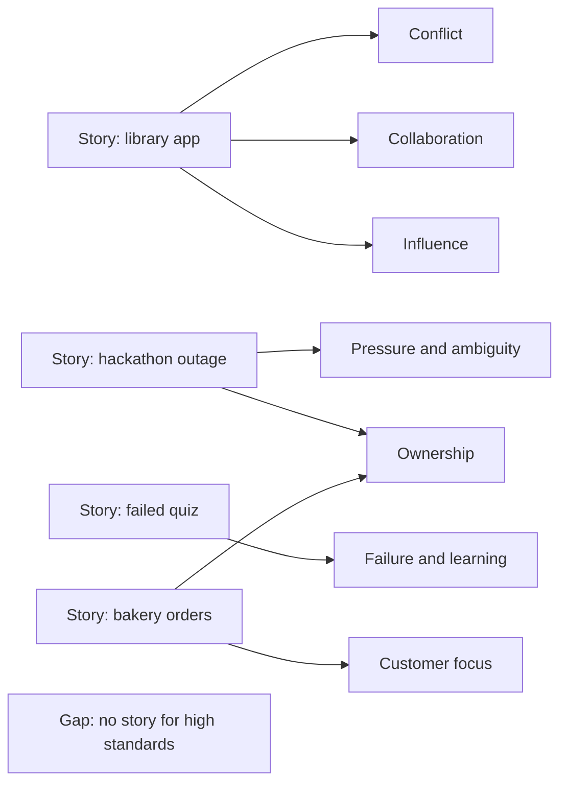

# Building a story bank

## Before this lesson

Read [Mining your experience for stories](#/lesson/behavioural/mining-experience): you should have, or know how to produce, a list of candidate stories and a list of competencies taken from a job posting. You should also know STAR ([STAR in depth](#/lesson/behavioural/star-in-depth)) and the habits of saying "I", using numbers and keeping to about two minutes ([lesson 6](#/lesson/behavioural/i-data-length)). The [story grid](#/lesson/interview-prep/story-grid-star) from the Cracking the Coding Interview track is a compact version of what this lesson builds; here you get a fuller template, a coverage matrix you can use interactively, and a routine for rehearsing and maintaining the bank.

## In plain words

A good restaurant kitchen does not start cooking each dish from nothing when the order arrives. Before service, the cooks prepare their **mise en place**: vegetables chopped, sauces made, everything in labelled containers within reach. When an order comes in, they assemble a dish in minutes, and it tastes the same every time.

A **story bank** is your mise en place for behavioural interviews. It is a small, organised set of your best stories, each prepared in note form (not as a script), each tagged with the competencies it can show. When a question arrives, you do not search your whole life under pressure; you reach for the right container.

Why it matters: interviewers ask many different questions, but they draw from a limited set of competencies. With 8 to 12 well-prepared stories, each covering several competencies, you can answer nearly any behavioural question calmly. Without a bank, you improvise, and improvised answers are long, vague and forget the result.

## How many stories do you need?

The answer depends on the company.

- **General roles**: MIT's career office suggests preparing three to five stories, outlined in notes. That is a minimum. It works because, as both MIT and Strayer University point out, one story can often answer several different questions.
- **Amazon**: Amazon's article on interview mistakes and its Bar Raisers' tips both advise preparing one or two examples for each of its 16 Leadership Principles (lesson 20 lists them). That does not mean 32 separate stories: one strong story usually covers two or three principles. In practice, 10 to 14 stories mapped across the principles is a realistic target.
- **A full loop at any large company**: since interviewers often cover different competencies and repeating one example for every question is a listed Amazon mistake, aim for at least 8 stories so you never need to tell the same one twice in one loop.

A practical plan: start with five core stories, then grow to 8 to 12, adding stories specifically to fill gaps in your coverage.

## What one story looks like in the bank

Each story in your bank is a single entry with the same fields. Here is the template. Copy it into a document or spreadsheet.

| Field | What to write | Example of length |
|---|---|---|
| Title | A short memorable name | "Checkout outage" |
| Headline | One sentence that summarises the story | 15 to 25 words |
| Situation | Setting and trigger, as keywords | 1 to 2 lines |
| Task | The goal and your part | 1 line |
| Actions | 3 to 5 steps, each with a reason, as bullets | 3 to 5 bullets |
| Results with numbers | Outcome with baseline and after, plus feedback | 1 to 2 lines |
| Reflection | Specific lesson, changed habit, evidence of reuse | 1 to 2 lines |
| Competencies and principles | Every competency or value this story can show | 2 to 5 tags |
| Likely probes | Follow-up questions you expect, with short answers | 3 to 4 bullets |
| Short version | A 30-second version for screening calls | 2 to 3 lines |

Notice the fields are **notes**, not paragraphs. MIT's advice is explicit: outline stories in bullets, do not script or memorise them, and stay flexible. A script makes you sound recited and leaves you stranded when an interviewer interrupts or asks the question from an unexpected angle. Notes let you rebuild the story naturally each time, in whatever shape the question needs.

## Two filled-in entries

### A junior entry (fictional)

| Field | Entry |
|---|---|
| Title | Library app double-booking |
| Headline | In a team project, I settled a database disagreement with a two-day prototype that exposed a double-booking bug. |
| Situation | 2nd-year SE module, team of 4, library room booking app, 2-week deadline |
| Task | Choose data storage; I disagreed with Arjun, who preferred JSON files |
| Actions | Asked why: he worried nobody knew SQL. Proposed parallel prototypes, one evening each. Tested 2 users booking same room at once. Showed both on Friday. Wrote a 1-page SQLite setup guide for the 2 teammates new to SQL |
| Results with numbers | File version double-booked in about 1 in 5 tests, SQLite in 0. Team chose SQLite. Project grade A-minus; the room clash test was cited in feedback |
| Reflection | Suggest a small test earlier; we argued 2 days before trying anything. Used the same approach in my internship when choosing a charting library |
| Competencies | Conflict, collaboration, influence, problem solving |
| Likely probes | How did Arjun feel? (relieved, he co-wrote the guide). What if SQLite had lost? (I would have used files and added a lock). What would you change? (prototype on day 1) |
| Short version | Disagreed about storage, ran two quick prototypes, data showed files double-booked, we chose SQLite and I wrote the setup guide. |

### A senior entry (fictional)

| Field | Entry |
|---|---|
| Title | Search latency and the cache argument |
| Headline | I cut search latency at peak by about 60% by convincing two teams to change a cache design neither owned alone. |
| Situation | Marketplace, 3 teams touch search; p95 latency (the time within which 95% of requests finish) about 1.8 s at evening peak, rising each month |
| Task | Tech lead on the search team; asked to fix latency for the year-end sale, 8 weeks away |
| Actions | Traced 500 slow requests: 70% waited on the pricing service. Pricing team saw it as our problem. Ran a 1-week experiment with a short-lived price cache behind a flag, on 5% of traffic. Wrote a 2-page proposal with results and the stale-price risk, plus a fallback. Agreed rollout steps with both leads. Mentored a mid-level engineer to own the rollout |
| Results with numbers | p95 from about 1.8 s to 0.7 s at peak. Zero stale-price complaints in the sale. Mid-level engineer led the next rollout alone |
| Reflection | Data beat argument; I should have brought the pricing lead into the experiment design, which would have saved a week of debate |
| Competencies | Influence without authority, ownership, data-driven decisions, mentoring, customer focus |
| Likely probes | Why not fix pricing itself? Risk of stale prices? How did you pick 5%? What did the pricing lead say? |
| Short version | Traced slow searches to pricing calls, ran a small cache experiment, used results to agree a design with the pricing team, p95 fell about 60% for the sale. |

## The coverage matrix

Once you have several entries, you need a view of the whole bank: which competencies are covered, which are covered too many times, and where the gaps are. That view is a **coverage matrix**: stories as rows, competencies as columns, a tick where a story can show a competency.



Diagrams like this get crowded quickly, so the interactive version below is more practical.

### Interactive: story-bank coverage matrix

Type up to eight story titles, tick the competencies each one can show, and the page shows how many stories cover each competency, highlights gaps (no story) and thin spots (only one story), and warns when one story is carrying too much. Switch the column set to Amazon's 16 Leadership Principles if you are preparing for Amazon. Everything stays in this page; nothing is saved or sent.

```html-run
<!doctype html>
<html lang="en">
<head>
<meta charset="utf-8">
<title>Story bank matrix</title>
<style>
  body { font-family: system-ui, sans-serif; margin: 12px; color: #1f2937; background: #fff; font-size: 14px; }
  .wrap { overflow-x: auto; }
  table { border-collapse: collapse; }
  th, td { border: 1px solid #d1d5db; padding: 3px 5px; text-align: center; }
  th.col { writing-mode: vertical-rl; transform: rotate(180deg); font-weight: 600; font-size: 12px; height: 150px; }
  td input[type=text] { width: 150px; font: inherit; }
  tr.total td { font-weight: 700; }
  .gap { background: #fee2e2; } .thin { background: #fef3c7; } .ok { background: #dcfce7; }
  select { font: inherit; margin-bottom: 8px; }
  #notes li { margin: 3px 0; }
</style>
</head>
<body>
<label>Columns: <select id="set">
  <option value="general">General competencies</option>
  <option value="amazon">Amazon Leadership Principles</option>
</select></label>
<div class="wrap"><table id="grid"></table></div>
<ul id="notes"></ul>
<script>
var sets = {
  general: ["Teamwork", "Conflict", "Failure and learning", "Ownership", "Ambiguity", "Influence", "Customer focus", "High standards", "Learning fast", "Communication"],
  amazon: ["Customer Obsession", "Ownership", "Invent and Simplify", "Are Right, A Lot", "Learn and Be Curious", "Hire and Develop the Best", "Insist on the Highest Standards", "Think Big", "Bias for Action", "Frugality", "Earn Trust", "Dive Deep", "Have Backbone; Disagree and Commit", "Deliver Results", "Strive to be Earth's Best Employer", "Success and Scale Bring Broad Responsibility"]
};
var titles = ["Library app double-booking", "Hackathon outage", "Failed data structures quiz", "Bakery online orders", "", "", "", ""];
var ticks = {};
function key(r, c) { return r + "_" + c; }
ticks[key(0, 0)] = ticks[key(0, 1)] = ticks[key(0, 5)] = true;
ticks[key(1, 3)] = ticks[key(1, 4)] = true;
ticks[key(2, 2)] = ticks[key(2, 8)] = true;
ticks[key(3, 3)] = ticks[key(3, 6)] = ticks[key(3, 9)] = true;
function render() {
  var cols = sets[document.getElementById("set").value];
  var g = document.getElementById("grid");
  var html = "<tr><th>Story</th>";
  cols.forEach(function (c) { html += "<th class='col'>" + c + "</th>"; });
  html += "</tr>";
  titles.forEach(function (t, r) {
    html += "<tr><td><input type='text' data-r='" + r + "' value='" + t.replace(/'/g, "&#39;") + "' placeholder='Story " + (r + 1) + "'></td>";
    cols.forEach(function (c, ci) {
      html += "<td><input type='checkbox' data-k='" + key(r, ci) + "'" + (ticks[key(r, ci)] ? " checked" : "") + "></td>";
    });
    html += "</tr>";
  });
  html += "<tr class='total'><td>Stories covering</td>";
  cols.forEach(function (c, ci) { html += "<td id='tot" + ci + "'></td>"; });
  html += "</tr>";
  g.innerHTML = html;
  g.querySelectorAll("input[type=text]").forEach(function (el) {
    el.addEventListener("input", function () { titles[+el.dataset.r] = el.value; summarise(); });
  });
  g.querySelectorAll("input[type=checkbox]").forEach(function (el) {
    el.addEventListener("change", function () { ticks[el.dataset.k] = el.checked; summarise(); });
  });
  summarise();
}
function summarise() {
  var cols = sets[document.getElementById("set").value];
  var notes = [], gaps = [], thin = [];
  cols.forEach(function (c, ci) {
    var n = 0;
    titles.forEach(function (t, r) { if (ticks[key(r, ci)]) n++; });
    var cell = document.getElementById("tot" + ci);
    cell.textContent = n;
    cell.className = n === 0 ? "gap" : (n === 1 ? "thin" : "ok");
    if (n === 0) gaps.push(c); else if (n === 1) thin.push(c);
  });
  titles.forEach(function (t, r) {
    var n = 0;
    cols.forEach(function (c, ci) { if (ticks[key(r, ci)]) n++; });
    if (n > 0 && !t.trim()) notes.push("Story " + (r + 1) + " has ticks but no title.");
    if (n >= 5) notes.push("'" + (t || "Story " + (r + 1)) + "' covers " + n + " columns. Check each tick is really strong evidence, or you may lean on it too often.");
  });
  if (gaps.length) notes.unshift("Gaps (no story): " + gaps.join(", ") + ".");
  if (thin.length) notes.unshift("Thin (one story only, so you cannot use it twice in a loop): " + thin.join(", ") + ".");
  if (!gaps.length && !thin.length) notes.unshift("Every column has at least two stories. Good coverage.");
  var ul = document.getElementById("notes"); ul.innerHTML = "";
  notes.forEach(function (n) { var li = document.createElement("li"); li.textContent = n; ul.appendChild(li); });
}
document.getElementById("set").addEventListener("change", function () { ticks = {}; render(); });
render();
</script>
</body>
</html>
```

How it works: the table is rebuilt from two lists, the story titles and the column names; each checkbox stores its row and column in a small `ticks` object; `summarise` counts ticks per column, colours the total red for a gap, yellow for a single story and green for two or more, and lists warnings. The sample data is Daniel's first four stories from lesson 7. Switching to the Amazon columns clears the ticks so you can map your stories again. Amazon lists "Have Backbone; Disagree and Commit" as one principle, so it appears as one column here.

### Reading the matrix

- **Red columns** are gaps. Mine your memories again with a prompt aimed at that competency (lesson 7), or accept the gap if the competency is unlikely for your target role.
- **Yellow columns** have one story. In a single interview that is enough, but in a loop of four or five interviewers, the same competency may come up twice. Aim for two.
- **A row with many ticks** is a strong, flexible story, which is good, but be honest: does it really show each of those competencies, or are some ticks a stretch? Strayer's advice is to share stories that clearly demonstrate the skill asked about.

## Rehearsing the bank

A story bank you have only written is half-built. You have to say the stories aloud.

Amazon's Bar Raiser tips suggest three stages of practice, which work for any company:

1. **Alone**, for example in front of a mirror, to get the order of events and the key numbers into your head.
2. **Recorded**, for example on your phone, so you can hear your pace, your filler words ("um", "like", "you know") and whether you say "I".
3. **With someone you trust** who will give candid feedback. A friend, a classmate, a mentor or a career centre adviser.

Use the timer from [lesson 6](#/lesson/behavioural/i-data-length) for every story. Aim for about two minutes, and practise the 30-second short version too.

### Practise from different angles

The same story must answer different questions. Practise each story against two or three questions from its competency tags. The library app story, for example, should be told differently for:

- "Tell me about a disagreement" (emphasis: understanding Arjun's view, the respectful resolution).
- "Tell me about using data to make a decision" (emphasis: the prototype test and its numbers).
- "Tell me about helping teammates" (emphasis: the setup guide for the two newcomers).

The facts stay the same; the headline and the parts of the Action you expand change. This is exactly why notes beat scripts.

## Maintaining the bank

- **Before each interview**: read the bank, then the company's values page, and tick which stories map to their values. Choose which stories you will use for which likely questions.
- **After each interview**: write down every question you were asked, which story you used, and which probes surprised you. Add the probes to the entries. Career centres such as MIT's also suggest reflecting on what went well and what to improve.
- **Every few months**: add new stories from recent work, and retire stories that are getting old or that you no longer tell well.
- **When you change target roles**: re-run the matrix with new columns. A move from backend engineering to engineering management needs more stories about hiring, mentoring and stakeholders (lesson 24).

## Common story-bank mistakes

1. **Writing scripts.** Full paragraphs tempt you to memorise. Keep to bullets and numbers.
2. **One hero story.** Everything maps to your biggest project, so every interviewer hears it. Spread across settings.
3. **No failures.** Every bank needs at least one, ideally two, honest failure stories (lesson 12).
4. **No numbers in the Results field.** If the field is empty, go and find a baseline.
5. **Stretching tags.** Ticking "Customer focus" for a story where no customer appears. The interviewer will notice.
6. **Never saying it aloud.** Written stories always sound different when spoken. Rehearse.

## Your turn

1. Create your bank document with the template fields.
2. Fill in five entries from your mined memories (lesson 7). Spend about 20 minutes on each.
3. Enter the titles into the matrix above, tick honestly, and note the gaps.
4. Write one more story aimed at your biggest gap.
5. Rehearse each story aloud twice with the timer, once at full length and once as the 30-second version.

## Summary

- A story bank is a set of prepared stories in note form, each tagged with the competencies it shows.
- MIT suggests at least three to five stories; Amazon advises one or two examples per Leadership Principle. Realistically, aim for 8 to 12 stories, more for Amazon, and avoid repeating one story across a loop.
- Each entry has a title, headline, STAR notes, results with numbers, reflection, competency tags, likely probes and a 30-second version.
- Use a coverage matrix to find gaps (no story) and thin spots (one story).
- Do not script or memorise (MIT). Rehearse alone, recorded and with a trusted person (Amazon Bar Raisers), and practise each story from several angles.
- Update the bank after every interview.

## Glossary

- **Story bank**: an organised set of your prepared stories with competency tags.
- **Entry**: one story in the bank, written in the template fields.
- **Coverage matrix**: a table of stories against competencies showing which are covered.
- **Gap**: a competency with no story in your bank.
- **Thin spot**: a competency with only one story.
- **Short version**: a 30-second telling of a story for screening calls.
- **p95 latency**: the time within which 95% of requests finish, a common measure of how slow the slower requests are.
- **Filler words**: words such as "um" and "like" that fill pauses without adding meaning.

```quiz
[
  {"q": "Why does MIT advise outlining stories in notes rather than writing scripts?",
   "options": ["Notes are faster to type", "Scripts sound recited and leave you stranded when a question comes from an unexpected angle", "Interviewers ban scripts", "Notes are required by Amazon"],
   "answer": 1,
   "explain": "MIT advises not to script or memorise, so you can adapt each story to the question and to interruptions."},
  {"q": "You are preparing for Amazon. Which plan best follows Amazon's advice?",
   "options": ["Three stories in total", "One or two examples per Leadership Principle, using stories that cover several principles each", "One perfect story used for every question", "No stories; Amazon only asks technical questions"],
   "answer": 1,
   "explain": "Amazon advises one or two examples per principle. Because stories overlap, 10 to 14 well-mapped stories is realistic."},
  {"q": "Your matrix shows 'Conflict' with exactly one story. Why is that a risk in a full interview loop?",
   "options": ["It is not a risk", "If two interviewers both ask about conflict, you must repeat the story or improvise", "Conflict questions are never asked", "The story will be too long"],
   "answer": 1,
   "explain": "Competencies can come up more than once in a loop; a second story avoids repetition, which Amazon lists as a mistake."},
  {"q": "In a story-bank entry, which field would hold 'p95 fell from 1.8 s to 0.7 s at peak'?",
   "options": ["Situation", "Task", "Results with numbers", "Competencies"],
   "answer": 2,
   "explain": "It is a measured outcome with a baseline, which belongs in the Results field."},
  {"q": "Which rehearsal sequence matches the Amazon Bar Raisers' tips?",
   "options": ["Only reading the notes silently", "Alone (for example in a mirror), then recorded on your phone, then with someone who will give candid feedback", "Only practising during the real interview", "Memorising each story word for word"],
   "answer": 1,
   "explain": "The Bar Raisers suggest practising alone, recording yourself, and practising with a trusted person who gives honest feedback."},
  {"q": "One story has ticks in seven of ten columns. What should you check?",
   "options": ["Nothing; more ticks is always better", "Whether each tick is genuinely strong evidence, and whether you are leaning on this story too often", "Whether the story is too short", "Whether it has a title"],
   "answer": 1,
   "explain": "Flexible stories are valuable, but stretched tags give weak evidence, and overusing one story makes your experience look thin."},
  {"q": "After an interview, what is the most useful update to your bank?",
   "options": ["Delete all stories you used", "Record the questions asked, the story used for each, and any probes that surprised you", "Rewrite every entry as a script", "Nothing until the result arrives"],
   "answer": 1,
   "explain": "Recording questions and surprising probes makes the next interview easier and improves the Likely probes field."}
]
```

> **Source:** MIT CAPD, The STAR method for behavioral interviews (https://capd.mit.edu/resources/the-star-method-for-behavioral-interviews/); Strayer University Career Center, Behavioral interview questions, PDF (https://assets.strayer.edu/career-center/Behavioral-Interview-Questions.pdf); Amazon, Interview mistakes to avoid (https://www.aboutamazon.com/news/workplace/amazon-jobs-interview-mistakes); Amazon, Bar Raiser tips (https://www.aboutamazon.com/news/workplace/amazon-job-interview-questions-tips-bar-raisers); Amazon, Leadership Principles (https://atoz.amazon/en-us/discover/leadership-principles). The template, entries and matrix page are original.
