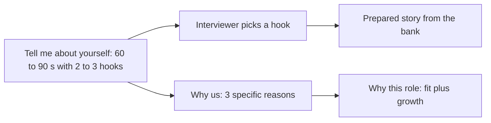

# "Tell me about yourself", "Why us?" and "Why this role?"

## Before this lesson

Read [Building a story bank](#/lesson/behavioural/story-bank): you should have a handful of prepared stories with headlines and numbers, because a good introduction points at them. The lesson [Classic behavioural questions with model answers](#/lesson/interview-prep/classic-behavioural-questions) in the Cracking the Coding Interview track gives the basic present-past-future structure with two model answers; this lesson adds how to tailor the introduction to different interviewers, how to plant hooks that steer the conversation, how to research a company so "Why us?" has real content, and weak and strong versions for students, career switchers and senior engineers.

## In plain words

When you meet someone at a party and they ask "So, what do you do?", you do not hand them your CV. You give a short version that fits the moment and, if you are good at conversation, you mention one thing interesting enough that they ask a follow-up. The conversation then goes where you hoped it would.

"Tell me about yourself" is that party question, asked by someone who is about to take notes. It opens most interviews, recruiter calls and many behavioural rounds. "Why do you want to work here?" and "Why this role?" usually follow soon after. Together they are the **opening questions**: they set the first impression, show how clearly you communicate, and tell the interviewer whether you know what you are applying for.

They matter for a job for a reason beyond first impressions. The opening is the only part of the interview where **you choose the topics**. A well-built introduction plants two or three of your best stories as "hooks", and interviewers often pick them up. You are, quietly, writing part of the interview's agenda.

## What each question is testing

| Question | What the interviewer wants to learn |
|---|---|
| "Tell me about yourself." | Who you are professionally, in brief; whether you can summarise clearly; what you think is important about yourself |
| "Why do you want to work here?" | Whether you researched the company; whether your reasons are specific and genuine; whether you are likely to stay and be motivated |
| "Why this role?" | Whether you understand what the job involves; whether your skills and interests fit it |
| "Why are you leaving your current job?" | Whether you are moving towards something or only away from something; whether you speak respectfully about past employers |
| "What are you passionate about?" | What motivates you; whether that matches the work |

Meta's software engineering preparation post (2022) describes its behavioural round as a way to learn about your background, what you are passionate about in technology and the kind of impact you want to make. ByteDance's interview page says interviews will cover your professional background, related experience and why you want to join. These are the opening questions in different words.

## "Tell me about yourself"

### Common phrasings

- "Tell me about yourself."
- "Walk me through your background."
- "Walk me through your CV."
- "Introduce yourself briefly."
- "What brought you to this point in your career?"
- "Give me the two-minute version of you."

### Structure: present, past, future, with hooks

The structure from the Cracking the Coding Interview lesson works well: **present** (what you do now), **past** (two or three highlights that led here), **future** (why this role). This lesson adds two refinements.

**Refinement 1: a thread.** Pick one theme that runs through your story, such as "I like making slow things fast", "I like building tools for people who are not engineers", or "I keep ending up on the data side". A thread turns a list of jobs into a story with a direction, and it makes the "future" part feel inevitable rather than tacked on.

**Refinement 2: hooks.** A **hook** is a short mention of an accomplishment, with a number, that you do not explain. "I rebuilt our report generation, which went from 40 minutes to under 2" is a hook. Do not tell the full story; leave it hanging. Interviewers often follow it up, and you have a fully prepared story waiting in your bank. Plant two or three hooks, each pointing to a different competency.

### Length and tone

Aim for 60 to 90 seconds. It is long enough to cover the present, past and future with hooks, and short enough to leave the interviewer wanting more. Speak as you would to a friendly colleague, not as if reading a biography.

### Tailor to the audience

The same facts should be framed differently depending on who is asking.

| Interviewer | What they care about most | Adjust by |
|---|---|---|
| Recruiter | Fit with the role, level, timing, motivation | Keep it non-technical; end clearly on why this role |
| Engineer | What you built and how; technical depth | Use one concrete technical hook; name the technologies once |
| Hiring manager | Scope, ownership, how you work with others | Hooks about ownership and collaboration; mention team size and your role |
| Senior leader | Impact and judgement | Fewer details, bigger outcomes, one decision you made |

### Go beyond the CV

One of Amazon's Bar Raisers, in Amazon's own article of interview tips, says she appreciates candidates who tell her something about themselves that she would not learn from the CV. The CV is already in front of the interviewer; repeating it wastes your best minute. Add what the CV cannot show: why you made a move, what you enjoy, a project outside work, the thread that ties it together.

### Weak and strong: a student

> **Weak (fictional).** "Hi, I'm Daniel. I'm a year-two computing student at the polytechnic. I'm taking modules in data structures, web development and databases. My GPA is decent. I've done some projects. I like coding and I'm a fast learner and a team player. I'm looking for an internship to gain experience."

Every sentence is either on the CV already or an unsupported claim ("fast learner", "team player"). There are no hooks, no thread and no reason for this company.

> **Strong (fictional).** "I'm a second-year computing student, and what I enjoy most is building small tools that real people use. Last year I helped my aunt's bakery move from phone orders to a simple online order form; about 60 orders a week now come through it, and it cut the evening phone rush in half. At school I've worked mostly on backends, and in our team project I ran a quick prototype that caught a double-booking bug before our demo. I also run beginner workshops at the coding club; the last one had about 40 people. I'm applying for this internship because your team builds tools for small merchants, which is the kind of user I've enjoyed building for, and I want to learn how that works at real scale."

The thread is "tools real people use". Three hooks point to three different stories in the bank (customer focus, problem solving, initiative). The ending connects directly to the role.

### Weak and strong: a career switcher

> **Weak (fictional).** "So I was a nurse for eight years, which I liked but it was very tiring, and the shifts were hard, and I always liked computers, so I did a bootcamp last year and now I'm looking for a developer job."

The reason for leaving sounds like escape, the past is not connected to the future, and nothing shows skill.

> **Strong (fictional).** "I'm a junior developer, and before that I spent eight years as a ward nurse. The thread between the two is that I like fixing systems that people depend on. On the ward, I noticed our medication handover sheet caused repeated mix-ups; I redesigned it with two colleagues, and handover errors on our ward dropped noticeably over the next quarter, which got me interested in how good tools change behaviour. I taught myself Python in the evenings, then did a full-time bootcamp. My final project was a shift-swap app for nurses that is now used by about 30 staff at my old hospital. I'm applying here because your product is used by clinics, so I can bring both halves of my background: I understand the users, and I can build for them."

### Weak and strong: an experienced engineer

> **Weak (fictional).** "I have twelve years of experience. I started at a bank doing Java, then moved to an e-commerce company, where I worked on many things, including payments, search and some infrastructure. Then I became a tech lead and led a team. Then I moved to my current company where I'm a senior engineer, working on microservices, Kubernetes, Kafka and so on. I've done a lot of things."

It is a chronological list with no highlights, no outcomes and a technology inventory instead of impact.

> **Strong (fictional).** "I'm a senior backend engineer, and for most of my twelve years I've worked on systems where slowness costs money: payments first, then search. The project I'm proudest of is leading the search latency work at my current company; we cut peak latency by about 60% before the year-end sale, which needed agreement from two other teams. Before that I led a team of five on an e-commerce checkout rewrite, and two of the engineers I mentored there are now tech leads. I'm looking for a role with broader scope across several teams, and your platform group's work on reliability for a whole region's payments is exactly that."

## "Why do you want to work here?"

### Common phrasings

- "Why do you want to work here?"
- "Why us?"
- "What do you know about our company?"
- "Why are you interested in this company over others?"
- "What attracted you to this opportunity?"

### Do the research first

There is no good answer to this question without research. ByteDance's interview page advises candidates to review the job description, learn about the company and research recent news, trends, competitors, company history and opportunities in its sector. Grab's "How we hire" page tells candidates to understand the business and be ready to propose solutions aligned with its mission in Southeast Asia. Both are telling you the same thing: "Why us?" is a test of preparation.

Useful sources, all public:

- The company's careers site, especially its values and "how we hire" pages.
- Its engineering blog, if it has one: it tells you what problems the engineers find interesting.
- Recent news and product announcements.
- The product itself: use it, and notice something specific.
- The job posting, read as a list of competencies (lesson 7).
- People who work there, if you can reach them politely through your network or alumni.

### Structure: three layers of reasons

A strong answer has two or three specific reasons, ideally from different layers:

1. **Mission or product**: what the company does and why it matters to you. Be specific: a product feature, a type of user, a problem being solved.
2. **Work and team**: what this team works on technically, and why that fits your skills or interests.
3. **Growth and culture**: what you would learn, and which stated value matches how you like to work. Link the value to a story.

### Weak and strong (fictional company)

The company below, "Kelana Pay", is invented for this example: a Southeast Asian company that provides payment tools for small merchants.

> **Weak.** "Kelana Pay is a big, fast-growing company with a great culture, and I've heard the benefits are really good. I want to work somewhere with lots of opportunities to learn. Also it's a well-known brand."

None of this is specific to Kelana Pay; any company name would fit. Mentioning benefits first suggests your main motive is the package.

> **Strong.** "Three reasons. First, the users: your app serves small merchants, many of whom move from cash to digital payments for the first time. I've helped my aunt's bakery make that move and saw how much a simple, reliable tool matters to them. Second, the work: your engineering blog post on reconciling payments across several banks described exactly the kind of correctness problem I enjoy; I'd like to learn how you test it. Third, one of your stated values is taking ownership end to end, and the project I'm proudest of, the bakery order form, is one I owned from the first conversation to the support calls afterwards."

Each reason is specific and checkable, and the third plants a hook into the story bank.

## "Why this role?"

### Common phrasings

- "Why this role?"
- "Why are you interested in this position?"
- "What interests you about this team?"
- "Why backend, rather than frontend?" (or any specialisation)
- "Where do you see this role taking you?"

### Structure: fit and growth

1. **Fit**: two parts of the job description that match things you have done, each with a brief piece of evidence.
2. **Growth**: one part of the role that stretches you, and why you want that stretch.

> **Example (fictional).** "The posting says the role is mostly backend services and working with production issues alongside senior engineers. Backend is where I've done my best work, like the double-booking fix in our team project, and I enjoy debugging live problems: at the bakery, I traced a missing-order bug to a time-zone setting. What I haven't done yet is operate a service at real scale, and that is what I want to learn next."

## "Why are you leaving?"

This question tests whether you are moving **towards** something or only **away** from something, and whether you speak respectfully about past employers. Amazon's Bar Raisers warn against negative comments about past managers or colleagues.

- **Good shape**: one sentence of honest, neutral context, then what you are moving towards. "I've learned a lot in three years on the payments team, and the work has become more maintenance than building. I want to work on a product that is still growing fast, which this role offers."
- **Avoid**: complaints about your manager, pay or colleagues, even if true. Interviewers wonder what you will say about them later.
- **If you were let go**: state it plainly and briefly without blame, then move to what you learned and what you want. "My role was cut in a restructuring last quarter, along with the rest of the analytics team. It gave me time to finish a cloud certification, and I'm looking for..."

## Putting it together: the first five minutes



When the opening goes well, the interviewer has heard your thread, three accomplishments, and specific reasons for this company and role, all in under five minutes, and is already curious about one of your stories.

## Your turn

1. Write your thread in one sentence.
2. Choose three hooks from your story bank, each pointing to a different competency, each with a number.
3. Write a 60 to 90 second introduction for an engineer audience, then adapt it for a recruiter.
4. Pick a real company you are interested in. Spend 30 minutes on its careers site, values page, engineering blog and product. Write three reasons from different layers.
5. Say all of it aloud with the timer from [lesson 6](#/lesson/behavioural/i-data-length).

## Summary

- The opening questions set the first impression and are the one place you choose topics.
- "Tell me about yourself": present, past, future, with a thread and two or three hooks; 60 to 90 seconds; tailor to recruiter, engineer, manager or leader; go beyond the CV, as an Amazon Bar Raiser recommends.
- "Why us?": research first (ByteDance and Grab both tell candidates to study the company and its business); give two or three specific reasons from mission or product, work and team, and growth or values.
- "Why this role?": fit with evidence, plus the stretch you want.
- "Why are you leaving?": move towards something; never criticise past employers.

## Glossary

- **Opening questions**: the introduction and motivation questions that start most interviews.
- **Thread**: a single theme that ties your background into one story.
- **Hook**: a brief, unexplained mention of an accomplishment that invites a follow-up question.
- **Tailoring**: adjusting emphasis to the interviewer's role.
- **Values page**: the part of a company's careers site that states its values, often used to build interview questions.
- **Engineering blog**: articles by a company's engineers about their technical work, useful for research.

```quiz
[
  {"q": "Which opening sentence contains a hook?",
   "options": ["I am a hard-working team player.", "I rebuilt our report generation, which went from 40 minutes to under 2.", "I have a degree in computing.", "I like coding."],
   "answer": 1,
   "explain": "A hook is a brief accomplishment with a number that invites a follow-up, pointing to a prepared story."},
  {"q": "An Amazon Bar Raiser says she appreciates candidates who tell her something she would not learn from the CV. What does that imply for 'Tell me about yourself'?",
   "options": ["Read the CV aloud", "Add what the CV cannot show: motivations, the thread, a project outside work", "Talk about hobbies only", "Refuse to answer"],
   "answer": 1,
   "explain": "The CV is already in front of the interviewer; the introduction should add context and direction."},
  {"q": "Which 'Why us?' answer would score higher, and why? A: 'You are a big, fast-growing company with great benefits.' B: 'Your app serves first-time digital merchants, which I have built for; your blog post on reconciliation describes problems I enjoy; and your ownership value matches my proudest project.'",
   "options": ["A, because benefits matter", "B, because each reason is specific, checkable and linked to the candidate's experience", "Both are equal", "Neither; the question is not scored"],
   "answer": 1,
   "explain": "Specific reasons show research and genuine fit; generic ones fit any company."},
  {"q": "What does ByteDance's interview page advise candidates to research?",
   "options": ["Only the interviewer's social media", "The job description, the company, recent news, trends, competitors, history and opportunities in its sector", "Nothing; interviews are unprepared", "Salary data only"],
   "answer": 1,
   "explain": "ByteDance lists these as preparation, which directly feeds a strong 'Why us?' answer."},
  {"q": "You are asked why you are leaving and your manager was difficult. What is the best approach?",
   "options": ["Explain in detail what the manager did wrong", "Give neutral context briefly and focus on what you are moving towards", "Say you have no reason", "Ask the interviewer if they have had bad managers"],
   "answer": 1,
   "explain": "Interviewers listen for moving towards something and for respect about past employers; Amazon's Bar Raisers warn against negativity."},
  {"q": "How should 'Tell me about yourself' change for a recruiter compared with an engineer?",
   "options": ["It should not change", "Less technical detail for the recruiter, with a clear ending on why this role; one concrete technical hook for the engineer", "Only engineers should hear about projects", "Recruiters should hear salary expectations first"],
   "answer": 1,
   "explain": "The same facts are framed for what each audience cares about most."},
  {"q": "Which is the best length for 'Tell me about yourself'?",
   "options": ["About 10 seconds", "About 60 to 90 seconds", "About 5 minutes", "As long as needed to cover every job"],
   "answer": 1,
   "explain": "Long enough for present, past, future and hooks; short enough to leave the interviewer curious."}
]
```

> **Source:** ByteDance, Interview (https://joinbytedance.com/interview); Meta, Preparing for your software engineering interview, 2022 (https://www.metacareers.com/blog/preparing-for-your-software-engineering-interview-at-meta/); Grab, How we hire (https://grab.careers/en/how-we-hire/general/); Amazon, Bar Raiser tips (https://www.aboutamazon.com/news/workplace/amazon-job-interview-questions-tips-bar-raisers). Kelana Pay and all candidates are fictional; the thread-and-hooks method is general advice.
