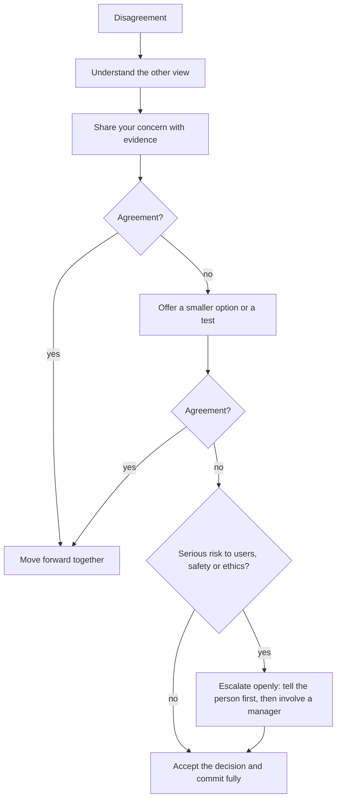

# Conflict and disagreement

## Before this lesson

Read [Teamwork and collaboration](#/lesson/behavioural/teamwork), which introduced the question-family pattern used here. The lesson [Classic behavioural questions](#/lesson/interview-prep/classic-behavioural-questions) in the Cracking the Coding Interview track has one model conflict answer (a rewrite-versus-patch disagreement resolved by a small experiment). This lesson goes further: the different kinds of conflict, how to tell a story where you did **not** get your way, Amazon's "Disagree and Commit" idea, and probes that interviewers use to check whether your story is really about respect.

## In plain words

Two people in a car disagree about the route. One kind of driver insists, refuses to listen, and sulks if overruled. Another kind says nothing and then grumbles about the traffic for an hour. A third kind says, "I think the coast road is faster at this time; here's why," listens to the reply, and if the other person still prefers the highway, drives the highway properly, without sabotaging the trip. You want to travel with the third driver.

**Conflict questions** check which driver you are. Engineers disagree constantly: about designs, priorities, code style, deadlines, what "done" means. Disagreement itself is healthy; it is how teams avoid mistakes. What hiring managers want to know is whether you disagree **usefully**: with evidence, with respect, and with the ability to move forward together whatever the outcome.

Companies say this explicitly. One of Meta's stated values is "Be direct and respect your colleagues". Amazon's Leadership Principles include one titled "Have Backbone; Disagree and Commit": in Amazon's description, you should respectfully challenge decisions you disagree with, even when it is uncomfortable, and once a decision is made, commit to it fully. Meta's preparation post lists "Tell me about a time you pushed an idea forward despite opposition" and "How do you deal with conflict?" among its sample questions.

## What the interviewer is really testing

- **Courage**: do you raise disagreement at all, or stay quiet to avoid discomfort?
- **Understanding**: do you try to understand the other side before arguing?
- **Evidence over authority**: do you use facts, data and small tests rather than volume or rank?
- **Respect**: do you describe the other person fairly, even now?
- **Resolution**: did the disagreement end in a decision, and did the work move forward?
- **Commitment**: if the decision went against you, did you support it fully?
- **Judgement about escalation**: did you know when, and how, to involve someone more senior?

## Kinds of conflict

It helps to know which kind your story is, because each emphasises different things.

| Kind | Example | What to emphasise |
|---|---|---|
| Technical | Two designs for a feature; which library to use | Evidence, experiments, trade-offs |
| Priorities | Product wants features, you want to fix reliability | Shared goals, data about impact, compromise |
| Process | How strictly to review code; whether to write tests | Understanding why the other person cares |
| Interpersonal | A teammate who dismisses others or misses commitments | Private conversation, facts not labels, empathy |
| With a senior person | Disagreeing with your lead or a senior engineer | Respectful challenge, evidence, commitment after the decision |

Prepare at least two conflict stories, ideally of different kinds, and at least one where you did not get your way.

## Common phrasings

- "Tell me about a time you disagreed with a colleague."
- "Tell me about a time you pushed an idea forward despite opposition."
- "How do you deal with conflict?"
- "Describe a time you disagreed with your manager's decision."
- "Tell me about a time you were wrong in a disagreement."
- "Give an example of a time you committed to a decision you disagreed with."
- "Tell me about working with someone difficult."
- "Describe a time you gave someone feedback they did not want to hear."

## An example rubric

An **example** rubric, written for this lesson:

| Level | What it looks like for conflict |
|---|---|
| Outstanding | Raised the disagreement directly and respectfully; sought and fairly describes the other view; used evidence or a test; a clear decision was reached; if overruled, committed fully and acted to make the decision succeed; specific reflection |
| Solid | Raised the disagreement respectfully, used reasons, reached a resolution, work moved forward |
| Borderline | Disagreement described but resolution vague; or the candidate "won" with no sign of listening; or avoided the conflict and it resolved by itself |
| Poor | Blames or belittles the other person; escalated immediately without trying to resolve; sabotaged or ignored the decision; or no real example ("I never have conflicts") |

## A weak answer (dialogue)

> **Example (fictional).** Question: "Tell me about a time you disagreed with a decision."
>
> **Candidate:** My tech lead wanted to release a big change before our annual sale without doing a proper load test. I thought that was a really bad idea, honestly quite reckless. I told him it was risky and that we should delay. He didn't listen, so I raised it with our manager. In the end they went ahead anyway, and there were some problems during the sale, which kind of proved my point.
>
> **Interviewer:** What did you do after the decision was made?
>
> **Candidate:** I did my part of the release. I'd already made my concerns clear, so it was on them.

The candidate may have been right about the risk. But the story shows an unflattering description of the lead ("reckless"), escalation as the first move after one conversation, no attempt to understand the lead's reasons, no evidence, and, worst of all, an "it was on them" attitude after the decision. On the example rubric this is poor, and it is a classic red flag (lesson 19).

## A strong answer (dialogue, full STAR)

> **Example (fictional).** Same question.
>
> **Candidate:** I'll describe disagreeing with my tech lead about skipping a full load test before our biggest sale of the year, losing that argument, and what I did to make the decision work.
>
> *(Situation)* I was a mid-level engineer at an online retailer, on the team that owns the checkout service. Three weeks before the year-end sale, we were finishing a change that moved part of checkout to a new database.
>
> *(Task)* The full load test, which simulates sale-level traffic, needed a week of environment setup. My lead, Hafiz, decided to skip it and rely on smaller tests, so we could finish two other sale features. I disagreed, and as the engineer who built the database change, I felt responsible for raising it properly.
>
> *(Action)* Before arguing, I asked Hafiz to walk me through his reasoning. His concern was real: the two other features were promised to the marketing team and each was worth more revenue than the risk he saw. I then wrote down my specific worry in one page: the new database had never handled more than about a third of last year's peak, and I listed the two failure modes I was afraid of, connection limits and slow queries under load. I proposed a smaller option: a two-day partial load test on only the new database path. Hafiz read it, thanked me, and still decided against it because the test environment was shared with the other features. I said I disagreed but understood, and asked whether I could reduce the risk in other ways that did not need that environment. He agreed. So I did three things. I added a feature switch that could send checkout back to the old database in under a minute. I built a dashboard showing connection count and query time for the new database, with an alert at 70% of the connection limit. And I wrote a one-page runbook, a step-by-step guide for the on-call engineer, saying exactly when to flip the switch.
>
> *(Result)* On the first night of the sale, traffic reached about twice our estimate. The alert fired at 9:40 pm when connections hit 70%. The on-call engineer followed the runbook and moved checkout back to the old database in about 40 seconds. Customers saw slower pages for roughly five minutes and no failed orders. We moved back to the new database after the sale, with a proper load test. Hafiz mentioned the switch and runbook in the sale review as the reason the night went smoothly.
>
> *(Reflection)* I learned two things. First, disagreeing well meant offering a smaller, cheaper option, not only saying no. Second, once the decision was made, my job was to make it succeed, and the safety net I built was more valuable than winning the argument would have been.
>
> **Interviewer:** Looking back, was Hafiz wrong?
>
> **Candidate:** Partly. The risk I worried about was real, but his trade-off was reasonable: the two features earned more than the five slow minutes cost. If I'd been in his position with his information, I might have made the same call. What I'd change is raising the risk a week earlier, when the partial test would have fitted.

## Why the strong answer scores higher

| Rubric point | Weak answer | Strong answer |
|---|---|---|
| Raised it directly and respectfully | Yes, but called the lead reckless | Yes, and describes Hafiz fairly |
| Sought the other view | No | Asked for his reasoning first and states it fairly |
| Evidence | "It was risky" | One-page note: a third of peak, two named failure modes |
| Offered alternatives | Delay only | A smaller two-day test, then other risk reductions |
| Escalation | Went to the manager after one conversation | Did not need to; the decision was the lead's to make |
| Commitment | "It was on them" | Built a switch, dashboard and runbook to make the decision safe |
| Outcome | "Some problems, proved my point" | Alert fired, rolled back in about 40 seconds, no failed orders |
| Reflection | None | Two specific lessons; fair view of the other side |

The deepest difference is attitude. The weak candidate wanted to be right. The strong candidate wanted the sale to succeed. That difference is exactly what "Disagree and Commit" means.

## A junior version: an interpersonal conflict

Not every conflict is technical. A **fictional** student example, answering "Tell me about working with someone difficult".

- **Situation.** A final-year project team of four building an app for a community library. One teammate, Jun, often rewrote other people's code without discussing it, which broke features twice before a progress review.
- **Task.** I was the team's informal coordinator, and two teammates had started complaining about Jun in a separate chat, which was making things worse.
- **Action.** I asked Jun for a coffee on his own rather than raising it in a group. I described two specific incidents and their effects, without labels like "rude": "On Tuesday the search page was rewritten and the filters stopped working before the review." Then I asked why he had done it. He explained he thought the code was messy and was worried about our grade. That was a fair concern, so I proposed that all changes go through a pull request (a request to merge code that a teammate reviews first), and that he lead a one-hour session on code style for the team, since he clearly cared about it. I also asked the other two to stop the side chat and raise issues directly.
- **Result.** There were no more surprise breakages in the remaining six weeks. Jun's style session led to a shared style guide, and our code quality mark went from 6 out of 10 at the progress review to 9 out of 10 at the final.
- **Reflection.** Describing behaviour and its effect, instead of judging the person, made the conversation easy. I use that approach whenever I give difficult feedback.

## Escalation: when and how

Beginners sometimes believe that involving a manager is always wrong. It is not. It is wrong as a **first** move, and wrong when done behind someone's back. A healthy sequence:



Notice the last step: even after escalating, once a final decision is made, you commit. If a decision is genuinely unethical or unsafe, that is a different matter from an ordinary disagreement, and your story should make clear which kind it was.

## Likely follow-up probes

| Probe | What it checks | How to answer |
|---|---|---|
| "How did the other person see it?" | Empathy, fairness | State their view in its strongest form |
| "What did you do when you didn't get your way?" | Commitment | Concrete actions that supported the decision |
| "Looking back, who was right?" | Humility | Honest, balanced; admit what they got right |
| "Did you consider escalating?" | Judgement | When and why you did or did not |
| "How is your relationship with them now?" | Lasting respect | A specific sign (they asked you to review their next design, you still work well together) |
| "What would you do differently?" | Reflection | A genuine change, often raising the issue earlier |

## Pitfalls

1. **"I don't really have conflicts."** It sounds like avoidance or a lack of strong views. Everyone who works with people disagrees sometimes.
2. **The villain story.** The other person was foolish, lazy or rude. Even if true, it makes you sound hard to work with.
3. **You always win.** Have at least one story where you were overruled or wrong.
4. **Escalating first.** Going to a manager before talking to the person.
5. **Quiet sabotage.** "I did my part" after losing. Disagree and Commit means supporting the decision, not doing the minimum.
6. **Too much emotion.** "I was furious" is fine as one honest sentence; the story should be about what you did.

## Your turn

1. Choose a disagreement where you did not get your way. Write the other person's view in its strongest form, in two sentences.
2. Write down what you did after the decision to help it succeed. If the answer is "nothing", think about what you would do now, and choose a different story for interviews.
3. Tell the story aloud with the opening headline "I'll describe disagreeing with ... and what I did after the decision."
4. Answer "Looking back, who was right?" in under 30 seconds, honestly.

## Summary

- Conflict questions test courage, understanding, evidence, respect, resolution, commitment and escalation judgement.
- Meta's values include "Be direct and respect your colleagues"; Amazon's principle "Have Backbone; Disagree and Commit" asks people to challenge respectfully and then commit fully.
- Prepare at least two conflict stories of different kinds, including one where you were overruled.
- Strong answers describe the other side fairly, use evidence or a smaller test, reach a decision, and show commitment through actions.
- Escalate openly and only after trying to resolve directly; commit after the final decision.

## Glossary

- **Conflict question**: a behavioural question about disagreement or friction with others.
- **Disagree and commit**: raising disagreement respectfully, then fully supporting the decision once made; part of an Amazon Leadership Principle's title.
- **Escalation**: involving someone more senior to resolve a disagreement.
- **Load test**: a test that simulates heavy traffic to see how a system behaves.
- **Runbook**: a step-by-step guide for handling a known operational situation.
- **Pull request**: a request to merge code changes, reviewed by a teammate first.
- **Rollback**: returning a system to its previous working state.

```quiz
[
  {"q": "Which behaviour best matches Amazon's 'Have Backbone; Disagree and Commit'?",
   "options": ["Staying quiet to keep the peace", "Challenging the decision respectfully with reasons, then fully supporting it once made", "Refusing to work on a decision you disagree with", "Escalating every disagreement to a director"],
   "answer": 1,
   "explain": "Amazon describes respectfully challenging decisions and committing wholly once a decision is determined."},
  {"q": "In the weak answer, which single sentence most damages the candidate on the example rubric?",
   "options": ["My tech lead wanted to release before the sale.", "I did my part of the release; it was on them.", "There was a big sale.", "We had a database change."],
   "answer": 1,
   "explain": "It shows a lack of commitment after the decision, the core of the rubric's poor level."},
  {"q": "In the strong answer, which part is the Action?",
   "options": ["I was a mid-level engineer at an online retailer", "Before arguing, I asked Hafiz to walk me through his reasoning... I added a feature switch, a dashboard and a runbook", "Customers saw slower pages for about five minutes", "I learned to offer a smaller option"],
   "answer": 1,
   "explain": "The Action is the sequence of the candidate's own steps; the others are Situation, Result and Reflection."},
  {"q": "After a conflict story where you won the argument, which follow-up probe is most likely coming?",
   "options": ["How did the other person see it, and how is your relationship now?", "What is your salary expectation?", "What is a hash map?", "Where did you go to school?"],
   "answer": 0,
   "explain": "Interviewers check that winning did not cost respect or the relationship."},
  {"q": "When is escalating to a manager appropriate in a disagreement?",
   "options": ["Immediately, to save time", "After trying to resolve it directly, done openly, especially for serious risk to users, safety or ethics", "Never", "Only by anonymous message"],
   "answer": 1,
   "explain": "Escalation is wrong as a first move or behind someone's back, but appropriate openly for serious risks."},
  {"q": "A candidate says, 'I don't really have conflicts at work.' How is this likely to be read?",
   "options": ["As a sign of excellent teamwork", "As avoidance or a lack of strong views, and no evidence for the rubric", "As the ideal answer", "As a technical answer"],
   "answer": 1,
   "explain": "Everyone who works with people disagrees sometimes; the question needs a real example."},
  {"q": "In the student example, why did describing 'the search page filters stopped working before the review' work better than calling Jun rude?",
   "options": ["It is shorter", "Describing specific behaviour and its effect invites a fix; labels invite defensiveness", "It avoids mentioning Jun", "Teachers prefer it"],
   "answer": 1,
   "explain": "Facts about behaviour and effects keep the conversation about the problem, not the person."}
]
```

> **Source:** Amazon, Leadership Principles (https://atoz.amazon/en-us/discover/leadership-principles); Meta, Preparing for your software engineering interview, 2022 (https://www.metacareers.com/blog/preparing-for-your-software-engineering-interview-at-meta/); Meta, Culture and values (https://www.metacareers.com/culture). Rubric, dialogues and the escalation flow are original and fictional.
