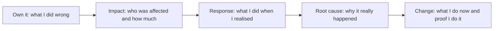

# Failure, mistakes and feedback

## Before this lesson

Read [Conflict and disagreement](#/lesson/behavioural/conflict) and [STAR variants](#/lesson/behavioural/star-variants), especially the section on Reflection: this family depends on it. The Cracking the Coding Interview track's [story grid lesson](#/lesson/interview-prep/story-grid-star) has one worked failure story (a cache released without an expiry) and the [classic questions lesson](#/lesson/interview-prep/classic-behavioural-questions) covers the weakness question. This lesson goes deeper: how to choose the right failure, a five-part shape for failure stories, the difference between a mistake, a failed project and critical feedback, and how to answer questions about giving and receiving feedback.

## In plain words

A pilot's training record is full of mistakes made in simulators, each one studied and turned into a rule. Nobody wants a pilot who has never made a mistake in training; they want one who has made many, in safe places, and learned from each. Aviation's safety record comes from treating mistakes as information rather than shame.

**Failure questions** ask for that attitude. "Tell me about a time you failed" is not a trap to find a reason to reject you. It is a check on three things: whether you are honest about your mistakes, whether you take responsibility rather than blaming others, and whether you actually change because of them. Meta's preparation post says openness about setbacks will not count against you and that interviewers value what you learned and how you grew. One of Amazon's Bar Raisers says, in Amazon's article of interview tips, that a candidate who is self-critical, admits a mistake without blaming others and explains the concrete changes made afterwards can really impress.

For a job, this matters more than it seems. Every engineer causes bugs and outages. Teams want people who report problems early, fix them calmly and prevent them next time, because the alternative, people who hide mistakes, is how small problems become disasters.

## What the interviewer is really testing

- **Honesty**: a real failure, stated plainly.
- **Ownership**: your part in it, without shifting blame.
- **Response**: what you did when you realised, especially how quickly you told people.
- **Root-cause thinking**: whether you understood why it happened, not only what happened.
- **Learning applied**: a specific change in your behaviour, ideally with evidence you have used it since.
- **Self-awareness**: whether you can see your own patterns.

## Five kinds of question in this family

| Kind | Typical phrasing | What to emphasise |
|---|---|---|
| A mistake you made | "Tell me about a mistake you made." | Ownership, fast response, prevention |
| A failed project or goal | "Tell me about a project that failed." | Your part in the failure, what you would do differently |
| Critical feedback you received | "Tell me about feedback that was hard to hear." | Listening, not defending, the change you made |
| Feedback you gave | "Tell me about giving someone difficult feedback." | Care, specifics, the outcome for the other person |
| Weakness or growth area | "What is an area you need to improve?" | A real weakness, its effect, what you do about it now |

Apple's interview tips page lists "areas you need to improve" among its sample questions. Meta's post lists "What could you have done better?" and "How do you like to give and receive feedback?".

## Common phrasings

- "Tell me about a time you failed."
- "Describe a mistake you made and what you learned."
- "Tell me about a project that did not go as planned."
- "What could you have done better on your last project?"
- "Tell me about the most critical feedback you have received."
- "How do you like to give and receive feedback?"
- "Tell me about a time you missed a deadline."
- "What is something you are working to improve?"

## Choosing the right failure

The most important decision is which story to tell. A good failure story is:

1. **Real and yours.** You made the mistake or the decision that went wrong, not your team or your manager.
2. **Meaningful.** It had real consequences: lost time, a bug users saw, a missed deadline, a disappointed client. A trivial failure ("I once forgot to reply to an email") sounds like avoidance.
3. **Not fatal for the role.** A story that suggests you are dishonest, careless with safety, or unable to do the core job is the wrong choice. A developer saying "I don't like writing code" is the extreme example.
4. **In the past, with learning applied.** The lesson should be something you now do, with at least one example of doing it. Michigan Tech's career services page makes the same point about results in general: outcomes that went badly can carry the most useful lessons, as long as you explain what you learned and how you would apply it.

Avoid two common dodges. The **disguised strength** ("I work too hard", "I'm a perfectionist") is so well known that interviewers read it as evasion. The **blame failure** ("the project failed because the client kept changing their mind") is not about you at all.

## The five-part shape

Failure stories fit STAR, but the Action and Result have a particular shape. Think of it as five beats:



The **root cause** is the underlying reason, as opposed to the immediate trigger. "I typed the wrong command" is the trigger; "I was running commands against production by hand with no review step" is closer to the root cause. Engineering teams often analyse incidents in a **blameless postmortem**, a written review that focuses on how the system and process allowed the mistake rather than on punishing a person. Using that language in your story shows maturity, as long as you still own your part.

## An example rubric

An **example** rubric, written for this lesson:

| Level | What it looks like for failure and learning |
|---|---|
| Outstanding | A real, meaningful failure owned plainly; prompt response that limited harm and informed others; clear root cause; specific change with evidence it has been applied since |
| Solid | Real failure owned; reasonable response; a specific lesson |
| Borderline | Failure minimised or partly blamed on others; generic lesson ("communication is important") |
| Poor | Disguised strength; blame; no learning; or the story suggests the candidate hid the problem |

## A weak answer (dialogue)

> **Example (fictional).** Question: "Tell me about a time you failed."
>
> **Candidate:** I'd say my biggest failure is that I sometimes take on too much because I really care about the team. For example, on one project the requirements kept changing and the product manager wasn't very clear, so the feature ended up late. I worked a lot of extra hours trying to save it, but it still slipped by a few weeks. I learned that I need to say no sometimes.
>
> **Interviewer:** What was your part in it being late?
>
> **Candidate:** Honestly, not much. It was mostly the changing requirements.

Two dodges in one answer: a disguised strength ("I care too much") and a blame failure (the product manager, the requirements). The candidate's follow-up confirms they see no personal part. Poor on the example rubric.

## A strong answer (dialogue, full STAR)

> **Example (fictional).** Same question.
>
> **Candidate:** I'll tell you about committing to a two-week estimate for a feature that took six, and why the bigger failure was that I didn't say so until week three.
>
> *(Situation)* I was a backend engineer at a travel booking start-up, in my second year. Our sales team had signed a hotel chain that needed group bookings, several rooms in one reservation, for a launch in their spring season.
>
> *(Task)* I was asked to estimate and build the group booking backend. I said two weeks, and the sales team gave the hotel a date based on that.
>
> *(Action)* I'd estimated from the happy path, the case where everything goes right, without looking at how our payment and cancellation code handled reservations. In week one I found that both assumed exactly one room per booking, in about forty places. That was my first mistake: estimating without reading the code. My second, worse mistake was that I didn't flag it. I thought I could catch up with longer days, and I didn't want to look slow. By the middle of week three it was obvious I couldn't. I went to my manager, Grace, that afternoon, told her plainly that I'd underestimated, that I'd known for over a week, and that I needed four more weeks. I brought a list of the forty places and a proposal: launch with group bookings that could only be cancelled as a whole, which cut about a week, and handle partial cancellations later. Grace and the sales lead agreed and told the hotel. I then broke the remaining work into tasks of a day or less and posted progress in the team channel every two days so nobody would be surprised again.
>
> *(Result)* We launched three and a half weeks after the original date. The hotel was unhappy about the delay but stayed, partly because they had a firm new date with a clear reason. The bigger cost was trust: Grace told me directly that the late warning hurt more than the wrong estimate, which was fair.
>
> *(Reflection)* I changed two habits. I don't give an estimate now until I've read the code paths involved, and I give a range rather than a number. And I flag a slip as soon as I think it's more likely than not, which I now do in our weekly planning. On my next large feature, a loyalty programme, I flagged a one-week risk in the first week; we moved a smaller item out and delivered on the original date.
>
> **Interviewer:** Why didn't you flag it earlier?
>
> **Candidate:** Pride, mostly. I was the newest engineer and I wanted to look capable. Ironically, flagging early is what makes people trust you, which is the opposite of what I feared.

## Why the strong answer scores higher

| Rubric point | Weak answer | Strong answer |
|---|---|---|
| Real failure owned | Disguised strength; blames requirements | Two specific mistakes, stated plainly |
| Impact | "Slipped by a few weeks" | Date given to a customer, slipped three and a half weeks, trust damaged |
| Response | Extra hours | Told the manager directly, brought the evidence and a scope option |
| Root cause | None | Estimated without reading the code; hid the slip out of pride |
| Change with evidence | "Say no sometimes" | Read the code, give ranges, flag early; loyalty project delivered on time |
| Self-awareness | "Not much" was my part | Names pride as the reason, honestly |

The strong candidate looks **more** hireable after telling a story about failing, which is the point of the question. Interviewers know everyone fails; they are looking for the person who handles it this way.

## Feedback: receiving and giving

### Receiving critical feedback

The structure is similar: the feedback, your first reaction (honestly, briefly), what you did with it, and the result. The key signal is that you **listened rather than defended**, asked for specifics, and changed something.

**A junior example (fictional).** Answering "Tell me about feedback that was hard to hear":

- **Situation.** In my internship at a logistics software company, I presented my project, a tool that flags late deliveries, to the operations team at the end of week six.
- **Task.** I wanted them to start using it. Afterwards my mentor told me the operations lead had found the presentation "impossible to follow".
- **Action.** My first reaction was defensive; I'd spent two days on the slides. I asked my mentor for specifics rather than arguing. She said I had spent ten minutes on the algorithm and one minute on what the tool would change in their day. I asked the operations lead for 15 minutes, apologised for the confusing presentation, and asked what they needed to know to decide. They wanted three things: which deliveries would be flagged, how early, and what they would have to do differently. I rebuilt the presentation around those three questions, with one slide of technical detail at the end, and presented again the next week.
- **Result.** The team agreed to a two-week trial, and the tool flagged 37 late deliveries early enough for staff to warn customers. The operations lead asked me to present the results to her manager.
- **Reflection.** I now start any presentation by writing down the three questions my audience needs answered, and I put technical detail last.

### Giving difficult feedback

Here the interviewer is checking **care and courage together**: did you say the hard thing, did you say it in a way the person could hear, and did it help them? A good pattern is to describe specific behaviour and its effect, ask for their view, and agree on a next step, then follow up. The interpersonal conflict story in [lesson 11](#/lesson/behavioural/conflict) is an example of the same pattern.

### "How do you like to give and receive feedback?"

This sounds like an opinion question. Answer with your preference in one or two sentences, then prove it with a short example. "I like feedback that is specific and soon, ideally the same day. For example, ..." The example is what scores.

## Likely follow-up probes

| Probe | What it checks | How to answer |
|---|---|---|
| "Why did it happen?" | Root-cause thinking | The underlying reason, including your own part |
| "When did you realise, and what did you do first?" | Speed and honesty of response | The moment, and who you told |
| "How did others react?" | Impact awareness | Honest, including any criticism you received |
| "What do you do differently now?" | Learning applied | A specific habit plus one example of using it |
| "Has it happened again?" | Whether the change worked | Honest; if it partly recurred, say what you changed next |
| "What is another failure?" | Whether you have more than one | Have a second ready |

## Pitfalls

1. **The disguised strength.** "I care too much", "I'm a perfectionist".
2. **Blame.** The client, the manager, the requirements, the tools.
3. **The trivial failure.** Too small to show anything.
4. **The catastrophic or alarming failure.** A story that suggests dishonesty or recklessness with users' data or safety.
5. **The unlearned failure.** No change in behaviour, or a generic lesson.
6. **Hiding the mistake in the story.** If you covered something up, that is not the story to tell.
7. **Over-apologising.** Own it in a sentence; spend most of the time on response and change.

## Your turn

1. Write down three failures from the last few years. For each, mark: real and mine? meaningful? not fatal for the role? learning applied?
2. Choose the best one and write the five beats: own it, impact, response, root cause, change with evidence.
3. Write a second story about critical feedback you received.
4. Answer aloud: "Why did it happen?" and "Has it happened again?" for your chosen story.

## Summary

- Failure questions test honesty, ownership, response, root-cause thinking and learning applied. Meta says openness about setbacks will not count against you; an Amazon Bar Raiser says self-critical, blame-free answers with concrete changes can impress.
- Choose a failure that is real, yours, meaningful, not fatal for the role, and followed by a change you can prove.
- Use five beats: own it, impact, response, root cause, change with evidence.
- For feedback received, show listening, specifics and change. For feedback given, show care plus courage. For preference questions, give a short preference and then an example.
- Avoid disguised strengths, blame, trivial stories and generic lessons.

## Glossary

- **Failure question**: a behavioural question about a mistake, failed project, missed goal or critical feedback.
- **Disguised strength**: a supposed weakness that is really a boast, such as "I work too hard".
- **Root cause**: the underlying reason a failure happened, as opposed to its immediate trigger.
- **Blameless postmortem**: a written incident review that focuses on how systems and processes allowed a mistake, rather than on punishing a person.
- **Happy path**: the case where everything goes as expected, with no errors or edge cases.
- **Estimate range**: an estimate given as a span ("three to five weeks") to show uncertainty honestly.
- **Growth area**: a skill or habit you are actively working to improve.

```quiz
[
  {"q": "Which failure story is the best choice for an interview?",
   "options": ["I work too hard and burn out.", "I underestimated a feature, hid the slip for a week, then told my manager, changed how I estimate, and delivered the next large feature on time.", "The client kept changing requirements, so the project failed.", "I once forgot to reply to an email."],
   "answer": 1,
   "explain": "It is real, yours, meaningful, not fatal for the role, and shows a change applied since. The others are a disguised strength, blame and a trivial failure."},
  {"q": "In the strong answer, what is the root cause rather than the trigger?",
   "options": ["The hotel needed group bookings", "Estimating from the happy path without reading the code, and not flagging the slip out of pride", "Payment code had forty places to change", "The launch was in spring"],
   "answer": 1,
   "explain": "The forty places were the trigger. The root causes were how the estimate was made and why the slip was hidden."},
  {"q": "What does Meta's preparation post say about discussing setbacks?",
   "options": ["Never mention failures", "Openness about setbacks will not count against you; learning and growth are valued", "Only discuss failures from school", "Failures are scored as negatives"],
   "answer": 1,
   "explain": "Meta's 2022 post encourages honesty about failures and what you learned."},
  {"q": "You are asked 'How do you like to receive feedback?' What is the best structure?",
   "options": ["A long philosophy of feedback", "A one or two sentence preference, then a short real example that proves it", "Say you never need feedback", "Ask the interviewer for feedback instead"],
   "answer": 1,
   "explain": "Opinion-sounding questions still score on evidence; the example is what the interviewer can rate."},
  {"q": "After a failure story, which follow-up probe is most likely?",
   "options": ["Has it happened again, and what do you do differently now?", "What is your favourite framework?", "Can you write a sorting algorithm?", "Where did you grow up?"],
   "answer": 0,
   "explain": "Interviewers check that the learning was real by asking whether it recurred and what changed."},
  {"q": "In the internship feedback story, what made the candidate's response strong?",
   "options": ["Defending the slides", "Asking for specifics, then asking the audience what they needed, rebuilding and presenting again", "Ignoring the feedback", "Complaining to the mentor"],
   "answer": 1,
   "explain": "Listening rather than defending, seeking specifics and changing the work are the key signals."},
  {"q": "Why is 'I am a perfectionist' a weak answer to 'What is an area you need to improve?'",
   "options": ["It is too technical", "Interviewers widely recognise it as a disguised strength and read it as evasion", "It is too long", "Perfectionism is a fatal weakness"],
   "answer": 1,
   "explain": "The question checks self-awareness; a disguised strength shows the opposite."}
]
```

> **Source:** Meta, Preparing for your software engineering interview, 2022 (https://www.metacareers.com/blog/preparing-for-your-software-engineering-interview-at-meta/); Amazon, Bar Raiser tips (https://www.aboutamazon.com/news/workplace/amazon-job-interview-questions-tips-bar-raisers); Michigan Tech Career Services, Behavioral interviews (https://www.mtu.edu/career/students/networking/interviews/behavioral/); Apple, Interview tips (https://www.apple.com/careers/us/interview_tips.html). Rubric and dialogues are original and fictional.
