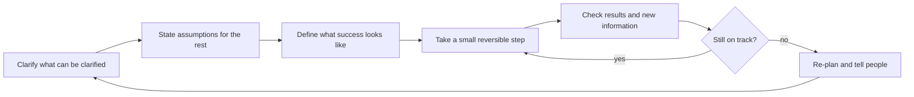

# Ambiguity and changing priorities

## Before this lesson

Read [Ownership and delivering results](#/lesson/behavioural/ownership-results): ambiguity stories often overlap with ownership, because someone has to act when nobody has a clear plan. The Open-Ended Engineering Questions track has a companion lesson on [unclear requirements and explaining technical ideas](#/lesson/thinking/behavioural-communication), which focuses on clarifying requirements in technical questions; this lesson focuses on telling stories about it.

## In plain words

Imagine hiking in fog. You cannot see the summit, the map is old and the trail markers are missing in places. A poor hiker either stops and waits for the fog to lift (it may not) or charges off in a guessed direction and gets lost. A good hiker checks what can be checked (compass, the slope underfoot), picks a direction for the next few hundred metres, marks the spot, walks, checks again and adjusts. They make progress without pretending to know more than they do.

Software work is often foggy. Requirements are vague ("make search better"), data is missing, the product changes direction halfway through a project, a new law appears, a key person leaves. **Ambiguity** means not having all the information you would like in order to act. **Changing priorities** means the goal itself moves while you work. **Ambiguity questions** ask for evidence that you are the good hiker: you make progress in the fog, sensibly, and you keep others informed.

Companies in fast-moving markets name this directly. Sea lists "We Adapt" and "We Run" among its core values: in Sea's description, change is constant and should be welcomed, and the company aims to move fast with urgency. Amazon's preparation page for Software Development Manager candidates lists adaptability and risk management among the project-management skills it assesses. A 2017 post on Grab's engineering blog about how it hired engineers in Singapore listed an entrepreneurial drive among the soft skills it looked for; that post is several years old, so treat it as historical colour rather than current policy.

For a job, this matters because almost nobody hands an engineer a perfect specification. The ability to move forward sensibly without one is a large part of what separates a mid-level engineer from a junior one.

## What the interviewer is really testing

- **Clarifying**: do you reduce the fog where you can, by asking the right people the right questions?
- **Explicit assumptions**: where you cannot get answers, do you state your assumptions and check them later?
- **Small, reversible steps**: do you act in ways that are cheap to undo if you are wrong?
- **Defining success**: do you turn a vague goal into something measurable?
- **Re-planning**: when priorities change, do you adjust calmly and openly, rather than complaining or ignoring the change?
- **Communication**: do the people around you know what you are doing and why?
- **Composure**: do you stay calm and constructive?

## Kinds of ambiguity

| Kind | Example | Useful moves |
|---|---|---|
| Vague goal | "Make onboarding better." | Define a measure with the requester; look at data |
| Missing information | No logs, no documentation, the original author has left | Investigate, prototype, ask around, write down what you learn |
| Unclear ownership | Nobody is sure who decides | Find the decision maker; propose a decision and ask for objections |
| New domain or technology | First time with payments, or a new language | Learn fast with a small throwaway prototype |
| Changing priorities | The launch market changes; a bigger customer appears | Re-plan openly; say what will slip and get agreement |
| Crisis | An outage with an unknown cause | Stabilise first, investigate second, communicate throughout |

## Common phrasings

- "Tell me about a time you had to work with incomplete information."
- "Describe a project where the requirements were unclear."
- "Tell me about a time priorities changed suddenly. What did you do?"
- "Give me an example of making a decision without all the data you wanted."
- "Tell me about a time you had to start something with no clear direction."
- "How do you handle ambiguity?"
- "Describe a time your project was cancelled or changed direction halfway through."

## The fog loop

Strong ambiguity stories usually follow a loop, whether or not the candidate names it:



A **reversible step** is one that is cheap to undo: a prototype, a feature switch, a trial with a few users, a draft shared for comments. Amazon's "Bias for Action" principle makes a related point: in Amazon's description, many decisions are reversible and do not need extensive study, and calculated risk-taking is valued. Recognising which decisions are reversible is a sign of judgement.

## An example rubric

An **example** rubric, written for this lesson:

| Level | What it looks like for ambiguity |
|---|---|
| Outstanding | Clarified what could be clarified; stated assumptions; defined a measurable goal; moved forward in small reversible steps; re-planned openly when things changed; kept stakeholders informed; good measured outcome |
| Solid | Made reasonable progress despite unclear information; some clarification and communication; outcome achieved |
| Borderline | Waited for clarity for a long time, or charged ahead on guesses without checking; outcome partly luck |
| Poor | Complained about the ambiguity, blamed others for it, or froze; no sensible process |

## A weak answer (dialogue)

> **Example (fictional).** Question: "Tell me about a time you had to work with unclear requirements."
>
> **Candidate:** That happens all the time, honestly. Product managers are often vague. On one project the PM asked us to "improve search" and didn't give any details. I asked several times for proper requirements but didn't really get them, so in the end I made a bunch of improvements I thought made sense, like fuzzy matching and better ranking. Then halfway through they changed priorities to something else entirely, which was frustrating. I think it worked out okay in the end.
>
> **Interviewer:** How did you know whether your improvements helped?
>
> **Candidate:** People said search felt better.

The answer opens with a complaint about product managers, shows no attempt to define success, describes changes chosen by taste, treats a priority change as an annoyance, and has no measured result. Borderline at best, with a tone that edges towards poor.

## A strong answer (dialogue, full STAR)

> **Example (fictional).** Same question.
>
> **Candidate:** I'll tell you about being asked to "make search better" with no definition of better, and how I turned that into a measurable goal, then re-planned halfway when the company changed its launch market.
>
> *(Situation)* I was a backend engineer at an online marketplace for second-hand furniture in Singapore and Malaysia. Our product manager, Kumar, had heard complaints about search and asked me to spend the quarter improving it.
>
> *(Task)* There was no specification, and Kumar was honest that he didn't know exactly what was wrong. My job was to work out what "better" meant and deliver it.
>
> *(Action)* First I tried to reduce the fog. I asked Kumar which complaints he'd heard; he forwarded twelve support tickets. Then I looked at a week of search logs and found something more useful than the tickets: about 18% of searches returned zero results, and people who got zero results almost never bought anything in that session. I proposed to Kumar that we define "better" as fewer zero-result searches, while checking that purchases after search didn't fall, and he agreed. I wrote down my assumptions in a one-page note: for example, that zero results were mostly caused by spelling and by local words for furniture. I sampled 200 zero-result searches by hand to check. Spelling was about 40% and local words, like Malay terms and brand names used as generic names, about 25%. So I shipped in small steps behind a feature switch, each tested on 10% of users first: spelling tolerance in week three, a list of local synonyms in week five. Then, in week six, the company decided to launch in Indonesia two months early, and Kumar asked whether search could support Bahasa Indonesia listings in time. Rather than push back or drop everything, I wrote a short re-plan: synonym work would pause, Indonesian support would take about three weeks using the same tools, and the remaining zero-result work would move to next quarter. I listed what would slip and asked Kumar and the Indonesia launch lead to agree in writing, which they did the same day.
>
> *(Result)* Zero-result searches fell from about 18% to about 7% in Singapore and Malaysia, and purchases following a search rose by about 6% in the test group, so we turned both changes on for everyone. Indonesian search was ready a week before the launch. Kumar later used my one-page "definition of better" note as a template for other vague requests.
>
> *(Reflection)* What I learned is that the most useful step with a vague goal is to propose a measure and get it agreed, because it turns arguments about taste into arguments about data. And when priorities change, writing down what slips and getting it agreed keeps everyone calm.
>
> **Interviewer:** What would you have done if Kumar had disagreed with your measure?
>
> **Candidate:** I'd have asked what he thought success looked like and tried to find a number for that instead. The point wasn't my measure; it was having one we both trusted.

## Why the strong answer scores higher

| Rubric point | Weak answer | Strong answer |
|---|---|---|
| Clarified what could be clarified | Asked for requirements, gave up | Asked for tickets, then went to the logs |
| Stated assumptions | No | One-page note, checked with a 200-search sample |
| Defined success | "People said it felt better" | Zero-result rate, with a purchase check |
| Small reversible steps | A batch of changes chosen by taste | Feature switch, 10% tests, one change at a time |
| Re-planned openly | Frustrated by the change | Written re-plan, slips listed, agreed same day |
| Tone | Complains about product managers | Describes Kumar fairly and works with him |
| Measured result | None | 18% to 7% zero results; purchases up about 6%; on time for the launch |

## A junior version: an internship that changed direction

- **Situation.** In my ten-week internship at a health-tech company, I was building a dashboard for clinic managers to see appointment no-shows.
- **Task.** In week five, my manager told me the company had dropped the dashboard to focus on a new product, and asked me to find something useful for the remaining five weeks, with no specific suggestion.
- **Action.** I took a day to understand the new priority by reading the new product's planning document and asking two engineers on that team what was slowing them down. Both mentioned that test data for patient appointments was created by hand. I proposed to my manager a small tool to generate realistic, fake appointment data, which would reuse the data model I'd learned for the dashboard. I agreed a scope with the team: three data types in two weeks, then more if useful. I demoed the first type after four days to check I was on the right track, and changed one field format after their feedback.
- **Result.** The tool generated test data for five data types by the end of my internship, and the team estimated it saved each of their four engineers a couple of hours a week. They kept using it after I left.
- **Reflection.** I learned to treat a cancelled project as a chance to ask "what is painful right now?" rather than waiting to be given work.

## Likely follow-up probes

| Probe | What it checks | How to answer |
|---|---|---|
| "What did you do first?" | Clarifying before acting | The first question you asked or data you looked at |
| "What assumptions did you make?" | Explicit assumptions | Name one or two and how you checked them |
| "How did you know you were on track?" | Defining success | The measure and the checkpoint |
| "What would you have done if you were wrong?" | Reversibility | How you could undo or change course |
| "How did the people around you react to the change?" | Communication | Who you told, how, and their response |
| "What was hardest about the uncertainty?" | Self-awareness and composure | Honest feeling, briefly, then what you did with it |

## Pitfalls

1. **Complaining about the ambiguity.** "PMs are always vague" sounds like you need perfect conditions.
2. **Waiting for clarity.** A story where you waited weeks for requirements shows the opposite of what is being tested.
3. **Charging ahead on guesses.** Acting without stating or checking assumptions.
4. **No definition of success.** "It felt better" is not a result.
5. **Silent re-planning.** Changing direction without telling the people who depended on the old plan.
6. **Treating a priority change as a personal loss.** Show that you understood why it changed.

## Your turn

1. Find a story where the goal was vague or changed. Write the vague goal in one sentence and the measurable definition you used (or could have used) in another.
2. List the assumptions you made, and how you checked or could have checked each.
3. If priorities changed, write the re-plan you made: what slipped, who agreed.
4. Tell the story aloud and answer "What did you do first?" and "What would you have done if you were wrong?".

## Summary

- Ambiguity questions test whether you can make sensible progress without full information, and adjust calmly when priorities change.
- Sea's values "We Adapt" and "We Run", Amazon's assessment of adaptability for managers and its "Bias for Action" principle all point at this skill. Grab's 2017 engineering post listed an entrepreneurial drive among soft skills; treat it as dated.
- Strong stories follow a loop: clarify, state assumptions, define success, take small reversible steps, check, re-plan openly.
- Describe the people who handed you the ambiguity fairly; complaining is a red flag.
- Students can use internships, projects or jobs that changed direction.

## Glossary

- **Ambiguity**: not having all the information you would like in order to act.
- **Changing priorities**: the goal or order of work shifting while a project is under way.
- **Assumption**: something you treat as true for now, without full proof, and plan to check.
- **Reversible step**: an action that is cheap to undo, such as a prototype or a feature switch.
- **Re-plan**: a revised plan after a change, stating what will slip and who agreed.
- **Zero-result search**: a search that returns nothing, often a sign of a search problem.
- **Stakeholder**: anyone affected by or with an interest in a piece of work.

```quiz
[
  {"q": "A product manager says 'make onboarding better' with no other detail. What is the strongest first move?",
   "options": ["Wait until they write a full specification", "Build the changes you personally like", "Ask what they have heard, look at data, and propose a measurable definition of 'better' to agree", "Escalate to their manager"],
   "answer": 2,
   "explain": "Reducing the fog and agreeing a measure turns a vague goal into one you can deliver and prove."},
  {"q": "Which opening sentence is a red flag in an ambiguity answer?",
   "options": ["I asked the PM which complaints they had heard.", "Product managers are always vague, honestly.", "I wrote down my assumptions in a one-page note.", "I tested the change on 10% of users first."],
   "answer": 1,
   "explain": "Complaining about the people who handed you ambiguity suggests you need perfect conditions and may be hard to work with."},
  {"q": "In the strong answer, which part is the Task?",
   "options": ["An online furniture marketplace in Singapore and Malaysia", "There was no specification; my job was to work out what 'better' meant and deliver it", "Zero-result searches fell to about 7%", "I sampled 200 searches by hand"],
   "answer": 1,
   "explain": "The Task states the goal and the candidate's responsibility; the others are Situation, Result and Action."},
  {"q": "Why does a 'reversible step' matter in ambiguous situations?",
   "options": ["It is always faster", "If your assumptions are wrong, a cheap-to-undo step limits the damage and lets you adjust", "It avoids talking to anyone", "It is required by law"],
   "answer": 1,
   "explain": "Small, undoable steps let you learn safely in the fog; Amazon's Bias for Action also distinguishes reversible decisions."},
  {"q": "Priorities change halfway through your project. Which response scores highest?",
   "options": ["Keep working on the original plan", "Complain to your manager", "Write a short re-plan listing what will slip, and get the affected people to agree", "Quietly drop the original work"],
   "answer": 2,
   "explain": "Open re-planning with agreed trade-offs shows adaptability and communication."},
  {"q": "After an ambiguity story, which probe is most likely?",
   "options": ["What assumptions did you make, and how did you check them?", "What is your GPA?", "Do you prefer tabs or spaces?", "What is the time complexity of quicksort?"],
   "answer": 0,
   "explain": "Interviewers check whether you made assumptions explicit and tested them."},
  {"q": "How should you treat the 2017 Grab engineering blog post as a source?",
   "options": ["As Grab's current official policy", "As dated, historical colour, since hiring processes change", "As irrelevant to Singapore", "As a law"],
   "answer": 1,
   "explain": "Processes change by year; an old post is useful background but not a statement of current practice."}
]
```

> **Source:** Sea, Our values (https://sea.com/aboutus/ourvalues); Amazon, SDM interview prep (https://atoz.amazon/en-us/jobs/hiring-process/interview-prep/software-development-manager); Amazon, Leadership Principles (https://atoz.amazon/en-us/discover/leadership-principles); Grab Engineering, How Grab hires engineers in Singapore, 2017 (https://engineering.grab.com/how-grab-hires-engineers-in-singapore). Rubric and dialogues are original and fictional.
