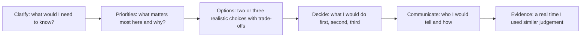

# Hypothetical and scenario questions

## Before this lesson

Read [What a behavioural interview is](#/lesson/behavioural/what-is-behavioural), which introduced the difference between behavioural ("tell me about a time") and hypothetical ("what would you do if") questions, and at least two of the question-family lessons, such as [Conflict and disagreement](#/lesson/behavioural/conflict) and [Ambiguity and changing priorities](#/lesson/behavioural/ambiguity). The Open-Ended Engineering Questions track covers technical open-ended questions (designing systems, debugging from evidence); this lesson covers scenario questions about judgement, people and priorities.

## In plain words

A driving instructor sometimes asks, "What would you do if a ball rolled into the road ahead?" There is no ball, but your answer shows whether you think about what might follow it (a child), whether you know the order of actions (check mirrors, brake smoothly) and whether you stay calm. A good answer is not a single word; it is a short chain of reasoning.

**Hypothetical questions** (also called **situational** or **scenario** questions) describe a realistic situation from the job and ask what you would do. Google's re:Work guide describes them as a main type of structured interview question, useful for seeing how candidates handle new situations; its example asks how a candidate would evaluate a competitor's new monthly fee for a product similar to their employer's, with follow-ups about the factors, pros and cons, and wider effects. DBS's "How we hire" page tells candidates to expect scenario-based questions. Microsoft's "How we hire" page says interviews look at how you would approach tasks in the role as well as your past experience. The US Office of Personnel Management's guidance on structured interviews also distinguishes situational questions, which ask what you would do, from behavioural ones, which ask what you did.

For a job, scenario questions matter in two ways. They are common in their own right, especially at banks, consultancies and in government. And they are useful for candidates with little experience, because they let you show judgement about situations you have not yet faced.

## How hypothetical questions differ from behavioural ones

| | Behavioural | Hypothetical |
|---|---|---|
| Wording | "Tell me about a time..." | "What would you do if..." |
| What it shows | What you actually did | How you reason about something new |
| Main risk | Vague story, no "I" | Generic, textbook answer anyone could give |
| Strongest move | A specific STAR story | Clear reasoning, options and trade-offs, then a real example of similar judgement |

The main trap is the generic answer. "I would communicate with all stakeholders and find the best solution" is true for every situation and therefore shows nothing. Interviewers are looking for **how** you would think: what you would want to know, what you would weigh, what you would do first and why.

## A structure for scenario answers

STAR does not fit a situation that has not happened. Use a different chain instead:



1. **Clarify.** Ask one or two questions, or state assumptions out loud. "How many users are affected? Is any data at risk?" This shows you know the answer depends on facts.
2. **Priorities.** Name the principle that guides you. "Customer data and safety come before the release date." This is often what the rubric is really checking.
3. **Options.** Give two or three realistic choices, with the main trade-off of each. This shows you see more than one path.
4. **Decide.** Choose, and give the first few steps in order. Interviewers want to see commitment, not only a list.
5. **Communicate.** Who needs to know, and when. Many scenario questions are secretly communication questions.
6. **Evidence.** Close with a short real example where you used similar judgement, if you have one. This turns a hypothetical answer into behavioural evidence, which usually scores higher.

You do not need to announce the steps. Like STAR, they are a hidden skeleton.

## Common kinds of scenario

| Kind | Example |
|---|---|
| Priorities and deadlines | "Two stakeholders each say their request is urgent. You can only do one this week." |
| Quality versus speed | "The day before release you find a bug affecting a small number of users. Your manager wants to ship." |
| People | "A teammate keeps missing commitments and the team is getting frustrated." |
| Ethics and integrity | "You notice a colleague sharing customer data in a way that may break policy." |
| Incidents | "You are on call and the main service is down. Walk me through your first 30 minutes." |
| Customers | "A large client demands a feature that would make the product worse for everyone else." |
| Business judgement | "A competitor starts charging for a feature we offer free. How would you think about it?" |

## Common phrasings

- "What would you do if...?"
- "Imagine you are... How would you handle it?"
- "Suppose your manager asks you to... What would you do?"
- "How would you approach a situation where...?"
- "Walk me through how you would respond if..."
- "If you joined and found that..., what would you do first?"
- "You have not done X before. How would you go about it?"

## An example rubric

An **example** rubric, written for this lesson:

| Level | What it looks like for a scenario answer |
|---|---|
| Outstanding | Clarifies key facts or states assumptions; names the guiding priority; weighs realistic options; commits to a clear sequence; plans communication; supports it with a real example of similar judgement |
| Solid | Sensible decision with reasons and some consideration of alternatives and communication |
| Borderline | Generic answer ("communicate with stakeholders") with little specific reasoning, or a decision with no reasons |
| Poor | Unsafe or unethical choice, refusal to engage, or an answer that ignores obvious risks |

## A weak answer (dialogue)

> **Example (fictional).** Question: "The day before a release, you find a bug that affects a small number of users. Your manager wants to ship on time. What do you do?"
>
> **Candidate:** I'd communicate with all the stakeholders and make sure everyone is aligned. Quality is really important to me, so I'd probably push to fix the bug before release. But I'd also respect my manager's decision. It's about finding the right balance.
>
> **Interviewer:** What would you need to know to decide?
>
> **Candidate:** I'd want to know more about the bug, I guess.

Every sentence is generic. The candidate both pushes to fix and respects the manager, without saying which or why. "Know more about the bug" is a start, but not specific. Borderline on the example rubric.

## A strong answer (dialogue)

> **Example (fictional).** Same question.
>
> **Candidate:** The first thing I'd want to know is what the bug does. Two questions decide most of it: does it put data or money at risk, and can the affected users work around it?
>
> *(Clarify)* If it corrupts data, charges people wrongly or exposes personal information, that's a different conversation from a broken button. And "a small number" matters: is it ten users or one percent of a million?
>
> *(Priorities)* My guiding principle is that anything harming users' data, money or privacy outweighs the date, and anything cosmetic or with an easy workaround usually doesn't.
>
> *(Options)* So I see three realistic options. One, ship on time with the bug, if it's minor and has a workaround, and fix it in the next release. Two, ship on time but turn off the affected feature with a feature switch, if the feature can be separated. Three, delay, if it's serious and can't be isolated.
>
> *(Decide)* My first step would be to reproduce it and write down exactly who is affected and how, within an hour or two, because the decision should rest on facts, not on my worry or my manager's deadline. Then I'd bring my manager a short note: what it does, how many users, the three options and my recommendation. If it's option one or two, I'd also prepare a fix for the next release and a message for support so they can help affected users.
>
> *(Communicate)* I'd tell support and anyone who depends on the feature, whatever we decide. If my manager chose to ship and I disagreed, I'd say so clearly once, with the evidence, and then help make the release as safe as possible.
>
> *(Evidence)* Something close to this happened in my last role: we found a rounding error in a discount calculation two days before a release. It overcharged about 0.3% of orders by a few cents. Because it touched money, I recommended turning off that discount type with a switch rather than delaying everything. My manager agreed; we shipped on time and fixed the rounding three days later.
>
> **Interviewer:** What if your manager says ship regardless, and you think it's harmful?
>
> **Candidate:** If it's serious harm, like exposing personal data, I'd escalate openly, telling my manager first that I'm going to. For anything less, it's their call, and I'd commit to it and do what I could to reduce the damage.

## Why the strong answer scores higher

| Rubric point | Weak answer | Strong answer |
|---|---|---|
| Clarifies | "Know more about the bug" | Two decisive questions: data or money at risk, and workaround; scale |
| Guiding priority | "Balance" | Users' data, money and privacy over the date |
| Options and trade-offs | Fix or respect manager, undecided | Three concrete options with conditions |
| Commits to a sequence | No | Reproduce, document, note to manager, prepare fix and support message |
| Communication | "Stakeholders" | Support, dependants, manager; disagree once then commit |
| Real evidence | None | Discount rounding story with numbers |

## When an interviewer turns a behavioural question into a hypothetical one

If you say "I haven't faced that exactly", many interviewers will reply, "Then how would you handle it?". This is a kindness: they are giving you another way to show judgement. Use the scenario structure, and still try to end with the closest real experience you have: "I haven't managed a production outage, but in my final-year project our demo server went down the night before the presentation, and what I did first was..."

## A junior version

**Question:** "Imagine you are in a project team and one member keeps missing deadlines. The others are getting frustrated. What would you do?"

> **Example (fictional answer).** "First I'd want to know why. Missing deadlines can mean they're overloaded with other modules, stuck on something technical, dealing with something personal, or not engaged, and each needs a different response. So I'd talk to them privately, not in the group chat, and describe what I've seen: 'The last two tasks were a few days late, and it's holding up the testing.' Then I'd ask what's going on and whether something would help. If they're stuck, I'd offer to pair on the next task. If they're overloaded, we could swap them to a smaller piece. I'd also ask the rest of the team to stop venting in a side chat, because that makes it worse. If nothing improved after a week or two and it put the project at risk, I'd tell our tutor openly, letting the teammate know first. I did something similar in my second year, when a teammate turned out to be stuck on the database library; one pairing session fixed it."

Clarify (why are they late?), priority (understanding before judging), options (pair, swap, escalate), sequence, communication, and a real example: the full chain at a student's scale.

## Likely follow-up probes

| Probe | What it checks | How to answer |
|---|---|---|
| "What if [a key fact] were different?" | Whether your reasoning adapts | Show how your decision changes, and why |
| "What would you do first?" | Prioritisation | One concrete first step |
| "Who would you involve?" | Communication | Names of roles and when |
| "What if your manager disagreed?" | Disagree and commit | Say it once with evidence, then commit, unless serious harm |
| "Have you faced something like this?" | Evidence | A real example, or the closest one |
| "What's the risk of your approach?" | Self-critique | The main downside, honestly |

## Pitfalls

1. **The generic answer.** "Communicate with stakeholders and find the best solution."
2. **Answering with no clarification.** Deciding before knowing anything about the situation.
3. **Sitting on the fence.** Listing options without choosing one.
4. **The heroic fantasy.** "I'd fix it all overnight myself." Unrealistic and ignores others.
5. **Ignoring ethics or safety.** Any scenario with data, money or safety has a priority that should be named.
6. **Forgetting the real example.** If you have relevant experience, use it.

## Your turn

Answer each of these aloud using the six-step chain, in about two minutes each, and end with a real example if you have one.

1. "Two senior people each tell you their request is the top priority for this week. You can only do one. What do you do?"
2. "You join a team and discover there are no tests for the most important service. What would you do in your first month?"
3. "A customer emails you directly, angry, threatening to cancel because of a bug you introduced. What do you do?"

## Summary

- Hypothetical, situational or scenario questions describe a realistic job situation and ask what you would do. Google's re:Work, DBS, Microsoft and OPM all describe or use them.
- The main trap is the generic answer; interviewers want to see how you reason.
- Use a six-step chain: clarify, priorities, options, decide, communicate, evidence.
- Name the guiding priority (often users' data, money, safety or trust), commit to a sequence, and plan communication.
- End with a real example of similar judgement when you can; it turns a hypothetical answer into behavioural evidence.

## Glossary

- **Hypothetical question**: a question about an imagined situation ("what would you do if").
- **Situational or scenario question**: other names for hypothetical questions, usually based on realistic job situations.
- **Guiding priority**: the principle that decides between options, such as users' safety before a deadline.
- **Workaround**: a way for users to achieve their goal despite a bug.
- **Feature switch**: a setting that turns a feature on or off without deploying new code.
- **Generic answer**: a response that would fit any situation and so shows no specific reasoning.

```quiz
[
  {"q": "Which opening to a scenario answer is strongest?",
   "options": ["I'd communicate with all stakeholders.", "The first thing I'd want to know is whether the bug puts data or money at risk, and whether users can work around it.", "Quality is very important to me.", "I'd do whatever my manager says."],
   "answer": 1,
   "explain": "It clarifies the facts that decide the answer, showing reasoning rather than slogans."},
  {"q": "What does Google's re:Work guide say hypothetical questions are good for?",
   "options": ["Testing memory", "Seeing how candidates handle new situations", "Checking typing speed", "Replacing coding rounds"],
   "answer": 1,
   "explain": "Re:Work describes hypothetical questions as showing how candidates think about situations they may not have faced."},
  {"q": "A candidate lists three options but never says which they would choose. Which rubric weakness is this?",
   "options": ["Unsafe choice", "Sitting on the fence: no commitment to a sequence", "Too much clarification", "Too many real examples"],
   "answer": 1,
   "explain": "Interviewers want to see a decision with first steps, not only a list."},
  {"q": "You say 'I haven't faced that exactly.' The interviewer asks, 'Then how would you handle it?' What is the best response?",
   "options": ["Repeat that you have no experience", "Use the scenario structure and end with the closest real experience you have", "Make up a story", "Ask to skip the question"],
   "answer": 1,
   "explain": "The interviewer is offering another route to show judgement; a near real example strengthens it."},
  {"q": "After a scenario answer, which follow-up probe is most likely?",
   "options": ["What if a key fact were different, for example the bug exposed personal data?", "What is your star sign?", "Spell 'necessary'.", "What did you eat for lunch?"],
   "answer": 0,
   "explain": "Interviewers vary a fact to see whether your reasoning adapts sensibly."},
  {"q": "Which page tells candidates to expect scenario-based questions, according to this track's research?",
   "options": ["DBS's How we hire page", "Apple's interview tips", "MOM's notice period page", "Sea's values page"],
   "answer": 0,
   "explain": "DBS says to expect scenario-based questions."},
  {"q": "In the strong answer, what is the guiding priority?",
   "options": ["The release date above all", "Users' data, money and privacy outweigh the date; cosmetic bugs usually do not", "Whatever is fastest", "Whatever the most senior person wants"],
   "answer": 1,
   "explain": "Naming the principle that decides between options is often what the rubric checks."}
]
```

> **Source:** Google re:Work, A guide to structured interviewing (https://rework.withgoogle.com/intl/en/guides/a-guide-to-structured-interviewing-for-better-hiring-practices); DBS, How we hire (https://www.dbs.com/careers/how-we-hire/default.page); Microsoft Careers, How we hire (https://careers.microsoft.com/i/us/en/how-we-hire); US OPM, Structured Interviews (https://www.opm.gov/policy-data-oversight/assessment-and-selection/other-assessment-methods/structured-interviews/). Rubric, chain and dialogues are original and fictional.
