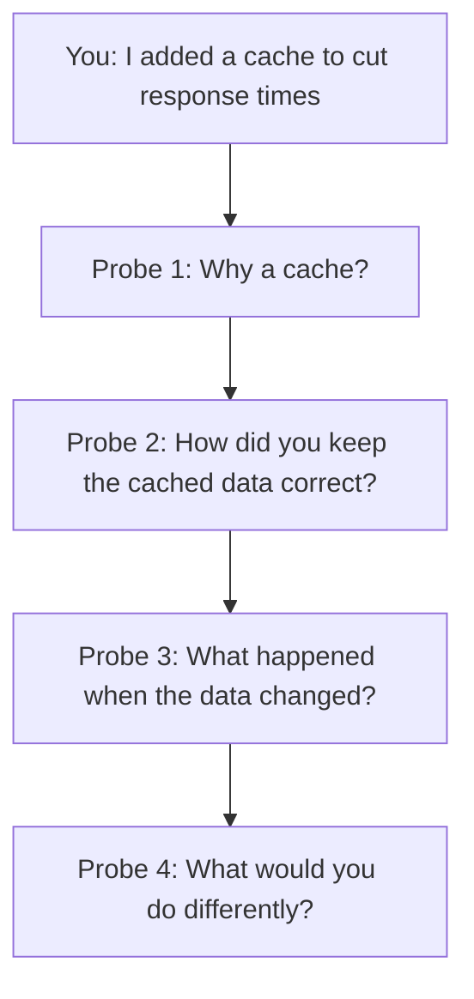

# Handling follow-up probes

## Before this lesson

Read [How you are scored](#/lesson/behavioural/how-you-are-scored) (you should know that probes fill gaps in the interviewer's notes) and at least three of the question-family lessons, each of which ended with a table of likely probes. This lesson pulls those together: why probes exist, the kinds you will meet, how to answer each kind, and an interactive drill.

## In plain words

When a doctor asks "Where does it hurt?" and you say "my stomach", the next questions come quickly: "Upper or lower? Sharp or dull? Since when? Worse after eating?" The doctor is not doubting you. Each answer narrows down what is going on, and a good patient answers each one directly and honestly, without retelling the whole week.

A **follow-up probe** in an interview works the same way. After your first answer, the interviewer asks short, pointed questions to get the evidence their notes still need: what you personally did, why you chose one approach, how you measured the result, what you would change. Probes are where many interviews are won or lost. A strong first answer followed by vague, defensive or rambling responses to probes can end up rated lower than a modest first answer with crisp, honest follow-ups.

Probes are not improvised attacks. Google's re:Work guide says each structured question comes with predetermined follow-ups that cover what the first answer usually misses. The US Office of Personnel Management describes highly structured interviews as asking every candidate the same predefined leads and probes, and its guide tells interviewers to probe when a candidate says "we". Knowing this makes probes much less stressful: most of them are on the interviewer's sheet before you walk in.

## Why interviewers probe

1. **To fill gaps.** Your answer skipped the Task, the reasons or the result.
2. **To separate you from the team.** "We" hides your contribution.
3. **To test depth.** Did you really do this, and do you understand it? Real experience survives three levels of "why?"; borrowed or exaggerated stories do not.
4. **To find your level.** A junior and a senior can tell similar stories; probes about trade-offs, alternatives and people reveal the difference.
5. **To see how you think on your feet.** Calm, direct answers to unexpected questions are themselves evidence.

## Kinds of probe

| Kind | Typical probes | What the interviewer wants |
|---|---|---|
| Role | "What did you personally do?" "What was your part versus the team's?" | Your own actions |
| Detail | "Walk me through exactly how you..." "What did the data show?" | Proof of real experience |
| Reasoning | "Why that approach?" "What alternatives did you consider?" | Judgement |
| People | "How did they react?" "How did you persuade them?" | Collaboration and influence |
| Outcome | "How did you measure that?" "What happened next?" | A real, measured result |
| Reflection | "What would you do differently?" "What did you learn?" | Self-awareness and growth |
| Counterfactual | "What if they had said no?" "What if you'd had half the time?" | Adaptable reasoning |
| Challenge | "Wasn't that risky?" "Couldn't you have done it faster?" | Composure and honest self-critique |

A **counterfactual** is a "what if things had been different" question. It checks whether your reasoning adapts, rather than whether you remember a script.

## How to answer a probe

### 1. Answer in the first sentence

Probes are short questions; give a direct answer first, then a little support. "How did you measure that?" → "From the payment logs: success rate per day for two weeks before and after. It went from about 94% to about 97.5%." Not: "Well, so, there's an interesting story about our logging..."

### 2. Keep it short

Most probe answers should take 15 to 45 seconds. The interviewer will ask another probe if they want more. Long probe answers eat the time for other questions, as lesson 6 explained.

### 3. Do not restart the story

Add only what was asked. Restarting from the Situation is one of the most common nervous habits.

### 4. Be honest about memory and uncertainty

"I don't remember the exact number; it was roughly a third" is a perfectly good answer. Inventing a precise figure is not, because the next probe ("how did you get that number?") will expose it.

### 5. Admit weaknesses in the story

If a probe finds something you did badly ("Wasn't it risky to change it without telling the other team?"), agree if it is true and say what you would do now. Defending a mistake you now recognise looks worse than the mistake.

### 6. Stay calm with challenge probes

Some interviewers push back on purpose to see how you react. A calm, reasoned answer ("It was a risk; I judged it acceptable because the change was behind a switch we could turn off in a minute") scores well. Getting defensive does not.

### 7. When you do not know

"I don't know; I wasn't involved in that part. Priya on the data team designed it. What I know is..." This is honest and still gives evidence about your part.

## The probe ladder

Interviewers often climb the same topic several rungs deep. For your main stories, prepare at least three rungs.



If you can answer rung three with specifics, the interviewer usually concludes the story is real and that you understand it. If you can only answer rung one, it suggests you were near the work rather than doing it.

## A full example: weak and strong probe responses

The first answer below is the same for both candidates. Only the probe responses differ. This is an **example** written for teaching.

> **Question:** Tell me about a time you improved the performance of something.
>
> **First answer (both candidates):** I sped up our internal reporting dashboard, used by about 40 people in operations, from roughly 12 seconds per page to under 2, by finding that one database query ran once per row and replacing it with a single query, then adding an index.

| Probe | Weak response | Strong response |
|---|---|---|
| "What did you personally do?" | "It was a team effort; we all looked at it." | "I did the investigation and the query rewrite. My lead reviewed the change, and a colleague on the database team advised on the index." |
| "How did you find the slow query?" | "We looked at the code and it was obvious." | "I turned on query logging for one page load and saw the same query 300 times, once per row. That pattern is called an N plus one problem." |
| "Why an index rather than caching the page?" | "Indexes are faster." | "The data changed every few minutes and operations needed it current. Caching would have shown stale numbers; an index kept it live." |
| "How did you measure the improvement?" | "Users said it was faster." | "I timed ten page loads before and after on the same data: median 12.1 seconds before, 1.6 after. I also checked the database's load during peak, which fell." |
| "What would you do differently?" | "Nothing really, it went well." | "I'd add a test that fails if a page makes more than a set number of queries, so the same pattern can't sneak back. I added it two months later after a similar bug." |
| "Wasn't adding an index risky on a big table?" | "No, it was fine." | "It could have locked the table while building, so I built it outside working hours using the database's option for building without locking, and checked with the database team first." |

The weak responses are not rude or wrong. They are vague, collective and closed. Each strong response answers directly, adds a specific fact, and where relevant admits a gap. By the sixth probe, the interviewer is in no doubt that the strong candidate did the work and understands it.

## Probes for students

Students sometimes fear that probes will expose how small their projects were. They will not, if you know your own project well. Common probes on school projects:

- "How did you divide the work?" (Have a clear answer about who did what.)
- "What was the hardest technical part, and how did you solve it?"
- "What grade or feedback did you get, and what would you change?"
- "Did anyone use it?" (If yes, how many and what did they say; if no, say so, and say how you tested it.)
- "Why did you choose that technology?" ("It was what we were taught" is honest; adding "and next time I'd consider X because..." is better.)

## Probes for experienced engineers

Senior candidates get harder probes about trade-offs, scope and people, because these are what distinguish levels (lesson 24):

- "What alternatives did you reject, and why?"
- "What did this cost, in time, money or other work?"
- "Who disagreed, and how did you bring them along?"
- "How would this design change at ten times the scale?"
- "What did you delegate, and how did you support the person?"
- "What did you decide not to do?"

## Interactive: probe drill

Practise answering probes out loud. Pick one of your stories, tell the first answer to yourself, then press **Next probe**. The page shows a random probe of the kind you selected and a 45-second countdown. Answer aloud before time runs out: direct first sentence, one specific fact, no restarting the story. Nothing is recorded or sent anywhere.

```html-run
<!doctype html>
<html lang="en">
<head>
<meta charset="utf-8">
<title>Probe drill</title>
<style>
  body { font-family: system-ui, sans-serif; margin: 12px; color: #1f2937; background: #fff; }
  #probe { font-size: 22px; font-weight: 600; min-height: 64px; margin: 14px 0; }
  #kind { font-size: 13px; color: #6b7280; text-transform: uppercase; letter-spacing: 0.05em; }
  #time { font-size: 36px; font-variant-numeric: tabular-nums; }
  .late { color: #b91c1c; }
  button, select { font: inherit; padding: 6px 12px; margin-right: 6px; }
  #tip { margin-top: 10px; color: #374151; }
  #count { font-size: 13px; color: #6b7280; margin-top: 6px; }
</style>
</head>
<body>
<label>Kind of probe:
  <select id="filter">
    <option value="all">All kinds</option>
    <option value="Role">Role</option>
    <option value="Detail">Detail</option>
    <option value="Reasoning">Reasoning</option>
    <option value="People">People</option>
    <option value="Outcome">Outcome</option>
    <option value="Reflection">Reflection</option>
    <option value="Counterfactual">Counterfactual</option>
    <option value="Challenge">Challenge</option>
  </select>
</label>
<button id="next">Next probe</button>
<div id="kind"></div>
<div id="probe">Choose a story, tell its first answer to yourself, then press Next probe.</div>
<div id="time">0:45</div>
<div id="tip"></div>
<div id="count"></div>
<script>
var probes = [
  ["Role", "What did you personally do, as opposed to the team?", "Start with 'I'. Name one or two of your own actions."],
  ["Role", "Who else was involved, and what was their part?", "Credit others by name or role, specifically."],
  ["Detail", "Walk me through exactly how you found the cause.", "Give the first step you took and what it showed."],
  ["Detail", "What did the data actually show?", "One number or observation, stated plainly."],
  ["Reasoning", "Why did you choose that approach?", "Give the main reason in one sentence."],
  ["Reasoning", "What alternatives did you consider, and why did you reject them?", "Name one alternative and its downside."],
  ["People", "How did the other person react?", "Describe their view fairly, then what happened."],
  ["People", "How did you get people to agree?", "Evidence, a small test, or lowering the cost for them."],
  ["Outcome", "How did you measure the result?", "Name the measure, the before and the after."],
  ["Outcome", "What happened after that?", "One concrete consequence, a week or a month later."],
  ["Reflection", "What would you do differently?", "A genuine change, never 'nothing'."],
  ["Reflection", "What did you learn that you still use?", "A specific habit, plus one time you used it."],
  ["Counterfactual", "What if they had said no?", "Your fallback plan, honestly."],
  ["Counterfactual", "What if you had had half the time?", "What you would cut, and why that part."],
  ["Challenge", "Wasn't that risky?", "Agree if true, then say how you limited the risk."],
  ["Challenge", "Couldn't you have done this faster?", "Honest: what slowed you, and what you would change."]
];
var timer = null, left = 45, asked = 0, last = -1;
function pick() {
  var f = document.getElementById("filter").value;
  var pool = [];
  probes.forEach(function (p, i) { if (f === "all" || p[0] === f) pool.push(i); });
  if (pool.length > 1) pool = pool.filter(function (i) { return i !== last; });
  return pool[Math.floor(Math.random() * pool.length)];
}
function show() {
  var i = pick(); last = i;
  var p = probes[i];
  document.getElementById("kind").textContent = p[0] + " probe";
  document.getElementById("probe").textContent = p[1];
  document.getElementById("tip").textContent = "";
  asked++;
  document.getElementById("count").textContent = "Probes answered this session: " + asked;
  left = 45; clearInterval(timer); render();
  timer = setInterval(function () {
    left--; render();
    if (left === 15) document.getElementById("tip").textContent = "Tip: " + p[2];
    if (left <= 0) { clearInterval(timer); document.getElementById("tip").textContent = "Time. Tip: " + p[2]; }
  }, 1000);
}
function render() {
  var el = document.getElementById("time");
  el.textContent = "0:" + String(Math.max(left, 0)).padStart(2, "0");
  el.className = left <= 10 ? "late" : "";
}
document.getElementById("next").onclick = show;
</script>
</body>
</html>
```

How it works: `probes` is a list of [kind, question, tip] entries; `pick` filters by the chosen kind and avoids repeating the previous probe; `show` displays it and starts a 45-second countdown, revealing the tip with 15 seconds left so you try first without help. Run ten probes per story; if one kind keeps catching you out, filter to it and practise until it does not.

## Pitfalls

1. **Treating probes as attacks.** They are mostly planned; answer, do not defend.
2. **Restarting the story.** Add only what was asked.
3. **Hiding behind "we".** The role probe will keep coming back.
4. **Inventing precision.** "Exactly 23.7%" with no way to know it.
5. **Rambling.** Probe answers over a minute crowd out other questions.
6. **"Nothing" to reflection probes.** Always have a genuine change ready.

## Your turn

1. For your three strongest stories, write the probe ladder three rungs deep on the most technical point.
2. For each story, write one-sentence answers to one probe of each kind in the table.
3. Use the drill: ten probes per story, aloud, with the timer.
4. Ask a friend to probe one story for five minutes without warning you of the questions.

## Summary

- Follow-up probes are short questions that collect missing evidence. Google and OPM describe them as planned parts of structured interviews; OPM advises probing whenever a candidate says "we".
- Kinds of probe: role, detail, reasoning, people, outcome, reflection, counterfactual and challenge.
- Answer directly in the first sentence, keep to 15 to 45 seconds, do not restart the story, be honest about memory and mistakes, and stay calm under challenge.
- Prepare the probe ladder at least three rungs deep for your main stories.
- Students should know who did what and why they chose their tools; seniors should expect probes on alternatives, costs, people and scale.

## Glossary

- **Follow-up probe**: a short question after your answer, asking for missing or deeper evidence.
- **Predetermined follow-up**: a probe written in advance as part of a structured question.
- **Probe ladder**: a series of probes that go deeper into the same point.
- **Counterfactual question**: a "what if things had been different" question.
- **Challenge probe**: a probe that pushes back on your decision to test composure and self-critique.
- **N plus one problem**: a performance bug where code runs one database query per item instead of one query for all items.

```quiz
[
  {"q": "The interviewer asks 'How did you measure that?' Which response is best?",
   "options": ["Let me start from the beginning of the project...", "From the payment logs: daily success rate for two weeks before and after, about 94% to 97.5%.", "Users said it was better.", "We measured it as a team."],
   "answer": 1,
   "explain": "It answers directly in the first sentence with a specific method and numbers, without restarting the story."},
  {"q": "According to Google's re:Work guide, where do many follow-up probes come from?",
   "options": ["The interviewer's mood", "Predetermined follow-ups written with each structured question", "The candidate's CV only", "Random selection"],
   "answer": 1,
   "explain": "Structured questions come with planned follow-ups covering what first answers usually miss."},
  {"q": "A probe exposes a real mistake in your story: 'Wasn't it risky to change it without telling the other team?' What is the strongest response?",
   "options": ["Defend the decision firmly", "Agree it was a risk, explain how it was limited, and say what you would do now", "Change the subject", "Say the other team was at fault"],
   "answer": 1,
   "explain": "Admitting a genuine weakness and showing what you learned scores better than defending it."},
  {"q": "You cannot remember an exact figure. What should you say?",
   "options": ["Invent a precise number", "Refuse to answer", "Give an honest estimate, such as 'roughly a third', and how you know", "Say numbers do not matter"],
   "answer": 2,
   "explain": "Honest estimates are fine; invented precision collapses at the next probe."},
  {"q": "What is a counterfactual probe?",
   "options": ["A question checking facts on your CV", "A 'what if things had been different' question that checks whether your reasoning adapts", "A trick question", "A coding question"],
   "answer": 1,
   "explain": "Counterfactuals such as 'What if they had said no?' test adaptable reasoning rather than memory."},
  {"q": "A candidate tells a story about adding a cache. Which probe is most likely to come at rung three of the ladder?",
   "options": ["What is a cache?", "What happened when the underlying data changed?", "Where did you go to university?", "Do you like your job?"],
   "answer": 1,
   "explain": "The ladder climbs from why, to how correctness was kept, to what happened when data changed."},
  {"q": "How long should most probe answers be?",
   "options": ["About 3 seconds", "About 15 to 45 seconds", "About 3 minutes", "As long as the original answer"],
   "answer": 1,
   "explain": "Short, direct answers leave time for more probes and more questions."}
]
```

> **Source:** Google re:Work, A guide to structured interviewing (https://rework.withgoogle.com/intl/en/guides/a-guide-to-structured-interviewing-for-better-hiring-practices); US OPM, Structured Interviews (https://www.opm.gov/policy-data-oversight/assessment-and-selection/other-assessment-methods/structured-interviews/); US OPM, Structured Interviews: A Practical Guide, 2011 (https://www.opm.gov/policy-data-oversight/assessment-and-selection/structured-interviews/structured-interviews.pdf). Examples and the drill page are original.
