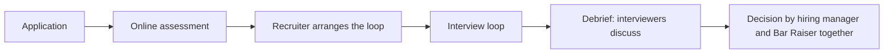

# Amazon: Leadership Principles, the loop and the Bar Raiser

## Before this lesson

Read [Building a story bank](#/lesson/behavioural/story-bank) (the coverage matrix there has an Amazon mode) and [How you are scored](#/lesson/behavioural/how-you-are-scored), which introduced the Bar Raiser. The question-family lessons (10 to 19) are the best preparation for individual Leadership Principle questions; this lesson maps them to Amazon's own framework and process.

## In plain words

Some sports clubs have a written playing philosophy that every coach at every age level uses: how we press, how we build from the back, what we value in a player. A young player trialling for that club does far better if they have read it, because every coach at the trial is watching for the same things.

Amazon's equivalent is its **Leadership Principles**, often shortened to **LPs**: sixteen short statements of how Amazon wants people to work. Amazon describes its hiring as rooted in them. Its preparation pages tell candidates to map their past experience to the principles, and its interviewers ask behavioural questions designed around them. Unlike many companies, where values sit on a careers page and appear in one interview at most, Amazon's principles shape almost every interview in the loop, including technical ones.

That makes Amazon the clearest case in this track of a company telling you exactly what it will look for. Candidates who prepare one or two stories per principle, as Amazon itself advises, walk in with a big advantage. Candidates who prepare only for coding often find that half of every interview is behavioural and they have nothing ready.

## The 16 Leadership Principles

Amazon's official list has sixteen principles. The titles below are Amazon's; the one-line summaries are paraphrases written for this lesson, and the sample questions are typical of the kind Amazon's interviewers ask, written here in original wording. Read Amazon's own page for the full text.

| # | Principle (Amazon's title) | In plain words | A typical question |
|---|---|---|---|
| 1 | Customer Obsession | Start from what customers need and work backwards; earn their trust | "Tell me about a time you went beyond what was expected for a customer." |
| 2 | Ownership | Think long term, act for the whole company, never "not my job" | "Tell me about something you took on that was outside your area." |
| 3 | Invent and Simplify | Look for new ideas and simpler ways, from anywhere; accept being misunderstood for a while | "Describe a time you simplified a complicated process." |
| 4 | Are Right, A Lot | Good judgement; seek different views; test your own beliefs | "Tell me about a decision you made with incomplete data." |
| 5 | Learn and Be Curious | Keep learning and exploring | "Tell me about something you learned recently on your own." |
| 6 | Hire and Develop the Best | Raise the bar in hiring; coach and develop others | "Tell me about a time you helped someone grow." |
| 7 | Insist on the Highest Standards | Keep raising the bar; do not pass defects on; fix things so they stay fixed | "Tell me about a time you were not satisfied with 'good enough'." |
| 8 | Think Big | Set a bold direction; look for unusual ways to serve customers | "Tell me about an idea of yours that was bigger than your immediate task." |
| 9 | Bias for Action | Speed matters; many decisions are reversible; take calculated risks | "Tell me about a time you acted quickly without full information." |
| 10 | Frugality | Achieve more with less; constraints breed creativity | "Tell me about delivering something with limited resources." |
| 11 | Earn Trust | Listen, speak candidly, treat others with respect, be self-critical | "Tell me about a time you admitted a mistake to your team." |
| 12 | Dive Deep | Stay connected to details; question when numbers and stories disagree | "Tell me about a problem you solved by digging into the data." |
| 13 | Have Backbone; Disagree and Commit | Challenge decisions respectfully, then commit fully | "Tell me about disagreeing with your manager." |
| 14 | Deliver Results | Focus on the key inputs; deliver with quality and on time despite setbacks | "Tell me about a time you delivered despite a major obstacle." |
| 15 | Strive to be Earth's Best Employer | Make work better, safer and fairer for people; help them grow | "Tell me about improving the working environment for your team." |
| 16 | Success and Scale Bring Broad Responsibility | Stay humble; think about the wider effects of your work; leave things better | "Tell me about a time you considered the wider impact of a technical decision." |

Notice that "Have Backbone; Disagree and Commit" is one principle with a two-part title. Many of these map directly to the question families in this track: Customer Obsession and Insist on the Highest Standards to [lesson 16](#/lesson/behavioural/customer-standards), Ownership and Deliver Results to [lesson 13](#/lesson/behavioural/ownership-results), Have Backbone; Disagree and Commit to [lesson 11](#/lesson/behavioural/conflict), Earn Trust to [lesson 12](#/lesson/behavioural/failure-feedback), Bias for Action and Are Right, A Lot to [lesson 14](#/lesson/behavioural/ambiguity) and [lesson 17](#/lesson/behavioural/hypothetical-questions), Hire and Develop the Best to [lesson 15](#/lesson/behavioural/influence) and [lesson 24](#/lesson/behavioural/senior-signals).

## The process

Amazon publishes preparation pages per role. What follows is what those pages said at the time of writing; formats change by role, level, location and year, so always read the page for your role.



### Software Development Engineer II (a mid-level engineering role)

- **Online assessment**: Amazon's SDE II page describes a coding section, a short system design scenario section and a brief work style survey based on the Leadership Principles.
- **Loop**: four interviews of 55 minutes each with members of Amazon's software development community.
- **Behavioural content**: each interviewer typically asks two or three questions about successes or challenges you have faced, mapped to the principles, alongside technical questions. Interviewers focus on what you did, how and why.
- **Outcome**: the page says candidates hear the outcome within five business days.

### Software Development Manager

- **Phone screen**: about an hour with a senior leader, split between behavioural questions on the principles and system design.
- **Loop**: five 55-minute interviews, plus a writing assessment sent before the loop.
- **Focus**: people management, technical design, project management, stakeholders and the principles.

### General facts from Amazon's other pages

- **Panel size**: Amazon's "What it's like to interview" page says that, depending on the role, candidates meet between two and seven Amazon employees, including managers, team members, people from related teams and a Bar Raiser.
- **Interview length and answer length**: Amazon's interview mistakes article says interviews typically last 45 minutes to an hour, and responses should be four minutes or less.
- **No brainteasers**: Amazon says it does not use brainteasers, because they do not predict success well.
- **Writing**: Amazon notes that it uses narrative memos rather than slide presentations, so written communication matters, and some roles ask for writing samples.

## How principles are assigned in a loop

Amazon's "How Amazon hires" page says Bar Raisers work with recruiters to decide which principles matter most for each role. In practice, this means each interviewer in your loop is usually given a few principles to assess, so that together they cover the important ones without repeating. Two consequences:

1. **You cannot predict exactly which principle each interviewer has.** Prepare all sixteen, with the most relevant ones for your role prepared in depth.
2. **Using the same story twice is risky.** If two interviewers each hear your best story, the debrief has less evidence. Amazon lists repeating the same example among its common interview mistakes.

## The Bar Raiser

The **Bar Raiser** is Amazon's best-known hiring mechanism. From Amazon's own descriptions:

- **Origin**: Amazon started the programme in 1999. It was first called the "Barkeeper Program"; Amazon explains that keeping a bar sounded like maintaining a standard, while the goal was to raise it with each hire.
- **The bar itself**: Amazon's aim is that every person hired is better than 50% of the people already in similar roles.
- **Who they are**: Amazon employees from teams across the company, acting as objective third parties. They are not part of the hiring team and focus on hiring for Amazon as a whole, not one team. Amazon's 2019 article said there were more than 3,600 of them.
- **How they are chosen and trained**: they are nominated by managers, peers or other Bar Raisers. Training is voluntary and on top of their normal job, covers the Leadership Principles and includes shadowing experienced Bar Raisers; Amazon says it takes from three months to a year depending on the person.
- **What they do**: assess the candidate for the role and for long-term success at Amazon, make sure the loop's discussion is open and fair, and help prepare interviewers and questions.
- **The decision**: Amazon says the Bar Raiser and the hiring manager make the final hiring decision together, with the Bar Raiser facilitating consensus so that no single person decides.

> [!NOTE]
> You will read on many websites that the Bar Raiser has a "veto". Amazon's own articles describe a joint decision and a facilitating role, and do not mention a veto. This track follows Amazon's description.

**What this means for you:** one of your interviewers is probably from an unrelated team and is focused on long-term potential and the principles, not on whether you know the team's codebase. You usually will not be told who it is. Treat every interviewer as if they were the Bar Raiser: clear stories, real data, honest reflection.

## Preparing for Amazon

### 1. Map your stories to the principles

Use the coverage matrix in [lesson 8](#/lesson/behavioural/story-bank) with the Amazon columns. Amazon's mistakes article and its Bar Raisers both advise one or two examples per principle. A realistic bank is 10 to 14 stories, each covering two or three principles.

### 2. Shift emphasis, not facts

The same story can serve different principles by changing the headline and which actions you expand. A **fictional** example: a story about finding that 18% of searches returned no results, defining a measure with the product manager and fixing it in small tested steps ([lesson 14](#/lesson/behavioural/ambiguity)).

| Principle asked | Headline you would use | Actions to expand |
|---|---|---|
| Dive Deep | "I found the real cause of search complaints by reading a week of logs and hand-checking 200 failed searches." | The log analysis, the sample, the categories |
| Customer Obsession | "I traced customer complaints to searches that returned nothing, and fixed the biggest causes." | The tickets, what customers experienced, the purchase effect |
| Bias for Action | "With a vague brief, I shipped small reversible changes behind a switch rather than waiting for a spec." | The 10% tests, the switch, the speed |
| Are Right, A Lot | "I tested my assumption about why searches failed before building anything." | The written assumptions, the sample that checked them |

### 3. Bring data

Amazon's SDE II and SDM pages advise including metrics wherever possible, describing Amazon as data-driven, and its mistakes article says most examples should lead with numbers. Every story in your Amazon bank should have a baseline and an after.

### 4. Prepare risks and failures

Amazon's preparation pages ask for examples of risks you took, failures and what you learned. Amazon's "What it's like to interview" page describes failure as part of innovation. Have at least two failure stories (lesson 12) and one where you took a calculated risk.

### 5. Practise writing

Because Amazon relies on written memos, some roles include a writing exercise. Practise explaining a technical decision in one clear page.

### 6. Expect deep probes

Interviewers focus on what you did, how and why. Prepare the probe ladder three rungs deep for each story (lesson 18).

## A short weak and strong comparison: Frugality

> **Example (fictional).** Question: "Tell me about a time you delivered something with limited resources."
>
> **Weak:** "Our team was always understaffed, so we had to be frugal. We worked hard and managed to deliver most things."
>
> **Strong:** "Our three-person team needed a staging environment, a copy of production for testing, but the quote for a full copy was about the cost of another engineer's salary for the year. I noticed that 80% of our tests only touched two of our nine services. I proposed a staging setup with real copies of those two and lightweight fakes for the other seven, which cost about a tenth as much. I built it over two weeks. It caught 11 release-blocking bugs in its first quarter, and when another team asked, I wrote a guide so they could copy the setup."

The weak answer is about scarcity; the strong one is about a creative choice under a constraint, with numbers, which is what the principle describes.

## Amazon-specific pitfalls

1. **Preparing only for coding.** Every interview includes behavioural questions.
2. **Reciting the principle.** "Customer Obsession means starting with the customer..." The interviewer knows. Tell a story.
3. **Stretching one story across all sixteen.**
4. **No failures or risks.** Amazon asks for them explicitly.
5. **No data.** Amazon describes itself as data-driven.
6. **Over four minutes.** Amazon's own guidance.
7. **Trusting old blog posts about the process.** Read the current page for your role.

## Your turn

1. Open the coverage matrix in lesson 8, switch to the Amazon columns and map your bank.
2. For any principle with no story, run a 15-minute mining session (lesson 7) with a prompt aimed at it.
3. Choose your strongest story and write two different headlines for two different principles.
4. Practise three stories aloud with the timer, each under four minutes, each with a number in the Result.

## Summary

- Amazon has 16 Leadership Principles and roots its hiring in them; behavioural questions appear in almost every interview, alongside technical ones.
- SDE II (at the time of writing): online assessment, then four 55-minute interviews with two or three principle-based questions each. SDM: a phone screen, five 55-minute interviews and a writing assessment. Panels of two to seven people. Interviews of 45 to 60 minutes; answers of four minutes or less. Formats vary by role, level and year.
- Bar Raisers: started in 1999 as the Barkeeper Program; more than 3,600 (2019); from outside the hiring team; trained three months to a year; aim for hires better than half of peers in similar roles; decide jointly with the hiring manager.
- Prepare one or two stories per principle, shift emphasis rather than facts, bring data, include failures and risks, practise writing and expect deep probes.

## Glossary

- **Leadership Principles (LPs)**: Amazon's sixteen statements of how it expects people to work, used throughout its hiring.
- **Loop**: the set of interviews in one hiring process.
- **Bar Raiser**: an Amazon interviewer from outside the hiring team, trained to assess long-term potential and the principles, who decides jointly with the hiring manager.
- **Barkeeper Program**: the original 1999 name of the Bar Raiser programme.
- **SDE II**: Software Development Engineer II, a mid-level engineering role at Amazon.
- **SDM**: Software Development Manager.
- **Narrative memo**: a written document used at Amazon instead of slide presentations.
- **Staging environment**: a copy of a production system used for testing before release.

```quiz
[
  {"q": "How many Leadership Principles does Amazon list?",
   "options": ["10", "14", "16", "20"],
   "answer": 2,
   "explain": "Amazon's official list has 16, with 'Have Backbone; Disagree and Commit' as one principle."},
  {"q": "According to Amazon, how is the final hiring decision made?",
   "options": ["The Bar Raiser alone, with a veto", "The hiring manager and the Bar Raiser together", "A vote of all candidates", "The recruiter alone"],
   "answer": 1,
   "explain": "Amazon describes a joint decision, with the Bar Raiser facilitating consensus. Amazon's own pages do not mention a veto."},
  {"q": "What was the Bar Raiser programme first called when it started in 1999?",
   "options": ["The Gatekeeper Program", "The Barkeeper Program", "The Talent Bar", "The Loop Council"],
   "answer": 1,
   "explain": "Amazon says the programme began in 1999 as the Barkeeper Program and was renamed because the goal is to raise the bar."},
  {"q": "An SDE II candidate prepares only coding. According to Amazon's SDE II page, what are they missing?",
   "options": ["Nothing", "Each interviewer typically asks two or three behavioural questions mapped to the principles", "A take-home project", "A brainteaser round"],
   "answer": 1,
   "explain": "Behavioural questions appear in every interview alongside technical ones."},
  {"q": "Your story is about hand-checking 200 failed searches to find their causes. Asked about Dive Deep, what should you emphasise?",
   "options": ["The team's chemistry", "The log analysis and the hand-checked sample that revealed the categories", "The launch party", "The product manager's role"],
   "answer": 1,
   "explain": "Shift emphasis to the actions that match the principle: getting into the details and data."},
  {"q": "Which statement about the Bar Raiser's aim is supported by Amazon's own pages?",
   "options": ["Each hire should be better than half of the people already in similar roles", "Each hire must have a PhD", "Bar Raisers only interview managers", "Bar Raisers are always from the hiring team"],
   "answer": 0,
   "explain": "Amazon describes the bar as better than 50% of those in similar roles; Bar Raisers come from outside the hiring team."},
  {"q": "Which answer would score higher for Frugality, and why? A: 'We were understaffed so we worked hard.' B: 'I built a staging setup with real copies of two services and fakes for seven, at about a tenth of the cost, which caught 11 release-blocking bugs.'",
   "options": ["A, because it shows effort", "B, because it shows a creative choice under a constraint with measured results", "Both equally", "Neither"],
   "answer": 1,
   "explain": "Frugality is about achieving more with less through creative choices, not about scarcity itself."}
]
```

> **Source:** Amazon, Leadership Principles (https://atoz.amazon/en-us/discover/leadership-principles); Amazon, SDE II interview prep (https://atoz.amazon/en-us/jobs/hiring-process/interview-prep/software-development-engineer-ii); Amazon, SDM interview prep (https://atoz.amazon/en-us/jobs/hiring-process/interview-prep/software-development-manager); Amazon, The Bar Raiser, 2019 (https://www.aboutamazon.com/news/workplace/amazon-bar-raiser); Amazon, How Amazon hires (https://www.aboutamazon.com/working-at-amazon/how-amazon-hires); Amazon, Interview mistakes to avoid (https://www.aboutamazon.com/news/workplace/amazon-jobs-interview-mistakes); Amazon, Bar Raiser tips (https://www.aboutamazon.com/news/workplace/amazon-job-interview-questions-tips-bar-raisers); Amazon, What it's like to interview at Amazon (https://www.aboutamazon.com/working-at-amazon/whats-it-like-to-interview-at-amazon). Paraphrases, sample questions and examples are original.
