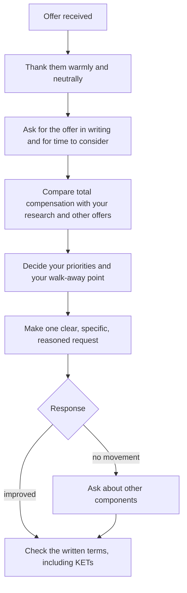

# Offers, negotiation and Singapore employment basics

## Before this lesson

Read [Remote and video interviews, and questions to ask](#/lesson/behavioural/remote-and-questions). The Cracking the Coding Interview track's lesson [Evaluating and negotiating offers](#/lesson/interview-prep/evaluating-negotiating-offers) covers negotiation principles and model scripts in depth; this lesson adds the behavioural side of the offer conversation, how to handle salary questions during interviews, and the Singapore employment basics every candidate there should know. It ends with a full mock-interview checklist for the whole track.

> [!WARNING]
> This lesson summarises official guidance for general understanding. It is not legal or financial advice. Employment rules change; check the Ministry of Manpower (MOM) and TAFEP pages linked in the Source line, and your own contract, for anything that affects you.

## In plain words

Buying a flat involves two kinds of knowledge. One is about the conversation: how to ask for a better price without souring the deal. The other is about the rules: what the contract must say, what happens if you need to pull out, and what the seller is not allowed to ask you. People who know only the first often get a good price on a bad contract.

The end of a job search is similar. The **offer** is the employer's formal proposal of the job, the pay and the terms. **Negotiation** is the conversation in which you discuss improving those terms. And in Singapore, the **Employment Act** and MOM's guidance set rules about what your written terms must contain and how notice works, while TAFEP's guidance sets expectations about fair interview questions. Knowing both halves lets you finish your search as well as you started it.

## Part 1: salary questions during interviews

### When it comes up

Recruiters often ask about salary expectations early, sometimes on the first call. In Singapore, TAFEP's guidance for employers on conducting interviews says that salary expectations and career aspirations may be discussed during the interview, so the question is normal and legitimate there.

### Two schools of thought, and a middle path

UC Berkeley's graduate division, in its tips on offer negotiation, advises against naming a preferred salary early, and suggests saying you would prefer to hear the range for the role first. That protects you from anchoring too low. On the other hand, in a market where the question is expected, refusing entirely can feel evasive.

A middle path that works in most situations:

1. **Ask for their range first**, politely. "Could you share the range budgeted for this role? That would help me give a useful answer."
2. **If pressed, give a researched range**, not a single number, with the top above your target. "Based on what I've seen for similar roles in Singapore, I'm looking at roughly X to Y, depending on the full package."
3. **Keep the conversation open.** "I'm flexible on the mix of base salary, bonus and other parts; the role itself matters most to me."

### Researching your market value

Berkeley's second tip is to know your market value: what the role pays for someone with your education, experience and location. In Singapore:

- **MOM's Occupational Wages tables** are the official national benchmark for pay by occupation. Use them as a starting point; this lesson does not quote figures from them, because they are updated over time.
- **Recruiters** will often tell you the range for a level if you ask.
- **People in the industry**: classmates, alumni and former colleagues, asked politely and privately.
- **Employee-reported salary sites**, such as Glassdoor, which Berkeley also lists, keeping in mind that self-reported data is uneven.

## Part 2: evaluating and negotiating the offer

### Total compensation

Berkeley's first tip is to understand the full package, not only the base salary. **Total compensation** means everything of value in an offer. Common parts in technology offers:

| Component | What it is | Notes |
|---|---|---|
| Base salary | The fixed monthly pay | Usually the hardest to move outside a set band |
| Bonus | A variable payment, often yearly | Ask how it is decided and what was typical |
| Equity | Shares or share units, usually received over several years | Ask about the schedule and conditions |
| Sign-on bonus | A one-off payment for joining | Often more flexible than base |
| Benefits | Leave, medical insurance, learning budgets | Compare with your current package |
| Level or title | Where you sit on the career ladder | Berkeley notes that asking whether the level can be reconsidered may change the salary range |
| Start date and other terms | When you begin; flexibility | Often easy to adjust |

### The conversation



Berkeley's third tip is to wait until you are fully prepared before negotiating: respond to an offer with gratitude and neutrality, ask for time, and do your research (and ideally have any competing offers) before replying. Meta's hiring process page similarly advises reviewing the offer letter carefully, asking questions, and telling your recruiter about competing offers or deadlines.

The behavioural skills from the rest of this track apply directly:

- **Evidence over pressure**: give a reason for your request (market research, a competing offer, the scope of the role), the same way you persuaded with data in [lesson 15](#/lesson/behavioural/influence).
- **Respect for the other side**: the recruiter is usually on your side and needs a reason to take to the people who approve offers.
- **Honesty**: never invent a competing offer. Recruiters may ask for details, and the relationship continues after you join.

> **Example (fictional script).** "Thank you again; I'm excited about the role and the team. I've looked at the range for similar roles in Singapore and I also have an offer from another company at a higher base. Would there be flexibility to bring the base salary to SGD 7,500 a month? If base is fixed, a sign-on bonus would also help close the gap. If we can get there, I'm ready to accept this week."

## Part 3: Singapore employment basics

### Key Employment Terms (KETs)

**Key Employment Terms** are the main terms of your job, which MOM requires employers to give employees in writing. MOM's page lists 18 items: items 1 to 17 are required where they apply, and item 18, place of work, is optional (though MOM encourages including it). They include:

- The employer's and employee's full names, job title and main duties, and start date.
- Duration of employment, if it is a fixed-term contract.
- Working arrangements: hours, days per week, rest day.
- Salary period, basic salary, fixed allowances and fixed deductions.
- Overtime payment period and rate, where overtime applies.
- Other salary-related parts such as bonuses and incentives.
- Types of leave, and other medical benefits.
- **Probation period** and **notice period**.
- Place of work (optional).

MOM's FAQ explains that written KETs must be issued **within 14 days of the employee's start date**, rather than before the first day. In practice, many employers give the main terms in the offer letter; use the list above to check that your offer letter and later KETs say what you were told.

### Notice periods

A **notice period** is the time between telling your employer you are leaving (or being told you must leave) and your last day. Your contract usually states it. When the contract says nothing, MOM's page on termination with notice sets these minimum periods:

| Length of service | Notice period if the contract is silent |
|---|---|
| Less than 26 weeks | 1 day |
| 26 weeks to less than 2 years | 1 week |
| 2 years to less than 5 years | 2 weeks |
| 5 years or more | 4 weeks |

Other points from MOM's page:

- The notice period must be **the same for the employer and the employee**.
- Notice must be given **in writing**, such as a letter or email; when resigning, ask for written acknowledgement.
- An employee who resigns can either serve the notice or pay **salary in lieu of notice** to the employer, an amount equal to the pay for the notice period. MOM's page describes this from the resigning employee's side, and notice can also be waived by mutual consent.
- With the employer's agreement, annual leave can be used to offset the notice period.

Why this matters for job searching: your **current** notice period decides your earliest start date at the new company. Tell recruiters accurately, and do not resign until you have the new offer in writing.

### Fair interviews and your rights

TAFEP's guidance tells employers to keep interview questions job-related and to avoid questions about personal characteristics. Its examples of questions not to ask cover **age, race, religion, marital status, plans to have children and disability**. If an employer must ask something that could seem discriminatory, TAFEP says it should explain why it needs the information. TAFEP also says candidates can report unfair or discriminatory interview practices to it through its contact page.

If you are asked such a question, you can answer, decline politely, or steer to the job: "I'm not sure how that relates to the role; I'm happy to talk about how I'd handle the on-call schedule." You can raise concerns with TAFEP afterwards.

Singapore is also introducing a **Workplace Fairness Act**. The Act comes in two Bills. The first passed in January 2025 and the second (the dispute resolution Bill) on 4 November 2025. In that debate MOM said it targets bringing the Act into force around the end of 2027, adjusting if needed, and no commencement date has been gazetted yet, so treat it as expected rather than in force.

### Pre-employment checks

Some employers, including DBS according to its hiring page, run **pre-employment checks** that verify facts such as qualifications and work history. Make sure everything on your CV and in your interviews is accurate; an exaggeration that survives an interview may not survive a check.

## Part 4: the mock-interview checklist

This checklist pulls the whole track together. Use it for a full mock interview with a friend, a classmate or a career centre, about a week before the real one.

### Before the mock

| Item | Lesson |
|---|---|
| Story bank of 8 to 12 stories in the template, with numbers and reflections | 8 |
| Coverage matrix checked against the target company's values | 8, 20 to 23 |
| Two failure stories and two conflict stories (one where you were overruled) | 11, 12 |
| "Tell me about yourself" with a thread and three hooks, 60 to 90 seconds | 9 |
| Three specific reasons for "Why us?" | 9 |
| Probe ladders three rungs deep for your top three stories | 18 |
| Five prepared questions for the interviewer | 25 |
| Confidential details removed from every story | 19, 22 |
| Remote setup tested, if relevant | 25 |

### During the mock (for the interviewer to score)

| Check | Yes or no |
|---|---|
| Headline before each story | |
| Action took most of the time | |
| "I" for own actions; others credited specifically | |
| A number or specific feedback in each Result | |
| A specific reflection in each story | |
| Each answer about two minutes, none over four | |
| Probe answers direct, under 45 seconds, no restarting | |
| No blame, no confidential details, no disguised strengths | |
| Hypothetical answers: clarify, priorities, options, decide, communicate, evidence | |
| Two or three good questions at the end | |

### After the mock

Write down every question, which story you used, and every probe that caught you out. Update the story bank, and repeat the mock with a different interviewer.

### Interactive: random mock-interview plan

Press the button to generate a 30-minute mock interview: an opener, four behavioural questions from different families, one hypothetical and time for your questions. Give it to a friend to run, or use it with the timer from lesson 6. Nothing is saved.

```html-run
<!doctype html>
<html lang="en">
<head>
<meta charset="utf-8">
<title>Mock interview plan</title>
<style>
  body { font-family: system-ui, sans-serif; margin: 12px; color: #1f2937; background: #fff; }
  button { font: inherit; padding: 6px 14px; }
  ol li { margin: 8px 0; }
  .fam { font-size: 12px; color: #6b7280; text-transform: uppercase; letter-spacing: 0.04em; }
</style>
</head>
<body>
<button id="go">Generate a mock interview</button>
<ol id="plan"></ol>
<script>
var openers = ["Tell me about yourself.", "Walk me through your background.", "Why are you interested in this role?"];
var families = {
  "Teamwork": ["Tell me about a time you worked with a team to reach a goal.", "Tell me about helping a teammate who was struggling."],
  "Conflict": ["Tell me about a time you disagreed with a colleague.", "Tell me about committing to a decision you disagreed with."],
  "Failure": ["Tell me about a time you failed.", "Tell me about feedback that was hard to hear."],
  "Ownership": ["Tell me about something you took on outside your responsibilities.", "Tell me about delivering under a tight deadline."],
  "Ambiguity": ["Tell me about working with unclear requirements.", "Tell me about a time priorities changed suddenly."],
  "Influence": ["Tell me about convincing others to adopt your idea.", "Tell me about leading without being the formal lead."],
  "Customer and standards": ["Tell me about going out of your way for a user.", "Tell me about a time you raised the quality bar."]
};
var hypotheticals = ["The day before release you find a bug affecting a few users. Your manager wants to ship. What do you do?", "Two senior people each say their request is the top priority this week. You can only do one. What do you do?", "You join a team with no tests on its most important service. What do you do in your first month?"];
function pickOne(a) { return a[Math.floor(Math.random() * a.length)]; }
function shuffle(a) { a = a.slice(); for (var i = a.length - 1; i > 0; i--) { var j = Math.floor(Math.random() * (i + 1)); var t = a[i]; a[i] = a[j]; a[j] = t; } return a; }
document.getElementById("go").onclick = function () {
  var items = [["Opener, 2 min", pickOne(openers)]];
  shuffle(Object.keys(families)).slice(0, 4).forEach(function (f) { items.push([f + ", 5 min with probes", pickOne(families[f])]); });
  items.push(["Hypothetical, 5 min", pickOne(hypotheticals)]);
  items.push(["Your questions, 3 min", "Ask two or three of your prepared questions."]);
  var ol = document.getElementById("plan"); ol.innerHTML = "";
  items.forEach(function (it) {
    var li = document.createElement("li");
    var f = document.createElement("div"); f.className = "fam"; f.textContent = it[0];
    var q = document.createElement("div"); q.textContent = it[1];
    li.appendChild(f); li.appendChild(q); ol.appendChild(li);
  });
};
</script>
</body>
</html>
```

The page picks one opener, shuffles the seven question families and takes four of them (so you never get two from the same family), adds one hypothetical and a closing slot. Times add up to 30 minutes.

## Summary

- Salary questions in interviews are normal in Singapore (TAFEP says expectations may be discussed). Berkeley advises not naming a number too early; a middle path is to ask for the range first and then give a researched range.
- Research market value: MOM's Occupational Wages tables are the official benchmark; recruiters, peers and employee-reported sites help.
- Evaluate total compensation (base, bonus, equity, sign-on, benefits, level, start date). Respond to offers with gratitude, ask for time, then make one clear, reasoned request. Never invent competing offers.
- KETs: 18 items (17 required where applicable, place of work optional), including probation and notice, issued in writing within 14 days of starting.
- Notice when the contract is silent: under 26 weeks, 1 day; 26 weeks to under 2 years, 1 week; 2 to under 5 years, 2 weeks; 5 years or more, 4 weeks. Same for both sides, in writing; a resigning employee may pay in lieu.
- TAFEP: interview questions should be job-related, avoiding age, race, religion, marital status, plans for children and disability; concerns can be reported to TAFEP. Both Workplace Fairness Bills have passed; the Act is expected to take effect in 2027 (no date gazetted yet).
- Finish with a full mock interview using the checklist.

## Glossary

- **Offer**: an employer's formal proposal of a job, pay and terms.
- **Total compensation**: everything of value in an offer, not only base salary.
- **Equity**: shares or share units in the company, usually received over several years.
- **Sign-on bonus**: a one-off payment for joining.
- **Key Employment Terms (KETs)**: the main terms of employment that MOM requires in writing, issued within 14 days of starting.
- **Notice period**: the time between giving or receiving notice and the last day of work.
- **Salary in lieu of notice**: payment equal to the notice period's salary instead of working the notice.
- **MOM**: Singapore's Ministry of Manpower.
- **TAFEP**: the Tripartite Alliance for Fair and Progressive Employment Practices.
- **Workplace Fairness Act**: Singapore legislation on workplace discrimination; both Bills have passed and MOM expects it to take effect in 2027, with no date gazetted yet.

```quiz
[
  {"q": "A recruiter in Singapore asks your salary expectations on the first call. Which response follows this lesson's middle path?",
   "options": ["Refuse to discuss salary at all", "Name a single low number to seem easy-going", "Ask politely for the role's range first, then give a researched range if pressed", "Ask what the recruiter earns"],
   "answer": 2,
   "explain": "TAFEP says salary expectations may be discussed; Berkeley warns against naming a number too early. Asking for the range first, then giving a researched range, balances both."},
  {"q": "Your contract says nothing about notice, and you have worked there for 3 years. What notice period applies under MOM's guidance?",
   "options": ["1 day", "1 week", "2 weeks", "4 weeks"],
   "answer": 2,
   "explain": "For 2 years to under 5 years of service, the notice period when the contract is silent is 2 weeks."},
  {"q": "Within what time must an employer issue written Key Employment Terms, according to MOM?",
   "options": ["Before the interview", "Within 14 days of the employee's start date", "Within one year", "Only on request"],
   "answer": 1,
   "explain": "MOM's FAQ explains KETs must be issued in writing within 14 days of the start date."},
  {"q": "Which question does TAFEP's guidance give as an example of one interviewers should not ask?",
   "options": ["How did you contribute to your last project's outcome?", "Are you planning to have children soon?", "What are your salary expectations?", "Why do you think you suit this role?"],
   "answer": 1,
   "explain": "TAFEP's examples to avoid cover age, race, religion, marital status, plans for children and disability."},
  {"q": "When is the Workplace Fairness Act expected to be implemented?",
   "options": ["It has been in force since 2020", "Expected in 2027 (both Bills have passed; no date gazetted yet)", "Never", "2035"],
   "answer": 1,
   "explain": "The first Bill passed in January 2025 and the second on 4 November 2025; MOM expects the Act to take effect in 2027, but no commencement date has been gazetted."},
  {"q": "Base salary is fixed by a pay band. According to Berkeley's tips, what else might you discuss?",
   "options": ["Nothing; accept immediately", "Other components such as bonus, sign-on, benefits, or whether the level could be reconsidered", "The interviewer's salary", "Your previous employer's secrets"],
   "answer": 1,
   "explain": "Berkeley advises understanding the full package; other parts and the level may be more flexible."},
  {"q": "Which statement about salary in lieu of notice matches MOM's termination-with-notice page?",
   "options": ["Employees can never use it", "A resigning employee can pay salary equal to the notice period instead of serving it", "It is illegal in Singapore", "It is always double the salary"],
   "answer": 1,
   "explain": "MOM's page says a resigning employee must either serve notice or pay salary in lieu; the notice length is the same for both sides."}
]
```

> **Source:** UC Berkeley Graduate Division, Three tips for job offer negotiations (https://grad.berkeley.edu/news/announcements/three-tips-for-job-offer-negotiations/); Meta, Hiring process (https://www.metacareers.com/hiring-process/); MOM, Termination with notice (https://www.mom.gov.sg/employment-practices/termination-of-employment/termination-with-notice); MOM, Key employment terms (https://www.mom.gov.sg/employment-practices/contract-of-service/key-employment-terms); MOM FAQ, Why must I issue written KETs within 14 days (https://www.mom.gov.sg/faq/key-employment-terms/why-must-i-issue-written-kets-within-14-days-of-my-employees-first-day-of-work-instead-of-before-their-first-day-of-work); TAFEP, Conducting job interviews (https://www.tal.sg/tafep/employment-practices/recruitment/conducting-job-interviews); MOM, Workplace Fairness (Dispute Resolution) Bill factsheet, 2025 (https://www.mom.gov.sg/newsroom/press-releases/2025/1014-workplace-fairness-dispute-resolution-bill-factsheet); MOM, Second reading speech, 4 Nov 2025 (https://www.mom.gov.sg/newsroom/speeches/2025/1104-second-reading-of-workplace-fairness-dispute-resolution-bill); Baker McKenzie, second Bill passed (https://www.bakermckenzie.com/en/insight/publications/alerts/2025/11/singapore-workplace-fairness-act-second-bill-passed); DBS, How we hire (https://www.dbs.com/careers/how-we-hire/default.page). Scripts, checklist and page are original; not legal advice.
