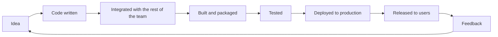
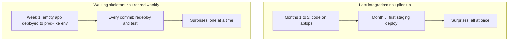
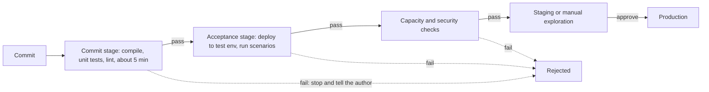

# Release anti-patterns and the cost of late feedback

> **Before this lesson:** nothing about delivery is assumed. It helps to have written a small program and to know that a team keeps its code in a shared store called a repository.

## In plain words

Think of a bakery. Baking a loaf is one job. Getting it wrapped, loaded on a van and on to a shop shelf while it is still fresh is another, and a bakery that is good at the first and bad at the second sells stale bread.

Software is the same. **Delivery** is everything that happens between a programmer finishing a change and a customer being able to use it. A **release** is the moment a new version is made available to users, and a **deployment** is the act of installing a version on the computers that run it (the **production** environment is the one real customers use).

This lesson describes the three classic ways teams make delivery slow and frightening, and the simple arithmetic that explains why. The remedy that the rest of the track builds is called **continuous delivery**: keeping software in a state where it can be released safely at any time.

Why this matters for a job: "tell me how code gets to production where you work" is one of the first questions in interviews for developer, DevOps and platform roles. This lesson gives you the vocabulary to answer it and to spot what is wrong with a process.

## Why this lesson exists

Most engineers meet "the release" before they meet any theory about it. It is the weekend when the whole team sits in a call, someone reads steps from a wiki page, a script fails halfway, and at 3 a.m. somebody edits a config file by hand on a production box and hopes. Nobody designed that process. It accreted, one emergency at a time.

Continuous delivery (CD) starts from a blunt observation: writing the code is rarely the hard part of shipping software. The hard part is everything between "it works on my machine" and "a customer is using it". If that stretch is slow, manual and frightening, the business learns slowly, engineers batch up work to avoid the pain, batches make each release riskier, and the fear grows. It is a reinforcing loop.

This lesson names the classic ways that loop shows up, explains the mechanism behind each, and gives you a way to measure it. The next lesson turns the diagnosis into principles.

By the end you should be able to:

- describe the three classic release anti-patterns and spot them in a real team,
- explain why batch size drives risk using simple probability,
- define cycle time and draw a value stream for a change,
- explain what a release candidate is and why every commit is one.

## What "delivery" actually covers

A feature has no value while it is sitting in a branch. It has value from the moment a user can use it. The path between those two points is the delivery process:



Two measurements describe how good that path is:

- **Cycle time** (often called *lead time for changes*): the wall-clock time from a commit landing to that commit running in production. Minutes in a healthy team, months in an unhealthy one.
- **Reliability of the path**: how often walking that path breaks something, and how long it takes to recover.

The interview question "how long would it take you to ship a one-line change?" is really a question about cycle time. If the honest answer is "six weeks, because the next release train leaves then", the organisation's ability to fix a typo, patch a vulnerability or test a pricing idea is six weeks. Nothing about the developers' skill changes that number; only the delivery process does.

> [!INTERVIEW]
> "Walk me through what happens between `git push` and production at your current job" is one of the most common openers in DevOps and platform interviews. Answer it as a value stream: list each step, say whether it is automated, how long it takes, and how long work waits before it. Then say which step you would attack first and why.

## Anti-pattern 1: deploying by hand

**What it looks like.** There is a document. It has forty steps: copy this archive to those three servers, stop the service, run these SQL statements in this order, edit `app.properties` to point at the new queue, restart, click around to check. A specific person "knows how to do releases". Releases take hours and sometimes go differently on each server.

**Why it fails.** A manual procedure has four structural weaknesses:

1. **Humans are not deterministic.** Even an expert skips a step under fatigue. With forty steps and a 1% chance of slipping on each, the chance of a flawless run is $0.99^{40} \approx 67\%$. One release in three has a defect that came purely from the procedure.
2. **Documentation rots.** The document describes the system as it was when someone last updated it. The script that actually runs is the only description guaranteed to be current.
3. **It is not testable.** You cannot run a wiki page in a test environment a hundred times to shake out its bugs. So the first real test of the deployment procedure is the production deployment itself.
4. **It does not leave evidence.** When something goes wrong, nobody can say exactly what was done, in what order, with what input.

**What the fix looks like.** The deployment is a program. A person chooses *what* version goes *where* and presses one button (or merges one pull request). Everything else is executed by a machine, logged, and identical every time.

```bash
# The whole human contribution to a deployment:
./deploy.sh --env production --version 2.14.3
```

Here is a tiny simulation that makes the arithmetic of manual steps concrete. Change `steps` and the slip rate and re-run it.

```python-run
import random

def manual_release(steps, slip, rng):
    """Return True if every manual step was done correctly."""
    return all(rng.random() > slip for _ in range(steps))

rng = random.Random(7)
trials = 20_000
for steps in (5, 20, 40, 80):
    ok = sum(manual_release(steps, 0.01, rng) for _ in range(trials))
    print(f"{steps:>3} manual steps, 1% slip each -> clean release {ok / trials:6.1%}"
          f"   (theory {0.99 ** steps:6.1%})")

print()
print("Automated: the script either works every time or fails every time,")
print("and the failing case is found in the first test environment, not in prod.")
```

The last two printed lines are the real point. Automation does not make a deployment bug-free. It makes the bugs *repeatable*, which means they can be found early and fixed once.

> [!WARNING]
> "We automated the release: it is a 400-line script that only Priya can run from her laptop" is still a manual release. The test is whether any authorised team member can deploy any version to any environment with one command, and whether that command is the same one used for the test environments.

## Anti-pattern 2: the first production-like deployment happens at the end

**What it looks like.** Developers work for months against laptops and a shared "dev" box that looks nothing like production: a different operating system patch level, a single node instead of a cluster, a local database instead of the managed one, no load balancer, no TLS, debug settings on. A production-like staging environment is built (or borrowed) only when "development is finished". The first deploy into it reveals a pile of surprises: the app assumes a writable local disk, sessions break behind the load balancer, a firewall blocks the outbound call, the installer was never written.

**Why it fails.** Each of those surprises is an assumption made months ago and never tested. The cost of a wrong assumption grows with the amount of code built on top of it. Discovering "we cannot keep session state in memory" in week two costs an afternoon; discovering it in month six costs a redesign under deadline pressure. There is also a people problem: the operations team first sees the software when it is thrown over the wall, so their knowledge about how production behaves arrives too late to influence the design.

**What the fix looks like.** Deploy to a production-like environment from the first week, using the same automated mechanism you will later use for production. Early on the application might be a "hello world" behind the real load balancer, talking to a real (empty) managed database. That is fine. You are testing the delivery path, and the path is the thing most likely to hurt you.



The second approach is often called a *walking skeleton*: the thinnest end-to-end slice that can be built, tested and deployed for real.

## Anti-pattern 3: production is configured by hand

**What it looks like.** Environments are changed by logging in and typing: a kernel parameter here, a connection pool size there, a hot fix copied on to one node of four. Nobody recorded it. Over time the nodes of a cluster drift apart, staging stops matching production, and "it worked in staging" stops being evidence of anything. Rebuilding a server from scratch takes days of archaeology. People speak of servers by name and are afraid to reboot them.

**Why it fails.** If the state of an environment is not written down in a form a machine can apply, then:

- you cannot reproduce it, so you cannot create a faithful test environment;
- you cannot roll it back, because you do not know what "before" was;
- you cannot review a change before it is made;
- recovery from a lost machine depends on memory.

**What the fix looks like.** Everything about an environment — operating system image, packages, middleware settings, network rules, application configuration — is described in files that live in version control, and environments are changed *only* by changing those files and letting automation apply them. We will spend a whole module on this (infrastructure as code); for now a small sketch:

```hcl
# terraform: the pool size is a reviewed, versioned fact, not something typed at 2 a.m.
resource "aws_db_parameter_group" "orders" {
  name   = "orders-pg15"
  family = "postgres15"

  parameter {
    name  = "max_connections"
    value = "400"
  }
}
```

A useful test: could you delete the production environment's servers and recreate them, working, from the repository alone, in a time you would be willing to tell your customers? If not, some of the environment lives only in people's heads.

## The mechanism underneath: batch size

All three anti-patterns share one property: they make a release *expensive*, and when something is expensive we do it rarely, and when we do it rarely each instance carries more change.

Suppose each individual change has an independent 2% chance of introducing a production problem. A release containing $n$ changes is clean with probability $0.98^n$:

| changes in the release | chance the release is clean |
|---|---|
| 1 | 98% |
| 10 | 82% |
| 50 | 36% |
| 200 | 2% |

So the quarterly release with two hundred changes is almost guaranteed to contain a problem. And when it does, the debugging cost is also worse, because there are two hundred suspects rather than one.

```python-run
import math

p_bad = 0.02          # chance that one change causes an incident

print(f"{'batch':>6} {'P(release has a bug)':>22} {'bisect steps to find it':>26}")
for n in (1, 5, 20, 50, 200):
    p_fail = 1 - (1 - p_bad) ** n
    bisect_steps = math.ceil(math.log2(n)) if n > 1 else 0
    print(f"{n:>6} {p_fail:>22.1%} {bisect_steps:>26}")

print()
total = 200
for n in (200, 20, 1):
    releases = total // n
    print(f"ship {total} changes as {releases:>3} release(s) of {n:>3}: "
          f"expected bad changes = {total * p_bad:.0f} either way, "
          f"but each failure has {n} suspect(s)")
```

Read the last block carefully, because it is a frequent source of confusion: shipping in small batches does **not** reduce the number of defects you write. It changes how quickly each one is found, how obvious its cause is, and how small the fix is. Four problems that surface one at a time, each traceable to the commit deployed ten minutes earlier, are routine. The same four problems tangled together after a big release are an outage.

This is the origin of the slogan *if it hurts, do it more often*: frequency forces you to make the painful thing cheap, and cheap things can be done in small pieces.

> [!TIP]
> When someone proposes "let's release less often so we have time to stabilise", translate it into batch size. Releasing less often means bigger batches, which means each release is riskier and needs even more stabilisation. The stabilisation phase is the symptom, not the cure.

## Feedback: the three properties

The remedy the rest of this track builds is a fast feedback loop on every change. A feedback loop is only useful if three things hold:

1. **Every change triggers it.** Not only code: a changed config value, a new database migration, a bumped library, an edited Terraform module and a new base image can each break production. Each must flow through the same checks.
2. **It arrives fast.** A failure reported five minutes after the commit is fixed by the author while the context is still in their head. A failure reported three weeks later needs a meeting to work out whose it is.
3. **Somebody acts on it.** A red build that everybody ignores is worse than no build, because it trains people that red is normal.

The executable form of that loop is the **deployment pipeline**: an automated sequence that takes each commit, builds it once, and pushes that build through progressively more demanding and more production-like checks. Cheap, fast checks run first; expensive ones run only on builds that survived the cheap ones.



## Every commit is a release candidate

In a traditional project, a "release candidate" is declared late: after code freeze, a build is blessed and enters a long test phase. Before that point nobody knows whether the product is releasable.

CD inverts this. **Every commit to the main line is treated as a candidate for release.** The pipeline's job is to try to disprove that. A commit that fails any stage is discarded as a candidate; a commit that passes every stage has earned the right to be released, and whether it actually goes out is a business decision, not a technical scramble.

Two consequences follow, and both feel strange at first:

- **The main line must always be in a releasable state.** Unfinished features cannot be allowed to break it, so they are hidden (behind feature flags or unreachable code paths) rather than kept away on long-lived branches. Module 14 covers how.
- **"Done" changes meaning.** A story that is coded and merged but not deployable is inventory. Done means the change has gone all the way through — at minimum demonstrated in a production-like environment, ideally live.

## A worked example: mapping a value stream

A team complains that releases are slow. Instead of arguing, draw the path one change takes and attach two numbers to every step: how long work is actually being done (*process time*) and how long the change sits waiting before the step (*wait time*).

| step | process time | wait before it | automated? |
|---|---|---|---|
| Code review | 30 min | 1 day | no |
| Merge to release branch | 15 min | 9 days (merge window) | no |
| Build and unit tests | 12 min | 0 | yes |
| Deploy to QA | 45 min | 2 days (ticket to ops) | no |
| Manual regression | 3 days | 4 days (QA queue) | no |
| Change advisory board | 30 min | 6 days (meets weekly) | no |
| Production deploy | 4 hours | 5 days (release window) | partly |

```python-run
steps = [  # (name, process_hours, wait_hours)
    ("code review",          0.5,  24),
    ("merge window",         0.25, 9 * 24),
    ("build + unit tests",   0.2,  0),
    ("deploy to QA",         0.75, 2 * 24),
    ("manual regression",    3 * 8, 4 * 24),
    ("change board",         0.5,  6 * 24),
    ("production deploy",    4,    5 * 24),
]
process = sum(p for _, p, _ in steps)
wait = sum(w for _, _, w in steps)
print(f"touch time : {process:6.1f} h")
print(f"wait time  : {wait:6.1f} h  ({wait / 24:.0f} days)")
print(f"flow efficiency = {process / (process + wait):.1%}")
print()
print("biggest queues:")
for name, p, w in sorted(steps, key=lambda s: -s[2])[:3]:
    print(f"  {name:<20} waits {w / 24:4.1f} days")
```

The output shows flow efficiency of a few percent: the change spends almost all of its life waiting. That is typical, and it tells you where to invest. Speeding up the compiler would be pointless here. The merge window, the change board and the release window are queues created by the fear of releasing; they shrink when the pipeline makes each release small and well-evidenced.

## Common misreadings

**"CD means deploying to production on every commit."** That is *continuous deployment*, a stricter practice. *Continuous delivery* means every commit *could* be released at the push of a button; the business may still choose to release weekly. *Continuous integration* is the base layer: everyone merges to the main line at least daily and an automated build verifies each merge.

| term | what is automated | human decision left |
|---|---|---|
| Continuous integration | merge, build, fast tests | everything after |
| Continuous delivery | all the way to a production-ready, proven artifact | "release now?" |
| Continuous deployment | all the way to production | none per change |

**"We need this only at big-tech scale."** The anti-patterns are about procedure, not size. A three-person team that deploys by SSH and memory has every problem above.

**"Automation first, then we will add tests."** A pipeline that ships untested code quickly only delivers bugs faster. Speed and safety come from the same investment.

**"The tool gives us CD."** Installing Jenkins or enabling GitHub Actions gives you a place to run scripts. The practices — small batches, one artifact, production-like environments, stopping when it is red — are what change outcomes.

## Summary

- Value is delivered when users can use a change, so the path from commit to production deserves as much engineering as the code.
- Three classic anti-patterns: manual deployment, meeting a production-like environment only at the end, and hand-configured production. Each makes releases unrepeatable and therefore risky.
- Risk grows with batch size. Small, frequent releases do not reduce the number of defects written, but they make each one cheap to find and fix.
- Useful feedback is triggered by every kind of change, arrives quickly, and is acted on.
- Every commit to main is a release candidate; the deployment pipeline exists to try to reject it.
- Measure cycle time and map the value stream before choosing what to improve; queues usually dominate.

## Glossary

- **Delivery** — everything between finishing a change and users being able to use it.
- **Release** — making a new version available to users.
- **Deployment** — installing a version of the software in an environment.
- **Production** — the environment that real users use.
- **Environment** — a complete set of machines and settings in which the software runs, such as test, staging or production.
- **Staging** — a test environment built to resemble production closely.
- **Commit** — one saved change in the version-control history.
- **Cycle time (lead time for changes)** — the time from a commit to that commit running in production.
- **Batch size** — how many changes are released together.
- **Configuration drift** — environments slowly becoming different from each other and from their written description.
- **Walking skeleton** — the thinnest end-to-end version of a system that can be built, tested and deployed for real.
- **Deployment pipeline** — the automated sequence of builds, tests and deployments that every change passes through.
- **Release candidate** — a build that might be released if it passes every check.
- **Continuous integration / delivery / deployment** — merging and testing every change at once / keeping every passing change ready to release / releasing every passing change automatically.
- **Value stream** — the full sequence of steps and waits a change goes through on its way to users.

## Check yourself

```quiz
[
  {"q": "A release procedure has 30 manual steps and a careful operator makes a mistake on 2% of steps. Roughly how often is the whole release performed flawlessly?",
   "options": ["About 98% of the time", "About 55% of the time", "About 30% of the time", "Almost never"],
   "answer": 1,
   "explain": "0.98 to the power 30 is about 0.545. Per-step reliability that sounds excellent still gives a coin-flip release once there are many steps."},
  {"q": "Which statement about small batches is correct?",
   "options": ["They reduce the number of defects developers introduce", "They make each defect faster to locate and cheaper to fix", "They remove the need for automated tests", "They only help teams practising continuous deployment"],
   "answer": 1,
   "explain": "The defect rate per change is unchanged. What improves is detection time and the number of suspects when something breaks."},
  {"q": "A team builds a production-like staging environment only after feature development is finished. What is the main risk?",
   "options": ["Staging costs more to run for a short time", "Assumptions about the runtime environment are tested only when they are most expensive to fix", "Developers will have too much feedback", "The CI server will be overloaded"],
   "answer": 1,
   "explain": "Environment assumptions (state, networking, permissions, installers) get baked in for months; discovering them late means redesign under deadline."},
  {"q": "What does it mean to treat every commit as a release candidate?",
   "options": ["Every commit is automatically released to users", "Every commit is tagged with a version number by hand", "Every commit enters the pipeline, which tries to prove it unfit for release", "Only commits made after code freeze are tested"],
   "answer": 2,
   "explain": "The pipeline's job is rejection. A commit that survives all stages is releasable; whether to release it is a separate, business decision."},
  {"q": "In a value stream, touch time is 30 hours and wait time is 570 hours. Where should improvement effort go first?",
   "options": ["Buying faster build machines", "Hiring more developers", "Removing the queues between steps", "Writing more documentation for the manual steps"],
   "answer": 2,
   "explain": "Flow efficiency is 5%. Work is idle 95% of the time, so shortening queues (merge windows, approval boards, release windows) dominates any speed-up of the active steps."},
  {"q": "Which best distinguishes continuous delivery from continuous deployment?",
   "options": ["Delivery has no automated tests", "Delivery keeps a human decision about when to release; deployment releases every passing change automatically", "Deployment is only for mobile apps", "They are two names for the same practice"],
   "answer": 1,
   "explain": "Both keep every passing build production-ready. Continuous deployment removes the per-release human decision."},
  {"q": "Servers in a cluster have been tweaked by hand over two years. Which problem is the most direct consequence?",
   "options": ["Unit tests run slower", "The environment cannot be reliably reproduced or rolled back", "Developers cannot use branches", "The compiler produces different binaries"],
   "answer": 1,
   "explain": "Unrecorded manual changes cause configuration drift: no known-good state to rebuild from, no faithful copy for testing, no way to undo."}
]
```

> **Source:** Humble & Farley, *Continuous Delivery*, ch. 1 (the problem of delivering software). Cycle-time and flow-efficiency vocabulary follows common lean value-stream usage.
