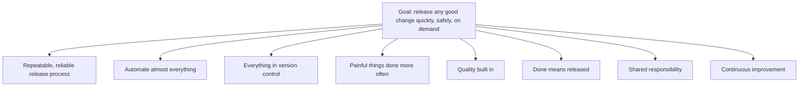
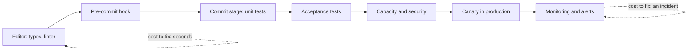

# Principles of continuous delivery

> **Before this lesson:** read [Release anti-patterns and the cost of late feedback](#/lesson/cicd/release-antipatterns), which explains what goes wrong with slow, manual releases. This lesson turns that diagnosis into rules.

## In plain words

A professional kitchen runs on a few house rules: clean as you go, label everything, taste before it leaves the pass. None of them is a recipe. They are habits that make every recipe come out well, whoever is cooking.

Continuous delivery has house rules of the same kind. This lesson gives eight **principles** — short statements about how to work — that hold whatever tools a team uses. Tools change every few years. These have stayed the same.

Two words appear throughout. To **automate** a task is to have a program do it instead of a person. **Version control** is a system (the best known is Git) that records every change to a set of files, who made it and why, so that any earlier state can be recovered.

Why this matters for a job: when you are shown an unfamiliar delivery process, these eight principles are a checklist for judging it. Interviewers often ask "what is DevOps?" or "how would you improve our release process?", and a good answer is built from them.

## From diagnosis to rules of thumb

The previous lesson described what goes wrong: manual steps, late contact with realistic environments, hand-tuned servers and large batches. A list of failures is not yet a way of working. This lesson gives you eight principles that, taken together, define continuous delivery. Tools change every few years; these have been stable for more than a decade, and you can use them to evaluate any pipeline you are shown.

For each principle you will see what it means, how a team applies it today, and how to tell when it is being violated. Treat the list as a checklist for design reviews and as vocabulary for interviews.



## 1. Make releasing a repeatable, reliable process

Releasing should be boring. It becomes boring when the same mechanism has been exercised hundreds of times before it matters. If the script that deploys to production is also the script that deploys to every test environment, then by the time a build reaches production its deployment procedure has already been tested as many times as there are environments, for every build that came before.

Repeatability rests on two legs:

- **Automation** of the build, test, provisioning and deployment steps, so that the procedure does not vary.
- **Configuration management** of everything those steps consume, so that the inputs do not vary either.

How to spot a violation: production deployment uses a different tool, a different person or a different document than staging deployment. Whatever is unique to production is, by definition, tested for the first time in production.

## 2. Automate almost everything

The word *almost* matters. Some activities need a human: exploratory testing, a usability review, a demo to a stakeholder, the judgement call to approve a release in a regulated setting. The principle is that a human should supply *judgement*, never *keystrokes*.

A practical way to automate without stalling the project: do a task by hand the first time to learn it, write it down the second time, automate it the third. Do not wait for a grand automation project; automate the step that currently hurts most, then the next.

A modern approval step shows the split between judgement and mechanics clearly. In GitHub Actions, a job that targets a protected *environment* pauses until a named reviewer approves, and then the machine does the work:

```yaml
jobs:
  deploy-production:
    runs-on: ubuntu-latest
    environment: production        # configured with "required reviewers" in repo settings
    steps:
      - uses: actions/checkout@v4
      - run: ./scripts/deploy.sh production "${{ github.sha }}"
```

The reviewer clicks one button. They do not copy files, run SQL or edit configs.

> [!TIP]
> When you inherit a manual process, record a real run as a shell transcript first. The transcript is already 60% of the script, and it shows you the undocumented steps people perform from habit.

## 3. Keep everything in version control

Not only source code. If it is needed to build, test, deploy or operate the system, it belongs in a repository:

| artefact | typical modern form |
|---|---|
| application code and tests | the service repo |
| build definition | `Makefile`, `package.json` scripts, `pyproject.toml`, `build.gradle` |
| pipeline definition | `.github/workflows/*.yml`, `.gitlab-ci.yml` |
| runtime image | `Dockerfile` |
| deployment description | Kubernetes manifests, Helm chart, Kustomize overlays |
| infrastructure | Terraform or Pulumi modules |
| database schema changes | numbered migration files |
| configuration per environment | values files, with secrets referenced rather than embedded |
| operational docs | runbooks in Markdown next to the code |

The test is a thought experiment. A new team member is given an empty laptop and repository access. Can they run one documented command and get a working build, and can the pipeline, given only a commit hash, recreate exactly what ran in production last Tuesday? If any ingredient lives on someone's disk or in a web console, the answer is no.

A second benefit is audit. A commit history answers *who changed what, when and why* for free, for infrastructure and configuration as well as code.

## 4. If it hurts, do it more often, and bring the pain forward

This is the most counter-intuitive principle and the most general. Integration is painful, so integrate on every commit rather than once a month. Releasing is painful, so release on every good build. Testing in production-like conditions is painful, so do it in the second stage of the pipeline rather than the week before launch. Writing release notes is painful, so generate them from commit messages on every build.

The reasoning from the last lesson applies each time: pain grows faster than linearly with batch size, and frequency forces the investment that removes the pain.

You will not always be able to jump straight to the ideal. If the organisation releases quarterly, monthly is a sensible intermediate goal, and it will expose the next constraint. Direction matters more than the starting point.

## 5. Build quality in

Defects are cheapest to remove at the moment they are created. A unit test failing on the author's laptop costs seconds. The same bug caught by a tester a week later costs a context switch, a ticket and a conversation. Found by a customer, it costs an incident.

"Building quality in" means arranging the work so that defects are caught as near their source as possible:



Two further implications:

- **Testing is not a phase.** There is no stage at the end where quality is "added". Tests are written with the code and run on every change.
- **Testing is not only the testers' job.** Developers, testers and operators share responsibility for the automated checks, and the pipeline is the shared record of what "good" means.

This idea is borrowed from lean manufacturing: you do not inspect quality into a product at the end of the line; you stop the line when a defect appears and fix the process that produced it. In software the "line" is the pipeline, and "stopping the line" means a red build takes priority over new work.

## 6. Done means released

A feature that is "dev complete" has delivered nothing. Until it has been through the pipeline and into users' hands — or, where a production release is not yet possible, at least demonstrated working in a production-like environment — the team does not know whether it works, performs, deploys or is wanted.

There is no "80% done". A change is either releasable or it is not. Counting unreleasable work as progress hides exactly the kind of risk that surfaces at the end of a project.

In practice teams encode this in their definition of done. A reasonable modern version:

1. merged to main behind a flag if incomplete,
2. all pipeline stages green for that commit,
3. deployed to production,
4. monitoring and alerts in place for the new behaviour,
5. flag turned on for real users (or scheduled).

## 7. Everybody is responsible for the delivery process

When development is measured on features shipped and operations is measured on stability, the two groups have opposite incentives, and the release becomes the place where they collide. The fix is organisational more than technical: the people who build, test and run the software work as one team with one goal, which is to deliver working software to users.

Concretely:

- developers are on call for the services they write, so they feel the cost of a hard-to-operate design;
- operations and security engineers take part in design from the start, so their constraints shape the system instead of blocking it at the end;
- anyone can see the state of the pipeline and of production; dashboards are shared, not owned by one group;
- a failed release is examined as a failure of the system, not of an individual.

This is the idea that later became known as DevOps. The name came after the principle.

> [!INTERVIEW]
> If asked "what is DevOps?", avoid answering with a tool list. A strong answer: "It is shared ownership of delivery and operation — the same team builds and runs the software — supported by automation, version-controlled infrastructure, and fast feedback from production. The tools exist to make that shared ownership practical."

## 8. Improve continuously

The first pipeline you build will be wrong in ways you cannot predict. Treat the delivery process itself as a product with a backlog. A lightweight loop works well:

1. Hold a regular retrospective with everyone involved in delivery.
2. Pick the single biggest constraint (use the value-stream map).
3. Agree one change, an owner and a way to measure its effect.
4. Check the measurement at the next retrospective; keep or revert the change.

This is the plan–do–check–act cycle. The measurement step is what separates improvement from opinion. Module 15 introduces four metrics that have become the standard yardstick.

## Putting the principles to work: an audit

Here is a small scoring tool. It encodes the principles as yes/no questions and prints where a team stands. Edit the answers to match a team you know.

```python-run
checks = {
    "repeatable": [
        ("Same deploy mechanism for every environment", True),
        ("Anyone authorised can deploy with one command", False),
    ],
    "automation": [
        ("Build and unit tests run on every push", True),
        ("Environment provisioning is scripted", False),
        ("Database changes applied by the pipeline", False),
    ],
    "version control": [
        ("Pipeline definition lives in the repo", True),
        ("Infrastructure definitions live in a repo", False),
        ("No config edited directly on servers", False),
    ],
    "frequency": [
        ("Everyone merges to main at least daily", False),
        ("Production release at least weekly", False),
    ],
    "quality built in": [
        ("A red build stops new merges", True),
        ("Tests are written with the change", True),
    ],
    "done = released": [
        ("Stories closed only after production deploy", False),
    ],
    "shared ownership": [
        ("Developers are on call for their services", False),
        ("Ops involved in design reviews", True),
    ],
    "improvement": [
        ("Delivery metrics reviewed monthly", False),
    ],
}

total = got = 0
for principle, items in checks.items():
    yes = sum(v for _, v in items)
    total += len(items); got += yes
    bar = "#" * yes + "." * (len(items) - yes)
    print(f"{principle:<18} [{bar:<3}] {yes}/{len(items)}")
print(f"\nscore {got}/{total}")
worst = min(checks, key=lambda p: sum(v for _, v in checks[p]) / len(checks[p]))
print("start with:", worst)
for q, v in checks[worst]:
    if not v:
        print("  -", q)
```

The script is trivial on purpose. Its value is in forcing a concrete answer to each question. "We mostly automate deployments" turns into a yes or a no.

## A worked example: one change, eight principles

A developer needs to raise an HTTP client timeout from 2 to 5 seconds for the payments integration. Follow the change through a team that applies the principles:

1. **Version control.** The timeout is a line in `config/base.yaml` in the service repo. The developer edits it on a short-lived branch and opens a pull request. The reason is in the commit message.
2. **Quality built in.** A pre-commit hook validates the YAML against a schema. The pull request triggers the commit stage: unit tests include one that loads every environment's config and checks required keys and types.
3. **Automation.** After review and merge, the pipeline builds one container image tagged with the commit hash and pushes it to the registry.
4. **Repeatable process.** The same Helm chart and the same deploy job install that image into the acceptance environment, then staging, with only a values file differing.
5. **Pain brought forward.** The acceptance suite includes a scenario with a deliberately slow payment stub, so the timeout behaviour is exercised an hour after the commit, not during an incident.
6. **Shared responsibility.** The on-call engineer for payments is a required reviewer for changes under `config/`, enforced by a `CODEOWNERS` file.
7. **Done means released.** The ticket closes when the production deploy job is green and the dashboard shows the p99 latency of the payment call within its expected band.
8. **Improvement.** In the retrospective someone notes the change took four hours end to end and three of them were waiting for a staging slot. That becomes the next thing to fix.

Contrast with the anti-pattern version of the same change: someone SSHes to four servers, edits a file on three of them, forgets the fourth, restarts the services, and tells nobody. Six months later the fourth server times out intermittently and nobody knows why.

## Benefits you can expect, and what they depend on

Teams that adopt these principles report the same set of outcomes:

- **Lower risk per release**, because each release is small and its deployment has been rehearsed.
- **Faster feedback from users**, because ideas reach them in days.
- **Less stress**, because releasing stops being an event.
- **Flexibility**, because any good build can be deployed anywhere, including a brand-new environment for a demo or a test.
- **Empowered teams**: a tester can self-serve a build into a test environment; an operator can roll back with a button.

None of these arrive from tooling alone. Each one depends on the discipline in the principles: a pipeline is only trustworthy if people stop when it is red, and a rollback button only works if every release kept the previous version deployable.

> [!WARNING]
> A common failure mode is "cargo cult" CD: a team builds an impressive pipeline but keeps long-lived branches, a two-week manual regression phase and a monthly change board. The pipeline then automates the cheap 5% of the path. Always check the principles against the *whole* value stream, not only the part that has YAML.

## Pitfalls

- **Automating a bad process.** A script that faithfully reproduces forty unnecessary steps is still forty steps. Simplify before you automate.
- **Treating principles as a maturity badge.** They are means to an end: fast, safe delivery. If a rule is not helping that, question it.
- **Skipping the organisational principles.** Principles 6 to 8 are about people and incentives. Teams that implement only 1 to 5 tend to stall at "fast CI, slow release".
- **Trying everything at once.** Start with version control and a single automated build, then extend one stage at a time.

## Summary

- Eight principles define continuous delivery: a repeatable release process, automation of everything that does not need judgement, version control for every artefact, doing painful things more often, quality built in, done meaning released, shared responsibility and continuous improvement.
- Repeatability comes from running one deployment mechanism against every environment.
- Humans supply decisions; machines supply execution.
- Quality is cheapest at the source, so checks move as close to the author as possible.
- The organisational principles (shared ownership, improvement) are what turn a fast build into fast delivery.

## Glossary

- **Principle** — a general rule for how to work, independent of any tool.
- **Automation** — having a program perform a task instead of a person.
- **Version control** — a system that records every change to files and can recover any earlier state.
- **Repository** — the store of files and their history kept by version control.
- **Pull request** — a proposed change, shown to others for review before it is merged.
- **Pipeline** — the automated sequence of checks and deployments a change goes through.
- **Environment (GitHub Actions)** — a named deployment target that can require approval before a job runs.
- **Definition of done** — the team's agreed list of what must be true before work counts as finished.
- **On call** — being the person responsible for responding when the running system has a problem.
- **DevOps** — the practice of one team sharing responsibility for building and running software.
- **Retrospective** — a regular meeting to review how work went and agree improvements.
- **Plan-do-check-act** — a loop for improvement: decide a change, make it, measure the result, keep or adjust it.

## Check yourself

```quiz
[
  {"q": "Why should the script that deploys to production also be used for test environments?",
   "options": ["It saves disk space on the CI server", "Each test deployment is then a rehearsal of the production procedure", "Test environments need production credentials", "It makes test environments faster"],
   "answer": 1,
   "explain": "Anything unique to the production deploy is exercised for the first time in production. Sharing the mechanism means it has been run many times before it matters."},
  {"q": "Which of these is an appropriate job for a human in an automated pipeline?",
   "options": ["Copying the artifact to each server", "Running the schema migration statements", "Deciding whether a build that passed all checks should be released today", "Editing the production config file"],
   "answer": 2,
   "explain": "People should contribute judgement. Mechanical steps belong to the machine."},
  {"q": "A new engineer cannot build the project because a required code-generation tool exists only on a colleague's laptop. Which principle is violated?",
   "options": ["Done means released", "Keep everything in version control", "Continuous improvement", "Shared responsibility"],
   "answer": 1,
   "explain": "Everything needed to build, test, deploy and run should be recoverable from the repository."},
  {"q": "What does 'build quality in' imply about testing?",
   "options": ["Testing is a phase after development finishes", "Only dedicated testers should write tests", "Checks run continuously and as close as possible to where defects are introduced", "Manual testing should be eliminated entirely"],
   "answer": 2,
   "explain": "Quality cannot be inspected in at the end. Checks run on every change, and exploratory manual testing still has a place."},
  {"q": "A story is coded, reviewed and merged, but the release is three weeks away. Under 'done means released', the story is:",
   "options": ["Done", "80% done", "Not done", "Done once QA signs off"],
   "answer": 2,
   "explain": "Until the change is released, or at least proven in a production-like environment, its real status is unknown. There is no partial credit."},
  {"q": "Releases are painful, so management proposes moving from monthly to quarterly releases. What would the principles predict?",
   "options": ["Releases become easier because there is more preparation time", "Each release becomes larger and riskier, increasing the pain", "No change", "Defects drop because of longer testing"],
   "answer": 1,
   "explain": "Lower frequency means larger batches. The principle is to do painful things more often so that they are forced to become cheap."},
  {"q": "Which situation most clearly shows missing shared responsibility?",
   "options": ["Developers get paged for their own services", "Operations first sees the application a week before launch", "A dashboard is visible to the whole team", "Security engineers review the design early"],
   "answer": 1,
   "explain": "When ops is involved only at the end, their constraints cannot influence the design and the release becomes a collision point."}
]
```

> **Source:** Humble & Farley, *Continuous Delivery*, ch. 1 (principles of software delivery). GitHub Actions environments and required reviewers: https://docs.github.com/en/actions/deployment/targeting-different-environments/using-environments-for-deployment
