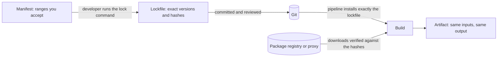

# Version control everything and pin your dependencies

> **Before this lesson:** read [Principles of continuous delivery](#/lesson/cicd/delivery-principles). You do not need to know Git commands; the ones used here are explained as they appear.

## In plain words

A good cook writes down a recipe exactly: not "some flour" but "250 g of plain flour, this brand". With an exact recipe, anybody can make the same cake next year. With a vague one, each attempt differs and nobody knows why one failed.

Software has the same need. To rebuild last month's version exactly, you must know which code it contained and which versions of every outside ingredient it used. The ingredients are called **dependencies**: pieces of software written by other people (often called libraries or packages) that your program uses.

Two tools give you the exact recipe. **Version control** (Git) stores every change to your own files. A **lockfile** is a file, written by a tool, listing the exact version of every dependency that was used.

This discipline of knowing and controlling every ingredient is called **configuration management**.

Why this matters for a job: "it worked yesterday and nothing changed" is one of the commonest problems in software, and it nearly always means an ingredient changed without anyone noticing. Interviewers ask how you make builds reproducible; this lesson is the answer.

## Motivation: "which version is actually running?"

A customer reports a bug in production. You need three answers immediately: exactly which code is running, which libraries it was built with, and which configuration it started under. If any of those takes more than a minute to find, your configuration management has a gap.

*Configuration management* is the discipline of storing, identifying and retrieving every artefact a project depends on, together with the relationships between them. It sounds like bookkeeping. It is in fact the foundation that every later module assumes: you cannot build once and promote an artifact, reproduce a failure, or roll back, unless you can name a past state precisely and get it back.

A good strategy lets you answer yes to four questions:

1. Can I reproduce any environment exactly — OS, packages, network settings, app, config?
2. Can I make a small change to any one of those and roll it out everywhere it applies?
3. Can I see every change that was made, who made it and when?
4. Can everyone on the team get the information they need without asking a gatekeeper?

This lesson covers the first half of the topic: what goes into version control, how to commit, and how to manage the code you did not write. The next lesson covers configuration, environments and secrets.

## What belongs in the repository

A short answer: everything a clean machine needs to turn a commit hash into a running, tested system.

```text
orders-service/
├── src/                      application code
├── tests/                    unit, integration and acceptance tests
├── migrations/               numbered database schema changes
├── Dockerfile                how the runtime image is built
├── pyproject.toml            declared dependencies (ranges)
├── uv.lock                   resolved dependencies (exact versions + hashes)
├── Makefile                  build, test, lint entry points
├── .github/workflows/        the pipeline itself
├── deploy/
│   ├── chart/                Helm chart
│   └── values-*.yaml         per-environment settings (no secrets)
├── infra/                    Terraform for queues, buckets, databases
├── docs/runbooks/            what to do when the pager goes off
└── .tool-versions            compiler / interpreter versions for local dev
```

What does **not** belong:

- **Build outputs** (compiled binaries, `dist/`, `node_modules/`, container images). They are derived from the source and are large; they live in an artifact repository, keyed by the commit that produced them. Committing them invites the situation where source and binary disagree.
- **Secrets** (passwords, API keys, private keys). A Git history is forever, and a repository is copied to every developer's laptop. Store a *reference* to the secret, not the secret.
- **Machine-specific files** (IDE settings with absolute paths, local `.env` files).

```gitignore
# .gitignore
dist/
build/
node_modules/
__pycache__/
*.pyc
.env
.env.*
!.env.example
*.pem
.terraform/
*.tfstate*
```

The `!.env.example` line is a useful pattern: commit a template listing every variable a developer must set, with dummy values, so the shape of the configuration is versioned even though the values are not.

> [!WARNING]
> Deleting a committed secret in a later commit does not remove it. It remains in history and in every clone. The only safe response is to **rotate the credential** immediately, then clean history if policy requires it. Add a secret scanner (for example gitleaks, or GitHub push protection) so the next one is blocked before it lands.

## Committing well

Version control only helps if the history is usable. Three habits make it so.

**Commit small and often, to the main line.** A change that sits on your disk or on a private branch is invisible to the build and to your colleagues. Merging at least once a day keeps differences small enough to integrate without drama. If a feature will take two weeks, find a way to land it in increments that do not break anything (Module 14 shows the techniques).

**Make each commit one logical change.** A commit that renames a module, fixes a bug and bumps a dependency cannot be reverted cleanly when only the bug fix turns out to be wrong. One reason per commit makes `git revert` and `git bisect` effective tools.

**Write messages for the person debugging at 2 a.m.** The diff shows *what* changed. The message must say *why*. A widely used structure is Conventional Commits, which adds a machine-readable type prefix:

```text
fix(payments): raise gateway timeout to 5s

The provider's p99 latency rose to 3.1s after their region
migration (see INC-482). At 2s we were failing ~0.4% of checkouts
that would have succeeded. 5s keeps us inside the 8s edge timeout.

Refs: INC-482
```

The first line is under about 70 characters and reads as a headline. The body explains the reasoning and links to the ticket. Because the prefix is structured (`fix`, `feat`, `feat!` for a breaking change), tools can derive the next version number and a changelog from history — you will implement that rule in a later problem.

```bash
git log --oneline -5
# 9f3c2e1 fix(payments): raise gateway timeout to 5s
# 41ab7d0 feat(cart): support gift cards at checkout
# c08d91e chore(deps): bump httpx from 0.27.0 to 0.27.2
# 7be4410 refactor(orders): extract tax calculation
# 1d2f6aa test(cart): cover empty-cart checkout
```

## Dependencies: the code you did not write

A modern service is mostly other people's code. A small web API commonly pulls in a few direct dependencies and a few hundred *transitive* ones (the dependencies of your dependencies). Each is an input to your build that can change without you touching a line.

### Declared versus resolved

There are two different questions:

- *What am I willing to accept?* — a **constraint** such as "any 1.x release at or above 1.4".
- *What exactly did I build and test with?* — a single **resolved** version of every package, direct and transitive.

The first belongs in the manifest (`package.json`, `pyproject.toml`, `Cargo.toml`, `go.mod`). The second belongs in a **lockfile** (`package-lock.json`, `uv.lock`, `poetry.lock`, `Cargo.lock`, `go.sum`), which is generated by the tool and committed.

```toml
# pyproject.toml  -- what we accept
[project]
dependencies = [
  "fastapi>=0.115,<0.116",
  "httpx~=0.27.0",
  "pydantic>=2.7,<3",
]
```

```text
# uv.lock (excerpt)  -- what we actually got, with content hashes
name = "httpx"
version = "0.27.2"
sdist = { url = "...", hash = "sha256:f7c2be1d..." }
```

Without a lockfile, two builds of the *same commit* an hour apart can produce different software because a transitive package published a new release in between. That destroys the property everything else relies on: same input, same output.

The flow from what you accept to what you ship looks like this:



### Reading version constraints

Most ecosystems follow **semantic versioning**: `MAJOR.MINOR.PATCH`, where a major bump signals an incompatible change, a minor bump adds functionality compatibly, and a patch bump fixes bugs compatibly. Constraint operators are shorthand over that scheme:

| constraint | meaning | accepts 1.4.2? | accepts 1.5.0? | accepts 2.0.0? |
|---|---|---|---|---|
| `==1.4.2` | exactly this | yes | no | no |
| `>=1.2,<2` | explicit range | yes | yes | no |
| `^1.2` (npm, Cargo) | compatible with 1.2: `>=1.2.0,<2.0.0` | yes | yes | no |
| `~1.4` (npm) | patch updates only: `>=1.4.0,<1.5.0` | yes | no | no |
| `~=1.4.0` (Python) | `>=1.4.0,<1.5.0` | yes | no | no |

Versions compare numerically field by field, not as strings: `1.10.0` is newer than `1.9.0` even though `"1.10"` sorts before `"1.9"` alphabetically.

```python-run
def parse(v):
    return tuple(int(x) for x in v.split("."))

def caret_range(base):
    """^X.Y.Z -> allow changes that do not modify the left-most non-zero field."""
    t = list(parse(base)) + [0] * (3 - len(base.split(".")))
    lo = tuple(t)
    for i, x in enumerate(t):
        if x != 0 or i == 2:
            hi = tuple(t[:i]) + (x + 1,) + (0,) * (2 - i)
            break
    return lo, hi

def tilde_range(base):
    parts = base.split(".")
    t = list(parse(base)) + [0] * (3 - len(parts))
    lo = tuple(t)
    hi = (t[0] + 1, 0, 0) if len(parts) == 1 else (t[0], t[1] + 1, 0)
    return lo, hi

for spec, fn in (("^1.2", caret_range), ("^0.3.1", caret_range), ("~1.4", tilde_range)):
    lo, hi = fn(spec[1:])
    print(f"{spec:<8} means >= {'.'.join(map(str, lo))} and < {'.'.join(map(str, hi))}")
    for v in ("1.4.2", "1.10.0", "0.3.9", "0.4.0", "2.0.0"):
        ok = lo <= parse(v) < hi
        print(f"    {v:<7} {'ok' if ok else '--'}")

print(sorted(["1.9.0", "1.10.0", "1.2.0"]), "<- string sort (wrong)")
print(sorted(["1.9.0", "1.10.0", "1.2.0"], key=parse), "<- numeric sort")
```

Notice the caret rule for `0.x` versions: below 1.0 the *minor* field is treated as the breaking one, so `^0.3.1` stops before `0.4.0`.

### Installing reproducibly in CI

Use the command that installs *exactly* the lockfile and fails if the manifest and lockfile disagree:

```bash
npm ci                         # Node: never rewrites package-lock.json
uv sync --locked               # Python (uv): error if uv.lock is stale
pip install --require-hashes -r requirements.txt   # Python (pip-tools output)
cargo build --locked           # Rust
go mod verify && go build ./...  # Go: verifies against go.sum
```

The developer-side commands (`npm install`, `uv lock`, `cargo update`) are the ones allowed to change the lockfile, and that change is committed and reviewed like any other.

### Keeping dependencies fresh without surprises

Pinning has a cost: pinned versions go stale and accumulate known vulnerabilities. The answer is not to float versions but to automate the update as a normal change. Bots such as Dependabot or Renovate open a pull request per update; the pipeline runs; a human (or an auto-merge rule for patch updates with green checks) merges it.

```yaml
# .github/dependabot.yml
version: 2
updates:
  - package-ecosystem: "pip"
    directory: "/"
    schedule:
      interval: "weekly"
    groups:
      minor-and-patch:
        update-types: ["minor", "patch"]
  - package-ecosystem: "github-actions"
    directory: "/"
    schedule:
      interval: "weekly"
```

This turns "a library changed under us" from an invisible event into a reviewed commit with its own pipeline run — the first property of good feedback from Lesson 1.

### Where the bits come from

Builds should not depend on the public internet being up, or on a public package not having been deleted or replaced. Larger organisations place a **proxying artifact repository** (Artifactory, Nexus, a cloud provider's registry) between builds and public registries. It caches every package ever used, lets security block specific versions, and hosts internal packages. Combined with lockfile hashes, it means a build next year fetches byte-identical inputs.

The same pinning logic applies to things that do not look like libraries:

```dockerfile
# floating: "3.12-slim" is re-published regularly, so this line changes meaning over time
FROM python:3.12-slim

# pinned by digest: immutable
FROM python:3.12-slim@sha256:3f1c0e2b6f0d9a1c7c4e8a5a2b9d6e7f8091a2b3c4d5e6f708192a3b4c5d6e7f
```

```yaml
# GitHub Actions: a tag can be moved by its owner; a full commit SHA cannot
- uses: actions/checkout@v4                                        # convenient
- uses: actions/checkout@11bd71901bbe5b1630ceea73d27597364c9af683  # v4.2.2, immutable
```

> [!TIP]
> Pin third-party GitHub Actions to a full commit SHA and let Dependabot update the SHA. A moved tag on a compromised action has been a real supply-chain attack vector; a SHA pin makes your workflow immune to tag movement.

## Internal components

Your own shared libraries are dependencies too. There are two ways to consume them, and the choice shapes your pipeline:

- **From source, in one repository (monorepo).** Everything builds at one commit; there is no version to pick. Simple consistency, but builds need to be smart about what to rebuild.
- **As versioned binaries (polyrepo).** The library has its own pipeline and publishes `pricing-lib 3.2.1` to the artifact repository; consumers pin a version and upgrade deliberately. Looser coupling, but a risk that consumers lag far behind.

Module 13 goes deep on that trade-off. For now, the rule is the same as for external code: a consumer's build must name an exact version of what it consumed.

## A worked example: reproducing last Tuesday

An incident review asks what changed between the release on Tuesday and the one on Thursday. With good configuration management, this is mechanical:

```bash
# 1. Which commits are running?  The image tag is the commit hash.
kubectl -n shop get deploy orders -o jsonpath='{.spec.template.spec.containers[0].image}'
# registry.example.com/orders@sha256:9c1e...   (labels show revision 9f3c2e1)

# 2. What changed in our code and config between the two releases?
git log --oneline 41ab7d0..9f3c2e1
git diff 41ab7d0..9f3c2e1 -- deploy/ migrations/

# 3. Did any dependency move?
git diff 41ab7d0..9f3c2e1 -- uv.lock | grep '^[+-]version'

# 4. Rebuild Tuesday's exact software to test a theory
git checkout 41ab7d0 && docker build -t orders:tuesday .
```

Every answer comes from the repository and the registry. Nobody needs to remember anything.

## Pitfalls

- **A lockfile that is not committed, or not enforced in CI.** It then documents one developer's machine and nothing else.
- **"Latest" anywhere.** `FROM node:latest`, `pip install requests`, `uses: some/action@main`, `image: myapp:latest` in a manifest. Each is a build input that changes silently.
- **Giant commits.** They defeat revert and bisect. If the message needs the word "and", consider splitting.
- **Vendoring by copy-paste.** Copying a library's source into your tree without recording its version makes upgrades and vulnerability checks guesswork. If you vendor, record the upstream version and automate the sync.
- **Ignoring the toolchain.** The compiler or interpreter version is a dependency too. Pin it (`.tool-versions`, `rust-toolchain.toml`, `engines` in `package.json`, the base image digest).

## Summary

- Configuration management lets you name any past state of the system and get it back; everything else in CD depends on it.
- Version everything a clean machine needs to build, test, deploy and run the system. Keep build outputs and secrets out.
- Commit small, single-purpose changes to main frequently, with messages that explain why.
- Separate what you accept (constraints in the manifest) from what you built (exact versions and hashes in a committed lockfile), and make CI install only from the lockfile.
- Keep pins fresh with automated update pull requests, and fetch through a controlled repository.
- Pin base images and CI actions by digest or commit SHA.

## Glossary

- **Configuration management** — knowing, storing and being able to recover every ingredient a system depends on.
- **Version control** — a system that records every change to files and can recover any earlier state.
- **Commit** — one saved change, with an author, a time and a message.
- **Commit message** — the text explaining why a change was made.
- **Dependency** — software written by others that your program needs.
- **Transitive dependency** — a dependency of one of your dependencies.
- **Manifest** — the file in which you declare which dependencies you accept, usually as ranges.
- **Lockfile** — a generated file recording the exact version of every dependency actually used.
- **Semantic versioning** — the MAJOR.MINOR.PATCH numbering scheme in which each part signals how big a change is.
- **Version constraint** — a rule such as `>=1.2,<2` describing which versions are acceptable.
- **Hash (digest)** — a short fingerprint computed from content; any change to the content changes it.
- **Secret** — a value such as a password or key that must not be readable by others.
- **Artifact repository** — a store for built packages and images.
- **Base image** — the existing container image a build starts from.
- **Monorepo / polyrepo** — one repository for many projects / one repository per project.

## Check yourself

```quiz
[
  {"q": "Which of these should NOT be committed to the source repository?",
   "options": ["The Dockerfile", "The CI workflow definition", "The compiled application binary", "Database migration scripts"],
   "answer": 2,
   "explain": "Build outputs are derived from source and belong in an artifact repository keyed by commit. Committing them risks source and binary drifting apart."},
  {"q": "What is the role of a lockfile?",
   "options": ["It prevents two developers editing the same file", "It records the exact resolved version and hash of every direct and transitive dependency", "It lists the acceptable version ranges", "It encrypts dependencies"],
   "answer": 1,
   "explain": "The manifest holds ranges; the lockfile holds the single resolution that was built and tested, making builds reproducible."},
  {"q": "With npm or Cargo semantics, which versions does ^1.2 accept?",
   "options": ["Only 1.2.0", "1.2.0 up to but not including 1.3.0", "1.2.0 up to but not including 2.0.0", "Any version at or above 1.2.0"],
   "answer": 2,
   "explain": "Caret allows changes that keep the left-most non-zero field fixed, so everything in 1.x from 1.2.0 upward."},
  {"q": "An API key was committed yesterday and removed in a commit today. What must happen?",
   "options": ["Nothing; it is gone", "Revoke and rotate the key, because it is still in history and in every clone", "Rename the repository", "Squash the two commits locally"],
   "answer": 1,
   "explain": "History retains the value and clones already hold it. Only rotation makes the leaked value useless."},
  {"q": "Why prefer `npm ci` (or `uv sync --locked`) over `npm install` in a pipeline?",
   "options": ["It is the only command that works on Linux", "It installs exactly what the lockfile says and fails on mismatch, rather than silently re-resolving", "It skips tests", "It upgrades packages to the newest versions"],
   "answer": 1,
   "explain": "CI must build the versions that were reviewed. Commands that may rewrite the lockfile make the build depend on the day it runs."},
  {"q": "Which sort order is correct for versions, oldest to newest?",
   "options": ["1.10.0, 1.2.0, 1.9.0", "1.2.0, 1.9.0, 1.10.0", "1.9.0, 1.10.0, 1.2.0", "1.2.0, 1.10.0, 1.9.0"],
   "answer": 1,
   "explain": "Fields compare as integers: 2 < 9 < 10. String comparison would wrongly put 1.10.0 first."},
  {"q": "Why pin a base image by digest rather than by a tag such as 3.12-slim?",
   "options": ["Digests download faster", "A tag can be re-pointed to different content; a digest identifies immutable content", "Tags are not supported by Kubernetes", "Digests are shorter"],
   "answer": 1,
   "explain": "Tags are mutable pointers. A digest is a content hash, so the same line always means the same bytes."}
]
```

> **Source:** Humble & Farley, *Continuous Delivery*, ch. 2 (configuration management: version control and dependencies). Semantic Versioning: https://semver.org — Conventional Commits: https://www.conventionalcommits.org — Dependabot options: https://docs.github.com/en/code-security/dependabot/working-with-dependabot/dependabot-options-reference
