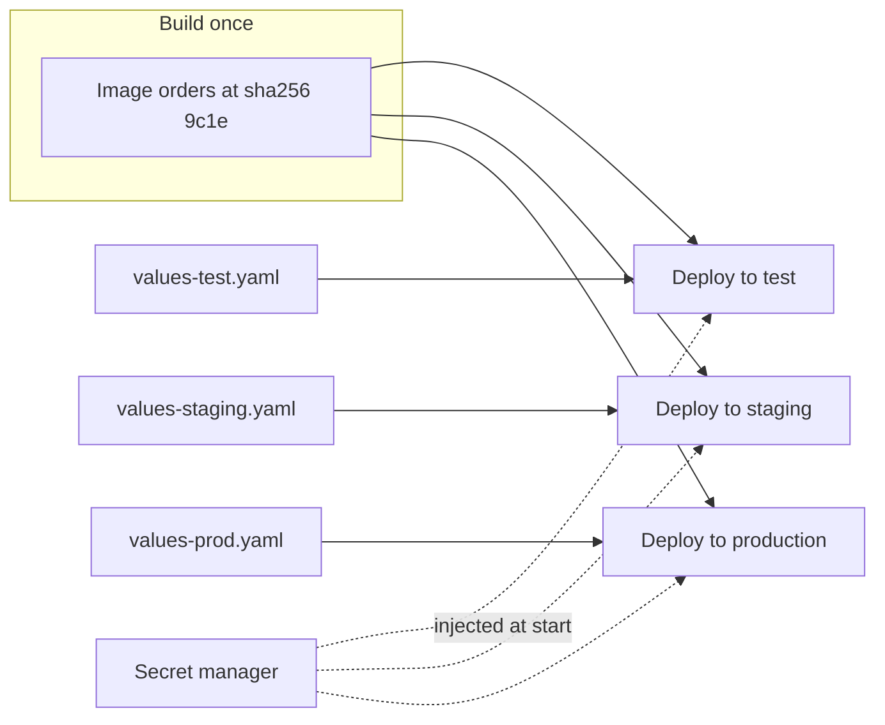

# Environments, configuration and secrets

> **Before this lesson:** read [Version control everything and pin your dependencies](#/lesson/cicd/version-everything). It introduces version control, dependencies and secrets.

## In plain words

A coffee machine of one model is sold all over the world. The machine is identical everywhere; what changes is the plug, the voltage setting and the language on the display. Nobody builds a different machine for each country.

Software should work the same way. The program is built once, and the things that differ between places — the address of the database, how many requests to handle at once, passwords — are supplied from outside. Those outside values are the program's **configuration**.

An **environment** is one complete place where the software runs: the developer's laptop, a test environment, the live system. A **secret** is a piece of configuration, such as a password, that would cause harm if it leaked.

Why this matters for a job: a wrong configuration value takes down production as surely as a bug does, and passwords accidentally published in code repositories are a regular cause of security incidents. "How do you manage configuration and secrets across environments?" is a standard interview question.

## Motivation: the one-line change that takes down production

Ask incident responders what caused their worst outages and "a configuration change" comes up as often as "a code change". A wrong hostname, a feature switched on in the wrong region, a connection pool set to 5 instead of 50, an expired certificate: none of these involve a compiler, and in many organisations none of them go through the checks that code goes through. Someone edits a value in a console and it is live.

That asymmetry is the problem this lesson addresses. Configuration can break a system as thoroughly as code can, and it is easier to change. So it deserves the same treatment: versioned, reviewed, tested, promoted through environments and auditable.

You will learn:

- what counts as configuration and when each kind is bound to the software,
- how to structure settings so that one artifact runs in every environment,
- how to validate configuration before it reaches production,
- how to handle secrets without putting them in Git,
- how to keep environments themselves under control.

## Configuration is the part that varies

An application's behaviour is determined by its code *plus* the values it reads when it starts or while it runs. Configuration is everything that legitimately differs between deployments of the same build:

- addresses and credentials of backing services (database, queue, cache, third-party APIs),
- resource sizing (pool sizes, timeouts, worker counts, memory limits),
- per-environment identity (hostnames, region, log level),
- behavioural switches (feature flags, limits, pricing tables).

A quick test for whether something is configuration or code: could the repository be made public right now without leaking a credential, and could the same binary be started in a different environment by changing only things outside the binary? If yes, the split is clean.

### When configuration gets bound

Values can be injected at four different moments, and the later the binding, the more flexible and the more dangerous it is.

| binding time | example | consequence |
|---|---|---|
| Build time | `--build-arg API_URL=...`, compile-time constants | A separate artifact per environment. Breaks "build once". Avoid for anything environment-specific. |
| Package time | values baked into an environment-specific image layer | Same problem in disguise. |
| Deploy time | environment variables, mounted config files, Helm values | One artifact, many environments. The default choice. |
| Run time | feature-flag service, dynamic config store polled by the app | Change behaviour without redeploying. Powerful; needs its own safety net. |

The guiding rule: **the artifact that was tested is the artifact that ships**, so nothing environment-specific may be compiled into it. Lesson 10 returns to this under the heading "build once".



> [!WARNING]
> Front-end builds are the classic trap. Bundlers inline variables such as `VITE_API_URL` or `NEXT_PUBLIC_*` at **build** time, so "the same image" for staging and production silently contains different JavaScript — or worse, the staging URL ships to production. Either serve a small runtime config file (`/config.json`) that the app fetches on start, or substitute placeholders when the container starts.

## Layered configuration

The cleanest structure is a set of defaults plus small per-environment overrides. Most values are the same everywhere; only the differences are written down per environment.

```yaml
# config/base.yaml  -- sensible defaults, safe for local development
http:
  port: 8080
  request_timeout_s: 5
db:
  pool_size: 10
  host: localhost
features:
  gift_cards: false
log_level: info
```

```yaml
# config/production.yaml  -- only what differs
db:
  pool_size: 50
  host: orders-db.internal
log_level: warn
```

The merge rule must be defined precisely, because subtle differences cause real bugs. The usual rule is a **deep merge**: dictionaries merge key by key recursively; any other value (number, string, list) in a later layer replaces the earlier one wholesale. Environment variables, if supported, form the top layer.

```python-run
import copy, json

def deep_merge(base, override):
    """Dicts merge recursively; everything else is replaced."""
    out = copy.deepcopy(base)
    for k, v in override.items():
        if isinstance(v, dict) and isinstance(out.get(k), dict):
            out[k] = deep_merge(out[k], v)
        else:
            out[k] = copy.deepcopy(v)
    return out

base = {"http": {"port": 8080, "request_timeout_s": 5},
        "db": {"pool_size": 10, "host": "localhost"},
        "features": {"gift_cards": False},
        "allowed_origins": ["http://localhost:3000"],
        "log_level": "info"}
production = {"db": {"pool_size": 50, "host": "orders-db.internal"},
              "allowed_origins": ["https://shop.example.com"],
              "log_level": "warn"}
env_vars = {"http": {"request_timeout_s": 8}}

effective = deep_merge(deep_merge(base, production), env_vars)
print(json.dumps(effective, indent=2))
print()
print("port kept from base      :", effective["http"]["port"])
print("timeout from env layer   :", effective["http"]["request_timeout_s"])
print("list replaced, not joined:", effective["allowed_origins"])
```

The last line is the pitfall to remember: lists are replaced, not concatenated. If production needs the base list plus one entry, it must restate the whole list. Tools differ here (Helm replaces lists; some libraries append), so check yours.

### Kubernetes flavour of the same idea

The same layering shows up in deployment tooling. With Kustomize, a `base/` directory holds the common manifests and each `overlays/<env>/` directory patches only what differs:

```yaml
# deploy/overlays/production/kustomization.yaml
apiVersion: kustomize.config.k8s.io/v1beta1
kind: Kustomization
resources:
  - ../../base
patches:
  - path: replicas.yaml          # 2 -> 6 replicas
configMapGenerator:
  - name: orders-config
    behavior: merge
    literals:
      - DB_POOL_SIZE=50
      - LOG_LEVEL=warn
images:
  - name: orders
    newName: registry.example.com/orders
    digest: sha256:9c1e4b7d0a52c5f1e2d3a4b5c6d7e8f9a0b1c2d3e4f5a6b7c8d9e0f1a2b3c4d5
```

With Helm it is a chart plus `values-production.yaml`. Either way, an environment is fully described by *artifact digest + config files at a commit*.

## Test your configuration

Configuration deserves tests for the same reason code does. Three cheap layers catch most mistakes.

**1. Schema validation at commit time.** Every environment's merged config is loaded and checked for required keys, types and ranges. This runs in the commit stage and takes milliseconds.

```python-run
SCHEMA = {
    "http.port":              (int, lambda v: 1 <= v <= 65535),
    "http.request_timeout_s": (int, lambda v: 1 <= v <= 30),
    "db.pool_size":           (int, lambda v: 1 <= v <= 200),
    "db.host":                (str, lambda v: len(v) > 0),
    "log_level":              (str, lambda v: v in {"debug", "info", "warn", "error"}),
}

def lookup(cfg, dotted):
    for part in dotted.split("."):
        if not isinstance(cfg, dict) or part not in cfg:
            return None, False
        cfg = cfg[part]
    return cfg, True

def validate(name, cfg):
    problems = []
    for key, (typ, ok) in SCHEMA.items():
        value, found = lookup(cfg, key)
        if not found:
            problems.append(f"missing {key}")
        elif not isinstance(value, typ) or isinstance(value, bool):
            problems.append(f"{key} should be {typ.__name__}, got {value!r}")
        elif not ok(value):
            problems.append(f"{key}={value!r} out of range")
    print(f"{name:<11}", "OK" if not problems else "FAIL: " + "; ".join(problems))

validate("staging",    {"http": {"port": 8080, "request_timeout_s": 5},
                        "db": {"pool_size": 20, "host": "db.stg"}, "log_level": "info"})
validate("production", {"http": {"port": 8080, "request_timeout_s": "5"},
                        "db": {"pool_size": 500}, "log_level": "verbose"})
```

**2. Fail fast at start-up.** The application parses and validates its whole configuration before accepting traffic, and exits with a clear message if anything is missing. A process that starts with a bad value and fails on the first request an hour later is much harder to diagnose. In a rolling deployment, failing at start means the new pods never become ready and the old ones keep serving.

**3. Smoke test after deployment.** A short script confirms that the deployed service can actually reach each dependency it is configured for: the database accepts a connection, the queue exists, the third-party endpoint answers. This catches values that are well-formed but wrong.

```bash
#!/usr/bin/env bash
set -euo pipefail
base="$1"
curl --fail --silent --max-time 5 "$base/healthz"            > /dev/null
curl --fail --silent --max-time 5 "$base/readyz?deep=true"   | grep -q '"db":"ok"'
echo "smoke test passed for $base"
```

## Secrets

A secret is configuration whose disclosure causes harm: database passwords, API tokens, signing keys, TLS private keys. It is managed like other configuration — versioned, per-environment, injected at deploy or run time — with one extra constraint: the *value* must never be readable in the repository, the image, the build log or the process list.

### Where secrets live

Keep the value in a system built for the job, and keep only a *reference* in Git.

| approach | how it works | good for |
|---|---|---|
| CI secret store | GitHub/GitLab encrypted secrets, exposed to selected jobs as variables | credentials the pipeline itself needs |
| Cloud secret manager | AWS Secrets Manager, GCP Secret Manager, Azure Key Vault; app or platform fetches at start | application secrets, with rotation and audit |
| HashiCorp Vault | central broker; can mint short-lived, per-client database credentials | dynamic secrets, multi-cloud |
| External Secrets Operator | a Kubernetes controller that syncs from a manager into `Secret` objects | Kubernetes workloads |
| Encrypted in Git | SOPS or Sealed Secrets; ciphertext is committed, a cluster or KMS key decrypts | GitOps, where Git must describe everything |

```yaml
# Git contains a reference, never the value
apiVersion: external-secrets.io/v1beta1
kind: ExternalSecret
metadata:
  name: orders-db
spec:
  refreshInterval: 1h
  secretStoreRef:
    name: aws-secrets
    kind: ClusterSecretStore
  target:
    name: orders-db            # the Kubernetes Secret that gets created
  data:
    - secretKey: password
      remoteRef:
        key: prod/orders/db
        property: password
```

### Principles for handling secrets

1. **Least privilege.** Each service gets its own credential with only the permissions it needs. The test environment's credentials cannot reach production data.
2. **Short-lived beats long-lived.** A token that expires in an hour limits the damage of a leak. Pipelines can obtain cloud credentials through OpenID Connect federation instead of storing a static key (Lesson 31 shows this).
3. **Rotation is routine.** If rotating a credential requires a redeploy and a prayer, it will not be done. Practise it.
4. **Never print them.** CI systems mask known secret values in logs, but a base64-encoded or JSON-wrapped secret slips past masking. Do not `echo` or `env` in a job that holds secrets.
5. **Never bake them into images.** A `COPY .env .` or an `ARG PASSWORD` leaves the value recoverable from image layers.

```dockerfile
# Wrong: the token is stored in an image layer and visible in `docker history`
ARG NPM_TOKEN
RUN echo "//registry.npmjs.org/:_authToken=${NPM_TOKEN}" > ~/.npmrc && npm ci

# Right: a BuildKit secret mount exists only for this one RUN and is never stored
RUN --mount=type=secret,id=npmrc,target=/root/.npmrc npm ci
```

```bash
docker build --secret id=npmrc,src=$HOME/.npmrc -t web:dev .
```

> [!INTERVIEW]
> "How do you manage secrets in a pipeline?" A complete answer covers four points: (1) values live in a secret manager, Git holds references; (2) the pipeline authenticates with short-lived federated credentials rather than stored keys; (3) access is scoped per environment and per service, with production secrets available only to the protected deploy job; (4) detection and response — secret scanning on push, masking in logs, and a practised rotation procedure.

## Managing the environments themselves

Application configuration is half of the picture. The environment the application lands in — OS image, runtime version, network rules, middleware settings, the versions of the services it talks to — is configuration too, and should be held to the same standard.

Two ideas carry most of the weight:

**Environments are created from definitions, not by hand.** If a test environment and production are produced by the same Terraform modules and the same base images with different parameters, their differences are visible in a diff. Hand-built environments diverge in ways nobody can list.

**Changes to environments go through a controlled path.** The same pull request, review and automated apply that changes application code should change infrastructure. Direct console or SSH changes are prevented by permissions where possible and detected (drift detection) where not. An emergency manual change is followed by a commit that makes the definition match reality, or by reverting the manual change.

It helps to write down, per environment, the baseline that makes it reproducible:

```yaml
# environments/staging.yaml  -- the whole truth about staging, at one commit
cluster:   { module: infra/modules/k8s, version: 1.31, node_count: 4 }
database:  { engine: postgres, version: "16.4", instance: db.m6g.large }
services:
  orders:   { image_digest: "sha256:9c1e...", config: deploy/values-staging.yaml }
  payments: { image_digest: "sha256:77ab...", config: deploy/values-staging.yaml }
external:
  payment_gateway: sandbox
```

How close should a test environment be to production? As close as you can afford in the dimensions that cause bugs: same OS and runtime versions, same topology *shape* (load balancer in front, more than one replica, a real database engine of the same version), same deployment mechanism. It can be smaller. It should not be different in kind.

## Pitfalls

- **A config repository with no pipeline.** Moving values into Git but applying them unreviewed and untested only moves the problem.
- **Per-environment code paths** such as `if env == "prod":`. They are untestable outside production. Express the difference as a named setting with a default.
- **Too much configurability.** Every option multiplies the states to test. Add a setting when two environments genuinely need different values, not "in case".
- **Secrets in environment variables that get dumped** by crash reporters or debug endpoints. Scrub them, or mount secrets as files.
- **Shared credentials across environments.** A leaked test credential then becomes a production incident.
- **Unvalidated dynamic config.** A runtime flag change is a deployment in all but name; give it review, gradual rollout and an audit trail.

## Summary

- Configuration is whatever differs between deployments of the same build; it can break production as easily as code, so it gets the same versioning, review and testing.
- Bind environment-specific values at deploy or run time, never at build time, so one tested artifact serves every environment.
- Use layered configuration: defaults plus small per-environment overrides with a clearly defined merge rule.
- Validate config with a schema in the commit stage, fail fast at start-up, and smoke test after deployment.
- Keep secret values in a secret manager, references in Git, credentials short-lived and narrowly scoped, and never in images or logs.
- Environments are built from versioned definitions and changed only through the pipeline.

## Glossary

- **Configuration** — the values that differ between deployments of the same program.
- **Environment** — one complete place where the software runs, such as test or production.
- **Environment variable** — a named value given to a program by the operating system when it starts.
- **Binding time** — the moment at which a configuration value is fixed: at build, at deployment or while running.
- **Deep merge** — combining nested settings layer by layer, with later layers overriding earlier ones.
- **Schema validation** — checking that configuration has the required keys, types and ranges.
- **Fail fast** — stopping immediately with a clear error instead of continuing in a broken state.
- **Smoke test** — a quick check, straight after deployment, that the service is working.
- **Secret** — a sensitive value such as a password, token or private key.
- **Secret manager** — a system built to store secrets and control who may read them.
- **Least privilege** — giving each program or person only the access it needs.
- **Rotation** — replacing a secret with a new one, routinely or after a leak.
- **Feature flag** — a setting that turns a piece of behaviour on or off without a new deployment.
- **Drift** — a difference between an environment and its written definition.

## Check yourself

```quiz
[
  {"q": "Why is injecting an environment-specific URL as a Docker build argument a problem?",
   "options": ["Build arguments are slow", "It produces a different artifact per environment, so the tested artifact is not the one deployed", "Docker does not support build arguments", "It makes the image larger"],
   "answer": 1,
   "explain": "Build-time binding forces one build per environment, breaking the guarantee that what was tested is what ships."},
  {"q": "In a typical deep merge of config layers, base has allowed_origins: [a, b] and the production layer has allowed_origins: [c]. What is the result?",
   "options": ["[a, b, c]", "[c]", "[a, b]", "An error"],
   "answer": 1,
   "explain": "Dictionaries merge recursively but lists and scalars are replaced wholesale by the later layer."},
  {"q": "What is the benefit of an application validating all its configuration at start-up and exiting on error?",
   "options": ["It uses less memory", "Bad config is detected before the instance takes traffic, so a rolling deploy halts with the old version still serving", "It removes the need for tests", "It hides the error from operators"],
   "answer": 1,
   "explain": "Failing fast turns a latent runtime failure into an immediate, obvious deployment failure that never reaches users."},
  {"q": "Which is the safest way to give a container build access to a private package registry token?",
   "options": ["ARG TOKEN in the Dockerfile", "COPY .npmrc into the image and delete it in a later layer", "A BuildKit secret mount used only in the RUN step that needs it", "Hard-code it in package.json"],
   "answer": 2,
   "explain": "ARG values and earlier layers remain recoverable from the image. A secret mount is never written to a layer."},
  {"q": "What should a Git repository contain for a production database password?",
   "options": ["The password in a YAML file", "The password base64-encoded", "A reference to the entry in a secret manager, or ciphertext that only the cluster can decrypt", "Nothing at all about it"],
   "answer": 2,
   "explain": "Git should describe where the secret comes from so the deployment is reproducible, without holding the readable value. Base64 is encoding, not encryption."},
  {"q": "Which statement about test environments is most accurate?",
   "options": ["They must be the same size as production", "They should match production in kind (versions, topology shape, deployment mechanism) even if smaller", "They should use a different database engine to find more bugs", "They do not need load balancers"],
   "answer": 1,
   "explain": "Differences in kind hide whole classes of bugs. Differences in scale are an acceptable cost saving for functional testing."},
  {"q": "Someone fixes an outage by editing a setting directly in the cloud console. What should happen next?",
   "options": ["Nothing, the outage is over", "The infrastructure definition is updated to match, or the manual change is reverted, so code and reality agree", "The console is uninstalled", "The change is documented only in chat"],
   "answer": 1,
   "explain": "Unrecorded manual changes are drift. The next automated apply would silently undo them, or the environment could no longer be reproduced."}
]
```

> **Source:** Humble & Farley, *Continuous Delivery*, ch. 2 (managing software configuration and environments). Docker build secrets: https://docs.docker.com/build/building/secrets/ — Kustomize: https://kubectl.docs.kubernetes.io/references/kustomize/ — External Secrets Operator: https://external-secrets.io
