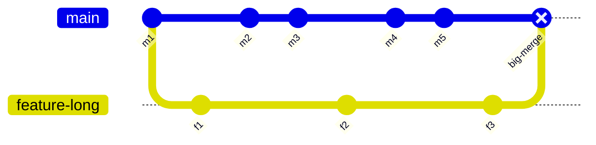
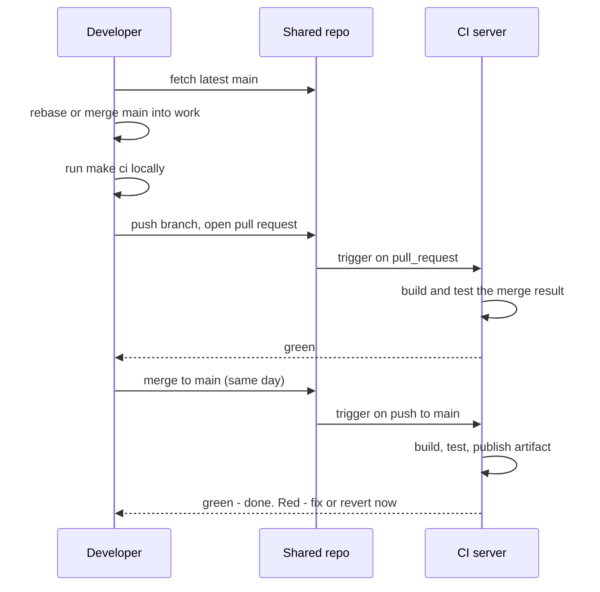

# Continuous integration: the practice, not the server

> **Before this lesson:** read [Version control everything and pin your dependencies](#/lesson/cicd/version-everything) for what a repository and a commit are. A **branch** — a separate line of work in the repository — is explained below.

## In plain words

Four people write one report. If each writes alone for a month and they paste everything together the night before the deadline, they find that two chapters contradict each other and the numbering is a mess. If they work in one shared document and read each other's additions every day, small disagreements are settled the same afternoon.

**Continuous integration** (CI) is the second way of working, applied to code. *To integrate* means to combine your changes with everyone else's. *Continuous* means doing it all the time — at least once a day — instead of in one painful session at the end.

The shared document is the **main branch** (also called *main*, *trunk* or the *mainline*): the one line of history everybody builds on. Every time someone adds to it, a computer automatically builds the software and runs its tests. That automatic run is called a **build**, and people say the build is **green** when it passes and **red** when it fails.

Why this matters for a job: CI is the foundation of every modern engineering team's daily routine. Interviewers check whether you understand that it is a *habit* — merge small changes often and fix failures at once — and not merely a tool that somebody installed.

## Motivation: integration is where the surprises live

Two developers each make a change that works. Alice renames `get_price()` to `price_for()` and updates every caller she can see. Bob, on his own branch, adds a new caller of `get_price()`. Each branch compiles and passes its tests. Merge them and the product is broken — and neither diff, reviewed alone, shows the bug.

That is an **integration defect**: it exists only in the combination. The longer two lines of work stay apart, the more of these accumulate and the harder each is to untangle, because by the time you find one, both authors have moved on and a hundred other changes sit on top.

Continuous integration (CI) is the practice that keeps this cost near zero. Its definition is short:

> Every developer merges their work into a shared main line at least once a day, and every merge is verified by an automated build and test run. When that run fails, fixing it is the team's top priority.

Notice what the definition does not mention: a product name. A team can have the fanciest CI server available and not be doing continuous integration, if people work on branches for two weeks and ignore red builds. Conversely, the practice was originally done with one spare machine and a rubber chicken to mark whose turn it was to integrate.

This lesson covers what you need to practise CI, how the loop works on a modern stack, and the supporting habits. The next lesson covers what to do when the build breaks.

## Why frequency changes everything

Think of the main line as the only true description of the product. Any work not yet merged is a private fork of reality, drifting away from it at the speed the rest of the team commits.



The number of possible conflicts between your branch and main grows with (changes on your side) × (changes on their side). Halving the time between merges roughly quarters that product. This simulation shows the effect:

```python-run
import random

def conflicts(days_between_merges, devs=6, files=400, edits_per_day=5, days=20, seed=1):
    """Count file-level overlaps discovered at merge time over a 20-day period."""
    rng = random.Random(seed)
    total = 0
    worst = 0
    for start in range(0, days, days_between_merges):
        touched = [set() for _ in range(devs)]
        for _ in range(days_between_merges):
            for d in range(devs):
                touched[d].update(rng.randrange(files) for _ in range(edits_per_day))
        batch = 0
        for a in range(devs):
            for b in range(a + 1, devs):
                batch += len(touched[a] & touched[b])
        total += batch
        worst = max(worst, batch)
    return total, worst

print(f"{'merge every':>12} {'overlaps in 20 days':>20} {'largest single merge':>21}")
for gap in (1, 2, 5, 10, 20):
    total, worst = conflicts(gap)
    print(f"{gap:>9} d   {total:>20} {worst:>21}")
```

Two things stand out. Total overlap goes up as the gap widens, and — more importantly — it arrives in a few enormous lumps instead of many trivial ones. A merge with three overlapping files is a five-minute conversation. A merge with three hundred is a week that nobody planned.

There is a second, quieter benefit. With frequent integration, the product is *known* to work at almost every point in time. Without it, the product is in an unknown state for most of the project, and "does it work?" can only be answered by stopping everything and finding out.

## The three prerequisites

**1. Everything in version control.** Code, tests, build scripts, schema migrations, pipeline definition (Lesson 3). CI verifies what is in the repository; anything outside it is unverified.

**2. An automated build that runs from the command line.** One command must take a clean checkout to a built, tested result with no human interaction and no IDE. If the build only works from a developer's editor, a server cannot run it.

```makefile
# Makefile -- the single entry point used by humans and by the CI server
.PHONY: ci lint test build

ci: lint test build        ## what the pipeline runs; run it locally before pushing

lint:
	ruff check src tests
	ruff format --check src tests

test:
	pytest -q --maxfail=1

build:
	docker build -t orders:$(shell git rev-parse --short HEAD) .
```

**3. Agreement from the team.** CI is a social contract: merge small and often, and fix the build first when it breaks. Without the agreement, the tooling is decoration.

## The loop, step by step

The original loop was performed by hand at the main line. On a modern platform, pull requests and automation perform the same steps, but it is worth seeing the logic underneath.



1. **Update first.** Bring main into your work before proposing it, so you test the combination, not your code in isolation.
2. **Run the commit build locally.** The same `make ci` the server runs. This catches most failures before anyone else is affected.
3. **Push and let the server verify.** The server is the neutral referee: a clean machine with no stray files, no locally installed tool, no uncommitted change. "Works on my machine" is settled here.
4. **Merge the same day.** A pull request that waits three days for review is a three-day branch.
5. **Watch the main-line build.** Your responsibility ends when the build of the merged commit is green, not when you click merge.

A minimal workflow that implements the server's side:

```yaml
# .github/workflows/ci.yml
name: ci
on:
  pull_request:
  push:
    branches: [main]

concurrency:
  group: ci-${{ github.ref }}
  cancel-in-progress: ${{ github.event_name == 'pull_request' }}

jobs:
  commit-stage:
    runs-on: ubuntu-latest
    timeout-minutes: 10
    steps:
      - uses: actions/checkout@v4
      - uses: astral-sh/setup-uv@v5
        with:
          enable-cache: true
      - run: uv sync --locked
      - run: make lint
      - run: make test
```

Line by line:

- `on: pull_request` builds every proposed change. By default GitHub checks out a *merge commit* of the branch with the current base, so you are testing the integrated result. `on: push` to `main` builds every commit that actually lands.
- `concurrency` cancels a superseded run on the same pull request when a new commit arrives, so the queue does not fill with obsolete builds. It does **not** cancel runs on `main`, because every main-line commit deserves a verdict.
- `timeout-minutes: 10` is a budget and a tripwire. If the commit stage creeps past ten minutes, the job fails and someone has to make it fast again.

> [!WARNING]
> A green pull-request check proves the branch worked against main *as it was when the check ran*. If other changes merged since, the combination is untested — this is called a **semantic merge conflict**, and it is exactly the Alice-and-Bob bug. Requiring branches to be up to date, or using a merge queue, closes the gap (Lesson 34).

## Supporting habits

### Keep the build fast

If the commit build takes forty minutes, people stop running it before pushing, batch their changes to avoid the wait, and start new work while it runs — so a failure interrupts something else. Aim for **under ten minutes, ideally under five** for the stage that gates merging. Slower, deeper tests move to later stages that run after merge (Module 5 and Module 7).

### Have a comprehensive automated test suite

A build that only compiles is checking syntax. CI's value is proportional to how much real behaviour the tests exercise. Three kinds matter here: *unit tests* (small, isolated, milliseconds each), *component or integration tests* (several pieces together, perhaps with a real database in a container), and *acceptance tests* (the running system against business scenarios). The fast ones gate the merge; the rest follow.

### Work in small steps

Frequent merging is impossible if every change is two thousand lines. Break work down so each step leaves the product working: introduce the new function, then switch callers over, then remove the old one. Hide incomplete user-facing features behind a flag rather than on a branch.

### Manage your workspace

Local development should start from a known-good state: pull main, run the build, see green, *then* start changing things. If the build is red before you begin, you cannot tell whether a later failure is yours. Developers need to be able to run the build and tests entirely locally, with dependencies supplied by the lockfile and, for services, by containers:

```yaml
# compose.yaml -- backing services for local tests, same versions as CI
services:
  db:
    image: postgres:16.4
    environment:
      POSTGRES_PASSWORD: dev-only
    ports: ["5432:5432"]
  cache:
    image: redis:7.4
    ports: ["6379:6379"]
```

### Practise test-driven development

Writing the test first is not required for CI, but it is the most reliable way to end up with the fast, comprehensive suite CI depends on. It also keeps changes small by construction: one failing test, the code to pass it, a refactor, commit.

## Making the build impossible to ignore: radiators and feedback devices

A red build in a web page nobody opens is a build nobody fixes. Teams therefore put the status where people cannot avoid it. Such a display is called an **information radiator**, a term from agile development: information that *radiates* to everyone walking past, like heat from a stove, without anyone having to go looking.

The simplest radiator is a wall-mounted monitor or television showing the pipelines of the team's projects: green for passing, red for failing, perhaps the name of the last committer and the time the build has been red. Some teams add an **extreme feedback device**: a physical object wired to the build status. Famous examples are a lava lamp that glows green and turns to a red one when the build fails, a USB traffic light on a desk, a coloured orb or desk light, or a siren for the brave. Their advantage is that they are felt rather than read: a red light in the corner of your eye changes behaviour without any conscious check.

The principle behind both is the same as the rest of this lesson: shorten the time between a mistake and the person who made it noticing.

Make a radiator work for you:

- **Show only what needs action.** Build state, test failures and the age of the current red are useful. A wall of vanity statistics is not.
- **Show staleness.** A radiator that has lost its connection and still shows the last green is worse than none. Have it turn grey or flash a warning if the feed has not updated recently.
- **Place it in the shared space**, visible from where people sit, not in a corner or in an inbox.
- **Avoid blame.** Showing the committer helps the quick fix; using it for shame teaches people to commit less often.
- **Do not rely on it alone.** A radiator supplements the notifications that go to the person who committed.

## What the CI server gives you beyond pass or fail

Once every commit is built on a neutral machine, several things come almost for free:

- **A single visible status** for the main line. Put it where people look: a chat notification on failure, a commit status badge, a dashboard on a wall screen.
- **History.** How long does the build take, and is it getting slower? Which tests fail most often? When did coverage drop?
- **Artifacts.** The server's build output, not a developer's, becomes the thing later stages test and deploy.
- **Reports** such as coverage, static analysis and dependency audits, produced on every commit without anyone remembering to run them.

Keep notifications meaningful. A message for every success becomes noise that hides the failure. Notify the author and the team channel when main goes red, and again when it returns to green.

## A worked example: finding the Alice-and-Bob bug in minutes

Replay the opening scenario with CI in place.

- **09:10** Alice merges the rename. Main is built: green.
- **09:40** Bob updates his branch from main before pushing, as the loop prescribes. His local `make test` fails with `AttributeError: get_price`. He fixes his new caller. Total cost: two minutes, one person, nobody else aware.

Suppose Bob skips the update and pushes:

- **09:42** The pull-request build checks out the merge of Bob's branch with current main and fails. Bob sees a red check on his own pull request. Cost: five minutes, still one person.

Suppose the team does none of this and both work on branches for three weeks:

- **Day 21** Both merge during "integration week" along with eleven other branches. The build fails with sixty errors. It takes two days to get a compiling product and a further week of testing to trust it.

Same defect, same developers. The only variable is how long the two changes were kept apart.

## Pitfalls

- **CI theatre.** A server builds each feature branch, but branches live for weeks. Nothing is being *integrated*. Measure branch lifetime; it should be hours to a day or two.
- **A build that depends on the server's state.** Tools installed by hand on a long-lived build agent, caches that are never cleared, tests that rely on files left by previous runs. Use fresh, ephemeral runners and declare every dependency.
- **Tests that are skipped "for now".** A skipped test protects nothing and is rarely restored. Track skips and treat a growing count as a defect.
- **Only building on a schedule.** A nightly build tells you that one of today's forty commits broke something. A per-commit build tells you which.
- **Letting pull requests queue.** Review latency is integration latency. Small changes get reviewed quickly; set an expectation such as "first response within a few working hours".
- **Treating warnings as harmless.** Decide what should fail the build (compiler warnings, lint errors, a coverage drop) and enforce it automatically, so the standard does not depend on a reviewer's mood.

> [!INTERVIEW]
> A favourite trap: "Your team uses GitHub Actions on every branch. Are you doing CI?" The right answer is "not necessarily". Ask three questions back: do all developers merge to main at least daily; does every merge trigger a build with meaningful tests; and when main is red, is it fixed (or reverted) within minutes? CI is defined by those behaviours.

> [!TIP]
> Make the local build and the server build literally the same command. When CI fails, the first debugging step should be "run `make ci` locally", and it should reproduce the failure. Every divergence between the two is a source of wasted hours.

## Summary

- Integration defects exist only in the combination of changes, and their cost grows with the time changes spend apart.
- CI is a team practice: merge to main at least daily, verify every merge automatically, fix a broken build before anything else.
- Prerequisites: everything in version control, a scripted build runnable from the command line, and team commitment.
- The loop is update, build locally, push, let a neutral server verify the merged result, merge quickly, and watch main.
- Keep the gating build under ten minutes, the test suite meaningful, changes small and workspaces reproducible.
- A CI tool running on long-lived branches is not continuous integration.

## Glossary

- **Integrate** — to combine your changes with everyone else's.
- **Continuous integration (CI)** — merging into the shared main line at least daily, with every merge verified automatically.
- **Branch** — a separate line of work in a repository.
- **Main (trunk, mainline)** — the shared branch everyone builds on.
- **Merge** — to combine one branch's changes into another.
- **Build** — the automated process of compiling, packaging and testing the code.
- **Green / red** — the build is passing / failing.
- **CI server** — the system that runs the build automatically for every change.
- **Integration defect** — a fault that exists only when two changes are combined.
- **Semantic merge conflict** — changes that merge without textual conflict but do not work together.
- **Pull request** — a proposed change, reviewed and checked before merging.
- **Unit test** — a fast test of one small piece of code in isolation.
- **Workflow** — in GitHub Actions, a file describing an automated process.
- **Runner** — the temporary machine on which CI jobs run.
- **Test-driven development** — writing a failing test first, then the code that makes it pass.
- **Information radiator** — A display placed where everyone passes, showing important status such as the state of the build
- **Extreme feedback device** — A physical object, such as a lava lamp or traffic light, that signals build status

## Check yourself

```quiz
[
  {"q": "Which statement is the best definition of continuous integration?",
   "options": ["Running a build server that compiles every branch", "Everyone merges to a shared main line at least daily, each merge is verified automatically, and a broken build is fixed immediately", "Deploying every commit to production", "Running all tests every night"],
   "answer": 1,
   "explain": "CI is defined by the merging frequency, automatic verification and the team's response to failure, not by the presence of a tool."},
  {"q": "Two branches each pass their own tests but the merged result is broken. What is this called?",
   "options": ["A flaky test", "A textual merge conflict", "A semantic merge conflict (integration defect)", "A dependency confusion attack"],
   "answer": 2,
   "explain": "Git merged the text cleanly, but the meaning of the combined code is wrong. Only building the combination reveals it."},
  {"q": "Why does the developer bring main into their work before pushing?",
   "options": ["To make the history linear for aesthetic reasons", "So that the tests they run locally exercise the combination of their change with everyone else's", "Because Git refuses pushes otherwise", "To increase the commit count"],
   "answer": 1,
   "explain": "Testing in isolation says nothing about integration. Updating first moves the discovery of conflicts to the cheapest possible point."},
  {"q": "Why should the build be runnable with a single command outside any IDE?",
   "options": ["IDEs are slow", "A server cannot click buttons; the same scripted build must run identically for developers and CI", "Command lines produce smaller binaries", "It is required by Git"],
   "answer": 1,
   "explain": "An automated, scripted build is a prerequisite: it lets a neutral machine verify every commit and lets developers reproduce failures."},
  {"q": "The commit build takes 45 minutes. What is the most likely behavioural consequence?",
   "options": ["Developers merge more often", "Developers batch changes and stop running the build before pushing", "Tests become more reliable", "Fewer integration defects"],
   "answer": 1,
   "explain": "Slow feedback pushes people towards larger, rarer merges, which is the opposite of CI. Keep the gating build to a few minutes."},
  {"q": "In the sample workflow, why are in-progress runs cancelled for pull requests but not for pushes to main?",
   "options": ["Main builds are cheaper", "A superseded pull-request commit no longer matters, but every commit that landed on main needs its own verdict", "GitHub does not allow cancelling main builds", "To save artifacts"],
   "answer": 1,
   "explain": "If main breaks you need to know which commit did it, so each one is built. Obsolete pull-request commits can be skipped safely."},
  {"q": "A team builds every feature branch on a CI server, and branches typically live three weeks. Are they practising CI?",
   "options": ["Yes, every branch is built", "No, their work is not being integrated with each other's until the branches merge", "Yes, as long as the builds are green", "Only if they also deploy"],
   "answer": 1,
   "explain": "Building isolated branches verifies each in isolation. Integration, by definition, requires merging into the shared line frequently."},
  {"q": "What is the main idea of an information radiator?", "options": ["Keeping reports in a database", "Putting important status where people see it without having to look for it", "Sending an email to the manager", "Hiding red builds"], "answer": 1, "explain": "It radiates to anyone passing, so a failing build cannot be ignored."},
  {"q": "Why should a build radiator show when its data was last updated?", "options": ["For decoration", "So a disconnected display does not keep showing a stale green", "To make builds faster", "Because browsers require it"], "answer": 1, "explain": "A frozen green display misleads everyone. Showing staleness exposes a broken feed."}
]
```

> **Source:** Humble & Farley, *Continuous Delivery*, ch. 3 (continuous integration: prerequisites and practices). GitHub Actions workflow syntax (`on`, `concurrency`, `timeout-minutes`): https://docs.github.com/en/actions/writing-workflows/workflow-syntax-for-github-actions
