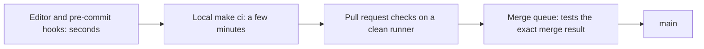
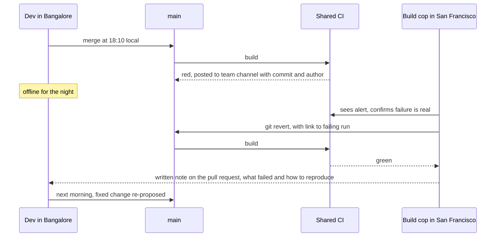

# Broken builds, team discipline and distributed teams

> **Before this lesson:** read [Continuous integration: the practice, not the server](#/lesson/cicd/ci-practices), which explains what a build is and what green and red mean.

## In plain words

A factory production line has a cord that any worker can pull to stop the line when they see a defect. It sounds wasteful. It is the reason the factory's products are good: a fault is fixed where it started, before a hundred more items are built on top of it.

In a software team, the production line is the shared **main branch**, and the alarm is a **red build** — the automatic tests failing. This lesson is about the agreement a team makes on what to do when that alarm sounds. The short version: fixing it comes before everything else, and the quickest fix is usually to undo the change that caused it, which is called a **revert**.

The second half of the lesson covers **distributed teams**: people spread across offices and time zones, who cannot lean over a desk and say "you broke the build".

Why this matters for a job: every team breaks the build sometimes. What interviewers and colleagues watch is how you respond — whether you unblock everyone quickly or leave them waiting while you investigate.

## Motivation: a signal is only as good as the response to it

A smoke detector that beeps every night gets its battery removed. A build that is red for days gets the same treatment: people stop looking, merge on top of the failure, and the one thing CI was meant to provide — a trustworthy answer to "does the product work right now?" — is gone.

The technical side of continuous integration is easy to set up in an afternoon. What separates teams that benefit from it and teams that merely pay for it is a handful of agreed behaviours around failure. This lesson states those behaviours, explains the reasoning for each, shows how modern platforms enforce several of them automatically, and then looks at how the practice survives when the team is spread across time zones.

## Why a red main line is an emergency

When main is broken, three bad things happen at once:

1. **Everyone who pulls gets a broken base.** Their local failures may be theirs or may be inherited; they cannot tell without investigating.
2. **New failures hide behind the old one.** If the build is already red, a second defect merged an hour later produces no new signal. When someone finally fixes the first, the second surfaces with no obvious author.
3. **Nothing can be released.** The latest good artifact gets older by the minute, and an urgent fix has no clean base to ship from.

The cost therefore grows with both the *duration* of the breakage and the *size of the team*. A simple model:

```python-run
def cost_of_red(minutes_red, devs, commits_per_dev_hour=0.5, investigate_min=15):
    """Rough person-minutes lost while main is broken."""
    hours = minutes_red / 60
    pulls = devs * commits_per_dev_hour * hours          # people who sync onto a red base
    wasted_investigation = pulls * investigate_min
    stacked = max(0, pulls - 1)                          # commits landing on top of the break
    hidden_defects = stacked * 0.05                      # 5% of those carry their own failure
    untangle = hidden_defects * 60
    return wasted_investigation + untangle

print(f"{'red for':>9} {'5 devs':>10} {'20 devs':>10} {'80 devs':>10}   (person-minutes)")
for minutes in (10, 30, 120, 480, 1440):
    row = [cost_of_red(minutes, d) for d in (5, 20, 80)]
    print(f"{minutes:>6} min" + "".join(f"{c:>11.0f}" for c in row))
```

The numbers are illustrative, but the shape is right: ten minutes of red is cheap for any team; a day of red in a large team burns person-weeks. This is why the rules below all point the same way — **minimise time-to-green**.

## The essential rules

### 1. Do not merge on top of a broken build

If main is red, the only changes that should land are the ones that fix it. Anything else makes the cause harder to isolate and extends the outage. On a platform with required status checks this is partly automatic: a pull request cannot merge unless its own checks pass, and with a merge queue, a red queue stops delivering.

### 2. Run the commit checks before you push — or have a machine do it for you

The cheapest broken build is the one that never reaches main. There are three levels of protection, and mature teams use all of them:



A *pre-tested* or *gated* commit means the server verifies your change against the current main line **before** it is allowed in, rather than discovering the problem afterwards. Pull requests with required checks are the everyday form; merge queues are the strict form.

```yaml
# .pre-commit-config.yaml -- fast checks before a commit is even created
repos:
  - repo: https://github.com/astral-sh/ruff-pre-commit
    rev: v0.6.9
    hooks:
      - id: ruff
        args: [--fix]
      - id: ruff-format
  - repo: https://github.com/gitleaks/gitleaks
    rev: v8.21.0
    hooks:
      - id: gitleaks
```

### 3. Wait for your change to go green before moving on

After merging, stay with the change until the main-line build reports success. If it fails you are the best-placed person to fix it, the context is fresh, and you have not yet started something that the failure would interrupt. With a five-minute commit stage this is a coffee, not a cost.

### 4. Do not leave with the build broken

The end of the working day is the worst time to merge something risky, because the people who inherit the breakage are in another time zone or arrive next morning to a red main. Two practical consequences:

- Merge early and often rather than in one push at 17:55.
- If you break the build and cannot fix it promptly, revert before you go.

### 5. Always be ready to revert, and time-box the fix

The most important rule in this lesson. When the build breaks you have two options: fix forward, or return main to the last known-good state. The discipline is to **time-box the fix** — ten minutes is a common limit — and revert when the box expires.

```bash
# main went red at 4c1d2aa ("feat: bulk discount rules")
git switch main && git pull
git revert --no-edit 4c1d2aa      # creates a new commit that undoes it
git push                          # goes through the normal pipeline

# for a merged pull request (a merge commit), say which parent is the main line:
git revert -m 1 <merge-commit-sha>
```

Reverting is not an admission of failure and not a judgement on the author. It restores service for everyone else in one cheap, safe operation, and the author can then debug calmly on a branch with no audience. Module 17 expands this into a team-wide "revert first" policy.

> [!WARNING]
> Never fix a broken main with `git push --force` or by rewriting history. Other people have already pulled the broken commit; rewriting leaves their clones inconsistent and destroys the audit trail. `git revert` adds a commit, which is always safe on a shared branch.

### 6. Do not comment out or skip failing tests

A test fails for one of three reasons, and each has a proper response:

| cause | response |
|---|---|
| The code has a regression | fix the code |
| The intended behaviour changed and the test is outdated | update or delete the test deliberately, in the same change |
| The test is unreliable (passes and fails on the same code) | quarantine it visibly with an owner and a deadline, then fix it |

Disabling a test to get a green build removes the alarm and leaves the fire. If skipping is ever necessary, make it noisy and tracked:

```python
import pytest

@pytest.mark.skip(reason="FLAKY-312: race in fixture teardown; owner=@dana; remove by 2026-12-01")
def test_refund_emits_event(): ...
```

A CI job can then fail if a skip has no ticket reference or is past its date.

### 7. Own the consequences of your change

If your commit makes someone else's test fail, it is your job to sort it out — either fix your change or work with the test's owner — not theirs to notice later. This is why the build must cover the whole product: you need to see the effect of your change on code you did not touch.

## Rules worth adopting once the basics hold

**Fail the build when the commit stage gets slow.** A time budget enforced by the pipeline (`timeout-minutes`) prevents the gradual slide from four minutes to forty.

**Fail the build on warnings and style violations.** Either a warning matters, in which case it should block, or it does not, in which case switch it off. A build that prints nine hundred warnings hides the one that matters.

**Fail the build on architectural breaches.** Automated rules such as "the `domain` package must not import from `web`" keep the structure honest far better than periodic reviews.

```toml
# pyproject.toml -- import-linter contract checked in CI
[tool.importlinter]
root_package = "orders"

[[tool.importlinter.contracts]]
name = "Layers"
type = "layers"
layers = ["orders.web", "orders.application", "orders.domain"]
```

**Ratchet quality metrics.** Rather than demanding 90% coverage on a legacy codebase overnight, record today's number and fail only if a change makes it worse. The bar then rises on its own.

## Roles: who watches the build?

On a small team, whoever broke the build fixes it and everyone can see the status. As teams grow, a failure on main can sit unowned because each person assumes someone else is on it. Two patterns help:

- **Automatic attribution.** The failure notification names the commit range and the authors, and is posted where the team already talks.
- **A rotating build cop** (also called build sheriff). One person per day or week has the explicit job of noticing a red main within minutes, identifying the suspect change, and reverting it if the author does not respond quickly. The role is a rotation, not a punishment, and its authority to revert is agreed in advance.

```yaml
# notify the team channel only when main turns red
  notify:
    needs: [commit-stage]
    if: ${{ failure() && github.ref == 'refs/heads/main' }}
    runs-on: ubuntu-latest
    steps:
      - name: Post failure to chat
        run: |
          curl -sS -X POST -H 'Content-Type: application/json' \
            --data "{\"text\":\"main is RED at ${GITHUB_SHA::7} by ${GITHUB_ACTOR}. Run: ${GITHUB_SERVER_URL}/${GITHUB_REPOSITORY}/actions/runs/${GITHUB_RUN_ID}\"}" \
            "$CHAT_WEBHOOK_URL"
        env:
          CHAT_WEBHOOK_URL: ${{ secrets.CHAT_WEBHOOK_URL }}
```

> [!TIP]
> Track two numbers for main: the percentage of time it is green, and the median time from red to green. They are the health indicators of your CI culture, and they improve quickly once someone is looking at them.

## Distributed teams

Co-located teams repair a build with a shout across the room. When contributors are spread over sites and time zones, three things get harder: knowing the build broke, knowing who should act, and acting when the author is asleep.

### What changes, and what to do about it

**Communication becomes asynchronous.** Replace hallway knowledge with durable, automatic signals: status in chat, failure notifications that name commits, a dashboard everyone can load. Decisions about the build ("we reverted X because Y") go in writing where the next shift will see them.

**The author may be offline.** This is the strongest argument for revert-first. Agree explicitly that anyone may revert a change that breaks main, without waiting for permission, and that a revert is routine. Otherwise a commit merged in Bangalore at their 18:00 blocks San Francisco for a full working day.

**One shared pipeline, not one per site.** Every location must integrate into the same main line and be judged by the same build. Separate per-site CI systems with a periodic sync recreate the integration problem at a larger scale.

**Infrastructure must be reachable and fast from everywhere.** A repository or artifact store that is slow from one site quietly discourages that site from committing often. Use hosted, globally available services, regional caches or mirrors for dependencies, and the same reproducible build environment (containers) so results do not differ by location.



### When direct merging is not possible

Some contributors cannot push to main at all: open-source contributors, vendors, or teams separated by a network boundary. The practice adapts:

- Contributors work in **forks** and propose changes as pull requests; the project's CI builds the proposal. Note the security model: workflows triggered by pull requests from forks should run without access to repository secrets, because the code under test is untrusted.
- Changes are kept small and rebased frequently on the upstream main, so that the fork never drifts far.
- Maintainers merge promptly; a patch queue that waits weeks is long-lived branching by another name.

A distributed version control system such as Git makes these workflows easy, and that ease is double-edged. Being able to commit locally and branch cheaply does not change the definition of integration: until work reaches the shared main line and is built there, it is not integrated.

## A worked example: a red build handled well and badly

**Handled badly.** At 16:40 a change lands that breaks a serialisation test. The author is in a meeting. Two colleagues notice the red badge, assume it is being handled, and merge their own work. At 18:00 the author leaves without checking. Overnight, the other site pulls main, loses an hour deciding the failure is not theirs, and commits on top. By the next afternoon there are fourteen commits on the red base; fixing the original test reveals two more failures of unknown origin. Total: main red for 22 hours, roughly three person-days lost, no artifact releasable.

**Handled well.** At 16:40 the change lands. At 16:45 the main build fails and a message names the commit and author. The build cop pings the author; no reply by 16:55. The build cop reverts at 16:56, linking the failing run. Main is green at 17:01. The author returns, reproduces the failure locally in ten minutes, and re-proposes a corrected change the next morning. Total: main red for 16 minutes, about half an hour of effort, and a releasable artifact throughout.

The technology is identical in both stories. The difference is entirely in the agreed rules.

## Pitfalls

- **Blame.** If breaking the build is treated as shameful, people respond by merging less often — precisely the wrong adaptation. Breaking the build occasionally is a sign of working at a healthy pace; leaving it broken is the problem.
- **"It's just a flaky test, re-run it."** Sometimes true, and corrosive when habitual. Each re-run without investigation teaches the team that red does not mean broken.
- **Fix-forward heroics.** Forty minutes of increasingly desperate commits ("fix", "fix again", "really fix") while everyone waits. Revert, then think.
- **Disabling protection for convenience.** Admin overrides of required checks "just this once" tend to coincide with incidents.
- **No owner outside office hours.** Decide who responds when the main build fails at 03:00 UTC, or accept and state that the answer is "the first person online, by reverting".

> [!INTERVIEW]
> "Main is red and the author says they'll have a fix in an hour. What do you do?" Expected answer: revert now. An hour of red blocks every other engineer and hides further breakages. The revert is cheap and loses nothing; the author re-lands the change with the fix. Then mention prevention: why did the pull-request checks not catch it — stale branch, missing test, or a flaky check that was ignored?

## Summary

- A CI signal is only valuable if a red build triggers an immediate response; the governing goal is the shortest possible time-to-green.
- Core rules: no merging on red, check before pushing (ideally with gated merges), wait for green, do not leave it broken, time-box fixes and revert, never silence failing tests, own the downstream effects of your change.
- Reverting is the default recovery because it is fast, safe on a shared branch and independent of the author's availability.
- As teams grow, add automatic attribution and a rotating build cop with pre-agreed authority to revert.
- Distributed teams need one shared main line and pipeline, written asynchronous signals, fast access to infrastructure from every site, and an explicit revert-first agreement.

## Glossary

- **Red build** — the automated build or tests are failing.
- **Time to green** — how long the main branch stays broken before it passes again.
- **Revert** — a new commit that undoes an earlier commit.
- **Time-box** — to set a fixed limit on how long you will try something before switching approach.
- **Force push** — overwriting a branch's history on the server; unsafe on shared branches.
- **Pre-commit hook** — a script that runs on the developer's machine before a commit is created.
- **Gated (pre-tested) commit** — a change that the server tests against the current main line before letting it in.
- **Merge queue** — a system that tests each change with those ahead of it before merging.
- **Flaky test** — a test that can pass and fail on the same code.
- **Quarantine** — taking an unreliable test out of the blocking set while still tracking it.
- **Ratchet** — a rule that a quality measure may improve but never get worse.
- **Build cop (build sheriff)** — the person currently responsible for noticing and dealing with a red main.
- **Distributed team** — a team spread across locations or time zones.
- **Fork** — a personal copy of a repository, from which changes are proposed.

## Check yourself

```quiz
[
  {"q": "Why is merging new work onto a red main line harmful?",
   "options": ["It uses extra CI minutes", "New failures are masked by the existing one and the original cause becomes harder to isolate", "Git forbids it", "It lowers code coverage"],
   "answer": 1,
   "explain": "A build that is already failing cannot signal an additional defect. Those hidden failures surface later with no clear author."},
  {"q": "The build broke five minutes ago and the author thinks a fix will take about an hour. What is the recommended action?",
   "options": ["Wait for the fix", "Revert the change now and re-land it with the fix later", "Skip the failing test", "Force-push main back to the previous commit"],
   "answer": 1,
   "explain": "Time-box and revert. It restores a green base for everyone in minutes, and nothing is lost because the change can be re-proposed."},
  {"q": "Why is `git revert` preferred over `git push --force` to undo a bad commit on main?",
   "options": ["Revert is faster to type", "Revert adds a new commit and keeps shared history intact, while force-pushing rewrites history others have already pulled", "Force-push is disabled in Git", "Revert deletes the bad commit permanently"],
   "answer": 1,
   "explain": "Rewriting a shared branch breaks other clones and removes the audit trail. A revert is an ordinary, safe, reviewable commit."},
  {"q": "A test fails intermittently on unchanged code. What is the proper response?",
   "options": ["Delete it silently", "Comment it out", "Quarantine it visibly with an owner and deadline, then fix the cause", "Re-run until it passes and move on"],
   "answer": 2,
   "explain": "Unreliable tests erode trust, but silently removing them loses coverage. A tracked quarantine keeps the signal clean and the problem owned."},
  {"q": "What is the role of a build cop?",
   "options": ["To approve every pull request", "To notice a red main quickly, identify the suspect change and get it fixed or reverted", "To write all the tests", "To punish developers who break the build"],
   "answer": 1,
   "explain": "It is a rotating responsibility that prevents the bystander effect on larger teams, with agreed authority to revert."},
  {"q": "For a team split between two distant time zones, which arrangement best preserves CI?",
   "options": ["Each site has its own main branch, synchronised weekly", "One shared main line and pipeline, with anyone allowed to revert a breaking change", "Only one site is allowed to merge", "Builds run once per day when both sites overlap"],
   "answer": 1,
   "explain": "Separate main lines defer integration. A single line with an explicit revert-first agreement keeps the build green regardless of who is awake."},
  {"q": "What does 'ratcheting' a quality metric such as coverage mean?",
   "options": ["Requiring 100% immediately", "Failing the build only if a change makes the metric worse than its recorded baseline", "Measuring it once a year", "Ignoring it on legacy code"],
   "answer": 1,
   "explain": "A ratchet prevents regression without demanding an unrealistic one-off jump, so quality rises gradually."},
  {"q": "Why should pull requests from forks run without access to repository secrets?",
   "options": ["Forks cannot run workflows", "The code under test is untrusted and could exfiltrate the secrets", "Secrets slow down the build", "It makes the checks pass more often"],
   "answer": 1,
   "explain": "Anyone can open a fork pull request containing arbitrary code. Running it with credentials would hand those credentials to the author."}
]
```

> **Source:** Humble & Farley, *Continuous Delivery*, ch. 3 (essential and suggested CI practices, distributed teams). pre-commit framework: https://pre-commit.com — GitHub Actions status functions such as `failure()`: https://docs.github.com/en/actions/writing-workflows/choosing-what-your-workflow-does/evaluate-expressions-in-workflows-and-actions
