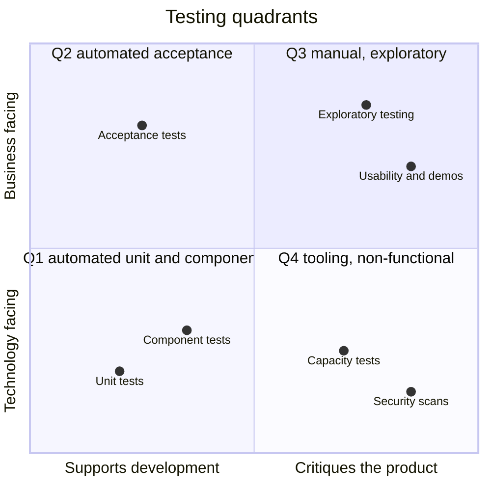
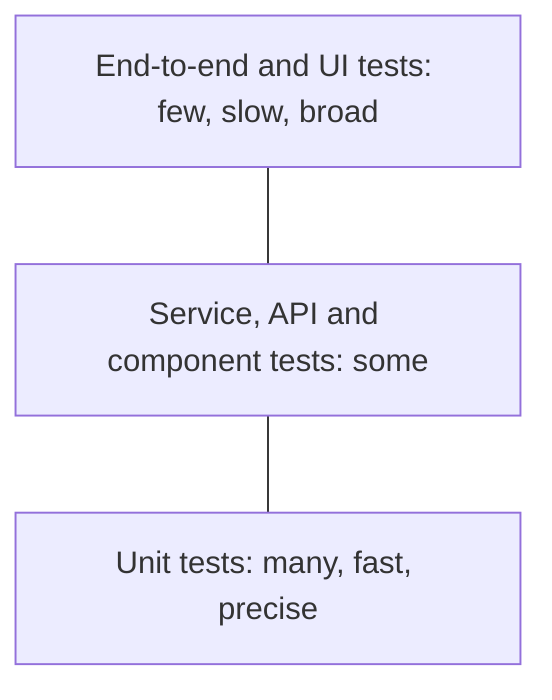
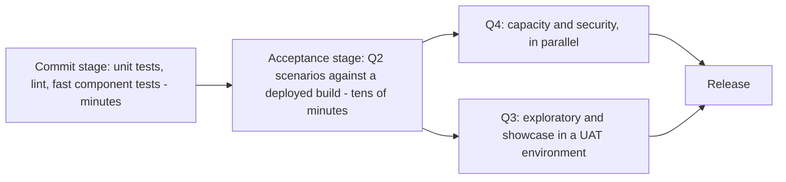

# Testing quadrants and the test pyramid

> **Before this lesson:** read [Continuous integration: the practice, not the server](#/lesson/cicd/ci-practices). You should know that an automated test is a small program that checks another program.

## In plain words

Before a car is sold it is checked in several different ways. Each bolt is checked as it is fitted. The assembled engine is run on a bench. A driver takes the finished car round a track. A crash test finds out what happens when things go wrong. Nobody would test a car only by crash-testing it, or only by checking bolts.

Software also needs several kinds of test, and this lesson gives you two maps for choosing them. The **testing quadrants** sort tests by *purpose*: who the test is for and what question it answers. The **test pyramid** tells you *how many* of each kind to have: many small, fast tests at the bottom and a few large, slow ones at the top.

Three kinds appear throughout. A **unit test** checks one small piece of code by itself. An **integration** (or **component**) **test** checks several pieces working together. An **end-to-end test** checks the whole running system the way a user would use it.

Why this matters for a job: "how would you test this?" is asked in nearly every engineering interview. A structured answer — which risks, which kind of test for each, how many, where in the pipeline — is what distinguishes experience from guesswork.

## Motivation: "we have tests" is not a strategy

Two teams both say they have good test coverage. The first has four thousand unit tests that run in ninety seconds and a few dozen end-to-end checks; they release daily. The second has six hundred browser-driven tests that take five hours, fail at random a few times per run, and are re-run until green; they release monthly, after a manual regression cycle.

Both have "automated tests". Only one has a testing *strategy* — a deliberate answer to the questions: what kinds of risk do we need to cover, which kind of test covers each one most cheaply, who writes it, and where in the pipeline does it run?

A deployment pipeline is, at heart, a sequence of tests arranged by cost. If the test portfolio is the wrong shape, no amount of pipeline engineering will make feedback fast or trustworthy. This lesson gives you two models for thinking about the shape: the **testing quadrants**, which classify tests by purpose, and the **test pyramid**, which tells you how many of each to have.

## The testing quadrants

The quadrant model (due to Brian Marick, popularised by Lisa Crispin and Janet Gregory) sorts tests along two axes:

- **Business-facing vs technology-facing.** Is the test expressed in the language of the domain ("a returning customer gets free shipping") or of the implementation ("`ShippingPolicy.rate()` returns 0 when `orders > 0`")?
- **Supporting development vs critiquing the product.** Does the test guide the team while building — telling them when a piece is done and guarding it afterwards — or does it evaluate the finished thing looking for what nobody anticipated?



| | supports development | critiques the product |
|---|---|---|
| **business-facing** | **Q2** functional acceptance tests — automated | **Q3** showcases, usability, exploratory testing — manual |
| **technology-facing** | **Q1** unit, component, deployment tests — automated | **Q4** capacity, security, availability tests — automated with special tools |

### Q2: business-facing tests that support development

These are **acceptance tests**: they check that a story's acceptance criteria are met by the running system. They answer "have we built what was asked?" and, once passing, become regression tests that answer "does it still work?".

Good acceptance criteria follow a *given–when–then* shape, which maps directly on to an automated test:

```gherkin
Feature: Free shipping for returning customers

  Scenario: A customer with a previous order pays no shipping
    Given a customer who has completed one order
    And a cart containing a 30 EUR item
    When the customer checks out
    Then the shipping charge is 0 EUR

  Scenario: A new customer pays standard shipping
    Given a customer with no previous orders
    And a cart containing a 30 EUR item
    When the customer checks out
    Then the shipping charge is 4.90 EUR
```

Each story should have at least one **happy path** (the canonical success), and selected **alternate paths** (valid variations) and **sad paths** (errors and rejections). Alternate and sad paths are far more numerous, so be selective at this level; exhaustive combinations belong in unit tests.

Acceptance tests are valuable to several people at once: developers get an unambiguous target, testers get regression safety and are freed from repetitive checking, and the customer gets confidence that requirements are met. They are also expensive to write and maintain, so it is legitimate not to automate every criterion. Automate what is stable, valuable and checkable by a machine; leave look-and-feel and one-off checks to people.

### Q1: technology-facing tests that support development

Written and owned by developers, these come in three sizes:

- **Unit tests** exercise one small piece in isolation — no database, no network, no file system, no clock. Thousands should run in seconds.
- **Component tests** (often called integration tests) exercise a larger cluster of code, possibly with a real database or message broker in a container. Slower, but they catch wiring mistakes that units miss.
- **Deployment tests** run after each deployment to confirm the application is installed, configured and able to reach its dependencies.

### Q3: business-facing tests that critique the product

Things a machine cannot judge. **Showcases** put working software in front of users to check that what was specified is what they actually want. **Exploratory testing** is skilled, creative investigation: a tester learns the system and designs experiments on the fly, finding the bugs nobody thought to write a test for. **Usability testing** watches real people attempt real tasks. Modern additions that belong here include beta programmes and controlled experiments (A/B tests) behind feature flags.

Automating the repetitive regression work in Q2 is precisely what frees testers to spend time on Q3, where human judgement adds the most.

### Q4: technology-facing tests that critique the product

Non-functional qualities: capacity, performance under load, security, availability, recoverability. These need special tools (load generators, vulnerability scanners, chaos experiments) and usually a production-like environment. They are frequently postponed to the end of a project; a pipeline lets you run at least a basic version on every candidate build (Module 9).

> [!TIP]
> Use the quadrants as a gap-finder. Draw the grid on a whiteboard and list what the team actually does in each cell. Empty cells are unmanaged risks. A team with a rich Q1 and nothing in Q2 builds the thing right but may not build the right thing; a team with only Q3 depends on slow, expensive manual cycles.

## The test pyramid

The quadrants say *what kinds* of test exist. The pyramid (Mike Cohn's model) says *how many* of each to write.



The reasoning comes from three properties that all get worse as you move up:

| property | unit | service / component | end-to-end |
|---|---|---|---|
| time per test | ~1 ms | ~100 ms – 1 s | ~10 s – minutes |
| diagnosis when it fails | points at one function | points at one service | "something, somewhere" |
| chance of a false failure | negligible | low | noticeable (timing, network, data) |
| confidence that the whole works | low per test | medium | high |

So the cheapest way to buy confidence is to cover as much behaviour as possible at the lowest level that can express it, and use the higher levels only for what cannot be tested lower down: that the pieces are wired together correctly and the key user journeys work.

The economics are easy to see with numbers:

```python-run
levels = {            # seconds per test, false-failure probability per test
    "unit": (0.002, 0.00001),
    "service": (0.4, 0.0005),
    "e2e": (25.0, 0.005),
}

def suite(name, counts, workers=1):
    seconds = sum(levels[k][0] * n for k, n in counts.items()) / workers
    p_all_clean = 1.0
    for k, n in counts.items():
        p_all_clean *= (1 - levels[k][1]) ** n
    total = sum(counts.values())
    print(f"{name:<22} tests={total:>5}  runtime={seconds / 60:7.1f} min  "
          f"P(false red on a good commit)={1 - p_all_clean:6.1%}")

suite("pyramid",           {"unit": 4000, "service": 300, "e2e": 25})
suite("ice-cream cone",    {"unit": 200,  "service": 100, "e2e": 600})
suite("cone, 20 runners",  {"unit": 200,  "service": 100, "e2e": 600}, workers=20)
```

Read the last column. With six hundred end-to-end tests, each only half a percent unreliable, almost every run of a perfectly good commit shows at least one red test. Parallel runners shorten the wait but do nothing for the false alarms. This is how teams arrive at the habit of "just re-run it", and from there to ignoring failures altogether.

### Shapes that go wrong

- **Ice-cream cone.** Mostly UI tests, a thin layer of unit tests, and a large scoop of manual testing on top. Slow, flaky, expensive. Usually the result of testing being added by a separate team after the code was written.
- **Hourglass.** Many unit tests, many end-to-end tests, almost nothing in the middle. Wiring bugs are caught only by the slow tests.
- **Cupcake.** Developers, testers and manual QA each test the same behaviour independently at different levels, tripling the cost.

Other shapes are legitimate for particular architectures. A front-end heavy application or a system of thin services glued to managed infrastructure may put more weight in the middle (the "testing trophy" or "honeycomb"), because most of its risk is in integration. The principle underneath stays constant: **push each check down to the cheapest level that can detect the defect.**

## Mapping tests on to the pipeline

The two models combine into the stage layout you will see for the rest of this track:



Fast, precise tests run first and gate merging. Slow, broad tests run on builds that survived the fast ones. Manual, judgement-based testing happens on builds that passed everything automated, so no human time is spent on a build a machine could have rejected.

## Worked example: where should each check live?

A checkout service applies discount codes. The rules: a code has an expiry date, a minimum basket value, and may be percentage or fixed-amount; the total can never go below zero. Suppose you want to cover these behaviours:

1. A fixed 10 EUR discount on an 8 EUR basket gives a total of 0, not −2.
2. An expired code is rejected with a clear message.
3. Percentage discounts round to the nearest cent, half up.
4. The discount is actually stored on the order row.
5. The checkout page shows the discounted total and the customer can pay.
6. The service copes with 300 checkouts per second.

A sensible allocation:

| behaviour | level | why |
|---|---|---|
| 1, 2, 3 and all their edge cases | unit | pure logic; dozens of cases in milliseconds |
| 4 | component, with a real database in a container | checks SQL mapping and transaction, cannot be seen by units |
| 5 | one acceptance scenario through the API, plus one UI journey | proves the wiring and the happy path end to end |
| 6 | capacity test (Q4) | needs load tooling and a production-like environment |

Here is what level 1 looks like. Note how much ground thirty lines cover in a few milliseconds:

```python-run
from decimal import Decimal, ROUND_HALF_UP
from datetime import date

def apply_discount(subtotal, code, today):
    """Return (total, message). subtotal is a Decimal."""
    if code is None:
        return subtotal, "no code"
    if today > code["expires"]:
        return subtotal, "code expired"
    if subtotal < code["min_basket"]:
        return subtotal, "basket below minimum"
    if code["kind"] == "percent":
        off = (subtotal * code["value"] / 100).quantize(Decimal("0.01"), ROUND_HALF_UP)
    else:
        off = code["value"]
    return max(Decimal("0.00"), subtotal - off), "applied"

D = Decimal
fixed10 = {"kind": "fixed", "value": D("10.00"), "min_basket": D("0"), "expires": date(2026, 12, 31)}
pct15   = {"kind": "percent", "value": D("15"), "min_basket": D("20"), "expires": date(2026, 12, 31)}
old     = dict(fixed10, expires=date(2025, 1, 1))
today = date(2026, 6, 1)

cases = [
    ("fixed never goes negative", D("8.00"),  fixed10, (D("0.00"),  "applied")),
    ("fixed normal",              D("25.00"), fixed10, (D("15.00"), "applied")),
    ("percent rounds half up",    D("20.30"), pct15,   (D("17.25"), "applied")),   # 3.045 -> 3.05
    ("below minimum basket",      D("19.99"), pct15,   (D("19.99"), "basket below minimum")),
    ("expired code",              D("50.00"), old,     (D("50.00"), "code expired")),
    ("no code",                   D("50.00"), None,    (D("50.00"), "no code")),
]
failed = 0
for name, subtotal, code, want in cases:
    got = apply_discount(subtotal, code, today)
    ok = got == want
    failed += not ok
    print(f"{'PASS' if ok else 'FAIL'}  {name:<28} -> {got[0]} ({got[1]})")
print(f"\n{len(cases) - failed}/{len(cases)} passed")
```

If you tried to cover the same six cases through a browser, each would take tens of seconds, need a seeded database and a running stack, and any failure would require digging through screenshots to find out whether the bug is in rounding or in the page.

> [!WARNING]
> Coverage percentage measures which lines were *executed* by tests, not whether anything was *checked*. A test with no assertions raises coverage and verifies nothing. Use coverage to find untested areas; never use it as proof of quality or as a target to hit.

## Pitfalls

- **Duplicating the same check at every level.** If a unit test already proves the rounding rule, an end-to-end test for it adds cost and no information.
- **Treating automation as a replacement for exploratory testing.** Automated tests confirm what you already thought of. They cannot notice that a workflow is confusing.
- **Letting a separate team own all test automation.** The feedback then arrives late and the developers who could fix problems cheaply never see the tests. Tests are written with the feature, by the people building it.
- **Counting tests rather than risk covered.** Ten thousand tests of getters and setters prove little. Ask which failure each test would catch.
- **Postponing Q4.** A capacity or security problem found a week before launch usually implies an architectural change.
- **Slow "unit" tests.** If a so-called unit test opens a database connection, it is a component test and should be budgeted as one.

> [!INTERVIEW]
> "How would you structure testing for a new service?" A structured answer: use the quadrants to list the risks (functional, internal quality, usability, non-functional), choose the cheapest level for each using the pyramid, then place each group in a pipeline stage by speed — unit and lint in the commit stage, component and acceptance after deploy to a test environment, capacity and security in parallel, exploratory on builds that passed everything. Finish with how you would keep the suite healthy: a time budget and zero tolerance for flaky tests.

## Summary

- A testing strategy decides which risks are covered by which kind of test, at what cost, and where in the pipeline.
- The quadrants classify tests by audience (business or technology) and purpose (guide development or critique the result): acceptance tests, unit and component tests, exploratory and usability work, and non-functional tests.
- The pyramid says to have many fast, precise low-level tests and few slow, broad ones, because speed, diagnosability and reliability all worsen as scope grows.
- Push every check to the lowest level that can detect the defect; reserve end-to-end tests for wiring and key journeys.
- The pipeline orders tests by cost: fast first, slow later, human judgement last.

## Glossary

- **Testing strategy** — a deliberate plan for which risks are covered by which tests.
- **Testing quadrants** — a model sorting tests by audience (business or technology) and purpose (guide development or critique the product).
- **Test pyramid** — the advice to have many fast low-level tests and few slow high-level ones.
- **Unit test** — a test of one small piece of code in isolation.
- **Component (integration) test** — a test of several pieces working together.
- **End-to-end test** — a test of the whole running system through its outside interface.
- **Acceptance test** — a test that a requirement has been met, written in business terms.
- **Acceptance criteria** — the conditions a piece of work must satisfy to be accepted.
- **Happy path / sad path** — the normal successful case / a case that ends in an error.
- **Exploratory testing** — skilled manual investigation of the product without a fixed script.
- **Non-functional requirement** — a quality such as speed, capacity or security.
- **Regression** — something that used to work and no longer does.
- **Flaky test** — a test that can pass and fail on the same code.
- **Coverage** — the share of code lines executed by the tests.

## Check yourself

```quiz
[
  {"q": "In the quadrant model, where do automated functional acceptance tests sit?",
   "options": ["Technology-facing, supporting development", "Business-facing, supporting development", "Business-facing, critiquing the product", "Technology-facing, critiquing the product"],
   "answer": 1,
   "explain": "They are written in domain terms and tell the team when a story is done, then act as regression protection."},
  {"q": "Which activity belongs in the business-facing, critique-the-product quadrant?",
   "options": ["Unit testing", "Load testing", "Exploratory testing", "Static analysis"],
   "answer": 2,
   "explain": "Exploratory testing, showcases and usability testing rely on human judgement about whether the product is actually fit for its users."},
  {"q": "Why does the test pyramid recommend few end-to-end tests?",
   "options": ["They cannot be automated", "They are slower, harder to diagnose and more prone to false failures than lower-level tests", "They never find bugs", "They require no environment"],
   "answer": 1,
   "explain": "Each property degrades with scope. End-to-end tests are still needed for wiring and key journeys, but in small numbers."},
  {"q": "A suite has 500 UI tests, each with a 0.5% chance of failing spuriously. Roughly how often does a correct commit show a red build?",
   "options": ["About 0.5% of runs", "About 8% of runs", "About 50% of runs", "About 92% of runs"],
   "answer": 3,
   "explain": "The chance all 500 pass cleanly is 0.995^500, about 8%, so roughly 92% of runs contain at least one false failure."},
  {"q": "A rule says percentage discounts round half up to the cent. Where is the best place to test the edge cases?",
   "options": ["Browser-driven end-to-end tests", "Unit tests of the pricing function", "Manual testing before each release", "Capacity tests"],
   "answer": 1,
   "explain": "It is pure logic with many cases. Unit tests cover them in milliseconds and pinpoint the fault."},
  {"q": "What is the 'ice-cream cone' anti-pattern?",
   "options": ["Too many unit tests", "A portfolio dominated by UI and manual tests with few unit tests", "Tests written before the code", "Running tests in parallel"],
   "answer": 1,
   "explain": "It inverts the pyramid, giving slow, flaky and expensive feedback."},
  {"q": "What does 85% line coverage tell you?",
   "options": ["85% of behaviours are verified", "85% of lines were executed by some test, with no guarantee about what was asserted", "The code has 15% bugs", "The pipeline is fast"],
   "answer": 1,
   "explain": "Coverage shows execution, not verification. It is useful for locating gaps, not as evidence of correctness."},
  {"q": "In a pipeline, why does manual exploratory testing come after the automated stages?",
   "options": ["Manual testing is less important", "So that human time is spent only on builds a machine could not already reject", "Because testers start work later in the day", "Automated tests depend on manual results"],
   "answer": 1,
   "explain": "People are the scarcest resource in the pipeline. Automated gates filter out builds with known problems first."}
]
```

> **Source:** Humble & Farley, *Continuous Delivery*, ch. 4 (implementing a testing strategy: types of tests). The quadrant model originates with Brian Marick; the pyramid with Mike Cohn.
