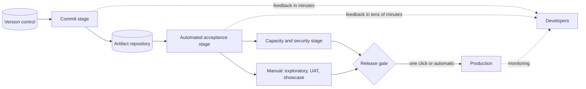
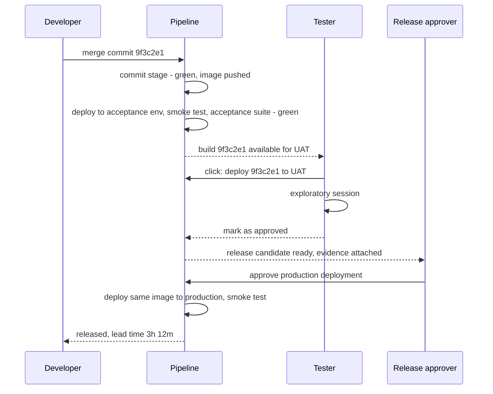

# Stages, gates and the flow of a change

> **Before this lesson:** read [Continuous integration: the practice, not the server](#/lesson/cicd/ci-practices) and [Testing quadrants and the test pyramid](#/lesson/cicd/quadrants-pyramid).

## In plain words

At an airport, a passenger passes a series of checkpoints: ticket desk, bag scan, passport control, the gate. Each one checks something different. The quick, cheap checks come first, so that somebody with no ticket is turned away at the entrance and not at the door of the aircraft.

A **deployment pipeline** treats every change to the software like that passenger. It is an automated series of checks, called **stages**. A change that passes one stage moves to the next; a change that fails is stopped, and its author is told straight away. A **gate** is a point where the change must pass, or be approved, before continuing.

The thing that travels through the pipeline is an **artifact**: the packaged, ready-to-run form of the software, produced once near the start.

Why this matters for a job: "design a deployment pipeline for this service" is one of the most common design questions in DevOps and backend interviews. After this lesson you can draw one, name each stage and say what it is for.

## Motivation: CI tells you the code compiles; who tells you it can ship?

Continuous integration, done well, answers one question within minutes: does the main line build and pass its fast tests? That is necessary and nowhere near sufficient. Between a green unit-test run and a satisfied user lie a dozen more questions. Does it deploy? Does it meet its acceptance criteria when running for real? Is it fast enough? Is it secure? Does the database migration work against a realistic data set?

In many organisations those questions are answered by different groups, by hand, after long waits. Testers wait for a "good build". Operations waits for documentation. The product owner sees the feature weeks after it was "finished". Each hand-off is a queue, and the value stream from Lesson 1 fills with waiting.

The **deployment pipeline** extends CI's idea all the way to release. It is an automated model of your path to production: every commit produces a candidate, and the pipeline subjects that candidate to a sequence of increasingly demanding checks. Each check the candidate survives raises confidence. Any failure removes it from consideration. At the far end, releasing is a button anyone authorised can press.

This lesson covers the shape of that pipeline — the stages, what each is for, and how a change moves through them.

## The pipeline as a sequence of filters



Three design ideas explain the layout.

**Cheap checks first.** Stages are ordered by cost and speed. If a typo can be caught by a ninety-second lint and unit run, it makes no sense to spend twenty minutes deploying an environment first. Conversely, the expensive stages only ever run on builds that have already survived the cheap ones, so their capacity is not wasted on clearly broken candidates.

**Confidence rises, environments converge on production.** The commit stage runs on a bare build agent. The acceptance stage runs against a deployed system in a production-like test environment. Later stages use environments that resemble production more and more closely. By the time a build is offered for release, it has been deployed several times, by the same mechanism, into progressively more realistic conditions.

**Failure stops the line.** A candidate that fails a stage does not advance. The team's response is the CI rule generalised: fix the cause or revert, and treat the red stage as the priority.

### Why not one big stage?

You could run everything in a single two-hour job. Splitting into stages buys three things: developers get the most common failures reported in minutes rather than hours; later stages can run in parallel with each other and with new commits; and each stage has a clear owner and purpose, which makes its failures easier to interpret.

This simulation compares the two for a stream of commits. Edit the failure probabilities to match your own experience.

```python-run
import random

STAGES = [            # name, minutes, probability a bad commit is caught here
    ("commit",      5,  0.70),
    ("acceptance", 30,  0.22),
    ("capacity",   45,  0.06),
]

def simulate(n_commits=2000, p_bad=0.15, seed=3):
    rng = random.Random(seed)
    staged_feedback = []            # minutes until the author hears about a failure
    monolith_feedback = []
    machine_staged = machine_mono = 0
    total = sum(m for _, m, _ in STAGES)
    for _ in range(n_commits):
        bad = rng.random() < p_bad
        elapsed = 0
        caught = False
        for name, minutes, p in STAGES:
            elapsed += minutes
            machine_staged += minutes
            if bad and rng.random() < p / (1 - sum(q for _, _, q in STAGES[:STAGES.index((name, minutes, p))])):
                staged_feedback.append(elapsed)
                caught = True
                break
        machine_mono += total
        if bad and caught:
            monolith_feedback.append(total)
    return staged_feedback, monolith_feedback, machine_staged, machine_mono

s, m, ms, mm = simulate()
avg = lambda xs: sum(xs) / len(xs)
print(f"failures caught: {len(s)}")
print(f"mean time to failure feedback  staged: {avg(s):5.1f} min   single job: {avg(m):5.1f} min")
print(f"share told within 5 minutes    staged: {sum(x <= 5 for x in s) / len(s):5.1%}")
print(f"machine minutes used           staged: {ms:>7}    single job: {mm:>7}")
```

Most failures are reported within five minutes, and the pipeline uses less compute because doomed candidates never reach the expensive stages.

## The stages in detail

### The commit stage

Triggered by every commit to the main line (and, in modern practice, by every pull request). Its jobs:

1. compile or otherwise build the code,
2. run the unit tests and a few fast component tests,
3. run static analysis — lint, type checks, formatting, quick security rules,
4. produce the deployable artifact and store it,
5. record metadata: which commit, which pipeline run, test results.

Budget: under five minutes if possible, never more than ten. Its output is not only a verdict but a thing — the **artifact** that every later stage will use. Module 7 is devoted to this stage.

### The automated acceptance stage

Takes the artifact, deploys it to a production-like environment using the same scripts that will deploy to production, runs a smoke test to confirm the deployment itself worked, and then runs the automated acceptance suite against the running system.

Why this is a separate gate rather than "more unit tests":

- Unit tests prove the pieces work. They cannot prove the application starts, connects to its database, and delivers a complete piece of behaviour.
- It is the first stage that exercises the **deployment** as well as the code.
- It is where business-facing criteria become executable. A build that passes says "the features we have automated checks for still work".

A failure here is as serious as a commit-stage failure, though it arrives later. The team should stop and respond, not leave the acceptance stage red for days on the theory that "those tests are always a bit broken".

### Subsequent automated stages

Anything that must hold but is too slow or specialised for the first two gates: capacity and performance tests, security scans against a running instance, tests in a full integration environment with real neighbouring systems, long-running soak tests, tests of the upgrade and rollback procedures. These can run in parallel once acceptance has passed.

### Manual stages

Exploratory testing, usability checks, showcases to stakeholders, and in some domains a formal user acceptance step. The key property is **pull, not push**: a tester chooses a build that has passed the automated gates and deploys it into their environment with one click, at a time that suits them. They never receive an untested build, and they never wait for a developer to "cut" one.

### Release

Deploying to production (and staging before it) is the last stage. It uses the same automated mechanism as every earlier deployment. Whether the trigger is a button with an approval or fully automatic is a policy choice (Lesson 1's table); the mechanics are identical.

## Triggering: automatic or manual

Between any two stages the transition is one of:

- **Automatic**: the next stage starts as soon as the previous one passes. Used for commit → acceptance → capacity.
- **Manual (push-button)**: the build becomes *available*; a person decides to promote it. Used for UAT environments and often for production.
- **Automatic with conditions**: promotion happens if policy is satisfied — a required approval, a change window, a passed canary analysis.

In a pipeline definition this is ordinary configuration:

```yaml
# .gitlab-ci.yml (excerpt): automatic up to staging, human decision for production
stages: [commit, acceptance, nonfunctional, release]

deploy-production:
  stage: release
  script:
    - ./scripts/deploy.sh production "$CI_COMMIT_SHA"
  environment:
    name: production
    url: https://shop.example.com
  rules:
    - if: $CI_COMMIT_BRANCH == $CI_DEFAULT_BRANCH
      when: manual            # shows a play button; pipeline waits here
```

## The pipeline is a graph

Real pipelines are not a single line. Jobs fan out to run in parallel and fan in at gates. Formally it is a directed acyclic graph (DAG): each job lists the jobs it needs, and a scheduler runs every job whose prerequisites have succeeded.

```yaml
# GitHub Actions: `needs` defines the graph
jobs:
  lint:        { runs-on: ubuntu-latest, steps: [ { run: make lint } ] }
  unit:        { runs-on: ubuntu-latest, steps: [ { run: make test } ] }
  build:
    needs: [lint, unit]
    runs-on: ubuntu-latest
    steps: [ { run: make image } ]
  acceptance:
    needs: build
    runs-on: ubuntu-latest
    steps: [ { run: make acceptance } ]
  capacity:
    needs: acceptance
    runs-on: ubuntu-latest
    steps: [ { run: make capacity } ]
  security:
    needs: acceptance
    runs-on: ubuntu-latest
    steps: [ { run: make dast } ]
  release:
    needs: [capacity, security]
    runs-on: ubuntu-latest
    environment: production
    steps: [ { run: make deploy ENV=production } ]
```

A scheduler for such a graph is small enough to write yourself, and doing so makes several pipeline behaviours obvious: why a failure skips everything downstream, and why wall-clock time is the longest path rather than the sum.

```python-run
jobs = {  # name: (minutes, needs, succeeds?)
    "lint":       (1,  [],                       True),
    "unit":       (4,  [],                       True),
    "build":      (3,  ["lint", "unit"],         True),
    "acceptance": (25, ["build"],                True),
    "capacity":   (40, ["acceptance"],           True),
    "security":   (15, ["acceptance"],           False),
    "release":    (5,  ["capacity", "security"], True),
}

def run(jobs):
    finish, status = {}, {}
    pending = dict(jobs)
    while pending:
        progressed = False
        for name in sorted(pending):
            minutes, needs, ok = pending[name]
            if any(n not in status for n in needs):
                continue                                   # prerequisites not decided yet
            if any(status[n] != "passed" for n in needs):
                status[name], finish[name] = "skipped", max(finish[n] for n in needs)
            else:
                start = max((finish[n] for n in needs), default=0)
                finish[name] = start + minutes
                status[name] = "passed" if ok else "FAILED"
            del pending[name]
            progressed = True
            break
        if not progressed:
            raise ValueError("cycle in pipeline definition")
    return status, finish

status, finish = run(jobs)
for name in sorted(finish, key=lambda n: (finish[n], n)):
    print(f"t={finish[name]:>3} min  {name:<11} {status[name]}")
print()
print("sum of job minutes :", sum(m for m, _, _ in jobs.values()))
print("wall clock         :", max(finish.values()), "min  (longest dependency chain)")
print("released           :", status["release"] == "passed")
```

Change `security` to succeed and re-run: the release proceeds and wall-clock time is still set by the slowest branch. This is the model behind the problem set for this module.

## Visibility: one view of every build

A pipeline is also an information system. For any commit, anyone should be able to see which stages it has passed, where it is deployed, and who promoted it. That single view replaces a great deal of meeting time:

- testers see which builds are ready and what changed in each,
- operations sees exactly what is about to be deployed and its test history,
- managers see cycle time and where candidates get stuck,
- auditors see who approved what and when.



## Growing a pipeline incrementally

You do not need the full picture on day one. A sensible order:

1. **Map the value stream** of the current path to production, however manual.
2. **Automate build and commit-stage tests**; produce an artifact.
3. **Automate deployment** of that artifact to one test environment, with a smoke test.
4. **Add an acceptance stage** with a single end-to-end scenario; grow it.
5. **Model the remaining manual steps as stages** with buttons, even if the work behind the button is still partly manual. The pipeline then shows the real process and its waits.
6. **Automate what hurts most**, guided by where candidates spend their time.

An empty-but-complete pipeline — every stage present, each doing something trivial — is the walking skeleton from Lesson 1. Fill it in rather than building stage by stage from the left.

## Pitfalls

- **A slow first stage.** If the commit stage takes thirty minutes, every benefit of staging is lost.
- **Stages that rebuild.** Each stage must test the artifact produced by the commit stage, not compile its own (next lesson).
- **Tolerating a red later stage.** If acceptance or capacity is "known to be flaky", it has stopped being a gate.
- **Manual stages that push.** A release manager who assembles builds and hands them to testers recreates the queues the pipeline was meant to remove.
- **Too many environments.** Every extra stage adds cycle time. Add one only if it catches a class of problem nothing earlier can.
- **No feedback from production.** The pipeline does not end at deploy; monitoring results are the final stage's output.

> [!INTERVIEW]
> "Design a deployment pipeline for a web service" is a staple. Draw the stages in order, give each a purpose and a time budget, say what artifact flows between them, mark which transitions are automatic and which need approval, and name the feedback loop at each stage. Then volunteer the two principles that make it trustworthy: build once and promote the same artifact, and deploy the same way everywhere.

> [!TIP]
> Give every stage an explicit time budget and display stage durations on the team dashboard. Pipelines rot by getting slower a few seconds at a time; a visible budget turns that into something someone notices.

## Summary

- The deployment pipeline is an automated model of the path from commit to release; each commit is a candidate that the pipeline tries to reject.
- Stages are ordered by cost: commit stage (minutes), automated acceptance (tens of minutes), further automated stages for capacity and security, manual exploration, release.
- Later stages run in more production-like environments and only on candidates that passed earlier ones.
- Transitions are automatic or push-button; manual stages pull builds on demand.
- Structurally a pipeline is a DAG: wall-clock time is the longest path, and a failure skips everything downstream.
- Build the whole skeleton early and fill it in, guided by where time is being lost.

## Glossary

- **Deployment pipeline** — the automated path from a commit to a release, as a series of stages.
- **Stage** — one step of the pipeline, with a specific purpose.
- **Gate** — a point a change must pass, automatically or by approval, before continuing.
- **Artifact** — the packaged, deployable result of a build.
- **Commit stage** — the first, fastest stage: build, unit tests and code checks.
- **Acceptance stage** — the stage that deploys the artifact and tests it against business requirements.
- **Capacity test** — a test of how much load the system can handle.
- **Smoke test** — a quick check after deployment that the service is alive.
- **Promotion** — moving a build that passed one stage on to the next environment.
- **Manual gate** — a transition that waits for a person to approve it.
- **Job** — one unit of work in a pipeline, run on one machine.
- **DAG (directed acyclic graph)** — a set of items connected by one-way arrows with no loops; here, jobs and their prerequisites.
- **Wall-clock time** — the real elapsed time, as opposed to the total machine time used.
- **Value stream** — the full sequence of steps and waits a change goes through on its way to users.

## Check yourself

```quiz
[
  {"q": "Why are pipeline stages ordered from fastest to slowest?",
   "options": ["Slow tests are less important", "Most defects are reported within minutes, and expensive stages run only on candidates likely to pass", "Fast tests need more hardware", "It is required by CI tools"],
   "answer": 1,
   "explain": "Ordering by cost gives early feedback for common failures and avoids wasting slow, costly stages on builds that are already known to be bad."},
  {"q": "What does the acceptance stage verify that the commit stage cannot?",
   "options": ["That the code compiles", "That the deployed, running application delivers the specified behaviour, including a working deployment", "That variable names follow conventions", "That the lockfile is up to date"],
   "answer": 1,
   "explain": "It is the first stage to deploy the artifact and test the system as a whole against business-facing criteria."},
  {"q": "In a pipeline DAG, jobs A (10 min) and B (25 min) both depend on Build and run in parallel; Release depends on A and B. Ignoring queueing, how long after Build finishes can Release start?",
   "options": ["10 minutes", "25 minutes", "35 minutes", "17.5 minutes"],
   "answer": 1,
   "explain": "Release needs both. Parallel branches finish when the slowest one does, so wall-clock time follows the longest path."},
  {"q": "What does it mean for manual testing stages to be 'pull' based?",
   "options": ["Testers pull code from Git and build it themselves", "Testers choose a build that passed the automated gates and deploy it themselves when ready", "Developers push builds to testers on a schedule", "Tests are pulled from the suite when they fail"],
   "answer": 1,
   "explain": "Self-service deployment of already-verified builds removes the queue between development and testing."},
  {"q": "A job in the middle of the graph fails. What happens to jobs that depend on it?",
   "options": ["They run anyway", "They are skipped, because their prerequisites did not succeed", "They are retried forever", "They run with a warning"],
   "answer": 1,
   "explain": "A failed prerequisite means the candidate has been rejected; downstream work would be wasted and misleading."},
  {"q": "Which is the best first step when introducing a pipeline to an existing project?",
   "options": ["Buy the most powerful CI product", "Map the current value stream from commit to release", "Automate production deployment before anything else", "Write capacity tests"],
   "answer": 1,
   "explain": "You need to know the real steps and waits before deciding what to automate, and the pipeline should model that process."},
  {"q": "The acceptance stage has been red for a week because 'those tests are unreliable'. What has been lost?",
   "options": ["Nothing, since unit tests still pass", "The stage no longer acts as a gate, so regressions in real behaviour go undetected", "Only some compute time", "The ability to commit"],
   "answer": 1,
   "explain": "A stage whose failures are ignored provides no information. Fix or quarantine the unreliable tests and restore the gate."}
]
```

> **Source:** Humble & Farley, *Continuous Delivery*, ch. 5 (anatomy of the deployment pipeline). GitLab CI `rules`, `when: manual` and environments: https://docs.gitlab.com/ci/yaml/ — GitHub Actions `needs`: https://docs.github.com/en/actions/writing-workflows/workflow-syntax-for-github-actions#jobsjob_idneeds
