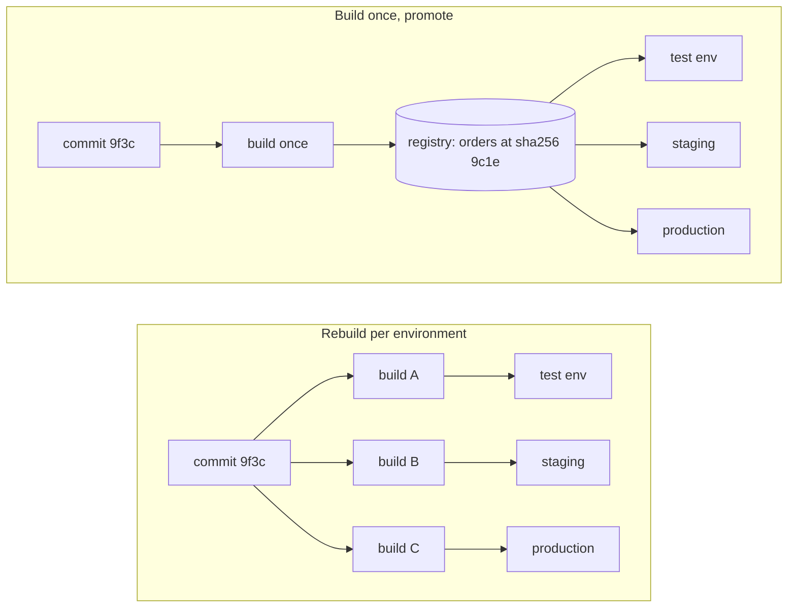

# Build once, promote artifacts, pipeline as code

> **Before this lesson:** read [Stages, gates and the flow of a change](#/lesson/cicd/pipeline-stages). A **container image**, used in the examples, is a sealed package holding a program and everything it needs to run.

## In plain words

A medicine is tested, batch by batch. The pills that reach the pharmacy come from the very batch that was tested. No manufacturer tests one batch and then ships a different one made later from "the same recipe" — the second batch might differ in ways nobody checked.

Pipelines follow the same rule: **build once**. The packaged software — the **artifact** — is produced a single time. That exact package is what gets tested, and that exact package is what is installed for customers. Moving the same artifact from one environment to the next is called **promotion**.

To be sure it really is the same package, each one is identified by a **digest**: a fingerprint calculated from its contents. If the fingerprint matches, the contents match.

The second idea in this lesson is **pipeline as code**: the description of the pipeline is itself a text file stored with the program, so it can be reviewed and its history kept like any other code.

Why this matters for a job: "what does 'build once, deploy many' mean?" is a standard interview question, and rebuilding separately for each environment is a mistake that reviewers look for in real pipelines.

## Motivation: "but it passed in staging"

A team's pipeline has four jobs: build-and-test, deploy-to-staging, deploy-to-production. Each deploy job begins with `git checkout` followed by `docker build`. Staging passes every test. Production crashes on start with an import error.

What happened? Between the staging build and the production build, forty minutes apart, a transitive dependency published a new patch release. The Dockerfile installed without a lockfile. The image that was tested and the image that shipped were built from the same commit and were not the same software.

The lesson generalises: **if you rebuild, you have not tested what you deploy.** This lesson covers the practices that make a pipeline's verdict mean something — build once, promote the same artifact, deploy the same way everywhere, smoke test every deployment, stop on failure — and then the modern practice of defining the pipeline itself as versioned code.

## Practice 1: build your binaries once

"Binary" here means whatever you deploy: a container image, a JAR, a wheel, a static site bundle, a compiled executable. The commit stage creates it exactly once, and every later stage uses that same set of bytes.

Reasons a rebuild can differ from the original, even at the same commit:

- unpinned or floating dependencies resolve differently,
- the base image tag (`python:3.12-slim`) was re-published,
- the compiler or build tool on the agent was upgraded,
- build-time environment variables differ between jobs,
- timestamps, file ordering or parallelism make the output non-deterministic.

Pinning (Lesson 3) reduces these, but the only way to be *certain* later stages test what will ship is not to rebuild at all.



### Identify artifacts by content, not by name

A container **tag** such as `orders:1.4.2` or `orders:latest` is a movable label. A **digest** such as `sha256:9c1e…` is a hash of the image contents: if the digest matches, the bytes match. Promote by digest.

```bash
# commit stage: build, push, capture the digest
docker build -t registry.example.com/orders:${GIT_SHA} .
docker push registry.example.com/orders:${GIT_SHA}
DIGEST=$(docker inspect --format='{{index .RepoDigests 0}}' registry.example.com/orders:${GIT_SHA})
echo "$DIGEST"
# registry.example.com/orders@sha256:9c1e4b7d0a52...

# later stages: deploy exactly that digest
kubectl -n staging set image deploy/orders orders="$DIGEST"

# "promotion" adds a label to existing content; nothing is rebuilt
docker buildx imagetools create --tag registry.example.com/orders:staging-approved "$DIGEST"
```

Tagging conventions that work well in practice:

| tag | set by | meaning |
|---|---|---|
| `<git-sha>` | commit stage | immutable identity tied to source |
| `1.4.2` | release job | human-friendly version, never reassigned |
| `staging-approved`, `prod-current` | promotion jobs | moving pointers for humans and tooling; never used as the deploy reference |

Configure the registry to make version tags immutable so that nobody can overwrite `1.4.2` with different content.

### The corollary: configuration lives outside the artifact

If one artifact must run in every environment, nothing environment-specific can be inside it (Lesson 4). The artifact carries code and defaults; the deployment supplies addresses, sizes, credentials and flags.

## Practice 2: deploy the same way to every environment

Use one deployment mechanism — one script, one Helm chart, one set of manifests — for the developer's local stack, the acceptance environment, staging and production. Differences between environments are expressed as *data* (a values file), never as different *procedures*.

```bash
#!/usr/bin/env bash
# scripts/deploy.sh <environment> <image-digest>
set -euo pipefail
env="$1"; image="$2"

helm upgrade --install orders deploy/chart \
  --namespace "shop-${env}" --create-namespace \
  --values "deploy/values-${env}.yaml" \
  --set image.reference="${image}" \
  --atomic --timeout 5m          # roll back automatically if the release does not become healthy

./scripts/smoke.sh "$(./scripts/url-for.sh "${env}")"
```

The benefit is statistical. If production deploys happen weekly but the acceptance environment is redeployed thirty times a day by the same script, the script has been exercised hundreds of times between production uses. A production-only procedure, by contrast, is always under-tested.

When a deployment fails in one environment but works in another, there are only three possible causes, and each is recorded in version control:

1. the environment's configuration values,
2. the environment's infrastructure,
3. the data in the environment.

That narrows debugging enormously compared with "the two procedures are different documents".

## Practice 3: smoke test every deployment

A deployment is not finished when the script exits zero. It is finished when the application has been shown to be up and connected. A **smoke test** is a short automated check run immediately after each deploy:

```bash
#!/usr/bin/env bash
# scripts/smoke.sh <base-url>
set -euo pipefail
base="$1"

for attempt in $(seq 1 30); do
  if curl --fail --silent --max-time 3 "${base}/readyz" > /dev/null; then break; fi
  [ "${attempt}" -eq 30 ] && { echo "service never became ready"; exit 1; }
  sleep 2
done

version=$(curl --fail --silent "${base}/version" | jq -r .commit)
[ "${version}" = "${EXPECTED_COMMIT}" ] || { echo "wrong version live: ${version}"; exit 1; }

curl --fail --silent "${base}/readyz?deep=true" | jq -e '.db == "ok" and .queue == "ok"' > /dev/null
echo "smoke ok: ${base} serves ${version}"
```

It checks three things: the service answers, it is the version you just deployed, and it can reach its dependencies. If the smoke test fails, the pipeline fails with a precise message, instead of a later stage producing three hundred confusing acceptance-test failures.

## Practice 4: test in a copy of production

The more a test environment differs from production, the less its green result predicts. Aim to match:

- operating system image and runtime versions,
- topology shape: load balancer, multiple replicas, a real database of the same engine and major version,
- network policy and identity model,
- the versions of neighbouring services,
- a realistic volume and shape of data where it affects behaviour.

Infrastructure as code (Module 11) is what makes this affordable: the same modules create every environment, parameterised by size.

## Practice 5: every change propagates immediately, and failure stops the line

When a commit passes the commit stage, the next stage should start without waiting for a schedule. If the acceptance stage takes thirty minutes and several commits arrive meanwhile, an intelligent scheduler picks up the *latest* successful commit-stage build next rather than queuing each one; a failure then covers a small, known range of commits.

And if any stage fails — build, test or deploy — the whole team owns getting it fixed, exactly as with CI. A deployment failure in the acceptance environment is a broken build.

## Promotion as a tracked decision

Here is a model of promotion that keeps the rules explicit. An artifact can enter an environment only if it has passed the gates that environment requires, and the record shows who promoted what.

```python-run
REQUIRES = {                      # environment -> gates the artifact must have passed
    "acceptance": {"commit"},
    "staging":    {"commit", "acceptance"},
    "production": {"commit", "acceptance", "capacity", "security", "approval"},
}

class Artifact:
    def __init__(self, digest, commit):
        self.digest, self.commit = digest, commit
        self.passed = set()
        self.history = []

    def record(self, gate, ok, by="pipeline"):
        self.history.append((gate, "pass" if ok else "FAIL", by))
        if ok:
            self.passed.add(gate)
        else:
            self.passed.discard(gate)

def promote(artifact, env, live):
    missing = REQUIRES[env] - artifact.passed
    if missing:
        return f"REFUSED {artifact.digest[:14]} -> {env}: missing {sorted(missing)}"
    live[env] = artifact.digest
    return f"deployed {artifact.digest[:14]} -> {env}"

live = {}
a = Artifact("sha256:9c1e4b7d0a52", "9f3c2e1")
a.record("commit", True)
print(promote(a, "acceptance", live))
a.record("acceptance", True)
print(promote(a, "production", live))          # too early
a.record("capacity", True); a.record("security", True)
print(promote(a, "staging", live))
print(promote(a, "production", live))          # still no approval
a.record("approval", True, by="release-manager@example.com")
print(promote(a, "production", live))

print("\nsame bytes everywhere:", len(set(live.values())) == 1, live)
print("audit trail:")
for gate, result, by in a.history:
    print(f"  {gate:<11} {result:<5} by {by}")
```

The final check — one digest in every environment — is the build-once principle stated as an assertion.

## Pipeline as code

Early CI servers were configured by clicking through web forms. The configuration lived in the server's database: unversioned, unreviewed, impossible to test on a branch, and lost if the server died. Today the pipeline definition is a file in the repository it builds.

```yaml
# .github/workflows/pipeline.yml -- build once, promote by digest
name: pipeline
on:
  push:
    branches: [main]

permissions:
  contents: read
  packages: write

jobs:
  commit-stage:
    runs-on: ubuntu-latest
    outputs:
      image: ${{ steps.push.outputs.image }}
    steps:
      - uses: actions/checkout@v4
      - run: make lint test
      - uses: docker/login-action@v3
        with:
          registry: ghcr.io
          username: ${{ github.actor }}
          password: ${{ secrets.GITHUB_TOKEN }}
      - id: build
        uses: docker/build-push-action@v6
        with:
          push: true
          tags: ghcr.io/${{ github.repository }}:${{ github.sha }}
      - id: push
        run: echo "image=ghcr.io/${{ github.repository }}@${{ steps.build.outputs.digest }}" >> "$GITHUB_OUTPUT"

  acceptance:
    needs: commit-stage
    runs-on: ubuntu-latest
    environment: acceptance
    steps:
      - uses: actions/checkout@v4
      - run: ./scripts/deploy.sh acceptance "${{ needs.commit-stage.outputs.image }}"
      - run: make acceptance

  production:
    needs: [commit-stage, acceptance]
    runs-on: ubuntu-latest
    environment: production          # required reviewers configured on the environment
    steps:
      - uses: actions/checkout@v4
      - run: ./scripts/deploy.sh production "${{ needs.commit-stage.outputs.image }}"
```

What to notice:

- The image is built in exactly one job. Its **digest** is exported as a job output and consumed by the later jobs through `needs.<job>.outputs`. No later job contains a build step.
- Every deploy calls the same `deploy.sh` with a different environment name.
- `permissions` grants the workflow token only what it needs.
- The production job is gated by an environment protection rule rather than by logic in the file.

### Why this matters

1. **The pipeline is versioned with the code.** Checking out an old commit gives you the pipeline that built it. A change to how the product is built is reviewed in the same pull request as the change that needs it.
2. **It can be tested on a branch** before it affects main.
3. **It is recoverable.** Losing the CI server loses nothing that matters.
4. **It is reusable.** Shared steps become reusable workflows, templates or includes maintained by a platform team (Lesson 31).

### Keep the YAML thin

A good rule: the pipeline file says *when* and *in what order*; scripts in the repository say *how*. If each job is `run: make something`, developers can run the same thing locally, the logic is testable, and moving to a different CI system is an afternoon's work. If two hundred lines of shell are embedded in YAML strings, none of that is true.

> [!WARNING]
> The pipeline definition is privileged code. Anyone who can change it can make it print secrets or deploy anything. Protect it like production: require review for changes under the workflow directory (code owners), keep deploy credentials scoped to protected branches and environments, and do not run workflows from untrusted forks with secrets available.

## Supply-chain integrity in brief

Build-once pairs naturally with proving *where* an artifact came from. Modern pipelines attach two pieces of evidence to the digest: a **signature** (the image was produced by our pipeline) and **provenance** (which repository, commit and workflow built it). The cluster can then refuse anything unsigned.

```bash
# keyless signing with the pipeline's OIDC identity
cosign sign --yes registry.example.com/orders@sha256:9c1e4b7d0a52...
# at deploy time, or enforced by an admission policy in the cluster
cosign verify registry.example.com/orders@sha256:9c1e4b7d0a52... \
  --certificate-identity-regexp 'https://github.com/example/orders/.*' \
  --certificate-oidc-issuer https://token.actions.githubusercontent.com
```

## Pitfalls

- **A build step hidden in a deploy job** (`docker build` or `npm run build` inside deploy). Search your pipeline for them.
- **Deploying by mutable tag.** `image: orders:latest` means the cluster may pull different content on different nodes.
- **Environment-specific images** ("orders-staging", "orders-prod"). Usually a sign that configuration is baked in.
- **Artifacts passed between jobs through a shared workspace** on a long-lived agent, with no checksum. Use an artifact store and verify the hash.
- **Smoke tests that only check HTTP 200 on `/`.** Check the version and the dependencies too.
- **Pipeline logic in the CI tool's UI.** If you cannot diff it, you cannot review it.
- **Skipping stages for "urgent" fixes.** Emergencies are when an untested deploy mechanism hurts most; the pipeline must be fast enough to be the emergency path (Lesson 20).

> [!INTERVIEW]
> "What does 'build once, deploy many' mean and why does it matter?" Build the deployable artifact a single time in the commit stage, store it with an immutable identifier, and promote those same bytes through every environment, injecting configuration at deploy time. It guarantees that what was tested is what is released, removes rebuild variance as a cause of environment-specific failures, makes rollback a matter of redeploying a known digest, and gives an audit trail from production back to a commit.

## Summary

- Build the deployable artifact once in the commit stage and promote the same bytes; identify it by content digest, not by a movable tag.
- Keep environment-specific configuration outside the artifact.
- Use one deployment mechanism for every environment so the production procedure is rehearsed constantly; differences are data.
- Smoke test after every deployment: alive, correct version, dependencies reachable.
- Promotion is a recorded decision gated on evidence the artifact has accumulated.
- Define the pipeline as code in the repository, keep it thin by delegating to scripts, and protect it as privileged.

## Glossary

- **Artifact** — the packaged, deployable result of a build.
- **Build once** — producing the artifact a single time and using that same artifact everywhere.
- **Promotion** — moving the same artifact on to the next environment.
- **Container image** — a sealed package holding a program and everything it needs to run.
- **Registry** — a storage service for container images.
- **Tag** — a movable, human-readable label on an image, such as `1.4.2`.
- **Digest** — a fingerprint computed from an image's contents; it cannot be re-pointed.
- **Immutable** — unable to be changed once created.
- **Smoke test** — a quick check after deployment that the service is alive and is the expected version.
- **Pipeline as code** — keeping the pipeline definition as a file in the repository.
- **Job output** — a value one pipeline job publishes for later jobs to read.
- **Helm** — a tool for installing applications on Kubernetes from a parameterised template called a chart.
- **Signature / provenance** — proof that an artifact was produced by your pipeline / the record of how and from what it was built.
- **Supply chain** — everything that goes into producing your software, including other people's code and tools.

## Check yourself

```quiz
[
  {"q": "A pipeline runs `docker build` separately in the staging job and the production job from the same commit. What is the core risk?",
   "options": ["It doubles the storage bill", "The two images may differ, so the tested image is not the one released", "Docker cannot build twice", "The commit hash changes"],
   "answer": 1,
   "explain": "Dependency resolution, base images, tool versions and non-determinism can all change the output. Only promoting the same bytes guarantees equivalence."},
  {"q": "Why deploy by image digest rather than by tag?",
   "options": ["Digests are easier to read", "A digest is a hash of the content and cannot be re-pointed, while a tag is a mutable label", "Tags are deprecated", "Digests compress better"],
   "answer": 1,
   "explain": "If the digest matches, the bytes match. A tag can be moved to different content at any time."},
  {"q": "What is the main benefit of using the same deploy script for test environments and production?",
   "options": ["Less disk usage", "The production deployment procedure is exercised many times before it is used in production", "It removes the need for configuration", "It makes test environments identical in size to production"],
   "answer": 1,
   "explain": "Frequent rehearsal in lower environments flushes out deployment bugs, so the rare production deploy is routine."},
  {"q": "Which checks belong in a post-deployment smoke test?",
   "options": ["The full acceptance suite", "The service responds, reports the expected version, and can reach its critical dependencies", "Unit tests", "A two-hour load test"],
   "answer": 1,
   "explain": "A smoke test is short and answers 'did the deployment itself work?' before slower stages run."},
  {"q": "If one artifact must run in all environments, where must environment-specific values come from?",
   "options": ["Compile-time constants", "A separate build per environment", "Configuration supplied at deploy or run time", "Hard-coded defaults only"],
   "answer": 2,
   "explain": "Anything baked in at build time forces a different artifact per environment."},
  {"q": "Which is an advantage of defining the pipeline as code in the repository?",
   "options": ["It runs faster", "Changes to the pipeline are versioned, reviewed and testable on a branch alongside the code they build", "It needs no credentials", "It prevents all failed builds"],
   "answer": 1,
   "explain": "The pipeline becomes an ordinary reviewed artefact, reproducible for any past commit and recoverable if the server is lost."},
  {"q": "Why keep pipeline YAML thin and put logic in repository scripts?",
   "options": ["YAML cannot express conditions", "Scripts can be run and debugged locally, tested, and reused if the CI system changes", "Scripts are always faster", "CI vendors require it"],
   "answer": 1,
   "explain": "The pipeline file should orchestrate. Logic in scripts is portable and reproducible on a developer machine."},
  {"q": "In the sample workflow, how do later jobs know which image to deploy?",
   "options": ["They rebuild it", "They use the tag latest", "The commit-stage job exports the image digest as an output that later jobs read through needs", "They query Git for the newest commit"],
   "answer": 2,
   "explain": "Passing the digest as a job output ties every deployment to the exact artifact produced once."}
]
```

> **Source:** Humble & Farley, *Continuous Delivery*, ch. 5 (deployment pipeline practices). GitHub Actions job outputs: https://docs.github.com/en/actions/writing-workflows/choosing-what-your-workflow-does/passing-information-between-jobs — docker/build-push-action outputs: https://github.com/docker/build-push-action — Helm `upgrade --atomic`: https://helm.sh/docs/helm/helm_upgrade/ — Sigstore cosign: https://docs.sigstore.dev
