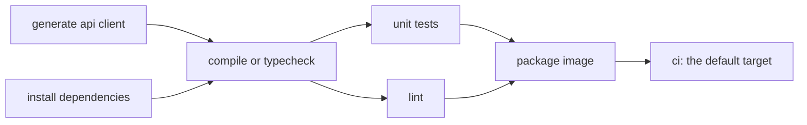

# Build scripting: one command, any machine

> **Before this lesson:** read [Build once, promote artifacts, pipeline as code](#/lesson/cicd/build-once). A **shell** is the text window in which commands are typed; a **script** is a file of such commands.

## In plain words

A flat-pack wardrobe comes with a numbered instruction sheet. Follow the steps and anyone gets the same wardrobe. Without the sheet you depend on the one neighbour who has built this model before, and you hope he is at home.

A **build** is the process that turns the files programmers write (**source code**) into something that can run and be shipped. A **build script** is the instruction sheet for that process — except that a computer follows it, so nothing is skipped or done in the wrong order.

The goal of this lesson is one sentence: *one command, on any machine, builds and tests the project.* A new colleague's laptop and the pipeline's server should both be able to do it, and should get the same result.

Why this matters for a job: "it works on my machine but fails on the server" is a daily problem in software. Knowing why it happens and how build scripts prevent it is a basic professional skill, and a frequent interview topic.

## Motivation: the README with seventeen steps

A new engineer joins. The README says: install Node 20 (not 22), install Python 3.12, run `npm install`, then `pip install -r requirements.txt` — unless you are on a Mac with Apple silicon, in which case first set two environment variables — then generate the API client by running a tool whose path is wrong, then start a database with a command that has a typo. Two days later they have a build. Meanwhile the CI server builds the project a slightly different way, encoded in a YAML file nobody runs locally, so "passes on my machine, fails in CI" is a weekly event.

Every one of those steps is knowledge that should have been *executable*. A build script is that knowledge written as a program: the single, authoritative description of how to turn source into something tested and shippable. This lesson is about writing that program well. The next lesson covers its sibling, the deployment script.

## What a build tool actually is

Underneath the differences in syntax, nearly every build tool models the same thing: a set of **tasks** and the **dependencies** between them. To do task X, first make sure Y and Z are done; skip any task whose inputs have not changed.



Tools fall along two axes.

**Task-oriented vs product-oriented.** A task-oriented tool (npm scripts, `just`, Rake, a shell script) describes actions: "run the tests". A product-oriented tool (Make, Bazel) describes files: "this output file is produced from these input files by this command". Product-oriented tools can skip work precisely, because they can compare inputs with outputs.

**Imperative vs declarative.** Some tools are general-purpose code with a build library (Gradle's Kotlin DSL, Rake). Others are configuration with conventions (Maven, Cargo, `pyproject.toml`): you declare what the project is and the tool knows the lifecycle.

| family | examples | strength | watch out for |
|---|---|---|---|
| Classic file-based | Make | ubiquitous, precise file dependencies | tab syntax, portability on Windows, hard to scale |
| Ecosystem-native | npm/pnpm scripts, Cargo, Go toolchain, Maven, Gradle, uv/Poetry | knows the language's conventions | each language has its own |
| Simple command runners | `just`, Task, shell scripts | readable, low ceremony | no incremental build on their own |
| Hermetic, cache-first | Bazel, Pants, Buck2, Nx, Turborepo | correct incremental and remote-cached builds across huge repos | steep learning curve |

No choice is wrong in itself. What matters are the principles the script follows.

### How incremental builds decide what to do

The oldest trick is still worth understanding. Make rebuilds a target if any of its prerequisites is newer than it. Modern tools compare content hashes of inputs instead of timestamps, which is more reliable and makes results shareable between machines.

```python-run
import hashlib

rules = {   # target: (inputs, command)
    "client.py":  (["openapi.yaml"],              "generate client"),
    "app.pyc":    (["app.py", "client.py"],       "compile"),
    "report.xml": (["app.pyc", "test_app.py"],    "run unit tests"),
    "image.tar":  (["app.pyc", "Dockerfile"],     "docker build"),
}
sources = {"openapi.yaml": "v1", "app.py": "v1", "test_app.py": "v1", "Dockerfile": "v1"}
cache = {}          # target -> hash of inputs it was last built from
content = {}        # target -> content fingerprint

def fingerprint(name):
    if name in sources:
        return hashlib.sha1(sources[name].encode()).hexdigest()[:8]
    return content[name]

def build(target, log):
    if target in sources:
        return
    inputs, command = rules[target]
    for i in inputs:
        build(i, log)
    key = "|".join(fingerprint(i) for i in inputs)
    if cache.get(target) == key:
        log.append(f"  skip  {target}")
        return
    cache[target] = key
    content[target] = hashlib.sha1((target + key).encode()).hexdigest()[:8]
    log.append(f"  RUN   {command:<16} -> {target}")

def run(label):
    log = []
    for t in ("report.xml", "image.tar"):
        build(t, log)
    print(label)
    print("\n".join(dict.fromkeys(log)))      # de-duplicate shared prerequisites

run("first build (cold):")
run("\nsecond build, nothing changed:")
sources["test_app.py"] = "v2"
run("\nafter editing only a test file:")
sources["openapi.yaml"] = "v2"
run("\nafter editing the API spec:")
```

After editing only a test, the image is not rebuilt. After editing the API spec, everything downstream is. That is the entire idea behind Bazel, Nx and Turborepo; they add sandboxing (so undeclared inputs cannot sneak in) and a remote cache (so CI and every developer share results).

## Principles of good build scripts

### 1. One entry point per pipeline stage

Give each stage a named target, and make the CI configuration call exactly that.

```makefile
# Makefile
SHELL := bash
.SHELLFLAGS := -eu -o pipefail -c
.DEFAULT_GOAL := help
GIT_SHA := $(shell git rev-parse --short=12 HEAD)
IMAGE   ?= registry.example.com/orders:$(GIT_SHA)

.PHONY: help setup lint typecheck test ci image acceptance clean

help:            ## list targets
	@grep -E '^[a-z-]+:.*##' $(MAKEFILE_LIST) | awk -F':.*## ' '{printf "  %-12s %s\n", $$1, $$2}'

setup:           ## install exact dependencies from the lockfile
	uv sync --locked

lint:            ## style and static checks
	uv run ruff check src tests
	uv run ruff format --check src tests

typecheck:       ## static types
	uv run mypy src

test:            ## unit tests with coverage
	uv run pytest tests/unit -q --cov=src --cov-fail-under=80

ci: setup lint typecheck test   ## everything the commit stage runs

image:           ## build the deployable image
	docker build --build-arg GIT_SHA=$(GIT_SHA) -t $(IMAGE) .

acceptance:      ## run acceptance tests against $$BASE_URL
	uv run pytest tests/acceptance -q --base-url "$(BASE_URL)"

clean:
	rm -rf .pytest_cache .mypy_cache dist build
```

```yaml
# the CI side stays trivial
    steps:
      - uses: actions/checkout@v4
      - uses: astral-sh/setup-uv@v5
      - run: make ci
      - run: make image
```

A developer runs `make ci` and gets the same verdict the server will give. When CI fails, the reproduction is one command.

### 2. Use the right tool for each job, but one front door

It is fine for a repository to use Cargo for the Rust service, pnpm for the web app and Terraform for infrastructure. What hurts is having no common way in. A thin top-level runner (`make`, `just`, a `./dev` script) that delegates to the native tools gives everyone the same verbs — `setup`, `lint`, `test`, `build` — in every repository.

### 3. Build and test scripts are code

They live in the repository, are reviewed, are kept small and factored, and fail loudly. For shell in particular:

```bash
#!/usr/bin/env bash
set -euo pipefail          # stop on error, on unset variables, and on failures inside pipes
IFS=$'\n\t'

log() { printf '%s %s\n' "$(date -u +%H:%M:%S)" "$*" >&2; }

: "${REGISTRY:?REGISTRY must be set}"     # explicit, early check of required input

log "building ${REGISTRY}/orders"
docker build -t "${REGISTRY}/orders:${GIT_SHA:-dev}" .
```

Without `set -e`, a failed command in the middle is ignored and the script reports success. Without `pipefail`, `pytest | tee log.txt` reports the exit status of `tee`. Lint shell with ShellCheck in the commit stage; it catches most quoting and portability mistakes.

### 4. Make the environment part of the build

"Works on my machine" is usually a toolchain difference. Three levels of control, in increasing strength:

- **Version files** read by a version manager (`.tool-versions`, `.nvmrc`, `rust-toolchain.toml`) so everyone gets the same compiler.
- **A container image as the build environment.** CI runs jobs inside it; developers can too (dev containers). The toolchain is then versioned by image digest.
- **Hermetic builds**, where the build tool itself downloads pinned toolchains and forbids access to anything undeclared.

```json
// .devcontainer/devcontainer.json -- the same toolchain for every developer and for CI
{
  "name": "orders",
  "image": "mcr.microsoft.com/devcontainers/python:3.12",
  "features": { "ghcr.io/devcontainers/features/docker-in-docker:2": {} },
  "postCreateCommand": "make setup"
}
```

### 5. Use relative paths and no machine-specific assumptions

A script that contains `/home/priya/projects/orders` or `C:\build` works on one machine. Resolve everything from the repository root:

```bash
ROOT="$(git rev-parse --show-toplevel)"
cd "${ROOT}"
```

The same applies to assumptions about preinstalled tools, the current directory, the locale, the time zone and the availability of the internet. Declare, pin or remove each one.

### 6. Eliminate manual steps

Any instruction of the form "before building, remember to…" is a bug in the script. Code generation, database start-up for tests, licence header checks, version stamping — all become targets with dependencies. A good test: wipe the working copy, clone, run one documented command. If it does not end in a passing build, find what was missing and script it.

### 7. Keep going far enough to be useful, then fail clearly

When tests fail, run the whole suite and report every failure rather than stopping at the first, so one pipeline run gives the full picture. (During local red-green cycles, `--maxfail=1` is the opposite convenience.) Always produce machine-readable results so the CI system can show which tests failed and track them over time:

```bash
uv run pytest -q --junitxml=reports/unit.xml
```

```yaml
      - if: always()                       # upload reports even when tests failed
        uses: actions/upload-artifact@v4
        with:
          name: unit-test-report
          path: reports/
```

### 8. Stamp the artifact with where it came from

Every artifact should be able to say which commit and pipeline run produced it. Pass the information in at build time and expose it at run time.

```dockerfile
ARG GIT_SHA=unknown
ARG BUILD_URL=unknown
LABEL org.opencontainers.image.revision="${GIT_SHA}" \
      org.opencontainers.image.source="https://github.com/example/orders" \
      org.opencontainers.image.url="${BUILD_URL}"
ENV APP_COMMIT="${GIT_SHA}"
```

A `/version` endpoint returning `APP_COMMIT` makes "what is running?" a `curl`.

## Project layout and conventions

Conventions reduce the amount of build script you need. If every service keeps source in `src/`, tests in `tests/unit` and `tests/acceptance`, migrations in `migrations/`, deployment files in `deploy/`, then shared tooling and reusable pipeline templates can work without per-project configuration. Language ecosystems encode such conventions (Maven's standard directory layout, Go's module layout, Cargo's `src/` and `tests/`); following them is nearly always cheaper than being original.

A practical corollary: **separate test kinds by directory or marker**, so the pipeline can select them cheaply.

```toml
# pyproject.toml
[tool.pytest.ini_options]
markers = [
  "slow: takes more than a second",
  "integration: needs a real database or broker",
]
addopts = "-m 'not slow and not integration'"   # the default run is the commit-stage set
```

## Worked example: from tribal knowledge to a script

Take the seventeen-step README from the opening and convert it:

| old README instruction | scripted replacement |
|---|---|
| "Install Node 20 and Python 3.12" | `.tool-versions` plus a dev container |
| "Run npm install, then pip install" | `make setup`, which calls `npm ci` and `uv sync --locked` |
| "Generate the API client (ask Sam where the tool is)" | a `generate` target; the generator is a pinned dev dependency |
| "Start Postgres" | `compose.yaml` and a `make services-up` target that waits for health |
| "Run tests, but skip the slow ones" | pytest markers; `make test` runs the fast set |
| "CI does something different" | CI runs `make ci` |

The README shrinks to: *Open in the dev container (or install the tools in `.tool-versions`), then run `make ci`.*

> [!TIP]
> Add a scheduled pipeline job that builds from a completely clean runner with all caches disabled. It is the only reliable way to discover that your build has quietly come to depend on a cached file or a tool that happens to be installed on the usual runners.

## Pitfalls

- **Logic embedded in CI YAML.** It cannot be run locally and ties you to one vendor.
- **Scripts that swallow errors**: `cmd || true`, missing `set -e`, ignoring exit codes of pipes.
- **Tests depending on build order or leftovers.** A clean checkout must build; so must a dirty one.
- **Slow dependency installation on every run.** Cache by lockfile hash (Lesson 31), but never let the cache change the result.
- **Different commands for local and CI "because CI needs extra flags".** Put the flags behind a variable in the same target.
- **Giant monolithic scripts.** One 900-line `build.sh` with flags is harder to maintain than ten small targets.
- **Unpinned build tools.** The linter upgraded itself and now main is red with no code change. Pin tool versions like any dependency.

> [!WARNING]
> Be careful with `curl ... | bash` installers and unpinned tool downloads inside build scripts. They make your build depend on a remote server's content at that moment, and they execute whatever it returns with the pipeline's credentials. Download a specific version, verify its checksum, and cache it.

> [!INTERVIEW]
> "A build passes locally and fails in CI. How do you approach it?" Start from the differences: toolchain versions, dependency resolution (lockfile honoured?), environment variables, clean versus dirty workspace, operating system, parallelism and test order, network access. Reproduce by running the CI command inside the CI image locally. Then fix the cause structurally — pin, containerise, or script the missing step — so that local and CI builds are the same command in the same environment.

## Summary

- A build script is the executable, authoritative description of how source becomes a tested artifact; it replaces instructions and tribal knowledge.
- Build tools model tasks and dependencies; product-oriented and hash-based tools can skip work safely and share results.
- Provide one entry point per pipeline stage and have CI call exactly that, so local and server builds are identical.
- Treat scripts as code: strict shell settings, linting, review, small targets, clear failures, machine-readable reports.
- Control the environment with pinned toolchains and containers; use relative paths; remove every manual step.
- Stamp artifacts with their commit so any running system can identify itself.

## Glossary

- **Source code** — the files programmers write.
- **Build** — the process that turns source code into something runnable and shippable.
- **Build script** — a file of instructions that performs the build automatically.
- **Shell** — the program that accepts typed commands.
- **Script** — a file of commands run in order.
- **Build tool** — a program that runs build tasks and knows the order they depend on.
- **Target (task)** — one named job a build tool can run, such as `test`.
- **Makefile** — the file describing targets for the `make` build tool.
- **Incremental build** — a build that redoes only the work whose inputs changed.
- **Exit code** — the number a program returns when it ends; 0 means success.
- **Toolchain** — the compilers, interpreters and tools needed to build a project.
- **Dev container** — a container that provides the same development tools to every developer.
- **Relative path** — a file location given from the current folder, not from the root of the disk.
- **Hermetic build** — a build that can use only inputs it has declared.

## Check yourself

```quiz
[
  {"q": "Why should the CI configuration call the same build target that developers run locally?",
   "options": ["It makes the YAML shorter for style reasons", "Failures can be reproduced with one local command and there is a single definition of the build", "CI servers cannot run other commands", "It increases cache hits only"],
   "answer": 1,
   "explain": "A single shared entry point removes the divergence between local and server builds, which is the main source of 'works on my machine'."},
  {"q": "What do `set -e` and `set -o pipefail` do in a Bash build script?",
   "options": ["Enable colours and logging", "Make the script exit when a command fails, including a failure inside a pipeline", "Run commands in parallel", "Print every variable"],
   "answer": 1,
   "explain": "Without them a failed step can be ignored and the script may still exit with success, producing a falsely green build."},
  {"q": "In a hash-based incremental build, only a unit-test file changes. Which work should be redone?",
   "options": ["Everything", "Only steps whose inputs include that file, such as running the tests", "Only the image build", "Nothing"],
   "answer": 1,
   "explain": "A step is re-run only when the fingerprint of its inputs changes. The image, which does not depend on the test file, is reused."},
  {"q": "Which approach gives the strongest guarantee that developers and CI use the same toolchain?",
   "options": ["A wiki page listing versions", "Running the build inside a container image pinned by digest", "Asking everyone to upgrade monthly", "Using the newest version of each tool"],
   "answer": 1,
   "explain": "A pinned build image makes the toolchain a versioned input, identical wherever the build runs."},
  {"q": "Why should a build script avoid absolute paths?",
   "options": ["They are slower to resolve", "They tie the build to one machine's layout, so it fails elsewhere", "Git cannot store them", "They break incremental builds only"],
   "answer": 1,
   "explain": "Portability across laptops and ephemeral CI runners requires everything to be resolved relative to the repository root."},
  {"q": "Why upload test reports with `if: always()`?",
   "options": ["To slow the job down", "So the reports are available even when the test step failed, which is when they are most needed", "Because artifacts cannot be uploaded on success", "To skip failing tests"],
   "answer": 1,
   "explain": "By default later steps are skipped after a failure. The report from a failed run is the one you need to read."},
  {"q": "What is the purpose of embedding the commit hash in an image label or a /version endpoint?",
   "options": ["To encrypt the image", "To let anyone trace a running artifact back to the exact source and pipeline run", "To make the image smaller", "To avoid using tags"],
   "answer": 1,
   "explain": "Traceability from production to commit is a core requirement of configuration management and of smoke tests that verify the deployed version."}
]
```

> **Source:** Humble & Farley, *Continuous Delivery*, ch. 6 (build and deployment scripting: build tools, principles, project layout, tips). GNU Make manual: https://www.gnu.org/software/make/manual/ — Dev containers: https://containers.dev — OCI image annotations: https://github.com/opencontainers/image-spec/blob/main/annotations.md
