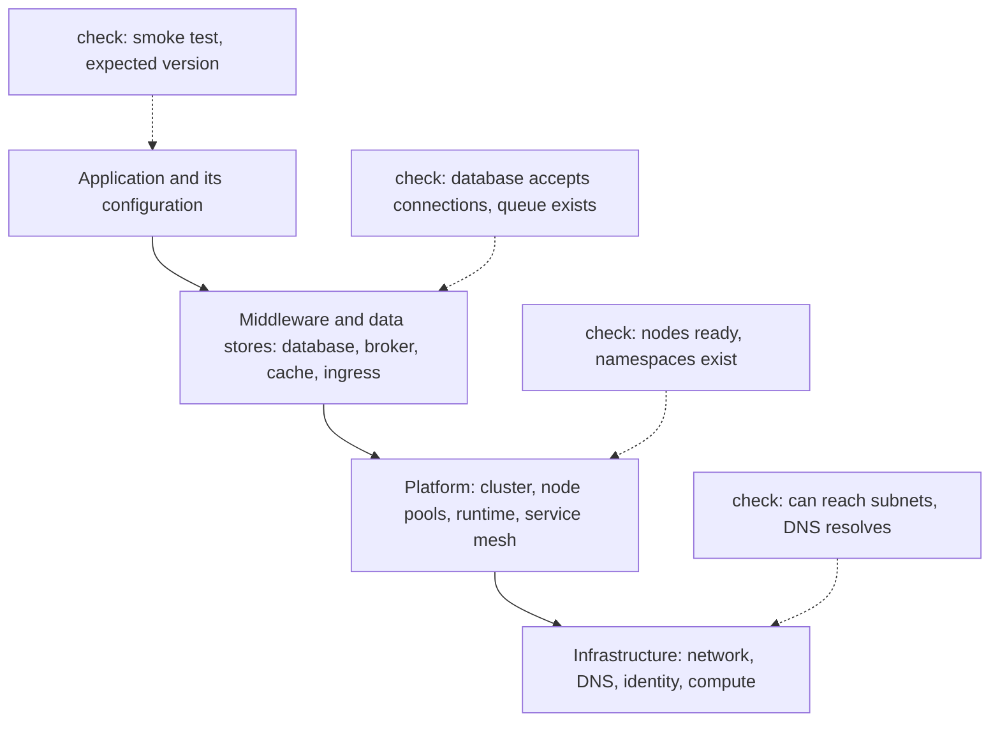
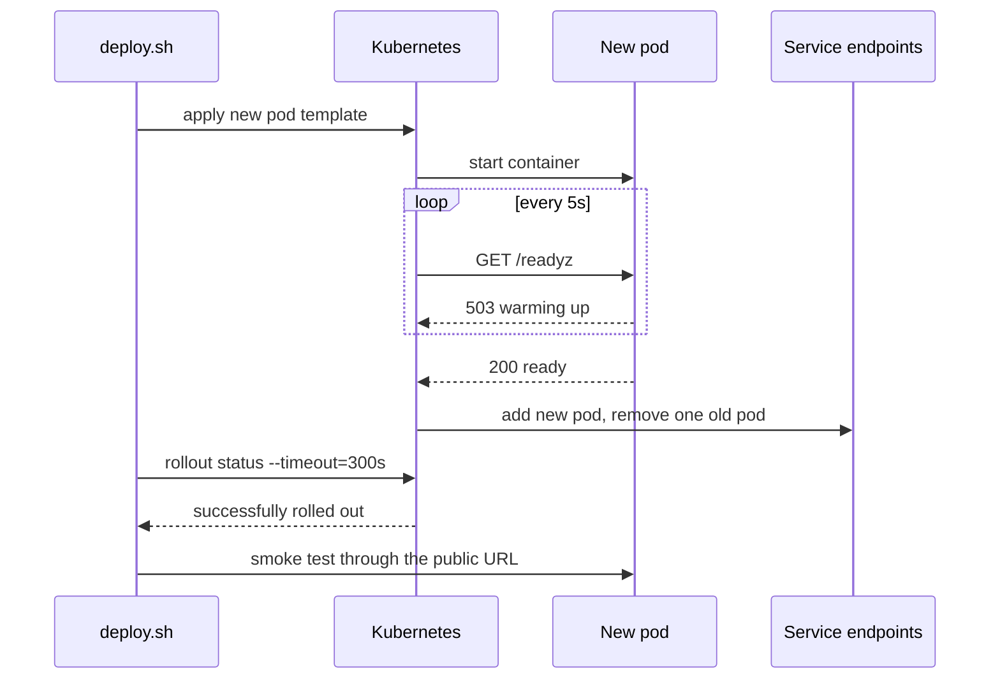

# Deployment scripting: idempotent, layered, verified

> **Before this lesson:** read [Build scripting: one command, any machine](#/lesson/cicd/build-scripts) and [Build once, promote artifacts, pipeline as code](#/lesson/cicd/build-once).

## In plain words

A home thermostat is set to 20 °C. You can press "set to 20" once or fifty times and the result is the same: the room ends up at 20. It does not matter whether the room started cold or warm, or whether the last attempt was interrupted.

A good **deployment script** — the program that installs a new version of the software — behaves like that. You tell it the state you want ("version 2.14 running, four copies"), and it works out what has to change. Running it a second time changes nothing. The word for "safe to repeat" is **idempotent**.

That matters because a deployment, unlike a build, never starts from a clean sheet. The target may be brand new, half-updated after a failure, or already correct.

Two more ideas complete the lesson. Deploy in **layers** — the machines first, then the database, then the application — and check each layer before the next. And always **verify**: ask the running software whether it is really working, instead of assuming.

Why this matters for a job: deployment scripts that work once and fail the second time are a classic source of outages. "What makes a deployment script production-ready?" is a common interview question.

## Motivation: the deploy that worked the first time only

A deployment script is written, run once against a fresh environment, and declared finished. The second run fails: the directory already exists, the database user is already created, the service is already registered. Someone adds `|| true` in six places. Now the script never fails — including when it should — and a half-applied deployment goes unnoticed until customers report it.

Deployment code has a harder job than build code. A build starts from a clean checkout and produces a file. A deployment starts from *whatever state the target is in* — fresh, already at the right version, halfway through a previous failed attempt, or modified by hand — and must bring it to a defined state, while users may be sending traffic.

This lesson covers the properties that make deployment automation trustworthy: it converges on a desired state, it can be run repeatedly, it proceeds layer by layer and checks each one, and it is the only way anything reaches an environment.

## Deploying is more than copying files

A complete deployment of a service typically involves:

1. making sure the target infrastructure exists and is configured (network, cluster, database instance, queues),
2. applying database schema changes,
3. placing the new version of the application alongside or in place of the old,
4. supplying environment-specific configuration and secrets,
5. starting the new version and waiting until it is ready,
6. shifting traffic to it,
7. verifying it works, and
8. recording what was done.

Each step can fail. The script's design determines whether a failure leaves you with a clear error and a working old version, or a mystery.

## Property 1: idempotence and convergence

An operation is **idempotent** if applying it twice has the same effect as applying it once. A deployment script should be idempotent as a whole: running it against an environment that is already at the desired state changes nothing and succeeds.

Two styles achieve this.

**Imperative with guards.** Each action first checks whether it is needed.

```bash
# not idempotent: fails on second run
mkdir /srv/orders
useradd orders

# idempotent
mkdir -p /srv/orders
id -u orders >/dev/null 2>&1 || useradd --system orders
```

**Declarative desired state.** You describe what should exist; a tool computes and applies the difference. This is how Kubernetes, Terraform, Ansible modules and Helm work, and it is the approach to prefer.

```yaml
# deploy/base/deployment.yaml -- a statement of what should be true
apiVersion: apps/v1
kind: Deployment
metadata:
  name: orders
spec:
  replicas: 4
  selector:
    matchLabels: { app: orders }
  template:
    metadata:
      labels: { app: orders }
    spec:
      containers:
        - name: orders
          image: registry.example.com/orders@sha256:9c1e4b7d0a52c5f1e2d3a4b5c6d7e8f9a0b1c2d3e4f5a6b7c8d9e0f1a2b3c4d5
          ports: [{ containerPort: 8080 }]
          readinessProbe:
            httpGet: { path: /readyz, port: 8080 }
            periodSeconds: 5
          envFrom:
            - configMapRef: { name: orders-config }
            - secretRef: { name: orders-db }
```

```bash
kubectl apply -f deploy/base/         # run it once or fifty times: same end state
kubectl rollout status deploy/orders --timeout=300s
```

The small engine below shows what "computing the difference" means. It is the core loop of every desired-state tool.

```python-run
def plan(desired, actual):
    """Return the ordered actions needed to make `actual` match `desired`."""
    actions = []
    for name in sorted(desired.keys() - actual.keys()):
        actions.append(("create", name, desired[name]))
    for name in sorted(desired.keys() & actual.keys()):
        if desired[name] != actual[name]:
            actions.append(("update", name, desired[name]))
    for name in sorted(actual.keys() - desired.keys()):
        actions.append(("delete", name, None))
    return actions

def apply(actions, actual):
    for verb, name, spec in actions:
        if verb == "delete":
            del actual[name]
        else:
            actual[name] = spec
    return actual

desired = {
    "configmap/orders": {"LOG_LEVEL": "warn", "POOL": "50"},
    "deploy/orders":    {"image": "sha256:9c1e", "replicas": 4},
    "service/orders":   {"port": 80},
}
actual = {
    "configmap/orders": {"LOG_LEVEL": "info", "POOL": "50"},
    "deploy/orders":    {"image": "sha256:41ab", "replicas": 4},
    "cronjob/old-report": {"schedule": "0 3 * * *"},
}

for run in (1, 2):
    actions = plan(desired, actual)
    print(f"run {run}: {len(actions)} change(s)")
    for verb, name, _ in actions:
        print(f"   {verb:<6} {name}")
    apply(actions, actual)
print("converged:", actual == desired)
```

Run one makes four changes; run two makes none. That second, empty run is the definition of idempotence, and it is also a cheap production check: if a re-apply shows a non-empty plan, something has drifted.

> [!TIP]
> Always look at the plan before applying it to production: `terraform plan`, `kubectl diff`, `helm diff upgrade`, `argocd app diff`. Posting the plan as a comment on the pull request turns an infrastructure change into something a reviewer can actually evaluate.

## Property 2: deploy in layers and test each one

An environment is a stack. Each layer depends on the one below, and a fault low down produces confusing symptoms high up.



Deploy bottom-up and verify each layer before starting the next. If the database is unreachable, the script should say exactly that and stop, rather than starting the application and failing a hundred acceptance tests.

```bash
#!/usr/bin/env bash
# scripts/deploy.sh <env> <image-ref>
set -euo pipefail
env="$1"; image="$2"; ns="shop-${env}"

step() { printf '\n== %s ==\n' "$*"; }

step "1/5 infrastructure"
terraform -chdir="infra/envs/${env}" init -input=false
terraform -chdir="infra/envs/${env}" apply -input=false -auto-approve
./scripts/check-infra.sh "${env}"            # DNS resolves, DB endpoint reachable, queue exists

step "2/5 database migrations"
kubectl -n "${ns}" delete job orders-migrate --ignore-not-found
kubectl -n "${ns}" create job orders-migrate --image="${image}" -- python -m orders.migrate up
kubectl -n "${ns}" wait --for=condition=complete job/orders-migrate --timeout=300s

step "3/5 application"
helm upgrade --install orders deploy/chart -n "${ns}" \
  -f "deploy/values-${env}.yaml" --set image.reference="${image}" \
  --atomic --timeout 5m

step "4/5 smoke test"
EXPECTED_COMMIT="$(./scripts/commit-of.sh "${image}")" ./scripts/smoke.sh "$(./scripts/url-for.sh "${env}")"

step "5/5 record"
./scripts/record-deploy.sh "${env}" "${image}" "${GITHUB_ACTOR:-local}"
echo "deployed ${image} to ${env}"
```

Points to notice:

- Each numbered step is itself idempotent, so a failed run can be started again.
- The migration runs as a job using the *same image* being deployed, so schema code and application code cannot be mismatched.
- `--atomic` asks Helm to roll back the release automatically if the new version does not become ready within the timeout.
- The script ends by recording the deployment; logging who deployed what, where and when is not optional.

### Tests that belong to the environment, not the application

The `check-infra.sh` step is an **environment test**: it verifies assumptions about the platform independent of your code. Useful checks include reachability of each dependency from inside the cluster, presence and validity period of TLS certificates, required permissions (can this service account read that secret?), and available capacity or quota. These run in seconds and turn "the app does not work in staging" into "the staging database security group does not allow the cluster subnet".

## Property 3: one path, used by everyone and everything

There must be exactly one way to change an environment: the script, invoked by the pipeline. No copying a file by hand "just this once", no editing a live manifest with `kubectl edit`, no console clicks.

Why so strict? Because every change that bypasses the script is one the script does not know about. The next automated deployment will either overwrite it silently or fail on it. Worse, the manual change exists in no repository, so the environment can no longer be reproduced.

Make the right path the easy one and the wrong path hard:

- deploy credentials are held by the pipeline's identity, not by individuals;
- humans have read access to production by default and obtain time-limited elevated access through a break-glass procedure that is logged;
- drift detection (GitOps controllers, scheduled `terraform plan`) reports any difference between the definition and reality.

## Property 4: the old version stays available until the new one is proven

A script that begins by deleting the running version creates a window in which nothing works, and a failure halfway leaves nothing to return to. Safer orderings:

- **Rolling replacement**: start new instances, wait until they pass readiness checks, then remove old ones a few at a time. The Kubernetes default.
- **Side by side**: install the new version next to the old and switch a pointer — a load balancer target, a symlink, a service selector (blue-green, Module 10).

The classic pre-container form of side-by-side is worth knowing because the idea recurs everywhere:

```bash
/srv/orders/
├── releases/
│   ├── 2026-06-01T1000-41ab7d0/
│   └── 2026-06-03T0915-9f3c2e1/      # new version unpacked here
└── current -> releases/2026-06-01T1000-41ab7d0

# the switch is one atomic rename; rollback is the same operation pointed at the old directory
ln -sfn /srv/orders/releases/2026-06-03T0915-9f3c2e1 /srv/orders/current.new
mv -T /srv/orders/current.new /srv/orders/current
systemctl reload orders
```

Nothing is deleted at deploy time. Old releases are pruned later by a separate job that keeps the last few.

## Property 5: wait for real readiness, with timeouts

"The command returned" is not "the service is serving". A deployment step must wait until the new version reports ready — and give up after a bounded time.



Two probes are involved and they are often confused. A **readiness** probe controls whether an instance receives traffic. A **liveness** probe controls whether it is restarted. A readiness endpoint should check that the instance can do useful work (configuration loaded, connection pool established). It should not fail merely because a downstream dependency is briefly slow, or every instance will drop out of rotation together.

Every wait needs a timeout, and reaching the timeout must be a failure that triggers rollback, never a silent continue.

## Worked example: making a fragile script safe

Here is a script of the kind found in many repositories, followed by its problems.

```bash
ssh deploy@web1 "cd /app && git pull && pip install -r requirements.txt && sudo systemctl restart app"
ssh deploy@web2 "cd /app && git pull && pip install -r requirements.txt && sudo systemctl restart app"
```

| problem | consequence | repair |
|---|---|---|
| Pulls source and installs on the server | builds a new, untested artifact on each production host | deploy the image built once in the commit stage |
| Unpinned `pip install` | hosts can end up with different libraries | lockfile inside the image |
| Restart with no readiness check | traffic hits a process that is still starting, or has crashed | readiness probe plus wait |
| Sequential, no stop on failure | web2 is updated even if web1 just broke | health gate between hosts; abort on failure |
| Hard-coded host list | a new server is silently skipped | target a group or selector, not names |
| No record, run from a laptop | no audit trail, depends on one person's SSH key | run by the pipeline with its own identity |
| No way back | rollback means `git checkout` under pressure | keep the previous release and switch a pointer |

After the repair, the human-facing interface is one line — `./scripts/deploy.sh production <digest>` — and everything in the table is handled by the platform.

## Pitfalls

- **`|| true` and ignored exit codes.** They convert failures into silent partial deployments.
- **Sleeping instead of waiting.** `sleep 30` is both too long when things are fast and too short when they are slow. Poll a condition with a timeout.
- **Non-idempotent migrations or bootstrap steps** that fail or duplicate data on a retry.
- **Readiness probes that always return 200**, which makes rolling deployments blind.
- **Secrets printed by `set -x`.** Shell tracing echoes expanded variables; disable it around sensitive commands.
- **Deploying application and infrastructure changes that depend on each other in one risky step.** Sequence them so each intermediate state works.
- **Scripts with a special production branch** (`if [ "$env" = prod ]; then …`). Every such branch is code that runs for the first time in production.

> [!WARNING]
> Be very careful with destructive, non-idempotent commands in deploy scripts — dropping tables, deleting volumes, `terraform destroy`, `kubectl delete -f` on a directory. Guard them behind explicit confirmation variables, keep them out of the normal deployment path, and make sure the pipeline's credentials for routine deploys are not allowed to perform them.

> [!INTERVIEW]
> "What makes a deployment script production-grade?" Idempotent and convergent (safe to re-run), declarative where possible, the same script for every environment, deploys an immutable prebuilt artifact, proceeds in layers with a verification after each, waits on real readiness with timeouts, keeps the previous version available for instant rollback, runs under the pipeline's identity, and records every run. Mention that you would test it by running it constantly against lower environments.

## Summary

- Deployment scripts must cope with any starting state, so design them to converge on a declared desired state and to be safe to run repeatedly.
- Prefer declarative tools that compute and apply a difference; review the plan before applying.
- Deploy in layers — infrastructure, platform, data stores, application — and verify each before the next, so failures are reported where they occur.
- Use a single deployment path for all environments and block or detect changes made outside it.
- Keep the old version until the new one has passed readiness and smoke checks; make the switch small and reversible.
- Wait on conditions with timeouts, never on fixed sleeps, and record every deployment.

## Glossary

- **Deployment script** — the program that installs a version of the software in an environment.
- **Idempotent** — giving the same result however many times it is run.
- **Desired state** — a description of what should exist, as opposed to the steps for creating it.
- **Declarative** — describing the result you want and leaving the steps to a tool.
- **Convergence** — moving the real state towards the desired state until they match.
- **Plan (diff)** — the list of changes a tool would make, shown before it makes them.
- **Kubernetes** — a system for running containers across a group of machines.
- **Pod** — one running copy of an application on Kubernetes.
- **Manifest** — a file describing something that should exist in a Kubernetes cluster.
- **Readiness probe** — a check deciding whether a copy of the application may receive traffic.
- **Liveness probe** — a check deciding whether a copy should be restarted.
- **Rolling replacement** — replacing running copies a few at a time.
- **Timeout** — a limit on how long to wait before treating something as failed.
- **Smoke test** — a quick check after deployment that the service is working.
- **Drift** — a difference between an environment and its definition.

## Check yourself

```quiz
[
  {"q": "What does it mean for a deployment script to be idempotent?",
   "options": ["It runs in constant time", "Running it again on an environment already in the desired state changes nothing and succeeds", "It can only be run once", "It deletes everything before deploying"],
   "answer": 1,
   "explain": "Idempotence makes retries safe and lets the same script handle fresh, current and partially updated environments."},
  {"q": "Why deploy and verify in layers from the infrastructure upward?",
   "options": ["It is faster", "A fault in a lower layer is reported precisely instead of surfacing as confusing application failures", "Upper layers do not depend on lower ones", "It avoids the need for smoke tests"],
   "answer": 1,
   "explain": "Checking each layer localises the failure: 'database unreachable' is far more actionable than a wall of failed acceptance tests."},
  {"q": "Someone fixes production with `kubectl edit` and tells nobody. What is the most likely next problem?",
   "options": ["Kubernetes rejects all future deployments", "The next automated deployment silently overwrites the fix, or the environment can no longer be reproduced", "The image digest changes", "Unit tests fail"],
   "answer": 1,
   "explain": "Changes outside the single deployment path are unknown to the definitions in version control and are lost or cause drift."},
  {"q": "What is the difference between a readiness probe and a liveness probe?",
   "options": ["They are identical", "Readiness decides whether the instance receives traffic; liveness decides whether it is restarted", "Readiness restarts the pod; liveness routes traffic", "Readiness runs only once"],
   "answer": 1,
   "explain": "Confusing them causes either traffic sent to instances that are not ready, or restart loops when a dependency is slow."},
  {"q": "Why is `sleep 60` a poor way to wait for a service to start?",
   "options": ["Sleep is not available on Linux", "It wastes time when startup is quick and still fails when startup is slow; polling a condition with a timeout is reliable", "It uses too much CPU", "It hides log output"],
   "answer": 1,
   "explain": "A fixed delay encodes a guess. Waiting on an observable condition with an upper bound is both faster and correct."},
  {"q": "In the symlink-switch layout, how is a rollback performed?",
   "options": ["Reinstall the operating system", "Point the `current` link back at the previous release directory", "Run git revert on the server", "Delete the newest directory first"],
   "answer": 1,
   "explain": "Because the previous release is still on disk, switching back is the same quick atomic operation as the deploy."},
  {"q": "A re-apply of the same definition against production shows a non-empty plan. What does that indicate?",
   "options": ["The tool is broken", "The environment has drifted from its definition, or the definition is not idempotent", "A new commit was pushed", "Nothing significant"],
   "answer": 1,
   "explain": "Converged state means an empty plan. Unexpected differences point to manual changes or non-deterministic definitions."}
]
```

> **Source:** Humble & Farley, *Continuous Delivery*, ch. 6 (deployment scripting: deploying and testing layers, testing environment configuration, tips). Kubernetes probes: https://kubernetes.io/docs/concepts/configuration/liveness-readiness-startup-probes/ — `kubectl rollout status`: https://kubernetes.io/docs/reference/kubectl/generated/kubectl_rollout/kubectl_rollout_status/ — Terraform plan: https://developer.hashicorp.com/terraform/cli/commands/plan
