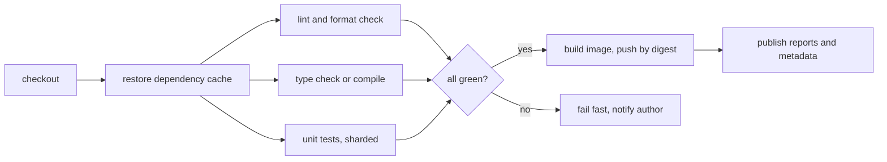

# Designing a fast commit stage

> **Before this lesson:** read [Stages, gates and the flow of a change](#/lesson/cicd/pipeline-stages) and [Testing quadrants and the test pyramid](#/lesson/cicd/quadrants-pyramid).

## In plain words

A spell-checker underlines a mistake as you type. You fix it in a second and carry on. Imagine one that only reported mistakes an hour after you finished the page: you would have moved on, forgotten what you meant, and be annoyed at the interruption.

The **commit stage** is the pipeline's spell-checker. It is the first set of automatic checks that runs every time a programmer saves a change to the shared code (each saved change is a **commit**). It has one job: say "this is clearly broken" or "this looks fine so far" within a few minutes.

**Feedback** is that answer coming back to the programmer. The whole lesson is about keeping it fast — which checks belong in this stage, how to write tests that run in thousandths of a second, and what to do when the stage has grown slow.

Why this matters for a job: every developer uses the commit stage dozens of times a day, so its speed shapes how a whole team works. "Our build takes forty minutes — what would you do?" is a very common interview question.

## Motivation: the five minutes that shape a team's day

Count how often a developer interacts with each part of the pipeline. Production deploys: perhaps a few a week. Acceptance stage results: a handful a day. The commit stage: every push, dozens of times a day per person. It is the part of the delivery system people feel most, and its speed sets the rhythm of the whole team.

If it answers in three minutes, people push small changes, wait for green, and move on with a clear head. If it answers in thirty-five, they stack up changes, start something else while waiting, and get dragged back by a failure half an hour after they stopped thinking about the code. The same engineers, the same codebase, noticeably different outcomes.

This lesson is about engineering that first stage deliberately: what it must do, what must stay out of it, how to write tests that keep it fast, and how to speed it up when it has grown.

## What the commit stage is for

Its purpose is narrow: **reject, as quickly as possible, any commit that is clearly not fit to go further**, and for commits that pass, **produce the artifact** the rest of the pipeline will test.

Inputs: a commit. Outputs:

- a verdict within a few minutes,
- the deployable artifact, stored once,
- reports — test results, coverage, static analysis findings,
- metadata tying all of that to the commit.

A typical order of work:



Target duration: ideally under five minutes, with ten as the hard ceiling. This is a budget, and like any budget it needs to be measured and defended.

## Deciding what belongs in it

The governing question for any check is: *does it catch a meaningful share of failures, and can it run inside the budget?* The commit stage does not need to catch everything. A rough goal is that when the commit stage is green, later stages fail only occasionally.

| check | commit stage? | reason |
|---|---|---|
| Compile, type check | yes | fastest possible signal; everything else depends on it |
| Unit tests | yes | the core of the stage |
| Lint, formatting | yes | seconds; removes style debates from review |
| A few fast component tests | yes, selectively | catch wiring errors cheaply |
| Secret scan, dependency audit | yes | seconds; consequences of missing them are severe |
| Build and publish artifact | yes | later stages need it |
| Full acceptance suite | no | tens of minutes; needs a deployed environment |
| Browser tests | no | slow and timing-sensitive |
| Capacity tests | no | long-running, need a dedicated environment |
| Tests calling real external services | no | slow, and their outages would block every merge |

A useful tactic when a slower stage catches a failure repeatedly: write a faster test of the same defect class and add it to the commit stage. Over time the commit stage accumulates cheap sentinels for the mistakes your team actually makes.

### What should break it

Beyond failing tests and compile errors, decide explicitly which conditions fail the stage, and automate each so the standard is not a matter of reviewer mood:

- lint or formatting violations,
- new compiler or type-checker warnings,
- coverage falling below the recorded baseline,
- a dependency with a known high-severity vulnerability,
- a detected secret,
- the stage exceeding its time budget.

## Writing tests that stay fast

The stage's speed is decided mostly by how tests are written. Five habits keep unit tests in the millisecond range.

### Stay away from the user interface

UI tests need a rendering engine, involve many components at once, and run at human speed. In the commit stage, test the logic behind the UI directly. If logic is tangled into views, that is a design signal: move it into plain functions or view models that can be called without a browser.

### Inject dependencies

A class that constructs its own database connection can only be tested with a database. A class that receives a repository through its constructor can be tested with an in-memory fake (Lesson 8). Dependency injection is as much a testability technique as an architectural one.

### Stay away from the database

A test that round-trips to a database is hundreds of times slower than one that does not, needs set-up and tear-down, and usually signals that business logic is mixed with persistence. Separate them: pure logic gets unit tests; a thin persistence layer gets a small number of component tests against a real engine in a container, which can run in a parallel job or a later stage.

### Avoid asynchrony and real time

Tests that start threads, wait for callbacks or call `sleep` are slow and intermittently wrong. Structure code so the logic is synchronous and testable on its own, with the asynchronous shell around it kept thin. Treat the clock as an injected dependency:

```python-run
import datetime as dt

class TrialPolicy:
    """Free trial lasts 14 days; a reminder is due in the final 3 days."""
    def __init__(self, clock):
        self.clock = clock

    def status(self, started):
        days = (self.clock() - started).days
        if days >= 14:
            return "expired"
        return "reminder" if days >= 11 else "active"

class FakeClock:
    def __init__(self, now): self.now = now
    def __call__(self): return self.now
    def advance(self, **kw): self.now += dt.timedelta(**kw)

start = dt.datetime(2026, 2, 20, 9, 0)
clock = FakeClock(start)
policy = TrialPolicy(clock)

timeline = []
for _ in range(16):
    timeline.append(policy.status(start))
    clock.advance(days=1)
print(timeline)

assert timeline[0] == "active" and timeline[10] == "active"
assert timeline[11] == "reminder" and timeline[13] == "reminder"
assert timeline[14] == "expired"
print("16 simulated days checked in microseconds, including the end of February")
```

With the real clock, verifying day 14 would take two weeks — or a test that silently depends on the date it runs.

### Minimise state

Each test should build the few objects it needs and leave nothing behind. Shared fixtures that many tests mutate make failures depend on execution order, which becomes a serious problem the day you run tests in parallel or in random order. Running the suite in random order regularly (for example with `pytest -p randomly`) flushes out hidden coupling early.

> [!TIP]
> Print the slowest tests on every run (`pytest --durations=20`, `go test -json` piped through a summariser, Jest's `--verbose` timings). A short list of offenders is usually responsible for most of the runtime, and visibility alone gets them fixed.

## Making the stage faster

When the stage outgrows its budget, work through these levers in order of return on effort.

### 1. Do less: remove and relocate

Delete tests that verify nothing, move tests that need real infrastructure to a later stage, and replace sleeps with injected time. This is the only lever that also improves the suite's quality.

### 2. Do not repeat: cache

Dependency downloads and compiler outputs rarely change between commits. Cache them keyed by a hash of the files that determine them:

```yaml
      - uses: actions/cache@v4
        with:
          path: ~/.cache/uv
          key: uv-${{ runner.os }}-${{ hashFiles('uv.lock') }}
          restore-keys: |
            uv-${{ runner.os }}-
```

The key changes exactly when the lockfile changes, so a stale cache can never substitute different dependencies. Lesson 31 examines cache keys in detail.

### 3. Do it concurrently: parallel jobs and sharding

Independent checks (lint, type check, tests) run as separate jobs at the same time. Within the test job, split the suite across several runners — **sharding**. A naive split by file count produces uneven shards, because test durations vary enormously. Splitting by recorded duration does much better:

```python-run
import random

rng = random.Random(11)
# 240 test files with skewed durations: most are quick, a few are slow
durations = sorted((round(rng.lognormvariate(1.2, 1.1), 1) for _ in range(240)), reverse=True)
total = sum(durations)

def round_robin(times, n):
    shards = [0.0] * n
    for i, t in enumerate(sorted(times)):       # alphabetical-ish order, ignoring duration
        shards[i % n] += t
    return shards

def greedy_by_duration(times, n):
    shards = [0.0] * n
    for t in sorted(times, reverse=True):       # longest first, into the lightest shard
        shards[shards.index(min(shards))] += t
    return shards

print(f"{len(durations)} files, {total / 60:.1f} min of tests, slowest file {durations[0]} s\n")
for n in (4, 8):
    a, b = round_robin(durations, n), greedy_by_duration(durations, n)
    ideal = total / n
    print(f"{n} shards   ideal {ideal:6.1f}s")
    print(f"   round-robin : slowest shard {max(a):6.1f}s  ({max(a) / ideal:4.2f}x ideal)")
    print(f"   by duration : slowest shard {max(b):6.1f}s  ({max(b) / ideal:4.2f}x ideal)")
```

Wall-clock time is the *slowest* shard, so balance is what matters. Note the floor: no split can beat the single slowest test file, which is another reason to break up monster test files.

```yaml
  unit:
    runs-on: ubuntu-latest
    strategy:
      fail-fast: false
      matrix:
        shard: [1, 2, 3, 4]
    steps:
      - uses: actions/checkout@v4
      - run: make setup
      - run: uv run pytest tests/unit --splits 4 --group ${{ matrix.shard }} --splitting-algorithm least_duration
```

### 4. Do only what is affected

In a large repository, a change to the documentation should not run the payment service's tests. **Change-based selection** maps changed paths to the jobs that need to run:

```yaml
on:
  pull_request:
    paths:
      - "services/orders/**"
      - "libs/pricing/**"       # orders depends on this library
      - ".github/workflows/orders.yml"
```

This is powerful and risky. If the dependency map is incomplete, you skip a test that would have failed. Build tools with an explicit dependency graph (Bazel, Nx, Turborepo, Pants) compute the affected set correctly; hand-maintained path filters need care, and the full suite should still run on main or nightly as a safety net. A problem in this module asks you to implement that selection.

### 5. Fail fast, but informatively

Order steps so the quickest, most likely failures come first: a ten-second lint before a four-minute test run. Within tests, though, run everything and report all failures, so one cycle reveals the full damage.

## Running the commit stage before the commit

Developers should be able to get the commit-stage verdict *before* affecting anyone else:

- locally, by running the same target (`make ci`);
- on a pull request, where the server runs it on the merge result;
- in a merge queue, where it runs on the exact combination that will become the new main.

Each is the same stage at a different moment. The later the moment, the more trustworthy and the more disruptive a failure; the best set-up uses all three so that almost nothing fails at the last one.

## Ownership

The commit stage belongs to the developers who use it. They must be able to change its scripts, add checks and fix its problems without filing a ticket to another team. A stage that developers cannot modify decays, because the people who feel its pain cannot fix it.

A platform team can still provide shared building blocks — reusable workflows, base images, caching infrastructure — but each team owns its own pipeline definition.

On very large teams it helps to give one person at a time the explicit job of tending the stage: watching its duration and failure rate, chasing unreliable tests, and helping people when it breaks. This is the build-cop role again, applied to the health of the stage itself.

## Worked example: from 26 minutes to under 5

A service's commit stage has drifted to 26 minutes. A profile of one run:

| step | minutes |
|---|---|
| install dependencies (no cache) | 4.0 |
| lint and type check (sequential) | 2.5 |
| "unit" tests, 1 runner | 15.5 |
| build image (no layer cache) | 4.0 |

Looking inside the tests: 1,900 genuine unit tests take 70 seconds; 240 tests marked unit actually use a database and take 11 minutes; 30 tests contain `time.sleep` totalling 3 minutes.

Applying the levers:

1. Cache dependencies by lockfile hash: 4.0 → 0.4.
2. Run lint and type check as parallel jobs: 2.5 → 1.5 of wall-clock, overlapping with tests.
3. Replace sleeps with a fake clock: −3.0.
4. Move the 240 database tests to a parallel component-test job with a service container, sharded across four runners: off the critical path at roughly 3 minutes.
5. Enable image layer caching: 4.0 → 1.2.

New critical path: 0.4 (restore) + 1.2 (unit tests) + 1.2 (image) with component tests finishing at about 3.5 minutes in parallel. The stage reports in under five minutes, and no check was dropped.

## Pitfalls

- **Buying speed with blindness**: deleting slow tests instead of rewriting or relocating them.
- **Caches that change results.** A cache must only make the same output arrive sooner. If clearing it changes the verdict, there is a bug.
- **Retrying failed tests automatically in the commit stage.** It hides real intermittent defects and normalises unreliability.
- **Path filters that skip required checks**, leaving a pull request permanently "pending". Use a single always-run gate job that summarises the others.
- **Uneven shards**, where one runner takes four times as long as the rest.
- **Letting the stage grow unobserved.** Plot its duration; set an alert on the budget.

> [!WARNING]
> Change-based test selection is an optimisation with a correctness risk. Every skipped test is a bet that the change could not affect it. Keep the dependency map generated from real build metadata where possible, treat changes to shared configuration (lockfiles, CI files, base images) as affecting everything, and always run the complete suite somewhere on main.

> [!INTERVIEW]
> "What goes in the commit stage and how long should it take?" Compile or type check, unit tests, lint and quick static and security checks, then build and publish the artifact — under five to ten minutes. Explain the principle: it is the fastest filter, catching most problems cheaply; anything needing a deployed environment or real external systems goes later. Then show you can keep it fast: test design (no UI, no database, no real time), caching, parallel jobs, sharding by duration, affected-only selection with a full run as backstop.

## Summary

- The commit stage is the pipeline's most-used component; its job is a fast verdict on every commit plus the artifact for later stages.
- Keep it inside a five-to-ten-minute budget by including only fast, high-yield checks and pushing everything needing real infrastructure downstream.
- Fast unit tests avoid the UI, the database, asynchrony and real time, inject dependencies, and share no state.
- Speed-up levers, in order: remove and relocate, cache by content hash, run in parallel and shard by duration, run only what a change affects, order steps to fail fast.
- The same stage runs locally, on pull requests and in a merge queue.
- Developers own the stage and tend it actively.

## Glossary

- **Commit stage** — the first, fastest pipeline stage, run on every commit.
- **Feedback** — the result of a check coming back to the person who made the change.
- **Lint** — an automatic check of code for style problems and likely mistakes.
- **Type check** — an automatic check that values are used in ways their kind allows.
- **Unit test** — a fast test of one small piece of code in isolation.
- **Dependency injection** — passing a component its collaborators instead of letting it create them.
- **Fake clock** — a stand-in for the real clock that a test can set and advance.
- **Cache** — saved results reused to avoid repeating slow work.
- **Cache key** — the name under which a cache is saved; it should change when the cached content should.
- **Parallel jobs** — jobs run at the same time on separate machines.
- **Sharding** — splitting a test suite across several machines.
- **Test selection** — running only the tests a change could affect.
- **Time budget** — a limit on how long a stage may take.
- **Wall-clock time** — the real elapsed time, as opposed to the total machine time used.

## Check yourself

```quiz
[
  {"q": "What are the two outputs every passing commit stage should produce?",
   "options": ["A deployment to production and a changelog", "A fast verdict and the deployable artifact used by all later stages", "A code review and a test plan", "A database backup and a release note"],
   "answer": 1,
   "explain": "The stage filters out bad commits quickly and builds, once, the artifact that the rest of the pipeline tests and promotes."},
  {"q": "Why should tests that call real third-party services stay out of the commit stage?",
   "options": ["They are illegal", "They are slow and their outages would block every merge for reasons unrelated to the change", "They cannot be written", "They do not find bugs"],
   "answer": 1,
   "explain": "The gate must be fast and reliable. External dependencies belong in a later, separate stage."},
  {"q": "A test verifies behaviour 14 days after sign-up. What is the right design?",
   "options": ["Sleep for 14 days in the test", "Change the system clock on the CI server", "Inject a clock into the code and advance a fake clock in the test", "Skip the test"],
   "answer": 2,
   "explain": "Treating time as a dependency makes the test instant and deterministic."},
  {"q": "A suite of 200 seconds is split into 4 shards taking 20, 30, 40 and 110 seconds. What is the wall-clock time of the test job?",
   "options": ["50 seconds", "200 seconds", "110 seconds", "40 seconds"],
   "answer": 2,
   "explain": "Shards run in parallel, so the job finishes when the slowest shard does. Balancing by duration matters more than adding runners."},
  {"q": "What is the correct cache key for installed dependencies?",
   "options": ["The current date", "The branch name", "A hash of the lockfile together with the operating system", "A constant string"],
   "answer": 2,
   "explain": "The key must change exactly when the inputs that determine the cached content change, so a stale cache can never alter the result."},
  {"q": "What is the main risk of running only the tests affected by the changed paths?",
   "options": ["It is slower", "An incomplete dependency map can skip a test that would have failed", "It uses more runners", "It breaks caching"],
   "answer": 1,
   "explain": "Selection is a bet that skipped tests are unaffected. Keep a full run on main as a backstop and derive the map from real dependency data."},
  {"q": "Why should lint run before the unit tests in the job order?",
   "options": ["Lint is more important", "It is much quicker, so common trivial failures are reported in seconds", "Tests cannot run on unlinted code", "It warms the cache"],
   "answer": 1,
   "explain": "Ordering cheap, likely-to-fail checks first shortens feedback for the most frequent problems."},
  {"q": "A team speeds up the stage by automatically retrying any failed unit test three times. What is the downside?",
   "options": ["Nothing", "Genuine intermittent defects and unreliable tests are hidden instead of fixed", "The cache is invalidated", "Coverage decreases"],
   "answer": 1,
   "explain": "Blanket retries mask races and order dependence. Unreliable tests should be quarantined and repaired, not papered over."}
]
```

> **Source:** Humble & Farley, *Continuous Delivery*, ch. 7 (the commit stage: principles, results, commit test suite practices). GitHub Actions cache: https://github.com/actions/cache — matrix strategy: https://docs.github.com/en/actions/writing-workflows/choosing-what-your-workflow-does/running-variations-of-jobs-in-a-workflow — path filters: https://docs.github.com/en/actions/writing-workflows/workflow-syntax-for-github-actions#onpushpull_requestpull_request_targetpathspaths-ignore
