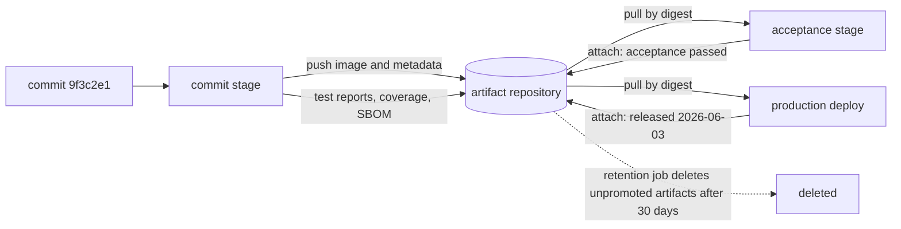

# Static analysis, quality gates and the artifact repository

> **Before this lesson:** read [Designing a fast commit stage](#/lesson/cicd/commit-stage-feedback) and [Build once, promote artifacts, pipeline as code](#/lesson/cicd/build-once).

## In plain words

Two everyday pictures help with this lesson.

A proofreader finds spelling mistakes by *reading* a recipe, without cooking it. **Static analysis** does that for programs: tools read the code and report problems without running it. ("Static" means "not running".) They find likely bugs, security weaknesses and untidy code in seconds.

A warehouse gives every box a label and a shelf, and keeps a record of where each box came from. An **artifact repository** is the warehouse for built software. Every package the pipeline produces — every **artifact** — is stored there once, labelled, never altered, and traceable back to the code that produced it.

Between the two sits a **quality gate**: a rule such as "no new warnings" that a change must satisfy before it may continue.

Why this matters for a job: these checks run on every change in a professional codebase, so you will meet them on your first day. Interviewers ask how you would introduce such checks to an old codebase without stopping all work, and how you would trace a running program back to its source.

## Motivation: the checks that need no test, and the output that needs a home

Unit tests tell you whether behaviour you thought to test is correct. A large class of problems can be found without running the program at all: a variable that might be `None`, an SQL query built by string concatenation, a function forty branches deep, an import that breaks the layering, a dependency with a published vulnerability, an AWS key pasted into a config file. Tools that read the code and report such findings are collectively called **static analysis**, and they belong in the commit stage because they are fast and need no environment.

The other half of this lesson is about where the commit stage's output goes. A green verdict is worthless if the thing that was verified cannot be found again. The **artifact repository** is the pipeline's memory: it holds exactly what was built, ties it to the commit that produced it, and serves it unchanged to every later stage.

## Static analysis: the layers

Think of static checks as a stack ordered from cheapest and most objective to slowest and most judgement-laden.

| layer | examples | finds | typical time |
|---|---|---|---|
| Formatting | Prettier, `gofmt`, `ruff format`, Black | inconsistent layout | seconds |
| Linting | ESLint, Ruff, golangci-lint, Clippy | likely bugs, unused code, bad idioms | seconds |
| Type checking | TypeScript `tsc`, mypy, Pyright, compilers | type mismatches, missing null handling | seconds to a minute |
| Structure rules | import-linter, dependency-cruiser, ArchUnit | forbidden dependencies between layers | seconds |
| Complexity and duplication | SonarQube, radon, jscpd | hard-to-maintain hotspots | tens of seconds |
| Security (SAST) | Semgrep, CodeQL, Bandit | injection, unsafe deserialisation, weak crypto | seconds to minutes |
| Secrets | gitleaks, trufflehog, platform push protection | committed credentials | seconds |
| Dependencies (SCA) | `npm audit`, `pip-audit`, Trivy, Dependabot alerts | known-vulnerable libraries, licence problems | seconds |
| Config and IaC | hadolint, tflint, Checkov, kubeconform | insecure or invalid Dockerfiles, Terraform, manifests | seconds |

```yaml
# commit stage: static checks as parallel jobs
jobs:
  lint:
    runs-on: ubuntu-latest
    steps:
      - uses: actions/checkout@v4
      - uses: astral-sh/setup-uv@v5
      - run: uv sync --locked
      - run: uv run ruff format --check .
      - run: uv run ruff check --output-format=github .
      - run: uv run mypy src
      - run: uv run lint-imports

  security:
    runs-on: ubuntu-latest
    steps:
      - uses: actions/checkout@v4
        with:
          fetch-depth: 0                 # full history so the secret scan can see every commit
      - run: gitleaks git --redact --exit-code 1 .
      - run: uvx pip-audit --requirement <(uv export --format requirements-txt --locked)
      - run: docker run --rm -i hadolint/hadolint < Dockerfile
```

### Formatting: end the argument by automating it

A formatter rewrites code into one canonical layout. The value is not that the chosen style is best; it is that nobody discusses it again, diffs contain only meaningful changes, and review time goes to substance. Run the formatter on save or in a pre-commit hook, and have the pipeline run it in *check* mode so unformatted code cannot merge.

### Linters and type checkers: bugs before runtime

A linter flags code that is legal and probably wrong: a variable assigned and never read, a mutable default argument, a comparison that is always false, an exception swallowed silently. A type checker proves a different kind of property — that a value of the wrong shape cannot reach a function — and is especially good at the null-handling mistakes that cause a large share of production errors.

Both produce their best return when they are strict from the beginning. Retrofitting is harder, which leads to the central technique of this lesson.

## Quality gates that ratchet

Suppose you turn on a linter in a five-year-old codebase and it reports 4,000 findings. Failing the build on all of them is impossible; ignoring all of them is pointless. The workable policy is a **ratchet**: record the current state as a baseline and fail only when a change makes things *worse*. The count can go down and never up.

```python-run
import json

class Ratchet:
    """A metric may improve freely but may not regress past its recorded baseline."""
    def __init__(self, baseline):
        self.baseline = dict(baseline)          # stored in the repo as quality-baseline.json

    def check(self, measured, higher_is_better):
        failures, improved = [], {}
        for name, value in measured.items():
            base = self.baseline[name]
            better = value > base if higher_is_better[name] else value < base
            worse = value < base if higher_is_better[name] else value > base
            if worse:
                failures.append(f"{name}: {base} -> {value}")
            elif better:
                improved[name] = value
        return failures, improved

    def tighten(self, improved):
        self.baseline.update(improved)

direction = {"coverage_pct": True, "lint_findings": False, "type_errors": False, "max_complexity": False}
r = Ratchet({"coverage_pct": 61.4, "lint_findings": 4012, "type_errors": 388, "max_complexity": 41})

changes = [
    ("fix typing in billing",   {"coverage_pct": 61.4, "lint_findings": 4012, "type_errors": 351, "max_complexity": 41}),
    ("new feature with tests",  {"coverage_pct": 62.9, "lint_findings": 4001, "type_errors": 351, "max_complexity": 41}),
    ("quick hack, no tests",    {"coverage_pct": 62.1, "lint_findings": 4009, "type_errors": 351, "max_complexity": 44}),
]
for title, measured in changes:
    failures, improved = r.check(measured, direction)
    if failures:
        print(f"REJECT  {title}: " + "; ".join(failures))
    else:
        r.tighten(improved)
        print(f"accept  {title}; baseline now {json.dumps(r.baseline)}")
```

The third change is rejected even though its numbers are better than where the project started. Each accepted improvement becomes the new floor. Many tools support this directly: ESLint's bulk suppressions, Ruff's per-file ignores, mypy's baseline plugins, SonarQube's "clean as you code" rule that new or changed lines must meet the standard.

An equally practical alternative is **diff-only gating**: apply the strict rules only to lines touched by the change. Old code is left alone until someone edits it.

### Coverage: a floor, not a goal

Coverage reports which lines or branches the tests executed. It is good at pointing out code no test touches. It is poor as a target, because execution is not verification: a test with no assertion raises coverage. Sensible uses:

- ratchet overall coverage so it cannot fall,
- require a higher bar for *changed* lines in a pull request (often called patch coverage),
- look at uncovered *branches* in critical modules during review.

> [!WARNING]
> When a metric becomes a target, people optimise the metric. A hard rule such as "90% coverage or the build fails" reliably produces assertion-free tests that touch lines. Gate on regression and on changed code, and keep judging test quality in review.

### Noise is the enemy

A static tool is only useful while its findings are acted on. Three rules keep the signal clean:

1. **Every enabled rule blocks.** If a rule is not worth failing the build for, switch it off. A wall of warnings hides the one that matters.
2. **Suppress locally, with a reason.** `# noqa: S608 - query uses a constant table name` on one line is honest. Disabling the rule globally because of one false positive throws away its value everywhere.
3. **Deliver findings where the author is looking.** Annotations on the pull request's changed lines get fixed. A dashboard nobody opens does not.

## The artifact repository

### What it is and why source control is the wrong place

Build outputs are large, binary, derived and numerous: one image per commit, forever. Putting them in Git bloats every clone and creates the possibility that a committed binary no longer matches its source. They belong in a system designed for them:

| artifact type | common repositories |
|---|---|
| Container images, Helm charts (OCI) | GHCR, GitLab registry, Amazon ECR, Google Artifact Registry, Harbor |
| Language packages | PyPI/devpi, npm registry, Maven Central, plus private proxies |
| Everything at once | JFrog Artifactory, Sonatype Nexus |
| Short-lived build outputs and reports | the CI system's own artifact store |

### The properties it must have

1. **Immutability.** Once `orders@sha256:9c1e…` or `pricing-lib 3.2.1` is published it never changes. Publishing different content under the same version is refused.
2. **Traceability in both directions.** From an artifact you can reach its commit and pipeline run; from a commit you can find its artifact.
3. **Reproducibility.** It should be possible to delete an artifact and recreate an equivalent one from the same commit. The repository is a cache of work, not the only copy of anything irreplaceable.
4. **Status.** The repository, or metadata alongside it, records how far each artifact has progressed: built, acceptance-passed, released.
5. **Retention rules.** Unreleased artifacts are deleted after a period; anything that reached production is kept as long as audit or rollback policy requires.
6. **Access control.** Only the pipeline can publish; consumers can only read.



### What to publish alongside the artifact

A modern commit stage publishes more than the image:

- **Provenance labels**: commit, repository, pipeline run URL, build time.
- **A software bill of materials (SBOM)**: the list of every component inside the artifact, in a standard format such as SPDX or CycloneDX. When a new vulnerability is announced, you can query SBOMs to find every affected artifact in minutes.
- **A signature and build attestation**, so consumers can verify the artifact came from your pipeline.
- **Test and analysis reports**, so the evidence for a release decision travels with the thing being released.

```yaml
  package:
    needs: [lint, security, unit]
    runs-on: ubuntu-latest
    permissions:
      contents: read
      packages: write
      id-token: write            # for keyless signing and attestations
      attestations: write
    steps:
      - uses: actions/checkout@v4
      - uses: docker/login-action@v3
        with:
          registry: ghcr.io
          username: ${{ github.actor }}
          password: ${{ secrets.GITHUB_TOKEN }}
      - id: build
        uses: docker/build-push-action@v6
        with:
          push: true
          tags: ghcr.io/${{ github.repository }}:${{ github.sha }}
          labels: |
            org.opencontainers.image.revision=${{ github.sha }}
            org.opencontainers.image.source=${{ github.server_url }}/${{ github.repository }}
          sbom: true
          provenance: mode=max
      - uses: actions/attest-build-provenance@v2
        with:
          subject-name: ghcr.io/${{ github.repository }}
          subject-digest: ${{ steps.build.outputs.digest }}
          push-to-registry: true
```

### Retention as a policy

Storage is cheap; unbounded storage is not. A retention policy answers "which artifacts may be deleted?" mechanically. A typical policy: keep everything that was ever released; keep the most recent few unreleased builds per branch; delete other unreleased builds older than thirty days.

```python-run
from datetime import date

artifacts = [  # (tag, built, branch, released)
    ("a1", date(2026, 3, 1),  "main", True),
    ("a2", date(2026, 4, 2),  "main", False),
    ("a3", date(2026, 5, 20), "main", False),
    ("a4", date(2026, 5, 28), "main", True),
    ("a5", date(2026, 5, 30), "main", False),
    ("a6", date(2026, 6, 1),  "main", False),
    ("f1", date(2026, 4, 15), "feat/gift-cards", False),
    ("f2", date(2026, 5, 31), "feat/gift-cards", False),
]

def to_delete(artifacts, today, max_age_days=30, keep_recent=2):
    by_branch = {}
    for a in sorted(artifacts, key=lambda a: a[1], reverse=True):
        by_branch.setdefault(a[2], []).append(a)
    doomed = []
    for branch, items in by_branch.items():
        unreleased = [a for a in items if not a[3]]
        protected = {a[0] for a in unreleased[:keep_recent]}
        for tag, built, _, released in items:
            if released or tag in protected:
                continue
            if (today - built).days > max_age_days:
                doomed.append(tag)
    return sorted(doomed)

print("delete:", to_delete(artifacts, date(2026, 6, 3)))
print("released artifacts are never deleted; the 2 newest unreleased per branch are kept")
```

## Worked example: tracing a production image back to its evidence

An auditor asks: "Show me that the code running in production last Thursday was reviewed, tested and built by your pipeline."

```bash
# 1. What is running?
kubectl -n shop get deploy orders -o jsonpath='{.spec.template.spec.containers[0].image}'
# ghcr.io/example/orders@sha256:9c1e4b7d0a52...

# 2. Which commit and pipeline run produced it?
docker buildx imagetools inspect ghcr.io/example/orders@sha256:9c1e4b7d0a52... \
  --format '{{ json .Provenance }}' | jq '.SLSA.buildDefinition.resolvedDependencies[0]'

# 3. Verify it was built by our workflow, not pushed by hand
gh attestation verify oci://ghcr.io/example/orders@sha256:9c1e4b7d0a52... --repo example/orders

# 4. What is inside it?
docker buildx imagetools inspect ghcr.io/example/orders@sha256:9c1e4b7d0a52... --format '{{ json .SBOM }}' \
  | jq -r '.SPDX.packages[] | "\(.name) \(.versionInfo)"' | head
```

The commit leads to the pull request (review evidence) and the pipeline run (test evidence). Nothing in the chain relies on anyone's recollection.

## Pitfalls

- **Advisory-only checks.** Findings that do not block accumulate until nobody reads them.
- **Big-bang rule adoption** that turns main red for a week. Ratchet or gate on the diff.
- **Mutable version tags.** If `1.4.2` can be overwritten, "which 1.4.2?" becomes a real question during an incident.
- **Artifacts kept only in CI job storage**, which expires after a few weeks, leaving nothing to roll back to.
- **No retention policy**, discovered when the registry bill or quota arrives.
- **Scanners that fail the build on vulnerabilities with no fix available.** Decide the policy: block on fixable high and critical findings, track the rest with an expiry date.
- **Secrets scanning only the latest commit.** A secret removed in the next commit is still in history.

> [!TIP]
> Run formatters and the fastest linters in a pre-commit hook *and* in the pipeline. The hook gives the author feedback in a second; the pipeline is the enforcement, because hooks can be skipped.

> [!INTERVIEW]
> "How would you introduce static analysis to a large legacy codebase?" Start with an auto-formatter applied in one mechanical commit (excluded from blame). Enable a linter and type checker with a recorded baseline and a ratchet, or gate only on changed lines, so existing debt does not block work but nothing gets worse. Add secret and dependency scanning immediately because the cost of missing those is high. Surface findings as pull-request annotations. Tighten rules gradually and delete suppressions as code is touched.

## Summary

- Static analysis finds defects, security problems and structural decay without running the code; it is fast, so it belongs in the commit stage.
- Layer the checks: formatting, linting, types, structure, complexity, security, secrets, dependencies, infrastructure config.
- On existing code use a ratchet or diff-only gating so quality can only improve; treat coverage as a floor and a gap-finder.
- Keep the signal clean: every rule blocks, suppress narrowly with reasons, report on the changed lines.
- The artifact repository stores each build once, immutably, with traceability to its commit, a record of its progress, an SBOM and provenance, under an explicit retention policy.

## Glossary

- **Static analysis** — examining code without running it.
- **Formatter** — a tool that rewrites code into one standard layout.
- **Linter** — a tool that reports likely mistakes and poor style.
- **Type checker** — a tool that proves values are used in ways their kind allows.
- **SAST** — static application security testing: static analysis aimed at security flaws.
- **SCA** — software composition analysis: checking dependencies for known vulnerabilities.
- **Quality gate** — a rule a change must satisfy before it may proceed.
- **Baseline** — a recorded starting measurement to compare later results against.
- **Ratchet** — a rule that a measure may improve but never get worse.
- **Coverage** — the share of code lines executed by the tests.
- **Suppression** — an explicit instruction to ignore one finding in one place.
- **Artifact repository** — a store for built packages and images.
- **Immutable** — unable to be changed once created.
- **SBOM (software bill of materials)** — a list of every component inside an artifact.
- **Provenance** — the record of how, and from what source, an artifact was built.
- **Retention policy** — the rules for how long stored artifacts are kept.

## Check yourself

```quiz
[
  {"q": "Why does static analysis fit well in the commit stage?",
   "options": ["It needs a production-like environment", "It runs quickly without executing or deploying the program", "It replaces unit tests", "It can only run once per day"],
   "answer": 1,
   "explain": "Static tools read source and configuration, so they give fast feedback with no environment to provision."},
  {"q": "A legacy codebase has 4,000 lint findings. Which policy lets the team adopt the linter without stopping work?",
   "options": ["Fail the build until all are fixed", "Report findings as warnings only, forever", "Record a baseline and fail only when a change increases the count", "Disable the linter"],
   "answer": 2,
   "explain": "A ratchet prevents regression and lets the number fall over time, without demanding an impossible one-off clean-up."},
  {"q": "What does a line-coverage figure actually measure?",
   "options": ["The proportion of requirements verified", "The proportion of lines executed by tests", "The proportion of bugs found", "The quality of assertions"],
   "answer": 1,
   "explain": "Coverage records execution. A test without assertions still counts, which is why coverage makes a poor target."},
  {"q": "Why are build outputs stored in an artifact repository rather than in Git?",
   "options": ["Git cannot store binary files", "They are large derived files; versioning them with source bloats the repo and risks binary and source disagreeing", "Artifact repositories are free", "Git history is not permanent"],
   "answer": 1,
   "explain": "Artifacts are reproducible from source and should be keyed by the commit that produced them, in a store built for immutable binaries."},
  {"q": "Which property of an artifact repository is most important for 'build once, promote'?",
   "options": ["Fast search", "Immutability of published versions", "A web interface", "Support for many languages"],
   "answer": 1,
   "explain": "If published content can change, later stages may test or deploy something different from what was built."},
  {"q": "What is an SBOM used for?",
   "options": ["Speeding up builds", "Listing every component inside an artifact so affected artifacts can be found when a vulnerability is announced", "Encrypting the image", "Replacing the lockfile"],
   "answer": 1,
   "explain": "A software bill of materials makes the contents of each released artifact queryable long after it was built."},
  {"q": "Under a typical retention policy, which artifacts are never deleted automatically?",
   "options": ["Builds from feature branches", "Builds older than 30 days", "Artifacts that were released to production", "The newest build only"],
   "answer": 2,
   "explain": "Released artifacts are needed for rollback, audit and reproduction of production issues."},
  {"q": "A linter rule produces one false positive. What is the best response?",
   "options": ["Disable the rule for the whole project", "Suppress it on that line with a comment explaining why", "Ignore the red build", "Remove the linter"],
   "answer": 1,
   "explain": "A narrow, documented suppression keeps the rule's value everywhere else and records the reasoning."}
]
```

> **Source:** Humble & Farley, *Continuous Delivery*, ch. 7 (what should break the commit stage; the artifact repository). Docker build attestations (SBOM, provenance): https://docs.docker.com/build/metadata/attestations/ — GitHub artifact attestations: https://docs.github.com/en/actions/security-for-github-actions/using-artifact-attestations — gitleaks: https://github.com/gitleaks/gitleaks
